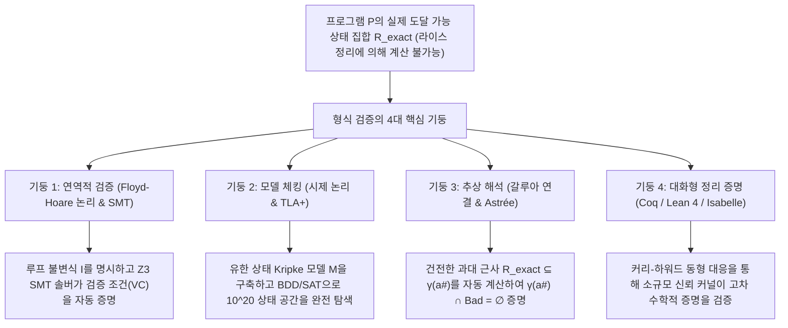
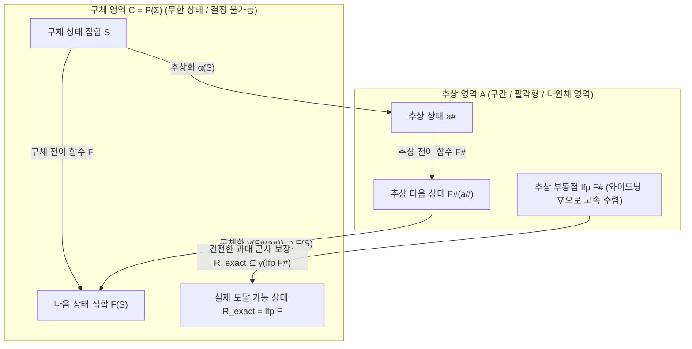

## 1. 테스트의 한계와 결정 불가능성의 벽: 왜 '100만 번의 테스트 통과'는 무력한가?

### 1.1 다익스트라의 불멸의 격언과 입력 공간의 천문학적 폭발

1969년, 튜링상 수상자이자 구조적 프로그래밍의 선구자인 <strong>에츠허르 다익스트라(Edsger W. Dijkstra)</strong>는 NATO 소프트웨어 공학 학술대회에서 소프트웨어 역사상 가장 유명하고 냉철한 경구를 남겼다.

> <strong>"Program testing can be used to show the presence of bugs, but never to show their absence!"</strong>
> (프로그램 테스팅은 버그의 <strong>존재</strong>를 보여주는 데는 사용할 수 있지만, 버그의 <strong>부재</strong>를 보여주는 데는 결코 사용할 수 없다!)

현대 소프트웨어 개발에서 단위 테스트, 통합 테스트, 퍼징(Fuzzing)은 필수적인 과정이다. 그러나 수학적 관점에서 볼 때 유한 번의 테스트 실행으로 프로그램의 완전한 무결성을 증명하는 것은 원리적으로 불가능하다. 단순히 두 개의 64비트 부호 있는 정수 `(x, y)`를 입력받는 순수 함수 하나만 생각해도 가능한 입력 쌍의 총수는 다음과 같다.

$$N_{\text{inputs}} = 2^{64} \times 2^{64} = 2^{128} \approx 3.4028 \times 10^{38}$$

초당 10억 번($10^9$번)의 테스트를 쉬지 않고 실행하는 슈퍼컴퓨터를 동원하더라도, 모든 입력을 전수 조사하는 데 걸리는 시간은 약 <strong>$1.08 \times 10^{22}$년</strong>으로 우주 나이(약 $1.38 \times 10^{10}$년)의 7,800억 배에 달한다. 여기에 동적 힙 메모리, 네트워크 패킷 지연, 멀티스레드 스케줄러의 비결정적 인터리빙(Interleaving)이 더해지면 실행 경로의 수는 문자 그대로 <strong>무한대($\infty$)</strong>로 발산한다.

2006년 구글의 <strong>조슈아 블로크(Joshua Bloch)</strong>가 폭로한 Java 표준 라이브러리(`java.util.Arrays.binarySearch`)의 <strong>이진 탐색 정수 오버플로 버그</strong>는 테스트의 한계를 극적으로 보여주었다.

```java
public static int binarySearch(int[] a, int key) {
    int low = 0;
    int high = a.length - 1;
    while (low <= high) {
        int mid = (low + high) / 2; // ★ 치명적 버그: low + high >= 2^31일 때 음수로 오버플로!
        int midVal = a[mid];
        if (midVal < key) low = mid + 1;
        else if (midVal > key) high = mid - 1;
        else return mid;
    }
    return -(low + 1);
}
```

이 코드는 전 세계 수억 대의 컴퓨터에서 <strong>9년 동안</strong> 매일 실행되며 모든 테스트를 통과했지만, 배열 크기가 커서 `low + high`가 32비트 정수 최댓값($2^{31}-1 = 2,147,483,647$)을 넘는 순간 음수로 오버플로되어 `ArrayIndexOutOfBoundsException`을 일으키며 충돌했다.

### 1.2 튜링의 정지 문제(1936)와 라이스의 정리(1953)

그렇다면 프로그램을 실행하지 않고 소스 코드만 분석하여 버그 유무를 100% 판별하는 만능 자동 분석기를 만들 수 있을까? 이를 가로막는 것이 <strong>앨런 튜링의 정지 문제(Halting Problem, 1936)</strong>와 <strong>헨리 고든 라이스의 정리(Rice's Theorem, 1953)</strong>이다.

$$\text{정리 (Rice, 1953): 튜링 완전한 언어에서 계산 가능한 함수의 모든 비자명한(Non-trivial) 의미론적 성질 } \mathcal{S} \text{ 는 결정 불가능(Undecidable)하다.}$$

즉, <strong>(1) 완전 자동화</strong>, <strong>(2) 건전성(Soundness: 버그 미탐지/위음성 제로)</strong>, <strong>(3) 완전성(Completeness: 오경보/위양성 제로)</strong>이라는 세 가지 조건을 동시에 만족하는 정적 분석기는 논리적으로 존재할 수 없다.

### 1.3 라이스의 정리를 돌파하는 전략: 건전한 과대 근사(Sound Over-Approximation)

<strong>형식 검증(Formal Verification)</strong>은 <strong>건전성(Soundness: 검증기가 '안전하다'고 증명하면 무한한 모든 실행 경로에서 100% 버그가 없음)</strong>을 절대적으로 사수하는 대신, 인간/AI가 루프 불변식을 제공하거나 실제 도달 가능 상태 집합 $\mathcal{R}_{\text{exact}}$를 감싸는 <strong>건전한 과대 근사 집합(Over-Approximation)</strong> $\mathcal{R}_{\text{approx}} \supseteq \mathcal{R}_{\text{exact}}$를 계산하여 위험 상태 집합 $\mathcal{B}$와의 교집합이 공집합임을 증명한다.

$$\mathcal{R}_{\text{approx}} \cap \mathcal{B} = \emptyset \implies \mathcal{R}_{\text{exact}} \cap \mathcal{B} = \emptyset$$



---

## 2. 제1기둥: 연역적 검증 — 플로이드-호어 논리, 최약 사전조건, 그리고 SMT 솔버

### 2.1 호어 삼중항(Hoare Triple)과 부분 정당성·전체 정당성

1969년 <strong>토니 호어(C. A. R. Hoare)</strong>는 명령형 프로그램의 동작을 논리학으로 추론하는 <strong>플로이드-호어 논리(Floyd-Hoare Logic)</strong>를 창시했다. 기본 단위는 <strong>호어 삼중항</strong>이다.

$$\{P\}\; C \;\{Q\}$$

- <strong>부분 정당성(Partial Correctness)</strong>: 사전조건 $P$가 성립할 때 명령 $C$를 실행하여 <strong>만약 종료한다면</strong>, 종료 상태에서 사후조건 $Q$가 반드시 성립한다.
- <strong>전체 정당성(Total Correctness)</strong>: 사전조건 $P$에서 $C$는 <strong>반드시 유한 스텝 내에 종료하며</strong>, 종료 후 $Q$가 성립한다.

### 2.2 호어 논리의 추론 규칙과 루프 불변식(Loop Invariant)

1. <strong>대입 공리(Assignment Axiom)</strong>: 사후조건 $Q$의 자유변수 $x$에 표현식 $E$를 역방향으로 대입한다.
   $$\frac{}{\{Q[E/x]\}\; x := E \;\{Q\}}$$
2. <strong>While 루프 규칙과 랭킹 함수(Ranking Function)</strong>:
   무한히 반복될 수 있는 루프를 유한한 논리식으로 증명하기 위해 매 반복 전후에 항상 유지되는 <strong>루프 불변식(Loop Invariant)</strong> $I$와, 매 반복마다 엄격히 감소하는 자연수 값 <strong>랭킹 함수(Loop Variant)</strong> $V \in \mathbb{N}$을 도입한다.
   $$\frac{\{I \land B \land V = v_0\}\; S \;\{I \land V < v_0\} \qquad (I \land B) \implies V \ge 0}{[I]\; \text{while } B \text{ do } S \;[I \land \neg B]}$$

1975년 다익스트라는 <strong>최약 사전조건 변환기(Weakest Precondition, $\text{wp}(C, Q)$)</strong>를 도입하여 프로그램 검증을 순수 수리논리학적 <strong>검증 조건(Verification Condition, VC)</strong> $P \implies \text{wp}(C, Q)$로 환원시켰다.

### 2.3 Dafny와 Z3 SMT 솔버를 이용한 이진 탐색의 완전 무결성 증명

이진 탐색의 중앙값 계산을 `mid := low + (high - low) / 2`로 수정하고 검증 언어 <strong>Dafny</strong>로 작성하면, 내부의 <strong>Z3 SMT 솔버</strong>(DPLL(T) 아키텍처 기반의 미해석 함수 EUF, 선형 정수 산술 LIA, 비트벡터 Bit-Vectors, 배열 이론 솔버 결합)가 오버플로 부재, 배열 경계 안전성, 종료성, 기능적 정확성을 수 밀리초 만에 100% 증명한다.

```dafny
method BinarySearch(a: array<int>, key: int) returns (index: int)
  requires forall i, j :: 0 <= i < j < a.Length ==> a[i] <= a[j]
  ensures 0 <= index ==> index < a.Length && a[index] == key
  ensures index < 0 ==> forall k :: 0 <= k < a.Length ==> a[k] != key
{
  var low := 0;
  var high := a.Length;
  while low < high
    invariant 0 <= low <= high <= a.Length
    invariant forall i :: 0 <= i < a.Length && !(low <= i < high) ==> a[i] != key
    decreases high - low
  {
    var mid := low + (high - low) / 2; // Z3가 오버플로 없음 및 0 <= mid < a.Length를 수학적으로 증명!
    if a[mid] < key { low := mid + 1; }
    else if key < a[mid] { high := mid; }
    else { return mid; }
  }
  return -1;
}
```

---

## 3. 제2기둥: 모델 체킹과 시제 논리 — 동시성 및 분산 시스템의 전 상태 공간 탐색

### 3.1 크립키 구조(Kripke Structure)와 시제 논리(LTL / CTL)

끊임없이 상호작용하는 동시성·분산 프로토콜을 검증하기 위해 <strong>클라크(Clarke)</strong>, <strong>에머슨(Emerson)</strong>, <strong>시파키스(Sifakis)</strong>는 1981년 <strong>모델 체킹(Model Checking)</strong>을 창시했고, <strong>레슬리 램포트(Leslie Lamport)</strong>는 <strong>TLA+</strong>를 설계했다.

시스템을 크립키 구조 $M = (S, S_0, R, L)$로 모델링하고, <strong>선형 시제 논리(LTL)</strong>와 <strong>계산 트리 논리(CTL)</strong>를 사용하여 두 가지 핵심 성질을 명세한다.

1. <strong>안전성(Safety — "나쁜 일은 결코 일어나지 않는다")</strong>: 두 프로세스가 동시에 임계 구역에 들어가지 않음.
   $$\text{LTL}: \quad \mathbf{G}\, \neg (\text{crit}_1 \land \text{crit}_2) \qquad \text{CTL}: \quad \mathbf{AG}\, \neg (\text{crit}_1 \land \text{crit}_2)$$
2. <strong>활성(Liveness — "좋은 일은 언젠가 반드시 일어난다")</strong>: 리소스를 요청하면 언젠가 반드시 승인됨(기아 상태 없음).
   $$\text{LTL}: \quad \mathbf{G}\, (\text{req}_1 \implies \mathbf{F}\, \text{crit}_1) \qquad \text{CTL}: \quad \mathbf{AG}\, (\text{req}_1 \implies \mathbf{AF}\, \text{crit}_1)$$

### 3.2 뷰히 오토마타(Büchi Automata), 기호 모델 체킹(BDD/IC3), 그리고 AWS의 TLA+ 혁신

LTL 모델 체커는 명세의 부정 $\neg \varphi$를 수리하는 <strong>뷰히 오토마타(Büchi Automaton)</strong> $A_{\neg \varphi}$를 생성한 뒤, 동기 곱 오토마타의 공집합 여부($\mathcal{L}(M \times A_{\neg \varphi}) = \emptyset$)를 검사한다. 위반 사이클이 발견되면 구체적인 <strong>반례 실행 경로(Counterexample Trace)</strong>를 즉시 출력한다.

또한 <strong>상태 폭발 문제(State Explosion Problem)</strong>를 해결하기 위해 브라이언트(Bryant)의 <strong>이진 결정 다이어그램(BDD)</strong>을 활용한 기호 모델 체킹($10^{20}$개 이상의 상태를 단숨에 탐색)과 SAT 기반의 <strong>유계 모델 체킹(BMC)</strong>, <strong>IC3 / PDR</strong> 알고리즘이 개발되었다.

실제로 <strong>Amazon Web Services (AWS)</strong> 엔지니어들은 <strong>S3</strong>와 <strong>DynamoDB</strong> 설계에 <strong>TLA+</strong>를 도입하여, 프로덕션 코드를 단 한 줄도 작성하기 전에 <strong>네트워크 분할과 메시지 지연, 리더 선출이 정확히 35단계로 교차할 때만 발생하는 치명적인 데이터 손실 버그</strong>를 사전에 찾아내어 수정했다.

---

## 4. 제3기둥: 추상 해석(Abstract Interpretation)과 아리안 5호 로켓 폭발의 교훈

### 4.1 1996년 6월 4일: 3억 7천만 달러짜리 아리안 5호 로켓은 왜 발사 37초 만에 공중분해되었는가?

1996년 6월 4일, 유럽우주국(ESA)의 <strong>아리안 5호(Ariane 5)</strong> 첫 비행(Flight 501)이 발사 <strong>37초</strong> 만에 폭발하여 약 <strong>3억 7천만 달러</strong>의 피해를 냈다. 원인은 아리안 4호에서 재사용한 관성항법장치(SRI)의 Ada 코드 한 줄이었다. 수평 속도 관련 64비트 부동소수점 변수 `BH`를 <strong>16비트 부호 있는 정수($-32,768 \sim +32,767$)</strong>로 변환하는 과정에서, 아리안 5호의 강력한 가속도로 인해 `BH`가 $32,767$을 돌파하며 하드웨어 <strong>산술 오버플로 예외(Operand Error)</strong>가 발생했다. 백업 컴퓨터와 주 컴퓨터가 72밀리초 간격으로 동시에 다운되었고, 버스상에 출력된 오류 진단 비트 패턴을 주 비행제어 컴퓨터(OBC)가 실제 기체 자세 데이터로 오인하여 노즐을 최대 각도로 꺾으면서 로켓이 공중분해되었다.

### 4.2 쿠조 부부의 추상 해석(1977), 갈루아 연결, 그리고 에어버스 A380의 완벽한 증명

프랑스의 <strong>파트리크 쿠조(Patrick Cousot)</strong>와 <strong>라디아 쿠조(Radhia Cousot)</strong> 부부가 1977년 창시한 <strong>추상 해석(Abstract Interpretation)</strong>은 구체적 상태 영역 $(\mathcal{C}, \subseteq) = (\mathcal{P}(\Sigma), \subseteq)$과 추상 영역 $(\mathcal{A}, \sqsubseteq^\#)$(구간 영역 Intervals, 팔각형 영역 Octagons $\pm x \pm y \le c$, 볼록 다면체 영역 Polyhedra 등) 사이의 <strong>갈루아 연결(Galois Connection)</strong>을 통해 이 문제를 해결했다.

$$(\mathcal{C}, \subseteq) \underset{\alpha}{\overset{\gamma}{\leftrightarrows}} (\mathcal{A}, \sqsubseteq^\#) \quad \text{where} \quad \alpha(S) \sqsubseteq^\# a^\# \iff S \subseteq \gamma(a^\#)$$

국소 건전성 조건 $\alpha(F(\gamma(a^\#))) \sqsubseteq^\# F^\#(a^\#)$과 루프 수렴을 가속하는 <strong>와이드닝 연산자(Widening Operator $\nabla$)</strong>를 결합하면, 추상 최소 부동점 $\text{lfp}\, F^\#$는 모든 도달 가능한 구체 상태를 100% 안전하게 포위한다.

$$\mathcal{R}_{\text{exact}} = \text{lfp}\, F \subseteq \gamma(\text{lfp}\, F^\#)$$



쿠조 연구팀이 개발한 정적 분석기 <strong>Astrée</strong>는 구간 영역, 팔각형 영역, 2차 디지털 필터용 <strong>타원체 영역(Ellipsoid Domain)</strong>을 결합하여 <strong>에어버스 A380(Airbus A380)의 약 100만 줄에 달하는 C 언어 비행 제어 소프트웨어</strong>를 분석했고, <strong>단 한 건의 오경보(False Alarm)도 없이</strong> 정수/부동소수점 오버플로, 0으로 나누기, 배열 경계 이탈, 잘못된 포인터 참조가 <strong>절대 발생하지 않음을 100% 수학적으로 증명</strong>했다!

---

## 5. 궁극의 보증: 대화형 정리 증명기(Coq / Lean 4 / Isabelle)와 4대 기둥 비교

<strong>커리-하워드 동형 대응(Curry-Howard Isomorphism: 명제는 타입이고, 증명은 프로그램이다)</strong>에 기반한 대화형 정리 증명기(<strong>Coq / Rocq</strong>, <strong>Lean 4</strong>, <strong>Isabelle/HOL</strong>)는 두 가지 역사적 금자탑을 세웠다.
1. <strong>CompCert (Xavier Leroy, INRIA)</strong>: Coq로 의미 보존 정리를 완벽히 증명한 C 컴파일러. 유타 대학의 <strong>Csmith</strong> 퍼징 실험에서 GCC와 LLVM에서 325개 이상의 오컴파일 버그가 쏟아져 나왔지만, <strong>CompCert의 검증된 미들엔드에서는 단 하나의 버그도 발견되지 않았다!</strong>
2. <strong>seL4 (Gerwin Klein et al.)</strong>: Isabelle/HOL을 이용해 C 소스 코드부터 ARM/RISC-V 기계어 바이너리까지 완전한 기능적 정확성과 보안 격리를 증명한 세계 최초의 OS 마이크로커널.

| 검증 패러다임 | 수학적 기반 | 대표 도구 및 언어 | 자동화 수준 | 산업계 대표 적용 사례 | 핵심 강점 및 트레이드오프 |
| :--- | :--- | :--- | :--- | :--- | :--- |
| <strong>1. 연역적 검증</strong> | 호어 논리, 최약 사전조건 $\text{wp}$, SMT 솔버 | <strong>Dafny</strong>, <strong>Frama-C</strong>, <strong>SPARK Ada</strong>, <strong>Verus</strong>, <strong>Z3</strong> | 반자동 (불변식 제공 시 SMT가 자동 증명) | 암호 라이브러리, 항공 관제, AWS Cedar 인증 엔진 | 코드 수준에서 깊은 기능적 정당성 증명; 루프 불변식 설계 필요. |
| <strong>2. 모델 체킹</strong> | Kripke 구조, 시제 논리 (LTL/CTL), 뷰히 오토마타, BDD | <strong>TLA+ (TLC)</strong>, <strong>SPIN</strong>, <strong>NuSMV</strong>, <strong>CBMC</strong> | 완전 자동 (유한 상태 모델 대상) | <strong>AWS S3 / DynamoDB</strong>, Paxos/Raft 프로토콜, CPU 회로 | 복잡한 동시성 버그의 구체적 반례 경로를 자동 생성; 상태 폭발 문제. |
| <strong>3. 추상 해석</strong> | 완비 격자, 갈루아 연결 $(\alpha,\gamma)$, 와이드닝 $\nabla$ | <strong>Astrée</strong>, <strong>Polyspace</strong>, <strong>Infer</strong> (Meta) | 완전 자동 (루프 불변식 자동 추론) | <strong>에어버스 A380/A350 비행제어</strong>, 차량용 임베디드 C 코드 | 100만 줄 규모의 상용 C 코드에서 런타임 에러 부재를 고속 자동 증명. |
| <strong>4. 대화형 정리 증명</strong> | 커리-하워드 동형 대응, 의존 타입 이론 / 고차 논리 | <strong>Coq (Rocq)</strong>, <strong>Lean 4</strong>, <strong>Isabelle/HOL</strong> | 대화형 (인간 + 전술 + AI 증명 합성) | <strong>CompCert</strong> C 컴파일러, <strong>seL4</strong> OS 마이크로커널 | 표현력의 한계가 없으며 소규모 커널이 100% 수학적 확실성 보장. |

오늘날 <strong>대규모 언어 모델(LLM)과 형식 검증기(Lean 4, Dafny, Z3)의 결합(Vericoding)</strong>은 AI가 증명과 불변식을 빠르게 제안하고 형식 검증기가 환각(Hallucination)을 100% 걸러내는 새로운 소프트웨어 공학의 시대를 열고 있다.
