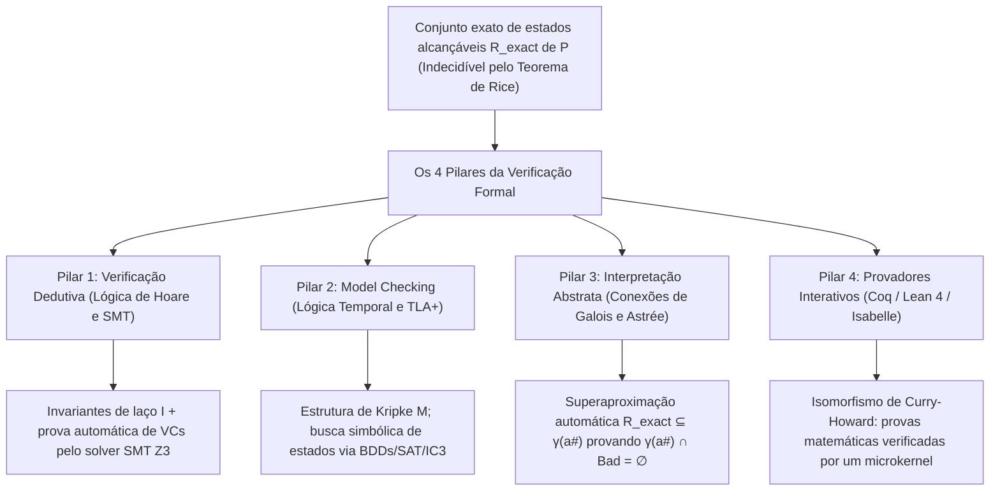
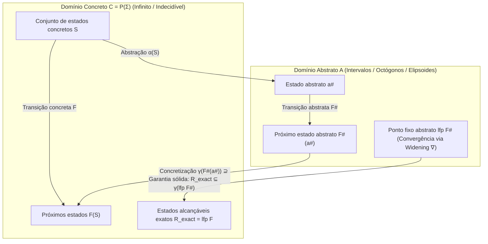

## 1. Os limites dos testes e a barreira da indecidibilidade: por que passar em 1.000.000 de testes não prova nada

### 1.1 A máxima imortal de Dijkstra e a explosão combinatória

Em 1969, na conferência de Engenharia de Software da OTAN, o vencedor do Prêmio Turing <strong>Edsger W. Dijkstra</strong> imortalizou a frase mais famosa da ciência da computação:

> <strong>"Program testing can be used to show the presence of bugs, but never to show their absence!"</strong>
> (O teste de programas pode ser usado para mostrar a presença de bugs, mas nunca para mostrar a sua ausência!)

Considere uma simples função pura `f(x, y)` que recebe dois inteiros com sinal de 64 bits (`int64_t`). O número total de pares de entrada possíveis é:

$$N_{\text{inputs}} = 2^{64} \times 2^{64} = 2^{128} \approx 3,4028 \times 10^{38}$$

Mesmo que um supercomputador executasse <strong>um bilhão ($10^9$) de testes por segundo</strong>, testar todas as entradas levaria cerca de <strong>$1,08 \times 10^{22}$ anos</strong> — 780 bilhões de vezes a idade do universo! Quando adicionamos alocação dinâmica de memória, pacotes de rede e entrelaçamentos (interleavings) não determinísticos de threads, o número de caminhos de execução diverge para o <strong>infinito ($\infty$)</strong>.

Em 2006, <strong>Joshua Bloch</strong> (Google) revelou um bug que permaneceu oculto por <strong>9 anos</strong> na biblioteca padrão do Java (`java.util.Arrays.binarySearch`): o famoso <strong>bug de estouro de inteiro (integer overflow) na busca binária</strong>:

```java
public static int binarySearch(int[] a, int key) {
    int low = 0;
    int high = a.length - 1;
    while (low <= high) {
        int mid = (low + high) / 2; // ★ BUG FATAL: overflow negativo quando low + high >= 2^31!
        int midVal = a[mid];
        if (midVal < key) low = mid + 1;
        else if (midVal > key) high = mid - 1;
        else return mid;
    }
    return -(low + 1);
}
```

Quando a soma `low + high` ultrapassa o limite máximo de um inteiro de 32 bits ($2^{31} - 1 = 2.147.483.647$), ocorre um overflow em complemento de dois para um número negativo, disparando `ArrayIndexOutOfBoundsException`.

### 1.2 O Problema da Parada de Turing (1936) e o Teorema de Rice (1953)

Por que não criar um analisador estático universal que leia o código-fonte de qualquer programa $P$ e decida com 100% de precisão se ele contém bugs? <strong>O Problema da Parada de Alan Turing (1936)</strong> e <strong>o Teorema de Rice (1953)</strong> provam que isso é matematicamente impossível:

$$\text{Teorema (Rice, 1953): Toda propriedade semântica não trivial } \mathcal{S} \text{ de funções computáveis é indecidível.}$$

Nenhuma ferramenta pode garantir simultaneamente <strong>(1) automação total</strong>, <strong>(2) correção / solidez (Soundness: zero falsos negativos)</strong> e <strong>(3) completude (Completeness: zero falsos positivos)</strong>.

### 1.3 Como a verificação formal contorna o Teorema de Rice: Superaproximação Sólida

A <strong>verificação formal</strong> jamais abre mão da <strong>solidez (Soundness)</strong>: quando certifica um programa como `"SAFE"`, ele é 100% garantido livre de bugs em todas as $\infty$ execuções possíveis. Para isso, calcula uma <strong>superaproximação sólida (Sound Over-Approximation)</strong> $\mathcal{R}_{\text{approx}} \supseteq \mathcal{R}_{\text{exact}}$ dos estados alcançáveis e prova que sua interseção com o conjunto de estados de erro $\mathcal{B}$ é vazia:

$$\mathcal{R}_{\text{approx}} \cap \mathcal{B} = \emptyset \implies \mathcal{R}_{\text{exact}} \cap \mathcal{B} = \emptyset$$



---

## 2. Pilar 1: Verificação Dedutiva — Lógica de Floyd-Hoare, Pré-condição Mais Fraca e Solucionadores SMT

### 2.1 A Tripla de Hoare, Invariantes de Laço e Funções de Ranking

Em 1969, <strong>C. A. R. Hoare</strong> estabeleceu a <strong>lógica de Floyd-Hoare</strong> baseada na <strong>Tripla de Hoare</strong>:

$$\{P\}\; C \;\{Q\}$$

- <strong>Correção Parcial</strong>: Se a pré-condição $P$ vale antes de $C$ e <strong>se $C$ termina</strong>, então a pós-condição $Q$ vale ao final.
- <strong>Correção Total</strong>: Sob $P$, <strong>$C$ obrigatoriamente termina</strong> em passos finitos e satisfaz $Q$.

As regras fundamentais incluem o axioma da atribuição $\{\,Q[E/x]\,\}\; x := E \;\{\,Q\,\}$ e a regra do laço `while` com um <strong>invariante de laço</strong> $I$ e uma <strong>função de ranking (variante)</strong> $V \in \mathbb{N}$ estritamente decrescente:

$$\frac{\{I \land B \land V = v_0\}\; S \;\{I \land V < v_0\} \qquad (I \land B) \implies V \ge 0}{[I]\; \text{while } B \text{ do } S \;[I \land \neg B]}$$

Com o cálculo da <strong>pré-condição mais fraca (Weakest Precondition, $\text{wp}(C, Q)$, Dijkstra 1975)</strong>, a prova do programa reduz-se a <strong>condições de verificação (VCs)</strong> matemáticas: $P \implies \text{wp}(C, Q)$.

### 2.2 Verificação Formal da Busca Binária em Dafny e Z3

Ao corrigir o cálculo do meio para `mid := low + (high - low) / 2` na linguagem <strong>Dafny</strong>, o solucionador SMT <strong>Z3</strong> (arquitetura <strong>DPLL(T)</strong> combinando funções não interpretadas EUF, aritmética linear inteira LIA, vetores de bits $\mathcal{T}_{\text{BV}}$ e arrays $\mathcal{T}_{\text{A}}$) prova em milissegundos a ausência de overflow e a correção total:

```dafny
method BinarySearch(a: array<int>, key: int) returns (index: int)
  requires forall i, j :: 0 <= i < j < a.Length ==> a[i] <= a[j]
  ensures 0 <= index ==> index < a.Length && a[index] == key
  ensures index < 0 ==> forall k :: 0 <= k < a.Length ==> a[k] != key
{
  var low := 0;
  var high := a.Length;
  while low < high
    invariant 0 <= low <= high <= a.Length
    invariant forall i :: 0 <= i < a.Length && !(low <= i < high) ==> a[i] != key
    decreases high - low
  {
    var mid := low + (high - low) / 2; // Z3 prova: sem overflow e 0 <= mid < a.Length!
    if a[mid] < key { low := mid + 1; }
    else if key < a[mid] { high := mid; }
    else { return mid; }
  }
  return -1;
}
```

---

## 3. Pilar 2: Model Checking e Lógica Temporal — Exploração Exaustiva de Sistemas Distribuídos

### 3.1 Estruturas de Kripke e Lógica Temporal LTL / CTL

Em 1981, <strong>Clarke</strong>, <strong>Emerson</strong> e <strong>Sifakis</strong> (Prêmio Turing 2007) criaram o <strong>Model Checking</strong>, enquanto <strong>Leslie Lamport</strong> (Prêmio Turing 2013) desenvolveu o <strong>TLA+</strong>. O sistema concorrente é modelado como uma <strong>estrutura de Kripke</strong> $M = (S, S_0, R, L)$ e especificado em <strong>LTL</strong> ou <strong>CTL</strong>:

1. <strong>Segurança (Safety — "Nada de ruim acontece jamais")</strong>: Exclusão mútua:
   $$\text{LTL}: \quad \mathbf{G}\, \neg (\text{crit}_1 \land \text{crit}_2) \qquad \text{CTL}: \quad \mathbf{AG}\, \neg (\text{crit}_1 \land \text{crit}_2)$$
2. <strong>Vivacidade (Liveness — "Algo bom eventualmente acontece")</strong>: Ausência de inanição (Starvation Freedom):
   $$\text{LTL}: \quad \mathbf{G}\, (\text{req}_1 \implies \mathbf{F}\, \text{crit}_1) \qquad \text{CTL}: \quad \mathbf{AG}\, (\text{req}_1 \implies \mathbf{AF}\, \text{crit}_1)$$

### 3.2 Autômatos de Büchi, BDDs, IC3 e o Sucesso do TLA+ na AWS

O verificador traduz $\neg \varphi$ em um <strong>autômato de Büchi</strong> $A_{\neg \varphi}$ e testa se o produto síncrono é vazio ($\mathcal{L}(M \times A_{\neg \varphi}) = \emptyset$). Para vencer a <strong>explosão de estados</strong>, utilizam-se <strong>Diagramas de Decisão Binária (BDDs, Bryant 1986 / McMillan 1990)</strong> capazes de verificar $10^{20}$ estados, <strong>Bounded Model Checking (BMC)</strong> e <strong>IC3 / PDR</strong>.

Na <strong>Amazon Web Services (AWS)</strong>, o uso do <strong>TLA+ (TLC)</strong> no <strong>S3</strong> e no <strong>DynamoDB</strong> revelou, antes de uma única linha de código de produção ser escrita, um bug distribuído crítico que exigia uma sequência exata de <strong>35 passos entrelaçados</strong> de falhas de rede e atrasos de mensagens.

---

## 4. Pilar 3: Interpretação Abstrata e a Lição do Desastre do Foguete Ariane 5

### 4.1 4 de junho de 1996: Por que o foguete Ariane 5 (US$ 370 milhões) se autodestruiu em 37 segundos

Em 4 de junho de 1996, o voo inaugural (<strong>Voo 501</strong>) do foguete europeu <strong>Ariane 5</strong> explodiu <strong>37 segundos</strong> após o lançamento, gerando um prejuízo de <strong>US$ 370 milhões</strong>. O sistema de referência inercial (SRI) reutilizava código Ada do <strong>Ariane 4</strong>, que convertia uma variável de ponto flutuante de 64 bits da velocidade horizontal (`BH`) em um <strong>inteiro com sinal de 16 bits ($-32.768 \dots +32.767$)</strong>. Com a aceleração muito maior do Ariane 5, `BH` ultrapassou $32.767$ e disparou uma exceção de hardware (`Operand Error`) não tratada. Os computadores de backup e principal desligaram-se e enviaram um padrão de bits de diagnóstico que o computador de bordo (OBC) interpretou como dados reais de atitude extrema, defletindo os bocais ao máximo e desintegrando o foguete.

### 4.2 A Interpretação Abstrata de Cousot (1977), Conexões de Galois e o Astrée no Airbus A380

Criada em 1977 por <strong>Patrick Cousot</strong> e <strong>Radhia Cousot</strong>, a <strong>interpretação abstrata</strong> conecta o reticulado concreto $(\mathcal{C}, \subseteq) = (\mathcal{P}(\Sigma), \subseteq)$ a um domínio abstrato $(\mathcal{A}, \sqsubseteq^\#)$ (intervalos $[a,b]$, octógonos $\pm x \pm y \le c$, poliedros convexos) por meio de uma <strong>Conexão de Galois</strong>:

$$(\mathcal{C}, \subseteq) \underset{\alpha}{\overset{\gamma}{\leftrightarrows}} (\mathcal{A}, \sqsubseteq^\#) \quad \text{tal que} \quad \alpha(S) \sqsubseteq^\# a^\# \iff S \subseteq \gamma(a^\#)$$

Combinando a condição de solidez local $\alpha(F(\gamma(a^\#))) \sqsubseteq^\# F^\#(a^\#)$ e o <strong>operador de alargamento (Widening $\nabla$)</strong>, o ponto fixo abstrato engloba com 100% de certeza todos os estados alcançáveis:

$$\mathcal{R}_{\text{exact}} = \text{lfp}\, F \subseteq \gamma(\text{lfp}\, F^\#)$$



O analisador estático <strong>Astrée</strong> verificou automaticamente o <strong>software de controle de voo Fly-by-Wire do Airbus A380 (quase 1.000.000 de linhas de código C)</strong> com <strong>zero falsos alarmes</strong>, provando matematicamente a ausência absoluta de qualquer erro em tempo de execução!

---

## 5. Pilar 4: Provadores Interativos de Teoremas (Coq / Lean 4 / Isabelle) e Comparação Global

Baseados no <strong>isomorfismo de Curry-Howard</strong> (*proposições como tipos, provas como programas*), <strong>Coq (Rocq)</strong>, <strong>Lean 4</strong> e <strong>Isabelle/HOL</strong> produziram dois marcos históricos:
1. <strong>CompCert (Xavier Leroy, INRIA)</strong>: Compilador C otimizador formalmente verificado em Coq. Nos testes de fuzzing do <strong>Csmith</strong> (PLDI 2011), mais de 325 bugs de compilação foram encontrados no GCC e LLVM, mas <strong>zero bugs no middle-end verificado do CompCert</strong>!
2. <strong>seL4 (Gerwin Klein et al.)</strong>: Primeiro microkernel de sistema operacional formalmente verificado em Isabelle/HOL até o binário ARM/RISC-V.

| Paradigma de Verificação | Base Matemática | Ferramentas e Linguagens | Automação | Aplicações Industriais | Força Principal e Trade-off |
| :--- | :--- | :--- | :--- | :--- | :--- |
| <strong>1. Verificação Dedutiva</strong> | Lógica de Hoare, cálculo $\text{wp}$, SMT | <strong>Dafny</strong>, <strong>Frama-C</strong>, <strong>SPARK Ada</strong>, <strong>Verus</strong>, <strong>Z3</strong> | Semiautomática (Invariantes + SMT) | Criptografia, controle aéreo, AWS Cedar | Prova correção funcional profunda diretamente no código. |
| <strong>2. Model Checking</strong> | Estruturas de Kripke, LTL/CTL, Büchi, BDDs | <strong>TLA+ (TLC)</strong>, <strong>SPIN</strong>, <strong>NuSMV</strong>, <strong>CBMC</strong> | Automática (em modelos finitos) | <strong>AWS S3 e DynamoDB</strong>, Paxos/Raft, CPUs | Gera contraexemplos exatos para bugs de concorrência. |
| <strong>3. Interpretação Abstrata</strong> | Reticulados, conexões de Galois $(\alpha,\gamma)$, $\nabla$ | <strong>Astrée</strong>, <strong>Polyspace</strong>, <strong>Infer</strong> (Meta) | Totalmente automática | <strong>Airbus A380/A350 Fly-by-Wire</strong>, C embarcado | Escala para 1.000.000+ de linhas de C sem anotações. |
| <strong>4. Prova Interativa</strong> | Isomorfismo de Curry-Howard, teoria de tipos | <strong>Coq (Rocq)</strong>, <strong>Lean 4</strong>, <strong>Isabelle/HOL</strong> | Interativa (Humano + Táticas + IA) | Compilador <strong>CompCert</strong>, microkernel <strong>seL4</strong> | Expressividade ilimitada e certeza absoluta via microkernel. |
