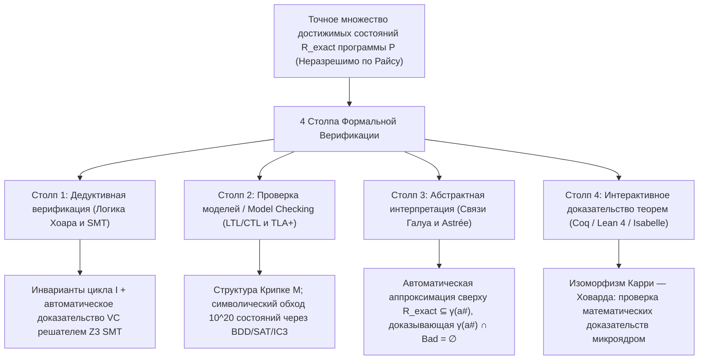
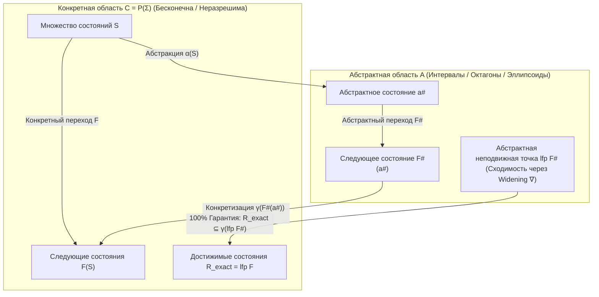

## 1. Пределы тестирования и стена неразрешимости: почему 1 000 000 успешных тестов ничего не доказывают

### 1.1 Бессмертный афоризм Дейкстры и комбинаторный взрыв пространства входов

В 1969 году на конференции НАТО по программной инженерии лауреат премии Тьюринга <strong>Эдсгер В. Дейкстра (Edsger W. Dijkstra)</strong> сформулировал самый известный тезис в истории информатики:

> <strong>"Program testing can be used to show the presence of bugs, but never to show their absence!"</strong>
> (Тестирование программ может использоваться для демонстрации <strong>наличия</strong> ошибок, но никогда — для демонстрации их <strong>отсутствия</strong>!)

Рассмотрим простейшую чистую функцию `f(x, y)`, принимающую два 64-битных знаковых целых числа (`int64_t`). Общее число возможных входных пар составляет:

$$N_{\text{inputs}} = 2^{64} \times 2^{64} = 2^{128} \approx 3{,}4028 \times 10^{38}$$

Даже если суперкомпьютер будет выполнять <strong>один миллиард ($10^9$) тестов в секунду</strong>, полный перебор всех входов займёт около <strong>$1{,}08 \times 10^{22}$ лет</strong> — в 780 миллиардов раз больше возраста Вселенной! С учётом динамической памяти, сетевых пакетов и недетерминированного переключения потоков (interleaving) число путей выполнения уходит в <strong>бесконечность ($\infty$)</strong>.

В 2006 году <strong>Джошуа Блох (Joshua Bloch)</strong> из Google обнаружил ошибку, которая скрывалась <strong>9 лет</strong> в стандартной библиотеке Java (`java.util.Arrays.binarySearch`) — знаменитый <strong>баг целочисленного переполнения в бинарном поиске</strong>:

```java
public static int binarySearch(int[] a, int key) {
    int low = 0;
    int high = a.length - 1;
    while (low <= high) {
        int mid = (low + high) / 2; // ★ ФАТАЛЬНЫЙ БАГ: отрицательное переполнение при low + high >= 2^31!
        int midVal = a[mid];
        if (midVal < key) low = mid + 1;
        else if (midVal > key) high = mid - 1;
        else return mid;
    }
    return -(low + 1);
}
```

Когда сумма `low + high` превышает максимум 32-битного знакового целого ($2^{31} - 1 = 2\,147\,483\,647$), в дополнительном коде происходит переполнение в отрицательную область, вызывая `ArrayIndexOutOfBoundsException`.

### 1.2 Проблема остановки Тьюринга (1936) и теорема Райса (1953)

Почему бы не написать универсальный анализатор, который по исходному коду любой программы $P$ со 100%-ной точностью определит, есть ли в ней ошибки? Этому препятствуют <strong>проблема остановки Алана Тьюринга (1936)</strong> и <strong>теорема Райса (1953)</strong>:

$$\text{Теорема (Rice, 1953): Любое нетривиальное семантическое свойство } \mathcal{S} \text{ вычислимых функций алгоритмически неразрешимо.}$$

Ни один инструмент не может одновременно обеспечить <strong>(1) полную автоматизацию</strong>, <strong>(2) корректность / надёжность (Soundness: ноль ложноотрицательных срабатываний)</strong> и <strong>(3) полноту (Completeness: ноль ложноположительных тревог)</strong>.

### 1.3 Как формальная верификация обходит теорему Райса: надёжная аппроксимация сверху

<strong>Формальная верификация</strong> никогда не жертвует <strong>надёжностью (Soundness)</strong>: если верификатор выдаёт вердикт `"SAFE"`, программа математически на 100% свободна от ошибок на всех $\infty$ путях выполнения. Для этого вычисляется <strong>надёжная аппроксимация сверху (Sound Over-Approximation)</strong> $\mathcal{R}_{\text{approx}} \supseteq \mathcal{R}_{\text{exact}}$ всех достижимых состояний и доказывается пустота её пересечения с множеством аварийных состояний $\mathcal{B}$:

$$\mathcal{R}_{\text{approx}} \cap \mathcal{B} = \emptyset \implies \mathcal{R}_{\text{exact}} \cap \mathcal{B} = \emptyset$$



---

## 2. Столп 1: Дедуктивная верификация — Логика Флойда — Хоара, слабейшее предусловие и SMT-решатели

### 2.1 Тройка Хоара, инварианты цикла и ранговые функции

В 1969 году <strong>Чарльз Энтони Ричард Хоар (C. A. R. Hoare)</strong> создал <strong>логику Флойда — Хоара</strong>, в основе которой лежит <strong>тройка Хоара</strong>:

$$\{P\}\; C \;\{Q\}$$

- <strong>Частичная корректность</strong>: Если до выполнения команды $C$ истинно предусловие $P$, и <strong>если $C$ завершается</strong>, то после выполнения истинно постусловие $Q$.
- <strong>Полная корректность</strong>: При предусловии $P$ команда <strong>$C$ гарантированно завершается</strong> за конечное число шагов и устанавливает $Q$.

Ключевые правила вывода включают аксиому присваивания $\{\,Q[E/x]\,\}\; x := E \;\{\,Q\,\}$ и правило цикла `while` с <strong>инвариантом цикла</strong> $I$ и строго убывающей натуральной <strong>ранговой функцией (вариантом)</strong> $V \in \mathbb{N}$:

$$\frac{\{I \land B \land V = v_0\}\; S \;\{I \land V < v_0\} \qquad (I \land B) \implies V \ge 0}{[I]\; \text{while } B \text{ do } S \;[I \land \neg B]}$$

С помощью исчисления <strong>слабейшего предусловия (Weakest Precondition, $\text{wp}(C, Q)$, Дейкстра 1975)</strong> верификация программы сводится к математическим <strong>условиям верификации (VCs)</strong>: $P \implies \text{wp}(C, Q)$.

### 2.2 Доказательство корректности бинарного поиска в Dafny и Z3

Заменив вычисление середины на `mid := low + (high - low) / 2` в языке <strong>Dafny</strong>, SMT-решатель <strong>Z3</strong> (архитектура <strong>DPLL(T)</strong>, объединяющая неинтерпретируемые функции EUF, линейную целочисленную арифметику LIA, битовые векторы $\mathcal{T}_{\text{BV}}$ и массивы $\mathcal{T}_{\text{A}}$) за миллисекунды автоматически доказывает полное отсутствие переполнений и выход за границы массива:

```dafny
method BinarySearch(a: array<int>, key: int) returns (index: int)
  requires forall i, j :: 0 <= i < j < a.Length ==> a[i] <= a[j]
  ensures 0 <= index ==> index < a.Length && a[index] == key
  ensures index < 0 ==> forall k :: 0 <= k < a.Length ==> a[k] != key
{
  var low := 0;
  var high := a.Length;
  while low < high
    invariant 0 <= low <= high <= a.Length
    invariant forall i :: 0 <= i < a.Length && !(low <= i < high) ==> a[i] != key
    decreases high - low
  {
    var mid := low + (high - low) / 2; // Z3 доказывает: переполнения нет и 0 <= mid < a.Length!
    if a[mid] < key { low := mid + 1; }
    else if key < a[mid] { high := mid; }
    else { return mid; }
  }
  return -1;
}
```

---

## 3. Столп 2: Проверка моделей (Model Checking) и темпоральная логика

### 3.1 Структуры Крипке и темпоральная логика LTL / CTL

В 1981 году <strong>Кларк</strong>, <strong>Эмерсон</strong> и <strong>Сифакис</strong> (премия Тьюринга 2007) изобрели <strong>проверку моделей (Model Checking)</strong>, а <strong>Лесли Лэмпорт</strong> (премия Тьюринга 2013) создал <strong>TLA+</strong>. Система моделируется как <strong>структура Крипке</strong> $M = (S, S_0, R, L)$, а её свойства записываются в <strong>LTL</strong> или <strong>CTL</strong>:

1. <strong>Безопасность (Safety — «Ничего плохого никогда не происходит»)</strong>: Взаимное исключение:
   $$\text{LTL}: \quad \mathbf{G}\, \neg (\text{crit}_1 \land \text{crit}_2) \qquad \text{CTL}: \quad \mathbf{AG}\, \neg (\text{crit}_1 \land \text{crit}_2)$$
2. <strong>Живость (Liveness — «Что-то хорошее в итоге обязательно произойдёт»)</strong>: Отсутствие голодания (Starvation Freedom):
   $$\text{LTL}: \quad \mathbf{G}\, (\text{req}_1 \implies \mathbf{F}\, \text{crit}_1) \qquad \text{CTL}: \quad \mathbf{AG}\, (\text{req}_1 \implies \mathbf{AF}\, \text{crit}_1)$$

### 3.2 Автоматы Бюхи, BDD, IC3 и применение TLA+ в Amazon Web Services (AWS)

Верификатор переводит отрицание спецификации $\neg \varphi$ в <strong>автомат Бюхи</strong> $A_{\neg \varphi}$ и проверяет пустоту синхронного произведения ($\mathcal{L}(M \times A_{\neg \varphi}) = \emptyset$). Для борьбы со <strong>взрывом пространства состояний</strong> используются <strong>бинарные диаграммы решений (BDD, Брайант 1986 / Макмиллан 1990)</strong>, охватывающие более $10^{20}$ состояний, <strong>Bounded Model Checking (BMC)</strong> и алгоритм <strong>IC3 / PDR</strong>.

В <strong>Amazon Web Services (AWS)</strong> применение <strong>TLA+ (TLC)</strong> при проектировании <strong>S3</strong> и <strong>DynamoDB</strong> позволило ещё до написания производственного кода выявить сложнейшую ошибку потери данных, требовавшую точной последовательности из <strong>35 переплетённых шагов</strong> (разделение сети, задержки пакетов и смена лидера).

---

## 4. Столп 3: Абстрактная интерпретация и урок катастрофы ракеты Ариан-5

### 4.1 4 июня 1996 года: Почему ракета Ариан-5 стоимостью 370 млн долларов взорвалась через 37 секунд

4 июня 1996 года первый полёт (<strong>Flight 501</strong>) европейской ракеты-носителя <strong>Ariane 5</strong> закончился самоуничтожением на <strong>37-й секунде</strong>, что привело к потере <strong>370 миллионов долларов</strong>. Инерциальная навигационная система (SRI) повторно использовала код на языке Ada от <strong>Ariane 4</strong>, где 64-битная вещественная переменная горизонтальной скорости (`BH`) преобразовывалась в <strong>16-битное знаковое целое ($-32\,768 \dots +32\,767$)</strong>. Из-за более мощного ускорения Ariane 5 значение `BH` превысило $32\,767$, вызвав необработанное аппаратное исключение переполнения (`Operand Error`). Резервный и основной компьютеры SRI отключились и отправили на шину диагностическую битовую последовательность, которую бортовой компьютер (OBC) принял за реальные данные об экстремальном крене и повернул сопла двигателей до упора, разрушив ракету.

### 4.2 Абстрактная интерпретация Кузо (1977), связи Галуа и триумф Astrée на Airbus A380

Созданная в 1977 году <strong>Патриком Кузо</strong> и <strong>Радией Кузо</strong> <strong>абстрактная интерпретация</strong> связывает конкретную решётку состояний $(\mathcal{C}, \subseteq) = (\mathcal{P}(\Sigma), \subseteq)$ с абстрактной областью $(\mathcal{A}, \sqsubseteq^\#)$ (интервалы $[a,b]$, октагоны $\pm x \pm y \le c$, выпуклые многогранники) через <strong>связь Галуа (Galois Connection)</strong>:

$$(\mathcal{C}, \subseteq) \underset{\alpha}{\overset{\gamma}{\leftrightarrows}} (\mathcal{A}, \sqsubseteq^\#) \quad \text{где} \quad \alpha(S) \sqsubseteq^\# a^\# \iff S \subseteq \gamma(a^\#)$$

При соблюдении условия локальной корректности $\alpha(F(\gamma(a^\#))) \sqsubseteq^\# F^\#(a^\#)$ и применении <strong>оператора расширения (Widening $\nabla$)</strong> абстрактная неподвижная точка гарантированно накрывает все достижимые состояния:

$$\mathcal{R}_{\text{exact}} = \text{lfp}\, F \subseteq \gamma(\text{lfp}\, F^\#)$$



Статический анализатор <strong>Astrée</strong> полностью автоматически проверил <strong>бортовое ПО управления полётом Fly-by-Wire авиалайнера Airbus A380 (около 1 000 000 строк кода на C)</strong> с <strong>нулём ложных тревог</strong>, математически доказав полное отсутствие любых ошибок времени выполнения!

---

## 5. Столп 4: Интерактивное доказательство теорем (Coq / Lean 4 / Isabelle) и сравнение подходов

Основанные на <strong>изоморфизме Карри — Ховарда</strong> (*высказывания как типы, доказательства как программы*), интерактивные системы (<strong>Coq / Rocq</strong>, <strong>Lean 4</strong>, <strong>Isabelle/HOL</strong>) породили два шедевра:
1. <strong>CompCert (Ксавье Леруа, INRIA)</strong>: Оптимизирующий компилятор C, формально верифицированный в Coq. При фаззинг-тестировании <strong>Csmith</strong> (PLDI 2011) в GCC и LLVM нашли более 325 ошибок компиляции, а в верифицированном ядре <strong>CompCert — ни одной</strong>!
2. <strong>seL4 (Гервин Кляйн и др.)</strong>: Первое в мире микроядро ОС, формально верифицированное в Isabelle/HOL вплоть до бинарного кода ARM/RISC-V.

| Парадигма верификации | Математическая основа | Инструменты и языки | Автоматизация | Промышленные применения | Главная сила и компромисс |
| :--- | :--- | :--- | :--- | :--- | :--- |
| <strong>1. Дедуктивная верификация</strong> | Логика Хоара, $\text{wp}$-исчисление, SMT | <strong>Dafny</strong>, <strong>Frama-C</strong>, <strong>SPARK Ada</strong>, <strong>Verus</strong>, <strong>Z3</strong> | Полуавтоматическая (Инварианты + SMT) | Криптография, УВД, движок авторизации AWS Cedar | Доказывает глубокую функциональную корректность кода. |
| <strong>2. Проверка моделей</strong> | Структуры Крипке, LTL/CTL, Бюхи, BDD | <strong>TLA+ (TLC)</strong>, <strong>SPIN</strong>, <strong>NuSMV</strong>, <strong>CBMC</strong> | Автоматическая (на конечных моделях) | <strong>AWS S3 и DynamoDB</strong>, Paxos/Raft, процессоры | Выдаёт точные трассы контрпримеров для параллельных багов. |
| <strong>3. Абстрактная интерпретация</strong> | Решётки, связи Галуа $(\alpha,\gamma)$, $\nabla$ | <strong>Astrée</strong>, <strong>Polyspace</strong>, <strong>Infer</strong> (Meta) | Полностью автоматическая | <strong>Airbus A380/A350 Fly-by-Wire</strong>, бортовой C-код | Масштабируется на 1 000 000+ строк C без ручных аннотаций. |
| <strong>4. Интерактивное доказательство</strong> | Изоморфизм Карри — Ховарда, теория типов | <strong>Coq (Rocq)</strong>, <strong>Lean 4</strong>, <strong>Isabelle/HOL</strong> | Интерактивная (Человек + тактики + ИИ) | Компилятор <strong>CompCert</strong>, микроядро ОС <strong>seL4</strong> | Неограниченная выразительность и 100% надёжность микроядра. |
