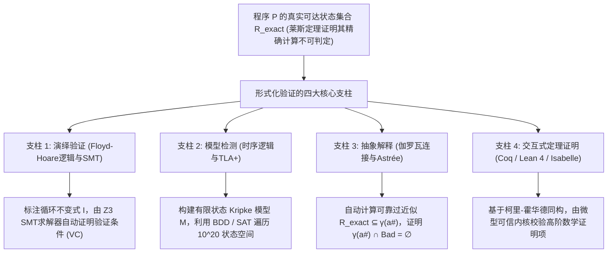
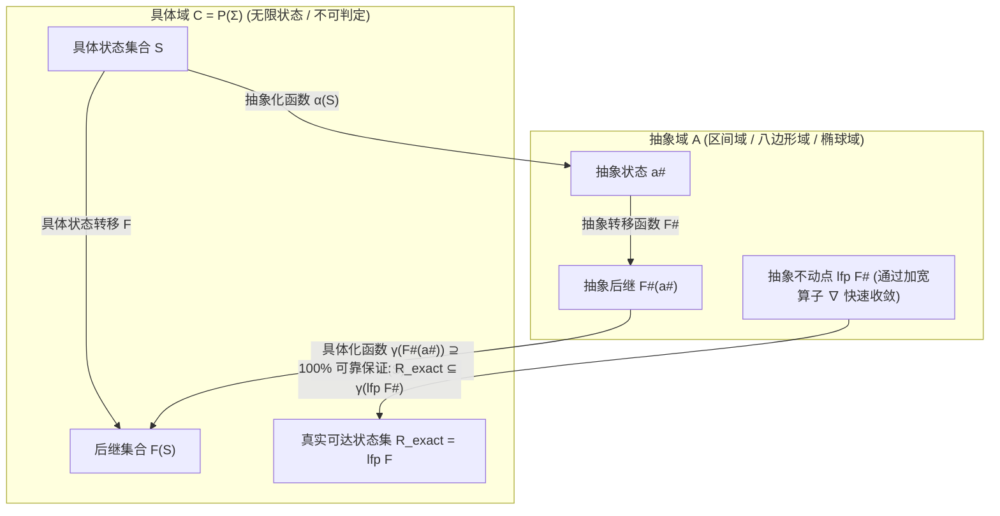

## 1. 软件测试的极限与不可判定性之墙：为什么“通过100万次测试”毫无数学保证？

### 1.1 戴克斯特拉的不朽名言与输入空间的指数级爆炸

1969年，图灵奖得主、结构化编程先驱<strong>艾兹格·戴克斯特拉（Edsger W. Dijkstra）</strong>在北约（NATO）软件工程会议上留下了一句震撼计算机科学史的至理名言：

> <strong>"Program testing can be used to show the presence of bugs, but never to show their absence!"</strong>
> （程序测试可以用来证明Bug的<strong>存在</strong>，但绝不能用来证明Bug的<strong>不存在</strong>！）

在现代软件工程中，单元测试、集成测试与模糊测试（Fuzzing）构成了质量保障的基石。然而，从严格的数学角度来看，任何有限次数的动态测试都无法穷尽程序的全部可能行为。考虑一个仅接收两个64位有符号整数 `(x, y)` 的纯函数，其可能的输入组合总数高达：

$$N_{\text{inputs}} = 2^{64} \times 2^{64} = 2^{128} \approx 3.4028 \times 10^{38}$$

即使动用每秒执行10亿次（$10^9$次）测试的超级计算机，穷举这一个简单函数的全部输入也需要约 <strong>$1.08 \times 10^{22}$ 年</strong>——相当于宇宙年龄（约 $1.38 \times 10^{10}$ 年）的7800亿倍！如果再加上堆内存指针、网络数据包乱序以及多线程调度的非确定性交错（Interleaving），执行路径的数量将直接发散至<strong>无穷大（$\infty$）</strong>。

2006年，Google工程师<strong>约书亚·布洛赫（Joshua Bloch）</strong>揭露了潜伏在Java标准库（`java.util.Arrays.binarySearch`）中长达<strong>9年</strong>的<strong>二分查找整数溢出Bug</strong>：

```java
public static int binarySearch(int[] a, int key) {
    int low = 0;
    int high = a.length - 1;
    while (low <= high) {
        int mid = (low + high) / 2; // ★ 致命算术溢出：当 low + high >= 2^31 时变为负数！
        int midVal = a[mid];
        if (midVal < key) low = mid + 1;
        else if (midVal > key) high = mid - 1;
        else return mid;
    }
    return -(low + 1);
}
```

当数组长度很大且搜索区间位于后半段，使得 `low + high` 超过32位有符号整数上限 $2^{31}-1 = 2,147,483,647$ 时，加法会发生补码溢出变成负数，立即引发 `ArrayIndexOutOfBoundsException` 崩溃。全球数亿台设备运行了9年、通过了无数测试，却从未在测试中触发这一边界条件。

### 1.2 图灵停机问题（1936）与莱斯定理（1953）

既然动态测试无法穷举，能否编写一个全自动静态分析器，读取任意程序 $P$ 的源代码并100%准确地判定它是否存在Bug？

<strong>阿兰·图灵的停机问题（Halting Problem, 1936）</strong>与<strong>亨利·戈登·莱斯的莱斯定理（Rice's Theorem, 1953）</strong>给出了否定回答：

$$\text{定理（Rice, 1953）：图灵完备语言中，可计算函数的任何非平凡语义性质 } \mathcal{S} \text{ 都是不可判定的（Undecidable）。}$$

“不发生除零错误”、“不发生整数溢出”、“不解引用空指针”全部属于非平凡语义性质。这意味着，没有任何验证工具能够同时满足以下三点：<strong>（1）全自动终止</strong>、<strong>（2）可靠性（Soundness：无漏报/零假阴性）</strong>、<strong>（3）完备性（Completeness：无误报/零假阳性）</strong>。

### 1.3 形式化验证如何突破莱斯定理？可靠性优先与过近似（Over-Approximation）

<strong>形式化验证（Formal Verification）</strong>之所以能证明航天飞控软件、操作系统内核与密码库“100%绝无Bug”，是因为它<strong>绝对坚守可靠性（Soundness：只要判定为SAFE，则在所有 $\infty$ 条路径上100%安全）</strong>，并战略性地放弃完全自动化（引入交互式定理证明或人工循环不变式）或放弃完备性（计算<strong>可靠的过近似集合 Sound Over-Approximation</strong>）。



设程序 $P$ 的真实可达状态集为 $\mathcal{R}_{\text{exact}}$，危险状态集为 $\mathcal{B}$。验证器通过构造一个稍大的过近似包络集合 $\mathcal{R}_{\text{approx}} \supseteq \mathcal{R}_{\text{exact}}$，只要证明：

$$\mathcal{R}_{\text{approx}} \cap \mathcal{B} = \emptyset \implies \mathcal{R}_{\text{exact}} \cap \mathcal{B} = \emptyset$$

即可在不运行程序一次的情况下，从数学上100%保证程序永远不会进入任何危险状态！

---

## 2. 第一支柱：演绎验证 —— 弗洛伊德-霍尔逻辑、最弱前置条件与SMT求解器

### 2.1 霍尔三元组（Hoare Triple）与部分正确性、完全正确性

1969年，<strong>东尼·霍尔（C. A. R. Hoare）</strong>在罗伯特·弗洛伊德工作的基础上提出了<strong>弗洛伊德-霍尔逻辑（Floyd-Hoare Logic）</strong>。其核心是<strong>霍尔三元组</strong>：

$$\{P\}\; C \;\{Q\}$$

其中 $P$ 为<strong>前置条件（Precondition）</strong>，$C$ 为程序命令，$Q$ 为<strong>后置条件（Postcondition）</strong>。
- <strong>部分正确性（Partial Correctness）</strong>：若初始状态满足 $P$，且 $C$ <strong>如果终止</strong>，则终止状态必满足 $Q$。
- <strong>完全正确性（Total Correctness）</strong>：若初始状态满足 $P$，则 $C$ <strong>必然在有限步内终止</strong>，且终止状态满足 $Q$。

### 2.2 霍尔逻辑的核心推理规则与循环不变式（Loop Invariant）

霍尔逻辑将程序语法映射为形式推理规则：

1. <strong>赋值公理（Assignment Axiom）</strong>：
   $$\frac{}{\{Q[E/x]\}\; x := E \;\{Q\}}$$
   要使赋值 $x := E$ 后满足 $Q$，赋值前必须满足将 $Q$ 中所有自由变量 $x$ 替换为 $E$ 后的逻辑式 $Q[E/x]$。
2. <strong>顺序复合与条件分支规则</strong>：
   $$\frac{\{P\}\; C_1 \;\{R\} \qquad \{R\}\; C_2 \;\{Q\}}{\{P\}\; C_1 ; C_2 \;\{Q\}}, \qquad \frac{\{P \land B\}\; C_1 \;\{Q\} \qquad \{P \land \neg B\}\; C_2 \;\{Q\}}{\{P\}\; \text{if } B \text{ then } C_1 \text{ else } C_2 \;\{Q\}}$$
3. <strong>While循环规则（部分正确性与完全正确性）</strong>：
   为了在不展开无限循环的前提下证明循环正确，必须引入在每次迭代前后恒成立的<strong>循环不变式（Loop Invariant）</strong> $I$，以及取值于自然数 $\mathbb{N}$ 且每次迭代严格递减的<strong>秩函数（Ranking Function / Loop Variant）</strong> $V$：
   $$\frac{\{I \land B \land V = v_0\}\; S \;\{I \land V < v_0\} \qquad (I \land B) \implies V \ge 0}{[I]\; \text{while } B \text{ do } S \;[I \land \neg B]}$$

1975年，戴克斯特拉进一步提出<strong>最弱前置条件演算（Weakest Precondition, $\text{wp}(C, Q)$）</strong>，将 $\{P\}\; C \;\{Q\}$ 的证明自动转化为纯数学<strong>验证条件（Verification Condition, VC）</strong>：$P \implies \text{wp}(C, Q)$。

### 2.3 使用 Dafny 与 Z3 SMT求解器证明二分查找100%无Bug

在 <strong>Dafny</strong>、<strong>Frama-C</strong> 或 <strong>SPARK Ada</strong> 中，当我们把二分查找的中点计算修复为 `mid := low + (high - low) / 2` 并标注循环不变式与秩函数后，底层的 <strong>Z3 SMT求解器</strong>（基于DPLL(T)架构，融合未解释函数EUF、线性整数算术LIA、位向量理论Bit-Vectors与数组理论Arrays）会在几毫秒内自动完成全部数学证明：

```dafny
method BinarySearch(a: array<int>, key: int) returns (index: int)
  requires forall i, j :: 0 <= i < j < a.Length ==> a[i] <= a[j]
  ensures 0 <= index ==> index < a.Length && a[index] == key
  ensures index < 0 ==> forall k :: 0 <= k < a.Length ==> a[k] != key
{
  var low := 0;
  var high := a.Length;
  while low < high
    invariant 0 <= low <= high <= a.Length
    invariant forall i :: 0 <= i < a.Length && !(low <= i < high) ==> a[i] != key
    decreases high - low
  {
    var mid := low + (high - low) / 2; // Z3 严格证明：绝不溢出且 0 <= mid < a.Length
    if a[mid] < key { low := mid + 1; }
    else if key < a[mid] { high := mid; }
    else { return mid; }
  }
  return -1;
}
```

当循环退出时，不变式 $0 \le \text{low} \le \text{high}$ 与循环条件否定 $\neg(\text{low} < \text{high})$ 结合，立即导出 $\text{low} = \text{high}$，半开区间 $[\text{low}, \text{high})$ 坍缩为空集 $\emptyset$，从而直接证明整个数组中都不存在 `key`！

---

## 3. 第二支柱：模型检测与时序逻辑 —— 并发与分布式系统的全状态空间探索

### 3.1 克里普克结构（Kripke Structure）与时序逻辑（LTL / CTL）

对于操作系统锁、CPU缓存一致性协议以及Amazon S3、DynamoDB等24小时运行的<strong>并发与分布式反应式系统（Reactive Systems）</strong>，2007年图灵奖得主<strong>克拉克（Clarke）</strong>、<strong>爱默生（Emerson）</strong>、<strong>希法基斯（Sifakis）</strong>创立了<strong>模型检测（Model Checking, 1981）</strong>，2013年图灵奖得主<strong>莱斯利·兰伯特（Leslie Lamport）</strong>创立了 <strong>TLA+</strong>。

系统被建模为克里普克结构 $M = (S, S_0, R, L)$。利用阿米尔·普努埃利（Amir Pnueli）引入的<strong>线性时序逻辑（LTL）</strong>与<strong>计算树逻辑（CTL）</strong>，我们可以精确刻画系统的两类核心属性：

1. <strong>安全性（Safety — “坏事永远不会发生”）</strong>：例如互斥锁绝不让两个进程同时进入临界区：
   $$\text{LTL}: \quad \mathbf{G}\, \neg (\text{crit}_1 \land \text{crit}_2) \qquad \text{CTL}: \quad \mathbf{AG}\, \neg (\text{crit}_1 \land \text{crit}_2)$$
2. <strong>活性（Liveness — “好事最终一定会发生”）</strong>：例如进程请求锁后最终一定能获得锁（无饥饿性）：
   $$\text{LTL}: \quad \mathbf{G}\, (\text{req}_1 \implies \mathbf{F}\, \text{crit}_1) \qquad \text{CTL}: \quad \mathbf{AG}\, (\text{req}_1 \implies \mathbf{AF}\, \text{crit}_1)$$

### 3.2 比奇自动机（Büchi Automata）、符号模型检测（BDD/IC3）与AWS TLA+实践

LTL模型检测器（如SPIN）将性质否定 $\neg \varphi$ 转化为接受无限字的<strong>比奇自动机（Büchi Automaton）</strong> $A_{\neg \varphi}$，并通过检验同步乘积自动机是否为空集：

$$\mathcal{L}(M \times A_{\neg \varphi}) = \emptyset$$

来验证系统。一旦发现可达的接受强连通分量（套索形环 Lasso），工具就会输出一条<strong>100%可复现的Bug反例轨迹（Counterexample Trace）</strong>。

为了克服并发系统的<strong>状态空间爆炸问题（State Explosion Problem）</strong>，<strong>布莱恩特（Bryant, 1986）</strong>与<strong>麦克米伦（McMillan, 1990）</strong>利用<strong>有序二叉决策图（ROBDD）</strong>实现了<strong>符号模型检测（Symbolic Model Checking）</strong>，一举验证了超过 $10^{20}$ 个状态的硬件电路；而<strong>有界模型检测（BMC）</strong>与 <strong>IC3 / PDR（Property Directed Reachability）</strong> 则进一步结合SAT求解器实现了超大规模工业验证。

在工业界，<strong>Amazon Web Services (AWS)</strong> 团队在设计 <strong>S3</strong> 和 <strong>DynamoDB</strong> 时广泛采用 <strong>TLA+（TLC模型检测器）</strong>，在编写任何生产代码之前，成功捕获了一个需要<strong>35步特定网络故障、延迟与主节点切换交错</strong>才能触发的致命数据丢失Bug——这是人工评审与混沌测试永远不可能发现的深层缺陷。

---

## 4. 第三支柱：抽象解释（Abstract Interpretation）与阿丽亚娜5号火箭爆炸的惨痛教训

### 4.1 1996年6月4日：价值3.7亿美元的阿丽亚娜5号为何在升空37秒后自毁？

1996年6月4日，欧洲航天局（ESA）的<strong>阿丽亚娜5号（Ariane 5）</strong>火箭首飞（Flight 501）在升空仅<strong>37秒</strong>后偏离航线并凌空爆炸，损失高达<strong>3.7亿美元</strong>。事故原因震惊世界：惯性基准系统（SRI）直接复用了阿丽亚娜4号的Ada代码，其中一行指令将表示水平速度偏差的64位浮点数 `BH` 强制转换为<strong>16位有符号整数（范围 $-32,768 \sim +32,767$）</strong>。由于阿丽亚娜5号推力远超前代，升空37秒后 `BH` 突破了 $32,767$，触发未捕获的硬件算术溢出异常（Operand Error），导致主备双机在72毫秒内相继停机，并将错误诊断位模式发给主飞控计算机（OBC），被误认为极端姿态倾角而将喷管打到极限，导致火箭解体。

### 4.2 库索夫妇的抽象解释（1977）、伽罗瓦连接与空客A380的零误报奇迹

法国计算机科学家<strong>帕特里克·库索（Patrick Cousot）</strong>与<strong>拉迪亚·库索（Radhia Cousot）</strong>早在1977年提出的<strong>抽象解释（Abstract Interpretation）</strong>理论为此提供了终极解药。

抽象解释在<strong>具体域</strong> $(\mathcal{C}, \subseteq) = (\mathcal{P}(\Sigma), \subseteq)$ 与<strong>抽象域</strong> $(\mathcal{A}, \sqsubseteq^\#)$（如区间域 Intervals $[a,b]$、八边形域 Octagons $\pm x \pm y \le c$、凸多面体域 Polyhedra）之间建立<strong>伽罗瓦连接（Galois Connection）</strong>：

$$(\mathcal{C}, \subseteq) \underset{\alpha}{\overset{\gamma}{\leftrightarrows}} (\mathcal{A}, \sqsubseteq^\#) \quad \text{满足} \quad \alpha(S) \sqsubseteq^\# a^\# \iff S \subseteq \gamma(a^\#)$$

只要抽象转移函数 $F^\#$ 满足局部可靠性条件 $\alpha(F(\gamma(a^\#))) \sqsubseteq^\# F^\#(a^\#)$，配合加速循环收敛的<strong>加宽算子（Widening Operator $\nabla$）</strong>，抽象最小不动点 $\text{lfp}\, F^\#$ 就必然可靠地包络全部真实可达状态：

$$\mathcal{R}_{\text{exact}} = \text{lfp}\, F \subseteq \gamma(\text{lfp}\, F^\#)$$



库索团队开发的静态分析器 <strong>Astrée</strong> 结合区间域、八边形域、二阶数字滤波器<strong>椭球抽象域（Ellipsoid Domain）</strong>与浮点舍入误差域，对<strong>空客A380（Airbus A380）近100万行C语言电传飞控软件</strong>进行了全自动形式化分析，以<strong>零误报（Zero False Alarms）</strong>数学证明了该软件在任何飞行条件下<strong>绝不会发生任何整数/浮点溢出、除零、数组越界或非法指针解引用</strong>！

---

## 5. 终极保障：交互式定理证明（Coq / Lean 4 / Isabelle）与四大支柱全景对比

当需要证明任意高阶数学性质时，基于<strong>柯里-霍华德同构（Curry-Howard Isomorphism：命题即类型，证明即程序）</strong>的交互式定理证明器（<strong>Coq / Rocq</strong>、<strong>Lean 4</strong>、<strong>Isabelle/HOL</strong>）创造了两大工业奇迹：
1. <strong>CompCert（Xavier Leroy, INRIA）</strong>：在Coq中完整证明语义保持定理的C语言优化编译器。在约翰·雷格尔（John Regehr）团队著名的 <strong>Csmith</strong> 模糊测试实验中，GCC和LLVM被测出超过325个错误编译Bug，而<strong>CompCert被验证的中间端是唯一一个零Bug的编译器</strong>！
2. <strong>seL4（Gerwin Klein et al.）</strong>：在Isabelle/HOL中完成从C源码到ARM/RISC-V机器码二进制级别完全功能正确性与机密性证明的微内核操作系统。

| 验证范式 | 数学基础 | 代表工具与语言 | 自动化程度 | 工业界标杆应用 | 核心优势与折中 |
| :--- | :--- | :--- | :--- | :--- | :--- |
| <strong>1. 演绎验证</strong> | 霍尔逻辑、最弱前置条件 $\text{wp}$、SMT求解器 | <strong>Dafny</strong>, <strong>Frama-C</strong>, <strong>SPARK Ada</strong>, <strong>Verus</strong>, <strong>Z3</strong> | 半自动（人工/AI提供不变式，SMT自动证明） | 密码学库、航空管制系统、AWS Cedar权限引擎 | 直接在源码上证明深度功能正确性；需构造循环不变式。 |
| <strong>2. 模型检测</strong> | Kripke结构、时序逻辑 (LTL/CTL)、比奇自动机、BDD | <strong>TLA+ (TLC)</strong>, <strong>SPIN</strong>, <strong>NuSMV</strong>, <strong>CBMC</strong> | 全自动（针对有限状态抽象模型） | <strong>AWS S3 / DynamoDB</strong>、Paxos/Raft协议、CPU电路 | 自动生成并发系统深层Bug的具体反例轨迹；面临状态爆炸。 |
| <strong>3. 抽象解释</strong> | 完备格、伽罗瓦连接 $(\alpha,\gamma)$、加宽算子 $\nabla$ | <strong>Astrée</strong>, <strong>Polyspace</strong>, <strong>Infer</strong> (Meta) | 全自动（自动推导循环不变式） | <strong>空客A380/A350飞控软件</strong>、车载嵌入式C代码 | 直接扩展至百万行级C代码，100%证明无运行时崩溃。 |
| <strong>4. 交互式定理证明</strong> | 柯里-霍华德同构、依值类型论 / 高阶逻辑 | <strong>Coq (Rocq)</strong>, <strong>Lean 4</strong>, <strong>Isabelle/HOL</strong> | 交互式（人工 + 策略 + AI协同） | <strong>CompCert</strong> C编译器、<strong>seL4</strong> 操作系统微内核 | 表达力无上限，微型内核保障100%数学确定性；证明成本最高。 |

今天，<strong>大语言模型（LLM）与形式化验证器（Lean 4 / Dafny / Z3）的深度融合（Vericoding）</strong>正在开启软件工程的新纪元：AI负责高速生成代码与循环不变式猜想，形式化验证器作为绝对不会产生“幻觉”的数学裁判进行严格校验——人类终于迎来了真正“零Bug”的高可靠软件时代。
