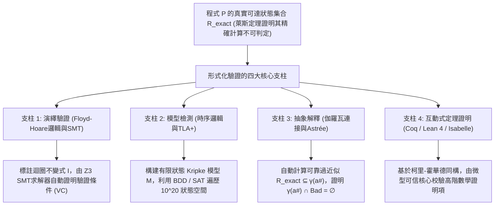
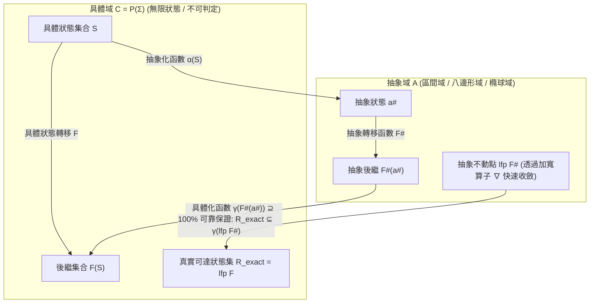

## 1. 軟體測試的極限與不可判定性之牆：為什麼「通過100萬次測試」毫無數學保證？

### 1.1 戴克斯特拉的不朽名言與輸入空間的指數級爆炸

1969年，圖靈獎得主、結構化程式設計先驅<strong>艾茲格·戴克斯特拉（Edsger W. Dijkstra）</strong>在北約（NATO）軟體工程會議上留下了一句震撼計算機科學史的至理名言：

> <strong>"Program testing can be used to show the presence of bugs, but never to show their absence!"</strong>
> （程式測試可以用來證明Bug的<strong>存在</strong>，但絕不能用來證明Bug的<strong>不存在</strong>！）

在現代軟體工程中，單元測試、整合測試與模糊測試（Fuzzing）構成了品質保障的基石。然而，從嚴格的數學角度來看，任何有限次數的動態測試都無法窮盡程式的全部可能行為。考慮一個僅接收兩個64位元有號整數 `(x, y)` 的純函數，其可能的輸入組合總數高達：

$$N_{\text{inputs}} = 2^{64} \times 2^{64} = 2^{128} \approx 3.4028 \times 10^{38}$$

即使動用每秒執行10億次（$10^9$次）測試的超級電腦，窮舉這一個簡單函數的全部輸入也需要約 <strong>$1.08 \times 10^{22}$ 年</strong>——相當於宇宙年齡（約 $1.38 \times 10^{10}$ 年）的7800億倍！如果再加上堆積記憶體指標、網路封包亂序以及多執行緒排程的非確定性交錯（Interleaving），執行路徑的數量將直接發散至<strong>無窮大（$\infty$）</strong>。

2006年，Google工程師<strong>約書亞·布洛赫（Joshua Bloch）</strong>揭露了潛伏在Java標準函式庫（`java.util.Arrays.binarySearch`）中長達<strong>9年</strong>的<strong>二分搜尋整數溢位Bug</strong>：

```java
public static int binarySearch(int[] a, int key) {
    int low = 0;
    int high = a.length - 1;
    while (low <= high) {
        int mid = (low + high) / 2; // ★ 致命算術溢位：當 low + high >= 2^31 時變為負數！
        int midVal = a[mid];
        if (midVal < key) low = mid + 1;
        else if (midVal > key) high = mid - 1;
        else return mid;
    }
    return -(low + 1);
}
```

當陣列長度很大且搜尋區間位於後半段，使得 `low + high` 超過32位元有號整數上限 $2^{31}-1 = 2,147,483,647$ 時，加法會發生二補數溢位變成負數，立即引發 `ArrayIndexOutOfBoundsException` 崩潰。全球數億台設備執行了9年、通過了無數測試，卻從未在測試中觸發這一邊界條件。

### 1.2 圖靈停機問題（1936）與萊斯定理（1953）

既然動態測試無法窮舉，能否編寫一個全自動靜態分析器，讀取任意程式 $P$ 的原始碼並100%準確地判定它是否存在Bug？

<strong>艾倫·圖靈的停機問題（Halting Problem, 1936）</strong>與<strong>亨利·戈登·萊斯的萊斯定理（Rice's Theorem, 1953）</strong>給出了否定回答：

$$\text{定理（Rice, 1953）：圖靈完備語言中，可計算函數的任何非平凡語義性質 } \mathcal{S} \text{ 都是不可判定的（Undecidable）。}$$

「不發生除零錯誤」、「不發生整數溢位」、「不解參考空指標」全部屬於非平凡語義性質。這意味著，沒有任何驗證工具能夠同時滿足以下三點：<strong>（1）全自動終止</strong>、<strong>（2）可靠性（Soundness：無漏報/零偽陰性）</strong>、<strong>（3）完備性（Completeness：無誤報/零偽陽性）</strong>。

### 1.3 形式化驗證如何突破萊斯定理？可靠性優先與過近似（Over-Approximation）

<strong>形式化驗證（Formal Verification）</strong>之所以能證明航太飛控軟體、作業系統核心與密碼庫「100%絕無Bug」，是因為它<strong>絕對堅守可靠性（Soundness：只要判定為SAFE，則在所有 $\infty$ 條路徑上100%安全）</strong>，並戰略性地放棄完全自動化（引入互動式定理證明或人工迴圈不變式）或放棄完備性（計算<strong>可靠的過近似集合 Sound Over-Approximation</strong>）。



設程式 $P$ 的真實可達狀態集為 $\mathcal{R}_{\text{exact}}$，危險狀態集為 $\mathcal{B}$。驗證器透過構造一個稍大的過近似包絡集合 $\mathcal{R}_{\text{approx}} \supseteq \mathcal{R}_{\text{exact}}$，只要證明：

$$\mathcal{R}_{\text{approx}} \cap \mathcal{B} = \emptyset \implies \mathcal{R}_{\text{exact}} \cap \mathcal{B} = \emptyset$$

即可在不執行程式一次的情況下，從數學上100%保證程式永遠不會進入任何危險狀態！

---

## 2. 第一支柱：演繹驗證 —— 弗洛伊德-霍爾邏輯、最弱前置條件與SMT求解器

### 2.1 霍爾三元組（Hoare Triple）與部分正確性、完全正確性

1969年，<strong>東尼·霍爾（C. A. R. Hoare）</strong>在羅伯特·弗洛伊德工作的基礎上提出了<strong>弗洛伊德-霍爾邏輯（Floyd-Hoare Logic）</strong>。其核心是<strong>霍爾三元組</strong>：

$$\{P\}\; C \;\{Q\}$$

其中 $P$ 為<strong>前置條件（Precondition）</strong>，$C$ 為程式命令，$Q$ 為<strong>後置條件（Postcondition）</strong>。
- <strong>部分正確性（Partial Correctness）</strong>：若初始狀態滿足 $P$，且 $C$ <strong>如果終止</strong>，則終止狀態必滿足 $Q$。
- <strong>完全正確性（Total Correctness）</strong>：若初始狀態滿足 $P$，則 $C$ <strong>必然在有限步內終止</strong>，且終止狀態滿足 $Q$。

### 2.2 霍爾邏輯的核心推理規則與迴圈不變式（Loop Invariant）

霍爾邏輯將程式語法映射為形式推理規則：

1. <strong>賦值公理（Assignment Axiom）</strong>：
   $$\frac{}{\{Q[E/x]\}\; x := E \;\{Q\}}$$
   要使賦值 $x := E$ 後滿足 $Q$，賦值前必須滿足將 $Q$ 中所有自由變數 $x$ 替換為 $E$ 後的邏輯式 $Q[E/x]$。
2. <strong>順序複合與條件分支規則</strong>：
   $$\frac{\{P\}\; C_1 \;\{R\} \qquad \{R\}\; C_2 \;\{Q\}}{\{P\}\; C_1 ; C_2 \;\{Q\}}, \qquad \frac{\{P \land B\}\; C_1 \;\{Q\} \qquad \{P \land \neg B\}\; C_2 \;\{Q\}}{\{P\}\; \text{if } B \text{ then } C_1 \text{ else } C_2 \;\{Q\}}$$
3. <strong>While迴圈規則（部分正確性與完全正確性）</strong>：
   為了在不展開無限迴圈的前提下證明迴圈正確，必須引入在每次迭代前後恆成立的<strong>迴圈不變式（Loop Invariant）</strong> $I$，以及取值於自然數 $\mathbb{N}$ 且每次迭代嚴格遞減的<strong>秩函數（Ranking Function / Loop Variant）</strong> $V$：
   $$\frac{\{I \land B \land V = v_0\}\; S \;\{I \land V < v_0\} \qquad (I \land B) \implies V \ge 0}{[I]\; \text{while } B \text{ do } S \;[I \land \neg B]}$$

1975年，戴克斯特拉進一步提出<strong>最弱前置條件演算（Weakest Precondition, $\text{wp}(C, Q)$）</strong>，將 $\{P\}\; C \;\{Q\}$ 的證明自動轉化為純數學<strong>驗證條件（Verification Condition, VC）</strong>：$P \implies \text{wp}(C, Q)$。

### 2.3 使用 Dafny 與 Z3 SMT求解器證明二分搜尋100%無Bug

在 <strong>Dafny</strong>、<strong>Frama-C</strong> 或 <strong>SPARK Ada</strong> 中，當我們把二分搜尋的中點計算修復為 `mid := low + (high - low) / 2` 並標註迴圈不變式與秩函數後，底層的 <strong>Z3 SMT求解器</strong>（基於DPLL(T)架構，融合未解釋函數EUF、線性整數算術LIA、位元向量理論Bit-Vectors與陣列理論Arrays）會在幾毫秒內自動完成全部數學證明：

```dafny
method BinarySearch(a: array<int>, key: int) returns (index: int)
  requires forall i, j :: 0 <= i < j < a.Length ==> a[i] <= a[j]
  ensures 0 <= index ==> index < a.Length && a[index] == key
  ensures index < 0 ==> forall k :: 0 <= k < a.Length ==> a[k] != key
{
  var low := 0;
  var high := a.Length;
  while low < high
    invariant 0 <= low <= high <= a.Length
    invariant forall i :: 0 <= i < a.Length && !(low <= i < high) ==> a[i] != key
    decreases high - low
  {
    var mid := low + (high - low) / 2; // Z3 嚴格證明：絕不溢位且 0 <= mid < a.Length
    if a[mid] < key { low := mid + 1; }
    else if key < a[mid] { high := mid; }
    else { return mid; }
  }
  return -1;
}
```

當迴圈退出時，不變式 $0 \le \text{low} \le \text{high}$ 與迴圈條件否定 $\neg(\text{low} < \text{high})$ 結合，立即導出 $\text{low} = \text{high}$，半開區間 $[\text{low}, \text{high})$ 坍縮為空集 $\emptyset$，從而直接證明整個陣列中都不存在 `key`！

---

## 3. 第二支柱：模型檢測與時序邏輯 —— 並行與分散式系統的全狀態空間探索

### 3.1 克里普克結構（Kripke Structure）與時序邏輯（LTL / CTL）

對於作業系統鎖、CPU快取一致性協定以及Amazon S3、DynamoDB等24小時執行的<strong>並行與分散式反應式系統（Reactive Systems）</strong>，2007年圖靈獎得主<strong>克拉克（Clarke）</strong>、<strong>愛默生（Emerson）</strong>、<strong>希法基斯（Sifakis）</strong>創立了<strong>模型檢測（Model Checking, 1981）</strong>，2013年圖靈獎得主<strong>萊斯利·蘭伯特（Leslie Lamport）</strong>創立了 <strong>TLA+</strong>。

系統被建模為克里普克結構 $M = (S, S_0, R, L)$。利用阿米爾·普努埃利（Amir Pnueli）引入的<strong>線性時序邏輯（LTL）</strong>與<strong>計算樹邏輯（CTL）</strong>，我們可以精確刻畫系統的兩類核心屬性：

1. <strong>安全性（Safety — 「壞事永遠不會發生」）</strong>：例如互斥鎖絕不讓兩個行程同時進入臨界區：
   $$\text{LTL}: \quad \mathbf{G}\, \neg (\text{crit}_1 \land \text{crit}_2) \qquad \text{CTL}: \quad \mathbf{AG}\, \neg (\text{crit}_1 \land \text{crit}_2)$$
2. <strong>活性（Liveness — 「好事最終一定會發生」）</strong>：例如行程請求鎖後最終一定能獲得鎖（無飢餓性）：
   $$\text{LTL}: \quad \mathbf{G}\, (\text{req}_1 \implies \mathbf{F}\, \text{crit}_1) \qquad \text{CTL}: \quad \mathbf{AG}\, (\text{req}_1 \implies \mathbf{AF}\, \text{crit}_1)$$

### 3.2 比奇自動機（Büchi Automata）、符號模型檢測（BDD/IC3）與AWS TLA+實踐

LTL模型檢測器（如SPIN）將性質否定 $\neg \varphi$ 轉化為接受無限字的<strong>比奇自動機（Büchi Automaton）</strong> $A_{\neg \varphi}$，並透過檢驗同步乘積自動機是否為空集：

$$\mathcal{L}(M \times A_{\neg \varphi}) = \emptyset$$

來驗證系統。一旦發現可達的接受強連通分量（套索形環 Lasso），工具就會輸出一條<strong>100%可重現的Bug反例軌跡（Counterexample Trace）</strong>。

為了克服並行系統的<strong>狀態空間爆炸問題（State Explosion Problem）</strong>，<strong>布萊恩特（Bryant, 1986）</strong>與<strong>麥克米倫（McMillan, 1990）</strong>利用<strong>有序二元決策圖（ROBDD）</strong>實現了<strong>符號模型檢測（Symbolic Model Checking）</strong>，一舉驗證了超過 $10^{20}$ 個狀態的硬體電路；而<strong>有界模型檢測（BMC）</strong>與 <strong>IC3 / PDR（Property Directed Reachability）</strong> 則進一步結合SAT求解器實現了超大規模工業驗證。

在工業界，<strong>Amazon Web Services (AWS)</strong> 團隊在設計 <strong>S3</strong> 和 <strong>DynamoDB</strong> 時廣泛採用 <strong>TLA+（TLC模型檢測器）</strong>，在編寫任何生產程式碼之前，成功捕獲了一個需要<strong>35步特定網路故障、延遲與主節點切換交錯</strong>才能觸發的致命資料遺失Bug——這是人工審查與混沌測試永遠不可能發現的深層缺陷。

---

## 4. 第三支柱：抽象解釋（Abstract Interpretation）與亞利安5號火箭爆炸的慘痛教訓

### 4.1 1996年6月4日：價值3.7億美元的亞利安5號為何在升空37秒後自毀？

1996年6月4日，歐洲太空總署（ESA）的<strong>亞利安5號（Ariane 5）</strong>火箭首飛（Flight 501）在升空僅<strong>37秒</strong>後偏離航線並凌空爆炸，損失高達<strong>3.7億美元</strong>。事故原因震驚世界：慣性基準系統（SRI）直接複用了亞利安4號的Ada程式碼，其中一行指令將表示水平速度偏差的64位元浮點數 `BH` 強制轉換為<strong>16位元有號整數（範圍 $-32,768 \sim +32,767$）</strong>。由於亞利安5號推力遠超前代，升空37秒後 `BH` 突破了 $32,767$，觸發未捕獲的硬體算術溢位例外（Operand Error），導致主備雙機在72毫秒內相繼停機，並將錯誤診斷位元模式發給主飛控電腦（OBC），被誤認為極端姿態傾角而將噴管打到極限，導致火箭解體。

### 4.2 庫索夫婦的抽象解釋（1977）、伽羅瓦連接與空中巴士A380的零誤報奇蹟

法國計算機科學家<strong>帕特里克·庫索（Patrick Cousot）</strong>與<strong>拉迪亞·庫索（Radhia Cousot）</strong>早在1977年提出的<strong>抽象解釋（Abstract Interpretation）</strong>理論為此提供了終極解藥。

抽象解釋在<strong>具體域</strong> $(\mathcal{C}, \subseteq) = (\mathcal{P}(\Sigma), \subseteq)$ 與<strong>抽象域</strong> $(\mathcal{A}, \sqsubseteq^\#)$（如區間域 Intervals $[a,b]$、八邊形域 Octagons $\pm x \pm y \le c$、凸多面體域 Polyhedra）之間建立<strong>伽羅瓦連接（Galois Connection）</strong>：

$$(\mathcal{C}, \subseteq) \underset{\alpha}{\overset{\gamma}{\leftrightarrows}} (\mathcal{A}, \sqsubseteq^\#) \quad \text{滿足} \quad \alpha(S) \sqsubseteq^\# a^\# \iff S \subseteq \gamma(a^\#)$$

只要抽象轉移函數 $F^\#$ 滿足局部可靠性條件 $\alpha(F(\gamma(a^\#))) \sqsubseteq^\# F^\#(a^\#)$，配合加速迴圈收斂的<strong>加寬算子（Widening Operator $\nabla$）</strong>，抽象最小不動點 $\text{lfp}\, F^\#$ 就必然可靠地包絡全部真實可達狀態：

$$\mathcal{R}_{\text{exact}} = \text{lfp}\, F \subseteq \gamma(\text{lfp}\, F^\#)$$



庫索團隊開發的靜態分析器 <strong>Astrée</strong> 結合區間域、八邊形域、二階數位濾波器<strong>橢球抽象域（Ellipsoid Domain）</strong>與浮點捨入誤差域，對<strong>空中巴士A380（Airbus A380）近100萬行C語言線傳飛控軟體</strong>進行了全自動形式化分析，以<strong>零誤報（Zero False Alarms）</strong>數學證明了該軟體在任何飛行條件下<strong>絕不會發生任何整數/浮點溢位、除零、陣列越界或非法指標解參考</strong>！

---

## 5. 終極保障：互動式定理證明（Coq / Lean 4 / Isabelle）與四大支柱全景對比

當需要證明任意高階數學性質時，基於<strong>柯里-霍華德同構（Curry-Howard Isomorphism：命題即型別，證明即程式）</strong>的互動式定理證明器（<strong>Coq / Rocq</strong>、<strong>Lean 4</strong>、<strong>Isabelle/HOL</strong>）創造了兩大工業奇蹟：
1. <strong>CompCert（Xavier Leroy, INRIA）</strong>：在Coq中完整證明語義保持定理的C語言最佳化編譯器。在約翰·雷格爾（John Regehr）團隊著名的 <strong>Csmith</strong> 模糊測試實驗中，GCC和LLVM被測出超過325個錯誤編譯Bug，而<strong>CompCert被驗證的中間端是唯一一個零Bug的編譯器</strong>！
2. <strong>seL4（Gerwin Klein et al.）</strong>：在Isabelle/HOL中完成從C原始碼到ARM/RISC-V機器碼二進位級別完全功能正確性與機密性證明的微核心作業系統。

| 驗證範式 | 數學基礎 | 代表工具與語言 | 自動化程度 | 工業界標竿應用 | 核心優勢與折衷 |
| :--- | :--- | :--- | :--- | :--- | :--- |
| <strong>1. 演繹驗證</strong> | 霍爾邏輯、最弱前置條件 $\text{wp}$、SMT求解器 | <strong>Dafny</strong>, <strong>Frama-C</strong>, <strong>SPARK Ada</strong>, <strong>Verus</strong>, <strong>Z3</strong> | 半自動（人工/AI提供不變式，SMT自動證明） | 密碼學庫、航空管制系統、AWS Cedar權限引擎 | 直接在原始碼上證明深度功能正確性；需構造迴圈不變式。 |
| <strong>2. 模型檢測</strong> | Kripke結構、時序邏輯 (LTL/CTL)、比奇自動機、BDD | <strong>TLA+ (TLC)</strong>, <strong>SPIN</strong>, <strong>NuSMV</strong>, <strong>CBMC</strong> | 全自動（針對有限狀態抽象模型） | <strong>AWS S3 / DynamoDB</strong>、Paxos/Raft協定、CPU電路 | 自動生成並行系統深層Bug的具體反例軌跡；面臨狀態爆炸。 |
| <strong>3. 抽象解釋</strong> | 完備格、伽羅瓦連接 $(\alpha,\gamma)$、加寬算子 $\nabla$ | <strong>Astrée</strong>, <strong>Polyspace</strong>, <strong>Infer</strong> (Meta) | 全自動（自動推導迴圈不變式） | <strong>空中巴士A380/A350飛控軟體</strong>、車載嵌入式C程式碼 | 直接擴展至百萬行級C程式碼，100%證明無執行期崩潰。 |
| <strong>4. 互動式定理證明</strong> | 柯里-霍華德同構、依值型別論 / 高階邏輯 | <strong>Coq (Rocq)</strong>, <strong>Lean 4</strong>, <strong>Isabelle/HOL</strong> | 互動式（人工 + 策略 + AI協同） | <strong>CompCert</strong> C編譯器、<strong>seL4</strong> 作業系統微核心 | 表達力無上限，微型核心保障100%數學確定性；證明成本最高。 |

今天，<strong>大型語言模型（LLM）與形式化驗證器（Lean 4 / Dafny / Z3）的深度融合（Vericoding）</strong>正在開啟軟體工程的新紀元：AI負責高速生成程式碼與迴圈不變式猜想，形式化驗證器作為絕對不會產生「幻覺」的數學裁判進行嚴格校驗——人類終於迎來了真正「零Bug」的高可靠軟體時代。
