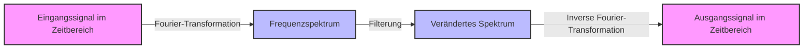

## 1. Einführung: Wellen als Überlagerungen betrachten

Schall, Licht und elektromagnetische Wellen umgeben uns. Lässt sich eine komplizierte, unregelmäßige Wellenform als Kombination einfacher Wellen verstehen? Die mit Joseph Fourier verbundene **Fourier-Reihe** und die **Fourier-Transformation**, die ein kontinuierliches Frequenzspektrum verwendet, beschreiben diese Idee mathematisch. Dabei müssen die Voraussetzungen an die Funktionen und der Begriff der Konvergenz angegeben werden.

Dieser Artikel erläutert die grundlegenden Formeln, ihre anschauliche Bedeutung und ein Beispiel aus der modernen Signalverarbeitung.

## 2. Fourier-Reihe: Periodische Wellen zerlegen

Eine Fourier-Reihe stellt eine periodische Funktion durch trigonometrische Anteile dar, deren Frequenzen ganzzahlige Vielfache der Grundfrequenz sind. Dass sich Koeffizienten berechnen lassen, bedeutet allein noch nicht, dass die Reihe an jedem Punkt zum ursprünglichen Funktionswert konvergiert. Wir betrachten hier stückweise glatte periodische Funktionen: Eine Periode lässt sich in endlich viele Intervalle zerlegen, in deren Innerem die Funktion stetig differenzierbar ist; an den Intervallenden besitzen sowohl die Funktion als auch ihre Ableitung endliche einseitige Grenzwerte. Unter dieser hinreichenden Voraussetzung konvergiert die Reihe an Stetigkeitsstellen zum Funktionswert und an Sprungstellen zum Mittelwert der links- und rechtsseitigen Grenzwerte.

$$
\lim_{M\to\infty} S_M(x)=\frac{f(x-)+f(x+)}{2}
$$

$S_M$ ist die Partialsumme bis zur $M$-ten Harmonischen. Auch am Übergang zwischen zwei Perioden sind die Grenzwerte der periodischen Fortsetzung zu verwenden. In der Nähe eines Sprungs bleibt das Überschwingen des Gibbs-Phänomens beim Hinzufügen weiterer Terme bestehen. Mehr Terme lassen den Fehler deshalb nicht auf dem gesamten Intervall gleichmäßig gegen null gehen.

### 2.1 Reelle Form der Fourier-Reihe

Für eine reellwertige Funktion mit Periode $2\pi$, die die genannten Voraussetzungen erfüllt, gilt die folgende Gleichung an Stetigkeitsstellen. Winkel werden im Bogenmaß angegeben. An einer Sprungstelle ist die linke Seite durch den Mittelwert der einseitigen Grenzwerte zu ersetzen.

$$
f(x) = \frac{a_0}{2} + \sum_{n=1}^{\infty} \left( a_n \cos(nx) + b_n \sin(nx) \right)
$$

$a_0,a_n,b_n$ heißen **Fourier-Koeffizienten**. Der konstante Term, also der Gleichanteil und Mittelwert über eine Periode, ist $a_0/2$ und nicht $a_0$. Für $n\ge1$ sind $a_n,b_n$ die Gewichte der Kosinus- und Sinusanteile. Aus der Orthogonalität der trigonometrischen Funktionen ergeben sich die Formeln:

$$
a_0 = \frac{1}{\pi} \int_{-\pi}^{\pi} f(x) dx
$$

$$
a_n = \frac{1}{\pi} \int_{-\pi}^{\pi} f(x) \cos(nx) dx
$$

$$
b_n = \frac{1}{\pi} \int_{-\pi}^{\pi} f(x) \sin(nx) dx
$$

### 2.2 Komplexe Form der Fourier-Reihe

Mit der [Eulerschen Formel](/de/p/eulers-identity/) $e^{i\theta}=\cos\theta+i\sin\theta$ lässt sich dieselbe Reihe durch komplexe Exponentialfunktionen ausdrücken. Die zweiseitige Summe ist als Grenzwert der symmetrischen Partialsummen von $n=-M$ bis $M$ zu lesen. Die Gleichheit an Stetigkeitsstellen und die Einschränkung an Sprungstellen entsprechen der reellen Form.

$$
f(x) = \sum_{n=-\infty}^{\infty} c_n e^{inx}
$$

$$
c_n = \frac{1}{2\pi} \int_{-\pi}^{\pi} f(x) e^{-inx} dx
$$

Für reellwertiges $f$ gilt $c_0=a_0/2$, $c_n=(a_n-ib_n)/2$ und $c_{-n}=(a_n+ib_n)/2$ für $n\ge1$. Auch die Darstellung einer reellen Wellenform durch komplexe Exponentialfunktionen enthält somit negative Frequenzen. Diese Form macht außerdem den Zusammenhang mit der Fourier-Transformation anschaulicher.

## 3. Fourier-Transformation: Über periodische Funktionen hinaus

Fourier-Reihen lassen sich auch auf periodisch fortgesetzte Funktionen anwenden. Um einen einzelnen Impuls oder ein anderes Signal auf der gesamten reellen Achse zu beschreiben, ist jedoch die **Fourier-Transformation** mit kontinuierlich veränderlicher Frequenz nützlich. Eine längere Periode und entsprechend kleinere Frequenzabstände liefern eine anschauliche Verbindung. Das Vertauschen von Grenzwerten und Integralen verlangt Voraussetzungen; diese Anschauung allein ist daher kein allgemeiner Beweis.

### 3.1 Definition und Rücktransformation

Wir verwenden ein Minuszeichen im Exponenten der Hintransformation und den Faktor $1/(2\pi)$ in der Rücktransformation. Wenn $\int_{-\infty}^{\infty}|f(t)|\,dt<\infty$ gilt, konvergiert die folgende Hintransformation für jedes reelle $\omega$ absolut.

$$
F(\omega) = \int_{-\infty}^{\infty} f(t) e^{-i\omega t} dt
$$

Ist beispielsweise $f$ stetig und sind sowohl $f$ als auch $F$ absolut integrierbar, so gewinnt die Rücktransformation $f$ wie folgt zurück. Diese Formel gilt nicht ohne Voraussetzungen für eine beliebige Funktion.

$$
f(t) = \frac{1}{2\pi} \int_{-\infty}^{\infty} F(\omega) e^{i\omega t} d\omega
$$

Wir messen $t$ in Sekunden und bezeichnen mit $\omega$ die Kreisfrequenz in rad/s. Zur Frequenz $\nu$ in Hertz besteht die Beziehung $\omega=2\pi\nu$. Die komplexwertige Funktion $F(\omega)$ beschreibt die Gewichte eines kontinuierlichen Spektrums. Wo $F\ne0$ ist, geben Betrag und Argument Größe und Phase an. Das Gewicht in einem kontinuierlichen Spektrum ist nicht unmittelbar die Amplitude eines einzelnen Anteils eines periodischen Signals.

Bei Funktionen mit Sprüngen können zusätzliche Regularitätsvoraussetzungen und ein symmetrisches uneigentliches Integral den Mittelwert der einseitigen Grenzwerte liefern. Quadratintegrierbare Funktionen und periodische Signale können Erweiterungen im $L^2$-Sinn beziehungsweise im Sinne von Distributionen erfordern. Diese Theorie wird hier nicht ausgeführt. Vorzeichen und Normierung unterscheiden sich je nach Quelle; Hin- und Rücktransformation sind deshalb immer als Paar zu prüfen.

### 3.2 Signalverarbeitung

Das Diagramm zeigt die Verarbeitung eines Signals im Frequenzbereich.



## 4. Diskrete Fourier-Transformation (DFT) und schnelle Fourier-Transformation (FFT)

Die **diskrete Fourier-Transformation (DFT)** bildet eine endliche Folge $x_0,\ldots,x_{N-1}$ auf dieselbe Anzahl von Frequenzkomponenten ab. Diese endliche Transformation ist davon zu unterscheiden, ein Integral der kontinuierlichen Fourier-Transformation einfach durch eine Summe zu ersetzen. Bei einem Zeitsignal erfolgen zuerst die Abtastung und die Auswahl eines endlichen Beobachtungsintervalls. DFT und inverse DFT bilden das Paar:

$$
X_k = \sum_{n=0}^{N-1} x_n e^{-i \frac{2\pi}{N} k n} \quad \text{for } k = 0, 1, \dots, N-1
$$

$$
x_n=\frac{1}{N}\sum_{k=0}^{N-1}X_k e^{i\frac{2\pi}{N}kn} \quad \text{for } n=0,1,\dots,N-1
$$

Bei einer Abtastfrequenz $f_s$ beträgt der Abstand der Frequenzrasterpunkte, auch *Bins* genannt, $f_s/N$ Hz. Die DFT entspricht der Betrachtung, dass sich die endliche Folge periodisch wiederholt. Signalanteile vor der Abtastung mit Frequenzen bei oder oberhalb von $f_s/2$ führen zu Aliasing oder Mehrdeutigkeit. Die Rekonstruktion eines kontinuierlichen Signals erfordert deshalb Annahmen wie eine Bandbegrenzung. Wenn eine Sinusschwingung im Beobachtungsintervall keine ganze Zahl von Perioden durchläuft, tritt außerdem spektrale Leckage auf: Ihre Energie verteilt sich auf mehrere Bins.

Die direkte Berechnung aller $N$ DFT-Komponenten benötigt $O(N^2)$ Rechenoperationen. Die [schnelle Fourier-Transformation (FFT)](/de/p/fast-fourier-transform-algorithm/) ist eine Familie von Algorithmen, die dieselbe DFT effizient berechnen. Beispielsweise lässt sich für eine Länge, die eine Zweierpotenz ist, durch rekursive Zerlegung $O(N\log N)$ erreichen. FFT bezeichnet eine Berechnungsmethode, keine andere Transformation und auch nicht an sich eine Näherung. Sie wird vielfach in der digitalen Signalverarbeitung eingesetzt, etwa bei Audiosignalen. Das Basisverfahren des üblichen verlustbehafteten JPEG verwendet dagegen eine diskrete Kosinustransformation (DCT). Die Verfahren sind verwandt, doch JPEG sollte nicht einfach als direkte FFT-Anwendung beschrieben werden.

### 4.1 Zwei Frequenzen und ihre Amplituden mit Python prüfen

Das Beispiel verwendet NumPy und Matplotlib. Wir tasten eine Sekunde mit 1.000 Hz ab und überlagern eine Sinusschwingung mit 50 Hz und Amplitude 1 sowie eine mit 120 Hz und Amplitude 0,5. Da die Eingabe reell ist, verwenden wir `rfft` und `rfftfreq`. Beide Frequenzen liegen genau auf Bins im Abstand von 1 Hz und unterhalb von 500 Hz.

```python
import numpy as np
import matplotlib.pyplot as plt

# Eine Sekunde mit 1000 Hz abtasten; den Endpunkt bei einer Sekunde ausschließen
fs = 1000.0
N = 1000
t = np.arange(N) / fs
signal = np.sin(2 * np.pi * 50 * t) + 0.5 * np.sin(2 * np.pi * 120 * t)

# DFT der nichtnegativen Frequenzen eines reellen Signals
fft_result = np.fft.rfft(signal)
frequencies = np.fft.rfftfreq(N, d=1 / fs)

# Einseitige Amplitude: Gleichanteil und Nyquist bei geradem N nicht verdoppeln
amplitude = np.abs(fft_result) / N
if N % 2 == 0:
    amplitude[1:-1] *= 2
else:
    amplitude[1:] *= 2

peak_indices = np.argsort(amplitude)[-2:]
for k in sorted(peak_indices, key=lambda k: frequencies[k]):
    print(f"{frequencies[k]:.0f} Hz: {amplitude[k]:.3f}")

fig, ax = plt.subplots()
ax.plot(frequencies, amplitude)
ax.set(xlim=(0, 200), xlabel="Frequency (Hz)", ylabel="Amplitude",
       title="One-sided amplitude spectrum")
ax.grid(True)
fig.tight_layout()
plt.show()
```

Die gerundete Ausgabe lautet `50 Hz: 1.000` und `120 Hz: 0.500`; die Python-Ausgabe verwendet den Dezimalpunkt. Die standardmäßige Hintransformation von `rfft` teilt nicht durch $N$, weshalb wir zur Amplitudendarstellung wie oben normieren. Beim Zusammenfassen eines positiven und negativen Frequenzpaares eines reellen Signals werden nur die inneren Bins verdoppelt; der Gleichanteil und bei gerader Länge die Nyquist-Komponente bleiben ausgenommen. Das liefert die Amplituden der auf Bins liegenden, nicht gefensterten Sinusschwingungen dieses Beispiels. Dieselbe Formel allein garantiert keine exakten Amplituden für beliebige Signale oder gefensterte Daten.

## 5. Fazit

Fourier-Reihe und Fourier-Transformation helfen, komplizierte Phänomene in einfache Anteile zu zerlegen. Der Blick auf ein Signal im Frequenzbereich kann verborgene Muster zeigen und die Verarbeitung von Informationen erleichtern.

Periodizität, Konvergenzvoraussetzungen, Frequenzeinheiten und Normierung müssen festgelegt werden. Die Unterscheidung zwischen DFT und den sie berechnenden FFT-Algorithmen verdeutlicht auch den Zusammenhang zwischen Formeln und Programmen.

## Quellen

- [MIT ES.1803 Topic 22: Koeffizienten, Konvergenz, Gibbs-Phänomen und Orthogonalität (§22.5–22.7)](https://ocw.mit.edu/courses/es-1803-differential-equations-spring-2024/mites_1803_s24_topic22.pdf)
- [MIT 18.330: Transformation und Inversion (Kapitel 6, Definition 14)](https://math.mit.edu/icg/resources/teaching/18.330/18.330-Apr29.pdf)
- [NIST DLMF §1.14(i): Definition und Inversionsbedingungen; andere Vorzeichen und Normierung als hier](https://dlmf.nist.gov/1.14#i)
- [MIT 6.341 Lecture 19: Rechenaufwand von DFT und FFT](https://ocw.mit.edu/courses/6-341-discrete-time-signal-processing-fall-2005/4ee39a5e74c9f5099ac516ce57215c96_lec19.pdf)
- [NumPy 2.3: FFT](https://numpy.org/doc/2.3/reference/generated/numpy.fft.fft.html), [rfft für reelle Eingaben](https://numpy.org/doc/2.3/reference/generated/numpy.fft.rfft.html) und [Frequenzraster von rfftfreq](https://numpy.org/doc/2.3/reference/generated/numpy.fft.rfftfreq.html)
- [ITU-T T.81: Verlustbehaftetes JPEG mit DCT (§4.2–4.3)](https://www.w3.org/Graphics/JPEG/itu-t81.pdf)
