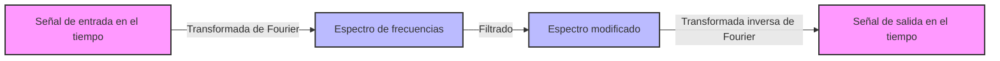

## 1. Introducción: pensar en la suma de ondas

El sonido, la luz y las ondas electromagnéticas nos rodean. ¿Podemos entender una forma de onda compleja e irregular como una combinación de ondas simples? Las **series de Fourier**, asociadas a Joseph Fourier, y la **transformada de Fourier**, que utiliza un conjunto continuo de frecuencias, dan una expresión matemática a esta idea. Para utilizarlas debemos indicar las condiciones sobre las funciones y el significado de la convergencia.

Este artículo presenta las fórmulas fundamentales, su interpretación intuitiva y un ejemplo de aplicación al procesamiento moderno de señales.

## 2. Series de Fourier: descomponer ondas periódicas

Una serie de Fourier representa una función periódica mediante componentes trigonométricas cuyas frecuencias son múltiplos enteros de la frecuencia fundamental. Poder calcular los coeficientes no implica, por sí solo, que la serie converja al valor de la función en cada punto. Aquí consideramos funciones periódicas suaves a trozos: un período puede dividirse en un número finito de intervalos en cuyo interior la función es continuamente derivable, y tanto la función como su derivada tienen límites laterales finitos en los extremos. Bajo esta condición suficiente, la serie converge al valor de la función en los puntos de continuidad y al promedio de los límites laterales en los saltos.

$$
\lim_{M\to\infty} S_M(x)=\frac{f(x-)+f(x+)}{2}
$$

$S_M$ es la suma parcial hasta el armónico de orden $M$. En la unión entre períodos se utilizan los límites de la extensión periódica. Cerca de un salto persiste el sobreimpulso del fenómeno de Gibbs al aumentar el número de términos. Por ello, añadir términos no hace que el error tienda uniformemente a cero en todo el intervalo.

### 2.1 Forma real de la serie de Fourier

Para una función de valores reales y período $2\pi$ que cumpla las condiciones anteriores, la igualdad siguiente es válida en los puntos de continuidad. Los ángulos se expresan en radianes. En un salto, el miembro izquierdo se sustituye por el promedio de los límites laterales.

$$
f(x) = \frac{a_0}{2} + \sum_{n=1}^{\infty} \left( a_n \cos(nx) + b_n \sin(nx) \right)
$$

Los números $a_0,a_n,b_n$ son los **coeficientes de Fourier**. El término constante, o componente continua, es el promedio sobre un período: $a_0/2$, no $a_0$. Para $n\ge1$, $a_n$ y $b_n$ son los pesos de las componentes coseno y seno. La ortogonalidad de las funciones trigonométricas proporciona las fórmulas:

$$
a_0 = \frac{1}{\pi} \int_{-\pi}^{\pi} f(x) dx
$$

$$
a_n = \frac{1}{\pi} \int_{-\pi}^{\pi} f(x) \cos(nx) dx
$$

$$
b_n = \frac{1}{\pi} \int_{-\pi}^{\pi} f(x) \sin(nx) dx
$$

### 2.2 Forma compleja de la serie de Fourier

La [fórmula de Euler](/es/p/eulers-identity/), $e^{i\theta}=\cos\theta+i\sin\theta$, permite expresar la misma serie con exponenciales complejas. La suma bilateral siguiente se interpreta como el límite de las sumas parciales simétricas desde $n=-M$ hasta $M$. La igualdad en puntos de continuidad y la salvedad en los saltos son las mismas que en la forma real.

$$
f(x) = \sum_{n=-\infty}^{\infty} c_n e^{inx}
$$

$$
c_n = \frac{1}{2\pi} \int_{-\pi}^{\pi} f(x) e^{-inx} dx
$$

Para $f$ de valores reales, $c_0=a_0/2$, $c_n=(a_n-ib_n)/2$ y $c_{-n}=(a_n+ib_n)/2$, con $n\ge1$. Las frecuencias negativas aparecen incluso al representar una onda real mediante exponenciales complejas. Esta forma también ayuda a entender la conexión con la transformada de Fourier.

## 3. Transformada de Fourier: más allá de las funciones periódicas

Las series también pueden aplicarse a funciones extendidas periódicamente. Sin embargo, para describir un pulso aislado u otra señal en toda la recta real resulta útil la **transformada de Fourier**, con frecuencias que varían de forma continua. Aumentar el período y reducir así la separación entre frecuencias ofrece una conexión intuitiva. Intercambiar límites e integrales exige condiciones, por lo que esa intuición no constituye por sí sola una demostración general.

### 3.1 Definición e inversión

Usamos signo negativo en el exponente de la transformada directa y el factor $1/(2\pi)$ en la inversa. Si $\int_{-\infty}^{\infty}|f(t)|\,dt<\infty$, la transformada directa siguiente converge absolutamente para todo $\omega$ real.

$$
F(\omega) = \int_{-\infty}^{\infty} f(t) e^{-i\omega t} dt
$$

Por ejemplo, si $f$ es continua y tanto $f$ como $F$ son absolutamente integrables, la transformada inversa recupera $f$ de la siguiente manera. La fórmula no se aplica sin condiciones a una función arbitraria.

$$
f(t) = \frac{1}{2\pi} \int_{-\infty}^{\infty} F(\omega) e^{i\omega t} d\omega
$$

Tomamos $t$ en segundos y $\omega$ como frecuencia angular, en rad/s. La frecuencia $\nu$ en hercios se relaciona mediante $\omega=2\pi\nu$. La función compleja $F(\omega)$ describe los pesos de un espectro continuo; donde $F\ne0$, su módulo y argumento permiten leer la magnitud y la fase. El peso de un espectro continuo no equivale directamente a la amplitud de una componente individual de una señal periódica.

Para funciones con saltos, condiciones adicionales de regularidad y una integral impropia simétrica pueden recuperar el promedio de los límites laterales. Las funciones de cuadrado integrable y las señales periódicas pueden necesitar extensiones en el sentido de $L^2$ y de las distribuciones, respectivamente. No desarrollamos aquí esas teorías. Los signos y la normalización varían según la referencia: compruebe siempre la transformada directa y la inversa como un par.

### 3.2 Procesamiento de señales

El diagrama ilustra el procesamiento de una señal en el dominio de la frecuencia.



## 4. Transformada discreta de Fourier (DFT) y transformada rápida de Fourier (FFT)

La **transformada discreta de Fourier (DFT)** lleva una secuencia finita $x_0,\ldots,x_{N-1}$ al mismo número de componentes de frecuencia. Esta transformación finita se distingue de sustituir sin más una integral de la transformada continua por una suma. Para una señal temporal, primero se realiza el muestreo y se selecciona un intervalo de observación finito. La DFT directa y la inversa forman el par:

$$
X_k = \sum_{n=0}^{N-1} x_n e^{-i \frac{2\pi}{N} k n} \quad \text{for } k = 0, 1, \dots, N-1
$$

$$
x_n=\frac{1}{N}\sum_{k=0}^{N-1}X_k e^{i\frac{2\pi}{N}kn} \quad \text{for } n=0,1,\dots,N-1
$$

Para una frecuencia de muestreo $f_s$, las posiciones de frecuencia o *bins* están separadas $f_s/N$ Hz. La DFT corresponde a considerar que la secuencia finita se repite periódicamente. Las componentes de la señal previa al muestreo con frecuencias iguales o superiores a $f_s/2$ causan aliasing o ambigüedad. Recuperar una señal continua requiere hipótesis como la limitación de banda. Si una sinusoide no completa un número entero de ciclos en el intervalo de observación, también aparece fuga espectral: su energía se reparte entre varios bins.

Evaluar directamente las $N$ componentes de la DFT requiere $O(N^2)$ operaciones. La [transformada rápida de Fourier (FFT)](/es/p/fast-fourier-transform-algorithm/) es una familia de algoritmos que calculan esa misma DFT de manera eficiente. Por ejemplo, para longitudes que son potencias de dos, un algoritmo de divide y vencerás necesita $O(N\log N)$ operaciones. FFT designa un método de cálculo, no otra transformación ni una aproximación por sí misma. Se utiliza ampliamente en el procesamiento digital de señales, incluido el audio. Por otra parte, el método básico del JPEG habitual con pérdidas emplea la transformada discreta del coseno (DCT). Aunque estas transformaciones están relacionadas, no debe presentarse JPEG simplemente como una aplicación directa de FFT.

### 4.1 Comprobar dos frecuencias y sus amplitudes con Python

Este ejemplo utiliza NumPy y Matplotlib. Se muestrea un segundo a 1.000 Hz y se suman una sinusoide de 50 Hz con amplitud 1 y otra de 120 Hz con amplitud 0,5. Como la entrada es real, usamos `rfft` y `rfftfreq`. Ambas frecuencias coinciden con bins separados 1 Hz y están por debajo de 500 Hz.

```python
import numpy as np
import matplotlib.pyplot as plt

# Muestrear un segundo a 1000 Hz, sin incluir el extremo de un segundo
fs = 1000.0
N = 1000
t = np.arange(N) / fs
signal = np.sin(2 * np.pi * 50 * t) + 0.5 * np.sin(2 * np.pi * 120 * t)

# DFT de frecuencias no negativas para una señal real
fft_result = np.fft.rfft(signal)
frequencies = np.fft.rfftfreq(N, d=1 / fs)

# Amplitud unilateral: no duplicar DC ni el bin de Nyquist para N par
amplitude = np.abs(fft_result) / N
if N % 2 == 0:
    amplitude[1:-1] *= 2
else:
    amplitude[1:] *= 2

peak_indices = np.argsort(amplitude)[-2:]
for k in sorted(peak_indices, key=lambda k: frequencies[k]):
    print(f"{frequencies[k]:.0f} Hz: {amplitude[k]:.3f}")

fig, ax = plt.subplots()
ax.plot(frequencies, amplitude)
ax.set(xlim=(0, 200), xlabel="Frequency (Hz)", ylabel="Amplitude",
       title="One-sided amplitude spectrum")
ax.grid(True)
fig.tight_layout()
plt.show()
```

La salida redondeada es `50 Hz: 1.000` y `120 Hz: 0.500`; las cadenas de Python usan el punto decimal. La transformada directa predeterminada de `rfft` no se divide por $N$, por lo que normalizamos como se muestra para representar amplitudes. Al reunir el par de frecuencias positiva y negativa de una señal real, se duplican solo los bins interiores, excluyendo la componente continua y, para longitudes pares, la componente de Nyquist. Este procedimiento permite leer las amplitudes de las sinusoides del ejemplo, alineadas con los bins y sin aplicar una ventana. La misma fórmula no garantiza estimaciones exactas para señales arbitrarias o datos a los que se haya aplicado una ventana.

## 5. Conclusión

Las series y la transformada de Fourier permiten descomponer fenómenos complejos en componentes más simples. Observar una señal en el dominio de la frecuencia ayuda a descubrir patrones y a procesar información.

Es necesario especificar periodicidad, condiciones de convergencia, unidades de frecuencia y normalización. Distinguir la DFT de los algoritmos FFT que la calculan también aclara la relación entre las fórmulas matemáticas y los programas.

## Referencias

- [MIT ES.1803 Topic 22: coeficientes, convergencia, fenómeno de Gibbs y ortogonalidad (§22.5–22.7)](https://ocw.mit.edu/courses/es-1803-differential-equations-spring-2024/mites_1803_s24_topic22.pdf)
- [MIT 18.330: transformada e inversión (capítulo 6, Definition 14)](https://math.mit.edu/icg/resources/teaching/18.330/18.330-Apr29.pdf)
- [NIST DLMF §1.14(i): definición y condiciones de inversión; sus signos y normalización difieren de los nuestros](https://dlmf.nist.gov/1.14#i)
- [MIT 6.341 Lecture 19: operaciones de la DFT y la FFT](https://ocw.mit.edu/courses/6-341-discrete-time-signal-processing-fall-2005/4ee39a5e74c9f5099ac516ce57215c96_lec19.pdf)
- [NumPy 2.3: FFT](https://numpy.org/doc/2.3/reference/generated/numpy.fft.fft.html), [rfft para entradas reales](https://numpy.org/doc/2.3/reference/generated/numpy.fft.rfft.html) y [bins de frecuencia de rfftfreq](https://numpy.org/doc/2.3/reference/generated/numpy.fft.rfftfreq.html)
- [ITU-T T.81: JPEG con pérdidas basado en DCT (§4.2–4.3)](https://www.w3.org/Graphics/JPEG/itu-t81.pdf)
