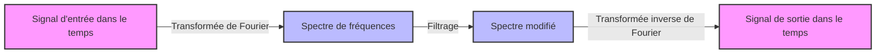

## 1. Introduction : penser en termes de sommes d'ondes

Le son, la lumière et les ondes électromagnétiques nous entourent. Peut-on comprendre une forme d'onde complexe et irrégulière comme une combinaison d'ondes simples ? La **série de Fourier**, associée à Joseph Fourier, et la **transformée de Fourier**, qui fait intervenir un ensemble continu de fréquences, donnent une expression mathématique à cette idée. Il faut toutefois préciser les conditions sur les fonctions et le sens de la convergence.

Cet article présente les formules de base, leur interprétation intuitive et un exemple d'application au traitement moderne du signal.

## 2. Série de Fourier : décomposer des ondes périodiques

Une série de Fourier représente une fonction périodique par des composantes trigonométriques dont les fréquences sont des multiples entiers de la fréquence fondamentale. Pouvoir calculer les coefficients ne garantit pas, à lui seul, que la série converge vers la valeur de la fonction en chaque point. Nous considérons ici des fonctions périodiques régulières par morceaux : une période peut être divisée en un nombre fini d'intervalles, à l'intérieur desquels la fonction est continûment dérivable, et la fonction ainsi que sa dérivée possèdent des limites latérales finies aux extrémités. Sous cette condition suffisante, la série converge vers la valeur de la fonction aux points de continuité et vers la moyenne des limites à gauche et à droite aux points de saut.

$$
\lim_{M\to\infty} S_M(x)=\frac{f(x-)+f(x+)}{2}
$$

$S_M$ désigne la somme partielle jusqu'à l'harmonique de rang $M$. Au raccord entre deux périodes, on utilise les limites du prolongement périodique. Près d'un saut, le dépassement lié au phénomène de Gibbs persiste lorsque le nombre de termes augmente. Ajouter des termes ne fait donc pas tendre l'erreur uniformément vers zéro sur tout l'intervalle.

### 2.1 Forme réelle de la série de Fourier

Pour une fonction à valeurs réelles de période $2\pi$ satisfaisant les conditions précédentes, l'égalité suivante vaut aux points de continuité. Les angles sont exprimés en radians. Aux points de saut, le membre de gauche doit être remplacé par la moyenne des limites latérales.

$$
f(x) = \frac{a_0}{2} + \sum_{n=1}^{\infty} \left( a_n \cos(nx) + b_n \sin(nx) \right)
$$

Les nombres $a_0,a_n,b_n$ sont les **coefficients de Fourier**. Le terme constant, ou composante continue, est la moyenne sur une période : $a_0/2$, et non $a_0$. Pour $n\ge1$, $a_n,b_n$ sont les poids des composantes cosinus et sinus. L'orthogonalité des fonctions trigonométriques donne les formules suivantes :

$$
a_0 = \frac{1}{\pi} \int_{-\pi}^{\pi} f(x) dx
$$

$$
a_n = \frac{1}{\pi} \int_{-\pi}^{\pi} f(x) \cos(nx) dx
$$

$$
b_n = \frac{1}{\pi} \int_{-\pi}^{\pi} f(x) \sin(nx) dx
$$

### 2.2 Forme complexe de la série de Fourier

La [formule d'Euler](/fr/p/eulers-identity/), $e^{i\theta}=\cos\theta+i\sin\theta$, permet d'écrire la même série avec des exponentielles complexes. La somme bilatérale ci-dessous se lit comme la limite des sommes partielles symétriques allant de $n=-M$ à $M$. L'égalité aux points de continuité et la réserve aux points de saut sont les mêmes que pour la forme réelle.

$$
f(x) = \sum_{n=-\infty}^{\infty} c_n e^{inx}
$$

$$
c_n = \frac{1}{2\pi} \int_{-\pi}^{\pi} f(x) e^{-inx} dx
$$

Pour une fonction $f$ à valeurs réelles, $c_0=a_0/2$, $c_n=(a_n-ib_n)/2$ et $c_{-n}=(a_n+ib_n)/2$ pour $n\ge1$. Les fréquences négatives apparaissent même lorsqu'on représente une onde réelle par des exponentielles complexes. Cette forme facilite aussi la compréhension du lien avec la transformée de Fourier.

## 3. Transformée de Fourier : au-delà des fonctions périodiques

Les séries s'appliquent aussi à des fonctions prolongées périodiquement. En revanche, pour décrire une impulsion isolée ou un autre signal sur toute la droite réelle, la **transformée de Fourier**, dont la fréquence varie continûment, est utile. Allonger la période pour réduire l'espacement des fréquences fournit un lien intuitif. L'échange de limites et d'intégrales demande toutefois des conditions ; cette intuition ne constitue donc pas à elle seule une démonstration générale.

### 3.1 Définition et inversion

Nous utilisons un signe négatif dans l'exposant de la transformée directe et le facteur $1/(2\pi)$ dans la transformée inverse. Si $\int_{-\infty}^{\infty}|f(t)|\,dt<\infty$, la transformée directe suivante converge absolument pour tout réel $\omega$.

$$
F(\omega) = \int_{-\infty}^{\infty} f(t) e^{-i\omega t} dt
$$

Par exemple, si $f$ est continue et si $f$ et $F$ sont toutes deux absolument intégrables, la transformée inverse restitue $f$ comme suit. Cette formule ne s'applique pas sans conditions à une fonction arbitraire.

$$
f(t) = \frac{1}{2\pi} \int_{-\infty}^{\infty} F(\omega) e^{i\omega t} d\omega
$$

On exprime $t$ en secondes ; $\omega$ désigne la pulsation, ou fréquence angulaire, en rad/s. La fréquence $\nu$ en hertz vérifie $\omega=2\pi\nu$. La fonction à valeurs complexes $F(\omega)$ décrit les poids d'un spectre continu ; là où $F\ne0$, son module et son argument donnent la grandeur et la phase. Le poids d'un spectre continu ne se confond pas directement avec l'amplitude d'une composante individuelle d'un signal périodique.

Pour une fonction présentant des sauts, des conditions supplémentaires de régularité et une intégrale impropre symétrique peuvent restituer la moyenne des limites latérales. Les fonctions de carré intégrable et les signaux périodiques peuvent nécessiter des extensions au sens de $L^2$ et des distributions, respectivement. Nous ne développons pas ces théories ici. Les signes et la normalisation varient selon les références : vérifiez toujours les transformées directe et inverse ensemble.

### 3.2 Traitement du signal

Le schéma illustre le traitement d'un signal dans le domaine fréquentiel.



## 4. Transformée de Fourier discrète (DFT) et transformée de Fourier rapide (FFT)

La **transformée de Fourier discrète (DFT)** associe à une suite finie $x_0,\ldots,x_{N-1}$ le même nombre de composantes fréquentielles. Il faut distinguer cette transformation finie d'un simple remplacement d'une intégrale de la transformée continue par une somme. Pour un signal temporel, on procède d'abord à l'échantillonnage et au choix d'un intervalle d'observation fini. La DFT directe et son inverse forment la paire :

$$
X_k = \sum_{n=0}^{N-1} x_n e^{-i \frac{2\pi}{N} k n} \quad \text{for } k = 0, 1, \dots, N-1
$$

$$
x_n=\frac{1}{N}\sum_{k=0}^{N-1}X_k e^{i\frac{2\pi}{N}kn} \quad \text{for } n=0,1,\dots,N-1
$$

Pour une fréquence d'échantillonnage $f_s$, l'espacement des points de fréquence, ou *bins*, est de $f_s/N$ Hz. La DFT correspond à considérer la suite finie comme répétée périodiquement. Des composantes du signal avant échantillonnage de fréquence supérieure ou égale à $f_s/2$ créent du repliement spectral ou une ambiguïté ; reconstruire un signal continu demande donc des hypothèses comme une bande limitée. Une sinusoïde qui n'accomplit pas un nombre entier de cycles dans l'intervalle d'observation produit aussi une fuite spectrale : son énergie se répartit sur plusieurs bins.

Calculer directement les $N$ composantes de la DFT demande $O(N^2)$ opérations. La [transformée de Fourier rapide (FFT)](/fr/p/fast-fourier-transform-algorithm/) désigne une famille d'algorithmes qui calculent efficacement la même DFT. Par exemple, pour une longueur qui est une puissance de deux, une méthode de division récursive permet $O(N\log N)$ opérations. FFT désigne une méthode de calcul, et non une autre transformation ni une approximation en soi. Elle est très utilisée en traitement numérique du signal, notamment pour l'audio. En revanche, le procédé de base du JPEG courant avec pertes repose sur la transformée en cosinus discrète (DCT). Ces transformations sont liées, mais JPEG ne doit pas être présenté simplement comme une utilisation directe de FFT.

### 4.1 Vérifier deux fréquences et leurs amplitudes avec Python

Cet exemple utilise NumPy et Matplotlib. On échantillonne une seconde à 1 000 Hz et l'on additionne une sinusoïde de 50 Hz d'amplitude 1 et une sinusoïde de 120 Hz d'amplitude 0,5. L'entrée est réelle : on utilise donc `rfft` et `rfftfreq`. Les deux fréquences coïncident avec des bins espacés de 1 Hz et sont inférieures à 500 Hz.

```python
import numpy as np
import matplotlib.pyplot as plt

# Échantillonner une seconde à 1000 Hz, sans inclure l'extrémité à une seconde
fs = 1000.0
N = 1000
t = np.arange(N) / fs
signal = np.sin(2 * np.pi * 50 * t) + 0.5 * np.sin(2 * np.pi * 120 * t)

# DFT des fréquences positives ou nulles d'un signal réel
fft_result = np.fft.rfft(signal)
frequencies = np.fft.rfftfreq(N, d=1 / fs)

# Amplitude unilatérale : ne pas doubler DC ni Nyquist pour N pair
amplitude = np.abs(fft_result) / N
if N % 2 == 0:
    amplitude[1:-1] *= 2
else:
    amplitude[1:] *= 2

peak_indices = np.argsort(amplitude)[-2:]
for k in sorted(peak_indices, key=lambda k: frequencies[k]):
    print(f"{frequencies[k]:.0f} Hz: {amplitude[k]:.3f}")

fig, ax = plt.subplots()
ax.plot(frequencies, amplitude)
ax.set(xlim=(0, 200), xlabel="Frequency (Hz)", ylabel="Amplitude",
       title="One-sided amplitude spectrum")
ax.grid(True)
fig.tight_layout()
plt.show()
```

La sortie arrondie est `50 Hz: 1.000` et `120 Hz: 0.500` ; les chaînes produites par Python utilisent le point décimal. La transformée directe par défaut de `rfft` n'est pas divisée par $N$ ; on normalise donc comme ci-dessus pour afficher les amplitudes. Pour réunir les fréquences positive et négative d'une même paire d'un signal réel, seuls les bins intérieurs sont doublés, à l'exclusion de la composante continue et, pour une longueur paire, de la composante de Nyquist. Cette méthode donne les amplitudes des sinusoïdes de l'exemple, centrées sur les bins et sans application de fenêtre. La même formule ne garantit pas des amplitudes exactes pour un signal arbitraire ou des données auxquelles on a appliqué une fenêtre.

## 5. Conclusion

La série et la transformée de Fourier aident à décomposer des phénomènes complexes en composantes simples. Observer un signal dans le domaine fréquentiel permet de découvrir des motifs et de traiter l'information.

Précisez la périodicité, les conditions de convergence, les unités de fréquence et la normalisation. Distinguer la DFT des algorithmes FFT qui la calculent rend aussi plus clair le lien entre les formules et les programmes.

## Références

- [MIT ES.1803 Topic 22 : coefficients, convergence, phénomène de Gibbs et orthogonalité (§22.5–22.7)](https://ocw.mit.edu/courses/es-1803-differential-equations-spring-2024/mites_1803_s24_topic22.pdf)
- [MIT 18.330 : transformée et inversion (chapitre 6, Definition 14)](https://math.mit.edu/icg/resources/teaching/18.330/18.330-Apr29.pdf)
- [NIST DLMF §1.14(i) : définition et conditions d'inversion ; signes et normalisation différents des nôtres](https://dlmf.nist.gov/1.14#i)
- [MIT 6.341 Lecture 19 : opérations de la DFT et de la FFT](https://ocw.mit.edu/courses/6-341-discrete-time-signal-processing-fall-2005/4ee39a5e74c9f5099ac516ce57215c96_lec19.pdf)
- [NumPy 2.3 : FFT](https://numpy.org/doc/2.3/reference/generated/numpy.fft.fft.html), [rfft pour les entrées réelles](https://numpy.org/doc/2.3/reference/generated/numpy.fft.rfft.html) et [fréquences de rfftfreq](https://numpy.org/doc/2.3/reference/generated/numpy.fft.rfftfreq.html)
- [ITU-T T.81 : JPEG avec pertes fondé sur la DCT (§4.2–4.3)](https://www.w3.org/Graphics/JPEG/itu-t81.pdf)
