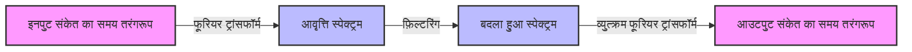

## 1. परिचय: तरंगों के योग के रूप में सोचना

हमारे आसपास ध्वनि, प्रकाश और विद्युतचुंबकीय तरंगों जैसी अनेक **तरंगें** हैं। क्या किसी जटिल और अनियमित तरंगरूप को सरल तरंगों के संयोजन के रूप में समझा जा सकता है? जोसेफ फूरियर से जुड़ी **फूरियर श्रृंखला** और सतत आवृत्तियों को उपयोग में लाने वाला **फूरियर ट्रांसफॉर्म** इस विचार को गणितीय रूप देते हैं। इन्हें प्रयोग करते समय फलनों की शर्तें और अभिसरण का अर्थ स्पष्ट करना आवश्यक है।

इस लेख में मूल सूत्रों, उनकी सहज व्याख्या और आधुनिक संकेत प्रसंस्करण के एक उदाहरण पर चर्चा की गई है।

## 2. फूरियर श्रृंखला: आवधिक तरंगों का विघटन

फूरियर श्रृंखला किसी आवधिक फलन को उन त्रिकोणमितीय घटकों से व्यक्त करती है जिनकी आवृत्तियाँ मूल आवृत्ति के पूर्णांक गुणज होती हैं। गुणांकों की गणना कर पाना अपने आप में यह नहीं बताता कि श्रृंखला हर बिंदु पर मूल फलन के मान की ओर अभिसरित होगी। यहाँ हम खंडशः सुचारु (piecewise smooth) आवधिक फलन लेते हैं: एक आवर्त को परिमित संख्या में ऐसे अंतरालों में बाँटा जा सकता है जिनके अंदर फलन सतत अवकलनीय हो, और अंतरालों के सिरों पर फलन तथा उसके अवकलज की एकपक्षीय सीमाएँ परिमित हों। इस पर्याप्त शर्त के अंतर्गत श्रृंखला सततता के बिंदुओं पर फलन के मान की ओर और कूद वाले असततता बिंदुओं पर बाईं तथा दाईं सीमाओं के औसत की ओर अभिसरित होती है।

$$
\lim_{M\to\infty} S_M(x)=\frac{f(x-)+f(x+)}{2}
$$

$S_M$ से आशय $M$वें हार्मोनिक तक के आंशिक योग से है। दो आवर्तों के जोड़ पर भी आवधिक विस्तार की बाईं और दाईं सीमाएँ ली जाती हैं। कूद के पास गिब्स परिघटना के कारण होने वाला अतिक्रमण, पदों की संख्या बढ़ाने पर भी बना रहता है। इसलिए अधिक पद लेने से पूरे अंतराल पर त्रुटि एकसमान रूप से शून्य की ओर नहीं जाती।

### 2.1 फूरियर श्रृंखला का वास्तविक रूप

उपर्युक्त शर्तों को पूरा करने वाले, $2\pi$ आवर्त के वास्तविक मान वाले फलन के लिए निम्न समानता सततता के बिंदुओं पर लागू होती है। कोण रेडियन में हैं। कूद के बिंदु पर बाएँ पक्ष को एकपक्षीय सीमाओं के औसत के रूप में पढ़ें।

$$
f(x) = \frac{a_0}{2} + \sum_{n=1}^{\infty} \left( a_n \cos(nx) + b_n \sin(nx) \right)
$$

$a_0,a_n,b_n$ को **फूरियर गुणांक** कहते हैं। अचर पद, अर्थात DC घटक और एक आवर्त का औसत, $a_0/2$ है, स्वयं $a_0$ नहीं। $n\ge1$ के लिए $a_n,b_n$ क्रमशः कोसाइन और साइन घटकों के भार हैं। त्रिकोणमितीय फलनों की लांबिकता (orthogonality) से ये गुणांक सूत्र मिलते हैं:

$$
a_0 = \frac{1}{\pi} \int_{-\pi}^{\pi} f(x) dx
$$

$$
a_n = \frac{1}{\pi} \int_{-\pi}^{\pi} f(x) \cos(nx) dx
$$

$$
b_n = \frac{1}{\pi} \int_{-\pi}^{\pi} f(x) \sin(nx) dx
$$

### 2.2 फूरियर श्रृंखला का सम्मिश्र रूप

[यूलर सूत्र](/hi/p/eulers-identity/) $e^{i\theta}=\cos\theta+i\sin\theta$ से उसी श्रृंखला को सम्मिश्र घातीय फलनों के रूप में लिखा जा सकता है। नीचे के द्विपक्षीय योग का अर्थ $n=-M$ से $M$ तक के सममित आंशिक योगों की सीमा है। सततता के बिंदुओं की समानता और कूद के बिंदुओं की सावधानी वास्तविक रूप जैसी ही है।

$$
f(x) = \sum_{n=-\infty}^{\infty} c_n e^{inx}
$$

$$
c_n = \frac{1}{2\pi} \int_{-\pi}^{\pi} f(x) e^{-inx} dx
$$

वास्तविक मान वाले $f$ के लिए $c_0=a_0/2$, $c_n=(a_n-ib_n)/2$ और $c_{-n}=(a_n+ib_n)/2$ हैं, जहाँ $n\ge1$ है। वास्तविक तरंगरूप को सम्मिश्र घातीय फलनों से व्यक्त करने पर भी ऋणात्मक आवृत्तियाँ आती हैं। यह रूप फूरियर ट्रांसफॉर्म से संबंध समझने में भी सहायता करता है।

## 3. फूरियर ट्रांसफॉर्म: गैर-आवधिक फलनों तक विस्तार

श्रृंखला का उपयोग आवधिक रूप से विस्तारित फलनों पर भी किया जा सकता है। लेकिन किसी एकल पल्स जैसे संकेत को पूरी वास्तविक रेखा पर व्यक्त करने के लिए सतत आवृत्तियों वाला **फूरियर ट्रांसफॉर्म** उपयोगी है। आवर्त बढ़ाने पर आवृत्तियों के बीच का अंतर घटता है; इससे एक सहज संबंध समझ में आता है। फिर भी सीमा और समाकल का क्रम बदलने के लिए शर्तें आवश्यक हैं। यह सहज विचार अपने आप में सामान्य प्रमाण नहीं है।

### 3.1 परिभाषा और व्युत्क्रम रूपांतरण

यहाँ सीधे रूपांतरण के घातांक में ऋण चिह्न और व्युत्क्रम रूपांतरण में $1/(2\pi)$ गुणक का नियम अपनाया गया है। यदि $\int_{-\infty}^{\infty}|f(t)|\,dt<\infty$ हो, तो निम्न सीधा रूपांतरण प्रत्येक वास्तविक $\omega$ के लिए निरपेक्ष रूप से अभिसरित होता है।

$$
F(\omega) = \int_{-\infty}^{\infty} f(t) e^{-i\omega t} dt
$$

उदाहरण के लिए, यदि $f$ सतत हो और $f$ तथा $F$ दोनों निरपेक्ष रूप से समाकलनीय हों, तो निम्न व्युत्क्रम रूपांतरण से $f$ पुनः प्राप्त होता है। इस सूत्र को बिना शर्त किसी भी फलन पर लागू नहीं किया जा सकता।

$$
f(t) = \frac{1}{2\pi} \int_{-\infty}^{\infty} F(\omega) e^{i\omega t} d\omega
$$

यहाँ $t$ की इकाई सेकंड है और $\omega$ कोणीय आवृत्ति है, जिसकी इकाई rad/s है। Hz में व्यक्त आवृत्ति $\nu$ से इसका संबंध $\omega=2\pi\nu$ है। सम्मिश्र मान वाला $F(\omega)$ सतत स्पेक्ट्रम के भार बताता है; जहाँ $F\ne0$ हो, वहाँ मापांक और कोणांक से परिमाण और कला (phase) पढ़ी जा सकती है। सतत स्पेक्ट्रम का भार, आवधिक संकेत के किसी एक घटक के आयाम के सीधे बराबर नहीं होता।

कूद वाले फलनों में अतिरिक्त नियमितता की शर्तों और सममित अनुचित समाकल से एकपक्षीय सीमाओं का औसत पुनः प्राप्त हो सकता है। जिन फलनों के मापांक का वर्ग समाकलनीय होता है, उनके लिए $L^2$ के अर्थ में विस्तार की आवश्यकता पड़ सकती है। आवधिक संकेतों के लिए गणितीय वितरणों (distributions) के अर्थ में विस्तार की आवश्यकता पड़ सकती है। इस लेख में उन सिद्धांतों का विस्तार नहीं किया गया है। अलग-अलग संदर्भों में चिह्न और सामान्यीकरण अलग होते हैं; इसलिए सीधे और व्युत्क्रम रूपांतरण को एक जोड़ी के रूप में जाँचें।

### 3.2 संकेत प्रसंस्करण

निम्न आरेख आवृत्ति क्षेत्र में संकेत के प्रसंस्करण का प्रवाह दिखाता है।



## 4. असतत फूरियर ट्रांसफॉर्म (DFT) और फास्ट फूरियर ट्रांसफॉर्म (FFT)

**असतत फूरियर ट्रांसफॉर्म (DFT)** परिमित अनुक्रम $x_0,\ldots,x_{N-1}$ को उतनी ही संख्या के आवृत्ति घटकों में बदलता है। इस परिमित रूपांतरण को सतत फूरियर रूपांतरण के समाकल की जगह केवल एक योग रख देने से अलग समझें। समय संकेत के लिए पहले नमूने लिए जाते हैं और परिमित अवलोकन अंतराल चुना जाता है। सीधे और व्युत्क्रम DFT की जोड़ी है:

$$
X_k = \sum_{n=0}^{N-1} x_n e^{-i \frac{2\pi}{N} k n} \quad \text{for } k = 0, 1, \dots, N-1
$$

$$
x_n=\frac{1}{N}\sum_{k=0}^{N-1}X_k e^{i\frac{2\pi}{N}kn} \quad \text{for } n=0,1,\dots,N-1
$$

यदि नमूना आवृत्ति $f_s$ है, तो आवृत्ति बिन (bin) के बीच का अंतर $f_s/N$ Hz है। DFT को परिमित अनुक्रम को आवधिक रूप से दोहराने के दृष्टिकोण से समझा जा सकता है। नमूने लेने से पहले संकेत में $f_s/2$ या उससे ऊँची आवृत्ति के घटक होने पर एलियासिंग या अस्पष्टता की समस्या होती है; सतत संकेत पुनः प्राप्त करने के लिए सीमित आवृत्ति बैंड जैसी धारणाएँ चाहिए। यदि अवलोकन अंतराल में किसी साइन तरंग के चक्रों की संख्या पूर्णांक न हो, तो स्पेक्ट्रल लीकेज भी होता है: ऊर्जा कई बिन में फैल जाती है।

परिभाषा के अनुसार DFT के सभी $N$ घटकों की सीधी गणना में $O(N^2)$ संक्रियाएँ लगती हैं। [फास्ट फूरियर ट्रांसफॉर्म (FFT)](/hi/p/fast-fourier-transform-algorithm/) उसी DFT को कुशलता से निकालने वाले एल्गोरिथ्मों का परिवार है। उदाहरण के लिए, लंबाई दो की घात हो तो पुनरावर्ती विभाजन से $O(N\log N)$ संक्रियाओं में गणना की जा सकती है। FFT किसी अलग रूपांतरण या अपने आप में किसी सन्निकटन का नाम नहीं है। इसका उपयोग ऑडियो सहित डिजिटल संकेत प्रसंस्करण में व्यापक है। दूसरी ओर, सामान्य हानिपूर्ण JPEG की मूल विधि असतत कोसाइन रूपांतरण (DCT) का उपयोग करती है। ये रूपांतरण संबंधित हैं, लेकिन JPEG को सीधे FFT के उपयोग का उदाहरण बताना सही नहीं है।

### 4.1 Python में दो आवृत्तियों और उनके आयामों की जाँच

इस उदाहरण में NumPy और Matplotlib उपयोग किए गए हैं। एक सेकंड तक 1,000 Hz पर नमूने लेकर 50 Hz और आयाम 1 तथा 120 Hz और आयाम 0.5 की साइन तरंगें जोड़ी जाती हैं। इनपुट वास्तविक है, इसलिए `rfft` और `rfftfreq` का उपयोग होता है। दोनों आवृत्तियाँ 1 Hz अंतर वाले बिन पर ठीक बैठती हैं और 500 Hz से कम हैं।

```python
import numpy as np
import matplotlib.pyplot as plt

# एक सेकंड तक 1000 Hz पर नमूने लें; अंतिम बिंदु एक सेकंड शामिल नहीं है
fs = 1000.0
N = 1000
t = np.arange(N) / fs
signal = np.sin(2 * np.pi * 50 * t) + 0.5 * np.sin(2 * np.pi * 120 * t)

# वास्तविक संकेत की गैर-ऋणात्मक आवृत्तियों का DFT
fft_result = np.fft.rfft(signal)
frequencies = np.fft.rfftfreq(N, d=1 / fs)

# एकपक्षीय आयाम: DC और सम N के नाइक्विस्ट घटक को दोगुना न करें
amplitude = np.abs(fft_result) / N
if N % 2 == 0:
    amplitude[1:-1] *= 2
else:
    amplitude[1:] *= 2

peak_indices = np.argsort(amplitude)[-2:]
for k in sorted(peak_indices, key=lambda k: frequencies[k]):
    print(f"{frequencies[k]:.0f} Hz: {amplitude[k]:.3f}")

fig, ax = plt.subplots()
ax.plot(frequencies, amplitude)
ax.set(xlim=(0, 200), xlabel="Frequency (Hz)", ylabel="Amplitude",
       title="One-sided amplitude spectrum")
ax.grid(True)
fig.tight_layout()
plt.show()
```

दशमलव के तीन स्थानों तक पूर्णांकित करने पर आउटपुट `50 Hz: 1.000` और `120 Hz: 0.500` है। `rfft` का डिफ़ॉल्ट सीधा रूपांतरण $N$ से विभाजित नहीं होता, इसलिए आयाम दिखाने के लिए ऊपर का सामान्यीकरण किया गया है। वास्तविक संकेत की धनात्मक और ऋणात्मक आवृत्तियों की जोड़ी को मिलाने पर केवल भीतरी बिन के मान दोगुने किए जाते हैं; DC और सम लंबाई वाले अनुक्रम का नाइक्विस्ट घटक दोगुना नहीं होता। यह इस उदाहरण की उन साइन तरंगों के आयाम पढ़ने का तरीका है जो बिन पर ठीक बैठती हैं और जिन पर विंडो नहीं लगाई गई है। मनमाने संकेत या विंडो लगाए गए डेटा के लिए यही सूत्र अकेला सही आयाम की गारंटी नहीं देता।

## 5. निष्कर्ष

फूरियर श्रृंखला और फूरियर ट्रांसफॉर्म जटिल घटनाओं को सरल घटकों में समझने में सहायता करते हैं। संकेत को आवृत्ति क्षेत्र में देखने से छिपे हुए पैटर्न मिल सकते हैं और सूचना का कुशल प्रसंस्करण संभव होता है।

आवधिकता, अभिसरण की शर्तें, आवृत्ति की इकाइयाँ और सामान्यीकरण स्पष्ट करें। DFT और उसे निकालने वाले FFT एल्गोरिथ्मों को अलग समझने से गणितीय सूत्रों और वास्तविक प्रोग्राम का संबंध भी स्पष्ट होता है।

## संदर्भ

- [MIT ES.1803 Topic 22: गुणांक, अभिसरण, गिब्स परिघटना और लांबिकता (§22.5–22.7)](https://ocw.mit.edu/courses/es-1803-differential-equations-spring-2024/mites_1803_s24_topic22.pdf)
- [MIT 18.330: रूपांतरण और व्युत्क्रम (अध्याय6, Definition 14)](https://math.mit.edu/icg/resources/teaching/18.330/18.330-Apr29.pdf)
- [NIST DLMF §1.14(i): परिभाषा और व्युत्क्रम की शर्तें; चिह्न और सामान्यीकरण इस लेख से अलग हैं](https://dlmf.nist.gov/1.14#i)
- [MIT 6.341 Lecture 19: DFT और FFT की गणना में संक्रियाएँ](https://ocw.mit.edu/courses/6-341-discrete-time-signal-processing-fall-2005/4ee39a5e74c9f5099ac516ce57215c96_lec19.pdf)
- [NumPy 2.3: FFT](https://numpy.org/doc/2.3/reference/generated/numpy.fft.fft.html), [वास्तविक इनपुट के लिए rfft](https://numpy.org/doc/2.3/reference/generated/numpy.fft.rfft.html), [rfftfreq के आवृत्ति बिन](https://numpy.org/doc/2.3/reference/generated/numpy.fft.rfftfreq.html)
- [ITU-T T.81: JPEG की हानिपूर्ण DCT विधि (§4.2–4.3)](https://www.w3.org/Graphics/JPEG/itu-t81.pdf)
