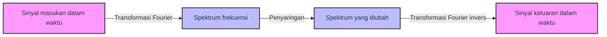

## 1. Pengantar: memikirkan penjumlahan gelombang

Suara, cahaya, dan gelombang elektromagnetik ada di sekitar kita. Dapatkah bentuk gelombang yang rumit dan tidak teratur dipahami sebagai gabungan gelombang sederhana? **Deret Fourier**, yang dikaitkan dengan Joseph Fourier, dan **transformasi Fourier**, yang menggunakan frekuensi kontinu, memberi bentuk matematis pada gagasan ini. Namun, kita perlu menyatakan syarat pada fungsi dan arti konvergensinya.

Artikel ini membahas rumus dasar, penafsiran intuitif, dan contoh penerapan dalam pemrosesan sinyal modern.

## 2. Deret Fourier: menguraikan gelombang periodik

Deret Fourier menyatakan fungsi periodik melalui komponen trigonometri yang frekuensinya merupakan kelipatan bulat dari frekuensi dasar. Dapat menghitung koefisien tidak dengan sendirinya berarti deret tersebut konvergen ke nilai fungsi semula di setiap titik. Di sini kita mempertimbangkan fungsi periodik yang mulus sepotong-sepotong: satu periode dapat dibagi menjadi sejumlah berhingga interval, fungsi dapat diturunkan secara kontinu di bagian dalam setiap interval, dan fungsi beserta turunannya memiliki limit satu sisi yang berhingga pada ujung interval. Dengan syarat cukup ini, deret konvergen ke nilai fungsi di titik kontinu dan ke rata-rata limit kiri dan kanan di titik diskontinuitas loncat.

$$
\lim_{M\to\infty} S_M(x)=\frac{f(x-)+f(x+)}{2}
$$

$S_M$ adalah jumlah parsial hingga harmonik ke-$M$. Pada sambungan antarperiode, gunakan limit dari perpanjangan periodiknya. Di dekat loncatan, pelampauan akibat fenomena Gibbs tetap ada ketika jumlah suku bertambah. Jadi, menambah suku tidak membuat galat menuju nol secara seragam di seluruh interval.

### 2.1 Bentuk real deret Fourier

Untuk fungsi bernilai real dengan periode $2\pi$ yang memenuhi syarat di atas, persamaan berikut berlaku di titik kontinu. Sudut dinyatakan dalam radian. Pada titik loncatan, ruas kiri dibaca sebagai rata-rata limit kiri dan kanan.

$$
f(x) = \frac{a_0}{2} + \sum_{n=1}^{\infty} \left( a_n \cos(nx) + b_n \sin(nx) \right)
$$

Bilangan $a_0,a_n,b_n$ disebut **koefisien Fourier**. Suku konstan, atau komponen DC, adalah rata-rata selama satu periode, yaitu $a_0/2$, bukan $a_0$. Untuk $n\ge1$, $a_n,b_n$ adalah bobot komponen kosinus dan sinus. Ortogonalitas fungsi trigonometri menghasilkan rumus koefisien:

$$
a_0 = \frac{1}{\pi} \int_{-\pi}^{\pi} f(x) dx
$$

$$
a_n = \frac{1}{\pi} \int_{-\pi}^{\pi} f(x) \cos(nx) dx
$$

$$
b_n = \frac{1}{\pi} \int_{-\pi}^{\pi} f(x) \sin(nx) dx
$$

### 2.2 Bentuk kompleks deret Fourier

Dengan [rumus Euler](/id/p/eulers-identity/) $e^{i\theta}=\cos\theta+i\sin\theta$, deret yang sama dapat ditulis menggunakan eksponensial kompleks. Jumlah dua sisi berikut dipahami sebagai limit jumlah parsial simetris dari $n=-M$ hingga $M$. Kesamaan di titik kontinu dan catatan untuk titik loncatan sama seperti pada bentuk real.

$$
f(x) = \sum_{n=-\infty}^{\infty} c_n e^{inx}
$$

$$
c_n = \frac{1}{2\pi} \int_{-\pi}^{\pi} f(x) e^{-inx} dx
$$

Untuk $f$ bernilai real, $c_0=a_0/2$, $c_n=(a_n-ib_n)/2$, dan $c_{-n}=(a_n+ib_n)/2$ untuk $n\ge1$. Frekuensi negatif muncul bahkan ketika bentuk gelombang real dinyatakan dengan eksponensial kompleks. Bentuk ini juga memperjelas hubungannya dengan transformasi Fourier.

## 3. Transformasi Fourier: melampaui fungsi periodik

Deret juga dapat digunakan untuk fungsi yang diperpanjang secara periodik. Namun, untuk menggambarkan satu pulsa atau sinyal lain pada seluruh garis real, **transformasi Fourier** dengan frekuensi yang berubah kontinu lebih sesuai. Memperpanjang periode sehingga jarak antarfrekuensi mengecil memberikan hubungan intuitif. Akan tetapi, menukar limit dan integral memerlukan syarat, sehingga intuisi ini saja bukan bukti umum.

### 3.1 Definisi dan inversi

Kita menggunakan tanda negatif pada eksponen transformasi maju dan faktor $1/(2\pi)$ pada transformasi invers. Jika $\int_{-\infty}^{\infty}|f(t)|\,dt<\infty$, transformasi maju berikut konvergen mutlak untuk setiap $\omega$ real.

$$
F(\omega) = \int_{-\infty}^{\infty} f(t) e^{-i\omega t} dt
$$

Sebagai contoh, jika $f$ kontinu serta $f$ dan $F$ keduanya terintegralkan mutlak, transformasi invers mengembalikan $f$ sebagai berikut. Rumus ini tidak dapat digunakan tanpa syarat untuk sembarang fungsi.

$$
f(t) = \frac{1}{2\pi} \int_{-\infty}^{\infty} F(\omega) e^{i\omega t} d\omega
$$

Di sini $t$ dinyatakan dalam detik dan $\omega$ adalah frekuensi sudut dalam rad/s. Frekuensi $\nu$ dalam hertz memenuhi $\omega=2\pi\nu$. Fungsi bernilai kompleks $F(\omega)$ menyatakan bobot spektrum kontinu; ketika $F\ne0$, modulus dan argumennya memberikan besar dan fase. Bobot pada spektrum kontinu tidak sama secara langsung dengan amplitudo satu komponen sinyal periodik.

Untuk fungsi yang memiliki loncatan, syarat keteraturan tambahan dan integral tak wajar simetris dapat mengembalikan rata-rata limit satu sisi. Fungsi yang kuadrat modulusnya terintegralkan dan sinyal periodik mungkin memerlukan perluasan dalam arti $L^2$ dan distribusi, secara berturut-turut. Teori tersebut tidak dibahas di sini. Tanda dan normalisasi dapat berbeda antarreferensi; periksa transformasi maju dan invers sebagai satu pasangan.

### 3.2 Pemrosesan sinyal

Diagram berikut menggambarkan pengolahan sinyal dalam domain frekuensi.



## 4. Transformasi Fourier diskrit (DFT) dan transformasi Fourier cepat (FFT)

**Transformasi Fourier diskrit (DFT)** memetakan barisan berhingga $x_0,\ldots,x_{N-1}$ ke komponen frekuensi dengan jumlah yang sama. Transformasi berhingga ini perlu dibedakan dari sekadar mengganti integral transformasi kontinu dengan jumlah. Untuk sinyal waktu, pengambilan sampel dan pemilihan interval pengamatan berhingga dilakukan terlebih dahulu. DFT maju dan invers membentuk pasangan berikut:

$$
X_k = \sum_{n=0}^{N-1} x_n e^{-i \frac{2\pi}{N} k n} \quad \text{for } k = 0, 1, \dots, N-1
$$

$$
x_n=\frac{1}{N}\sum_{k=0}^{N-1}X_k e^{i\frac{2\pi}{N}kn} \quad \text{for } n=0,1,\dots,N-1
$$

Jika frekuensi pengambilan sampel adalah $f_s$, jarak antarposisi frekuensi, atau *bin*, adalah $f_s/N$ Hz. DFT sesuai dengan cara pandang bahwa barisan berhingga diulang secara periodik. Komponen sinyal sebelum pengambilan sampel dengan frekuensi sebesar atau lebih tinggi dari $f_s/2$ menimbulkan aliasing atau ambiguitas. Karena itu, pemulihan sinyal kontinu memerlukan asumsi seperti keterbatasan pita frekuensi. Sinusoid yang tidak menyelesaikan sejumlah siklus yang bulat dalam interval pengamatan juga menimbulkan kebocoran spektral: energinya tersebar ke beberapa bin.

Menghitung semua $N$ komponen DFT langsung dari definisinya memerlukan $O(N^2)$ operasi. [Transformasi Fourier cepat (FFT)](/id/p/fast-fourier-transform-algorithm/) adalah keluarga algoritma yang menghitung DFT yang sama secara efisien. Sebagai contoh, untuk panjang berupa pangkat dua, pemecahan secara rekursif dapat menghasilkan $O(N\log N)$ operasi. FFT adalah metode perhitungan, bukan transformasi lain ataupun nama suatu pendekatan aproksimasi itu sendiri. FFT banyak digunakan dalam pemrosesan sinyal digital, termasuk audio. Sebaliknya, metode dasar JPEG biasa dengan kompresi lossy menggunakan transformasi kosinus diskrit (DCT). Meskipun transformasinya terkait, JPEG tidak seharusnya langsung disebut sebagai contoh penggunaan FFT.

### 4.1 Memeriksa dua frekuensi dan amplitudonya dengan Python

Contoh ini menggunakan NumPy dan Matplotlib. Kita mengambil sampel selama satu detik pada 1.000 Hz, lalu menjumlahkan sinusoid 50 Hz beramplitudo 1 dan sinusoid 120 Hz beramplitudo 0,5. Karena masukan bernilai real, kita memakai `rfft` dan `rfftfreq`. Kedua frekuensi tepat berada pada bin yang berjarak 1 Hz dan keduanya di bawah 500 Hz.

```python
import numpy as np
import matplotlib.pyplot as plt

# Ambil sampel satu detik pada 1000 Hz, tanpa titik akhir satu detik
fs = 1000.0
N = 1000
t = np.arange(N) / fs
signal = np.sin(2 * np.pi * 50 * t) + 0.5 * np.sin(2 * np.pi * 120 * t)

# DFT frekuensi nonnegatif untuk sinyal real
fft_result = np.fft.rfft(signal)
frequencies = np.fft.rfftfreq(N, d=1 / fs)

# Amplitudo satu sisi: jangan gandakan DC atau Nyquist untuk N genap
amplitude = np.abs(fft_result) / N
if N % 2 == 0:
    amplitude[1:-1] *= 2
else:
    amplitude[1:] *= 2

peak_indices = np.argsort(amplitude)[-2:]
for k in sorted(peak_indices, key=lambda k: frequencies[k]):
    print(f"{frequencies[k]:.0f} Hz: {amplitude[k]:.3f}")

fig, ax = plt.subplots()
ax.plot(frequencies, amplitude)
ax.set(xlim=(0, 200), xlabel="Frequency (Hz)", ylabel="Amplitude",
       title="One-sided amplitude spectrum")
ax.grid(True)
fig.tight_layout()
plt.show()
```

Keluaran yang dibulatkan adalah `50 Hz: 1.000` dan `120 Hz: 0.500`; keluaran Python menggunakan titik desimal. Transformasi maju bawaan `rfft` tidak dibagi dengan $N$, sehingga kita melakukan normalisasi seperti di atas untuk menampilkan amplitudo. Saat menyatukan pasangan frekuensi positif dan negatif dari sinyal real, hanya bin bagian dalam yang dikalikan dua; komponen DC dan, untuk panjang genap, komponen Nyquist tidak digandakan. Cara ini membaca amplitudo sinusoid dalam contoh, yang tepat pada bin dan tidak dikenai fungsi jendela. Rumus yang sama saja tidak menjamin amplitudo tepat untuk sinyal sembarang atau data yang telah dikenai fungsi jendela.

## 5. Kesimpulan

Deret dan transformasi Fourier membantu memecah fenomena rumit menjadi komponen sederhana. Melihat sinyal dalam domain frekuensi dapat mengungkap pola dan membantu pemrosesan informasi.

Nyatakan periodisitas, syarat konvergensi, satuan frekuensi, dan normalisasi. Membedakan DFT dari algoritma FFT yang menghitungnya juga memperjelas hubungan rumus matematis dengan program nyata.

## Referensi

- [MIT ES.1803 Topic 22: koefisien, konvergensi, fenomena Gibbs, dan ortogonalitas (§22.5–22.7)](https://ocw.mit.edu/courses/es-1803-differential-equations-spring-2024/mites_1803_s24_topic22.pdf)
- [MIT 18.330: transformasi dan inversi (Bab 6, Definition 14)](https://math.mit.edu/icg/resources/teaching/18.330/18.330-Apr29.pdf)
- [NIST DLMF §1.14(i): definisi dan syarat inversi; tanda dan normalisasinya berbeda dari artikel ini](https://dlmf.nist.gov/1.14#i)
- [MIT 6.341 Lecture 19: jumlah operasi DFT dan FFT](https://ocw.mit.edu/courses/6-341-discrete-time-signal-processing-fall-2005/4ee39a5e74c9f5099ac516ce57215c96_lec19.pdf)
- [NumPy 2.3: FFT](https://numpy.org/doc/2.3/reference/generated/numpy.fft.fft.html), [rfft untuk masukan real](https://numpy.org/doc/2.3/reference/generated/numpy.fft.rfft.html), dan [bin frekuensi rfftfreq](https://numpy.org/doc/2.3/reference/generated/numpy.fft.rfftfreq.html)
- [ITU-T T.81: JPEG lossy berbasis DCT (§4.2–4.3)](https://www.w3.org/Graphics/JPEG/itu-t81.pdf)
