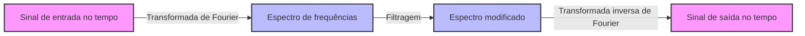

## 1. Introdução: pensar na soma de ondas

Som, luz e ondas eletromagnéticas estão ao nosso redor. Podemos entender uma forma de onda complexa e irregular como uma combinação de ondas simples? A **série de Fourier**, associada a Joseph Fourier, e a **transformada de Fourier**, que utiliza frequências contínuas, dão expressão matemática a essa ideia. Para usá-las, é necessário especificar as condições sobre as funções e o significado da convergência.

Este artigo apresenta as fórmulas básicas, uma interpretação intuitiva e um exemplo de aplicação ao processamento moderno de sinais.

## 2. Série de Fourier: decompor ondas periódicas

Uma série de Fourier representa uma função periódica por componentes trigonométricas cujas frequências são múltiplos inteiros da frequência fundamental. Poder calcular os coeficientes não implica, por si só, que a série convirja ao valor da função em cada ponto. Aqui consideramos funções periódicas suaves por partes: um período pode ser dividido em um número finito de intervalos, em cujo interior a função é continuamente diferenciável, e tanto a função quanto sua derivada têm limites laterais finitos nos extremos. Sob essa condição suficiente, a série converge ao valor da função nos pontos de continuidade e à média dos limites laterais nos saltos.

$$
\lim_{M\to\infty} S_M(x)=\frac{f(x-)+f(x+)}{2}
$$

$S_M$ é a soma parcial até o harmônico de ordem $M$. Na junção entre períodos, usam-se os limites da extensão periódica. Perto de um salto, a ultrapassagem causada pelo fenômeno de Gibbs persiste quando se acrescentam termos. Portanto, aumentar o número de termos não faz o erro tender uniformemente a zero em todo o intervalo.

### 2.1 Forma real da série de Fourier

Para uma função de valores reais e período $2\pi$ que satisfaça as condições acima, a igualdade seguinte vale nos pontos de continuidade. Os ângulos são expressos em radianos. Em um salto, substitua o lado esquerdo pela média dos limites laterais.

$$
f(x) = \frac{a_0}{2} + \sum_{n=1}^{\infty} \left( a_n \cos(nx) + b_n \sin(nx) \right)
$$

Os números $a_0,a_n,b_n$ são os **coeficientes de Fourier**. O termo constante, ou componente contínua (DC), é a média em um período: $a_0/2$, e não $a_0$. Para $n\ge1$, $a_n$ e $b_n$ são os pesos das componentes cosseno e seno. A ortogonalidade das funções trigonométricas fornece as fórmulas:

$$
a_0 = \frac{1}{\pi} \int_{-\pi}^{\pi} f(x) dx
$$

$$
a_n = \frac{1}{\pi} \int_{-\pi}^{\pi} f(x) \cos(nx) dx
$$

$$
b_n = \frac{1}{\pi} \int_{-\pi}^{\pi} f(x) \sin(nx) dx
$$

### 2.2 Forma complexa da série de Fourier

A [fórmula de Euler](/pt/p/eulers-identity/), $e^{i\theta}=\cos\theta+i\sin\theta$, permite escrever a mesma série com exponenciais complexas. A soma bilateral abaixo deve ser entendida como o limite das somas parciais simétricas de $n=-M$ a $M$. A igualdade nos pontos de continuidade e a ressalva nos saltos são as mesmas da forma real.

$$
f(x) = \sum_{n=-\infty}^{\infty} c_n e^{inx}
$$

$$
c_n = \frac{1}{2\pi} \int_{-\pi}^{\pi} f(x) e^{-inx} dx
$$

Para $f$ de valores reais, $c_0=a_0/2$, $c_n=(a_n-ib_n)/2$ e $c_{-n}=(a_n+ib_n)/2$, com $n\ge1$. Frequências negativas aparecem mesmo ao representar uma forma de onda real por exponenciais complexas. Essa forma também ajuda a compreender a ligação com a transformada de Fourier.

## 3. Transformada de Fourier: além das funções periódicas

A série também pode ser aplicada a funções estendidas periodicamente. Entretanto, para descrever um pulso isolado ou outro sinal em toda a reta real, é útil a **transformada de Fourier**, com frequências que variam continuamente. Aumentar o período e, assim, reduzir o espaçamento entre frequências oferece uma ligação intuitiva. Trocar limites e integrais exige condições; essa intuição, sozinha, não é uma demonstração geral.

### 3.1 Definição e inversão

Usamos sinal negativo no expoente da transformada direta e o fator $1/(2\pi)$ na inversa. Se $\int_{-\infty}^{\infty}|f(t)|\,dt<\infty$, a transformada direta abaixo converge absolutamente para todo $\omega$ real.

$$
F(\omega) = \int_{-\infty}^{\infty} f(t) e^{-i\omega t} dt
$$

Por exemplo, se $f$ é contínua e tanto $f$ quanto $F$ são absolutamente integráveis, a transformada inversa recupera $f$ da seguinte forma. A fórmula não se aplica sem condições a uma função arbitrária.

$$
f(t) = \frac{1}{2\pi} \int_{-\infty}^{\infty} F(\omega) e^{i\omega t} d\omega
$$

Tomamos $t$ em segundos e $\omega$ como frequência angular, em rad/s. A frequência $\nu$ em hertz se relaciona por $\omega=2\pi\nu$. A função complexa $F(\omega)$ representa os pesos de um espectro contínuo; onde $F\ne0$, seu módulo e argumento indicam magnitude e fase. Um peso em um espectro contínuo não equivale diretamente à amplitude de uma componente individual de um sinal periódico.

Para funções com saltos, condições adicionais de regularidade e uma integral imprópria simétrica podem recuperar a média dos limites laterais. Funções de quadrado integrável e sinais periódicos podem exigir extensões no sentido de $L^2$ e das distribuições, respectivamente. Essas teorias ficam fora desta introdução. Os sinais e a normalização variam entre referências; verifique sempre as transformadas direta e inversa como um par.

### 3.2 Processamento de sinais

O diagrama ilustra o processamento de um sinal no domínio da frequência.



## 4. Transformada discreta de Fourier (DFT) e transformada rápida de Fourier (FFT)

A **transformada discreta de Fourier (DFT)** leva uma sequência finita $x_0,\ldots,x_{N-1}$ ao mesmo número de componentes de frequência. Essa transformação finita deve ser distinguida da simples substituição de uma integral da transformada contínua por uma soma. Para um sinal temporal, primeiro se faz a amostragem e se seleciona um intervalo de observação finito. A DFT direta e a inversa formam o par:

$$
X_k = \sum_{n=0}^{N-1} x_n e^{-i \frac{2\pi}{N} k n} \quad \text{for } k = 0, 1, \dots, N-1
$$

$$
x_n=\frac{1}{N}\sum_{k=0}^{N-1}X_k e^{i\frac{2\pi}{N}kn} \quad \text{for } n=0,1,\dots,N-1
$$

Para uma frequência de amostragem $f_s$, as posições de frequência, ou *bins*, estão espaçadas em $f_s/N$ Hz. A DFT corresponde a considerar a sequência finita como repetida periodicamente. Componentes do sinal antes da amostragem com frequência igual ou superior a $f_s/2$ causam aliasing ou ambiguidade; recuperar um sinal contínuo exige hipóteses como a limitação de banda. Uma senoide que não completa um número inteiro de ciclos no intervalo de observação também produz vazamento espectral: sua energia se espalha por vários bins.

Calcular diretamente todas as $N$ componentes da DFT exige $O(N^2)$ operações. A [transformada rápida de Fourier (FFT)](/pt/p/fast-fourier-transform-algorithm/) é uma família de algoritmos para calcular a mesma DFT de modo eficiente. Por exemplo, para comprimentos que são potências de dois, a divisão e conquista permite $O(N\log N)$ operações. FFT designa um método de cálculo, não outra transformação nem uma aproximação por si só. É amplamente usada no processamento digital de sinais, incluindo áudio. Por outro lado, o método básico do JPEG comum com perdas utiliza a transformada discreta do cosseno (DCT). Embora essas transformadas sejam relacionadas, JPEG não deve ser apresentado simplesmente como aplicação direta da FFT.

### 4.1 Conferir duas frequências e suas amplitudes com Python

O exemplo utiliza NumPy e Matplotlib. Amostramos um segundo a 1.000 Hz e somamos uma senoide de 50 Hz com amplitude 1 a outra de 120 Hz com amplitude 0,5. Como a entrada é real, usamos `rfft` e `rfftfreq`. Ambas as frequências coincidem com bins espaçados em 1 Hz e estão abaixo de 500 Hz.

```python
import numpy as np
import matplotlib.pyplot as plt

# Amostrar um segundo a 1000 Hz, sem incluir o extremo de um segundo
fs = 1000.0
N = 1000
t = np.arange(N) / fs
signal = np.sin(2 * np.pi * 50 * t) + 0.5 * np.sin(2 * np.pi * 120 * t)

# DFT das frequências não negativas de um sinal real
fft_result = np.fft.rfft(signal)
frequencies = np.fft.rfftfreq(N, d=1 / fs)

# Amplitude unilateral: não duplicar DC nem Nyquist para N par
amplitude = np.abs(fft_result) / N
if N % 2 == 0:
    amplitude[1:-1] *= 2
else:
    amplitude[1:] *= 2

peak_indices = np.argsort(amplitude)[-2:]
for k in sorted(peak_indices, key=lambda k: frequencies[k]):
    print(f"{frequencies[k]:.0f} Hz: {amplitude[k]:.3f}")

fig, ax = plt.subplots()
ax.plot(frequencies, amplitude)
ax.set(xlim=(0, 200), xlabel="Frequency (Hz)", ylabel="Amplitude",
       title="One-sided amplitude spectrum")
ax.grid(True)
fig.tight_layout()
plt.show()
```

A saída arredondada é `50 Hz: 1.000` e `120 Hz: 0.500`; a saída do Python usa ponto decimal. A transformada direta padrão de `rfft` não é dividida por $N$, portanto normalizamos como mostrado para exibir amplitudes. Ao reunir o par de frequências positiva e negativa de um sinal real, duplicamos apenas os bins internos, excluindo DC e, para comprimentos pares, a componente de Nyquist. Isso permite ler as amplitudes das senoides deste exemplo, alinhadas aos bins e sem aplicação de janela. A mesma fórmula, sozinha, não garante amplitudes exatas para sinais arbitrários ou dados com aplicação de janela.

## 5. Conclusão

A série e a transformada de Fourier ajudam a decompor fenômenos complexos em componentes simples. Observar um sinal no domínio da frequência permite descobrir padrões e processar informações.

Especifique periodicidade, condições de convergência, unidades de frequência e normalização. Distinguir a DFT dos algoritmos FFT que a calculam também esclarece a relação entre as fórmulas e os programas.

## Referências

- [MIT ES.1803 Topic 22: coeficientes, convergência, fenômeno de Gibbs e ortogonalidade (§22.5–22.7)](https://ocw.mit.edu/courses/es-1803-differential-equations-spring-2024/mites_1803_s24_topic22.pdf)
- [MIT 18.330: transformada e inversão (capítulo 6, Definition 14)](https://math.mit.edu/icg/resources/teaching/18.330/18.330-Apr29.pdf)
- [NIST DLMF §1.14(i): definição e condições de inversão; sinais e normalização diferentes dos nossos](https://dlmf.nist.gov/1.14#i)
- [MIT 6.341 Lecture 19: operações da DFT e da FFT](https://ocw.mit.edu/courses/6-341-discrete-time-signal-processing-fall-2005/4ee39a5e74c9f5099ac516ce57215c96_lec19.pdf)
- [NumPy 2.3: FFT](https://numpy.org/doc/2.3/reference/generated/numpy.fft.fft.html), [rfft para entradas reais](https://numpy.org/doc/2.3/reference/generated/numpy.fft.rfft.html) e [bins de frequência de rfftfreq](https://numpy.org/doc/2.3/reference/generated/numpy.fft.rfftfreq.html)
- [ITU-T T.81: JPEG com perdas baseado em DCT (§4.2–4.3)](https://www.w3.org/Graphics/JPEG/itu-t81.pdf)
