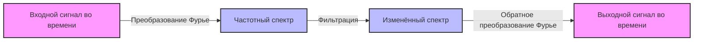

## 1. Введение: представление волны как суммы

Нас окружают звук, свет и электромагнитные волны. Можно ли понять сложную, нерегулярную форму сигнала как сочетание простых волн? **Ряд Фурье**, связанный с именем Жозефа Фурье, и **преобразование Фурье**, использующее непрерывный набор частот, придают этой идее математическую форму. При этом необходимо указать условия на функции и смысл сходимости.

В статье рассматриваются основные формулы, их наглядное толкование и пример применения в современной обработке сигналов.

## 2. Ряд Фурье: разложение периодических волн

Ряд Фурье представляет периодическую функцию через тригонометрические составляющие с частотами, являющимися целочисленными кратными основной частоты. Возможность вычислить коэффициенты сама по себе не означает, что ряд в каждой точке сходится к значению исходной функции. Здесь рассматриваются кусочно-гладкие периодические функции: период можно разбить на конечное число интервалов, внутри которых функция непрерывно дифференцируема, а на концах и функция, и её производная имеют конечные односторонние пределы. При этом достаточном условии ряд сходится к значению функции в точках непрерывности и к полусумме левого и правого пределов в точках скачка.

$$
\lim_{M\to\infty} S_M(x)=\frac{f(x-)+f(x+)}{2}
$$

$S_M$ — частичная сумма до гармоники порядка $M$. На стыке периодов также используются пределы периодического продолжения. Вблизи скачка сохраняется выброс, связанный с явлением Гиббса, даже при увеличении числа членов. Поэтому добавление членов не приводит к равномерному стремлению ошибки к нулю на всём интервале.

### 2.1 Вещественная форма ряда Фурье

Для вещественнозначной функции периода $2\pi$, удовлетворяющей указанным условиям, следующее равенство верно в точках непрерывности. Углы измеряются в радианах. В точке скачка левую часть следует заменить полусуммой односторонних пределов.

$$
f(x) = \frac{a_0}{2} + \sum_{n=1}^{\infty} \left( a_n \cos(nx) + b_n \sin(nx) \right)
$$

Числа $a_0,a_n,b_n$ называются **коэффициентами Фурье**. Постоянный член, или постоянная составляющая, равен среднему за период: $a_0/2$, а не $a_0$. При $n\ge1$ коэффициенты $a_n,b_n$ задают веса косинусных и синусных составляющих. Из ортогональности тригонометрических функций получаются формулы:

$$
a_0 = \frac{1}{\pi} \int_{-\pi}^{\pi} f(x) dx
$$

$$
a_n = \frac{1}{\pi} \int_{-\pi}^{\pi} f(x) \cos(nx) dx
$$

$$
b_n = \frac{1}{\pi} \int_{-\pi}^{\pi} f(x) \sin(nx) dx
$$

### 2.2 Комплексная форма ряда Фурье

[Формула Эйлера](/ru/p/eulers-identity/) $e^{i\theta}=\cos\theta+i\sin\theta$ позволяет записать тот же ряд через комплексные экспоненты. Двусторонняя сумма ниже понимается как предел симметричных частичных сумм от $n=-M$ до $M$. Равенство в точках непрерывности и оговорка в точках скачка остаются такими же, как в вещественной форме.

$$
f(x) = \sum_{n=-\infty}^{\infty} c_n e^{inx}
$$

$$
c_n = \frac{1}{2\pi} \int_{-\pi}^{\pi} f(x) e^{-inx} dx
$$

Для вещественнозначной $f$ выполняются равенства $c_0=a_0/2$, $c_n=(a_n-ib_n)/2$, $c_{-n}=(a_n+ib_n)/2$ при $n\ge1$. Отрицательные частоты появляются даже при представлении вещественного сигнала комплексными экспонентами. Эта форма также помогает увидеть связь с преобразованием Фурье.

## 3. Преобразование Фурье: за пределами периодических функций

Ряды применимы и к периодически продолженным функциям. Однако для описания отдельного импульса или другого сигнала на всей вещественной оси полезно **преобразование Фурье**, в котором частота меняется непрерывно. Увеличение периода и уменьшение шага частот дают наглядную связь между двумя представлениями. Но перестановка предела и интеграла требует условий, поэтому одна эта наглядная идея не является общим доказательством.

### 3.1 Определение и обращение

Мы используем отрицательный знак в показателе прямого преобразования и множитель $1/(2\pi)$ в обратном. Если $\int_{-\infty}^{\infty}|f(t)|\,dt<\infty$, следующий интеграл прямого преобразования сходится абсолютно при каждом вещественном $\omega$.

$$
F(\omega) = \int_{-\infty}^{\infty} f(t) e^{-i\omega t} dt
$$

Например, если $f$ непрерывна, а $f$ и $F$ обе абсолютно интегрируемы, обратное преобразование восстанавливает $f$ по следующей формуле. Её нельзя без условий применять к произвольной функции.

$$
f(t) = \frac{1}{2\pi} \int_{-\infty}^{\infty} F(\omega) e^{i\omega t} d\omega
$$

Здесь $t$ измеряется в секундах, а $\omega$ — угловая частота в рад/с. Частота $\nu$ в герцах связана с ней равенством $\omega=2\pi\nu$. Комплекснозначная функция $F(\omega)$ описывает веса непрерывного спектра; там, где $F\ne0$, модуль и аргумент дают величину и фазу. Вес в непрерывном спектре нельзя напрямую отождествлять с амплитудой отдельной составляющей периодического сигнала.

Для функций со скачками при дополнительных условиях регулярности симметричный несобственный интеграл может восстанавливать полусумму односторонних пределов. Для функций с интегрируемым квадратом модуля и для периодических сигналов могут потребоваться расширения в смысле $L^2$ и в смысле обобщённых функций соответственно. Эти теории здесь не рассматриваются. Знаки и нормировка различаются в разных источниках; проверяйте прямое и обратное преобразования вместе.

### 3.2 Обработка сигналов

Схема показывает обработку сигнала в частотной области.



## 4. Дискретное преобразование Фурье (ДПФ) и быстрое преобразование Фурье (БПФ)

**Дискретное преобразование Фурье (ДПФ)** переводит конечную последовательность $x_0,\ldots,x_{N-1}$ в такое же число частотных составляющих. Это конечное преобразование следует отличать от простой замены интеграла непрерывного преобразования конечной суммой. Для временного сигнала сначала выполняют дискретизацию и выбирают конечный интервал наблюдения. Прямое и обратное ДПФ образуют пару:

$$
X_k = \sum_{n=0}^{N-1} x_n e^{-i \frac{2\pi}{N} k n} \quad \text{for } k = 0, 1, \dots, N-1
$$

$$
x_n=\frac{1}{N}\sum_{k=0}^{N-1}X_k e^{i\frac{2\pi}{N}kn} \quad \text{for } n=0,1,\dots,N-1
$$

При частоте дискретизации $f_s$ шаг частотных отсчётов, или бинов, равен $f_s/N$ Гц. ДПФ соответствует представлению конечной последовательности как периодически повторяющейся. Компоненты исходного сигнала до дискретизации с частотами не ниже $f_s/2$ вызывают наложение спектров или неоднозначность. Поэтому восстановление непрерывного сигнала требует предположений, например ограничения полосы частот. Если синусоида не укладывается в интервал наблюдения целым числом периодов, возникает и спектральная утечка: энергия распределяется между несколькими бинами.

Прямой расчёт всех $N$ составляющих ДПФ требует $O(N^2)$ операций. [Быстрое преобразование Фурье (БПФ, FFT)](/ru/p/fast-fourier-transform-algorithm/) — семейство алгоритмов для эффективного вычисления того же ДПФ. Например, при длине, равной степени двойки, рекурсивное разбиение даёт $O(N\log N)$ операций. БПФ означает способ вычисления, а не другое преобразование или само по себе приближение. Оно широко применяется в цифровой обработке сигналов, в том числе звуковых. С другой стороны, базовый метод обычного JPEG со сжатием с потерями использует дискретное косинусное преобразование (ДКП, DCT). Эти преобразования связаны, но JPEG не следует без оговорок представлять как прямое применение БПФ.

### 4.1 Проверка двух частот и их амплитуд в Python

Пример использует NumPy и Matplotlib. Мы берём одну секунду с частотой дискретизации 1 000 Гц и складываем синусоиду с частотой 50 Гц и амплитудой 1 с синусоидой с частотой 120 Гц и амплитудой 0,5. Вход вещественный, поэтому используются `rfft` и `rfftfreq`. Обе частоты точно совпадают с бинами, расположенными с шагом 1 Гц, и ниже 500 Гц.

```python
import numpy as np
import matplotlib.pyplot as plt

# Одна секунда с частотой 1000 Гц; конечную точку в одну секунду не включаем
fs = 1000.0
N = 1000
t = np.arange(N) / fs
signal = np.sin(2 * np.pi * 50 * t) + 0.5 * np.sin(2 * np.pi * 120 * t)

# ДПФ неотрицательных частот вещественного сигнала
fft_result = np.fft.rfft(signal)
frequencies = np.fft.rfftfreq(N, d=1 / fs)

# Односторонняя амплитуда: не удваиваем DC и Найквист при чётном N
amplitude = np.abs(fft_result) / N
if N % 2 == 0:
    amplitude[1:-1] *= 2
else:
    amplitude[1:] *= 2

peak_indices = np.argsort(amplitude)[-2:]
for k in sorted(peak_indices, key=lambda k: frequencies[k]):
    print(f"{frequencies[k]:.0f} Hz: {amplitude[k]:.3f}")

fig, ax = plt.subplots()
ax.plot(frequencies, amplitude)
ax.set(xlim=(0, 200), xlabel="Frequency (Hz)", ylabel="Amplitude",
       title="One-sided amplitude spectrum")
ax.grid(True)
fig.tight_layout()
plt.show()
```

Округлённый вывод: `50 Hz: 1.000` и `120 Hz: 0.500`; Python использует в выводе десятичную точку. Прямое преобразование `rfft` по умолчанию не делится на $N$, поэтому для отображения амплитуд выполнена указанная нормировка. При объединении положительной и отрицательной частот вещественного сигнала удваиваются только внутренние бины; постоянная составляющая и, при чётной длине, составляющая Найквиста не удваиваются. Это позволяет определить амплитуды синусоид данного примера, частоты которых совпадают с бинами и к которым не применялась оконная функция. Одна эта формула не гарантирует точные амплитуды для произвольных сигналов или данных после применения окна.

## 5. Заключение

Ряд и преобразование Фурье помогают разложить сложные явления на простые составляющие. Представление сигнала в частотной области позволяет находить скрытые закономерности и обрабатывать информацию.

Указывайте периодичность, условия сходимости, единицы частоты и нормировку. Различие между ДПФ и вычисляющими его алгоритмами БПФ также проясняет связь математических формул с программами.

## Источники

- [MIT ES.1803 Topic 22: коэффициенты, сходимость, явление Гиббса и ортогональность (§22.5–22.7)](https://ocw.mit.edu/courses/es-1803-differential-equations-spring-2024/mites_1803_s24_topic22.pdf)
- [MIT 18.330: преобразование и обращение (глава 6, Definition 14)](https://math.mit.edu/icg/resources/teaching/18.330/18.330-Apr29.pdf)
- [NIST DLMF §1.14(i): определение и условия обращения; знаки и нормировка отличаются от принятых здесь](https://dlmf.nist.gov/1.14#i)
- [MIT 6.341 Lecture 19: число операций ДПФ и БПФ](https://ocw.mit.edu/courses/6-341-discrete-time-signal-processing-fall-2005/4ee39a5e74c9f5099ac516ce57215c96_lec19.pdf)
- [NumPy 2.3: FFT](https://numpy.org/doc/2.3/reference/generated/numpy.fft.fft.html), [rfft для вещественных данных](https://numpy.org/doc/2.3/reference/generated/numpy.fft.rfft.html), [частотные отсчёты rfftfreq](https://numpy.org/doc/2.3/reference/generated/numpy.fft.rfftfreq.html)
- [ITU-T T.81: JPEG с потерями на основе DCT (§4.2–4.3)](https://www.w3.org/Graphics/JPEG/itu-t81.pdf)
