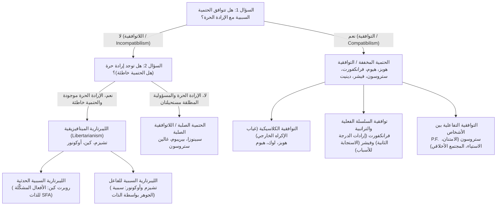
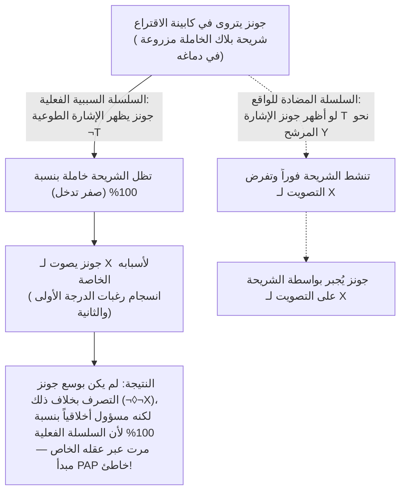

## 1. مقدمة: المعضلة الثلاثية الكلاسيكية للحتمية السببية والإرادة الحرة والمسؤولية الأخلاقية

عندما تقرر في هذه اللحظة تمرير هذه الصفحة إلى الأسفل أو مد يدك نحو فنجان القهوة، فإنك تعيش قناعة ظاهراتية مباشرة — <strong>الشعور بالفاعلية (Sense of Agency)</strong>: اليقين بأن الأمر *متروك لك* في كيفية التصرف، وأنك كنت تستطيع التصرفبخلاف ذلك، وأنك المؤلف الواعي والعقلاني لقراراتك. تشكل هذه القناعة الأساس الذي يقوم عليه نظامنا القانوني بأكمله، والمدح والذم الأخلاقيان، فضلاً عن المشاعر الإنسانية المتبادلة كالامتنان والاستياء والشعور بالذنب.

غير أننا ما إن ننظر إلى الإنسان من منظور العلوم الطبيعية حتى تصطدم هذه البداهة اليومية بالبنية السببية للكون المادي. فانقباض الألياف العضلية في يدك ناتج عن جهود فعل عصبية أطلقها تحرر النواقل العصبية في القشرة الجبهية الأمامية والعقد القاعدية — وهي عمليات تخضع بصرامة لمعادلات الديناميكا الكهربائية والديناميكا الحرارية وميكانيكا الكم. ومنذ عام 1674، شبّه الفيلسوف العقلاني <strong>باروخ سبينوزا</strong> (الرسالة 58) وهم الإرادة الحرة لدى الإنسان <strong>بحجر مقذوف في الهواء</strong> يكتسب الوعي فجأة: فالحجر، إذ يعي حركته الخاصة ويجهل القوة الخارجية التي قذفته، سيظن نفسه يطير بإرادته الحرة المحضة.

### شيطان لابلاس والصياغة المنطقية الموجهة للحتمية السببية

في عام 1814، وفي مقدمة كتابه *مقال فلسفي في الاحتمالات*، صاغ العالم الفرنسي <strong>بيير سيمون لابلاس</strong> تجربة الفكر الشهيرة المعروفة باسم <strong>«شيطان لابلاس (Laplace's Demon)»</strong>: لو وُجد عقل يعرف في لحظة معينة جميع القوى التي تحرك الطبيعة ومواضع جميع الكائنات المكونة لها، لجمع في معادلة واحدة حركة أكبر أجرام الكون وحركة أخف الذرات؛ ولن يكون هناك شيء غير مؤكد بالنسبة له، بل سيحضر المستقبل والماضي معاً أمام عينيه.

في الميتافيزيقا التحليلية المعاصرة، تُعرَّف <strong>الحتمية السببية (Causal Determinism)</strong> بدقة باستخدام المنطق الموجه (Modal Logic). ليكن $P_0$ قضية صادقة تصف الحالة الفيزيائية الدقيقة الكاملة للكون في لحظة $t_0$ في الماضي السحيق (قبل مليار سنة مثلاً)، وليكن $L$ عطف (Conjunction) جميع القوانين الأساسية الصادقة للطبيعة، وليكن $P$ قضية صادقة تصف فعلاً بشرياً في اللحظة الحالية $t$ (مثل: *«أنت ترفع يدك اليمنى في اللحظة $t$»*). تنص الحتمية على تحقق الاستلزام الضروري التالي:

$$\Box \bigl( (P_0 \land L) \to P \bigr)$$

حيث يرمز $\Box$ إلى الضرورة الميتافيزيقية (*«صادق في جميع العوالم الممكنة»*). أي أنه في كل عالم ممكن يشترك مع العالم الفعلي في نفس الماضي السحيق $P_0$ ونفس قوانين الطبيعة $L$، لابد أن يقع الفعل نفسه $P$ حتماً.

### التصنيف $2 \times 2$ لنقاش الإرادة الحرة

| الموقف الفلسفي | هل يتوافق مع الحتمية؟ | هل توجد إرادة حرة؟ | هل توجد مسؤولية أخلاقية مطلقة؟ | الشرط الجوهري للحرية | أبرز الفلاسفة |
| :--- | :---: | :---: | :---: | :--- | :--- |
| <strong>اللاتوافقية الصلبة</strong> (Hard Incompatibilism) | لا | لا | لا (العقاب الانتقامي غير مبرر) | علة الذات المطلقة (*Causa Sui*)، وهي مستحيلة منطقياً | باروخ سبينوزا، ديرك بيريبوم، غالين ستروسون |
| <strong>الليبرتارية</strong> (Libertarianism) | لا | نعم | نعم | إمكانية التصرف بخلاف ذلك اللاحتمية والمصدر النهائي | رودريك تشيزم، روبرت كين، تيموثي أوكونور |
| <strong>التوافقية الكلاسيكية</strong> (Classical Compatibilism) | نعم | نعم | نعم | غياب القيود المادية أو الإكراه الخارجي؛ العمل وفق الرغبات | توماس هوبز، جون لوك، ديفيد هيوم |
| <strong>التوافقية المعاصرة / شبه التوافقية</strong> | نعم | نعم | نعم (تعتمد على *السلسلة السببية الفعلية*) | الانسجام بين رغبات الدرجة الأولى وإرادات الدرجة الثانية (فرانكفورت)؛ الاستجابة للأسباب (فيشر) | هاري فرانكفورت، P.F. ستروسون، جون مارتن فيشر، دانيال دينيت |

---

## 2. الحجة الرئيسية لبيتر فان إنواغن: «حجة النتيجة (The Consequence Argument)»

في كتابه *مقال في الإرادة الحرة* (1983)، صاغ الفيلسوف الأمريكي <strong>بيتر فان إنواغن (Peter van Inwagen)</strong> <strong>«حجة النتيجة (The Consequence Argument)»</strong>:

> *«إذا كانت الحتمية صادقة، فإن أفعالنا هي نتائج لقوانين الطبيعة وأحداث في الماضي السحيق. لكن ما حدث قبل ولادتنا ليس بيدنا (not up to us)، كما أن ماهية قوانين الطبيعة ليست بيدنا. وبالتالي، فإن نتائج هذه الأشياء (بما في ذلك أفعالنا الحالية) ليست بيدنا أيضاً.»*

### المؤثر الموجه $\mathcal{N}$ وقاعدتا الاستدلال $\alpha$ و $\beta$

يُدخل فان إنواغن المؤثر الموجه $\mathcal{N} p$:

$$\mathcal{N} p \iff \text{«القضية } p \text{ صادقة، ولا يملك أي فاعل بشري، ولم يملك قط، أي خيار بشأن ما إذا كانت } p \text{ صادقة.»}$$

ويحكم هذا المؤثر قاعدتا استدلال أساسيتان:
1. <strong>القاعدة $\alpha$ (من الضرورة المنطقية إلى انعدام الخيار)</strong>: $\Box p \vdash \mathcal{N} p$. لا أحد يملك خياراً بشأن الحقائق الضرورية منطقياً أو ميتافيزيقياً.
2. <strong>القاعدة $\beta$ (انتقال انعدام الخيار / Transfer of Powerlessness)</strong>: $\mathcal{N} p,\; \mathcal{N}(p \to q) \vdash \mathcal{N} q$. إذا لم يكن لأحد خيار بشأن $p$ ولا بشأن الشرطية $(p \to q)$، فلا خيار لأحد بشأن النتيجة $q$.

### الاشتقاق الصوري من سبع خطوات

$$\begin{aligned}
1.\quad &\Box \bigl( (P_0 \land L) \to P \bigr) &&\text{[المقدمة 1: تعريف الحتمية السببية]} \\
2.\quad &\Box \bigl( P_0 \to (L \to P) \bigr) &&\text{[من (1) بقاعدة التصدير في منطق القضايا]} \\
3.\quad &\mathcal{N} \bigl( P_0 \to (L \to P) \bigr) &&\text{[من (2) بتطبيق القاعدة } \alpha\text{]} \\
4.\quad &\mathcal{N} P_0 &&\text{[المقدمة 2: مبدأ ثبات الماضي السحيق]} \\
5.\quad &\mathcal{N} (L \to P) &&\text{[من (3) و (4) بتطبيق القاعدة } \beta\text{]} \\
6.\quad &\mathcal{N} L &&\text{[المقدمة 3: مبدأ ثبات قوانين الطبيعة]} \\
7.\quad &\mathcal{N} P &&\text{[من (5) و (6) بتطبيق القاعدة } \beta \text{ — وهو المطلوب إثباته]}
\end{aligned}$$

### ردود التوافقيين: «المعجزات الموضعية» لديفيد لويس والمثال المضاد للقاعدة $\beta$

1. <strong>ديفيد لويس (*«Are We Free to Break the Laws?»*, 1981)</strong>: يميز لويس بين القدرة <strong>بالمعنى القوي</strong> (أن يتسبب فعلي نفسه في خرق قانون فيزيائي، وهو مستحيل: $\mathcal{N}_{\text{strong}} L$) والقدرة <strong>بالمعنى الضعيف المضاد للواقع</strong>: *لو* أنني اخترت عدم رفع يدي ($\neg P$)، لكان أقرب عالم ممكن إلى عالمنا قد شهد <strong>معجزة تباين موضعية (Local divergence miracle)</strong> ضئيلة للغاية في مشابكي العصبية قبيل القرار بلحظة، مما يجعل $L$ كاذبة في ذلك العالم المضاد للواقع ($\neg \mathcal{N}_{\text{weak}} L$).
2. <strong>ماكاي وجونسون (1996) ضد القاعدة $\beta$</strong>: تستلزم القاعدتان $\alpha$ و $\beta$ منطقياً مبدأ <strong>التجميع (Agglomeration: $\mathcal{N} p, \mathcal{N} q \vdash \mathcal{N}(p \land q)$)</strong>. لكن إذا اخترت بحرية *عدم* رمي عملة معدنية عادلة، فإن $\mathcal{N} p$ (*«العملة لم تستقر على الوجه»*) صادقة و $\mathcal{N} q$ (*«العملة لم تستقر على الظهر»*) صادقة (لأنك حتى لو رميتها لا يمكنك ضمان الوجه أو الظهر)، غير أن $\mathcal{N}(p \land q)$ (*«العملة لم تستقر لا على الوجه ولا على الظهر»*) <strong>كاذبة</strong>، لأنه كان يكفيك رمي العملة لضمان ظهور أحد الوجهين!

---

## 3. هل تنقذ اللاحتمية الكمومية الإرادة الحرة؟ حجة الحظ والحجة الأساسية لستروسون

هل يمكن لانهيار دالة الموجة الاحتمالي وفق <strong>قاعدة بورن</strong> ($|\psi\rangle = c_1 |A\rangle + c_2 |B\rangle$، حيث $|c_1|^2 + |c_2|^2 = 1$) أن ينقذ الإرادة الحرة؟

### حجة الحظ (The Luck / Mind Argument)

إذا كان قرارك الأخلاقي بين كشف الفساد ($A$) أو قبول الرشوة ($B$) يُحسم في الميكروثانية الأخيرة بواسطة <strong>قفزة كمومية عشوائية بلا سبب</strong> في قشرتك الجبهية، فلست *أنت* من يتحكم عقلانياً في النتيجة، بل الصدفة العمياء لنرد دون ذري! وكما تُظهر <strong>حجة الإرجاع (Rollback Argument)</strong> لفان إنواغن (2000) ومشكلة <strong>الحظ عبر العوالم (Cross-world Luck)</strong> لألفريد ميلي (2006)، فإن استبدال سلاسل لابلاس بروليت كمومي لا ينتج فاعلية مسؤولة بل اختلاجات عشوائية.

### النماذج الليبرتارية والحجة الأساسية لغالين ستروسون (1994)

يرد الليبرتاريون إما عبر <strong>الأفعال المشكِّلة للذات (Self-Forming Actions, SFA)</strong> لـ <strong>روبرت كين (1996)</strong> (حيث يبذل الفاعل أثناء الصراع الأخلاقي الممزق جهداً إرادياً مزدوجاً نحو الخيارين معاً في شبكات عصبية فوضوية، متبنياً أياً من النتيجتين)، أو عبر <strong>سببية الفاعل (Agent-Causation)</strong> لـ <strong>رودريك تشيزم</strong> و <strong>تيموثي أوكونور</strong> ($S \xrightarrow{\text{agent-causes}} A$).

ومع ذلك، أثبت <strong>غالين ستروسون</strong> عام 1994 عبر <strong>الحجة الأساسية (The Basic Argument)</strong> أن المسؤولية الأخلاقية المطلقة <strong>مستحيلة منطقياً</strong> سواء أكان الكون حتمياً أم لاحتمياً:
1. عندما تقوم بالفعل $A$، فإنك تفعل ذلك بسبب طبيعتك الذهنية والخلقية الحالية ($M_1$).
2. لكي تكون مسؤولاً مسؤولية مطلقة عن $A$، يجب أن تكون مسؤولاً مسؤولية مطلقة عن كونك $M_1$.
3. ولكن لكي تكون مسؤولاً عن $M_1$، كان يجب أن تختار عمداً في الماضي أن تصبح $M_1$ استناداً إلى مبادئ تقييمية سابقة $M_0$، وللمسؤولية عن $M_0$ تحتاج إلى $M_{-1}$، مما يولد <strong>تسلسلاً لا نهائياً فاسداً ($A \leftarrow M_1 \leftarrow M_0 \leftarrow M_{-1} \leftarrow \cdots$)</strong> ينتهي حتماً عند جيناتك وبيئة طفولتك المبكرة $M_{\text{init}}$ التي لم تخترها قط. لا شيء يمكن أن يكون <strong>*Causa Sui</strong>* (علة ذاته).

---

## 4. الثورة التوافقية: من هيوم إلى حالات هاري فرانكفورت

يرى <strong>توماس هوبز</strong> و <strong>ديفيد هيوم</strong> (*تحقيق في الفهم البشري*، 1748، القسم الثامن) أن الحرية لا تتعارض مع الضرورة السببية، بل مع <strong>الإكراه الخارجي (السلاسل، السجن، التهديد)</strong>. بل إن الفعل لا يستوجب المسؤولية الأخلاقية إلا إذا صدر سببياً عن شخصية الفاعل المستقرة ودوافعه!

### دحض مبدأ الإمكانيات البديلة (PAP) على يد هاري فرانكفورت (1969)

في عام 1969، وفي ورقته الشهيرة *«Alternate Possibilities and Moral Responsibility»*، دحض <strong>هاري فرانكفورت</strong> <strong>مبدأ الإمكانيات البديلة (PAP: $\text{Resp}(S,A) \implies \Diamond \neg A$)</strong> من خلال تجربة فكر <strong>بلاك وجونز</strong>:
* يريد جراح الأعصاب <strong>بلاك</strong> أن يصوت <strong>جونز</strong> للمرشح $X$، فيزرع سراً شريحة إلكترونية في دماغه.
* <strong>البروتوكول المضاد للواقع</strong>: إذا أظهر جونز الإشارة العصبية المسبقة $T$ الدالة على ميله للتصويت لـ $Y$، تنشط الشريحة فوراً وتجبر جونز إلكترونياً على التصويت لـ $X$. أما إذا أظهر الإشارة $\neg T$ وقرر من تلقاء نفسه التصويت لـ $X$، تظل الشريحة <strong>خاملة تماماً (dormant)</strong>.
* <strong>السلسلة الفعلية</strong>: يتروى جونز بمفرده ويصوت طوعاً لـ $X$؛ ولا تتدخل شريحة بلاك مطلقاً!

رغم أن جونز لم يملك أي إمكانية للتصرف بخلاف ذلك ($\neg \Diamond \neg X$)، فإنه <strong>مسؤول أخلاقياً بنسبة 100%</strong> لأن الشريحة لم تلعب أي دور في <strong>السلسلة السببية الفعلية</strong>. وعلى هذا الأساس بنى <strong>جون مارتن فيشر</strong> مذهب <strong>شبه التوافقية (Semicompatibilism)</strong>.

---

## 5. الإرادات التراتبية، الاستجابة للأسباب، المواقف التفاعلية، وعلم الأعصاب

1. <strong>النظرية التراتبية للإرادة عند هاري فرانكفورت (1971)</strong>:
   يتميز <strong>الشخص (Person)</strong> عن الكائن المندفع (<strong>Wanton</strong>) بامتلاكه <strong>إرادات من الدرجة الثانية ($\text{Vol}_2$)</strong> تقرر أي <strong>رغبات الدرجة الأولى ($\text{Des}_1$)</strong> يريد لها أن تكون إرادته الفاعلة. <strong>المدمن المكره (Unwilling Addict)</strong> يفتقر إلى حرية الإرادة لأن اندفاعه يناقض إرادته من الدرجة الثانية للتعافي، بينما يتحقق لدى <strong>المدمن الراغب (Willing Addict)</strong> والفاعل المستقل انسجام وتماهٍ كامل (<strong>Hierarchical Mesh</strong>).
2. <strong>«الاستجابة المعتدلة للأسباب» عند فيشر ورافيزا (1998)</strong>:
   يتطلب التحكم التوجيهي أن تكون الآلية التداولية الفعلية $M$ <strong>متقبلة للأسباب (Receptivity)</strong> (قادرة على إدراك الأسباب الكافية للتصرف بخلاف ذلك) و <strong>متفاعلة مع الأسباب (Reactivity)</strong> (قادرة على ترجمة ذلك الإدراك إلى فعل مختلف في بعض العوالم المضادة للواقع على الأقل).
3. <strong>المواقف التفاعلية عند P.F. ستروسون (*«Freedom and Resentment»*, 1962)</strong>:
   تتجذر المسؤولية الأخلاقية في شبكتنا من <strong>المواقف التفاعلية التشاركية</strong> (<strong>الاستياء</strong>، <strong>الامتنان</strong>، <strong>السخط الأخلاقي</strong>، <strong>التسامح</strong>). إن التخلي عن هذه المواقف تجاه البشرية جمعاء لتبني <strong>موقف موضوعي</strong> سريري بارد باسم الحتمية هو أمر مستحيل نفسياً وعبثي عملياً.
4. <strong>تجربة بنجامين ليبيت (1983) ودحض آرون شورغر (2012)</strong>:
   وجد ليبيت أنه عند ثني المعصم تلقائياً، يبدأ <strong>جهد الاستعداد (RP)</strong> في الباحة الحركية الإضافية عند $-550\text{ ms}$ قبل وعي النية (<strong>زمن W</strong> عند $-200\text{ ms}$). لكن هذا الادعاء العصبي ضد الإرادة الحرة ينهار تماماً:
   * <strong>النقد الفلسفي (ميلي 2009، دينيت 2003، ماوز وآخرون 2019)</strong>: ثني المعصم عشوائياً بلا سبب لا علاقة له بالتداول الأخلاقي المعقد (عندما يتخذ المشاركون قرارات هادفة بشأن تبرعات خيرية حقيقية، يختفي جهد الاستعداد المبكر تماماً!). كما أن وضع «الدماغ» في مقابل «أنت» يقع في مغالطة الثنائية الديكارتية.
   * <strong>نموذج المركِّم العشوائي لآرون شورغر (2012, *PNAS*)</strong>: أثبت شورغر أن جهد الاستعداد عند $-550\text{ ms}$ ليس قراراً لاواعياً، بل هو أثر رياضي ناتج عن حساب المتوسط الرجعي زمنياً (*time-locked averaging*) لتقلبات عفوية من <strong>الضوضاء الوردية ($1/f$)</strong> في القشرة الحركية تعبر عتبة القرار عشوائياً حول $-200\text{ ms}$!

---

## 6. خاتمة: إصلاح العدالة الجنائية والاستقلالية البشرية بعد شيطان لابلاس

إذا اشترطنا للإرادة الحرة أن تكون <strong>*Causa Sui</strong>* خارقة للطبيعة، فيجب علينا رفض العقاب الانتقامي لصالح <strong>نموذج الصحة العامة والتأهيل</strong> كما يقترح ديرك بيريبوم وغريغ كاروسو. أما كما تُبيِّن <strong>التوافقية المعاصرة</strong>، فإن الحرية الإنسانية الحقيقية لا تكمن في خرق قوانين الفيزياء، بل في قدرتنا المنبثقة على حكم رغباتنا بالعقل، والاستجابة المرنة للأسباب الأخلاقية، والعيش كفاعلين مسؤولين داخل مجتمع أخلاقي.
