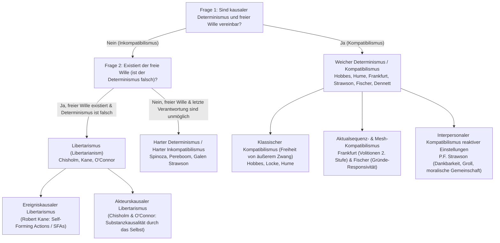
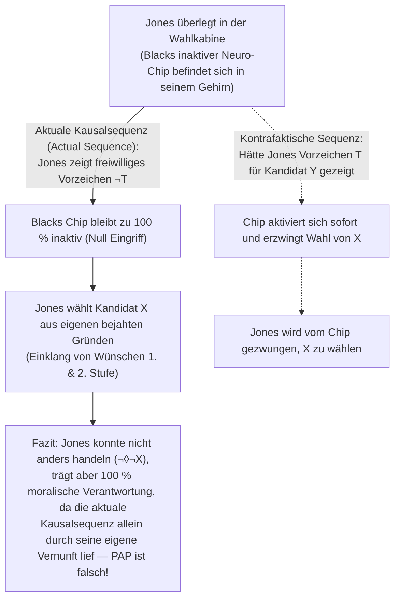

## 1. Einleitung: Das klassische Trilemma von Determinismus, Willensfreiheit und moralischer Verantwortung

Wenn Sie sich in diesem Augenblick entscheiden, auf dieser Seite weiterzuscrollen oder nach Ihrer Kaffeetasse zu greifen, erleben Sie eine unmittelbare phänomenologische Gewissheit – das <strong>Urheberschaftsgefühl (Sense of Agency)</strong>: die Überzeugung, dass es *an Ihnen liegt*, wie Sie handeln, dass Sie auch anders hätten handeln können und dass Sie der bewusste, rationale Autor Ihrer Entscheidungen sind. Diese Überzeugung bildet das Fundament unserer gesamten Rechtsordnung, unserer moralischen Praxis von Lob und Tadel sowie zwischenmenschlicher Gefühle wie Dankbarkeit, Empörung und Schuld.

Betrachten wir den Menschen jedoch durch das Prisma der Naturwissenschaften, prallt dieses Selbstbild frontal auf die kausale Architektur des physikalischen Universums. Die Kontraktion Ihrer Muskelfasern wird durch Aktionspotentiale motorischer Neuronen ausgelöst, diese wiederum durch die Ausschüttung von Neurotransmittern an Synapsen im präfrontalen Kortex und in den Basalganglien – Prozesse, die streng den Differentialgleichungen der Elektrodynamik, Thermodynamik und Quantenmechanik gehorchen. Schon 1674 verglich <strong>Baruch de Spinoza</strong> (Brief 58) das menschliche Freiheitsgefühl mit einem <strong>fliegenden Stein</strong>, der nach einem äußeren Wurf plötzlich Bewusstsein erlangt: Da der Stein sich seiner eigenen Bewegung bewusst ist, aber die äußeren Ursachen seines Wurfs nicht kennt, hält er sich für vollkommen frei.

### Der Laplacesche Dämon und die modale Formalisierung des Determinismus

1814 formulierte der französische Mathematiker und Astronom <strong>Pierre-Simon Laplace</strong> in seinem *Essai philosophique sur les probabilités* das klassische Gedankenexperiment des <strong>Laplaceschen Dämons</strong>: Eine Intelligenz, die zu einem gegebenen Zeitpunkt alle Kräfte der Natur und die Positionen aller Teilchen kennte, könnte mit einer einzigen Formel sowohl die Bewegungen der größten Himmelskörper als auch die des kleinsten Atoms berechnen; Zukunft und Vergangenheit lägen gleichermaßen offen vor ihren Augen.

In der modernen analytischen Metaphysik wird der <strong>kausale Determinismus</strong> mithilfe der Modallogik exakt definiert. Sei $P_0$ eine wahre Proposition, die den gesamten mikrophysikalischen Zustand des Universums zu einem Zeitpunkt $t_0$ in der fernen Vergangenheit (etwa vor einer Milliarde Jahren) vollständig beschreibt, sei $L$ die Konjunktion aller wahren fundamentalen Naturgesetze und sei $P$ eine wahre Proposition über eine menschliche Handlung zum gegenwärtigen Zeitpunkt $t$ (z. B. *„Sie heben zum Zeitpunkt $t$ Ihre rechte Hand“*). Der Determinismus besagt dann:

$$\Box \bigl( (P_0 \land L) \to P \bigr)$$

wobei $\Box$ für metaphysische Notwendigkeit (*„in allen möglichen Welten wahr“*) steht. In jeder möglichen Welt, die dieselbe Vergangenheit $P_0$ und dieselben Naturgesetze $L$ teilt wie unsere Welt, tritt unausweichlich dieselbe Handlung $P$ ein.

### Die $2 \times 2$-Taxonomie der Freiheitsdebatte

| Philosophische Position | Mit Determinismus vereinbar? | Existiert freier Wille? | Existiert letzte moralische Verantwortung? | Kernbedingung für Freiheit / Autonomie | Hauptvertreter |
| :--- | :---: | :---: | :---: | :--- | :--- |
| <strong>Harter Inkompatibilismus</strong> (Hard Incompatibilism) | Nein | Nein | Nein (Vergeltungsstrafe ist ungerechtfertigt) | Letzte Selbstverursachung (*Causa Sui*), logisch unmöglich | Baruch de Spinoza, Derk Pereboom, Galen Strawson |
| <strong>Libertarismus</strong> (Libertarianism) | Nein | Ja | Ja | Indeterministisches Andershandelnkönnen & letzte Urheberschaft | Roderick Chisholm, Robert Kane, Timothy O'Connor |
| <strong>Klassischer Kompatibilismus</strong> (Classical Compatibilism) | Ja | Ja | Ja | Abwesenheit äußeren physischen Zwangs; Handeln gemäß eigenen Wünschen | Thomas Hobbes, John Locke, David Hume |
| <strong>Moderner / Semikompatibilismus</strong> (Contemporary / Semicompatibilism) | Ja | Ja | Ja (basiert auf der *aktualen Kausalsequenz*) | Einklang von Wünschen 1. Stufe und Volitionen 2. Stufe (Frankfurt); Gründe-Responsivität (Fischer) | Harry Frankfurt, P.F. Strawson, John Martin Fischer, Daniel Dennett |

---

## 2. Peter van Inwagens Meisterargument für den Inkompatibilismus: Das Konsequenzargument

In seinem Werk *An Essay on Free Will* (1983) formulierte <strong>Peter van Inwagen</strong> das <strong>Konsequenzargument (The Consequence Argument)</strong>, das den Inkompatibilismus ins Zentrum der analytischen Metaphysik zurückführte:

> *„Wenn der Determinismus wahr ist, dann sind unsere Handlungen die Konsequenzen der Naturgesetze und der Ereignisse in der fernen Vergangenheit. Aber es liegt nicht bei uns (not up to us), was vor unserer Geburt geschah, und es liegt ebenso wenig bei uns, wie die Naturgesetze lauten. Folglich liegen auch die Konsequenzen dieser Dinge (einschließlich unserer gegenwärtigen Handlungen) nicht bei uns.“*

### Der Modaloperator $\mathcal{N}$ und die Schlussregeln $\alpha$ und $\beta$

Van Inwagen führt den Operator $\mathcal{N} p$ ein:

$$\mathcal{N} p \iff \text{„Proposition } p \text{ ist wahr, und kein Mensch hat oder hatte jemals eine Wahl darüber, ob } p \text{ der Fall ist.“}$$

Für $\mathcal{N}$ gelten zwei fundamentale Schlussregeln:
1. <strong>Regel $\alpha$ (Von logischer Notwendigkeit zur Machtlosigkeit)</strong>: $\Box p \vdash \mathcal{N} p$. Niemand hat eine Wahl über logisch oder metaphysisch notwendige Wahrheiten.
2. <strong>Regel $\beta$ (Transfer der Machtlosigkeit / Transfer of Powerlessness)</strong>: $\mathcal{N} p,\; \mathcal{N}(p \to q) \vdash \mathcal{N} q$. Wenn niemand eine Wahl über $p$ hat und niemand eine Wahl darüber hat, dass $q$ aus $p$ folgt, dann hat auch niemand eine Wahl über $q$.

### Die 7-stufige formale Ableitung

$$\begin{aligned}
1.\quad &\Box \bigl( (P_0 \land L) \to P \bigr) &&\text{[Prämisse 1: Definition des kausalen Determinismus]} \\
2.\quad &\Box \bigl( P_0 \to (L \to P) \bigr) &&\text{[Aus (1) durch aussagenlogische Exportation]} \\
3.\quad &\mathcal{N} \bigl( P_0 \to (L \to P) \bigr) &&\text{[Aus (2) mittels Schlussregel } \alpha\text{]} \\
4.\quad &\mathcal{N} P_0 &&\text{[Prämisse 2: Prinzip der Unabänderlichkeit der Vergangenheit]} \\
5.\quad &\mathcal{N} (L \to P) &&\text{[Aus (3) und (4) mittels Schlussregel } \beta\text{]} \\
6.\quad &\mathcal{N} L &&\text{[Prämisse 3: Prinzip der Unabänderlichkeit der Naturgesetze]} \\
7.\quad &\mathcal{N} P &&\text{[Aus (5) und (6) mittels Schlussregel } \beta \text{ — Q.E.D.]}
\end{aligned}$$

### Kompatibilistische Einwände: David Lewis und das Gegenbeispiel zu Regel $\beta$

1. <strong>David Lewis (*„Are We Free to Break the Laws?“*, 1981)</strong>: Lewis zeigte, dass Prämisse 3 ($\mathcal{N} L$) doppeldeutig ist. Im <strong>starken Sinn</strong> kann kein Mensch durch seine Handlung ein Naturgesetz verletzen ($\mathcal{N}_{\text{strong}} L$). Doch im <strong>schwachen kontrafaktischen Sinn</strong> gilt: *Hätte* ich mich zum Zeitpunkt $t$ anders entschieden ($\neg P$), wäre in der nächstgelegenen möglichen Welt kurz vor meiner Entscheidung im Gehirn ein winziges <strong>lokales Divergenzwunder (Local divergence miracle)</strong> aufgetreten, sodass $L$ dort falsch gewesen wäre ($\neg \mathcal{N}_{\text{weak}} L$).
2. <strong>McKay und Johnson (1996) gegen Regel $\beta$</strong>: Regel $\alpha$ und $\beta$ implizieren logisch das Prinzip der <strong>Agglomeration</strong> ($\mathcal{N} p, \mathcal{N} q \vdash \mathcal{N}(p \land q)$). Wenn Sie sich frei entscheiden, eine faire Münze *nicht* zu werfen, dann gilt $\mathcal{N} p$ (*„Die Münze landet nicht auf Kopf“*, da Sie selbst durch Werfen Kopf nicht garantieren könnten) und $\mathcal{N} q$ (*„Die Münze landet nicht auf Zahl“*). Doch $\mathcal{N}(p \land q)$ (*„Die Münze landet weder auf Kopf noch auf Zahl“*) ist <strong>falsch</strong>, weil Sie durch bloßes Werfen der Münze das Gegenteil hätten garantieren können!

---

## 3. Rettet der Quantenindeterminismus den freien Willen? Das Zufallsargument und Galen Strawsons Basisargument

Können quantenmechanische Wahrscheinlichkeiten nach der <strong>Bornschen Regel</strong> ($|\psi\rangle = c_1 |A\rangle + c_2 |B\rangle$ mit $|c_1|^2 + |c_2|^2 = 1$) den freien Willen retten?

### Das Zufallsargument (The Luck / Mind Argument)

Wenn Ihre Entscheidung zwischen einer moralischen Pflicht $A$ und einem Verbrechen $B$ durch einen <strong>unverursachten, rein zufälligen Quantensprung</strong> in einem Ionenkanal Ihres präfrontalen Kortex entschieden wird, dann haben <strong>nicht Sie</strong> die Entscheidung rational kontrolliert – sondern der blinde Zufall eines subatomaren Würfelwurfs! Wie <strong>Peter van Inwagens Rollback-Argument (2000)</strong> und <strong>Alfred Meles Cross-World Luck (2006)</strong> zeigen: Wenn Gott das Universum 1.000-mal an den Punkt eine Millisekunde vor der Wahl zurückspult und der Akteur bei exakt identischer Charakter-, Motiv- und Bewusstseinslage 500-mal lügt und 500-mal die Wahrheit sagt, dann ist der Unterschied zwischen beiden Welten bloßes <strong>Zufallsglück (Luck)</strong>, das moralische Verantwortung untergräbt.

### Libertarische Modelle und Galen Strawsons Basisargument (1994)

Libertarier antworten darauf entweder mit <strong>Robert Kanes „Self-Forming Actions“ (SFAs)</strong> (bei inneren moralischen Zerrissenheitskonflikten bemüht sich der Akteur aktiv um beide Optionen zugleich, sodass er das Ergebnis in jedem Fall intentional bejaht) oder mit der <strong>Akteurskausalität (Agent-Causation)</strong> von <strong>Roderick Chisholm</strong> und <strong>Timothy O'Connor</strong> (die Person als Substanz startet als „unbewegter Beweger“ eine neue Kausalkette $S \xrightarrow{\text{agent-causes}} A$).

Doch <strong>Galen Strawson</strong> bewies 1994 mit seinem <strong>Basisargument (The Basic Argument)</strong>, dass letzte moralische Verantwortung unabhängig von Determinismus oder Indeterminismus <strong>logisch unmöglich</strong> ist:
1. Man tut, was man tut ($A$), aufgrund dessen, wie man geistig und charakterlich beschaffen ist ($M_1$).
2. Um für $A$ letztverantwortlich zu sein, müsste man für seine eigene Beschaffenheit $M_1$ letztverantwortlich sein.
3. Dazu hätte man $M_1$ in der Vergangenheit absichtlich wählen müssen – was bereits frühere Bewertungsprinzipien $M_0$ voraussetzt, für die man wiederum $M_{-1}$ gebraucht hätte (*infinitiver Regress*: $A \leftarrow M_1 \leftarrow M_0 \leftarrow M_{-1} \leftarrow \cdots$).
4. Da der Mensch endlich ist, endet jede Kette bei den ungewählten Genen und der frühkindlichen Umwelt $M_{\text{init}}$. Nichts kann <strong>*Causa Sui</strong>* (Ursache seiner selbst) sein!

---

## 4. Die kompatibilistische Revolution: Von Hume zu Harry Frankfurts Gegenbeispielen

Für <strong>Thomas Hobbes</strong> und <strong>David Hume</strong> (*Eine Untersuchung über den menschlichen Verstand*, 1748, Abschnitt VIII) ist der Gegensatz zu Freiheit nicht kausale Notwendigkeit, sondern <strong>äußerer Zwang (Ketten, Gefängnis, Bedrohung)</strong>. Mehr noch: Nur wenn eine Tat kausal aus dem beständigen Charakter einer Person hervorgeht, kann die Person für sie verantwortlich gemacht werden!

### Harry Frankfurts Widerlegung des Prinzips der alternativen Möglichkeiten (PAP, 1969)

Über zwei Jahrtausende galt das <strong>Prinzip der alternativen Möglichkeiten (Principle of Alternate Possibilities, PAP)</strong> als unantastbares Axiom:

$$\mathbf{PAP}: \quad \text{Ein Akteur } S \text{ ist für Handlung } A \text{ nur dann moralisch verantwortlich, wenn er auch anders hätte handeln können } (\Diamond \neg A).$$

1969 widerlegte <strong>Harry Frankfurt</strong> in seinem bahnbrechenden Aufsatz *„Alternate Possibilities and Moral Responsibility“* das PAP durch das Gedankenexperiment von <strong>Black und Jones</strong>:
* Der Neurochirurg <strong>Black</strong> möchte, dass <strong>Jones</strong> für Kandidat $X$ stimmt, und implantiert ihm heimlich einen Neuro-Chip.
* <strong>Kontrafaktisches Protokoll</strong>: Zeigt Jones das neurologische Vorzeichen $T$ für eine Entscheidung zugunsten von $Y$, aktiviert sich der Chip sofort und zwingt Jones elektronisch dazu, $X$ zu wählen. Zeigt Jones hingegen $\neg T$ und entscheidet sich aus freien Stücken selbst für $X$, bleibt der Chip <strong>vollkommen inaktiv (dormant)</strong>.
* <strong>Aktuale Sequenz</strong>: Jones wägt seine eigenen Gründe ab und wählt vollkommen freiwillig $X$; Blacks Chip greift zu keinem Zeitpunkt ein!

Jones konnte nicht anders handeln ($\neg \Diamond \neg X$), ist aber dennoch zu 100 % moralisch verantwortlich, weil der Chip in der <strong>aktualen Kausalsequenz</strong> keinerlei Rolle spielte! Darauf aufbauend entwickelte <strong>John Martin Fischer</strong> seinen <strong>Semikompatibilismus</strong>, der zwischen *regulativer Kontrolle* (Andershandelnkönnen) und *Steuerungskontrolle (Guidance Control)* unterscheidet.

---

## 5. Hierarchische Volitionen, Gründe-Responsivität, reaktive Einstellungen und Neurowissenschaft

1. <strong>Harry Frankfurts hierarchisches Modell des Willens (1971)</strong>:
   Personen besitzen nicht nur <strong>Wünsche erster Stufe ($\text{Des}_1$)</strong> (z. B. den Wunsch, eine Droge zu nehmen oder abstinent zu bleiben), sondern auch <strong>Volitionen zweiter Stufe ($\text{Vol}_2$)</strong> – Wünsche darüber, welcher Wunsch erster Stufe ihr handlungswirksamer Wille sein soll. Der <strong>widerwillige Süchtige (Unwilling Addict)</strong> ist unfrei, weil sein effektiver Trieb seiner Volition zweiter Stufe widerspricht; beim <strong>willigen Süchtigen (Willing Addict)</strong> und beim autonomen Akteur hingegen stehen Wille erster Stufe und Volition zweiter Stufe in harmonischem Einklang (<strong>Wholehearted Mesh</strong>).
2. <strong>Fischer & Ravizzas „Moderate Gründe-Responsivität“ (*Responsibility and Control*, 1998)</strong>:
   Eine Handlung unterliegt genau dann verantwortungsbegründender Steuerungskontrolle, wenn sie aus dem eigenen Mechanismus $M$ des Akteurs hervorgeht, der <strong>gründe-rezeptiv</strong> (erkennt hinreichende Gegengründe in kontrafaktischen Szenarien) und <strong>gründe-reaktiv</strong> (setzt diese Erkenntnis in zumindest einigen kontrafaktischen Welten in anderes Handeln um) ist.
3. <strong>P.F. Strawsons *„Freedom and Resentment“* (1962)</strong>:
   Moralische Verantwortung wurzelt in unseren zwischenmenschlichen <strong>partizipativen reaktiven Einstellungen (Participant Reactive Attitudes)</strong> wie <strong>Groll (Resentment)</strong>, <strong>Dankbarkeit (Gratitude)</strong>, <strong>moralischer Empörung</strong> und <strong>Vergebung</strong>. Diese zugunsten einer rein klinisch-verwaltenden <strong>objektiven Einstellung (Objective Attitude)</strong> gegenüber der gesamten Menschheit aufzugeben, ist sowohl psychologisch unmöglich als auch praktisch absurd.
4. <strong>Benjamin Libets Bereitschaftspotential (1983) und Aaron Schurgers Widerlegung (2012)</strong>:
   Libet stellte fest, dass beim spontanen Handgelenksbeugen das unbewusste <strong>Bereitschaftspotential (RP)</strong> im supplementärmotorischen Areal bereits bei $-550\text{ ms}$ einsetzt, während die bewusste Absicht (<strong>W-Zeit</strong>) erst bei $-200\text{ ms}$ berichtet wird. Doch diese vermeintliche Widerlegung des freien Willens scheitert doppelt:
   * <strong>Philosophische Kritik (Mele 2009, Dennett 2003, Maoz et al. 2019)</strong>: Grundloses Handgelenkschnippen hat nichts mit wohlüberlegten moralischen Entscheidungen zu tun (bei bedeutsamen Entscheidungen über Spenden verschwindet das frühe RP vollständig!); zudem beruht die Trennung von „Gehirn“ und „Ich“ auf einem verfehlten kartesischen Dualismus.
   * <strong>Aaron Schurgers Stochastisches Akkumulatormodell (2012, *PNAS*)</strong>: Schurger wies nach, dass das frühe RP bei $-550\text{ ms}$ gar keine unbewusste Entscheidung ist, sondern ein mathematisches Artefakt der rückwärtsgerichteten Mittelung (Time-locked averaging) von spontanem <strong>$1/f$-Hintergrundrauschen (Pink Noise)</strong> im motorischen Kortex, das zufällig die Entscheidungsschwelle bei $-200\text{ ms}$ überschreitet!

---

## 6. Fazit: Strafrechtsreform und menschliche Autonomie nach dem Laplaceschen Dämon

Versteht man unter freiem Willen eine übernatürliche Selbsterschaffung (*Causa Sui*), so ist diese unmöglich – was Denker wie Derk Pereboom und Gregg Caruso dazu führt, im Strafrecht reine Vergeltungsstrafen (Retributivismus) abzulehnen und durch ein humanes <strong>Public-Health-Quarantäne- und Rehabilitationsmodell</strong> zu ersetzen. Versteht man Freiheit hingegen im Sinne des <strong>modernen Kompatibilismus</strong>, so ist unsere Fähigkeit, Gründe abzuwägen, unsere Wünsche reflektierend zu ordnen und als verantwortliche Mitglieder einer moralischen Gemeinschaft zu handeln, kein Wunder gegen die Physik, sondern die höchste evolutionäre Errungenschaft innerhalb der kausalen Ordnung der Natur.
