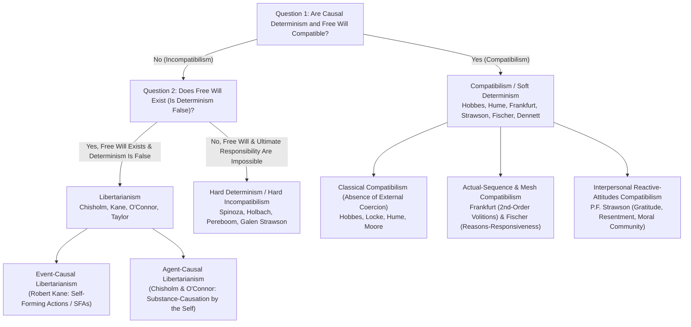
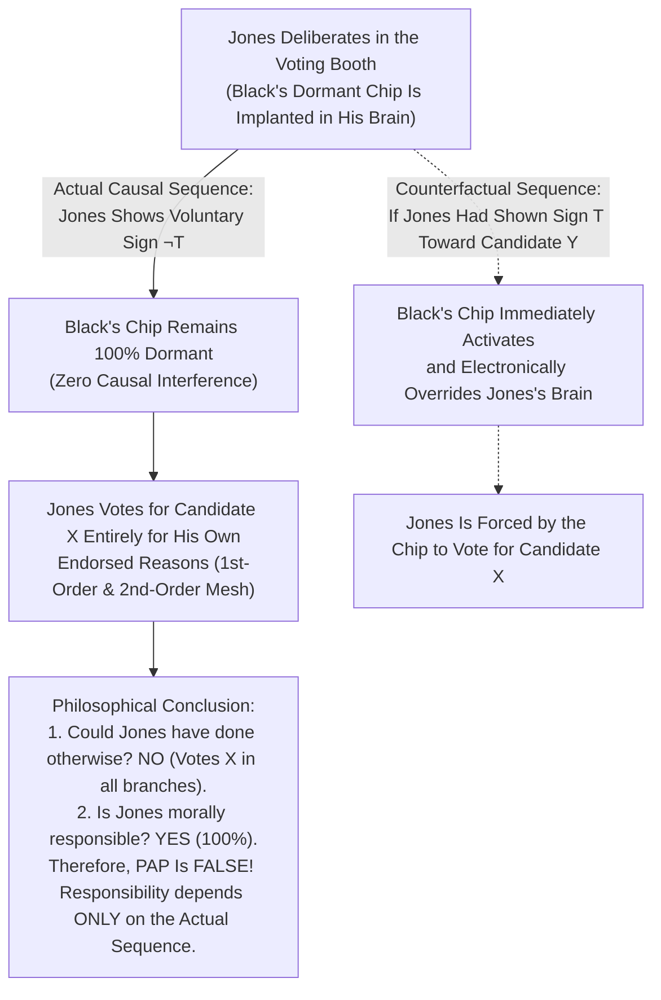

## 1. Introduction: The Classical Trilemma of Causal Determinism, Free Will, and Moral Responsibility

Suppose that right now you decide to scroll down this page or reach for a cup of coffee on your desk. Throughout every waking moment of human life, we inhabit an overwhelming phenomenological conviction—what cognitive scientists and philosophers of action call the <strong>Sense of Agency</strong>: the conviction that *it is up to us* how we act, that we could have refrained from scrolling or chosen water instead of coffee, and that we are the conscious, rational authors of our decisions. This lived conviction is not merely an idle metaphysical intuition; it forms the load-bearing architecture of our entire moral, interpersonal, and legal order. When a criminal court sentences a defendant, or when we feel moral indignation toward a betrayer, gratitude toward a benefactor, or remorse for our own failings, we presuppose that the agent acted of their own <strong>free will</strong> and therefore bears genuine <strong>moral responsibility</strong>.

Yet the moment we step back and view human beings through the lens of the natural sciences, this everyday self-image collides head-on with the causal structure of the physical universe. The contraction of the muscle fibers in your hand was triggered by action potentials traveling down motor neurons; those action potentials were initiated by neurotransmitter release across synaptic clefts in the primary motor cortex, supplementary motor area, and basal ganglia; and those electrochemical events were governed by the opening and closing of voltage-gated ion channels obeying the strict differential equations of electrodynamics, thermodynamics, and quantum mechanics. The human brain is a physical system composed of roughly $8.6 \times 10^{10}$ neurons and $10^{26}$ atoms embedded seamlessly within the physical cosmos. If every physical event is exhaustively determined by prior physical states and the immutable laws of nature, how can a human decision be anything more than an inevitable link in an unbroken causal chain stretching back 13.8 billion years to the Big Bang?

In a famous 1674 letter (Letter 58 to Schuller), the seventeenth-century rationalist philosopher <strong>Baruch Spinoza</strong> illustrated this predicament with his haunting analogy of the <strong>flying stone</strong>. Imagine a stone receives an external impulse from a thrower that propels it through the air. Now suppose that while flying through space, the stone suddenly becomes conscious. Because the stone is conscious of its own ongoing endeavor (*conatus*) to continue moving, but wholly ignorant of the external causes that hurled it into motion, the stone will proudly conclude that it is flying by its own free will! Humanity, Spinoza declared, is in the exact same position: *"Men believe themselves to be free, simply because they are conscious of their actions, and unconscious of the causes whereby those actions are determined."*

### Laplace's Demon and the Modal Formalization of Causal Determinism

In 1814, the French mathematician and physicist <strong>Pierre-Simon Laplace</strong> gave the definitive classical formulation of universal determinism in the introduction to his *Essai philosophique sur les probabilités* (*A Philosophical Essay on Probabilities*), invoking a hypothetical super-intelligence that posterity dubbed <strong>Laplace's Demon</strong>:

> *"We may regard the present state of the universe as the effect of its past and the cause of its future. An intellect which at a certain moment would know all forces that set nature in motion, and all positions of all items of which nature is composed, if this intellect were also vast enough to submit these data to analysis, it would embrace in a single formula the movements of the greatest bodies of the universe and those of the tiniest atom; for such an intellect nothing would be uncertain and the future just like the past would be present before its eyes."*

In contemporary analytic metaphysics, <strong>Causal Determinism</strong> is defined not in terms of human predictability (epistemology), but in terms of strict modal entailment (metaphysics). Let $P_0$ be a true proposition that gives the complete, maximally specific description of the intrinsic physical state of the entire universe at some instant $t_0$ in the remote past (for instance, a billion years ago, long before any human beings or dinosaurs existed). Let $L$ be the conjunction into a single proposition of all the true fundamental laws of nature. And let $P$ be any true proposition describing a state of affairs or human action at a subsequent time $t$ (such as *"You raise your right hand at time $t$"*). Causal determinism is the thesis that $P$ is logically or metaphysically entailed by the conjunction of $P_0$ and $L$:

$$\Box \bigl( (P_0 \land L) \to P \bigr)$$

Here $\Box$ is the standard necessity operator of modal logic (*"in all metaphysically possible worlds"*). Thus, determinism states that in every possible world that shares the exact same remote past $P_0$ and the exact same laws of nature $L$ as the actual world, the exact same future $P$ must occur without exception. Every alternative branch of history is closed off by the past and the laws.

### The Classical Trilemma and the $2 \times 2$ Taxonomy of the Free Will Debate

This modal definition immediately generates the <strong>Classical Trilemma of Free Will</strong>:
1. <strong>The Thesis of Causal Determinism</strong>: Every event, including human deliberation, choice, and bodily action, is causally necessitated by the remote past $P_0$ and the laws of nature $L$: $\Box((P_0 \land L) \to P)$.
2. <strong>The Incompatibilist Thesis</strong>: If causal determinism is true, no human agent possesses <strong>free will</strong> (understood either as the *leeway ability to do otherwise* or as *ultimate causal sourcehood*).
3. <strong>The Moral Responsibility Thesis</strong>: Human agents possess free will and are therefore genuinely <strong>morally responsible</strong> (deserving of praise, blame, resentment, gratitude, and legal punishment) for at least some of their actions.

Depending on how philosophers resolve the tension among these three propositions, the landscape of the free will debate divides into two overarching camps—<strong>Incompatibilism</strong> and <strong>Compatibilism</strong>—and four foundational philosophical positions:

To orient our investigation, the following comparison table maps the architectural differences across the major positions in the contemporary literature:

| Philosophical Position | Compatible with Determinism? | Do Humans Have Free Will? | Does Ultimate Moral Responsibility Exist? | Core Condition Required for Freedom / Agency | Key Proponents |
| :--- | :---: | :---: | :---: | :--- | :--- |
| <strong>Hard Determinism / Hard Incompatibilism</strong> | No (Incompatibilist) | No | No (Retributive desert is unjustified) | Ultimate self-origination (*Causa Sui*), which is logically and physically impossible | Baruch Spinoza, Derk Pereboom, Galen Strawson, Gregg Caruso |
| <strong>Event-Causal Libertarianism</strong> | No (Incompatibilist) | Yes | Yes | Indeterministic leeway during torn moral struggles (*Self-Forming Actions* / plural voluntary control) | Robert Kane, Laura Ekstrom, Randolph Clarke |
| <strong>Agent-Causal Libertarianism</strong> | No (Incompatibilist) | Yes | Yes | Direct, uncaused substance-causation of intentions by the enduring rational self ($S \to A$) | Thomas Reid, Roderick Chisholm, Richard Taylor, Timothy O'Connor |
| <strong>Classical Compatibilism (Soft Determinism)</strong> | Yes (Compatibilist) | Yes | Yes | Absence of external physical restraint or coercion; acting in accordance with one's own desires | Thomas Hobbes, John Locke, David Hume, G.E. Moore, A.J. Ayer |
| <strong>Contemporary Mesh & Semicompatibilism</strong> | Yes (Compatibilist) | Yes | Yes (Grounded in the *Actual Sequence*) | Harmony between 1st-order desires and 2nd-order volitions (Frankfurt); moderate reasons-responsiveness (Fischer) | Harry Frankfurt, Gary Watson, John Martin Fischer, Daniel Dennett |
| <strong>Strawsonian Expressivist Compatibilism</strong> | Yes (Compatibilist) | Yes | Yes (Internal to interpersonal life) | Participation in mutual human reactive attitudes (resentment, gratitude, forgiveness) | P.F. Strawson, R. Jay Wallace, Gary Watson, Michael McKenna |

In the sections that follow, we will rigorously examine each stage of this dialectic: (1) Peter van Inwagen's modal formalization of the <strong>Consequence Argument</strong> for incompatibilism and the compatibilist replies of David Lewis and McKay & Johnson; (2) why quantum mechanics fails to provide an easy rescue for libertarian free will due to the <strong>Luck / Mind Argument</strong> and <strong>Galen Strawson's Basic Argument</strong>; (3) the <strong>Compatibilist Revolution</strong> inaugurated by David Hume and transformed in 1969 by <strong>Harry Frankfurt's counterexamples to the Principle of Alternate Possibilities (PAP)</strong>; and (4) <strong>Hierarchical Volitions</strong>, <strong>Reasons-Responsiveness</strong>, <strong>P.F. Strawson's Reactive Attitudes</strong>, and the neuroscientific controversy surrounding <strong>Benjamin Libet's Readiness Potential (RP)</strong> experiments.

---

## 2. Peter van Inwagen's Master Argument for Incompatibilism: The Consequence Argument

For much of the mid-twentieth century, Anglo-American analytic philosophy was dominated by a confident compatibilism that dismissed the traditional problem of free will as a linguistic confusion. That complacency was shattered in the 1970s and early 1980s when <strong>Peter van Inwagen</strong> (building on parallel insights by Carl Ginet and David Wiggins) published his landmark monograph *An Essay on Free Will* (1983). At its center stood a formal deductive argument that came to be known as <strong>The Consequence Argument</strong>.

Van Inwagen stated the informal heart of the argument in three deceptively simple sentences:

> *"If determinism is true, then our acts are the consequences of the laws of nature and events in the remote past. But it is not up to us what went on before we were born, and neither is it up to us what the laws of nature are. Therefore, the consequences of these things (including our present acts) are not up to us."*

### The Modal Operator $\mathcal{N}$ and Inference Rules $\alpha$ and $\beta$

To transform this intuitive reasoning into a rigorous deductive proof, van Inwagen introduced a specialized agential modal operator $\mathcal{N}$ (read as <strong>"No one has any choice about"</strong> or <strong>"Powerlessness"</strong>). For any true proposition $p$, $\mathcal{N} p$ is defined as:

$$\mathcal{N} p \iff \text{“}p \text{ obtains, and no human agent has, or ever had, any choice about whether } p \text{ obtains.”}$$

More precisely, an agent $S$ has a choice about $p$ only if $S$ has the causal power or ability to perform some action $A$ such that, if $S$ were to perform $A$, $p$ would be false ($\neg p$). If no human being has or ever had such power over the truth of $p$, then $\mathcal{N} p$ holds.

Van Inwagen governs the operator $\mathcal{N}$ with two fundamental inference rules:

1. <strong>Rule $\alpha$ (From Logical/Metaphysical Necessity to Powerlessness)</strong>:
   $$\frac{\Box p}{\mathcal{N} p}$$
   If a proposition $p$ is logically or metaphysically necessary—true in all possible worlds (such as $\Box(2+2=4)$ or a strict logical entailment)—then $p$ is true and no human agent has, or ever had, any choice about whether $p$ is true. Even an omnipotent mortal cannot falsify a necessary truth.

2. <strong>Rule $\beta$ (The Transfer of Powerlessness / Closure Under Powerlessness)</strong>:
   $$\frac{\mathcal{N} p, \quad \mathcal{N}(p \to q)}{\mathcal{N} q}$$
   If $p$ obtains and no one has or ever had any choice about whether $p$ obtains ($\mathcal{N} p$), and if the material conditional $(p \to q)$ also obtains and no one has or ever had any choice about whether $(p \to q)$ obtains ($\mathcal{N}(p \to q)$), then $q$ obtains and no one has or ever had any choice about whether $q$ obtains ($\mathcal{N} q$).
   *Intuitive illustration*: Suppose the sun explodes at $t_1$ and no human has any choice about that ($\mathcal{N} p$). And suppose that if the sun explodes at $t_1$, all life on Earth perishes at $t_2$, and no human has any choice about that conditional link ($\mathcal{N}(p \to q)$). It inexorably follows that all life on Earth perishes at $t_2$ and no human has any choice about that ($\mathcal{N} q$). Powerlessness transfers across unavoidable conditionals.

### The Seven-Step Formal Derivation of the Consequence Argument

Let us now instantiate three propositions:
* <strong>$P_0$</strong>: The complete proposition describing the intrinsic microphysical state of the cosmos at time $t_0$ in the distant past (say, one billion years ago, long before any primates evolved).
* <strong>$L$</strong>: The conjunction of all true fundamental laws of physics.
* <strong>$P$</strong>: Any true proposition describing a human action occurring right now at time $t$ (e.g., *"Judge Smith signs the execution warrant at time $t$"* or *"You raise your hand at time $t$"*).

Assuming Causal Determinism holds in our world, we can derive $\mathcal{N} P$ in seven rigorous steps:

$$\begin{aligned}
1.\quad &\Box \bigl( (P_0 \land L) \to P \bigr) &&\text{[Premise 1: Definition of Causal Determinism]} \\
2.\quad &\Box \bigl( P_0 \to (L \to P) \bigr) &&\text{[From (1) by Propositional Exportation in Modal Logic]} \\
3.\quad &\mathcal{N} \bigl( P_0 \to (L \to P) \bigr) &&\text{[From (2) by Application of Rule } \alpha\text{]} \\
4.\quad &\mathcal{N} P_0 &&\text{[Premise 2: Principle of the Fixity of the Remote Past]} \\
5.\quad &\mathcal{N} (L \to P) &&\text{[From (3) and (4) by Application of Rule } \beta\text{]} \\
6.\quad &\mathcal{N} L &&\text{[Premise 3: Principle of the Fixity of the Laws of Nature]} \\
7.\quad &\mathcal{N} P &&\text{[From (5) and (6) by Application of Rule } \beta \text{ — Q.E.D.]}
\end{aligned}$$

Look closely at the conclusion in Step 7: <strong>$\mathcal{N} P$</strong>. It states that *you raise your hand right now at time $t$, and no human being—including you—has, or ever had, any choice whatsoever about whether you raise your hand right now!* If the Consequence Argument is sound and determinism is true, our belief that we have a choice between raising our hand and keeping it still is just as illusory as believing that we have a choice about the gravitational constant $G$ or the positions of trilobites in the Cambrian ocean.

### Compatibilist Counter-Strategies: David Lewis's "Local Miracles" and Rejecting Rule $\beta$

Because the Consequence Argument is deductively valid given Rules $\alpha$ and $\beta$, any compatibilist who wishes to defend our ability to do otherwise under determinism must challenge one of three targets: <strong>Premise 2 ($\mathcal{N} P_0$: Fixity of the Past)</strong>, <strong>Premise 3 ($\mathcal{N} L$: Fixity of the Laws)</strong>, or <strong>Rule $\beta$ (Transfer of Powerlessness)</strong>.

#### 1. David Lewis's *"Are We Free to Break the Laws?"* (1981): Strong vs. Weak Ability

In his classic 1981 paper *"Are We Free to Break the Laws?"*, the eminent modal metaphysician <strong>David Lewis</strong> argued that the Consequence Argument trades on a subtle equivocation in Premise 3 ($\mathcal{N} L$). What does it mean to say that a human agent "can break a law of nature" or "can render $L$ false"? Lewis distinguished two radically different senses of ability:

* <strong>The Strong Sense of Ability (Causal / Miraculous Law-Breaking)</strong>:
  *"I am able to do something such that, if I did it, my act itself would either be or cause a violation of the laws of nature $L$."*
  For example, if I were able to throw a stone faster than the speed of light $c$ or levitate in defiance of gravity, my action would directly cause a law-breaking event. Obviously, no human agent possesses this miraculous causal power. In the strong sense, $\mathcal{N}_{\text{strong}} L$ is undeniably true.
* <strong>The Weak Counterfactual Sense of Ability (Prerequisite Local Divergence Miracle)</strong>:
  *"I am able to do something such that, if I did it, a law of nature $L$ would have been violated slightly earlier by a tiny, localized divergence miracle."*
  Why would a counterfactual action entail a prior micro-miracle? Recall Lewis's celebrated possible-worlds semantics for counterfactual conditionals ($A \;\square\!\to\; B$). When we evaluate the counterfactual *"If I had refrained from raising my hand at $t$ ($\neg P$), what would the closest possible world look like?"*, we do not rewrite the entire history of the universe all the way back to the Big Bang $P_0$ (which Lewis rejects as an illegitimate *backtracking counterfactual*). Instead, the closest possible world $w^*$ in which I refrain from raising my hand is a world that matches the actual world's past $P_0$ <strong>perfectly</strong> right up until a fraction of a second before my decision at $t$, at which point a tiny, imperceptible <strong>local divergence miracle</strong> occurs—a few extra neurotransmitter molecules cross a synaptic cleft in my prefrontal cortex in violation of the actual world's laws $L$—allowing my alternative choice $\neg P$ to unfold lawfully thereafter.

Lewis pointed out the trap that van Inwagen's Consequence Argument sets for the compatibilist:
* If $\mathcal{N}$ is interpreted using the <strong>Strong Sense</strong> of ability, then Premise 3 ($\mathcal{N}_{\text{strong}} L$) is true, <strong>but the conclusion $\mathcal{N}_{\text{strong}} P$ does not threaten free will</strong>, because a compatibilist only claims that we have the weak counterfactual ability to do otherwise!
* Conversely, if $\mathcal{N}$ is interpreted using the <strong>Weak Counterfactual Sense</strong>, then $\mathcal{N}_{\text{weak}} P$ would indeed refute free will, <strong>but Premise 3 ($\mathcal{N}_{\text{weak}} L$) is false</strong>, because if I had acted otherwise, a tiny local miracle would have occurred just beforehand, meaning $L$ would have been false in that counterfactual world! Either way, the Consequence Argument fails to refute compatibilist freedom (a view known as <strong>Local Miracle Compatibilism</strong>).

*(Note: Incompatibilists such as Helen Beebee and John Martin Fischer have replied that Lewis's weak ability is too anemic to ground moral responsibility: if the only way I could have refrained from committing a crime is if a law of physics had miraculously broken on its own prior to my choice, then in the actual world where no miracle occurred, I was still powerless to avoid the crime.)*

#### 2. Slote (1982) and McKay & Johnson's (1996) Counterexample to Rule $\beta$

A second major line of critique attacks the logical validity of <strong>Rule $\beta$</strong> itself. Pioneered by <strong>Michael Slote (1982)</strong> (*"Selective Necessity and the Free-Will Problem"*) and brought to a decisive formal climax by <strong>Thomas McKay and David Johnson (1996)</strong> (*"A Reconsideration of an Argument against Compatibilism"*), this critique proves that van Inwagen's original Rule $\beta$ is <strong>formally invalid</strong> because it entails the principle of <strong>Agglomeration</strong>:

$$\text{Agglomeration}: \quad \frac{\mathcal{N} p, \quad \mathcal{N} q}{\mathcal{N}(p \land q)}$$

It is easy to prove that Rule $\alpha$ and Rule $\beta$ together entail Agglomeration: since $\Box\bigl(p \to (q \to (p \land q))\bigr)$ is a tautology of propositional logic, Rule $\alpha$ yields $\mathcal{N}\bigl(p \to (q \to (p \land q))\bigr)$; applying Rule $\beta$ once with $\mathcal{N} p$ yields $\mathcal{N}\bigl(q \to (p \land q)\bigr)$, and applying Rule $\beta$ a second time with $\mathcal{N} q$ yields $\mathcal{N}(p \land q)$.

Now consider McKay and Johnson's devastating counterexample to Agglomeration:
Suppose you hold a fair coin in your hand. You have the completely free choice either to <strong>toss the coin</strong> or <strong>not toss the coin</strong>. However, if you do toss the coin, whether it lands heads or tails is governed by pure indeterministic chance—you have no skill or power to ensure that it lands heads, nor to ensure that it lands tails.
In fact, <strong>you freely choose not to toss the coin</strong>. Let us define two true propositions about what actually happens:
* $p$: *"The coin does not land heads."*
* $q$: *"The coin does not land tails."*

Now evaluate $\mathcal{N} p$, $\mathcal{N} q$, and $\mathcal{N}(p \land q)$:
1. <strong>$\mathcal{N} p$ is TRUE</strong>: The coin does not land heads ($p$), and you have no choice about whether $p$ is true, because there is nothing you can do that would *guarantee* or ensure that the coin lands heads ($\neg p$). Even if you tossed it, it might land tails!
2. <strong>$\mathcal{N} q$ is TRUE</strong>: By exact symmetry, the coin does not land tails ($q$), and you have no choice about whether $q$ is true, because nothing you can do would guarantee that it lands tails ($\neg q$).
3. <strong>Yet $\mathcal{N}(p \land q)$ is FALSE!</strong> Why? Because the conjunction $(p \land q)$ states: *"The coin neither lands heads nor lands tails"*—which is logically equivalent to *"The coin is not tossed"*! And you <strong>did</strong> have a choice about whether $(p \land q)$ was true: all you had to do to guarantee its falsity ($\neg(p \land q)$, i.e., that the coin lands *either* heads *or* tails) was to toss the coin!

Thus, $\mathcal{N} p$ is true, $\mathcal{N} q$ is true, yet $\mathcal{N}(p \land q)$ is false. Van Inwagen himself conceded that McKay and Johnson's counterexample refuted his original formulation of Rule $\beta$, prompting incompatibilists (such as Alexander Pruss, Timothy O'Connor, and van Inwagen in later work) to reformulate the operator $\mathcal{N}$ in terms of exact probabilities or wider-interval modalities.

---

## 3. Why Quantum Indeterminism Does Not Easily Save Libertarian Free Will: The Luck Argument and Strawson's Basic Argument

Suppose, however, that we grant the incompatibilist conclusion of the Consequence Argument: causal determinism rules out the leeway ability to do otherwise. At this point, many physicists and laypeople turn optimistically to twentieth-century <strong>Quantum Mechanics</strong>. After all, Laplace's Demon belonged to the era of classical Newtonian mechanics and Maxwellian electrodynamics. In standard quantum mechanics (under the Copenhagen or objective-collapse interpretations), the unitary evolution of the wave function $|\psi(t)\rangle$ via the Schrödinger equation is punctuated by stochastic measurements or decoherence transitions governed by <strong>Born's Rule</strong>.

Suppose that at a critical juncture in moral deliberation, the firing of a neural assembly in your dorsolateral prefrontal cortex hinges on a microscopic quantum superposition—for instance, whether calcium ions tunnel through a voltage-gated channel or a vesicle releases glutamate at a synaptic bouton:

$$|\psi\rangle = c_1 |\text{Fire: Choose Action } A\rangle + c_2 |\text{Do Not Fire: Choose Action } B\rangle, \quad |c_1|^2 + |c_2|^2 = 1$$

When this superposition resolves, it collapses to $|\text{Choose } A\rangle$ with probability $P(A) = |c_1|^2 = 0.5$ and to $|\text{Choose } B\rangle$ with probability $P(B) = |c_2|^2 = 0.5$. Crucially, as proved by <strong>Bell's Theorem</strong> (and confirmed by Aspect, Clauser, and Zeilinger's Nobel Prize–winning experiments) alongside the <strong>Kochen-Specker Theorem</strong>, there are no local hidden variables predetermining which outcome occurs. Even Laplace's Demon, knowing the entire past history of the universe $P_0$ and all laws of quantum physics $L$, cannot entail whether $A$ or $B$ will occur: $\neg\Box((P_0 \land L) \to A)$ and $\neg\Box((P_0 \land L) \to B)$.

Does this quantum indeterminism rescue free will? Virtually every contemporary philosopher of action agrees that <strong>merely injecting quantum randomness into the brain does not save free will—in fact, it threatens to destroy rational agency altogether</strong>.

### The Luck / Mind Argument: Why Randomness Is Not Freedom

In the philosophical literature, this objection is known as <strong>The Luck Argument</strong> or <strong>The Mind Argument</strong> (so named by Peter van Inwagen because many of its classic formulations by Hobart, Nowell-Smith, and Smart appeared in the journal *Mind*).

Consider the predicament carefully. If determinism is true, your choice is necessitated by the remote past and the laws of physics, which seems to leave no room for *you* to have done otherwise. So the libertarian demands that the causal chain be broken by an indeterministic gap right before the moment of choice. But if your prior character, beliefs, desires, values, and moral reasoning leave it genuinely undetermined whether you choose $A$ (say, telling the truth under oath) or $B$ (committing perjury), and the tie is broken by an <strong>uncaused, stochastic quantum jump</strong>, then what determined whether $A$ or $B$ occurred? <strong>Pure, blind, random chance!</strong>

An uncaused quantum event is literally equivalent to rolling a subatomic die inside your cerebral cortex. If a random quantum fluctuation tips your neurons toward perjury rather than honesty, how can *you* be blamed for the outcome of a subatomic coin toss over which you had no prior causal control? Replacing the iron necessity of Laplace's Demon with the stochastic roulette wheel of quantum mechanics does not transform a puppet into a free agent; it merely transforms a deterministic puppet into an erratic, spasmodic marionette jerked about by white noise.

Two famous thought experiments sharpen the Luck Argument to a razor's edge:
1. <strong>Peter van Inwagen's "Rollback Argument" (2000)</strong>:
   Suppose Alice is torn between telling a lie ($A$) and telling the truth ($B$) at time $t$, where the objective quantum probability of $A$ is $0.5$ and of $B$ is $0.5$. In the actual world, she freely chooses to tell the truth ($B$). Now imagine that God <strong>rolls back</strong> the history of the universe to $t - \Delta t$ (one millisecond before her choice) and replays the scenario <strong>1,000 times</strong> from the exact same physical and psychological initial state. Across those 1,000 replays, Alice chooses the truth ($B$) roughly 500 times and chooses to lie ($A$) roughly 500 times. If an observer watches this cosmic experiment, becomes convinced that whether Alice lies or tells the truth on any given replay is a pure $50/50$ chance completely independent of anything in Alice's prior mind or character, how can anyone hold that Alice was in rational control of choosing $B$ rather than $A$?
2. <strong>Alfred Mele's Problem of "Cross-World Luck" (*Free Will and Luck*, 2006)</strong>:
   Compare <strong>Actual-World Alice</strong> (who chooses $B$, truth) with <strong>Replay-World Alice\</strong>* (who chooses $A$, lying). Up to the exact instant $t$ of the quantum collapse, Alice and Alice\* are microphysically and psychologically identical down to the last quark: they have the exact same memories, the exact same moral character, the exact same intensity of effort, and the exact same deliberative thoughts. Therefore, there is <strong>nothing about Alice</strong> that explains the cross-world difference between why she became a truth-teller in World 1 and a liar in World 2. That difference is a matter of pure <strong>presentational luck</strong>, which seems incompatible with moral desert.

### Libertarian Counter-Models: Robert Kane's "Self-Forming Actions" (SFAs) and Agent-Causation

To survive the Luck Argument, contemporary libertarians have developed two sophisticated metaphysical frameworks designed to show how indeterminism can enhance rather than undermine agential control:

#### 1. Event-Causal Libertarianism: Robert Kane's Self-Forming Actions (SFAs)

In *The Significance of Free Will* (1996), <strong>Robert Kane</strong> constructed the most influential naturalist, event-causal libertarian theory. Kane concedes that we do not need indeterminism in every mundane decision (if you walk to the fridge and deterministically grab your favorite drink based on your settled preferences, you act freely). Why? Because your settled preferences were formed by *earlier* undetermined choices! Kane calls those pivotal, character-creating turning points in our lives <strong>Self-Forming Actions (SFAs)</strong>.

How does an SFA escape the Luck Argument?
* <strong>Torn Decisions and Chaotic Neural Networks</strong>: An SFA occurs when an agent is deeply torn between two competing visions of who they ought to become—for example, a businesswoman on her way to a career-making meeting who witnesses an assault in an alley and is torn between <strong>Moral Duty</strong> (stopping to help the victim) and <strong>Personal Ambition</strong> (hurrying to her meeting).
* Kane proposes that during such intense conflict, two competing neural networks in the brain enter a state of <strong>non-equilibrium thermodynamic chaos (the edge of chaos)</strong>, becoming sensitive to microscopic quantum indeterminacies that are amplified to the macroscopic level of neural firing.
* <strong>Dual Efforts of Will and Plural Voluntary Control</strong>: Why isn't the resolution of this quantum-chaotic conflict a mere lucky accident? Because the businesswoman is not passively waiting for a roulette wheel to spin! Rather, she is simultaneously exerting <strong>two active efforts of will</strong>—trying to resolve the conflict in favor of duty *and* trying to resolve it in favor of ambition—each backed by coherent, endorsed reasons. Whichever neural network crosses the firing threshold first, the resulting choice is one that <strong>she was purposefully trying to bring about for her own reasons</strong>. She therefore possesses <strong>Plural Voluntary Control</strong>: whichever way she chooses, she endorses the outcome intentionally and voluntarily, not by accident or mistake.

#### 2. Agent-Causal Libertarianism: Chisholm and O'Connor's Substance Causation

Critics of Kane argue that even if the businesswoman is trying to make both choices, the fact that *which* effort succeeds is settled by a quantum fluctuation still leaves the decisive cross-world difference to luck. For this reason, <strong>Roderick Chisholm (1964)</strong>, <strong>Richard Taylor (1966)</strong>, and <strong>Timothy O'Connor (*Persons and Causes*, 2000)</strong> reject the reduction of all causation to <strong>Event-Causation</strong> (where one event $E_1$ causes another event $E_2$).

Instead, reviving a tradition stretching back to Aristotle, Thomas Aquinas, and the Scottish Enlightenment philosopher <strong>Thomas Reid</strong>, they posit <strong>Agent-Causation (Substance Causation)</strong>:
* Alongside event-causation ($E_1 \xrightarrow{\text{causes}} E_2$), there exists a sui generis, irreducible causal relation in which an enduring, self-conscious rational <strong>substance—the Agent $S$ herself</strong>—directly brings about an executive intention or neural event $A$ without being causally determined to do so by any prior event ($S \xrightarrow{\text{agent-causes}} A$).
* In Chisholm's famous words: *"If we are responsible, and if what I have been trying to say is true, then we have a prerogative which some would attribute only to God: each of us, when we act, is a prime mover unmoved. In doing what we do, we cause certain events to happen, and nothing—or no one—causes us to cause those events to happen."*

While Agent-Causation directly captures our pre-theoretical intuition of being the ultimate source of our choices, it faces formidable empirical and metaphysical hurdles (highlighted by <strong>Derk Pereboom</strong> in *Living Without Free Will*, 2001): (1) If the self as a substance causes a physical neural firing at time $t$ independently of prior physical events, does this violate the <strong>Conservation of Energy/Momentum</strong> and the <strong>Causal Closure of the Physical Domain</strong>? And (2) what explains *why* the agent caused intention $A$ at the exact millisecond $t_1$ rather than $t_2$ if no prior event triggered that exercise of agent-causal power?

### Galen Strawson's "Basic Argument" (1994): The Logical Impossibility of *Causa Sui*

Going even further than the Luck Argument, the British philosopher <strong>Galen Strawson</strong> (son of P.F. Strawson) argued in his celebrated 1994 paper *"The Impossibility of Moral Responsibility"* that <strong>Ultimate Moral Responsibility</strong> (the kind of "heaven-and-hell" desert that would make it intrinsically just to punish or reward someone unconditionally) is <strong>logically impossible—regardless of whether determinism is true or false</strong>.

Strawson calls this <strong>The Basic Argument</strong>, which can be reconstructed as a deductive infinite regress:

1. <strong>Dependency of Action on Mental Nature</strong>: Whenever you perform an intentional action $A$, you do what you do because of the way you are mentally at that moment—let us call your current mental and characterological constitution $M_1$ (comprising your beliefs, desires, values, temperament, and deliberative habits).
2. <strong>Transfer of Responsibility Requirement</strong>: To be *truly, ultimately morally responsible* for your action $A$, you must be truly, ultimately responsible for the mental constitution $M_1$ from which $A$ flowed.
3. <strong>Prior Self-Creation Condition</strong>: But to be truly responsible for being $M_1$, you must have intentionally brought it about in the past that you have constitution $M_1$.
4. <strong>Presupposition of Prior Principles</strong>: However, in order to have *intentionally and rationally chosen* to cultivate constitution $M_1$ (rather than by blind accident), you must already have existed at an earlier time with a prior mental constitution $M_0$—a pre-existing set of evaluative principles and preferences in light of which you chose to make yourself $M_1$.
5. <strong>Vicious Infinite Regress</strong>: To be truly responsible for $M_1$, you must therefore be truly responsible for your prior constitution $M_0$, which requires that you intentionally chose $M_0$ in light of a still earlier constitution $M_{-1}$, and so on *ad infinitum*:
   $$A \longleftarrow M_1 \longleftarrow M_0 \longleftarrow M_{-1} \longleftarrow M_{-2} \longleftarrow \cdots$$
6. <strong>Empirical Termination in Unchosen Origins</strong>: Because human beings are finite creatures born into time, this regress cannot be infinite; it inevitably terminates in $M_{\text{init}}$—your original genetic endowment and early childhood environment, over which you had <strong>zero choice whatsoever</strong>. (Even if you later modified your character via Robert Kane's Self-Forming Actions, the very principles or inclinations by which you tried to modify yourself either stemmed from your unchosen $M_{\text{init}}$ or from ungrounded random chance!)
7. <strong>Conclusion (*Causa Sui* Impossibility)</strong>: Nothing can be <strong>*causa sui</strong>*—the ultimate cause of itself ex nihilo. Therefore, neither determinism nor indeterminism can ever yield ultimate moral responsibility.

As <strong>Friedrich Nietzsche</strong> wrote with blistering irony in *Beyond Good and Evil* (§21, 1886):
> *"The desire for 'freedom of the will' in the superlative metaphysical sense... the desire to bear the entire and ultimate responsibility for one's actions oneself, and to absolve God, the world, ancestors, chance, and society involves nothing less than to be precisely this causa sui and, with more than Munchausen daring, to pull oneself up into existence by the hair, out of the swamps of nothingness."*

---

## 4. The Compatibilist Revolution: From Hobbes & Hume to Harry Frankfurt's Counterexamples

If demanding that human beings be supernatural *causa sui* "prime movers unmoved" leads straight into logical contradiction and empirical absurdity, the <strong>Compatibilist</strong> asks a revolutionary question: <strong>Why on earth did we ever think that free will and moral responsibility require breaking the causal order of nature in the first place?</strong>

### Classical Compatibilism (Hobbes, Locke, Hume): Freedom as Absence of External Constraint

The foundational architects of modern compatibilism—<strong>Thomas Hobbes</strong> (*Leviathan*, 1651), <strong>John Locke</strong> (*An Essay Concerning Human Understanding*, 1689), and <strong>David Hume</strong> (*An Enquiry Concerning Human Understanding*, 1748)—argued that the entire perceived conflict between determinism and free will rests on a catastrophic confusion between <strong>Causal Necessity</strong> (lawful causation) and <strong>Compulsion / Coercion</strong> (being forced against one's will).

In Section VIII of his *Enquiry* (*"Of Liberty and Necessity"*), Hume famously declared that *"the whole controversy has hitherto turned merely upon words."* When we say in ordinary life, law, and ethics that a person acted <strong>freely</strong>, what is the contrast class? We are contrasting a person who walks out of a room because she wants to go for a walk with a prisoner who is <strong>locked in iron chains</strong>, a victim who has a <strong>gun held to his head</strong>, or a patient whose limbs are convulsing from a neurological seizure. Hume therefore defined freedom (which the scholastics called *liberty of spontaneity*) with crystal clarity:

> *"By liberty, then, we can only mean a power of acting or not acting, according to the determinations of the will; that is, if we choose to remain at rest, we may; if we choose to move, we also may. Now this hypothetical liberty is universally allowed to belong to every one who is not a prisoner and in chains."*

Even more powerfully, Hume turned the tables on the libertarian with what is called <strong>Hume's Argument from Character</strong>: far from undermining moral responsibility, <strong>causal determinism is actually required for moral responsibility!</strong> Why do we blame or punish an agent for a malicious act? Because we regard the act as a causal expression of the agent's enduring character, motives, and disposition. If an act were *uncaused* by the agent's prior character—if it burst into existence out of an indeterministic vacuum ("liberty of indifference")—then, Hume observed, *"a person is no more accountable for those actions which are not casual and contingent, than for the building of a house that fell down by an earthquake; the action is over, and leaves no foulness behind in the agent."*

In the early twentieth century, philosophers like <strong>G.E. Moore</strong> (*Ethics*, 1912) and <strong>A.J. Ayer</strong> (1954) formalized classical compatibilism by proposing the <strong>Conditional Analysis</strong> of the ability to do otherwise:
$$\text{“}S \text{ could have done otherwise”} \stackrel{\text{def}}{\Longleftrightarrow} \text{“If } S \text{ had chosen (or willed) to do otherwise, } S \text{ would have done otherwise.”}$$

Yet Classical Compatibilism suffered from two severe vulnerabilities:
1. <strong>J.L. Austin's (*"Ifs and Cans"*, 1956) and Keith Lehrer's Refutation of the Conditional Analysis</strong>: Suppose a person suffers from a paralyzing pathological phobia of snakes, or has been subjected to deep hypnotic brainwashing, such that it is psychologically impossible for her to *choose* to touch a snake. It is still true that *if* she were to choose to touch the snake, her hand would move and touch it (no external chains hold her hand back). Yet because she <strong>cannot choose</strong> to touch it, she is plainly not free to touch it! The conditional $({\text{Choose } \neg A} \;\square\!\to\; \neg A)$ can be true even when the agent is completely unable to fulfill the antecedent.
2. <strong>The Problem of Internal Compulsion</strong>: A severe heroin addict, a kleptomaniac, or an obsessive-compulsive hand-washer is not locked in external chains or threatened by a gunman; when they take the drug or steal an item, they are acting on their strongest current desire. Classical compatibilism lacked the psychological depth to explain why an unwilling addict acting on an irresistible internal urge is *unfree*, whereas a reflective rational agent acting on her considered values is *free*.

### Harry Frankfurt's 1969 Copernican Revolution: Refuting the Principle of Alternate Possibilities (PAP)

For over two millennia, virtually every participant in the free will debate—incompatibilists and classical compatibilists alike—accepted one foundational axiom as beyond question. In 1969, in a ten-page paper published in *The Journal of Philosophy* titled <strong>*"Alternate Possibilities and Moral Responsibility"</strong>*, <strong>Harry G. Frankfurt</strong> named this axiom the <strong>Principle of Alternate Possibilities (PAP)</strong>:

$$\mathbf{PAP}: \quad \text{An agent } S \text{ is morally responsible for performing action } A \text{ only if } S \text{ could have done otherwise } (\Diamond \neg A).$$

Look back at the entire debate up to 1969:
* Incompatibilists argued: (1) PAP is true; (2) Determinism eliminates alternate possibilities ($\neg \Diamond \neg A$); (3) Therefore, determinism eliminates moral responsibility.
* Classical compatibilists argued: (1) PAP is true; (2) Determinism does *not* eliminate alternate possibilities (when analyzed conditionally); (3) Therefore, moral responsibility survives.

Frankfurt executed a breathtaking philosophical masterstroke: instead of defending a fragile conditional analysis of "could have done otherwise," <strong>he proved that PAP itself is false!</strong> An agent can be 100% morally responsible for an action even when she literally had <strong>zero possibility of doing otherwise</strong>.

#### The Classic Frankfurt-Style Case: Black and Jones

To refute PAP, Frankfurt constructed a brilliant class of thought experiments now universally known as <strong>Frankfurt-Style Cases (FSCs)</strong>:

* <strong>The Cast</strong>: <strong>Jones</strong>, an ordinary rational voter (or deliberating agent), and <strong>Black</strong>, a brilliant, nefarious neurosurgeon with vast technological resources.
* <strong>Black's Goal</strong>: Black intensely wants Jones to perform a specific action $X$—for instance, <strong>voting for Candidate $X$</strong> in today's election (or executing a corporate scheme $X$). However, Black prefers not to waste energy intervening unless he has to; he would much rather let Jones decide to do $X$ on his own.
* <strong>The Dormant Neuro-Implant</strong>: While Jones was asleep the night before, Black secretly implanted a microscopic <strong>neurological monitor and actuator chip</strong> into Jones's prefrontal cortex. Jones has no idea the chip exists.
* <strong>The Prior Neurological Sign ($T / \neg T$)</strong>: Black is an expert reader of Jones's pre-decision brain states (or subtle behavioral twitches). Black knows that a few seconds before Jones makes up his mind, if Jones is about to decide to vote for Candidate $Y$ ($\neg X$), his brain reliably exhibits a prior neurological signature $T$. Conversely, if Jones is about to decide on his own to vote for Candidate $X$, his brain exhibits signature $\neg T$.
* <strong>Black's Counterfactual Intervention Protocol</strong>:
  1. <strong>The Counterfactual Branch ($T \to \text{Chip Activates}$)</strong>: If Jones shows the neurological sign $T$ indicating that he is about to choose Candidate $Y$, Black's chip immediately activates, overrides Jones's deliberative faculties, and electronically forces Jones's brain to choose and vote for Candidate $X$.
  2. <strong>The Actual Branch ($\neg T \to \text{Chip Remains Dormant}$)</strong>: If Jones shows signature $\neg T$ and decides <strong>entirely on his own, for his own reasons and desires</strong>, to vote for Candidate $X$, Black's chip does <strong>absolutely nothing</strong>. It remains completely dormant, exerting zero causal influence on Jones's neural processes.
* <strong>What Actually Happens</strong>: Inside the voting booth, Jones reflects on his own political convictions and personal interests, exhibits $\neg T$, wholeheartedly decides entirely on his own to vote for Candidate $X$, and pulls the lever for $X$. <strong>Black never intervenes; the chip remains totally inactive from start to finish.</strong>

Now evaluate the two decisive questions about this scenario:

1. <strong>Could Jones have done otherwise than vote for Candidate $X$?</strong>
   <strong>No!</strong> In the actual sequence, he votes for $X$ on his own. In every counterfactual sequence in which he even begins to incline toward voting for $Y$, Black's chip immediately fires and forces him to vote for $X$. Across the entire space of accessible counterfactual possibilities, Jones votes for $X$. He has <strong>no alternate possibilities</strong> ($\neg \Diamond \neg X$).
2. <strong>Is Jones morally responsible (deserving of praise or blame) for voting for Candidate $X$?</strong>
   <strong>Unquestionably YES!</strong> Why? Because Black's chip never activated! It sat in Jones's skull as inert as a grain of sand. Everything that actually caused Jones to vote for $X$ was his own ordinary, rational deliberation, his own desires, and his own endorsed values. Everything happened in the exact same way it would have happened if Black and his chip had never existed at all. Imagine Jones trying to excuse himself after the election by pleading: *"You can't blame me for voting for $X$! Even though I voted for $X$ gladly for my own selfish reasons without knowing about Black, there was an inactive chip in my head that *would* have forced me if I hadn't!"* Such an excuse is manifestly absurd.

The philosophical shockwave of Frankfurt's discovery transformed contemporary metaphysics and ethics:
* <strong>PAP is false</strong>: Moral responsibility does not require the leeway ability to do otherwise ($\Diamond \neg A$).
* <strong>Sourcehood / Actual-Sequence Primacy</strong>: What matters for moral responsibility is <strong>never</strong> what would have happened in non-actual, counterfactual possible worlds; what matters is <strong>solely how the action was actually produced in the real world (the Actual Causal Sequence)</strong>!
* <strong>Defanging Causal Determinism</strong>: Even if causal determinism (like van Inwagen's Consequence Argument) closes off alternative counterfactual branches of history, closing off unused counterfactual branches is no more relevant to your moral responsibility in the actual world than Black's dormant chip! So long as your action in the actual sequence flows through your own rational, self-endorsed psychological architecture, you act freely and responsibly.

### The Incompatibilist "Dilemma Defense" and John Martin Fischer's Semicompatibilism

Incompatibilists quickly realized that if Frankfurt's argument stands, the Consequence Argument loses its power to undermine moral responsibility. In response, <strong>Robert Kane (1985, 1996)</strong>, <strong>David Widerker (1995)</strong>, and <strong>Carl Ginet (1996)</strong> mounted the famous <strong>Dilemma Defense</strong> (alongside the <strong>"Flicker of Freedom" Strategy</strong>).

The Dilemma Defense asks: What is the modal relationship between Jones's prior neurological sign $\neg T$ at time $t_1$ and Jones's subsequent decision to do $X$ at time $t_2$?
* <strong>Horn 1 (The Deterministic Horn)</strong>: Suppose the link between the prior sign $\neg T$ at $t_1$ and Jones's choice $X$ at $t_2$ is <strong>causally deterministic</strong> ($\Box(\neg T \to X)$). Then the scenario simply assumes causal determinism is operating in Jones's brain! To assert without further argument that Jones is morally responsible in a deterministic scenario <strong>begs the question</strong> against the incompatibilist, who denies that anyone is responsible when their choice is deterministically entailed by prior states!
* <strong>Horn 2 (The Indeterministic Horn)</strong>: Suppose instead that the link between $\neg T$ at $t_1$ and $X$ at $t_2$ is <strong>indeterministic</strong> (preserving libertarian causal openness). Then even *after* Jones exhibits the friendly sign $\neg T$ at $t_1$, there remains a small indeterministic probability that at the very instant of choice $t_2$, Jones might suddenly decide to do $Y$ after all—and by $t_2$ it is <strong>too late</strong> for Black's chip to prevent the choice! Thus, either Jones retains a tiny <strong>Flicker of Freedom</strong> (he *could* have begun to choose $Y$ at $t_2$), or Black must intervene prematurely and destroy Jones's responsibility!

Compatibilists met the Dilemma Defense with remarkable ingenuity:
1. <strong>Mele and Robb's "Blockage Cases" (1998)</strong> and <strong>Hunt's "Buffer Cases" (2000)</strong>: Instead of relying on a prior temporal sign $T$ at $t_1$, Black sets up a neural blockade that continuously blocks the neural pathway required for choosing $Y$, while leaving the indeterministic deliberative pathway leading to $X$ completely untouched. Jones deliberates indeterministically without ever hitting the blockade and chooses $X$ on his own.
2. <strong>Derk Pereboom's "Tax Evasion Case" (2001)</strong>: Ironically crafted by an incompatibilist (Pereboom) to prove that Frankfurt cases *do* work against PAP without begging the question! Instead of making the prior sign a *sufficient* condition for doing $X$, Pereboom makes the sign a <strong>necessary condition for doing otherwise ($\neg X$)</strong>.
   * <strong>Joe</strong> is deciding whether to illegally evade taxes ($X$). Joe is a selfish man who will inevitably choose to evade taxes *unless* he consciously focuses a certain threshold level of moral attentiveness ($M$) on the reasons to obey the law.
   * Note that $M$ is <strong>not</strong> a sufficient condition for paying taxes (even if Joe attends to moral reasons $M$, he still has the libertarian indeterministic freedom to either pay taxes or evade them). However, $M$ is a <strong>strictly necessary condition</strong> for choosing not to evade taxes.
   * Black's neuro-implant is programmed to activate <strong>if and only if</strong> Joe exhibits the necessary preliminary step $M$ (attending to moral reasons).
   * In fact, Joe never once bothers to attend to moral reasons ($\neg M$), and chooses to evade taxes ($X$) while his brain operates indeterministically! Here, determinism is never assumed (avoiding Horn 1), yet Joe could not have avoided evading taxes (avoiding Horn 2), and Joe is clearly blameworthy!
3. <strong>John Martin Fischer's "Semicompatibilism" (*The Metaphysics of Free Will*, 1994)</strong>:
   Fischer argues that even if a tiny "flicker of freedom" (such as triggering a neurological twitch $T$ before Black's chip takes over) exists in some Frankfurt cases, such a pathetic, truncated flicker lacks the robustness required to ground moral responsibility! Furthermore, Fischer distinguishes two kinds of control:
   * <strong>Regulative Control</strong>: The dual power to do $A$ or to do $\neg A$ (which causal determinism may well rule out via the Consequence Argument).
   * <strong>Guidance Control</strong>: The actual-sequence power to guide one's behavior intentionally through one's own reasons-responsive mechanism (which is fully compatible with causal determinism).
   Fischer's <strong>Semicompatibilism</strong> holds that moral responsibility is completely compatible with causal determinism *even if* causal determinism rules out the regulative ability to do otherwise.

---

## 5. Hierarchical Volitions, Reasons-Responsiveness, Reactive Attitudes, and the Neuroscience of Free Will

Once Frankfurt liberated compatibilism from the burden of proving counterfactual "alternate possibilities," the central task of philosophy of action shifted to <strong>Actual-Sequence Compatibilism</strong>: *What exact psychological, structural, and interpersonal properties must the actual causal history of an action possess in order for the agent to be free and morally responsible?* Four monumental theories define the contemporary answer, followed by a decisive engagement with experimental neuroscience.

### Pillar 1: Harry Frankfurt's Hierarchical Mesh Theory of the Will (1971)

In his seminal 1971 paper <strong>*"Freedom of the Will and the Concept of a Person"</strong>*, Frankfurt solved the problem of internal compulsion (why the unwilling drug addict is unfree even without external chains) by uncovering the <strong>hierarchical, reflexive architecture of human desire</strong>.

Non-human animals and young infants possess <strong>First-Order Desires ($\text{Des}_1$)</strong>: desires directed at performing or not performing specific actions $A$ (e.g., *"I want to inject this narcotic,"* *"I want to abstain and keep my job,"* *"I want to eat this food"*). Among an agent's competing first-order desires, the one that actually proves causally effective in moving the agent all the way to action is what Frankfurt defines as <strong>The Will (Effective $\text{Des}_1$)</strong>.

What uniquely defines a <strong>Person (人格)</strong>, however, is the capacity for reflective self-evaluation—forming desires *about one's own desires*:
* <strong>Second-Order Desires ($\text{Des}_2$)</strong>: Desires regarding which first-order desires one has or wants to have.
* <strong>Second-Order Volitions ($\text{Vol}_2$)</strong>: A specific, crucial kind of second-order desire: <strong>the desire that a particular first-order desire $\text{Des}_1(A)$ be (or not be) one's effective Will!</strong>

With this hierarchical apparatus, Frankfurt famously contrasted three figures who all suffer from the exact same physiological addiction to a narcotic:

1. <strong>The Unwilling Addict</strong>:
   He experiences two warring first-order desires: an overpowering physiological craving to take the drug, $\text{Des}_1(\text{Drug})$, and a desire to refrain and reclaim his life, $\text{Des}_1(\text{Abstain})$. Crucially, at the reflective second-order level, he forms a <strong>Second-Order Volition $\text{Vol}_2\bigl(\text{Des}_1(\text{Abstain})\bigr)$</strong>: he desperately wants his desire to abstain to be the effective will that governs his conduct. Tragically, because of his physiological addiction, $\text{Des}_1(\text{Drug})$ overpowers him and moves him to take the drug. Why is the unwilling addict unfree? Because <strong>there is a disharmony (alienation) between his Effective First-Order Will and his Second-Order Volition!</strong> He is a helpless bystander to his own craving; the desire that moves him is not the desire he *wants* to move him.
2. <strong>The Wanton</strong>:
   The Wanton also has conflicting first-order desires $\text{Des}_1(\text{Drug})$ and $\text{Des}_1(\text{Abstain})$, and takes the drug when the craving is strongest. However, the Wanton <strong>has no Second-Order Volitions at all</strong> ($\text{Vol}_2 = \varnothing$). He is completely indifferent to the question of what his will should be; he simply follows whichever first-order impulse happens to win the tug-of-war at the moment. Because he lacks second-order volitions, he lacks the reflexive structure of a Person, and neither possesses nor lacks freedom of the will.
3. <strong>The Willing Addict</strong>:
   Like the other two, the Willing Addict is physiologically addicted to the drug (so he *cannot do otherwise* than take it). Yet unlike the Unwilling Addict, the Willing Addict is not alienated from his craving. Upon reflection, he wholeheartedly embraces his addiction: he forms the <strong>Second-Order Volition $\text{Vol}_2\bigl(\text{Des}_1(\text{Drug})\bigr)$</strong>, desiring that his craving for the drug be his effective will! Here, his first-order effective will and his second-order volition are in <strong>complete harmonious alignment (Hierarchical Mesh)</strong>, reinforced by what Frankfurt later called <strong>Wholehearted Identification</strong> and endorsement. Even though his physiology makes taking the drug unavoidable, he makes the action entirely his own and is morally responsible for it!

*(Note: In his influential 1975 paper "Free Agency," <strong>Gary Watson</strong> raised the <strong>Regress & Authority Objection</strong> against Frankfurt: since second-order volitions are themselves just higher-level desires, what makes $\text{Vol}_2$ any more authoritative than $\text{Des}_1$, and why doesn't an agent need a third-order volition $\text{Vol}_3$, fourth-order $\text{Vol}_4$, ad infinitum? Watson proposed replacing a hierarchy of mere desires with a structural harmony between the <strong>Appetitive System</strong> [passions/desires] and the <strong>Valuational System</strong> [normative judgments of the good grounded in practical reason].)*

### Pillar 2: Fischer & Ravizza's "Moderate Reasons-Responsiveness" (1998)

Hierarchical mesh theories are purely <strong>internal and structural (time-slice theories)</strong>: they look only at whether an agent's mental states at time $t$ are in internal harmony. Incompatibilists such as <strong>Derk Pereboom</strong> (*Living Without Free Will*, 2001, via his famous <strong>Four-Case Manipulation Argument</strong>) and <strong>Alfred Mele</strong> (*Autonomous Agents*, 1995) pressed a powerful objection: What if a team of neuroscientists secretly brainwashes or neurally engineers an agent (Professor Plum) at time $t_1$ so that *both* his first-order desire to commit a crime and his second-order volition endorsing that desire mesh harmoniously at time $t_2$? Intuitively, a freshly brainwashed agent is not morally responsible, even if his internal states exhibit a perfect Frankfurtian mesh!

To solve this problem, <strong>John Martin Fischer and Mark Ravizza</strong> developed a <strong>Historical and Externalist</strong> theory of Guidance Control in their monumental book *Responsibility and Control: A Theory of Moral Responsibility* (1998). According to Fischer and Ravizza, an agent $S$ exercises responsibility-grounding <strong>Guidance Control</strong> over an action $A$ if and only if $A$ issues from $S$'s <strong>own</strong>, <strong>moderately reasons-responsive mechanism $M$</strong>:

1. <strong>Moderate Reasons-Responsiveness of the Actual Mechanism $M$</strong>:
   We hold fixed the specific kind of causal mechanism $M$ that actually operated in the agent's brain (e.g., normal human practical deliberation, as opposed to Black's dormant chip or direct electronic stimulation) and test how $M$ behaves across a space of counterfactual worlds:
   * <strong>Regular Reasons-Receptivity (Cognitive Recognition)</strong>: Mechanism $M$ is regularly receptive to reasons if there is an understandable, coherent pattern of counterfactual scenarios in which sufficient reasons to do otherwise exist, and in which $M$ <strong>recognizes</strong> those reasons as sufficient (e.g., recognizing that if pushing a button would torture an innocent child, or if someone offered $\$1,000$ not to push it, that counts as a decisive reason not to push it).
   * <strong>Weak Reasons-Reactivity (Behavioral Translation)</strong>: Mechanism $M$ is weakly reactive to reasons if, in *at least some* of those counterfactual worlds where $M$ recognizes a sufficient reason to do otherwise (and operates unimpeded), $M$ successfully translates that recognition into an alternative choice and action ($\neg A$).
2. <strong>Historical Mechanism Ownership (Taking Responsibility)</strong>:
   Why isn't a freshly brainwashed agent responsible? Because the manipulated mechanism was implanted from the outside without the agent's historical participation! Through normal moral education and reactive social feedback, a developing human agent comes to see herself as an apt target of the moral reactive attitudes with respect to actions flowing from her deliberative faculty, thereby <strong>taking ownership</strong> of her reasons-responsive mechanism.

Notice how brilliantly this solves both the deterministic puzzle and the Frankfurt puzzle: in the actual deterministic world, Jones's practical reasoning mechanism $M$ is causally determined by actual reasons to choose $X$. Yet because that very mechanism $M$ has the general causal disposition (counterfactual sensitivity) to respond differently to different reasons when unimpeded, $M$ is <strong>moderately reasons-responsive</strong>! Contrast this with a psychotic delusion or an irresistible compulsive disorder, which would continue producing the exact same behavior even in counterfactual worlds where overwhelming reasons against it were presented.

### Pillar 3: P.F. Strawson's *"Freedom and Resentment"* (1962) and the Interpersonal Turn

Alongside Frankfurt, the single most influential essay on free will in the twentieth century is <strong>Sir Peter Frederick Strawson's</strong> 1962 British Academy lecture <strong>*"Freedom and Resentment"</strong>*. Whereas traditional metaphysicians asked whether an external metaphysical fact (like indeterminism) justifies our practices of praise and blame, Strawson argued that this entire question puts the cart before the horse—indulging in what he memorably diagnosed as <strong>"panicky metaphysics."</strong>

Strawson redirected philosophy's gaze toward the concrete moral psychology of interpersonal human life, governed by what he called the <strong>Participant Reactive Attitudes</strong>:
* When we interact with other human beings as fellow members of a moral community, we naturally and inevitably care about the <strong>quality of their wills</strong> toward us and others—whether they bear us goodwill, malice, or callous indifference.
* Our perception of another's goodwill or ill will is directly expressed in a rich web of <strong>Reactive Attitudes</strong>:
  * <strong>Personal Reactive Attitudes</strong>: <strong>Resentment</strong> (when someone intentionally wrongs or insults us), <strong>Gratitude</strong> (when someone acts out of genuine kindness toward us), and <strong>Forgiveness</strong>.
  * <strong>Vicarious / Generalized Reactive Attitudes</strong>: <strong>Moral Indignation</strong> or disapprobation (when a third party wrongs an innocent stranger).
  * <strong>Self-Reactive Attitudes</strong>: <strong>Guilt</strong>, <strong>Remorse</strong>, <strong>Shame</strong>, and moral obligation toward oneself.
* Under what conditions do we suspend or modify these participant reactive attitudes in actual life? Strawson identified two wholly internal, non-metaphysical categories of pleas:
  1. <strong>Type-1 Pleas (Excuses — Local Ignorance or Coercion)</strong>: *"He didn't see you," "He was pushed by the crowd," "He didn't know the document was forged."* Here we do not cease viewing the person as a full moral agent; we merely recognize that this specific bodily movement did not reflect a malicious quality of will.
  2. <strong>Type-2 Pleas (Exemptions — Global Incapacity)</strong>: *"He is only a three-year-old child," "He suffers from severe acute paranoid schizophrenia," "He has advanced neurodegenerative dementia."* When we accept an exemption, we suspend our participant reactive attitudes altogether and adopt what Strawson calls <strong>The Objective Attitude</strong>.
* <strong>Participant Stance vs. The Objective Attitude</strong>:
  To adopt the <strong>Objective Attitude</strong> toward another human being is to view him not as a peer with whom one can reason, quarrel, forgive, or love on equal terms, but rather as an <strong>object of social policy, clinical management, psychiatric treatment, behavioral conditioning, or quarantine</strong>. While we can—and sometimes must—adopt the objective attitude temporarily toward a patient in crisis or as a clinical refuge from emotional strain, <strong>we cannot adopt the Objective Attitude toward all human beings permanently</strong>.

Strawson's master argument against Hard Determinism (Pessimism) thus unfolds in two steps:
1. <strong>The Psychological Impossibility Thesis</strong>: Our commitment to the interpersonal web of participant reactive attitudes is so deeply rooted in our biological and social human nature that even if a theoretical conviction in universal determinism were proven tomorrow, it is <strong>psychologically impossible</strong> for human beings to abandon resentment, gratitude, love, forgiveness, and guilt in favor of universal clinical objectivity.
2. <strong>The Practical Irrationality Thesis</strong>: Even if a magical "objectivity pill" allowed us to extinguish all reactive attitudes and view our spouses, children, friends, and neighbors purely as deterministic biological machines to be managed and manipulated, <strong>would it be rational to swallow that pill?</strong> To ask the question is to see its absurdity: the rationality of any choice is measured by human flourishing and the enrichment of human life, and a world stripped of interpersonal reactive attitudes would be a cold, inhuman wasteland devoid of genuine friendship, love, and mutual respect. Our moral responsibility practices require no external metaphysical license from quantum physics; they are constitutive of human interpersonal life itself.

*(In <strong>Daniel Dennett's</strong> complementary evolutionary works, <strong>Elbow Room</strong> [1984] and <strong>Freedom Evolves</strong> [2003], Dennett shows how natural selection and cultural evolution engineered the human brain precisely as an anticipatory, counterfactual-simulating, norm-internalizing agent capable of participating in Strawsonian moral communities—proving that determinism does not entail <strong>fatalism/inevitability</strong>, because evolved minds use deterministic causal regularities to anticipate and <strong>avoid</strong> harms.)*

### The Challenge from Neuroscience: Benjamin Libet's Readiness Potential (1983) and Aaron Schurger's Refutation (2012)

Beginning in the 1980s, a new threat to free will emerged not from modal metaphysics, but from cognitive neuroscience. In a famous 1983 study published in *Brain*, the neurophysiologist <strong>Benjamin Libet</strong> asked whether our conscious intention to act is the true causal initiator of bodily movement, or merely a post-hoc epiphenomenon generated *after* the brain has already unconsciously decided.

#### Libet's Experimental Paradigm and Timeline

Libet seated subjects in front of a cathode-ray oscilloscope displaying a fast-rotating spot of light (completing a circle every $2.56\text{ seconds}$, functioning as a millisecond clock). Electrodes on the subject's scalp recorded the <strong>Readiness Potential (RP / *Bereitschaftspotential*)</strong>—a slow-building negative electrical shift over the <strong>Supplementary Motor Area (SMA)</strong> and pre-motor cortex known since Kornhuber and Deecke (1965) to precede voluntary muscle movements—while an electromyogram (EMG) on the wrist muscle defined the exact moment of physical movement onset ($t = 0\text{ ms}$).

Subjects were instructed: *"Wait until you feel like it, and then at any time of your own free choosing, flick your wrist spontaneously. Do not pre-plan when to move; afterwards, report the exact position of the rotating clock spot at the instant you first became consciously aware of the urge or intention to move (<strong>W-time</strong>)."*

Averaging across 40 trials per subject, Libet discovered a startling chronological sequence:

$$\text{Onset of Unconscious Readiness Potential (RP): } t \approx -550\text{ ms} \quad\longrightarrow\quad \text{Conscious Awareness of Intention (W-time): } t \approx -200\text{ ms} \quad\longrightarrow\quad \text{Muscle Contraction (EMG): } t = 0\text{ ms}$$

The brain's Readiness Potential began ramping up <strong>350 milliseconds before</strong> the subject reported feeling the conscious decision to move! (In 2008, <strong>John-Dylan Haynes</strong> and colleagues extended this paradigm using functional MRI and multivariate pattern analysis, reporting that when subjects freely chose between pressing a left or right button, weak statistical signals in the frontopolar cortex [Brodmann area 10] and parietal cortex could predict their choice with roughly <strong>55–60% accuracy</strong>—just above the 50% chance baseline—up to <strong>7 to 10 seconds</strong> before conscious awareness.)

Libet himself shrank from concluding that free will is completely illusory, proposing that in the final $150\text{ ms}$ window between conscious awareness ($-200\text{ ms}$) and muscle activation ($-50\text{ ms}$), the conscious mind retains the power to <strong>veto</strong> or abort the unconsciously initiated urge—dubbing this <strong>"Free Won't."</strong> However, popularizers like psychologist Daniel Wegner (*The Illusion of Conscious Will*, 2002) and Sam Harris (*Free Will*, 2012) proclaimed that neuroscience had empirically proved conscious free will to be an epiphenomenal illusion.

#### Why the Libet Epiphenomenalist Argument Collapses: Philosophical and Neuroscientific Refutations

Over the past two decades, both philosophers of mind and experimental neuroscientists have dismantled the claim that Libet's experiment disproves free will:

1. <strong>Philosophical Critique (Alfred Mele, *Effective Intentions*, 2009; Daniel Dennett, *Freedom Evolves*, 2003)</strong>:
   * <strong>Arbitrary Picking vs. Rational Moral Deliberation</strong>: Libet explicitly forbade his subjects from thinking ahead or acting for reasons! Flicking one's wrist at a random moment for no reason whatsoever is a classic case of <strong>"Buridan's Ass" arbitrary picking</strong>, which has almost nothing in common with real-world moral and practical agency (where we deliberate over days or weeks about complex reasons, weigh evidence, and form <strong>distal intentions</strong>). Indeed, when <strong>Uri Maoz, Gideon Yaffe, Christof Koch, and Liad Mudrik (2019, *eLife*)</strong> tested subjects making *deliberate, meaningful choices* (deciding which real charity would receive a $\$1,000$ donation) rather than arbitrary button presses, <strong>the early Readiness Potential (RP) vanished completely!</strong>
   * <strong>The Fallacy of Dualistic "Brain-vs.-Self" Alienation</strong>: Saying *"Your brain decided 350 milliseconds before YOU did!"* commits a crude <strong>Cartesian Homunculus Fallacy</strong>. It presupposes that "You" are a disembodied ghostly spectator sitting in a Cartesian Theater waiting to issue an uncaused miracle, while your physical brain is an external rival usurping your authority. On any scientifically informed, compatibilist view of the mind, <strong>you ARE the integrated neural system of your brain!</strong> Of course conscious awareness of a proximal urge at $-200\text{ ms}$ is preceded by unconscious neural processing of motives, attention, and motor preparation at $-550\text{ ms}$; if your conscious intention popped into existence without prior neural preparation in your own brain, *that* would be an inexplicable miracle!

2. <strong>Aaron Schurger's Neuroscientific Revolution: The Stochastic Accumulator Model (2012, *PNAS*)</strong>:
   Most decisively of all, in a landmark 2012 paper in the *Proceedings of the National Academy of Sciences*, neuroscientist <strong>Aaron Schurger, Jacobo Sitt, and Stanislas Dehaene</strong> proved that Libet's Readiness Potential at $-550\text{ ms}$ <strong>is not an unconscious decision to move at all!</strong>
   * Even when a person is sitting completely still with no intention of moving, neuronal firing rates in the motor cortex undergo continuous, spontaneous background fluctuations characterized by <strong>$1/f$ ("pink") stochastic noise</strong>.
   * When a subject is given Libet's instruction (*"Flick your wrist whenever you feel like it for no particular reason"*), the brain shifts its baseline motor excitability close to the <strong>decision threshold</strong> and essentially lets the spontaneous background noise push the neural state over the line (modeled mathematically by a leaky <strong>Drift-Diffusion / Stochastic Accumulator Equation</strong>: $dx = (I - kx)\,dt + c\,dW_t$).
   * <strong>The Time-Locked Averaging Artifact</strong>: Why did Libet see a smooth ramp-up starting at $-550\text{ ms}$? Because Libet collected 40 trials, <strong>aligned them backward in time locked to the exact moment the threshold was crossed ($t=0$), and averaged them together!</strong> If you take *any* random walk with $1/f$ autocorrelation and average only the trajectories that happened to cross a high threshold at $t=0$, the backward average will <strong>mathematically guarantee</strong> a smooth, rising curve starting several hundred milliseconds before $t=0$!
   * In reality, on any individual trial at $-550\text{ ms}$, no decision has been made—the brain is merely riding a random wave of spontaneous background neural noise, and the actual commitment to move occurs only when the accumulator crosses the threshold around $-150\text{ to }-200\text{ ms}$, <strong>simultaneously with the subject's conscious W-time report!</strong>

---

## 6. Conclusion: Criminal Justice, Artificial Intelligence, and Human Autonomy After Laplace's Demon

Our journey across metaphysics, modal logic, quantum mechanics, moral psychology, and neuroscience reveals why the problem of free will remains one of the deepest crucibles of human thought—and how its resolution reshapes our understanding of justice and ourselves.

If by "free will" we insist on <strong>Ultimate Metaphysical Origination (*Causa Sui*)</strong>—the demand that a human being stand outside the causal history of the universe, unconditioned by genetics, upbringing, or physical law, yet immune to the blind luck of quantum randomness—then <strong>Peter van Inwagen's Consequence Argument</strong>, <strong>The Luck Argument</strong>, and <strong>Galen Strawson's Basic Argument</strong> prove beyond doubt that no finite creature in any possible universe could ever possess it.

Philosophers who embrace this <strong>Hard Incompatibilist</strong> conclusion, led by <strong>Derk Pereboom</strong> and <strong>Gregg Caruso</strong> (*Just Deserts*, 2021; *Rejecting Retributivism*, 2021), argue for a profound humanitarian transformation of criminal law. If no criminal is the ultimate *causa sui* creator of their own genetic predisposition, childhood trauma, or neural architecture, then pure <strong>Retributivism</strong>—the doctrine that inflicting suffering on wrongdoers is intrinsically morally good because they "ultimately deserve to suffer"—is morally indefensible. In its place, Pereboom and Caruso champion the <strong>Public Health Quarantine Model</strong>: just as society ethically quarantines a carrier of a deadly contagious virus to protect public safety without hating the patient or wishing them pain, while investing resources in curing the patient and eradicating the environmental causes of disease, a humane justice system should abandon punitive hatred and dehumanizing prisons in favor of compassionate incapacitation, rehabilitation, restorative justice, and addressing the socioeconomic roots of crime.

At the same time, the <strong>Compatibilist Revolution</strong> spearheaded by <strong>David Hume, P.F. Strawson, Harry Frankfurt, Gary Watson, John Martin Fischer, and Daniel Dennett</strong> demonstrates that abandoning the supernatural myth of *Causa Sui* does not mean abandoning human freedom, dignity, or moral agency. The freedom that genuinely matters—the only freedom worth wanting—is not the power to work miracles against the laws of physics or to spin a quantum roulette wheel in our synapses. Rather, <strong>authentic human freedom is an emergent, actual-sequence achievement of rational self-governance</strong>:

1. <strong>Volitional Integration (Frankfurt & Watson)</strong>: The reflective capacity to step back from our immediate first-order impulses, evaluate them in light of our deepest second-order values, and act from a wholehearted mesh between what we desire and what we judge worth doing.
2. <strong>Moderate Reasons-Responsiveness (Fischer & Ravizza)</strong>: The cognitive and volitional flexibility of a deliberative brain that is not locked into compulsion or delusion, but tracks and responds to objective moral and practical reasons across changing circumstances.
3. <strong>Interpersonal Mutual Recognition (P.F. Strawson)</strong>: Standing within a community of equals where our actions express the quality of our goodwill, and where gratitude, forgiveness, and moral accountability bind us together as persons rather than objects.

Even if Laplace's Demon could integrate the Schrödinger wave function or classical Hamiltonian of the entire cosmos from the Big Bang to the end of time, that physical equation does not *bypass* your conscious deliberation, your moral struggles, or your love for others. Your deliberating, reasons-responsive mind is the very causal conduit through which the universe determines what happens next. We are not ghosts trapped inside a deterministic machine; we are part of nature wakefully steering itself by the light of reason.
