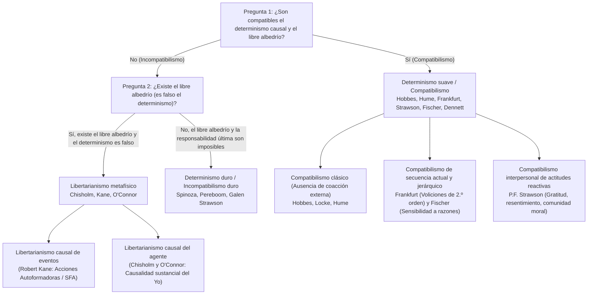
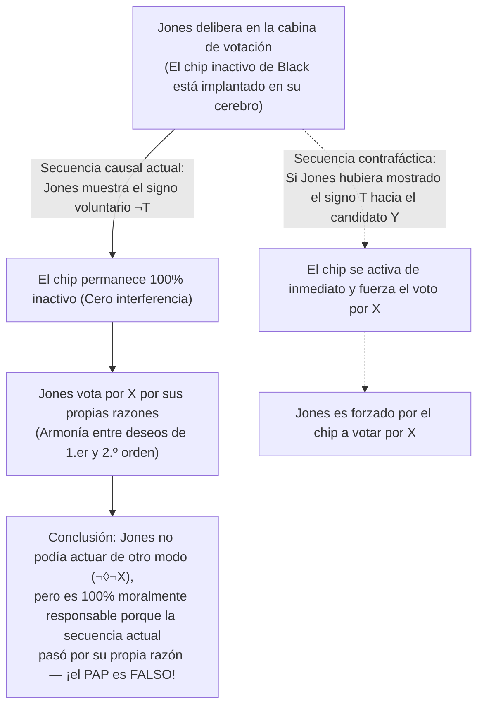

## 1. Introducción: El trilema clásico del determinismo causal, el libre albedrío y la responsabilidad moral

Cuando en este preciso instante decides desplazar esta página hacia abajo o extender la mano hacia tu taza de café, experimentas una convicción fenomenológica inmediata —el <strong>sentido de agencia (Sense of Agency)</strong>—: la certeza de que *depende de ti* cómo actuar, de que podrías haber actuado de otro modo y de que eres el autor consciente y racional de tus decisiones. Esta convicción sostiene todo nuestro orden jurídico, el elogio y el reproche moral, así como sentimientos interpersonales como la gratitud, el resentimiento y la culpa.

Sin embargo, al observar al ser humano desde la perspectiva de las ciencias naturales, esta intuición choca frontalmente con la arquitectura causal del universo físico. La contracción de tus fibras musculares es producida por potenciales de acción neuronales desencadenados por la liberación de neurotransmisores en la corteza prefrontal y los ganglios basales, procesos regidos estrictamente por las ecuaciones de la electrodinámica, la termodinámica y la mecánica cuántica. Ya en 1674, <strong>Baruch Spinoza</strong> (Carta 58) comparó la ilusión humana del libre albedrío con una <strong>piedra lanzada al aire</strong> que de repente adquiriera conciencia: al ser consciente de su propio movimiento pero ignorante de la fuerza externa que la arrojó, la piedra creería volar por su propio libre albedrío.

### El demonio de Laplace y la formalización modal del determinismo

En 1814, en su *Ensayo filosófico sobre las probabilidades*, <strong>Pierre-Simon Laplace</strong> formuló el célebre experimento mental del <strong>demonio de Laplace</strong>: una inteligencia que en un instante dado conociera todas las fuerzas que animan la naturaleza y las posiciones de todos los seres que la componen abarcaría en una sola fórmula los movimientos de los mayores cuerpos del universo y los del átomo más ligero; nada sería incierto para ella, y tanto el futuro como el pasado estarían presentes ante sus ojos.

En la metafísica analítica contemporánea, el <strong>determinismo causal</strong> se define rigurosamente mediante la lógica modal. Sea $P_0$ una proposición verdadera que describe el estado microfísico completo del universo en un instante $t_0$ del pasado remoto (por ejemplo, hace mil millones de años), sea $L$ la conjunción de todas las leyes fundamentales verdaderas de la naturaleza, y sea $P$ una proposición verdadera que describe una acción humana en el instante actual $t$ (ej.: *«Levantas la mano derecha en el instante $t$»*). El determinismo afirma:

$$\Box \bigl( (P_0 \land L) \to P \bigr)$$

donde $\Box$ denota la necesidad metafísica (*«verdadero en todos los mundos posibles»*). En todo mundo posible que comparta exactamente el mismo pasado remoto $P_0$ y las mismas leyes naturales $L$ que el mundo actual, ocurre inexorablemente la misma acción $P$.

### La taxonomía $2 \times 2$ del debate sobre el libre albedrío

| Posición filosófica | ¿Compatible con el determinismo? | ¿Existe el libre albedrío? | ¿Existe responsabilidad moral última? | Condición central de la libertad | Filósofos representativos |
| :--- | :---: | :---: | :---: | :--- | :--- |
| <strong>Incompatibilismo duro</strong> (Hard Incompatibilism) | No | No | No (El castigo retributivo es injustificado) | Autocausalidad última (*Causa Sui*), lógicamente imposible | Baruch Spinoza, Derk Pereboom, Galen Strawson |
| <strong>Libertarianismo</strong> (Libertarianism) | No | Sí | Sí | Posibilidad indeterminista de actuar de otro modo y origen último | Roderick Chisholm, Robert Kane, Timothy O'Connor |
| <strong>Compatibilismo clásico</strong> (Classical Compatibilism) | Sí | Sí | Sí | Ausencia de restricción o coacción física externa; actuar según los propios deseos | Thomas Hobbes, John Locke, David Hume |
| <strong>Compatibilismo contemporáneo / Semicompatibilismo</strong> | Sí | Sí | Sí (Basada en la *secuencia causal actual*) | Armonía entre deseos de 1.er orden y voliciones de 2.º orden (Frankfurt); sensibilidad a razones (Fischer) | Harry Frankfurt, P.F. Strawson, John Martin Fischer, Daniel Dennett |

---

## 2. El argumento maestro de Peter van Inwagen: El Argumento de la Consecuencia

En *An Essay on Free Will* (1983), <strong>Peter van Inwagen</strong> formuló <strong>el Argumento de la Consecuencia (The Consequence Argument)</strong>:

> *«Si el determinismo es verdadero, entonces nuestros actos son las consecuencias de las leyes de la naturaleza y de los acontecimientos en el pasado remoto. Pero no depende de nosotros (not up to us) lo que ocurrió antes de que naciéramos, y tampoco depende de nosotros cuáles sean las leyes de la naturaleza. Por lo tanto, las consecuencias de estas cosas (incluidos nuestros actos presentes) tampoco dependen de nosotros.»*

### El operador modal $\mathcal{N}$ y las reglas de inferencia $\alpha$ y $\beta$

Van Inwagen introduce el operador modal agencial $\mathcal{N} p$:

$$\mathcal{N} p \iff \text{«La proposición } p \text{ es verdadera, y ningún agente humano tiene, ni ha tenido jamás, elección alguna acerca de si } p \text{ es verdadera.»}$$

Este operador se rige por dos reglas de inferencia:
1. <strong>Regla $\alpha$ (De la necesidad lógica a la impotencia)</strong>: $\Box p \vdash \mathcal{N} p$. Nadie tiene elección sobre verdades lógica o metafísicamente necesarias.
2. <strong>Regla $\beta$ (Transferencia de la impotencia / Transfer of Powerlessness)</strong>: $\mathcal{N} p,\; \mathcal{N}(p \to q) \vdash \mathcal{N} q$. Si nadie tiene elección sobre $p$ ni sobre el condicional $(p \to q)$, entonces nadie tiene elección sobre $q$.

### Derivación formal en siete pasos

$$\begin{aligned}
1.\quad &\Box \bigl( (P_0 \land L) \to P \bigr) &&\text{[Premisa 1: Definición del determinismo causal]} \\
2.\quad &\Box \bigl( P_0 \to (L \to P) \bigr) &&\text{[De (1) por exportación proposicional]} \\
3.\quad &\mathcal{N} \bigl( P_0 \to (L \to P) \bigr) &&\text{[De (2) aplicando la Regla } \alpha\text{]} \\
4.\quad &\mathcal{N} P_0 &&\text{[Premisa 2: Principio de la fijeza del pasado remoto]} \\
5.\quad &\mathcal{N} (L \to P) &&\text{[De (3) y (4) aplicando la Regla } \beta\text{]} \\
6.\quad &\mathcal{N} L &&\text{[Premisa 3: Principio de la fijeza de las leyes de la naturaleza]} \\
7.\quad &\mathcal{N} P &&\text{[De (5) y (6) aplicando la Regla } \beta \text{ — Q.E.D.]}
\end{aligned}$$

### Respuestas compatibilistas: Los «milagros locales» de David Lewis y el contraejemplo a la Regla $\beta$

1. <strong>David Lewis (*«Are We Free to Break the Laws?»*, 1981)</strong>: Lewis distingue entre la capacidad en <strong>sentido fuerte</strong> (causar mediante la propia acción una violación de las leyes físicas, lo cual es imposible: $\mathcal{N}_{\text{strong}} L$) y la capacidad en <strong>sentido débil contrafáctico</strong>: *si* yo hubiera decidido no levantar la mano ($\neg P$), en el mundo posible más cercano al actual habría ocurrido un diminuto <strong>milagro local de divergencia</strong> en las sinapsis de mi cerebro justo antes de la decisión, haciendo que $L$ fuera falsa en ese mundo contrafáctico ($\neg \mathcal{N}_{\text{weak}} L$).
2. <strong>McKay y Johnson (1996) contra la Regla $\beta$</strong>: Las reglas $\alpha$ y $\beta$ implican lógicamente la <strong>Aglomeración</strong> ($\mathcal{N} p, \mathcal{N} q \vdash \mathcal{N}(p \land q)$). Pero si eliges libremente *no* lanzar una moneda justa, tanto $\mathcal{N} p$ (*«La moneda no cae en cara»*) como $\mathcal{N} q$ (*«La moneda no cae en cruz»*) son verdaderas (pues ni siquiera lanzándola podrías garantizar cara o cruz), ¡pero $\mathcal{N}(p \land q)$ (*«La moneda no cae ni en cara ni en cruz»*) es <strong>falsa</strong>, ya que bastaba con lanzar la moneda para garantizar que cayera en una de las dos!

---

## 3. ¿Salva el indeterminismo cuántico al libre albedrío? El Argumento de la Suerte y el Argumento Básico de Strawson

¿Puede el colapso probabilístico de la función de onda según la <strong>regla de Born</strong> ($|\psi\rangle = c_1 |A\rangle + c_2 |B\rangle$, con $|c_1|^2 + |c_2|^2 = 1$) rescatar el libre albedrío?

### El Argumento de la Suerte (The Luck / Mind Argument)

Si tu decisión moral entre denunciar un delito ($A$) o aceptar un soborno ($B$) se decide en el último microsegundo mediante un <strong>salto cuántico aleatorio e incausado</strong> en tu corteza prefrontal, entonces no eres *tú* quien controla racionalmente el resultado, ¡sino el azar ciego de un dado subatómico! Como demuestran el <strong>Argumento del Rebobinado (Rollback Argument)</strong> de van Inwagen (2000) y la <strong>suerte entre mundos (Cross-world Luck)</strong> de Alfred Mele (2006), sustituir las cadenas de Laplace por una ruleta cuántica no genera agencia responsable, sino espasmos aleatorios.

### Modelos libertarios y el Argumento Básico de Galen Strawson (1994)

Los libertarios responden mediante las <strong>Acciones Autoformadoras (Self-Forming Actions, SFA)</strong> de <strong>Robert Kane (1996)</strong> (en decisiones desgarradas, el agente realiza un esfuerzo dual de voluntad hacia ambas opciones en redes neuronales caóticas, respaldando cualquiera de los resultados) o mediante la <strong>Causalidad del Agente (Agent-Causation)</strong> de <strong>Roderick Chisholm</strong> y <strong>Timothy O'Connor</strong> ($S \xrightarrow{\text{agent-causes}} A$).

No obstante, <strong>Galen Strawson</strong> demostró en 1994 con su <strong>Argumento Básico (The Basic Argument)</strong> que la responsabilidad moral última es <strong>lógicamente imposible</strong>, sea el universo determinista o indeterminista:
1. Cuando actúas ($A$), haces lo que haces debido a cómo eres mental y caracterológicamente ($M_1$).
2. Para ser últimamente responsable de $A$, debes ser últimamente responsable de ser $M_1$.
3. Pero para ser responsable de $M_1$, tendrías que haber elegido intencionalmente convertirte en $M_1$ en el pasado basándote en principios evaluativos previos $M_0$, y para ser responsable de $M_0$ habrías necesitado $M_{-1}$, generando un <strong>regreso infinito vicioso ($A \leftarrow M_1 \leftarrow M_0 \leftarrow M_{-1} \leftarrow \cdots$)</strong> que termina inevitablemente en tu dotación genética y entorno infantil inicial $M_{\text{init}}$, que jamás elegiste. Nada puede ser <strong>*Causa Sui</strong>* (causa de sí mismo).

---

## 4. La revolución compatibilista: De Hume a los casos de Harry Frankfurt

Para <strong>Thomas Hobbes</strong> y <strong>David Hume</strong> (*Investigación sobre el entendimiento humano*, 1748, Sección VIII), la libertad no se opone a la necesidad causal, sino a la <strong>coacción externa (cadenas, prisión, amenazas)</strong>. Más aún: ¡solo cuando un acto brota causalmente del carácter duradero y los motivos del agente podemos atribuirle responsabilidad moral!

### La refutación del Principio de Posibilidades Alternativas (PAP) por Harry Frankfurt (1969)

En 1969, en su célebre artículo *«Alternate Possibilities and Moral Responsibility»*, <strong>Harry Frankfurt</strong> refutó el <strong>Principio de Posibilidades Alternativas (PAP: $\text{Resp}(S,A) \implies \Diamond \neg A$)</strong> mediante el caso de <strong>Black y Jones</strong>:
* El neurocirujano <strong>Black</strong> quiere que <strong>Jones</strong> vote por el candidato $X$ e implanta en secreto un chip en su cerebro.
* <strong>Protocolo contrafáctico</strong>: Si Jones muestra el signo neurológico previo $T$ de que va a votar por $Y$, el chip se activa de inmediato y fuerza electrónicamente a Jones a votar por $X$. Si Jones muestra el signo $\neg T$ y decide por sí mismo votar por $X$, el chip permanece <strong>completamente inactivo (dormant)</strong>.
* <strong>Secuencia actual</strong>: Jones delibera por su cuenta y vota voluntariamente por $X$; ¡el chip de Black nunca se activa!

Aunque Jones no tenía ninguna posibilidad de hacer otra cosa ($\neg \Diamond \neg X$), es <strong>100 % moralmente responsable</strong> porque el chip no desempeñó ningún papel en la <strong>secuencia causal actual</strong>. Sobre esta base, <strong>John Martin Fischer</strong> formuló su <strong>semicompatibilismo</strong> (distinguiendo el *control regulativo* del *control de guía / Guidance Control*).

---

## 5. Voliciones jerárquicas, sensibilidad a razones, actitudes reactivas y neurociencia

1. <strong>La teoría jerárquica de la voluntad de Harry Frankfurt (1971)</strong>:
   Una <strong>persona</strong> se distingue de un ser impulsivo (<strong>Wanton</strong>) por poseer <strong>voliciones de segundo orden ($\text{Vol}_2$)</strong> acerca de qué <strong>deseos de primer orden ($\text{Des}_1$)</strong> quiere que constituyan su voluntad efectiva. El <strong>adicto involuntario (Unwilling Addict)</strong> carece de libertad de la voluntad porque su impulso contradice su volición de segundo orden de rehabilitarse, mientras que en el <strong>adicto voluntario (Willing Addict)</strong> y en el agente autónomo existe una identificación plena y armoniosa (<strong>Hierarchical Mesh</strong>).
2. <strong>La «sensibilidad moderada a las razones» de Fischer y Ravizza (1998)</strong>:
   El control de guía requiere que el mecanismo deliberativo actual $M$ sea <strong>receptivo a las razones</strong> (capaz de reconocer razones suficientes para actuar de otro modo) y <strong>reactivo a las razones</strong> (capaz de traducir ese reconocimiento en una acción diferente en al menos algunos mundos contrafácticos).
3. <strong>Las actitudes reactivas de P.F. Strawson (*«Freedom and Resentment»*, 1962)</strong>:
   La responsabilidad moral reside en nuestra red de <strong>actitudes reactivas participantes</strong> (<strong>resentimiento</strong>, <strong>gratitud</strong>, <strong>indignación moral</strong>, <strong>perdón</strong>). Renunciar a estas actitudes hacia toda la humanidad para adoptar perpetuamente una fría <strong>actitud objetiva</strong> clínica en nombre del determinismo es tanto psicológicamente imposible como prácticamente absurdo.
4. <strong>El experimento de Benjamin Libet (1983) y la refutación de Aaron Schurger (2012)</strong>:
   Libet descubrió que, al flexionar espontáneamente la muñeca, el <strong>potencial de preparación (RP)</strong> en el área motora suplementaria comienza en $-550\text{ ms}$, antes de la conciencia de la intención (<strong>tiempo W</strong> en $-200\text{ ms}$). Pero esta supuesta refutación neurocientífica del libre albedrío fracasa por completo:
   * <strong>Crítica filosófica (Mele 2009, Dennett 2003, Maoz et al. 2019)</strong>: Flexionar la muñeca al azar sin motivo alguno no tiene nada que ver con la deliberación moral compleja (cuando los sujetos toman decisiones significativas sobre donaciones reales, ¡el RP temprano desaparece por completo!). Además, contraponer «el cerebro» a «ti» incurre en un falaz dualismo cartesiano.
   * <strong>El modelo de acumulador estocástico de Aaron Schurger (2012, *PNAS*)</strong>: Schurger demostró que el RP en $-550\text{ ms}$ no es una decisión inconsciente, sino un artefacto matemático de promediar hacia atrás en el tiempo (*time-locked averaging*) fluctuaciones espontáneas de <strong>ruido rosa ($1/f$)</strong> en la corteza motora que cruzan aleatoriamente el umbral de decisión alrededor de $-200\text{ ms}$!

---

## 6. Conclusión: Reforma de la justicia penal y autonomía humana tras el demonio de Laplace

Si por libre albedrío exigimos una imposible <strong>*Causa Sui</strong>* sobrenatural, debemos rechazar el retributivismo punitivo en favor de un <strong>modelo de salud pública y rehabilitación</strong>, como proponen Derk Pereboom y Gregg Caruso. Pero como demuestra el <strong>compatibilismo contemporáneo</strong>, la verdadera libertad humana no consiste en violar las leyes de la física, sino en nuestra capacidad emergente para gobernar nuestros deseos mediante la razón, responder flexiblemente a las razones morales y convivir como agentes responsables dentro de una comunidad moral.
