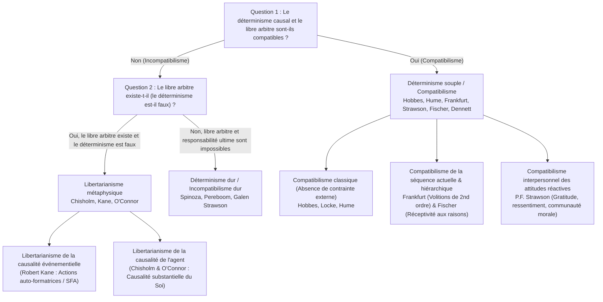
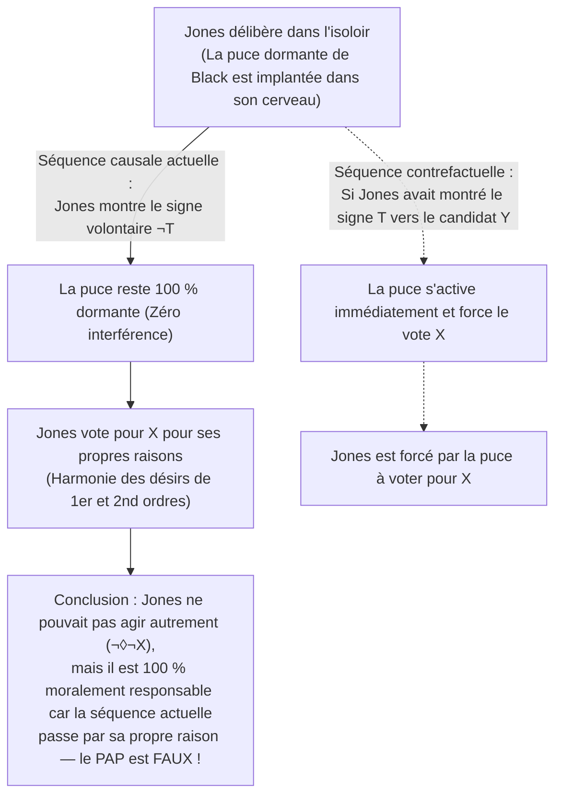

## 1. Introduction : Le trilemme classique du déterminisme causal, du libre arbitre et de la responsabilité morale

Lorsque vous décidez en cet instant de faire défiler cette page ou de saisir votre tasse de café, vous éprouvez une conviction phénoménologique immédiate — le <strong>sentiment d'agentivité (Sense of Agency)</strong> : la certitude qu'il *ne tient qu'à vous* d'agir ainsi, que vous auriez pu agir autrement et que vous êtes l'auteur conscient et rationnel de vos choix. Cette conviction constitue la clé de voûte de nos systèmes juridiques, de l'éloge et du blâme moraux, ainsi que de nos sentiments interpersonnels de gratitude, de ressentiment et de culpabilité.

Pourtant, dès que nous considérons l'être humain à travers le prisme des sciences de la nature, cette intuition se heurte de plein fouet à la structure causale de l'univers physique. La contraction de vos fibres musculaires résulte de potentiels d'action neuronaux déclenchés par la libération de neurotransmetteurs dans le cortex préfrontal et les ganglions de la base — autant d'événements régis par les équations de l'électrodynamique, de la thermodynamique et de la mécanique quantique. Dès 1674, <strong>Baruch Spinoza</strong> (Lettre 58) comparait l'illusion humaine du libre arbitre à une <strong>pierre lancée dans les airs</strong> qui deviendrait soudainement consciente : consciente de son effort pour continuer son mouvement mais ignorante de la main qui l'a lancée, elle se croirait parfaitement libre.

### Le démon de Laplace et la formalisation modale du déterminisme

En 1814, dans son *Essai philosophique sur les probabilités*, <strong>Pierre-Simon Laplace</strong> formula l'expérience de pensée du <strong>démon de Laplace</strong> : une intelligence qui connaîtrait à un instant donné toutes les forces qui animent la nature et la position de tous les êtres qui la composent embrasserait dans une même formule les mouvements des plus grands corps de l'univers et ceux du plus léger atome ; rien ne serait incertain pour elle, et l'avenir comme le passé serait présent à ses yeux.

En métaphysique analytique contemporaine, le <strong>déterminisme causal</strong> se définit formellement en logique modale. Soit $P_0$ une proposition vraie décrivant l'état microphysique complet de l'univers à un instant $t_0$ du passé lointain (par exemple il y a un milliard d'années), soit $L$ la conjonction de toutes les lois fondamentales de la nature, et soit $P$ une proposition vraie décrivant une action humaine à l'instant présent $t$ (ex. : *« Vous levez la main droite à l'instant $t$ »*). Le déterminisme affirme l'implication stricte suivante :

$$\Box \bigl( (P_0 \land L) \to P \bigr)$$

où $\Box$ désigne la nécessité métaphysique (*« vrai dans tous les mondes possibles »*). Dans tout monde possible partageant exactement le même passé $P_0$ et les mêmes lois $L$ que le monde actuel, la même action $P$ se produit nécessairement.

### La taxonomie $2 \times 2$ du débat sur le libre arbitre

| Position philosophique | Compatible avec le déterminisme ? | Le libre arbitre existe-t-il ? | La responsabilité morale ultime existe-t-elle ? | Condition centrale de la liberté | Philosophes représentatifs |
| :--- | :---: | :---: | :---: | :--- | :--- |
| <strong>Incompatibilisme dur</strong> (Hard Incompatibilism) | Non | Non | Non (La punition rétributive est injustifiée) | Auto-causalité ultime (*Causa Sui*), logiquement impossible | Baruch Spinoza, Derk Pereboom, Galen Strawson |
| <strong>Libertarianisme</strong> (Libertarianism) | Non | Oui | Oui | Possibilité indéterministe d'agir autrement & source ultime | Roderick Chisholm, Robert Kane, Timothy O'Connor |
| <strong>Compatibilisme classique</strong> (Classical Compatibilism) | Oui | Oui | Oui | Absence de contrainte physique externe ; agir selon ses désirs | Thomas Hobbes, John Locke, David Hume |
| <strong>Compatibilisme contemporain / Semi-compatibilisme</strong> | Oui | Oui | Oui (Fondée sur la *séquence causale actuelle*) | Harmonie entre désirs du 1er ordre et volitions du 2nd ordre (Frankfurt) ; réceptivité aux raisons (Fischer) | Harry Frankfurt, P.F. Strawson, John Martin Fischer, Daniel Dennett |

---

## 2. L'argument maître de Peter van Inwagen : L'Argument de la Conséquence

Dans *An Essay on Free Will* (1983), <strong>Peter van Inwagen</strong> a formulé <strong>l'Argument de la Conséquence (The Consequence Argument)</strong> :

> *« Si le déterminisme est vrai, alors nos actes sont les conséquences des lois de la nature et d'événements situés dans le passé lointain. Mais ce qui s'est passé avant notre naissance ne dépend pas de nous (not up to us), et ce que sont les lois de la nature ne dépend pas non plus de nous. Par conséquent, les conséquences de ces choses (y compris nos actes présents) ne dépendent pas de nous. »*

### L'opérateur modal $\mathcal{N}$ et les règles d'inférence $\alpha$ et $\beta$

Van Inwagen introduit l'opérateur modal d'impuissance $\mathcal{N} p$ :

$$\mathcal{N} p \iff \text{« La proposition } p \text{ est vraie, et aucun agent humain n'a, ni n'a jamais eu, le moindre choix quant au fait que } p \text{ soit vraie. »}$$

Deux règles d'inférence gouvernent cet opérateur :
1. <strong>Règle $\alpha$ (De la nécessité logique à l'impuissance)</strong> : $\Box p \vdash \mathcal{N} p$. Personne n'a le choix concernant une vérité logiquement nécessaire.
2. <strong>Règle $\beta$ (Transfert de l'impuissance / Transfer of Powerlessness)</strong> : $\mathcal{N} p,\; \mathcal{N}(p \to q) \vdash \mathcal{N} q$. Si personne n'a le choix concernant $p$, ni concernant le fait que $p$ entraîne $q$, alors personne n'a le choix concernant $q$.

### Dérivation formelle en sept étapes

$$\begin{aligned}
1.\quad &\Box \bigl( (P_0 \land L) \to P \bigr) &&\text{[Prémisse 1 : Définition du déterminisme causal]} \\
2.\quad &\Box \bigl( P_0 \to (L \to P) \bigr) &&\text{[De (1) par exportation propositionnelle]} \\
3.\quad &\mathcal{N} \bigl( P_0 \to (L \to P) \bigr) &&\text{[De (2) par application de la Règle } \alpha\text{]} \\
4.\quad &\mathcal{N} P_0 &&\text{[Prémisse 2 : Principe de la fixité du passé lointain]} \\
5.\quad &\mathcal{N} (L \to P) &&\text{[De (3) et (4) par application de la Règle } \beta\text{]} \\
6.\quad &\mathcal{N} L &&\text{[Prémisse 3 : Principe de la fixité des lois de la nature]} \\
7.\quad &\mathcal{N} P &&\text{[De (5) et (6) par application de la Règle } \beta \text{ — C.Q.F.D.]}
\end{aligned}$$

### Réponses compatibilistes : Les « miracles locaux » de David Lewis et la réfutation de la Règle $\beta$

1. <strong>David Lewis (*« Are We Free to Break the Laws? »*, 1981)</strong> : Lewis distingue la capacité au <strong>sens fort</strong> (causer soi-même une violation des lois physiques, ce qui est impossible : $\mathcal{N}_{\text{strong}} L$) et la capacité au <strong>sens faible contrefactuel</strong> : *si* j'avais choisi de ne pas lever la main ($\neg P$), le monde possible le plus proche du nôtre partagerait exactement le même passé $P_0$ jusqu'à une fraction de seconde avant ma décision, où un minuscule <strong>miracle local de divergence</strong> se serait produit dans mes synapses, rendant $L$ fausse dans ce monde contrefactuel ($\neg \mathcal{N}_{\text{weak}} L$).
2. <strong>McKay et Johnson (1996) contre la Règle $\beta$</strong> : Les règles $\alpha$ et $\beta$ impliquent l'<strong>Agglomération</strong> ($\mathcal{N} p, \mathcal{N} q \vdash \mathcal{N}(p \land q)$). Or, si vous choisissez librement de *ne pas* lancer une pièce équilibrée, $\mathcal{N} p$ (*« La pièce ne tombe pas sur pile »*) est vraie et $\mathcal{N} q$ (*« La pièce ne tombe pas sur face »*) est vraie (car même en la lançant, vous ne pourriez garantir ni pile ni face), mais $\mathcal{N}(p \land q)$ (*« La pièce ne tombe ni sur pile ni sur face »*) est <strong>fausse</strong>, puisqu'il vous suffisait de lancer la pièce pour garantir qu'elle tombe sur l'une des deux faces !

---

## 3. L'indéterminisme quantique sauve-t-il le libre arbitre ? L'Argument de la Chance et l'Argument de Base de Strawson

L'indéterminisme de la mécanique quantique et la <strong>règle de Born</strong> ($|\psi\rangle = c_1 |A\rangle + c_2 |B\rangle$ avec $|c_1|^2 + |c_2|^2 = 1$) suffisent-ils à sauver le libre arbitre libertarien ?

### L'Argument de la Chance (The Luck / Mind Argument)

Si votre décision morale entre dénoncer une fraude ($A$) et accepter un pot-de-vin ($B$) est tranchée à la dernière microseconde par un <strong>saut quantique aléatoire sans cause</strong> dans votre cortex préfrontal, alors ce n'est pas *vous* qui contrôlez rationnellement l'action, mais le hasard aveugle d'un coup de dés subatomique ! Comme le montrent <strong>l'argument du rembobinage (Rollback Argument)</strong> de van Inwagen (2000) et le problème de la <strong>chance inter-mondes (Cross-world Luck)</strong> d'Alfred Mele (2006), remplacer les chaînes du démon de Laplace par une roulette de casino quantique transforme l'agent en marionnette spasmodique, non en sujet responsable.

### Modèles libertariens et l'Argument de Base de Galen Strawson (1994)

Face à ce défi, <strong>Robert Kane (1996)</strong> propose les <strong>Actions Auto-Formatrices (Self-Forming Actions, SFA)</strong> (lors d'un conflit intérieur déchirant, deux réseaux neuronaux chaotiques amplifient l'indéterminisme quantique, mais l'agent déploie un double effort de volonté vers les deux options, endossant le résultat quel qu'il soit), tandis que <strong>Roderick Chisholm</strong> et <strong>Timothy O'Connor</strong> défendent la <strong>causalité de l'agent (Agent-Causation)</strong> ($S \xrightarrow{\text{agent-causes}} A$).

Toutefois, <strong>Galen Strawson</strong> a démontré en 1994 avec son <strong>Argument de Base (The Basic Argument)</strong> que la responsabilité morale ultime est <strong>logiquement impossible</strong>, que le déterminisme soit vrai ou faux :
1. Lorsque vous agissez ($A$), vous faites ce que vous faites en raison de ce que vous êtes mentalement et caractériellement ($M_1$).
2. Pour être ultimement responsable de $A$, vous devez être ultimement responsable d'être $M_1$.
3. Mais pour être responsable de $M_1$, vous auriez dû choisir intentionnellement de devenir $M_1$ dans le passé en fonction de principes antérieurs $M_0$, ce qui exige d'être responsable de $M_0$ via $M_{-1}$, engendrant une <strong>régression à l'infini ($A \leftarrow M_1 \leftarrow M_0 \leftarrow M_{-1} \leftarrow \cdots$)</strong> qui aboutit inévitablement à votre patrimoine génétique et votre petite enfance $M_{\text{init}}$, que vous n'avez nullement choisis. Rien ne peut être <strong>*Causa Sui</strong>* (cause de soi-même).

---

## 4. La révolution compatibiliste : De Hume aux cas de Harry Frankfurt

Pour <strong>Thomas Hobbes</strong> et <strong>David Hume</strong> (*Enquête sur l'entendement humain*, 1748, Section VIII), la liberté ne s'oppose pas à la nécessité causale, mais à la <strong>contrainte extérieure (chaînes, prison, coercition)</strong>. Mieux encore : seule une action causée par le caractère durable et les motifs d'une personne permet de lui imputer une responsabilité morale !

### La réfutation du Principe des Possibilités Alternatives (PAP) par Harry Frankfurt (1969)

En 1969, dans son article historique *« Alternate Possibilities and Moral Responsibility »*, <strong>Harry Frankfurt</strong> a réfuté l'axiome bimillénaire du <strong>Principe des Possibilités Alternatives (PAP : $\text{Resp}(S,A) \implies \Diamond \neg A$)</strong> grâce à l'expérience de pensée de <strong>Black et Jones</strong> :
* Le neurochirurgien <strong>Black</strong> veut que <strong>Jones</strong> vote pour le candidat $X$ et implante secrètement une puce dans son cerveau.
* <strong>Protocole contrefactuel</strong> : Si Jones montre le signe neurologique précurseur $T$ indiquant qu'il va voter pour $Y$, la puce s'active et force électroniquement Jones à voter pour $X$. Si Jones montre le signe $\neg T$ et décide de lui-même de voter pour $X$, la puce reste <strong>totalement dormante</strong>.
* <strong>Séquence actuelle</strong> : Jones délibère seul et vote de plein gré pour $X$ ; la puce de Black n'intervient jamais !

Bien que Jones n'ait eu aucune possibilité d'agir autrement ($\neg \Diamond \neg X$), il est <strong>100 % moralement responsable</strong> parce que la puce n'a joué aucun rôle dans la <strong>séquence causale actuelle</strong> ! C'est le fondement du <strong>semi-compatibilisme</strong> de <strong>John Martin Fischer</strong>.

---

## 5. Volitions hiérarchiques, réceptivité aux raisons, attitudes réactives et neurosciences

1. <strong>La théorie hiérarchique du vouloir de Harry Frankfurt (1971)</strong> :
   Une <strong>personne</strong> se distingue d'un être impulsif (<strong>Wanton</strong>) par sa capacité à former des <strong>volitions de second ordre ($\text{Vol}_2$)</strong> évaluant ses <strong>désirs de premier ordre ($\text{Des}_1$)</strong>. Le <strong>toxicomane malgré lui (Unwilling Addict)</strong> est aliéné car sa pulsion contredit sa volition de second ordre d'arrêter, tandis que chez le <strong>toxicomane consentant (Willing Addict)</strong> et l'agent autonome, le vouloir effectif de premier ordre s'accorde pleinement avec la volition de second ordre (<strong>Hierarchical Mesh</strong>).
2. <strong>La « réceptivité modérée aux raisons » de Fischer et Ravizza (1998)</strong> :
   Le contrôle de guidage (*Guidance Control*) requiert que le mécanisme délibératif actuel $M$ soit <strong>réceptif aux raisons</strong> (capable de reconnaître des raisons suffisantes d'agir autrement) et <strong>réactif aux raisons</strong> (capable de traduire cette reconnaissance en action dans certains mondes contrefactuels).
3. <strong>Les attitudes réactives de P.F. Strawson (*« Freedom and Resentment »*, 1962)</strong> :
   La responsabilité morale repose sur le réseau de nos <strong>attitudes réactives participantes</strong> (<strong>ressentiment</strong>, <strong>gratitude</strong>, <strong>indignation</strong>, <strong>pardon</strong>). Abandonner ces attitudes envers toute l'humanité au profit d'une froide <strong>attitude objective</strong> clinique au nom du déterminisme est à la fois psychologiquement impossible et pratiquement absurde.
4. <strong>L'expérience de Benjamin Libet (1983) et la réfutation d'Aaron Schurger (2012)</strong> :
   Libet a observé que lors d'un mouvement spontané du poignet, le <strong>potentiel de préparation (RP)</strong> dans l'aire motrice supplémentaire apparaît vers $-550\text{ ms}$, avant la prise de conscience de l'intention (<strong>temps W</strong> à $-200\text{ ms}$). Mais cette objection neuroscientifique au libre arbitre s'effondre :
   * <strong>Critique philosophique (Mele 2009, Dennett 2003, Maoz et al. 2019)</strong> : Un mouvement arbitraire du poignet sans raison n'a rien à voir avec une délibération morale complexe (lorsque les sujets prennent des décisions réfléchies de dons caritatifs, le RP précoce disparaît complètement !). De plus, opposer « le cerveau » à « vous » relève d'un dualisme cartésien naïf.
   * <strong>Le modèle d'accumulateur stochastique d'Aaron Schurger (2012, *PNAS*)</strong> : Schurger a démontré que le RP à $-550\text{ ms}$ n'est nullement une décision inconsciente, mais un artefact mathématique dû au moyennage rétrograde (*time-locked averaging*) de fluctuations spontanées de <strong>bruit rose ($1/f$)</strong> dans le cortex moteur qui franchissent aléatoirement le seuil de décision vers $-200\text{ ms}$ !

---

## 6. Conclusion : Justice pénale et autonomie humaine après le démon de Laplace

Si le libre arbitre exigeait d'être une impossible <strong>*Causa Sui</strong>* surnaturelle, nous devrions, avec Derk Pereboom et Gregg Caruso, abolir le rétributivisme punitif au profit d'un <strong>modèle de santé publique et de réhabilitation</strong>. Mais comme le montre le <strong>compatibilisme contemporain</strong>, la véritable liberté humaine ne consiste pas à violer les lois de la physique : elle réside dans notre capacité émergente à gouverner nos désirs par la raison, à répondre aux raisons morales et à vivre en membres responsables d'une communauté morale.
