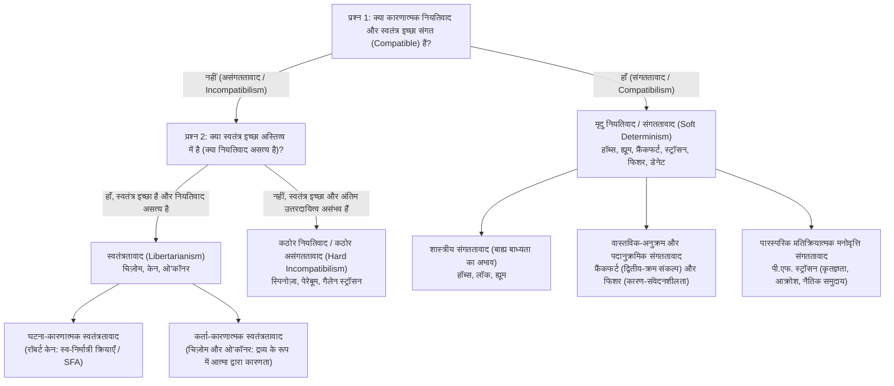
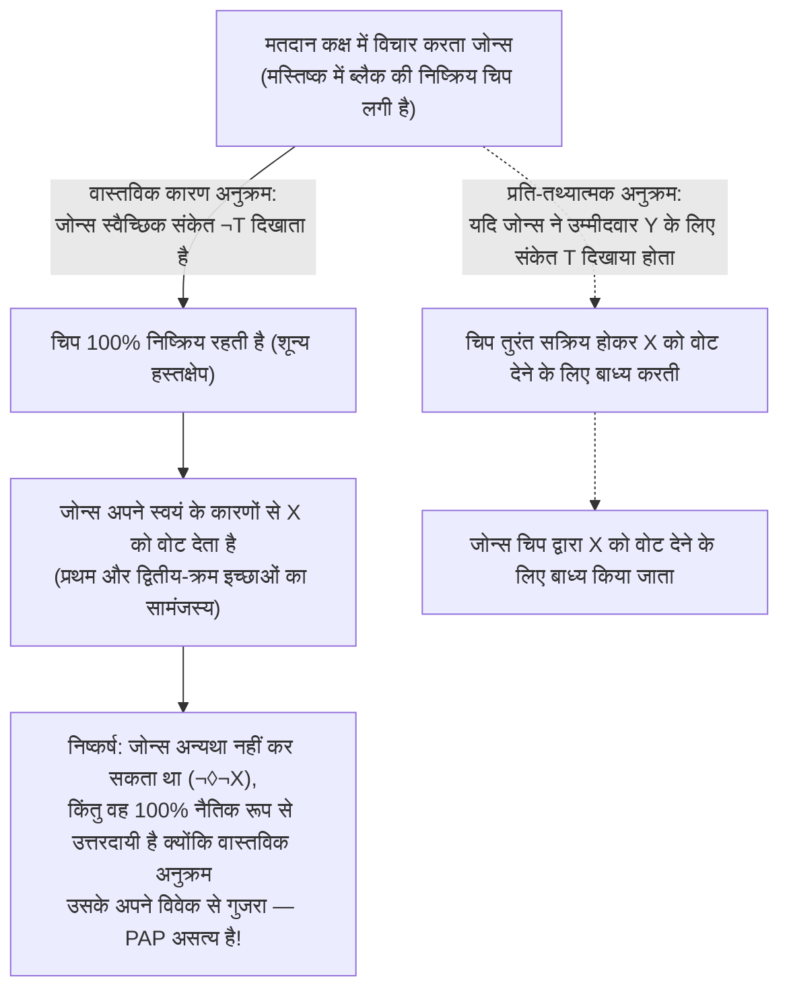

## 1. प्रस्तावना: कारणात्मक नियतिवाद, स्वतंत्र इच्छा और नैतिक उत्तरदायित्व की शास्त्रीय त्रयी समस्या

जब आप इसी क्षण इस पृष्ठ को नीचे स्क्रॉल करने या अपनी मेज पर रखे कॉफी कप को उठाने का निर्णय लेते हैं, तो आप एक तीव्र अनुभवजन्य विश्वास का अनुभव करते हैं — <strong>कर्तृत्व की भावना (Sense of Agency)</strong>: यह निश्चय कि यह *आप पर निर्भर है* कि आप कैसे कार्य करते हैं, कि आप अन्यथा भी कर सकते थे, और कि आप अपने निर्णयों के सचेत, तार्किक लेखक हैं। यही विश्वास हमारी संपूर्ण न्याय प्रणाली, नैतिक प्रशंसा और निंदा, तथा कृतज्ञता, आक्रोश और अपराधबोध जैसी पारस्परिक भावनाओं की नींव है।

किंतु जैसे ही हम प्राकृतिक विज्ञान के दृष्टिकोण से मनुष्य को देखते हैं, यह सहज अंतर्ज्ञान भौतिक ब्रह्मांड की कारणात्मक संरचना से सीधे टकराता है। आपके हाथ की मांसपेशियों का संकुचन मोटर न्यूरॉन्स के ऐक्शन पोटेंशियल से उत्पन्न होता है, जो प्रीफ्रंटल कॉर्टेक्स और बेसल गैन्ग्लिया के सिनैप्स में न्यूरोट्रांसमीटरों के स्राव से प्रेरित होता है — और ये सभी प्रक्रियाएँ विद्युतगतिकी, ऊष्मागतिकी तथा क्वांटम यांत्रिकी के कठोर समीकरणों का पालन करती हैं। 1674 में ही <strong>बारुख स्पिनोज़ा (Baruch Spinoza)</strong> (पत्र 58) ने मनुष्य के स्वतंत्र इच्छा के भ्रम की तुलना <strong>हवा में फेंके गए एक पत्थर</strong> से की थी जिसे अचानक चेतना मिल जाए: पत्थर अपनी गति के प्रयास के प्रति तो सचेत होगा, पर उसे फेंकने वाले बाहरी बल से अनभिज्ञ होने के कारण वह गर्व से सोचेगा कि वह अपनी स्वतंत्र इच्छा से उड़ रहा है।

### लाप्लास का दानव और कारणात्मक नियतिवाद का मोडल सूत्रीकरण

1814 में अपनी पुस्तक *Essai philosophique sur les probabilités* की भूमिका में फ्रांसीसी गणितज्ञ <strong>पियरे-साइमन लाप्लास (Pierre-Simon Laplace)</strong> ने प्रसिद्ध <strong>'लाप्लास के दानव (Laplace's Demon)'</strong> की कल्पना प्रस्तुत की: यदि कोई ऐसी विशाल बुद्धि हो जो किसी एक क्षण में प्रकृति को गतिमान करने वाले सभी बलों और सभी कणों की स्थितियों को जानती हो, तो वह ब्रह्मांड के सबसे बड़े पिंडों और सबसे हल्के परमाणु की गति को एक ही सूत्र में पिरो देगी; उसके लिए कुछ भी अनिश्चित नहीं होगा और भविष्य भी अतीत की तरह उसकी आँखों के सामने उपस्थित होगा।

समकालीन विश्लेषणात्मक तत्वमीमांसा में, <strong>कारणात्मक नियतिवाद (Causal Determinism)</strong> को मोडल लॉजिक (Modal Logic) द्वारा सटीक रूप से परिभाषित किया जाता है। मान लीजिए $P_0$ सुदूर अतीत के किसी क्षण $t_0$ (जैसे एक अरब वर्ष पूर्व) में संपूर्ण ब्रह्मांड की सूक्ष्म-भौतिक स्थिति का पूर्ण सत्य कथन है, $L$ प्रकृति के सभी सत्य मूलभूत नियमों का संयोजन (Conjunction) है, और $P$ वर्तमान क्षण $t$ में किसी मानवीय क्रिया (जैसे *«आप समय $t$ पर अपना दाहिना हाथ उठाते हैं»*) का सत्य कथन है। नियतिवाद कहता है:

$$\Box \bigl( (P_0 \land L) \to P \bigr)$$

जहाँ $\Box$ तात्विक अनिवार्यता (*«सभी संभव लोकों में सत्य»*) को दर्शाता है। अर्थात् जिस भी संभव लोक में अतीत $P_0$ और प्रकृति के नियम $L$ वास्तविक जगत के समान हैं, वहाँ भविष्य की क्रिया $P$ अनिवार्य रूप से समान होगी।

### स्वतंत्र इच्छा विवाद का $2 \times 2$ वर्गीकरण

| दार्शनिक दृष्टिकोण | नियतिवाद के साथ संगत? | क्या स्वतंत्र इच्छा है? | क्या अंतिम नैतिक उत्तरदायित्व है? | स्वतंत्रता की मूल शर्त | प्रमुख दार्शनिक |
| :--- | :---: | :---: | :---: | :--- | :--- |
| <strong>कठोर असंगततावाद</strong> (Hard Incompatibilism) | नहीं | नहीं | नहीं (प्रतिशोधात्मक दंड अनुचित है) | अंतिम स्व-कारण (*Causa Sui*), जो तार्किक रूप से असंभव है | बारुख स्पिनोज़ा, डर्क पेरेबूम, गैलेन स्ट्रॉसन |
| <strong>स्वतंत्रतावाद</strong> (Libertarianism) | नहीं | हाँ | हाँ | अनिर्धारित 'अन्यथा करने की क्षमता' और अंतिम स्रोत | रोडरिक चिज़ोम, रॉबर्ट केन, टिमोथी ओ'कॉनर |
| <strong>शास्त्रीय संगततावाद</strong> (Classical Compatibilism) | हाँ | हाँ | हाँ | बाह्य भौतिक बंधन या बलप्रयोग का अभाव; इच्छा के अनुसार कार्य | थॉमस हॉब्स, जॉन लॉक, डेविड ह्यूम |
| <strong>समकालीन / अर्ध-संगततावाद</strong> (Contemporary / Semicompatibilism) | हाँ | हाँ | हाँ (*वास्तविक कारण अनुक्रम* पर आधारित) | प्रथम-क्रम इच्छा और द्वितीय-क्रम संकल्प का सामंजस्य (फ्रैंकफर्ट); कारण-संवेदनशीलता (फिशर) | हैरी फ्रैंकफर्ट, पी.एफ. स्ट्रॉसन, जॉन मार्टिन फिशर, डैनियल डेनेट |

---

## 2. पीटर वैन इनवेगन का मुख्य तर्क: परिणाम तर्क (The Consequence Argument)

अपनी प्रसिद्ध पुस्तक *An Essay on Free Will* (1983) में <strong>पीटर वैन इनवेगन (Peter van Inwagen)</strong> ने <strong>परिणाम तर्क (The Consequence Argument)</strong> प्रस्तुत किया:

> *«यदि नियतिवाद सत्य है, तो हमारे कार्य प्रकृति के नियमों और सुदूर अतीत की घटनाओं के परिणाम (consequences) हैं। किंतु हमारे जन्म से पहले क्या हुआ, यह हमारे वश में नहीं है (not up to us), और प्रकृति के नियम क्या हैं, यह भी हमारे वश में नहीं है। इसलिए, इन चीजों के परिणाम (हमारे वर्तमान कार्यों सहित) भी हमारे वश में नहीं हैं।»*

### मोडल ऑपरेटर $\mathcal{N}$ और अनुमान नियम $\alpha$ तथा $\beta$

वैन इनवेगन ने ऑपरेटर $\mathcal{N} p$ को इस प्रकार परिभाषित किया:

$$\mathcal{N} p \iff \text{«कथन } p \text{ सत्य है, और किसी भी मानव कर्ता के पास इस बात का कोई विकल्प नहीं है, न कभी था, कि } p \text{ सत्य हो या नहीं।»}$$

इसके दो मूल अनुमान नियम हैं:
1. <strong>नियम $\alpha$ (तार्किक अनिवार्यता से शक्तिहीनता)</strong>: $\Box p \vdash \mathcal{N} p$. तार्किक रूप से अनिवार्य सत्यों के विषय में किसी के पास कोई विकल्प नहीं होता।
2. <strong>नियम $\beta$ (शक्तिहीनता का स्थानांतरण / Transfer of Powerlessness)</strong>: $\mathcal{N} p,\; \mathcal{N}(p \to q) \vdash \mathcal{N} q$. यदि $p$ के बारे में किसी के पास विकल्प नहीं है और $(p \to q)$ के बारे में भी किसी के पास विकल्प नहीं है, तो $q$ के बारे में भी किसी के पास विकल्प नहीं है।

### सात-चरणीय औपचारिक निगमन

$$\begin{aligned}
1.\quad &\Box \bigl( (P_0 \land L) \to P \bigr) &&\text{[आधारवाक्य 1: कारणात्मक नियतिवाद की परिभाषा]} \\
2.\quad &\Box \bigl( P_0 \to (L \to P) \bigr) &&\text{[1 से तार्किक एक्सपोर्टेशन नियम द्वारा]} \\
3.\quad &\mathcal{N} \bigl( P_0 \to (L \to P) \bigr) &&\text{[2 पर नियम } \alpha \text{ लागू करने से]} \\
4.\quad &\mathcal{N} P_0 &&\text{[आधारवाक्य 2: सुदूर अतीत की स्थिरता का सिद्धांत]} \\
5.\quad &\mathcal{N} (L \to P) &&\text{[3 और 4 पर नियम } \beta \text{ लागू करने से]} \\
6.\quad &\mathcal{N} L &&\text{[आधारवाक्य 3: प्रकृति के नियमों की स्थिरता का सिद्धांत]} \\
7.\quad &\mathcal{N} P &&\text{[5 और 6 पर नियम } \beta \text{ लागू करने से — सिद्ध हुआ (Q.E.D.)]}
\end{aligned}$$

### संगततावादी प्रत्युत्तर: डेविड लुईस के 'स्थानीय चमत्कार' और नियम $\beta$ का खंडन

1. <strong>डेविड लुईस (*«Are We Free to Break the Laws?»*, 1981)</strong>: लुईस ने <strong>प्रबल क्षमता (Strong Ability)</strong> (स्वयं अपने कार्य से भौतिक नियम तोड़ना, जो असंभव है: $\mathcal{N}_{\text{strong}} L$) और <strong>दुर्बल प्रति-तथ्यात्मक क्षमता (Weak Counterfactual Ability)</strong> में भेद किया: *यदि* मैंने हाथ न उठाने का निर्णय लिया होता ($\neg P$), तो निकटतम संभव लोक में मेरे निर्णय से ठीक पहले मस्तिष्क के सिनैप्स में एक सूक्ष्म <strong>स्थानीय विचलन चमत्कार (Local divergence miracle)</strong> घटित हुआ होता, जिससे उस प्रति-तथ्यात्मक लोक में $L$ असत्य हो जाता ($\neg \mathcal{N}_{\text{weak}} L$)।
2. <strong>मैकके और जॉनसन (1996) द्वारा नियम $\beta$ का खंडन</strong>: नियम $\alpha$ और $\beta$ से <strong>संकलन नियम (Agglomeration: $\mathcal{N} p, \mathcal{N} q \vdash \mathcal{N}(p \land q)$)</strong> निकलता है। यदि आप स्वतंत्र रूप से एक सिक्का *न* उछालने का चुनाव करते हैं, तो $\mathcal{N} p$ (*«सिक्का चित नहीं गिरा»*) और $\mathcal{N} q$ (*«सिक्का पट नहीं गिरा»*) दोनों सत्य हैं (क्योंकि उछालने पर भी आप चित या पट की गारंटी नहीं दे सकते), किंतु $\mathcal{N}(p \land q)$ (*«सिक्का न चित गिरा न पट»*) <strong>असत्य</strong> है, क्योंकि आप सिक्का उछालकर आसानी से यह सुनिश्चित कर सकते थे कि दोनों में से कोई एक अवश्य आए!

---

## 3. क्या क्वांटम अनिर्धारणवाद स्वतंत्र इच्छा को बचाता है? 'भाग्य का तर्क' और स्ट्रॉसन का मूल तर्क

क्या <strong>बोर्न नियम (Born Rule)</strong> ($|\psi\rangle = c_1 |A\rangle + c_2 |B\rangle$, जहाँ $|c_1|^2 + |c_2|^2 = 1$) के अनुसार तरंग फलन का प्रायिकतात्मक पतन स्वतंत्र इच्छा की रक्षा कर सकता है?

### भाग्य का तर्क (The Luck / Mind Argument)

यदि भ्रष्टाचार उजागर करने ($A$) या रिश्वत लेने ($B$) के बीच आपका नैतिक निर्णय अंतिम माइक्रोसेकंड में आपके प्रीफ्रंटल कॉर्टेक्स में एक <strong>अकारण, यादृच्छिक क्वांटम छलांग</strong> से तय होता है, तो उस परिणाम को *आप* नियंत्रित नहीं कर रहे हैं, बल्कि एक उप-परमाण्विक पासे का अंधा संयोग नियंत्रित कर रहा है! वैन इनवेगन के <strong>रोलबैक तर्क (Rollback Argument, 2000)</strong> और अल्फ्रेड मेले के <strong>क्रॉस-वर्ल्ड लक (Cross-world Luck, 2006)</strong> के अनुसार, लाप्लास की जंजीरों को क्वांटम रूलेट व्हील से बदलना केवल यादृच्छिक झटके पैदा करता है, उत्तरदायी कर्तृत्व नहीं।

### स्वतंत्रतावादी मॉडल और गैलेन स्ट्रॉसन का 'मूल तर्क' (1994)

स्वतंत्रतावादी इसके उत्तर में <strong>रॉबर्ट केन (1996)</strong> के <strong>स्व-निर्मात्री क्रियाओं (Self-Forming Actions, SFA)</strong> (गहन नैतिक द्वंद्व के दौरान अराजक तंत्रिका नेटवर्क में कर्ता दोनों विकल्पों के लिए एक साथ प्रयास करता है) या <strong>रोडरिक चिज़ोम</strong> और <strong>टिमोथी ओ'कॉनर</strong> के <strong>कर्ता-कारणता (Agent-Causation)</strong> ($S \xrightarrow{\text{agent-causes}} A$) का सहारा लेते हैं।

फिर भी, <strong>गैलेन स्ट्रॉसन</strong> ने 1994 में अपने <strong>मूल तर्क (The Basic Argument)</strong> द्वारा सिद्ध किया कि अंतिम नैतिक उत्तरदायित्व <strong>तार्किक रूप से असंभव</strong> है:
1. जब आप कोई कार्य $A$ करते हैं, तो आप उसे अपनी वर्तमान मानसिक और चारित्रिक स्थिति ($M_1$) के कारण करते हैं।
2. $A$ के लिए अंतिम रूप से उत्तरदायी होने के लिए आपको $M_1$ होने के लिए उत्तरदायी होना होगा।
3. किंतु $M_1$ के लिए उत्तरदायी होने हेतु आपको अतीत में पूर्ववर्ती सिद्धांतों $M_0$ के आधार पर जानबूझकर $M_1$ बनना चुना होना चाहिए, और $M_0$ के लिए $M_{-1}$ आवश्यक होगा — जिससे एक <strong>अनंत पश्चगमन ($A \leftarrow M_1 \leftarrow M_0 \leftarrow M_{-1} \leftarrow \cdots$)</strong> उत्पन्न होता है जो आपके जन्मजात जीन और प्रारंभिक परिवेश $M_{\text{init}}$ पर समाप्त होता है जिसे आपने कभी नहीं चुना। कोई भी सत्ता <strong>*Causa Sui</strong>* (स्वयं का कारण) नहीं हो सकती।

---

## 4. संगततावादी क्रांति: ह्यूम से हैरी फ्रैंकफर्ट के उदाहरणों तक

<strong>थॉमस हॉब्स</strong> और <strong>डेविड ह्यूम</strong> (*An Enquiry Concerning Human Understanding*, 1748, खंड VIII) के अनुसार, स्वतंत्रता का विरोध कारणात्मक अनिवार्यता से नहीं, बल्कि <strong>बाह्य बलप्रयोग (जंजीर, कारावास, धमकी)</strong> से है। बल्कि जब कोई कार्य कर्ता के स्थायी चरित्र और उद्देश्यों से कारणात्मक रूप से उत्पन्न होता है, तभी उसे नैतिक रूप से उत्तरदायी ठहराया जा सकता है!

### हैरी फ्रैंकफर्ट (1969) द्वारा 'वैकल्पिक संभावनाओं के सिद्धांत (PAP)' का खंडन

1969 में अपने ऐतिहासिक शोधपत्र *«Alternate Possibilities and Moral Responsibility»* में <strong>हैरी फ्रैंकफर्ट</strong> ने <strong>ब्लैक और जोन्स</strong> के विचार प्रयोग द्वारा <strong>वैकल्पिक संभावनाओं के सिद्धांत (PAP: $\text{Resp}(S,A) \implies \Diamond \neg A$)</strong> को ध्वस्त कर दिया:
* न्यूरोसर्जन <strong>ब्लैक</strong> चाहता है कि <strong>जोन्स</strong> उम्मीदवार $X$ को वोट दे, और वह चुपचाप जोन्स के मस्तिष्क में एक चिप प्रत्यारोपित कर देता है।
* <strong>प्रति-तथ्यात्मक प्रोटोकॉल</strong>: यदि जोन्स उम्मीदवार $Y$ को वोट देने के झुकाव का पूर्व तंत्रिका संकेत $T$ दिखाता है, तो चिप तुरंत सक्रिय होकर जोन्स को $X$ को वोट देने के लिए बाध्य कर देगी। यदि जोन्स संकेत $\neg T$ दिखाता है और स्वयं अपने कारणों से $X$ को वोट देने का निर्णय लेता है, तो चिप <strong>पूरी तरह निष्क्रिय (dormant)</strong> रहती है।
* <strong>वास्तविक अनुक्रम</strong>: जोन्स स्वयं विचार करता है और स्वेच्छा से $X$ को वोट देता है; ब्लैक की चिप कभी सक्रिय ही नहीं होती!

यद्यपि जोन्स के पास अन्यथा करने की कोई संभावना नहीं थी ($\neg \Diamond \neg X$), फिर भी वह <strong>100% नैतिक रूप से उत्तरदायी</strong> है क्योंकि <strong>वास्तविक कारण अनुक्रम (Actual Causal Sequence)</strong> में चिप की कोई भूमिका नहीं थी। इसी आधार पर <strong>जॉन मार्टिन फिशर</strong> ने अपना <strong>अर्ध-संगततावाद (Semicompatibilism)</strong> विकसित किया।

---

## 5. पदानुक्रमिक संकल्प, कारण-संवेदनशीलता, प्रतिक्रियात्मक मनोवृत्तियाँ और तंत्रिका विज्ञान

1. <strong>हैरी फ्रैंकफर्ट का पदानुक्रमिक इच्छा सिद्धांत (1971)</strong>:
   एक <strong>व्यक्ति (Person)</strong> आवेगी प्राणी (<strong>Wanton</strong>) से इसलिए भिन्न है क्योंकि उसके पास <strong>द्वितीय-क्रम के संकल्प ($\text{Vol}_2$)</strong> होते हैं कि उसकी कौन सी <strong>प्रथम-क्रम की इच्छा ($\text{Des}_1$)</strong> उसकी प्रभावी इच्छा बने। <strong>अनिच्छुक व्यसनी (Unwilling Addict)</strong> स्वतंत्र नहीं है क्योंकि उसकी तलब नशा छोड़ने के उसके द्वितीय-क्रम के संकल्प के विरुद्ध है, जबकि <strong>इच्छुक व्यसनी (Willing Addict)</strong> और स्वायत्त कर्ता में प्रथम और द्वितीय-क्रम की इच्छाओं का पूर्ण सामंजस्य (<strong>Hierarchical Mesh</strong>) होता है।
2. <strong>फिशर और राविज़ा की 'मध्यम कारण-संवेदनशीलता' (1998)</strong>:
   मार्गदर्शक नियंत्रण (Guidance Control) के लिए आवश्यक है कि वास्तविक विचार-विमर्श तंत्र $M$ <strong>कारण-ग्रहणशील (Receptivity)</strong> हो (अन्यथा करने के पर्याप्त कारणों को पहचान सके) और <strong>कारण-प्रतिक्रियाशील (Reactivity)</strong> हो (कम से कम कुछ प्रति-तथ्यात्मक लोकों में उस पहचान को भिन्न क्रिया में बदल सके)।
3. <strong>पी.एफ. स्ट्रॉसन की प्रतिक्रियात्मक मनोवृत्तियाँ (*«Freedom and Resentment»*, 1962)</strong>:
   नैतिक उत्तरदायित्व हमारी <strong>सहभागी प्रतिक्रियात्मक मनोवृत्तियों</strong> (<strong>आक्रोश</strong>, <strong>कृतज्ञता</strong>, <strong>नैतिक रोष</strong>, <strong>क्षमा</strong>) के ताने-बाने में निहित है। नियतिवाद के नाम पर संपूर्ण मानवता के प्रति इन मनोवृत्तियों को त्यागकर एक ठंडी नैदानिक <strong>वस्तुनिष्ठ मनोवृत्ति (Objective Attitude)</strong> अपनाना मनोवैज्ञानिक रूप से असंभव और व्यावहारिक रूप से निरर्थक है।
4. <strong>बेंजामिन लिबेट का प्रयोग (1983) और आरोन शर्गर का खंडन (2012)</strong>:
   लिबेट ने पाया कि कलाई को स्वतः मोड़ते समय सप्लीमेंट्री मोटर एरिया में <strong>तत्परता विभव (Readiness Potential, RP)</strong> $-550\text{ ms}$ पर शुरू हो जाता है, जबकि सचेत इच्छा (<strong>W-time</strong>) $-200\text{ ms}$ पर दर्ज होती है। किंतु स्वतंत्र इच्छा के विरुद्ध यह दावा पूरी तरह ध्वस्त हो चुका है:
   * <strong>दार्शनिक आलोचना (मेले 2009, डेनेट 2003, माओज़ आदि 2019)</strong>: बिना किसी कारण के कलाई हिलाना जटिल नैतिक विचार-विमर्श से बिल्कुल भिन्न है (जब प्रतिभागी वास्तविक दान के सार्थक निर्णय लेते हैं, तो प्रारंभिक RP पूरी तरह गायब हो जाता है!)। साथ ही, 'मस्तिष्क' को 'आप' से अलग मानना भ्रामक कार्तीय द्वैतवाद है।
   * <strong>आरोन शर्गर का स्टोकेस्टिक एक्यूमुलेटर मॉडल (2012, *PNAS*)</strong>: शर्गर ने सिद्ध किया कि $-550\text{ ms}$ का RP कोई अचेतन निर्णय नहीं है, बल्कि मोटर कॉर्टेक्स में स्वतःस्फूर्त <strong>पिंक नॉइज़ ($1/f$ उतार-चढ़ाव)</strong> का समय-बद्ध पश्च-औसत (*time-locked averaging*) लेने से उत्पन्न एक गणितीय कलाकृति मात्र है जो लगभग $-200\text{ ms}$ पर निर्णय की दहलीज पार करती है!

---

## 6. निष्कर्ष: आपराधिक न्याय सुधार और लाप्लास के दानव के बाद मानवीय स्वायत्तता

यदि हम स्वतंत्र इच्छा का अर्थ एक असंभव अलौकिक <strong>*Causa Sui</strong>* मानते हैं, तो हमें डर्क पेरेबूम और ग्रेग कारूसो के अनुसार प्रतिशोधात्मक दंड को त्यागकर <strong>सार्वजनिक स्वास्थ्य संगरोध और पुनर्वास मॉडल</strong> अपनाना चाहिए। किंतु जैसा कि <strong>समकालीन संगततावाद</strong> दर्शाता है, वास्तविक मानवीय स्वतंत्रता भौतिकी के नियमों को तोड़ने में नहीं, बल्कि विवेक द्वारा अपनी इच्छाओं को निर्देशित करने, नैतिक कारणों के प्रति लचीला प्रतिसाद देने और एक नैतिक समुदाय के उत्तरदायी सदस्य के रूप में जीने की हमारी उभरती क्षमता में निहित है।
