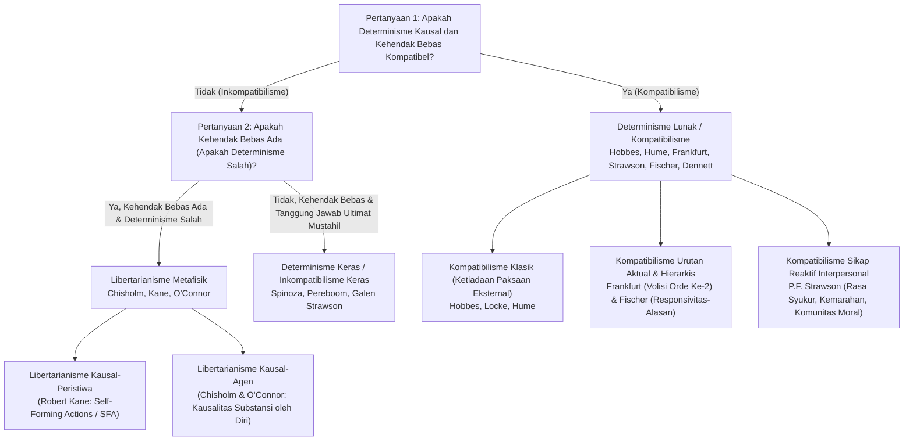
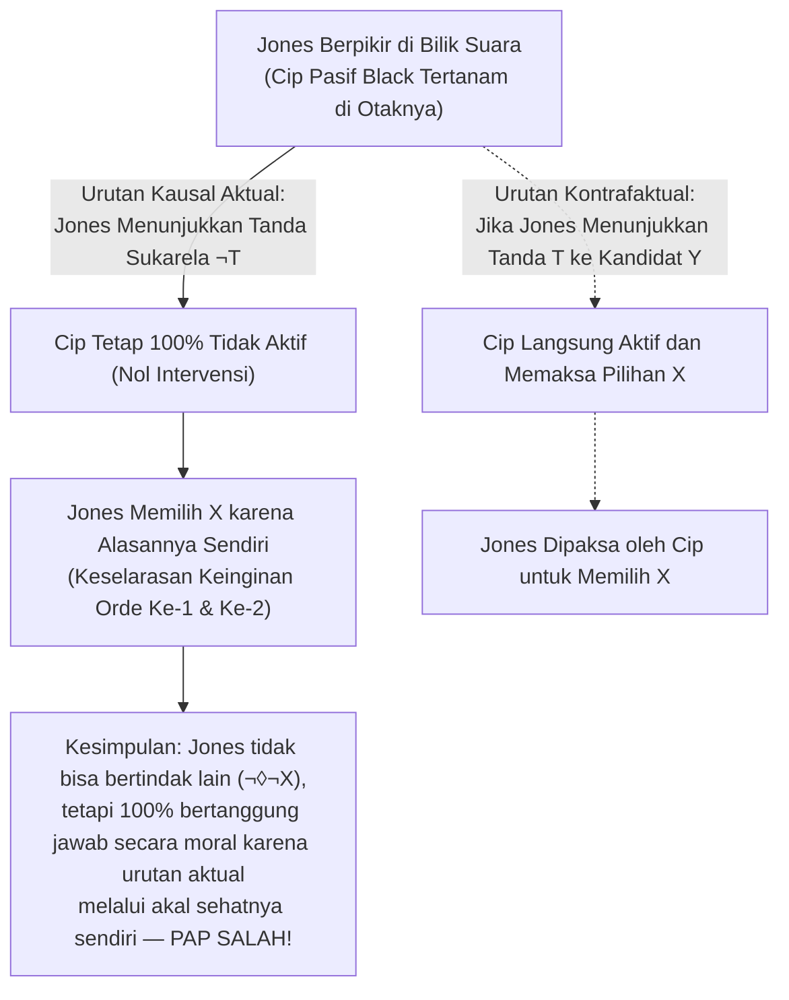

## 1. Pendahuluan: Trilema Klasik Determinisme Kausal, Kehendak Bebas, dan Tanggung Jawab Moral

Ketika saat ini Anda memutuskan untuk menggulir halaman ini ke bawah atau meraih cangkir kopi di meja Anda, Anda merasakan keyakinan fenomenologis yang sangat kuat — <strong>rasa keagenan (Sense of Agency)</strong>: kepastian bahwa *terserah pada Anda* bagaimana Anda bertindak, bahwa Anda sebenarnya bisa memilih untuk tidak menggulir layar, dan bahwa Anda adalah penulis sadar serta rasional atas keputusan Anda. Keyakinan ini menjadi fondasi bagi seluruh sistem hukum modern, pujian dan celaan moral, serta perasaan interpersonal seperti rasa syukur, kemarahan, dan rasa bersalah.

Namun, begitu kita memandang manusia melalui lensa ilmu pengetahuan alam, intuisi sehari-hari ini bertabrakan langsung dengan arsitektur kausal alam semesta fisik. Kontraksi serat otot di tangan Anda dipicu oleh potensial aksi neuron motorik yang disebabkan oleh pelepasan neurotransmiter di korteks prefrontal dan ganglia basal — proses elektrokimia yang tunduk secara ketat pada persamaan elektrodinamika, termodinamika, dan mekanika kuantum. Sejak tahun 1674, <strong>Baruch Spinoza</strong> (Surat 58) mengilustrasikan ilusi kehendak bebas manusia melalui analogi <strong>batu yang terbang</strong>: jika sebuah batu yang dilempar ke udara tiba-tiba memiliki kesadaran, karena ia hanya menyadari gerakannya sendiri tetapi tidak mengetahui kekuatan eksternal yang melemparkannya, batu itu akan dengan bangga menyimpulkan bahwa ia terbang atas kehendak bebasnya sendiri.

### Iblis Laplace dan Formalisasi Modal Determinisme Kausal

Pada tahun 1814, dalam pengantar *Essai philosophique sur les probabilités*, <strong>Pierre-Simon Laplace</strong> merumuskan eksperimen pikiran <strong>Iblis Laplace (Laplace's Demon)</strong>: suatu intelek super yang pada satu saat mengetahui seluruh gaya yang menggerakkan alam dan posisi seluruh partikel penyusunnya akan merangkum dalam satu rumus tunggal gerakan benda langit terbesar maupun atom terkecil; baginya tidak ada yang tidak pasti, dan masa depan sebagaimana masa lalu akan hadir jelas di hadapannya.

Dalam metafisika analitik kontemporer, <strong>Determinisme Kausal</strong> didefinisikan secara ketat menggunakan logika modal. Misalkan $P_0$ adalah proposisi benar yang mendeskripsikan kondisi mikrofisik lengkap alam semesta pada waktu $t_0$ di masa lalu yang sangat jauh (misalnya satu miliar tahun silam), $L$ adalah konjungsi dari seluruh hukum dasar alam yang benar, dan $P$ adalah proposisi benar mengenai tindakan manusia pada waktu saat ini $t$ (misalnya, *«Anda mengangkat tangan kanan pada waktu $t$»*). Determinisme menyatakan berlakunya implikasi niscaya berikut:

$$\Box \bigl( (P_0 \land L) \to P \bigr)$$

di mana $\Box$ melambangkan keniscayaan metafisik (*«benar di semua dunia yang mungkin»*). Di setiap dunia yang mungkin yang memiliki masa lalu $P_0$ dan hukum alam $L$ yang sama persis dengan dunia aktual, tindakan $P$ yang sama pasti terjadi.

### Taksonomi $2 \times 2$ Perdebatan Kehendak Bebas

| Posisi Filosofis | Kompatibel dengan Determinisme? | Apakah Kehendak Bebas Ada? | Apakah Tanggung Jawab Moral Ultimat Ada? | Syarat Inti Kebebasan | Tokoh Utama |
| :--- | :---: | :---: | :---: | :--- | :--- |
| <strong>Inkompatibilisme Keras</strong> (Hard Incompatibilism) | Tidak | Tidak | Tidak (Hukuman retributif tidak dapat dibenarkan) | Penyebab diri sendiri (*Causa Sui*), mustahil secara logis | Baruch Spinoza, Derk Pereboom, Galen Strawson |
| <strong>Libertarianisme</strong> (Libertarianism) | Tidak | Ya | Ya | Kemampuan indeterministik untuk bertindak lain & sumber ultimat | Roderick Chisholm, Robert Kane, Timothy O'Connor |
| <strong>Kompatibilisme Klasik</strong> (Classical Compatibilism) | Ya | Ya | Ya | Tidak adanya paksaan fisik eksternal; bertindak sesuai keinginan sendiri | Thomas Hobbes, John Locke, David Hume |
| <strong>Kompatibilisme Kontemporer / Semikompatibilisme</strong> | Ya | Ya | Ya (Bergantung pada *urutan kausal aktual*) | Keselarasan keinginan orde ke-1 dan volisi orde ke-2 (Frankfurt); responsivitas-alasan (Fischer) | Harry Frankfurt, P.F. Strawson, John Martin Fischer, Daniel Dennett |

---

## 2. Argumen Utama Peter van Inwagen: Argumen Konsekuensi (The Consequence Argument)

Dalam *An Essay on Free Will* (1983), <strong>Peter van Inwagen</strong> merumuskan <strong>Argumen Konsekuensi (The Consequence Argument)</strong>:

> *«Jika determinisme benar, maka tindakan kita adalah konsekuensi dari hukum alam dan peristiwa di masa lalu yang jauh. Namun, bukan kuasa kita (not up to us) apa yang terjadi sebelum kita lahir, dan bukan pula kuasa kita bagaimana hukum alam itu berlaku. Oleh karena itu, konsekuensi dari hal-hal tersebut (termasuk tindakan kita saat ini) juga bukan berada dalam kuasa kita.»*

### Operator Modal $\mathcal{N}$ dan Aturan Inferensi $\alpha$ serta $\beta$

Van Inwagen memperkenalkan operator modal keagenan $\mathcal{N} p$:

$$\mathcal{N} p \iff \text{«Proposisi } p \text{ benar, dan tidak ada agen manusia yang memiliki, atau pernah memiliki, pilihan apa pun mengenai apakah } p \text{ benar.»}$$

Operator ini diatur oleh dua aturan inferensi:
1. <strong>Aturan $\alpha$ (Dari Keniscayaan Logis ke Ketidakberdayaan)</strong>: $\Box p \vdash \mathcal{N} p$. Tidak seorang pun punya pilihan atas kebenaran yang niscaya secara logis.
2. <strong>Aturan $\beta$ (Transfer Ketidakberdayaan / Transfer of Powerlessness)</strong>: $\mathcal{N} p,\; \mathcal{N}(p \to q) \vdash \mathcal{N} q$. Jika tidak seorang pun punya pilihan atas $p$ maupun atas implikasi $(p \to q)$, maka tidak seorang pun punya pilihan atas $q$.

### Derivasi Formal Tujuh Langkah

$$\begin{aligned}
1.\quad &\Box \bigl( (P_0 \land L) \to P \bigr) &&\text{[Premis 1: Definisi Determinisme Kausal]} \\
2.\quad &\Box \bigl( P_0 \to (L \to P) \bigr) &&\text{[Dari (1) melalui Eksportasi Proposisional]} \\
3.\quad &\mathcal{N} \bigl( P_0 \to (L \to P) \bigr) &&\text{[Dari (2) dengan menerapkan Aturan } \alpha\text{]} \\
4.\quad &\mathcal{N} P_0 &&\text{[Premis 2: Prinsip Ketetapan Masa Lalu Jauh]} \\
5.\quad &\mathcal{N} (L \to P) &&\text{[Dari (3) dan (4) dengan menerapkan Aturan } \beta\text{]} \\
6.\quad &\mathcal{N} L &&\text{[Premis 3: Prinsip Ketetapan Hukum Alam]} \\
7.\quad &\mathcal{N} P &&\text{[Dari (5) dan (6) dengan menerapkan Aturan } \beta \text{ — Q.E.D.]}
\end{aligned}$$

### Tanggapan Kompatibilis: «Mukjizat Lokal» David Lewis dan Contoh Penyangkal Aturan $\beta$

1. <strong>David Lewis (*«Are We Free to Break the Laws?»*, 1981)</strong>: Lewis membedakan kemampuan dalam <strong>arti kuat</strong> (menyebabkan pelanggaran hukum fisika melalui tindakan sendiri, yang mustahil: $\mathcal{N}_{\text{strong}} L$) dan kemampuan dalam <strong>arti lemah kontrafaktual</strong>: *seandainya* saya memilih untuk tidak mengangkat tangan ($\neg P$), di dunia yang mungkin yang paling dekat dengan dunia aktual akan terjadi <strong>mukjizat divergensi lokal</strong> kecil di sinapsis otak saya sesaat sebelum keputusan tersebut, sehingga $L$ menjadi salah di dunia kontrafaktual itu ($\neg \mathcal{N}_{\text{weak}} L$).
2. <strong>McKay dan Johnson (1996) melawan Aturan $\beta$</strong>: Aturan $\alpha$ dan $\beta$ secara logis mengimplikasikan <strong>Aglomerasi</strong> ($\mathcal{N} p, \mathcal{N} q \vdash \mathcal{N}(p \land q)$). Namun jika Anda secara bebas memilih untuk *tidak* melempar koin yang adil, baik $\mathcal{N} p$ (*«Koin tidak mendarat di sisi angka»*) maupun $\mathcal{N} q$ (*«Koin tidak mendarat di sisi gambar»*) adalah benar (karena bahkan jika dilempar pun Anda tidak bisa menjamin hasilnya), tetapi $\mathcal{N}(p \land q)$ (*«Koin tidak mendarat di angka maupun gambar»*) adalah <strong>salah</strong>, karena Anda cukup melempar koin untuk menjamin salah satu sisi muncul!

---

## 3. Apakah Indeterminisme Kuantum Menyelamatkan Kehendak Bebas? Argumen Keberuntungan dan Argumen Dasar Strawson

Dapatkah keruntuhan fungsi gelombang probabilistik menurut <strong>Aturan Born</strong> ($|\psi\rangle = c_1 |A\rangle + c_2 |B\rangle$, dengan $|c_1|^2 + |c_2|^2 = 1$) menyelamatkan kehendak bebas?

### Argumen Keberuntungan (The Luck / Mind Argument)

Jika keputusan moral Anda antara melaporkan korupsi ($A$) atau menerima suap ($B$) ditentukan pada mikrodetik terakhir oleh <strong>lompatan kuantum acak tanpa sebab</strong> di korteks prefrontal Anda, maka bukan *Anda* yang mengendalikan hasilnya secara rasional, melainkan kebetulan buta dari lemparan dadu subatomik! Sebagaimana ditunjukkan oleh <strong>Argumen Putar-Balik (Rollback Argument)</strong> van Inwagen (2000) dan <strong>keberuntungan lintas-dunia (Cross-world Luck)</strong> Alfred Mele (2006), mengganti rantai Laplace dengan rolet kuantum hanya menghasilkan kedutan acak, bukan keagenan yang bertanggung jawab.

### Model Libertarian dan Argumen Dasar Galen Strawson (1994)

Kaum libertarian merespons melalui <strong>Tindakan Pembentuk-Diri (Self-Forming Actions, SFA)</strong> dari <strong>Robert Kane (1996)</strong> (dalam konflik batin yang hebat, agen melakukan upaya kehendak ganda menuju kedua opsi dalam jaringan saraf kaotik sehingga mendukung hasil mana pun yang menang) atau melalui <strong>Kausalitas Agen (Agent-Causation)</strong> dari <strong>Roderick Chisholm</strong> dan <strong>Timothy O'Connor</strong> ($S \xrightarrow{\text{agent-causes}} A$).

Namun, <strong>Galen Strawson</strong> membuktikan pada tahun 1994 melalui <strong>Argumen Dasar (The Basic Argument)</strong> bahwa tanggung jawab moral ultimat <strong>mustahil secara logis</strong>, baik alam semesta bersifat deterministik maupun indeterministik:
1. Ketika Anda melakukan tindakan $A$, Anda melakukannya karena kondisi mental dan karakter Anda saat itu ($M_1$).
2. Untuk bertanggung jawab secara ultimat atas $A$, Anda harus bertanggung jawab secara ultimat atas diri Anda sebagai $M_1$.
3. Tetapi untuk bertanggung jawab atas $M_1$, Anda harus secara sengaja memilih menjadi $M_1$ di masa lalu berdasarkan prinsip evaluasi sebelumnya $M_0$, dan untuk bertanggung jawab atas $M_0$ diperlukan $M_{-1}$, sehingga memicu <strong>regresi tak hingga ($A \leftarrow M_1 \leftarrow M_0 \leftarrow M_{-1} \leftarrow \cdots$)</strong> yang berujung pada gen dan lingkungan masa kecil awal $M_{\text{init}}$ yang tidak pernah Anda pilih. Tidak ada sesuatu pun yang dapat menjadi <strong>*Causa Sui</strong>* (penyebab dirinya sendiri).

---

## 4. Revolusi Kompatibilis: Dari Hume hingga Kasus Harry Frankfurt

Bagi <strong>Thomas Hobbes</strong> dan <strong>David Hume</strong> (*An Enquiry Concerning Human Understanding*, 1748, Bagian VIII), kebebasan tidak bertentangan dengan keniscayaan kausal, melainkan dengan <strong>paksaan eksternal (rantai, penjara, ancaman)</strong>. Lebih jauh lagi: hanya ketika suatu tindakan mengalir secara kausal dari karakter dan motif agen yang menetap, barulah kita dapat meminta pertanggungjawaban moral darinya!

### Pembantahan Prinsip Kemungkinan Alternatif (PAP) oleh Harry Frankfurt (1969)

Pada tahun 1969, dalam makalah terkenalnya *«Alternate Possibilities and Moral Responsibility»*, <strong>Harry Frankfurt</strong> membantah <strong>Prinsip Kemungkinan Alternatif (PAP: $\text{Resp}(S,A) \implies \Diamond \neg A$)</strong> melalui eksperimen pikiran <strong>Black dan Jones</strong>:
* Ahli bedah saraf <strong>Black</strong> ingin <strong>Jones</strong> memilih kandidat $X$ dan secara diam-diam menanamkan cip di otaknya.
* <strong>Protokol kontrafaktual</strong>: Jika Jones menunjukkan tanda neurologis awal $T$ bahwa ia akan memilih $Y$, cip tersebut langsung aktif dan memaksa Jones secara elektronik untuk memilih $X$. Jika Jones menunjukkan tanda $\neg T$ dan memutuskan sendiri untuk memilih $X$, cip tersebut tetap <strong>sepenuhnya tidak aktif (dormant)</strong>.
* <strong>Urutan aktual</strong>: Jones mempertimbangkan alasannya sendiri dan secara sukarela memilih $X$; cip Black tidak pernah aktif sama sekali!

Meskipun Jones tidak memiliki kemungkinan untuk bertindak lain ($\neg \Diamond \neg X$), ia tetap <strong>100% bertanggung jawab secara moral</strong> karena cip tersebut tidak berperan apa pun dalam <strong>urutan kausal aktual</strong>. Atas dasar ini, <strong>John Martin Fischer</strong> merumuskan <strong>semikompatibilisme</strong> (membedakan *kontrol regulatif* dari *kontrol pemandu / Guidance Control*).

---

## 5. Volisi Hierarkis, Responsivitas-Alasan, Sikap Reaktif, dan Neurosains

1. <strong>Teori Kehendak Hierarkis Harry Frankfurt (1971)</strong>:
   Seorang <strong>pribadi (Person)</strong> berbeda dari makhluk impulsif (<strong>Wanton</strong>) karena memiliki <strong>volisi orde kedua ($\text{Vol}_2$)</strong> mengenai <strong>keinginan orde pertama ($\text{Des}_1$)</strong> mana yang ia inginkan menjadi kehendak efektifnya. <strong>Pecandu yang terpaksa (Unwilling Addict)</strong> tidak memiliki kebebasan kehendak karena dorongannya bertentangan dengan volisi orde keduanya untuk berhenti, sedangkan pada <strong>pecandu yang rela (Willing Addict)</strong> dan agen otonom terdapat identifikasi utuh dan selaras (<strong>Hierarchical Mesh</strong>).
2. <strong>«Responsivitas-Alasan Moderat» Fischer dan Ravizza (1998)</strong>:
   Kontrol pemandu mensyaratkan bahwa mekanisme deliberatif aktual $M$ bersifat <strong>reseptif terhadap alasan</strong> (mampu mengenali alasan yang cukup untuk bertindak lain) dan <strong>reaktif terhadap alasan</strong> (mampu menerjemahkan pengenalan itu menjadi tindakan berbeda di setidaknya beberapa dunia kontrafaktual).
3. <strong>Sikap Reaktif P.F. Strawson (*«Freedom and Resentment»*, 1962)</strong>:
   Tanggung jawab moral berakar pada jaringan <strong>sikap reaktif partisipan</strong> kita (<strong>kemarahan/kekesalan</strong>, <strong>rasa syukur</strong>, <strong>kemarahan moral</strong>, <strong>pengampunan</strong>). Meninggalkan sikap-sikap ini terhadap seluruh umat manusia demi mengadopsi <strong>sikap objektif</strong> klinis yang dingin atas nama determinisme adalah mustahil secara psikologis dan absurd secara praktis.
4. <strong>Eksperimen Benjamin Libet (1983) dan Bantahan Aaron Schurger (2012)</strong>:
   Libet menemukan bahwa saat menggerakkan pergelangan tangan secara spontan, <strong>potensial kesiapan (RP)</strong> di area motorik suplementer dimulai pada $-550\text{ ms}$, mendahului kesadaran niat (<strong>waktu W</strong> pada $-200\text{ ms}$). Namun klaim bahwa neurosains telah menggugurkan kehendak bebas runtuh sepenuhnya:
   * <strong>Kritik filosofis (Mele 2009, Dennett 2003, Maoz et al. 2019)</strong>: Menggerakkan pergelangan tangan secara acak tanpa alasan tidak ada hubungannya dengan deliberasi moral yang kompleks (ketika subjek membuat keputusan bermakna tentang donasi amal nyata, RP awal menghilang sepenuhnya!). Selain itu, mempertentangkan «otak» dengan «Anda» terjebak dalam dualisme Kartesian yang keliru.
   * <strong>Model Akumulator Stokastik Aaron Schurger (2012, *PNAS*)</strong>: Schurger membuktikan bahwa RP pada $-550\text{ ms}$ bukanlah keputusan bawah sadar, melainkan artefak matematis dari perataan mundur terhadap waktu (*time-locked averaging*) atas fluktuasi spontan <strong>derau merah muda ($1/f$)</strong> di korteks motorik yang secara acak melintasi ambang keputusan sekitar $-200\text{ ms}$!

---

## 6. Kesimpulan: Reformasi Peradilan Pidana dan Otonomi Manusia Setelah Iblis Laplace

Jika kehendak bebas menuntut <strong>*Causa Sui</strong>* adikodrati yang mustahil, kita harus menolak retributivisme punitif demi <strong>model karantina kesehatan masyarakat dan rehabilitasi</strong>, sebagaimana diusulkan Derk Pereboom dan Gregg Caruso. Namun, sebagaimana ditunjukkan oleh <strong>kompatibilisme kontemporer</strong>, kebebasan sejati manusia bukanlah mukjizat yang melanggar hukum fisika, melainkan kapasitas emergen kita untuk mengatur keinginan melalui akal budi, merespons alasan moral secara fleksibel, dan hidup sebagai agen yang bertanggung jawab dalam komunitas moral.
