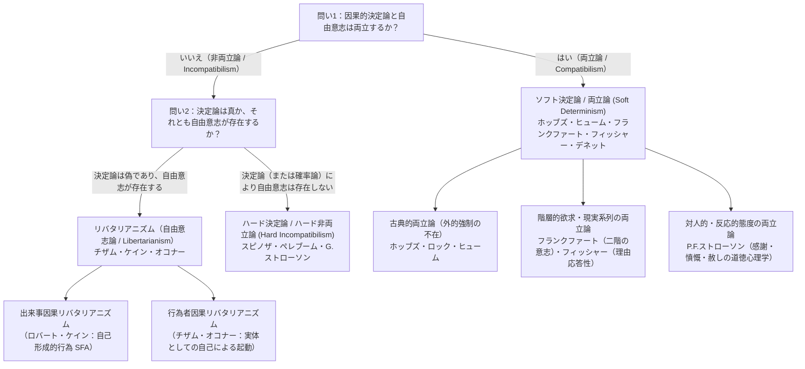
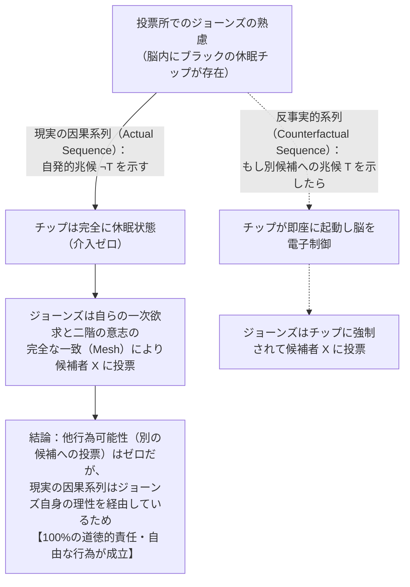

## 1. 序論：決定論・自由意志・道徳的責任のトリレンマ

いま、あなたがこの記事を読み進めるために画面をスクロールし、あるいはコーヒーカップに手を伸ばしたとする。私たちは日常のあらゆる瞬間において、「自分はスクロールしないこともできたし、コーヒーではなく水を飲むこともできた。自分自身の自由な判断でこの行為を選んだのだ」という強烈な主体性の実感（Sense of Agency）の中で生きている。この実感こそが、近代以降の法体系、道徳的賞賛と非難、契約、罪悪感、感謝といった人間社会の根幹を支える土台である。裁判官が被告人に有罪判決を下すとき、そこには「被告人は自らの自由意志によって犯罪を選択したのであり、別の適法な行動をとることもできたはずだ」という暗黙の前提が横たわっている。

しかし、自然科学の世界観に目を転じた瞬間、この日常的確信は根底から揺さぶられることになる。あなたの指の筋肉を収縮させたのは運動ニューロンの活動電位であり、その発火を引き起こしたのは前頭前野や大脳基底核におけるシナプス間の神経伝達物質の放出であり、さらにその分子運動はマクスウェル方程式や熱力学、量子力学といった厳密な物理法則に従うイオンチャネルの開閉によって引き起こされたものである。人間の脳もまた、宇宙に存在する約 $10^{26}$ 個の原子から成る物理系の一つにすぎない。もし宇宙のあらゆる物理的出来事が、先行する物理的状態と自然法則によって余すところなく決定されているとしたら、私たちが誇る「自由な決断」とは、ビッグバン以来連綿と続く巨大な因果のドミノ倒しの一コマにすぎないのではないか。

17世紀の哲学者<strong>バールーフ・デ・スピノザ（Baruch de Spinoza）</strong>は、1674年の書簡（第58書簡）において、この人間の自由意志の感覚を<strong>「空を飛ぶ石の錯覚」</strong>という鮮烈な比喩で描き出した。外部からの衝撃によって空中へ投げ出された石が、もし突然「意識」を持ったとしたらどうなるか。その石は、自分を投げた外部の力（先行する原因）には気づかず、自分が今まさに空中を飛んでいるという運動の欲求だけを意識するがゆえに、「私は私自身の完全に自由な意志によって飛び続けているのだ！」と固く信じ込むだろう。スピノザに言わせれば、人間が自らを自由だと信じる理由は、「自分の行為を意識してはいるが、その行為へと自分を駆り立てている原因については無知である」というただ一点に尽きるのである。

### ラプラスの悪魔と因果的決定論の定式化

1814年、フランスの数学者・天文学者<strong>ピエール＝シモン・ラプラス（Pierre-Simon Laplace）</strong>は『確率の哲学的試論（*Essai philosophique sur les probabilités*）』において、古典力学の決定論的世界観を象徴する思考実験――後に<strong>「ラプラスの悪魔（Laplace's Demon）」</strong>と呼ばれることになる超越的知性――を提示した。

> 「もしある瞬間における自然界を動かすあらゆる力と、自然界を構成するあらゆる存在物の位置を知り、かつそれらのデータを解析しうるほど広大な知性が存在するならば、その知性は宇宙で最も巨大な天体の運動も、最も軽い原子の運動も、同一の方程式のうちに包含するであろう。そのような知性にとっては、不確実なものは何一つなく、未来もまた過去と同様にその目の前に現前するであろう。」

現代の分析形而上学において、この<strong>因果的決定論（Causal Determinism）</strong>は、様相論理（Modal Logic）を用いて次のように厳密に定義される。人類が誕生するはるか以前の宇宙の過去のある時点 $t_0$（たとえばビッグバン直後や先カンブリア時代）における宇宙全体の完全なミクロ物理的記述を命題 $P_0$ とし、自然界のすべての真なる基本法則の連言を $L$ とし、任意の未来の時点 $t$ における出来事（たとえば「あなたが2026年のある瞬間に右手を挙げる」という出来事）を記述する真なる命題を $P$ とする。このとき、決定論とは次の論理的必然性が成り立つという主張である。

$$\Box \bigl( (P_0 \land L) \to P \bigr)$$

ここで $\Box$ は論理的・形而上学的必然性（「すべての可能世界において真である」）を表す様相演算子である。すなわち、決定論が真である世界とは、「過去の初期状態 $P_0$ と自然法則 $L$ が一致するすべての可能世界において、未来のあらゆる出来事 $P$ の真理値もただ一通りに完全に一致する世界（分岐のない世界）」である。

### 自由意志をめぐる古典的トリレンマと $2 \times 2$ の理論地図

この決定論の定式化は、哲学史上最も深刻な<strong>「自由意志のトリレンマ」</strong>を突きつける。以下の3つの命題は、一見するとどれも説得力を持つにもかかわらず、3つ同時に真になることができないように見える。

1. <strong>因果的決定論の命題</strong>：人間の意思決定や身体運動を含むすべての出来事は、過去の状態 $P_0$ と自然法則 $L$ によって因果的に決定されている。
2. <strong>非両立性の命題</strong>：もしすべての出来事が過去と自然法則によって決定されているならば、人間には「他のように行為する能力（Ability to do otherwise）」も「自らの行為の究極的な起源（Ultimate sourcehood）」もなく、したがって<strong>自由意志は存在しない</strong>。
3. <strong>道徳的責任の命題</strong>：人間は少なくとも一部の行為について自由意志を有しており、それゆえに道徳的責任（賞賛・非難・刑罰の正当性）を負う。

この3つの命題のうち、どれを肯定しどれを棄却するかによって、自由意志の哲学は大きく<strong>非両立論（Incompatibilism）</strong>と<strong>両立論（Compatibilism）</strong>という二大陣営、さらには4つの基本的立場へと分岐する。

これら4つの立場の理論的構造を整理すると、以下の比較表のように対比できる。

| 哲学的立場 | 決定論と自由は両立するか？ | 自由意志は存在するか？ | 究極的道徳的責任は存在するか？ | 自由の核心的条件 | 代表的な哲学者 |
| :--- | :---: | :---: | :---: | :--- | :--- |
| <strong>ハード決定論 / ハード非両立論</strong> (Hard Determinism / Incompatibilism) | いいえ（非両立） | いいえ | いいえ（応報的処罰は不当） | 究極的な自己原因（*Causa Sui*）だが論理的に不可能 | スピノザ、ドルバック、ダーク・ペレブーム、ガレン・ストローソン |
| <strong>リバタリアニズム（自由意志論）</strong> (Libertarianism) | いいえ（非両立） | はい | はい | 非決定論的な「他行為可能性」および行為者による究極的起源 | ロデリック・チザム、ロバート・ケイン、ティモシー・オコナー |
| <strong>古典的両立論（ソフト決定論）</strong> (Classical Compatibilism) | はい（両立） | はい | はい | 物理的拘束や脅迫などの「外的強制の不在」と欲求に従う行為 | トマス・ホッブズ、ジョン・ロック、デイヴィッド・ヒューム |
| <strong>現代的両立論 / 半両立論</strong> (Contemporary / Semi-Compatibilism) | はい（両立） | はい | はい（現実の因果系列に依存） | 二階の意志との統合（フランクファート）、理由への適度な応答性（フィッシャー） | ハリー・フランクファート、P.F.ストローソン、ジョン・マーティン・フィッシャー、ダニエル・デネット |

本稿では、まず非両立論の最強の武器であるピーター・ヴァン・インワーゲンの<strong>「帰結論証（Consequence Argument）」</strong>を様相論理によって厳密に定式化し、次に「量子力学の不確定性が自由意志を救う」という通俗的議論がなぜ<strong>「運の論証（Luck Argument）」</strong>によって崩壊するかを解明する。その上で、ハリー・フランクファートの<strong>「フランクファート事例（Frankfurt-Style Cases）」</strong>がいかに2000年にわたる「他行為可能性」のドグマを覆したのか、さらにP.F.ストローソンの<strong>「反応的態度」</strong>とベンジャミン・リベットの<strong>神経科学実験（準備電位）</strong>をめぐる最新の論争までを体系的に踏破する。

---

## 2. ピーター・ヴァン・インワーゲンの「帰結論証（The Consequence Argument）」

1970年代以前、英米の分析哲学においては「自由とは単に強制されずに自分の欲求通りに行動できることだ」とする古典的両立論が主流を占めていた。この両立論の覇権を一撃で打ち破り、非両立論を現代形而上学の中心舞台へと復権させたのが、1983年の著書『自由意志に関する試論（*An Essay on Free Will*）』において<strong>ピーター・ヴァン・インワーゲン（Peter van Inwagen）</strong>が定式化した<strong>「帰結論証（The Consequence Argument）」</strong>である（同時期にカール・ギネットやデイヴィッド・ウィギンズも類似の論証を展開した）。

ヴァン・インワーゲンは帰結論証の直観的核心を、きわめて平易な言葉で次のように要約している。

> 「もし決定論が真であるならば、私たちの行為は自然法則と遠い過去の出来事の帰結（consequence）である。しかし、私たちが生まれる前に何が起きたかは私たちにはどうすることもできない（not up to us）し、自然法則がどのようなものであるかも私たちにはどうすることもできない。したがって、それらの帰結（私たちの現在の行為を含む）もまた、私たちにはどうすることもできないのである。」

### 様相演算子 $\mathcal{N}$ と推論規則 $\alpha \cdot \beta$ による厳密な定式化

この直観的議論が本当に論理的に妥当（Valid）であるかを検証するため、ヴァン・インワーゲンは特殊な様相演算子 $\mathcal{N}$ を導入した。任意の命題 $p$ に対して、$\mathcal{N} p$ を次のように定義する。

$$\mathcal{N} p \iff \text{「命題 } p \text{ は真であり、いかなる人間も } p \text{ が真であることについて選択の余地を持たないし、かつて持ったこともない」}$$

（英語では *"p and no one has, or ever had, any choice about whether p"* と読まれる。「誰にもどうすることもできない（Powerlessness / Fixity）」を表す演算子である。）

この演算子 $\mathcal{N}$ に関して、きわめて強力な直観的妥当性を持つ<strong>2つの推論規則（Inference Rules）</strong>が設定される。

1. <strong>規則 $\alpha$（必然性から無力性への移行 / Rule $\alpha$）</strong>：
   $$\frac{\Box p}{\mathcal{N} p}$$
   もし命題 $p$ が論理的・形而上学的に必然的な真理（たとえば「$2+2=4$」や「赤いものは色づいている」）であるならば、いかなる人間も $p$ が真であるかどうかについて選択の余地を持たない。人間には論理法則を書き換える力はないからである。

2. <strong>規則 $\beta$（無力性の伝達原理 / Rule $\beta$: Transfer of Powerlessness）</strong>：
   $$\frac{\mathcal{N} p, \quad \mathcal{N}(p \to q)}{\mathcal{N} q}$$
   もし命題 $p$ が真であって誰にもどうすることもできず（$\mathcal{N} p$）、かつ「もし $p$ ならば $q$ である」という条件文 $(p \to q)$ も真であって誰にもどうすることもできない（$\mathcal{N}(p \to q)$）ならば、帰結である $q$ もまた真であり、誰にもどうすることもできない（$\mathcal{N} q$）。たとえば、「太陽が爆発する（$\mathcal{N} p$）」ことが誰にも止められず、「太陽が爆発すれば地球上の生命が死滅する（$\mathcal{N}(p \to q)$）」ことも誰にも止められないならば、「地球上の生命が死滅する（$\mathcal{N} q$）」ことも誰にも止められない。

### 帰結論証の7段階の形式的証明

いま、以下の3つの具体的な命題を設定しよう。
* <strong>$P_0$</strong>：人類が誕生するはるか以前（たとえば10億年前）の時点 $t_0$ における宇宙の完全な物理的状態を記述する真なる命題。
* <strong>$L$</strong>：自然界のすべての基本物理法則の連言。
* <strong>$P$</strong>：現在の時点 $t$ におけるあなたの任意の行為（たとえば「あなたが今、裁判官として有罪判決文に署名する」あるいは「今、右手を挙げる」）を記述する真なる命題。

決定論（$\Box((P_0 \land L) \to P)$）を仮定したとき、規則 $\alpha$ と規則 $\beta$ を用いると、以下の7ステップによって自動的に $\mathcal{N} P$ が導出される。

$$\begin{aligned}
1.\quad &\Box \bigl( (P_0 \land L) \to P \bigr) &&\text{【前提1：因果的決定論の定義】} \\
2.\quad &\Box \bigl( P_0 \to (L \to P) \bigr) &&\text{【1より命題論理の移出律（Exportation）による変形】} \\
3.\quad &\mathcal{N} \bigl( P_0 \to (L \to P) \bigr) &&\text{【2に推論規則 } \alpha \text{ を適用】} \\
4.\quad &\mathcal{N} P_0 &&\text{【前提2：過去固定性の原理（恐竜以前の過去は誰にも変えられない）】} \\
5.\quad &\mathcal{N} (L \to P) &&\text{【3と4に推論規則 } \beta \text{ を適用】} \\
6.\quad &\mathcal{N} L &&\text{【前提3：法則固定性の原理（人間は自然法則を破る奇跡を起こせない）】} \\
7.\quad &\mathcal{N} P &&\text{【5と6に推論規則 } \beta \text{ を適用 ── 証明終了（Q.E.D.）】}
\end{aligned}$$

結論であるステップ7の $\mathcal{N} P$ が意味するのは、<strong>「あなたが今、右手を挙げる（あるいは判決文に署名する）ことは真であり、あなたを含むいかなる人間も、あなたがそうすることについて一切の選択の余地を持たない」</strong>という驚愕の帰結である。もし帰結論証が健全（Sound）であれば、決定論が真であるかぎり、あなたが今行っているすべての行動は、10億年前の岩石の配置や重力定数とまったく同じ意味において「あなたにはどうすることもできない不可避の出来事」だということになる。

### 両立論者による反撃：デイヴィッド・ルイスの「局所的奇跡」と規則 $\beta$ への批判

この鉄壁に見える帰結論証に対し、両立論者が生き残る道はどこにあるのか。前提1（決定論の定義）は議論の仮定そのものであり、規則 $\alpha$ も疑いようがない。したがって、両立論者が攻撃できる標的は、<strong>前提2（$\mathcal{N} P_0$：過去の固定性）</strong>、<strong>前提3（$\mathcal{N} L$：法則の固定性）</strong>、あるいは<strong>推論規則 $\beta$（無力性の伝達）</strong>のいずれかに絞られる。

#### 1. デイヴィッド・ルイスの「私たちは法則を破る自由があるか？」（1981年）

20世紀最大の形而上学者のひとりである<strong>デイヴィッド・ルイス（David Lewis）</strong>は、1981年の著名な論文『私たちは法則を破る自由があるか？（*Are We Free to Break the Laws?*）』において、前提3（$\mathcal{N} L$）に潜む精妙な曖昧さを暴き出した。ルイスによれば、「自然法則を破ることができる（Able to break a law）」という表現には、<strong>強い意味（Strong Sense）</strong>と<strong>弱い反事実的意味（Weak Counterfactual Sense）</strong>の2種類が存在する。

* <strong>強い意味での法則打破能力（奇跡を起こす能力）</strong>：「私が手を挙げないという行為それ自体が、自然法則 $L$ の違反になる（あるいはその行為が原因となって法則違反を引き起こす）ような行為をなしうる能力」。たとえば、重力を無視して空中に浮かび上がったり、光速を超えて走ったりする能力である。人間がこのような超自然的な力を持っていないことは言うまでもない。
* <strong>弱い意味での反事実的能力（局所的乖離奇跡の先行）</strong>：「私がもし手を挙げなかったと仮定したならば（反事実的条件文 $\neg P \;\square\!\to\; \neg L$）、私がその決断を下すほんの少し前の脳内のニューロンにおいて、現実世界の物理法則 $L$ からのごく微小な逸脱（<strong>局所的乖離奇跡 / Local divergence miracle</strong>）が先行して生じていたであろう、というような行為をなしうる能力」。

ルイスの可能世界意味論（反事実的条件文の類似性評価）によれば、「もし私が今、手を挙げなかったならば」という反事実的シナリオを考える際、10億年前の過去 $P_0$ まで遡って宇宙の歴史全体を書き換える（Backtracking counterfactual：過去遡及型反事実条件文）よりも、私の決断の直前まで過去 $P_0$ を現実世界と完全に一致させたまま、決断直前のシナプスで1個のイオンが微小な「局所的奇跡」によって異なる動きをした世界を考える方が、現実世界に最も近い可能世界となる。
ルイスは、自由意志に必要なのはこの「弱い反事実的意味での能力」だけであり、その場合、人間が自力で物理法則を破壊する超能力者でなくとも、$\mathcal{N} L$（弱い意味）を退けて「私は手を挙げないこともできた」と正当に主張できると論じた（これは<strong>「局所的奇跡の両立論 / Local Miracle Compatibilism」</strong>と呼ばれる）。もっとも、これに対して非両立論者（ヘレン・ビービーやジョン・マーティン・フィッシャーら）は、「私が別の行為をするためには、事前に自然法則がひとりでに破綻していなければならなかったというのでは、結局のところ私自身にはどうすることもできないのではないか」と再反論している。

#### 2. マイケル・スロートとマッケイ＆ジョンソンによる「規則 $\beta$」への反例

もう一つの有力な反撃は、推論規則 $\beta$ そのものの論理的妥当性を突き崩す試みである。<strong>マイケル・スロート（Michael Slote, 1982）</strong>は、「選択の余地がない（$\mathcal{N}$）」という概念は選択的様相（Selective Modality）を含んでおり、推論規則 $\beta$（無力性の伝達）は一般には成り立たないと指摘した。さらに決定的な打撃を与えたのが、<strong>トマス・マッケイとデイヴィッド・ジョンソン（Thomas McKay & David Johnson, 1996）</strong>による規則 $\beta$ の反例である。

彼らは、規則 $\beta$ と規則 $\alpha$ を組み合わせると、<strong>「連言の集積性（Agglomeration） $\mathcal{N} p, \mathcal{N} q \vdash \mathcal{N}(p \land q)$」</strong>が自動的に導かれることを証明した。実際、命題論理のトートロジー $\Box(p \to (q \to (p \land q)))$ に規則 $\alpha$ を適用して $\mathcal{N}(p \to (q \to (p \land q)))$ を得れば、$\mathcal{N} p$ と $\mathcal{N} q$ から規則 $\beta$ を2回適用するだけで直ちに $\mathcal{N}(p \land q)$ が導出される。ところが、この集積性は簡単な思考実験で反証されてしまう。
いま、公正なコインが存在し、あなたが「コインを投げるか投げないか」を自由に選べるとしよう。ただし、いったんコインを投げれば、表が出るか裏が出るかは純粋な偶然であり、あなたにはコントロールできない。事実として、<strong>あなたはコインを投げず</strong>、したがって「コインは表にならなかった（命題 $p$）」し、「コインは裏にもならなかった（命題 $q$）」。
このとき、次の3つを考えてみよう。
1. <strong>$\mathcal{N} p$ は真である</strong>：あなたはコインが「表にならない」ことについて選択の余地を持たなかった（なぜなら、仮にあなたがコインを投げていたとしても、表が出る保証はどこにもないから、確実に $\neg p$（表が出る）を実現する力はあなたにはない）。
2. <strong>$\mathcal{N} q$ も真である</strong>：同様に、確実に「裏を出す」力もあなたにはないから、「裏にならない（$q$）」こともあなたにはどうすることもできない。
3. <strong>しかし $\mathcal{N}(p \land q)$ は偽である</strong>！ なぜなら、連言 $(p \land q)$ すなわち「コインが表にも裏にもならない」ことは、「コインを投げない」ことと同値であり、あなたはコインを投げることによって確実に $\neg(p \land q)$（「表か裏のどちらかが出る」）を実現する選択肢を持っていたからである！

このマッケイ＆ジョンソンの反例によって、ヴァン・インワーゲンの元の規則 $\beta$ が形式的に妥当ではないことが証明された。その後、アレクサンダー・プルスやティモシー・オコナー、さらにはヴァン・インワーゲン自身によって、「命題 $p$ のみを確実に変える能力」ではなく「命題 $p$ が偽となるような何らかの命題を実現する能力」へと演算子 $\mathcal{N}^*$ を修正した<strong>「改訂版・帰結論証」</strong>が構築され、現在も様相形而上学の最前線で緻密な論争が続けられている。

---

## 3. 量子力学の非決定論は自由意志を救うか：「運の論証」とストローソンの基本論証

帰結論証が示すように、もし古典物理学的な決定論が自由意志を脅かすのであれば、20世紀に登場した<strong>量子力学（Quantum Mechanics）</strong>こそが自由意志の救世主になるのではないか――そう考える人は少なくない。実際、ニュートン力学やアインシュタインの相対性理論が厳格な決定論的微分方程式であったのに対し、量子力学の標準的なコペンハーゲン解釈においては、ミクロな粒子の時間発展（シュレーディンガー方程式）は確率振幅の重ね合わせとして進み、観測・相互作用の瞬間に<strong>ボルンの確率規則（Born Rule）</strong>に従って非決定論的（確率的）に収縮する。

たとえば、脳のシナプス前終末におけるカルシウムイオンの流入や小胞の開口放出が、ある量子状態 $|\psi\rangle$ の重ね合わせに依存していると仮定しよう。

$$|\psi\rangle = c_1 |\text{発火する ($A$)}\rangle + c_2 |\text{発火しない ($B$)}\rangle \quad \bigl(|c_1|^2 + |c_2|^2 = 1\bigr)$$

このとき、ニューロンが発火してあなたが行動 $A$ をとる確率は $P(A) = |c_1|^2$、行動 $B$ をとる確率は $P(B) = |c_2|^2$ であり、ベルの不等式の破れ（アスペらの実験）やコッヘン＝シュペッカーの定理が示す通り、そこには「まだ人類が知らない局所的な隠れた変数（Hidden Variables）」すら存在しない。つまり、宇宙の初期状態 $P_0$ と自然法則 $L$ をすべて知り尽くしたラプラスの悪魔でさえ、あなたが次に $A$ を選ぶか $B$ を選ぶかを100%確実に予言することはできないのである。

では、これで人間の自由意志は証明されたのだろうか？ 現代の哲学者たちの答えは、ほぼ一致して<strong>「ノー」</strong>である。

### 「運の論証（The Luck Argument / Mind Argument）」：偶然は自由ではない

なぜ量子力学の非決定論（Indeterminism）を持ち出しても、自由意志は簡単には救われないのか。その理由は、分析哲学において<strong>「運の論証（The Luck Argument）」</strong>あるいは（学術誌『Mind』に繰り返し掲載されたことから）<strong>「マインド論証（The Mind Argument）」</strong>と呼ばれる強力なジレンマにある。

いま、あなたが重大な道徳的選択（たとえば「不正を内部告発する（$A$）」か「賄賂を受け取って黙認する（$B$）」か）に直面しているとしよう。あなたの脳内で量子的な揺らぎが増幅され、確率 $50\%$ で $A$、確率 $50\%$ で $B$ に収縮するとする。ここでよく考えてみてほしい。もしあなたの決断が、収縮の瞬間に生じる<strong>「原因なき純粋な確率的ジャンプ（Uncaused random quantum jump）」</strong>によって最終的に決着したのだとすれば、それは<strong>「あなたが自らの理性と意志でコントロールした」</strong>と言えるだろうか？

まったく言えないはずである。なぜなら、先行するあなたの性格、信念、道徳的価値観、熟慮のすべてがまったく同一であったにもかかわらず、最後に電子のスピンが上を向いたか下を向いたかという<strong>純粋なサイコロの目（盲目的な偶然 / Blind Chance）</strong>によって、あなたが英雄になるか犯罪者になるかが決まったにすぎないからである。ラプラスの悪魔という「鉄の鎖」を断ち切るために、頭蓋骨の中に「量子カジノのルーレット」を埋め込んだとしても、ルーレットの出目に道徳的責任を負うことはできない。決定論の下での行為が「過去の奴隷」であるなら、純粋な非決定論の下での行為は「偶然の発作（ランダムな痙攣）」にすぎないのである。

この問題を極限まで鮮明にしたのが、ピーター・ヴァン・インワーゲン（2000年）の<strong>「巻き戻し論証（Rollback Argument）」</strong>および<strong>アルフレッド・ミール（Alfred Mele, 2006）</strong>の<strong>「クロスワールドの運（Cross-world Luck）」</strong>の思考実験である。
* アリスが時点 $t$ において、嘘をつく（$A$）か真実を語る（$B$）かを非決定論的（リバタリアン的）に決断し、実際に真実を語った（$B$）とする。
* いま、全能の神が宇宙の時間を決断の1ミリ秒前（$t - \Delta t$）まで<strong>完全に巻き戻し（Rollback）</strong>、同じ初期条件から1,000回リプレイ再生したと想像しよう。
* 決断が真に非決定論的であるならば、たとえば500回のリプレイではアリスは真実を語り（$B$）、残りの500回のリプレイではアリスは嘘をつく（$A$）ことになる。
* しかし、リプレイ第1回（真実を語ったアリス）とリプレイ第2回（嘘をついたアリス）は、決断の瞬間 $t$ に至るまでの記憶、性格、欲望、道徳的熟慮のすべてにおいて、原子1個のレベルまで<strong>100%完全に同一</strong>である。この2つの可能世界のアリスの行動を分けた差（Cross-world difference）を説明するものは、アリス自身のうちには何一つ存在しない。それは単なる<strong>「純粋な運（Presentational Luck）」</strong>にすぎない。

### リバタリアニズムの応答：ロバート・ケインの「自己形成的行為（SFA）」と「行為者因果」

この「決定論なら必然、非決定論ならただの偶然」という二律背反に対し、現代のリバタリアン（非両立論的自由意志論者）は大きく2つの精緻な理論モデルで応答している。

#### 1. 出来事因果リバタリアニズム（ロバート・ケインの「自己形成的行為 / Self-Forming Actions」）

<strong>ロバート・ケイン（Robert Kane）</strong>は主著『自由意志の意義（*The Significance of Free Will*, 1996）』において、量子的な非決定論が単なる「サイコロ振り」にならないための巧妙なモデルを提示した。ケインによれば、私たちの日常の行為の大部分は過去の性格によって決定されていて構わないが、人生の岐路において自らの人格そのものを形作る<strong>「自己形成的行為（Self-Forming Actions: SFAs）」</strong>だけは非決定論的でなければならない。

SFAが生じるのは、行為者の心の中で<strong>「道徳的義務（例：困っている人を助けるため会議に遅れてでも立ち止まる）」</strong>と<strong>「個人的野心（例：出世のかかった重要な会議に急ぐ）」</strong>という2つの強い動機が激しく葛藤している場面（Torn Decisions）である。ケインの仮説では、この激しい心理的葛藤の際、脳内の2つの競合する神経ネットワークが非平衡熱力学的な<strong>カオス状態（エッジ・オブ・カオス）</strong>に陥り、ミクロな量子論的不確定性がマクロな神経発火レベルまで増幅される。
ここでなぜ「単なる運」にならないのか？ ケインの答えは、<strong>「行為者はその瞬間、両方の選択肢を同時に実現しようと能動的に努力（Dual efforts of will）しており、どちらの神経ネットワークが閾値を超えて勝利したとしても、それは行為者自身が十分な理由をもって意図的に目指していた行為だからである（複数自発的コントロール / Plural Voluntary Control）」</strong>というものである。ルーレットが勝手に回ったのではなく、あなた自身が2つの合理的な目標に向かって全力を尽くし、その一方が結実したのだから、どちらに転んでもそれは「あなた自身の責任ある行為」だというわけである。

#### 2. 行為者因果リバタリアニズム（チザム・オコナーの「実体による因果」）

一方、<strong>ロデリック・チザム（Roderick Chisholm）</strong>、<strong>リチャード・テイラー（Richard Taylor）</strong>、<strong>ティモシー・オコナー（Timothy O'Connor）</strong>らは、ケインのように「脳内の出来事 $E_1$ が出来事 $E_2$ を確率的に引き起こす（出来事因果 / Event-Causation）」という枠組みにとどまるかぎり、最後の決着が「運」になる問題は解決しないと見る。
彼らが提唱するのは、アリストテレスやトマス・アクィナス、トマス・リードの伝統に連なる<strong>「行為者因果（Agent-Causation / 実体因果）」</strong>である。すなわち、出来事が出来事を引き起こす通常の因果系列とは別に、<strong>「意識と理性を持つ実体としての行為者（Agent / Self）$S$ そのものが、先行するいかなる出来事にも決定されることなく、自ら第一原因（Uncaused Causer）となって新たな因果の鎖を起動する」</strong>という特殊な因果関係（$S \xrightarrow{\text{agent-causes}} A$）を認める立場である。
チザムはかつて、神が宇宙を創造したのと同様に、「人間は自由に行為するとき、小さな奇跡を起こす『動かされざる第一の動者（Prime Mover Unmoved）』である」と述べた。しかし、この立場に対しては、現代の物理主義者やダーク・ペレブームらから「実体としての『私』が特定の時刻 $t$ にニューロンを発火させるとき、もし物理的なエネルギー保存則や物理的領域の因果的閉包性（Causal Closure of the Physical）を破るなら現代物理学と矛盾するし、破らないなら結局のところ出来事因果に還元されてしまうのではないか」という厳しい批判が向けられている。

### ガレン・ストローソンの「基本論証（The Basic Argument）」：自己原因（*Causa Sui*）の不可能性

さらに、決定論か非決定論かという物理学の議論すら超越して、「究極的な道徳的責任（天国や地獄に行くに値するような絶対的責任）は<strong>論理的に不可能</strong>である」と論証したのが、イギリスの哲学者<strong>ガレン・ストローソン（Galen Strawson）</strong>（後述するP.F.ストローソンの息子）が1994年の論文『道徳的責任の不可能性（*The Impossibility of Moral Responsibility*）』で提示した<strong>「基本論証（The Basic Argument）」</strong>である。

ストローソンの論証は、恐るべき単純さと明晰さを持っている。

1. あなたがある行為 $A$ を行うとき、あなたが $A$ を行うのは、あなたのその時点での<strong>精神的・性格的あり方 $M_1$</strong>（あなたの信念、欲望、道徳観、気質）がしかじかであるからである。
2. もしあなたが自分の行為 $A$ に対して<strong>究極的な道徳的責任</strong>を負うべきであるならば、あなたはその行為を生み出した<strong>自分自身の精神的あり方 $M_1$</strong> に対しても、究極的な責任を負っているのでなければならない。
3. しかし、あなたが自分のあり方 $M_1$ に責任を持つためには、あなたは過去に自らの自由な選択によって「自分を $M_1$ という人間に作り変える」ことを意図的に選んだのでなければならない。
4. ところが、過去に「自分を $M_1$ に作り変えよう」と意図的に選択したとき、あなたはその選択の基準となる<strong>先行する精神的あり方（価値観や選好）$M_0$</strong> をすでに持っていたはずである。
5. では、あなたはその先行するあり方 $M_0$ に対して責任があるのか？ $M_0$ に責任を持つためには、さらにその前に別の基準 $M_{-1}$ に基づいて $M_0$ を選んだのでなければならず、これは<strong>無限後退（Infinite Regress：$M_1 \leftarrow M_0 \leftarrow M_{-1} \leftarrow \dots$）</strong>に陥る。
6. 人間は有限の存在である以上、この連鎖を過去に遡れば、必ず<strong>「生まれつきの遺伝子と幼児期の生育環境」</strong>という、あなた自身が絶対に選択したはずのない初期状態 $M_{\text{init}}$ に到達する。たとえ後からロバート・ケインの言う「自己形成的行為（SFA）」によって性格を少しずつ変えたとしても、どのように性格を変えたいかという最初の方向性自体は $M_{\text{init}}$（または無根拠な運）に由来している。
7. 結論：いかなる存在も<strong>「自己原因（*Causa Sui*：自分自身を無から創造する原因）」</strong>になることは論理的に不可能である。したがって、決定論が真であろうと偽であろうと、人間が自らの行為に対して究極的な道徳的責任を負うことは論理的にありえない。

フリードリヒ・ニーチェも『善悪の彼岸』（第21節）において、この自己原因（*Causa Sui*）の概念を「これまで案出された最も甚だしい自己矛盾であり、ミュンヒハウゼン男爵が自分の髪の毛を引っ張って沼から自分自身を引きずり出そうとするような論理的強姦である」と痛烈に嘲笑した。もし自由意志と責任に「究極的な自己創造」を求めるならば、非両立論は不可避的にハード非両立論（自由意志の否定）へと行き着くことになる。

---

## 4. 両立論の革命：ホッブズ・ヒュームからフランクファート事例へ

ここで発想を180度転換してみよう。そもそも、私たちが道徳的責任や自由を語るとき、ニーチェやG.ストローソンが批判したような「宇宙の因果連鎖から切り離された神のような自己原因（*Causa Sui*）」など本当に必要なのだろうか？ 因果的決定論と自由意志は、実は最初から何ら矛盾していなかったのではないか？ この視座に立つのが<strong>両立論（Compatibilism）</strong>である。

### 古典的両立論（ホッブズ・ロック・ヒューム）：外的強制の不在と性格からの因果

近代哲学において両立論の基礎を築いたのは、<strong>トマス・ホッブズ（Thomas Hobbes）</strong>、<strong>ジョン・ロック（John Locke）</strong>、そして<strong>デイヴィッド・ヒューム（David Hume）</strong>というイギリス経験論の系譜である。ヒュームは1748年の『人間知性研究（*An Enquiry Concerning Human Understanding*）』第8章「自由と必然について」において、自由意志論争が2000年間も紛糾してきたのは、哲学者たちが「自由」という言葉の意味を取り違えてきた単なる言葉の上の混乱（Verbal dispute）にすぎないと断じた。

ヒュームによれば、自由と対立するのは「因果的必然性（Necessity）」ではなく、牢獄の鎖や銃による脅迫といった<strong>「外的強制（Constraint / Coercion）」</strong>である。ヒュームは自由を次のように定義する。

> 「自由とは、意思の決定に従って行為し、あるいは行為しない力（a power of acting or not acting, according to the determinations of the will）以外の何を意味しうるだろうか。すなわち、もし私たちが静止することを選ぶならば静止することができ、もし動くことを選ぶならば動くことができる、ということである。」

さらにヒュームは、リバタリアンが求める「因果的決定のない自由（無差別の自由 / Liberty of Indifference）」こそが、かえって道徳的責任を破壊するという鋭い逆転の論証を展開した。なぜ私たちはある人の善行を褒め、悪行を非難するのか？ それは、その行為が<strong>その人の持続的な性格、動機、人格から因果的に必然的に生み出された結果</strong>だからである。もしある人の行為が、その人の性格や動機と何の因果的結びつきも持たず、その場限りの原因なき偶然によって飛び出してきたものだとしたら、その行為が終わった瞬間にその人自身には何の痕跡も残らず、その人を非難する理由は完全に消滅してしまう！ すなわち、<strong>道徳的責任が成立するためには、決定論（人格と行為の因果的結合）は邪魔どころか不可欠の前提条件なのである</strong>。

また、20世紀前半のG.E.ムーアらは、「彼は他のように行為できた（Could have done otherwise）」という表現を、<strong>「もし彼が他のように行為しようと欲した（選んだ）ならば、彼は他のように行為していたであろう（条件法分析 / Conditional Analysis）」</strong>と翻訳することで、決定論との両立を図った。

しかし、この古典的両立論には2つの致命的な弱点があった。
1. <strong>J.L.オースティン（1956年『Ifs and Cans』）やキース・レーラーによる条件法分析への批判</strong>：「もし彼がそう選んだならば、そうできただろう」と言っても、たとえば重度の恐怖症患者や洗脳された人間は、そもそも「そう選ぶこと自体が心理的に不可能」なのであり、その場合は自由に行為できたとは言えない。
2. <strong>内的強迫（Internal Compulsion）の問題</strong>：鎖で縛られておらず、誰からも銃を突きつけられていなくても、<strong>重度の薬物中毒者（アディクト）</strong>や<strong>窃盗癖（クレプトマニア）</strong>の患者、強迫性障害の患者は、「その瞬間の自分の衝動・欲求に従って」行動している。古典的両立論の定義（外的強制の不在）だけでは、こうした内的強迫に苦しむ人々と、真に自律的な自由人との区別がつかないのである。

### ハリー・フランクファートのコペルニクス的転回（1969年）：「他行為可能性の原理（PAP）」の論駁

この膠着状態を打破し、20世紀後半の分析哲学に最大のパラダイムシフトをもたらしたのが、1969年にアメリカの哲学者<strong>ハリー・フランクファート（Harry G. Frankfurt）</strong>が発表したわずか10ページの論文<strong>『他行為可能性と道徳的責任（*Alternate Possibilities and Moral Responsibility*）』</strong>である。

フランクファート以前、非両立論者も古典的両立論者も、ある一つの大前提だけは共通の公理として無批判に受け入れていた。それが<strong>「他行為可能性の原理（Principle of Alternate Possibilities: PAP）」</strong>である。

$$\mathbf{PAP} \text{（他行為可能性の原理）}: \quad \text{行為者 } S \text{ が行為 } A \text{ について道徳的責任を負う} \implies S \text{ は } A \text{ 以外の行為をすることもできた（}\Diamond \neg A\text{）}$$

非両立論者は「PAPは真であり、決定論の下では他行為可能性がないから、責任もない」と主張し、古典的両立論者は「PAPは真だが、決定論の下でも条件付きの意味で他行為可能性がある」と防戦していた。これに対しフランクファートは、<strong>「そもそもPAP自体が偽である！ 人間が道徳的責任を負うために『別の行為ができたこと（他行為可能性）』など最初から必要ない」</strong>という衝撃的な反例を突きつけたのである。これが有名な<strong>「フランクファート事例（Frankfurt-Style Cases）」</strong>である。

#### フランクファート事例：神経外科医ブラックとジョーンズの思考実験

次の精巧な思考実験を想像してほしい。

* <strong>登場人物</strong>：誠実あるいは利己的な有権者<strong>ジョーンズ（Jones）</strong>と、狂信的だが天才的な神経科学者<strong>ブラック（Black）</strong>。
* <strong>状況設定</strong>：ブラックは、今度の大統領選挙において、ジョーンズにどうしても<strong>候補者 $X$ に投票させたい</strong>（あるいはある計画 $X$ を実行させたい）と強く望んでいる。しかしブラックは、できることなら余計な介入はせず、ジョーンズが自発的に $X$ に投票してくれるのを好んでいる。
* <strong>秘密の神経チップの埋め込み</strong>：ブラックはジョーンズが眠っている間に、彼の脳内に極小の<strong>神経モニタリング＆制御チップ</strong>を密かに埋め込んだ。ジョーンズはこのチップの存在をまったく知らない。
* <strong>事前兆候 $T$ の監視</strong>：ブラックはジョーンズの脳波パターンを熟知しており、ジョーンズが決断を下す数秒前に現れる確実に信頼できる神経学的兆候（Prior Sign）を知っている。もしジョーンズが「候補者 $Y$ に投票しよう」と決断する直前には必ず微細な神経シグナル $T$ が現れ、逆に「候補者 $X$ に投票しよう」と決断する直前にはシグナル $\neg T$ が現れる。
* <strong>ブラックの反事実的介入プロトコル</strong>：
  1. <strong>【反事実的ルート（もしジョーンズが $Y$ を選ぼうとした場合）】</strong>：もしジョーンズが迷った末にシグナル $T$（$Y$ への傾斜）を示したならば、チップが即座に作動し、ジョーンズの前頭前野を電子的に乗っ取って強制的に「候補者 $X$ への投票」を決断・実行させる。
  2. <strong>【現実のルート（ジョーンズが自発的に $X$ を選んだ場合）】</strong>：もしジョーンズがシグナル $\neg T$ を示し、<strong>最初から自分自身の理由と動機に基づいて自発的に「候補者 $X$ に投票する」と決断した場合</strong>、ブラックのチップは<strong>完全に休眠状態（Dormant）</strong>のまま何もしない。
* <strong>現実に起きたこと</strong>：投票日当日、ジョーンズは自分自身の政治的信念（あるいは個人的な損得勘定）に基づいて熟慮し、誰からも強制されることなく、自ら喜んで<strong>候補者 $X$ に投票した</strong>。ブラックのチップは最初から最後まで一度も作動せず、ジョーンズの脳の神経活動には1ミリボルトの干渉も与えなかった。

さあ、この現実のシナリオにおいて、次の2つの問いに答えてみよう。

1. <strong>ジョーンズには「他のように行為する可能性（候補者 $X$ 以外に投票する可能性）」があったか？</strong>
   <strong>答えは「ノー（一切なかった）」である。</strong> なぜなら、現実のルートでは彼は自発的に $X$ に投票し、もし仮に彼が少しでも別の候補者 $Y$ に心を傾ける反事実的ルートに進んでいたとしても、即座にブラックのチップが作動して結局 $X$ に投票させられていたからである。すべての可能なシナリオにおいて、ジョーンズは不可避的に $X$ に投票する。
2. <strong>それでも、現実に自らの意志で $X$ に投票したジョーンズは、その投票行為に対して道徳的責任を負うか？</strong>
   <strong>答えは文句なしに「イエス（100%責任を負う）」である！</strong> なぜなら、ブラックのチップはただの一度も作動しておらず、現実の因果プロセス（Actual Causal Sequence）においては、チップが最初から脳内に存在しなかったのとまったく同じだからである。もしジョーンズが後に「実は私の頭の中にブラックの休眠チップが入っていたから、私が自分の意思で $X$ に投票したことには責任がない！」と言い訳したとしても、誰もそんな言い訳は認めないだろう。

この思考実験が証明した哲学的帰結は計り知れない。<strong>道徳的責任にとって本質的なのは、「もし別の可能世界だったら何が起きたか（反事実的な他行為可能性 / Alternate Possibilities）」という横の広がりではなく、「現実の世界において、その行為がいかなる心理的・因果的メカニズムを経由して生み出されたか（現実の因果系列 / Actual Sequence）」という縦のプロセスなのである。</strong> たとえ因果的決定論によって「別の行動をとる可能性」が宇宙から消去されていたとしても、それはブラックの休眠チップと同じく、私たちが現実に自らの理性と欲求に基づいて行った行為の責任を何ら損なわないのである！

### 「ジレンマ防衛（Dilemma Defense）」とフィッシャーの半両立論（Semicompatibilism）

もちろん、非両立論者たちもフランクファート事例に対して手をこまねいていたわけではない。ロバート・ケイン、デイヴィッド・ウィダーカー（David Widerker）、カール・ギネットらは、<strong>「自由のきらめき（Flicker of Freedom）」</strong>や<strong>「ウィダーカー＝ケインのジレンマ防衛（Dilemma Defense）」</strong>と呼ばれる鋭い反論を提起した。

彼らの問いはこうである。「ジョーンズが示す事前兆候 $T / \neg T$ と、その後のジョーンズの決断 $X / Y$ との関係は、<strong>決定論的</strong>なのか、それとも<strong>非決定論的</strong>なのか？」
* <strong>第1の角（決定論的な場合）</strong>：もし兆候 $\neg T$ が現れた時点で、ジョーンズが $X$ を選ぶことが100%決定論的に決まっているならば、その状況で「ジョーンズには責任がある」と断定することは、非両立論者に対して<strong>論点先取（Begging the question）</strong>を犯していることになる。
* <strong>第2の角（非決定論的な場合）</strong>：もし兆候 $\neg T$ と決断 $X$ の関係が非決定論的であるならば、たとえジョーンズが最初に $\neg T$ を示したとしても、最後の瞬間に突然気が変わって $Y$ を選んでしまう可能性（ブラックの介入が間に合わない「自由のきらめき」）が残ってしまう！

このジレンマ防衛に対し、現代の両立論者たちはさらに洗練されたフランクファート事例を考案して応答した。
* <strong>アルフレッド・ミールとデイヴィッド・ロブ（Mele & Robb, 1998）の「ブロッケージ事例（Blockage Cases）」</strong>：事前兆候を待つのではなく、あらかじめ選択肢 $Y$ につながる神経経路だけを物理的に遮断（ブロック）しておくが、行為者はその遮断された経路を一度も使おうとせず、自発的な熟慮プロセスだけで $X$ に到達するケース。
* <strong>ダーク・ペレブーム（Derk Pereboom, 2001）の「脱税事例（Tax Evasion Case）」</strong>：事前兆候を「$X$ を選ぶための十分条件」ではなく、<strong>「$X$ 以外を選ぶための必要条件（例：道徳的理由への一定レベルの注意集中）」</strong>に設定する巧妙なケース。ジョーンズは道徳的理由に注意を払えば脱税を思いとどまることができるが、もしその注意レベルが閾値に達した瞬間にブラックの装置が作動して脱税を強制する。現実にはジョーンズは一度も道徳的理由に注意を払おうとせず、利己的動機から脱税を実行する。この場合、決定論を一切仮定せず（論点先取を回避し）、かつ他行為可能性を完全に封じたまま、ジョーンズの責任が鮮やかに浮かび上がる。
* <strong>ジョン・マーティン・フィッシャー（John Martin Fischer）の「半両立論（Semicompatibilism）」</strong>：フィッシャーは、仮に決定論が「別の行為をする自由（調整的コントロール / Regulative Control）」を奪うとしても、道徳的責任に必要な「現実の行為を導く自由（指導的コントロール / Guidance Control）」とは完全に両立すると主張し、この立場を<strong>「半両立論」</strong>と名付けた。

---

## 5. 階層的欲求・理由応答性・反応的態度、そして神経科学の挑戦

フランクファート事例によって「他行為可能性」という外堀を埋めた現代の両立論は、続いて「では、現実の因果系列がどのような条件を満たしていれば、その行為は『自由で自律的な自分の行為』と言えるのか？」という積極的な内部構造の解明へと進んだ。そこには<strong>（1）フランクファートの階層的欲求理論</strong>、<strong>（2）フィッシャー＆ラヴィッツァの理由応答性理論</strong>、<strong>（3）P.F.ストローソンの反応的態度理論</strong>、そして<strong>（4）ダニエル・デネットの進化論的両立論</strong>という巨大な柱が存在する。そして最後に、現代の<strong>神経科学（リベットの準備電位実験）</strong>からの挑戦を検討しよう。

### 第1の柱：ハリー・フランクファートの「階層的欲求と二階の意志」（1971年）

フランクファートは1971年の記念碑的論文『意志の自由と人格の概念（*Freedom of the Will and the Concept of a Person*）』において、古典的両立論が苦しんだ「薬物中毒者（内的強迫）と自律的人格の区別」を、欲求の階層構造（Hierarchical Mesh）によって見事に解き明かした。

フランクファートによれば、人間以外の動物や幼児も「〜したい」という欲求を持っているが、自律的な<strong>「人格（Person）」</strong>だけが持つ固有の能力は、<strong>自分自身の欲求そのものを自己評価の対象にする反射的構造</strong>にある。
* <strong>一階の欲求（First-Order Desires）</strong>：「薬物を吸いたい」「健康のために薬物をやめたい」「コーヒーを飲みたい」といった、特定の行為 $A$ に向けられた直接的な欲求。このうち、実際に身体を動かして行為を成立させる有効な一階の欲求を、フランクファートは<strong>「意志（The Will）」</strong>と呼ぶ。
* <strong>二階の欲求（Second-Order Desires）と二階の意志（Second-Order Volitions）</strong>：「自分がどの一階の欲求を持つ人間でありたいか」、特に<strong>「どの一階の欲求が自分の実際の『意志（行為を動かす欲求）』になってほしいか」</strong>というメタレベルの欲求である。

この階層構造を用いると、同じように薬物の禁断症状に支配されている<strong>3種類の人物</strong>の決定的な違いが氷解する。

1. <strong>不本意な中毒者（The Unwilling Addict）</strong>：
   彼の中には「麻薬を打ちたい」という一階の欲求と、「麻薬を断ち切りたい」という一階の欲求が共存している。そして彼は、高次の自己反省において<strong>「私は『麻薬を断ち切りたい』という欲求こそが私の意志になってほしい」という二階の意志（Second-Order Volition）</strong>を強く抱いている。しかし、生理的な禁断症状の圧倒的な力によって、不本意にも「麻薬を打ちたい」という欲求が勝ってしまい、麻薬を打ってしまう。このとき、彼の一階の意志は彼の二階の意志から<strong>疎外（Alienated）</strong>されており、彼には<strong>意志の自由がない</strong>。
2. <strong>ウォントン（The Wanton / 無反省な欲求追従者）</strong>：
   彼の中にも同じ2つの一階の欲求があるが、彼は「自分がどちらの欲求に勝ってほしいか」という二階の意志をそもそも一切持たない。その時々でたまたま強い方の衝動に流されるままに生きる存在（幼児や動物に近い状態）であり、彼には自由意志があるとも言えないし、欠如しているとも言えない（そもそも人格としての自律性の土俵に乗っていない）。
3. <strong>喜んでする中毒者（The Willing Addict）</strong>：
   彼は生理的には麻薬中毒であり、仮にやめようとしても禁断症状でやめられない（他行為可能性はない）。しかし、彼は自らの人生観として快楽主義を心から肯定しており、<strong>「私は『麻薬を打ちたい』という一階の欲求こそが私の意志であることを心から承認し、望んでいる」という二階の意志</strong>を持っている。彼の行為においては、一階の欲求と二階の意志が完全に調和・噛み合っており（<strong>Hierarchical Mesh / 階層的統合</strong>）、彼は自らの行為と<strong>心からの一体化（Wholehearted Identification）</strong>を果たしている。したがって、たとえ彼に他行為可能性がなくとも、彼は自らの自由意志によって麻薬を打っているのであり、その行為に完全な責任を負うのである！

（※なお、このフランクファートの階層モデルに対しては、1975年に<strong>ゲイリー・ワトソン（Gary Watson）</strong>が「では、二階の意志自体が強迫的なものだったらどうするのか？ 三階、四階の欲求へと無限後退するのではないか」と批判し、単なる欲求の階層ではなく、情念的な「欲求システム（Appetitive System）」と理性的な「価値判断システム（Valuational System）」の一致として再定式化する発展をもたらした。）

### 第2の柱：フィッシャー＆ラヴィッツァの「理由応答性（Reasons-Responsiveness）」（1998年）

では、もし悪魔的な神経科学者が、ある人の脳を洗脳・操作して「一階の欲求」と「二階の意志」の両方を同時に人工的に植え付けたとしたらどうなるか？ その場合、一階と二階は噛み合っている（Meshしている）にもかかわらず、直観的にはその人は自由ではない（これをダーク・ペレブームの「4段階事例 / Four-Case Argument」やロバート・ケインの「隠밀な非強制的コントロール / Covert Non-constraining Control」といった<strong>操作論証 / Manipulation Argument</strong>と呼ぶ）。

この問題を克服するため、<strong>ジョン・マーティン・フィッシャーとマーク・ラヴィッツァ（John Martin Fischer & Mark Ravizza）</strong>は1998年の共著『責任とコントロール（*Responsibility and Control*）』において、行為者内部の静的な欲求の一致だけでなく、行為を生み出す<strong>歴史的・因果的メカニズムの「理由に対する適度な応答性（Moderate Reasons-Responsiveness）」</strong>を基準に据えた。

彼らによれば、ある行為が道徳的責任を伴う「指導的コントロール（Guidance Control）」の下で行われたと言えるのは、現実の因果系列において作動した意思決定メカニズム $M$（たとえば人間の通常の実践的推論）が、以下の2つの条件を満たし、かつ行為者自身がそのメカニズムを過去の道徳的発達を通じて自分のものとして引き受けている（Ownership）場合である。
1. <strong>理由の受容性（Reasons-Receptivity）</strong>：「もし別の行為をすべき十分な理由（たとえば『今そのボタンを押せば無実の人が死ぬ』『100万円の報酬がもらえる』など）が存在したならば、どういう場合にそうすべきか」という理由のパターンを規則的・体系的に認識できること。
2. <strong>理由への反応性（Reasons-Reactivity）</strong>：そうした十分な理由が存在する反事実的シナリオの少なくとも一部において（ブラックのチップなどの外部介入がない状態でその同じメカニズム $M$ が作動したならば）、その理由の認識に応じて実際に異なる選択・行為へと出力を変えられること。

妄想性障害や重度の強迫観念によって動くメカニズムは、どれほど強い反対理由（「今手を洗わなくても細菌に汚染されていない」「ここに100万円積むから手を洗うのを1分待ってくれ」）を提示されても、まったく出力を変えることができない（理由に対して非応答的である）。これに対し、通常の健全な人間の脳における熟慮メカニズムは、たとえ現実世界が決定論的であったとしても、<strong>「十分な理由の変化に対して柔軟に出力を変えうる構造（理由応答性）」</strong>を備えている。この理由応答的なメカニズムを通過して生まれた行為こそが、自由で責任ある行為の正体なのである。

### 第3の柱：P.F.ストローソンの『自由と憤慨（Freedom and Resentment）』（1962年）

分析形而上学の精緻な議論と並んで、20世紀の自由意志論に最大の衝撃を与えたもう一つの古典が、イギリスの哲学者<strong>ピーター・フレデリック・ストローソン（P. F. Strawson）</strong>が1962年に発表した講演論文<strong>『自由と憤慨（*Freedom and Resentment*）』</strong>である。

ストローソンは、決定論の真偽をめぐって「責任が消滅するのではないか」と怯える非両立論者（悲観主義者）も、それを功利主義的な「社会統制・犯罪抑止の有用性」だけで正当化しようとする浅薄な両立論者（楽観主義者）も、ともに人間の道徳的実践の本当の意味を見失っていると批判した（彼は非両立論者の過剰な要求を「パニックに陥った形而上学 / Panicky Metaphysics」と呼んだ）。

ストローソンが注目したのは、私たちが他者と対等な人間関係を結んで生きる際に抱く<strong>「参与的・反応的態度（Participant Reactive Attitudes）」</strong>という感情と実践のネットワークである。
* 誰かに足を踏まれたとしよう。もし相手があなたを侮辱する悪意をもってわざと足を踏みつけたのなら、あなたは激しい<strong>「憤慨（Resentment）」</strong>を覚えるだろう。逆に、相手が心からの善意であなたを助けてくれたなら、あなたは深い<strong>「感謝（Gratitude）」</strong>を抱く。自分が不当に他者を傷つければ<strong>「罪悪感（Guilt）」</strong>に苛まれ、相手が誠実に謝罪すれば<strong>「赦し（Forgiveness）」</strong>を与える。
* これらの反応的態度は、「相手の脳内で量子力学的な非決定論が成り立っている」といった抽象的な形而上学的仮説を根拠にしているのではない。それらは、<strong>私たちが他者を「単なる物理的対象や道具」としてではなく、「善意や悪意、敬意を向け合う対等な道徳的共同体のメンバー（人格）」として遇することそのもの</strong>なのである。
* もちろん、私たちは特定のケースにおいて、この反応的態度を停止することがある。たとえば、（1）「彼は混雑で押されてよろけただけだ（無知・不可抗力）」という<strong>弁解（Excuses）</strong>がある場合や、（2）「彼はまだ3歳の幼児だ」「彼は重度の統合失調症の急性期にある」という<strong>免責（Exemptions）</strong>がある場合である。後者の場合、私たちは相手に対して「憤慨」する代わりに、相手を「治療・管理・訓練・保護すべき対象」として見る<strong>「客観的態度（Objective Attitude）」</strong>へと切り替える。
* ここでストローソンは問う。「もし明日、物理学者が『決定論が100%証明された』と発表したとして、私たちは人類全員に対して『参与的・反応的態度（感謝・憤慨・愛・赦し）』をすべて放棄し、家族や友人や恋人を含むすべての人間を、永遠に冷徹な『客観的態度（壊れた機械や管理対象を見る目）』だけで扱うことができるだろうか？」
* 答えは二重の意味で<strong>「否」</strong>である。第一に、そのような態度の全面的放棄は、人間の本性（Human commitment）として<strong>心理学的に不可能</strong>である。第二に、仮にそんなことができたとしたら、それは人間的な愛や友情、相互承認のすべてが凍りついたディストピアであり、実践的な合理性の観点からも絶対に選ぶべきではない。したがって、私たちの道徳的責任の実践は、決定論という形而上学的命題によって外側から正当化される必要もなければ、それによって破壊されることもないのである。

### 第4の柱：ダニエル・デネットの進化論的両立論（『エルボー・ルーム』『自由は進化する』）

さらにアメリカの哲学者・認知科学者<strong>ダニエル・デネット（Daniel C. Dennett）</strong>は、著書『エルボー・ルーム：望むに値する自由意志の諸品種（*Elbow Room: The Varieties of Free Will Worth Wanting*, 1984）』および『自由は進化する（*Freedom Evolves*, 2003）』において、進化生物学と計算機科学の視点から両立論を鮮やかにアップデートした。

デネットによれば、多くの人が陥る最大の誤謬は、<strong>「決定論（Determinism）」</strong>と<strong>「宿命論（Fatalism / Inevitability）」</strong>を混同することである。宿命論とは「あなたが何を考え、どのように努力しようとも、結果は最初から決まっていて避けられない（例：オイディプス王の神託）」という無力な世界観である。しかし、決定論的な物理世界において、進化は「未来を予測し、危険を事前に察知して<strong>回避（Avoid）</strong>する情報処理システム」として動物の脳を発達させた。
たとえば、決定論的なチェス・プログラムや、飛んでくるボールを予測してよける人間の脳を考えてみよう。物理法則が決定論的であるからこそ、脳は「もしこのまま動かなければボールが顔に当たる（反事実的シミュレーション）」と計算し、身をかわして衝撃を「回避」することができる。人間は言語と文化の進化によって、さらに長期的な未来のシミュレーションと道徳的規範の内面化を獲得した。これこそが<strong>「望むに値する唯一の自由意志（Free will worth wanting）」</strong>であり、物理法則を破る超能力などまったく必要としないのである。

### 神経科学からの挑戦：ベンジャミン・リベットの「準備電位（Readiness Potential）」実験（1983年）

哲学の世界で両立論が精緻化される一方、1980年代以降、実験神経科学の側から「自由意志は脳が作り出した事後的な錯覚（エピフェノメノン / 随伴現象）ではないか」という実証的な挑戦状が叩きつけられた。その象徴が、アメリカの生理学者<strong>ベンジャミン・リベット（Benjamin Libet）</strong>が1983年に行った有名な実験である。

#### リベット実験のプロトコルと衝撃的なタイムライン

リベットは被験者の頭皮に脳波計（EEG）を装着し、補足運動野（SMA）周辺から記録される<strong>「準備電位（Readiness Potential: RP / Bereitschaftspotential）」</strong>――自発的な身体運動に先行して現れる緩やかな負の電位変化――を測定した。被験者には、目の前のオシロスコープ上で高速回転する時計の光の点を見つめながら、「自分の好きなタイミングで、いつでも手首（または指）を自由に曲げてください。そして、『今、手首を動かそう！』という意識的な意図（Urge / Intention to move）が心に浮かんだ瞬間の時計の針の位置（<strong>W時間 / W-time</strong>）を報告してください」と指示した。

実験の結果、次の驚くべき時間的順序が明らかになった（手首の筋肉が実際に動く筋電図の立ち上がり時刻を $t = 0\text{ ms}$ とする）。

$$\text{準備電位（RP）の開始 } (-550\text{ ms}) \longrightarrow \text{意識的意図（W時間）の自覚 } (-200\text{ ms}) \longrightarrow \text{実際の筋肉運動 } (0\text{ ms})$$

なんと、被験者自身が「よし、今動かそう！」と意識的に決断した（$-200\text{ ms}$）よりも<strong>約350ミリ秒（0.35秒）も前に</strong>、脳の運動野ではすでに手首を動かすための神経活動（準備電位）が始まっていたのである！（さらに2008年には、<strong>ジョン＝ディラン・ヘインズ（John-Dylan Haynes）</strong>らの研究チームがfMRIと機械学習を用いた実験を行い、被験者が右手か左手のどちらのボタンを押すかを意識的に決める<strong>最大7〜10秒前</strong>に、前頭極皮質や頭頂葉の活動パターンから約60%の精度で選択を予測できると報告した。）

この結果から、社会心理学者ダニエル・ウェグナー（『意識的意志の錯覚』）や一部の神経科学者は、「行為の真の原因は無意識の脳の神経発火であり、『私が自分の意志で決めた』という意識的体験は、脳がすでに行動を開始した後に貼り付けられる事後的なラベル（錯覚）にすぎない」と主張した。（なお、リベット自身は自由意志を完全に否定することをためらい、意識的意図が生じた $-200\text{ ms}$ から運動実行までの残り $150\text{ ms}$ の間に、意識がその無意識の衝動を拒否して止める<strong>「拒否権としての自由（Free Won't / Conscious Veto）」</strong>が残されていると論じた。）

#### 哲学者と現代神経科学によるリベット解釈への徹底批判

しかし、この「リベット実験が自由意志を葬り去った」というセンセーショナルな解釈は、現在では哲学と神経科学の双方から徹底的に論駁されている。

1. <strong>アルフレッド・ミール（『Effective Intentions』, 2009）とダニエル・デネット（『Freedom Evolves』, 2003）による哲学的批判</strong>：
   * <strong>「恣意的な手首曲げ」と「理性的熟慮」の混同</strong>：リベット実験の課題は、「何の理由も判断基準もないまま、ただランダムな瞬間に手首をピクッと動かす（ビュリダンのロバ的状況）」という極度に人工的な作業である。私たちが法や道徳で問題にする自由意志とは、数日間・数ヶ月間にわたって証拠を集め、道徳的・将来的な理由を戦わせて「転職するか」「内部告発するか」を熟慮する<strong>遠隔的意図（Distal Intention）と実践的推論</strong>のプロセスであり、無意味な手首のピクつきとは神経基盤がまったく異なる。実際、ウリ・マオズ（Uri Maoz et al., 2019）らの最新の脳波実験では、無意味なボタン押しではなく「寄付先を選ぶ」といった意味のある熟慮的決断を行わせた場合、リベットのような先行する準備電位（RP）がまったく現れないことが実証されている！
   * <strong>心身二元論の密輸入（Cartesian Theater Fallacy）</strong>：「あなた（意識）が決める前に、脳が勝手に決めていた！」という驚きは、「『私』とは脳の物理的プロセスとは別個の、頭蓋骨の中に座っている非物質的な小人（ホムンクルス）であり、その小人が外側から脳に最初の命令を下すはずだ」という前近代的な<strong>デカルト的二元論</strong>を暗黙の前提にしている。両立論的・物理主義的な人間観に立てば、<strong>あなたの前頭葉で進行する信念・欲求・価値観の情報処理プロセスそれ自体が「あなた自身」</strong>なのである。意識的な「決断の宣言（$-200\text{ ms}$）」に先行して、あなた自身の脳内で動機や準備の神経活動（$-550\text{ ms}$）が立ち上がるのは当たり前のことであり、それは「脳があなたを乗っ取った」のではなく「あなた（＝あなたの脳）が意思決定を形成しつつあるプロセス」にほかならない。

2. <strong>アーロン・シュルガーら（Aaron Schurger et al., 2012, *PNAS*）による神経科学的コペルニクス転回（確率的蓄積モデル）</strong>：
   さらに2012年、神経科学者アーロン・シュルガーらの研究によって、リベットの「準備電位（RP）」の正体そのものが覆された。
   人間の脳の運動野では、何も意図していない安静時にも、常に背景ノイズとしての自発的な神経活動の揺らぎ（<strong>ピンクノイズ / $1/f$ ゆらぎ</strong>）がランダムに上下している。リベット実験のように「特に理由はないが、いつでも好きなときに手首を動かしてよい」という課題が与えられると、脳は運動発火の閾値（Threshold）のすぐ近くまでベースラインを近づけて待機する。そして、背景の確率的なランダム揺らぎ（ドリフト拡散過程 / Stochastic Accumulator）がたまたま波のように高まって閾値に近づいた瞬間、それが最後のひと押しとなって「今動かそう（$-200\text{ ms}$）」という決断と運動発火を引き起こす。
   ここで決定的なトリックがある。リベットは、<strong>「実際に手首が動いた瞬間（$t=0$）を基準にして時間を逆向きに揃え、何十回もの試行の脳波を平均（Time-locked averaging）した」</strong>のである！ ランダムに上下するノイズであっても、「閾値を突破した瞬間」だけを基準に選んで過去に向かって平均をとれば、当然ながら $-550\text{ ms}$ 付近からなだらかに上昇していく見かけ上の曲線（準備電位）が数学的アーティファクトとして必ず浮かび上がる。
   つまり、$-550\text{ ms}$ の準備電位とは「無意識の脳がすでに手首を動かす決定を下した指令シグナル」などではまったくなく、<strong>単なる背景の自発的神経ノイズの波を逆向きに平均した影</strong>だったのである！ シュルガーはこの発見によって神経科学界の権威ある賞を受賞し、現在では「リベットの準備電位＝無意識による事前決定」という古い図式は神経科学の最前線において完全に過去のものとなっている。

---

## 6. 結論：刑事司法・人工知能・ラプラスの悪魔以後の人間観

以上の壮大な哲学的・科学的探求を総括しよう。私たちが「すべてが物理法則で決まっている宇宙において、人間に自由意志はあるのか」と問うとき、その答えは私たちが「自由意志」という言葉に何を求めるかによって決定的に分岐する。

もし私たちが自由意志に、<strong>「宇宙の過去の歴史や物理法則から完全に切り離され、かつ量子的な偶然の運にも左右されず、自分自身の性格や価値観すら無から創造する究極の第一原因（*Causa Sui*）であること」</strong>を求めるならば、ヴァン・インワーゲンの帰結論証、運の論証、そしてガレン・ストローソンの基本論証が冷徹に示す通り、そのような超自然的自由意志は（決定論の世界であれ量子力学の世界であれ）存在しえない。

この「ハード非両立論」の帰結を真剣に受け止めるダーク・ペレブームやグレッグ・カルーソ（Gregg Caruso）らは、現代の刑事司法から「悪人には苦痛を与えること自体が正義に適う」という<strong>応報主義（Retributivism / Just Deserts）</strong>を完全に撤廃すべきだと主張している。彼らが提唱するのは<strong>「公衆衛生・隔離モデル（Public Health Quarantine Model）」</strong>である。私たちが危険な感染症の保菌者を隔離・治療するとき、その患者を道徳的に憎んだり「苦しむべきだ」と願ったりはしない。それと同様に、凶悪犯もまた遺伝と環境と脳の因果連鎖の産物である以上、憎悪や応報的処罰の対象とするのではなく、社会の安全を守るための最小限の隔離と、リハビリテーション、そして犯罪を生む社会構造（貧困や教育格差、児童虐待）の予防的改善へと司法制度を全面転換すべきだというのである。

その一方で、ハリー・フランクファート、P.F.ストローソン、ジョン・マーティン・フィッシャー、ダニエル・デネットらが切り拓いた<strong>現代の両立論（Compatibilism）</strong>は、もう一つの力強く豊かな人間観を提示する。
私たちが本当に守り、誇りに思うべき「自由」とは、物理法則に逆らって小さな奇跡を起こすことでもなければ、脳内で量子ルーレットを回すことでもない。それは、<strong>外的な暴力や内的な強迫・依存症に支配されることなく、世界についての客観的な証拠と道徳的な理由に対して柔軟に応答し（Reasons-Responsiveness）、自らが抱く一階の欲求を二階のメタ的な価値判断に照らして吟味・統合し（Hierarchical Mesh）、他者と感謝や憤慨や赦しを交わし合う対等な道徳的共同体の一員として生きること（Reactive Attitudes）</strong>である。

ラプラスの悪魔がどれほど精密に宇宙の微分方程式を書き下そうとも、「苦痛を避け、不正を憎み、愛する人を守るべき理由を理解して決断する」という人間の前頭葉の高度な情報処理アーキテクチャは、その物理的因果連鎖の<strong>外側に</strong>あるのではなく、まさにその因果連鎖が138億年の宇宙進化の果てに結晶化させた<strong>最も精妙な内部メカニズムそのもの</strong>なのである。物理法則は私たちから自由を奪う牢獄ではない。物理法則と因果的秩序があるからこそ、私たちの熟慮は未来の行動を確実に導き、私たちの言葉と約束は他者に届き、私たちは自らの人生の著者（Author）となることができるのである。
