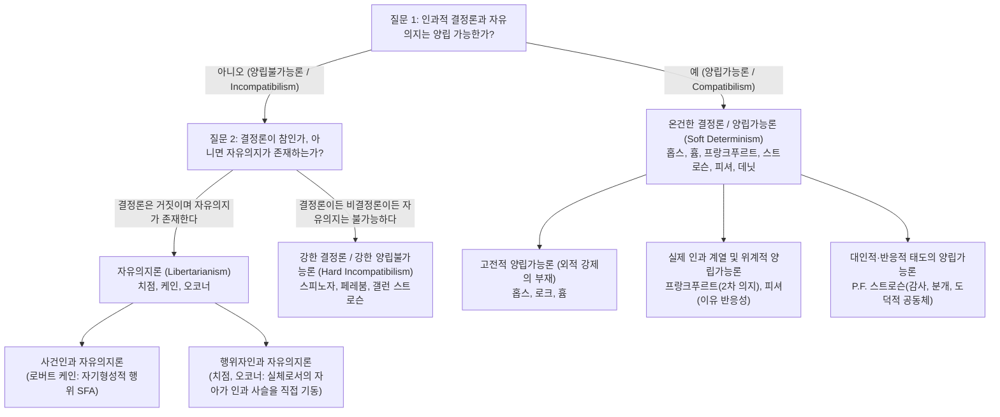
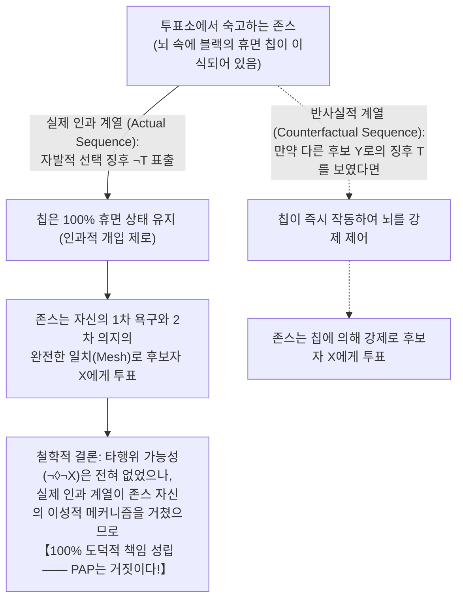

## 1. 서론: 인과적 결정론, 자유의지, 도덕적 책임의 고전적 트릴레마

지금 이 순간 당신이 화면을 스크롤하거나 책상 위의 커피잔으로 손을 뻗는다고 가정해 보자. 우리는 일상의 모든 순간에 "나는 스크롤하지 않을 수도 있었고, 커피 대신 물을 마실 수도 있었다. 내 자유로운 판단으로 이 행위를 선택했다"라는 강렬한 <strong>행위주체성 감각(Sense of Agency)</strong> 속에서 살아간다. 이 확신은 근대 이후의 법체계, 도덕적 칭찬과 비난, 계약, 죄책감, 감사와 같은 인간 사회의 근간을 이루는 토대다. 판사가 피고인에게 유죄 판결을 내릴 때, 거기에는 "피고인은 다른 적법한 행동을 할 수도 있었으나 스스로의 자유의지로 범죄를 선택했으므로 도덕적·법적 책임을 져야 한다"라는 전제가 깔려 있다.

그러나 자연과학의 관점으로 시선을 돌리는 순간, 이러한 일상적 직관은 물리적 우주의 인과 구조와 정면으로 충돌한다. 손가락 근육을 수축시킨 것은 운동 뉴런의 활동전위이며, 그 발화를 일으킨 것은 전두엽 피질과 기저핵 시냅스에서의 신경전달물질 방출이고, 그 전기화학적 과정은 맥스웰 방정식, 열역학, 양자역학이라는 엄격한 물리 법칙을 따르는 이온 채널의 개폐에 의해 결정된다. 인간의 뇌 역시 약 $8.6 \times 10^{10}$개의 뉴런과 $10^{26}$개의 원자로 이루어진 물리계에 불과하다. 만약 우주의 모든 물리적 사건이 선행하는 물리적 상태와 자연법칙에 의해 남김없이 결정된다면, 우리가 자랑하는 '자유로운 결단'이란 빅뱅(Big Bang) 이래 138억 년 동안 이어져 온 거대한 인과의 도미노 중 한 조각에 지나지 않는 것 아닐까?

17세기 합리론 철학자 <strong>바뤼흐 스피노자(Baruch Spinoza)</strong>는 1674년의 서한(제58서한)에서 이 곤경을 유명한 <strong>'날아가는 돌의 비유'</strong>로 묘사했다. 외부의 충격에 의해 공중으로 던져진 돌이 갑자기 의식을 갖게 된다면, 돌은 자신을 던진 외부 원인은 모른 채 자신이 지금 날아가고 있다는 운동의 노력만을 의식하기 때문에 "나는 내 완전히 자유로운 의지로 날고 있다!"라고 굳게 믿을 것이다. 스피노자에 따르면 인간이 스스로를 자유롭다고 믿는 이유는 오직 "자신의 행위는 의식하지만, 그 행위를 결정하는 원인들에 대해서는 무지하기 때문"이다.

### 라플라스의 악마와 인과적 결정론의 양상논리적 정식화

1814년 프랑스의 수학자이자 천문학자인 <strong>피에르시몽 라플라스(Pierre-Simon Laplace)</strong>는 『확률에 관한 철학적 시론』에서 고전역학적 결정론을 상징하는 초월적 지성, 즉 <strong>'라플라스의 악마(Laplace's Demon)'</strong>를 제시했다. 어느 한순간 자연계를 움직이는 모든 힘과 모든 물질의 위치를 알고 이를 해석할 수 있는 지성이 있다면, 가장 거대한 천체의 운동부터 가장 가벼운 원자의 운동까지 하나의 공식에 포섭할 것이며, 그 지성에게는 미래도 과거와 마찬가지로 눈앞에 현전할 것이라는 주장이다.

현대 분석형이상학에서 <strong>인과적 결정론(Causal Determinism)</strong>은 양상논리(Modal Logic)를 통해 엄밀하게 정의된다. 인류가 탄생하기 훨씬 이전인 먼 과거의 시점 $t_0$(예: 10억 년 전)における 우주 전체의 미시물리적 상태를 기술하는 참인 명제를 $P_0$, 모든 참된 기본 자연법칙의 연언(Conjunction)을 $L$, 미래의 임의의 시점 $t$에 일어나는 사건이나 인간 행위(예: "당신이 시점 $t$에 오른손을 든다")를 기술하는 참인 명제를 $P$라 하자. 결정론은 다음의 필연적 함축이 성립한다는 주장이다.

$$\Box \bigl( (P_0 \land L) \to P \bigr)$$

여기서 $\Box$는 형이상학적 필연성("모든 가능세계에서 참")을 나타내는 양상 연산자다. 즉, 과거의 초기 상태 $P_0$와 자연법칙 $L$이 현실 세계와 일치하는 모든 가능세계에서 미래의 사건 $P$는 단 하나로 고정된다.

### 자유의지 논쟁의 $2 \times 2$ 지형도

이 트릴레마를 어떻게 해결하느냐에 따라 자유의지 철학은 크게 <strong>양립불가능론(Incompatibilism)</strong>과 <strong>양립가능론(Compatibilism)</strong>의 두 진영, 그리고 네 가지 핵심 입장으로 나뉜다.

| 철학적 입장 | 결정론과 자유의 양립 여부 | 자유의지 존재 여부 | 궁극적 도덕적 책임 존재 여부 | 자유의 핵심 조건 | 대표적인 철학자 |
| :--- | :---: | :---: | :---: | :--- | :--- |
| <strong>강한 결정론 / 강한 양립불가능론</strong> (Hard Incompatibilism) | 불가능 (양립불가능) | 없음 | 없음 (응보적 처벌은 부당함) | 궁극적인 자기원인(*Causa Sui*), 그러나 논리적으로 불가능 | 스피노자, 더크 페레붐, 갤런 스트로슨 |
| <strong>자유의지론 (리버테리어니즘)</strong> (Libertarianism) | 불가능 (양립불가능) | 있음 | 있음 | 비결정론적 '달리 행위할 가능성' 및 궁극적 기원 | 로더릭 치점, 로버트 케인, 티머시 오코너 |
| <strong>고전적 양립가능론</strong> (Classical Compatibilism) | 가능 (양립가능) | 있음 | 있음 | 물리적 구속이나 협박 같은 '외적 강제의 부재'와 욕구에 따른 행위 | 토머스 홉스, 존 로크, 데이비드 흄 |
| <strong>현대적 양립가능론 / 반양립가능론</strong> (Contemporary / Semicompatibilism) | 가능 (양립가능) | 있음 | 있음 (실제 인과 계열에 의존) | 1차 욕구와 2차 의지의 조화(프랑크푸르트), 적절한 이유 반응성(피셔) | 해리 프랑크푸르트, P.F. 스트로슨, 존 마틴 피셔, 대니얼 데닛 |

---

## 2. 피터 판 인바겐의 양립불가능론 주논증: '귀결 논증(The Consequence Argument)'

1983년 저서 『자유의지에 관한 시론(*An Essay on Free Will*)』에서 미국의 철학자 <strong>피터 판 인바겐(Peter van Inwagen)</strong>은 현대 양립불가능론을 부활시킨 가장 강력한 연역 논증인 <strong>'귀결 논증(The Consequence Argument)'</strong>을 정식화했다.

> "만약 결정론이 참이라면, 우리의 행위는 자연법칙과 먼 과거 사건들의 귀결(consequence)이다. 그러나 우리가 태어나기 전에 무슨 일이 일어났는지는 우리에게 달려 있지 않으며(not up to us), 자연법칙이 어떠한지도 우리에게 달려 있지 않다. 따라서 그것들의 귀결(우리의 현재 행위를 포함하여) 또한 우리에게 달려 있지 않다."

### 양상 연산자 $\mathcal{N}$과 추론 규칙 $\alpha \cdot \beta$

판 인바겐은 행위적 무력성을 나타내는 양상 연산자 $\mathcal{N} p$를 다음과 같이 정의한다.

$$\mathcal{N} p \iff \text{“명제 } p\text{는 참이며, 어떠한 인간 행위자도 } p\text{가 참인지 여부에 대해 현재나 과거에 아무런 선택의 여지를 갖지 못한다.”}$$

연산자 $\mathcal{N}$은 두 가지 핵심 추론 규칙을 따른다.
1. <strong>규칙 $\alpha$ (논리적 필연성에서 무력성으로의 이행)</strong>:
   $$\frac{\Box p}{\mathcal{N} p}$$
   명제 $p$가 논리적·형이상학적으로 필연적인 진리라면, 어떠한 인간도 $p$에 대해 선택의 여지를 갖지 못한다.
2. <strong>규칙 $\beta$ (무력성의 전달 원리 / Transfer of Powerlessness)</strong>:
   $$\frac{\mathcal{N} p, \quad \mathcal{N}(p \to q)}{\mathcal{N} q}$$
   $p$에 대해 아무도 선택의 여지가 없고($\mathcal{N} p$), 조건문 $(p \to q)$에 대해서도 아무도 선택의 여지가 없다면($\mathcal{N}(p \to q)$), 그 귀결인 $q$에 대해서도 아무도 선택의 여지가 없다($\mathcal{N} q$).

### 귀결 논증의 7단계 형식적 증명

$$\begin{aligned}
1.\quad &\Box \bigl( (P_0 \land L) \to P \bigr) &&\text{[전제 1: 인과적 결정론의 정의]} \\
2.\quad &\Box \bigl( P_0 \to (L \to P) \bigr) &&\text{[1에서 명제논리의 수출률(Exportation) 적용]} \\
3.\quad &\mathcal{N} \bigl( P_0 \to (L \to P) \bigr) &&\text{[2에 추론 규칙 } \alpha \text{ 적용]} \\
4.\quad &\mathcal{N} P_0 &&\text{[전제 2: 과거 고정성의 원리 (인류 이전의 과거는 바꿀 수 없음)]} \\
5.\quad &\mathcal{N} (L \to P) &&\text{[3과 4에 추론 규칙 } \beta \text{ 적용]} \\
6.\quad &\mathcal{N} L &&\text{[전제 3: 법칙 고정성의 원리 (인간은 물리 법칙을 깨는 기적을 일으킬 수 없음)]} \\
7.\quad &\mathcal{N} P &&\text{[5와 6에 추론 규칙 } \beta \text{ 적용 —— 증명 끝 (Q.E.D.)]}
\end{aligned}$$

단계 7의 결론 $\mathcal{N} P$는 <strong>당신이 지금 손을 드는 행위에 대해 당신을 포함한 누구도 아무런 선택의 여지가 없음</strong>을 함축한다!

### 양립가능론자의 반격: 데이비드 루이스의 '국소적 기적'과 규칙 $\beta$ 반례

1. <strong>데이비드 루이스(David Lewis, 1981)의 『우리는 법칙을 깨뜨릴 자유가 있는가?(*Are We Free to Break the Laws?*)』</strong>:
   루이스는 전제 3($\mathcal{N} L$)이 <strong>강한 능력(Strong Ability)</strong>과 <strong>약한 반사실적 능력(Weak Counterfactual Ability)</strong>을 혼동하고 있다고 비판했다. 인간은 자신의 행위 자체가 직접 물리 법칙을 파괴하는 초자연적 능력(강한 능력)은 없지만, 루이스의 가능세계 반사실적 조건문 의미론에 따르면 "만약 내가 지금 손을 들지 않았더라면($\neg P$)"이라는 반사실적 시나리오에서 현실 세계와 가장 가까운 가능세계는 결단 직전 뇌의 시냅스에서 아주 미세한 <strong>'국소적 일탈 기적(Local divergence miracle)'</strong>이 선행하여 현실 법칙 $L$에서 살짝 벗어난 세계다. 따라서 약한 반사실적 의미에서 $\mathcal{N}_{\text{weak}} L$은 거짓이며, 행위자는 여전히 달리 행위할 능력을保有한다(<strong>국소적 기적 양립가능론</strong>).
2. <strong>매케이와 존슨(McKay & Johnson, 1996)의 규칙 $\beta$ 반례</strong>:
   규칙 $\alpha$와 규칙 $\beta$를 결합하면 <strong>연언 집적성(Agglomeration: $\mathcal{N} p, \mathcal{N} q \vdash \mathcal{N}(p \land q)$)</strong>이 도출된다. 그러나 공정한 동전을 던질지 말지 자유롭게 선택할 수 있는 상황에서 실제로 <strong>동전을 던지지 않았다</strong>고 하자. $p=$"동전이 앞면이 나오지 않았다", $q=$"동전이 뒷면이 나오지 않았다"라고 할 때, 동전을 던져도 앞면이나 뒷면을 확실히 보장할 수 없으므로 $\mathcal{N} p$와 $\mathcal{N} q$는 모두 참이지만, $(p \land q)$는 "동전을 던지지 않았다"와 동치이므로 동전을 던짐으로써 확실히 거짓으로 만들 수 있어 <strong>$\mathcal{N}(p \land q)$는 거짓</strong>이다! 이로써 원래 형태의 규칙 $\beta$가 부당함이 입증되었다.

---

## 3. 양자역학의 비결정론은 자유의지를 구원하는가: '운의 논증'과 스트로슨의 기본 논증

고전역학의 결정론이 자유를 위협한다면 <strong>양자역학(Quantum Mechanics)</strong>의 확률적 파동함수 붕괴(<strong>보른 규칙 / Born Rule</strong>)가 자유의지를 구원할 수 있을까?

$$|\psi\rangle = c_1 |\text{발화: 행위 } A\text{ 선택}\rangle + c_2 |\text{비발화: 행위 } B\text{ 선택}\rangle, \quad |c_1|^2 + |c_2|^2 = 1$$

현대 행위철학자들의 대답은 단호한 <strong>"아니오"</strong>다.

### '운의 논증 / 마인드 논증(The Luck / Mind Argument)': 우연은 자유가 아니다

만약 당신이 도덕적 결단을 내리는 마지막 순간, 당신의 성격·신념·가치관·숙고로도 $A$와 $B$가 결정되지 않고 전두엽 뉴런의 <strong>원인 없는 순수 확률적 양자 점프(주사위 굴리기)</strong>에 의해 결과가 결정된다면, 그것은 당신이 이성적으로 통제한 것이 아니라 <strong>맹목적인 우연(Blind Chance)</strong>이 결정한 것이다!
* <strong>판 인바겐의 '되감기 논증(Rollback Argument, 2000)'과 알프레드 밀(Alfred Mele, 2006)의 '가능세계 간 운(Cross-world Luck)'</strong>: 신이 우주의 시간을 결단 1밀리초 전으로 되감아 똑같은 초기 조건에서 1,000번 재생했을 때, 500번은 진실을 말하고 500번은 거짓말을 한다면, 진실을 말한 1회차의 앨리스와 거짓말을 한 2회차의 앨리스 사이에는 결단 직전까지 원자 하나까지 아무런 차이가 없다. 그 차이는 순전히 <strong>운(Luck)</strong>일 뿐이며, 순수한 운에 도덕적 책임을 물을 수는 없다.

### 자유의지론의 대응과 갤런 스트로슨의 '기본 논증(Basic Argument)'

1. <strong>로버트 케인(Robert Kane, 1996)의 '자기형성적 행위(Self-Forming Actions, SFAs)'</strong>: 도덕적 의무와 개인적 야망이 격렬하게 갈등할 때 뇌의 두 신경망이 비평형 열역학적 카오스 상태에 빠져 양자 불확정성을 증폭시킨다. 행위자는 두 목표 모두를 위해 동시에 능동적인 의지적 노력(Dual efforts of will)을 기울이고 있으므로, 어느 쪽이 승리하든 행위자 자신의 이유에 기반한 자발적 행위(<strong>복수 자발적 통제 / Plural Voluntary Control</strong>)가 된다.
2. <strong>치점과 오코너(Chisholm & O'Connor)의 '행위자 인과(Agent-Causation)'</strong>: 사건이 사건을 일으키는 사건인과($E_1 \to E_2$)와 별개로, 실체로서의 자아 $S$가 '움직여지지 않는 제1동자(Prime Mover Unmoved)'로서 새로운 인과 사슬을 직접 기동한다($S \xrightarrow{\text{agent-causes}} A$).

그러나 영국의 철학자 <strong>갤런 스트로슨(Galen Strawson, 1994)</strong>은 <strong>'기본 논증(The Basic Argument)'</strong>을 통해 결정론 여부와 무관하게 궁극적 도덕적 책임은 <strong>논리적으로 불가능</strong>함을 증명했다.
1. 당신이 행위 $A$를 하는 것은 당신의 현재 정신적·성격적 상태 $M_1$ 때문이다.
2. 행위 $A$에 대해 궁극적 책임을 지려면, 당신은 자신이 $M_1$이라는 사람인 것에 대해서도 궁극적 책임을 져야 한다.
3. 그러나 $M_1$에 책임을 지려면 과거에 의도적으로 자신을 $M_1$으로 만들기로 선택했어야 하며, 이는 그 선택의 기준이 된 선행 정신 상태 $M_0$가 이미 존재했음을 전제한다.
4. $M_0$에 책임을 지려면 그 이전의 $M_{-1}$이 필요하며, 이는 <strong>무한 후퇴($A \leftarrow M_1 \leftarrow M_0 \leftarrow M_{-1} \leftarrow \cdots$)</strong>에 빠져 결국 당신이 결코 선택하지 않은 태어날 때의 유전자와 초기 양육 환경 $M_{\text{init}}$에 도달한다.
5. <strong>결론</strong>: 그 무엇도 <strong>자기원인(*Causa Sui*, 스스로를 무에서 창조하는 원인)</strong>이 될 수 없으므로, 궁극적 도덕적 책임은 논리적으로 불가능하다.

---

## 4. 양립가능론의 혁명: 홉스·흄에서 프랑크푸르트 사례까지

<strong>데이비드 흄(David Hume, 1748)</strong>은 『인간 지성 탐구』 제8장에서 자유와 대립하는 것은 인과적 필연성이 아니라 감옥의 사슬이나 협박 같은 <strong>'외적 강제(Coercion)'</strong>라고 역설했다. 오히려 행위가 행위자의 지속적인 성격과 동기에서 인과적으로 산출되어야만 도덕적 비난과 칭찬이 가능하다. 그러나 고전적 양립가능론은 외적 구속이 없는데도 부자유스러운 <strong>내적 강박(약물 중독자, 도벽 환자)</strong>을 설명하기 어려웠다.

### 해리 프랑크푸르트(1969)의 코페르니쿠스적 전환: '타행위 가능성의 원리(PAP)' 논박

2000년 동안 양립불가능론자와 고전적 양립가능론자 모두가 공유했던 공리는 <strong>타행위 가능성의 원리(Principle of Alternate Possibilities, PAP)</strong>였다.

$$\mathbf{PAP}: \quad \text{행위자 } S\text{가 행위 } A\text{에 대해 도덕적 책임을 진다} \implies S\text{는 } A\text{ 이외의 행위를 할 수도 있었다 }(\Diamond \neg A).$$

1969년 <strong>해리 프랑크푸르트(Harry Frankfurt)</strong>는 논문 『타행위 가능성과 도덕적 책임』에서 유명한 <strong>'프랑크푸르트 사례(Frankfurt-Style Cases)'</strong>를 통해 PAP 자체를 격파했다.

* <strong>신경외과의 블랙(Black)과 유권자 존스(Jones)</strong>: 블랙은 존스가 후보자 $X$에게 투표하기를 원하여 존스의 뇌에 비밀 신경 칩을 이식한다.
* <strong>반사실적 개입 프로토콜</strong>: 만약 존스가 경쟁 후보 $Y$에게 투표하려는 신경학적 사전 징후 $T$를 보이면 칩이 즉각 작동하여 강제로 $X$에게 투표하게 만든다. 반면 존스가 징후 $\neg T$를 보이며 스스로의 이유로 $X$에게 투표하려 하면 칩은 <strong>완전히 휴면 상태(Dormant)</strong>로 남아 아무런 개입도 하지 않는다.
* <strong>실제 일어난 일</strong>: 존스는 처음부터 끝까지 오직 자신의 정치적 신념에 따라 자발적으로 후보자 $X$에게 투표했고, 블랙의 칩은 단 한 번도 작동하지 않았다!

존스는 어떤 가능세계에서도 $X$ 이외에 투표할 수 없었으나(타행위 가능성 부재), 칩이 전혀 작동하지 않고 오직 자신의 숙고로 투표했으므로 <strong>100% 도덕적 책임</strong>을 진다! 즉, 도덕적 책임에 본질적인 것은 반사실적 세계의 대안 가능성이 아니라 <strong>현실의 인과 계열(Actual Causal Sequence)</strong>이다! (양립불가능론자들의 '딜레마 방어'에 맞서 더크 페레붐의 '탈세 사례'와 존 마틴 피셔의 <strong>반양립가능론 / Semicompatibilism</strong>은 이 결론을 더욱 정교하게 방어했다.)

---

## 5. 위계적 의지, 이유 반응성, 반응적 태도, 그리고 신경과학의 도전

1. <strong>프랑크푸르트의 '위계적 욕구 이론(Hierarchical Mesh Theory, 1971)'</strong>:
   인간 인격체(Person)는 단순한 <strong>1차 욕구(First-Order Desires)</strong>뿐만 아니라, 어떤 1차 욕구가 자신의 실제 행동하는 의지(Will)가 되기를 바라는지 평가하는 <strong>2차 의지(Second-Order Volitions)</strong>를 갖는다. <strong>마지못한 중독자(Unwilling Addict)</strong>는 금단 증상 때문에 자신의 2차 의지(단약)에 반하여 마약을 투약하므로 의지의 자유가 없지만, <strong>기꺼이 하는 중독자(Willing Addict)</strong>나 자율적 행위자는 1차 욕구와 2차 의지가 온전한 조화(Wholehearted Identification & Mesh)를 이룬다.
2. <strong>피셔와 라비자의 '적절한 이유 반응성(Moderate Reasons-Responsiveness, 1998)'</strong>:
   세뇌 조작 논증(Manipulation Argument)을 극복하기 위해 존 마틴 피셔와 마크 라비자는 실제 작동한 의사결정 메커니즘 $M$이 반사실적 상황에서 충분한 이유를 규칙적으로 인식하는 <strong>이유 수용성(Receptivity)</strong>과 그에 따라 행동을 바꿀 수 있는 <strong>이유 반응성(Reactivity)</strong>을 갖추고 행위자가 그 메커니즘의 소유권(Ownership)을 가질 때 지도적 통제(Guidance Control)가 성립함을 보였다.
3. <strong>P.F. 스트로슨의 『자유와 분개(*Freedom and Resentment*, 1962)』와 반응적 태도</strong>:
   도덕적 책임은 형이상학적 명제에 의존하는 것이 아니라, 타인을 도덕적 공동체의 일원으로 대할 때 느끼는 <strong>참여적 반응적 태도(Participant Reactive Attitudes: 분개, 감사, 용서, 죄책감)</strong>의 실천 그 자체다. 인류 전체에 대해 이 반응적 태도를 버리고 모든 인간을 관리·치료 대상으로만 보는 차가운 <strong>객관적 태도(Objective Attitude)</strong>로 영구히 전환하는 것은 심리학적으로 불가능할 뿐 아니라 인간성을 파괴하는 실천적 부조리다.
4. <strong>벤저민 리벳(Benjamin Libet, 1983)의 준비전위 실험과 현대 신경과학의 논박</strong>:
   리벳은 피험자가 손목을 구부릴 때 의식적 의도(<strong>W-time</strong>, $-200\text{ ms}$)보다 약 $350\text{ ms}$ 앞선 $-550\text{ ms}$에 보조운동영역(SMA)에서 <strong>준비전위(Readiness Potential, RP)</strong>가 발생함을 발견했다. 그러나 이로부터 "자유의지는 뇌가 만든 사후적 착각"이라고 주장하는 통속적 해석은 완전히 논박되었다.
   * <strong>밀(2009)과 데닛(2003)의 철학적 비판</strong>: 아무 이유 없이 손목을 까딱이는 임의적 행동은 도덕적 숙고와 전혀 다르며(실제로 Maoz et al., 2019 실험에서 의미 있는 기부 결정을 할 때는 초기 준비전위 RP가 전혀 나타나지 않았다!), "뇌가 당신보다 먼저 결정했다"는 주장은 '당신=숙고하는 뇌 신경계 자체'임을 망각한 데카르트적 이원론의 오류다.
   * <strong>아론 슈거(Aaron Schurger et al., 2012, *PNAS*)의 확률적 축적 모델(Stochastic Accumulator Model)</strong>: 슈거 연구팀은 $-550\text{ ms}$의 준비전위가 무의식적 사전 결단이 아니라, 운동 피질의 <strong>자발적 배경 핑크 노이즈($1/f$ 확률적 요동)</strong>가 역치(Threshold)를 넘은 순간($t=0$)을 기준으로 과거를 향해 평균(Time-locked averaging)낼 때 필연적으로 나타나는 수학적 아티팩트임을 증명했다! 실제 운동 결단은 의식적 W-time과 동일한 $-200\text{ ms}$ 부근에서 이루어진다.

---

## 6. 결론: 형사사법 개혁과 라플라스의 악마 이후의 인간관

자유의지를 물리 법칙과 인과 사슬 바깥의 초자연적 <strong>자기원인(*Causa Sui*)</strong>으로 정의한다면, 그러한 자유의지는 존재할 수 없으며, 더크 페레붐과 그레그 카루소(Gregg Caruso)가 제안하듯 형사사법은 잔혹한 응보주의(Retributivism)를 버리고 <strong>'공중보건 격리 및 재활 모델(Public Health Quarantine Model)'</strong>로 나아가야 한다. 반면 흄, 프랑크푸르트, 스트로슨, 피셔, 데닛으로 이어지는 <strong>현대 양립가능론</strong>은 진정으로 가치 있는 자유란 물리 법칙을 깨는 기적이 아니라, <strong>인과적 질서 속에서 이성적 이유에 민감하게 반응하고, 자신의 1차 욕구를 2차 가치관과 통합하며, 타인과 감사와 분개와 용서를 나누는 도덕적 공동체의 자율적 주체로 살아가는 능력</strong>임을 보여준다. 물리 법칙은 자유를 가두는 감옥이 아니라, 우리의 숙고가 미래의 행동을 확실히 이끌어 우리가 삶という 이야기의 진정한 저자(Author)가 되게 해주는 토대인 것이다.
