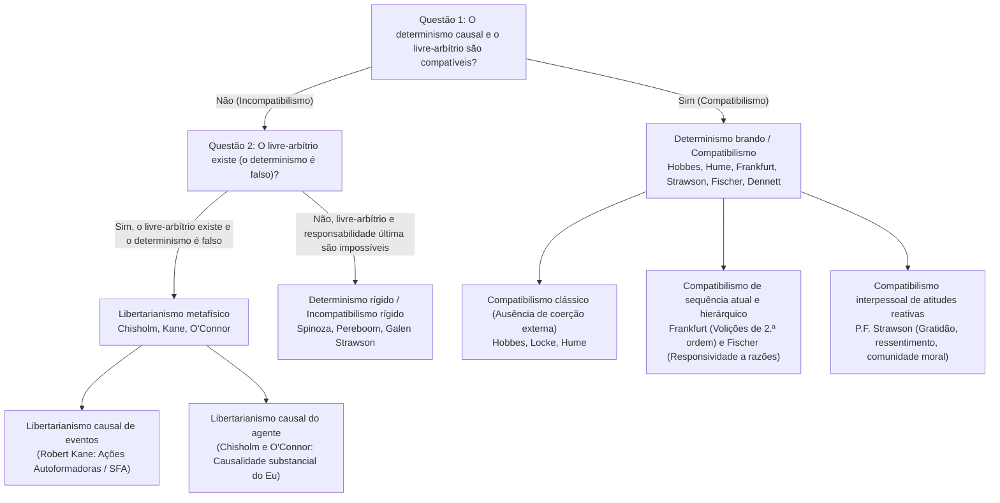
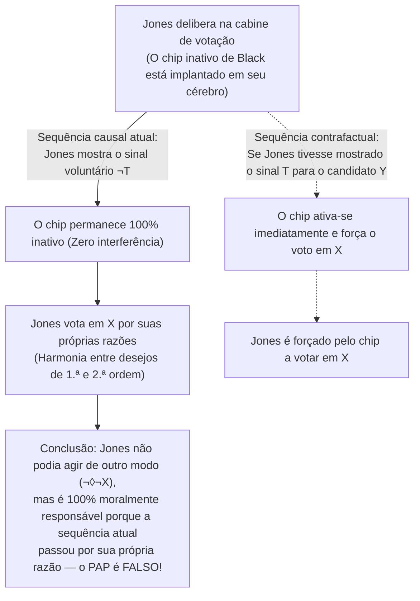

## 1. Introdução: O trilema clássico do determinismo causal, livre-arbítrio e responsabilidade moral

Quando você decide neste exato momento rolar esta página para baixo ou estender a mão para pegar sua xícara de café, você vivencia uma convicção fenomenológica imediata — o <strong>sentido de agência (Sense of Agency)</strong>: a certeza de que *cabe a você* decidir como agir, de que poderia ter agido de outro modo e de que é o autor consciente e racional de suas escolhas. Essa convicção sustenta todo o nosso ordenamento jurídico, o elogio e a censura moral, bem como sentimentos interpessoais como gratidão, ressentimento e culpa.

Contudo, assim que observamos o ser humano sob a ótica das ciências naturais, essa intuição colide frontalmente com a arquitetura causal do universo físico. A contração das fibras musculares da sua mão resulta de potenciais de ação neuronais desencadeados pela liberação de neurotransmissores no córtex pré-frontal e nos gânglios da base — processos regidos estritamente pelas equações da eletrodinâmica, da termodinâmica e da mecânica quântica. Já em 1674, <strong>Baruch Spinoza</strong> (Carta 58) comparou a ilusão humana do livre-arbítrio a uma <strong>pedra lançada ao ar</strong> que subitamente adquirisse consciência: consciente de seu próprio esforço para continuar em movimento, mas ignorante da força externa que a arremessou, a pedra acreditaria voar por seu próprio livre-arbítrio.

### O Demônio de Laplace e a formalização modal do determinismo

Em 1814, em seu *Ensaio filosófico sobre as probabilidades*, <strong>Pierre-Simon Laplace</strong> formulou o célebre experimento mental do <strong>Demônio de Laplace</strong>: uma inteligência que em um dado instante conhecesse todas as forças que animam a natureza e as posições de todos os seres que a compõem abrangeria em uma única fórmula os movimentos dos maiores corpos do universo e os do átomo mais leve; nada seria incerto para ela, e tanto o futuro quanto o passado estariam presentes diante de seus olhos.

Na metafísica analítica contemporânea, o <strong>determinismo causal</strong> é definido rigorosamente por meio da lógica modal. Seja $P_0$ uma proposição verdadeira que descreve o estado microfísico completo do universo em um instante $t_0$ do passado remoto (por exemplo, há um bilhão de anos), seja $L$ a conjunção de todas as leis fundamentais verdadeiras da natureza, e seja $P$ uma proposição verdadeira que descreve uma ação humana no instante atual $t$ (ex.: *«Você levanta a mão direita no instante $t$»*). O determinismo afirma:

$$\Box \bigl( (P_0 \land L) \to P \bigr)$$

onde $\Box$ denota a necessidade metafísica (*«verdadeiro em todos os mundos possíveis»*). Em todo mundo possível que compartilhe exatamente o mesmo passado remoto $P_0$ e as mesmas leis naturais $L$ que o mundo atual, ocorre inexoravelmente a mesma ação $P$.

### A taxonomia $2 \times 2$ do debate sobre o livre-arbítrio

| Posição Filosófica | Compatível com o determinismo? | Existe livre-arbítrio? | Existe responsabilidade moral última? | Condição central da liberdade | Filósofos representativos |
| :--- | :---: | :---: | :---: | :--- | :--- |
| <strong>Incompatibilismo rígido</strong> (Hard Incompatibilism) | Não | Não | Não (A punição retributiva é injustificada) | Autocausalidade última (*Causa Sui*), logicamente impossível | Baruch Spinoza, Derk Pereboom, Galen Strawson |
| <strong>Libertarianismo</strong> (Libertarianism) | Não | Sim | Sim | Possibilidade indeterminista de agir de outro modo e origem última | Roderick Chisholm, Robert Kane, Timothy O'Connor |
| <strong>Compatibilismo clássico</strong> (Classical Compatibilism) | Sim | Sim | Sim | Ausência de restrição ou coerção física externa; agir segundo os próprios desejos | Thomas Hobbes, John Locke, David Hume |
| <strong>Compatibilismo contemporâneo / Semicompatibilismo</strong> | Sim | Sim | Sim (Baseada na *sequência causal atual*) | Harmonia entre desejos de 1.ª ordem e volições de 2.ª ordem (Frankfurt); responsividade a razões (Fischer) | Harry Frankfurt, P.F. Strawson, John Martin Fischer, Daniel Dennett |

---

## 2. O argumento mestre de Peter van Inwagen: O Argumento da Consequência

Em *An Essay on Free Will* (1983), <strong>Peter van Inwagen</strong> formulou <strong>o Argumento da Consequência (The Consequence Argument)</strong>:

> *«Se o determinismo é verdadeiro, então nossos atos são as consequências das leis da natureza e dos eventos no passado remoto. Mas não cabe a nós (not up to us) o que aconteceu antes de nascermos, e tampouco cabe a nós quais são as leis da natureza. Portanto, as consequências dessas coisas (incluindo nossos atos presentes) também não cabem a nós.»*

### O operador modal $\mathcal{N}$ e as regras de inferência $\alpha$ e $\beta$

Van Inwagen introduz o operador modal agencial $\mathcal{N} p$:

$$\mathcal{N} p \iff \text{«A proposição } p \text{ é verdadeira, e nenhum agente humano tem, ou jamais teve, qualquer escolha sobre se } p \text{ é verdadeira.»}$$

Esse operador rege-se por duas regras de inferência:
1. <strong>Regra $\alpha$ (Da necessidade lógica à impotência)</strong>: $\Box p \vdash \mathcal{N} p$. Ninguém tem escolha sobre verdades lógica ou metafisicamente necessárias.
2. <strong>Regra $\beta$ (Transferência da impotência / Transfer of Powerlessness)</strong>: $\mathcal{N} p,\; \mathcal{N}(p \to q) \vdash \mathcal{N} q$. Se ninguém tem escolha sobre $p$ nem sobre a condicional $(p \to q)$, então ninguém tem escolha sobre $q$.

### Derivação formal em sete passos

$$\begin{aligned}
1.\quad &\Box \bigl( (P_0 \land L) \to P \bigr) &&\text{[Premissa 1: Definição do determinismo causal]} \\
2.\quad &\Box \bigl( P_0 \to (L \to P) \bigr) &&\text{[De (1) por exportação proposicional]} \\
3.\quad &\mathcal{N} \bigl( P_0 \to (L \to P) \bigr) &&\text{[De (2) aplicando a Regra } \alpha\text{]} \\
4.\quad &\mathcal{N} P_0 &&\text{[Premissa 2: Princípio da fixidez do passado remoto]} \\
5.\quad &\mathcal{N} (L \to P) &&\text{[De (3) e (4) aplicando a Regra } \beta\text{]} \\
6.\quad &\mathcal{N} L &&\text{[Premissa 3: Princípio da fixidez das leis da natureza]} \\
7.\quad &\mathcal{N} P &&\text{[De (5) e (6) aplicando a Regra } \beta \text{ — Q.E.D.]}
\end{aligned}$$

### Respostas compatibilistas: Os «milagres locais» de David Lewis e o contraexemplo à Regra $\beta$

1. <strong>David Lewis (*«Are We Free to Break the Laws?»*, 1981)</strong>: Lewis distingue entre a capacidade em <strong>sentido forte</strong> (causar mediante a própria ação uma violação das leis físicas, o que é impossível: $\mathcal{N}_{\text{strong}} L$) e a capacidade em <strong>sentido fraco contrafactual</strong>: *se* eu tivesse decidido não levantar a mão ($\neg P$), no mundo possível mais próximo do atual teria ocorrido um minúsculo <strong>milagre local de divergência</strong> nas sinapses do meu cérebro pouco antes da decisão, tornando $L$ falsa nesse mundo contrafactual ($\neg \mathcal{N}_{\text{weak}} L$).
2. <strong>McKay e Johnson (1996) contra a Regra $\beta$</strong>: As regras $\alpha$ e $\beta$ implicam logicamente a <strong>Aglomeração</strong> ($\mathcal{N} p, \mathcal{N} q \vdash \mathcal{N}(p \land q)$). Mas se você escolhe livremente *não* lançar uma moeda justa, tanto $\mathcal{N} p$ (*«A moeda não cai em cara»*) quanto $\mathcal{N} q$ (*«A moeda não cai em coroa»*) são verdadeiras (pois nem mesmo lançando-a você poderia garantir cara ou coroa), mas $\mathcal{N}(p \land q)$ (*«A moeda não cai nem em cara nem em coroa»*) é <strong>falsa</strong>, já que bastava lançar a moeda para garantir que caísse em uma das duas!

---

## 3. O indeterminismo quântico salva o livre-arbítrio? O Argumento da Sorte e o Argumento Básico de Strawson

Pode o colapso probabilístico da função de onda segundo a <strong>regra de Born</strong> ($|\psi\rangle = c_1 |A\rangle + c_2 |B\rangle$, com $|c_1|^2 + |c_2|^2 = 1$) resgatar o livre-arbítrio?

### O Argumento da Sorte (The Luck / Mind Argument)

Se a sua decisão moral entre denunciar uma fraude ($A$) ou aceitar um suborno ($B$) for decidida no último microssegundo por um <strong>salto quântico aleatório e sem causa</strong> no seu córtex pré-frontal, então não é *você* quem controla racionalmente o resultado, mas o acaso cego de um dado subatômico! Como demonstram o <strong>Argumento do Rebobinamento (Rollback Argument)</strong> de van Inwagen (2000) e a <strong>sorte entre mundos (Cross-world Luck)</strong> de Alfred Mele (2006), substituir as correntes de Laplace por uma roleta quântica não gera agência responsável, mas espasmos aleatórios.

### Modelos libertários e o Argumento Básico de Galen Strawson (1994)

Os libertários respondem por meio das <strong>Ações Autoformadoras (Self-Forming Actions, SFA)</strong> de <strong>Robert Kane (1996)</strong> (em decisões dilaceradas, o agente realiza um esforço duplo de vontade em direção a ambas as opções em redes neurais caóticas, endossando qualquer um dos resultados) ou por meio da <strong>Causalidade do Agente (Agent-Causation)</strong> de <strong>Roderick Chisholm</strong> e <strong>Timothy O'Connor</strong> ($S \xrightarrow{\text{agent-causes}} A$).

Não obstante, <strong>Galen Strawson</strong> demonstrou em 1994 com seu <strong>Argumento Básico (The Basic Argument)</strong> que a responsabilidade moral última é <strong>logicamente impossível</strong>, seja o universo determinista ou indeterminista:
1. Quando você age ($A$), faz o que faz devido ao modo como é mental e caracterologicamente ($M_1$).
2. Para ser ultimamente responsável por $A$, deve ser ultimamente responsável por ser $M_1$.
3. Mas para ser responsável por $M_1$, teria de ter escolhido intencionalmente tornar-se $M_1$ no passado com base em princípios avaliativos prévios $M_0$, e para ser responsável por $M_0$ teria precisado de $M_{-1}$, gerando um <strong>regresso infinito vicioso ($A \leftarrow M_1 \leftarrow M_0 \leftarrow M_{-1} \leftarrow \cdots$)</strong> que termina inevitavelmente em sua dotação genética e ambiente infantil inicial $M_{\text{init}}$, que você jamais escolheu. Nada pode ser <strong>*Causa Sui</strong>* (causa de si mesmo).

---

## 4. A revolução compatibilista: De Hume aos casos de Harry Frankfurt

Para <strong>Thomas Hobbes</strong> e <strong>David Hume</strong> (*Investigação sobre o entendimento humano*, 1748, Seção VIII), a liberdade não se opõe à necessidade causal, mas à <strong>coerção externa (correntes, prisão, ameaças)</strong>. Mais ainda: somente quando um ato brota causalmente do caráter duradouro e dos motivos do agente podemos atribuir-lhe responsabilidade moral!

### A refutação do Princípio das Possibilidades Alternativas (PAP) por Harry Frankfurt (1969)

Em 1969, em seu célebre artigo *«Alternate Possibilities and Moral Responsibility»*, <strong>Harry Frankfurt</strong> refutou o <strong>Princípio das Possibilidades Alternativas (PAP: $\text{Resp}(S,A) \implies \Diamond \neg A$)</strong> por meio do caso de <strong>Black e Jones</strong>:
* O neurocirurgião <strong>Black</strong> quer que <strong>Jones</strong> vote no candidato $X$ e implanta secretamente um chip em seu cérebro.
* <strong>Protocolo contrafactual</strong>: Se Jones mostrar o sinal neurológico prévio $T$ de que vai votar em $Y$, o chip ativa-se imediatamente e força eletronicamente Jones a votar em $X$. Se Jones mostrar o sinal $\neg T$ e decidir por si mesmo votar em $X$, o chip permanece <strong>completamente inativo (dormant)</strong>.
* <strong>Sequência atual</strong>: Jones delibera por conta própria e vota voluntariamente em $X$; o chip de Black nunca se ativa!

Embora Jones não tivesse nenhuma possibilidade de fazer outra coisa ($\neg \Diamond \neg X$), ele é <strong>100% moralmente responsável</strong> porque o chip não desempenhou nenhum papel na <strong>sequência causal atual</strong>. Com base nisso, <strong>John Martin Fischer</strong> formulou seu <strong>semicompatibilismo</strong> (distinguindo o *controle regulativo* do *controle de orientação / Guidance Control*).

---

## 5. Volições hierárquicas, responsividade a razões, atitudes reativas e neurociência

1. <strong>A teoria hierárquica da vontade de Harry Frankfurt (1971)</strong>:
   Uma <strong>pessoa</strong> distingue-se de um ser impulsivo (<strong>Wanton</strong>) por possuir <strong>volições de segunda ordem ($\text{Vol}_2$)</strong> acerca de quais <strong>desejos de primeira ordem ($\text{Des}_1$)</strong> quer que constituam sua vontade efetiva. O <strong>dependente involuntário (Unwilling Addict)</strong> carece de liberdade da vontade porque seu impulso contradiz sua volição de segunda ordem de se reabilitar, enquanto no <strong>dependente voluntário (Willing Addict)</strong> e no agente autônomo existe uma identificação plena e harmoniosa (<strong>Hierarchical Mesh</strong>).
2. <strong>A «responsividade moderada a razões» de Fischer e Ravizza (1998)</strong>:
   O controle de orientação requer que o mecanismo deliberativo atual $M$ seja <strong>receptivo a razões</strong> (capaz de reconhecer razões suficientes para agir de outro modo) e <strong>reativo a razões</strong> (capaz de traduzir esse reconhecimento em uma ação diferente em pelo menos alguns mundos contrafactuais).
3. <strong>As atitudes reativas de P.F. Strawson (*«Freedom and Resentment»*, 1962)</strong>:
   A responsabilidade moral reside em nossa rede de <strong>atitudes reativas participantes</strong> (<strong>ressentimento</strong>, <strong>gratidão</strong>, <strong>indignação moral</strong>, <strong>perdão</strong>). Renunciar a essas atitudes em relação a toda a humanidade para adotar perpetuamente uma fria <strong>atitude objetiva</strong> clínica em nome do determinismo é tanto psicologicamente impossível quanto praticamente absurdo.
4. <strong>O experimento de Benjamin Libet (1983) e a refutação de Aaron Schurger (2012)</strong>:
   Libet descobriu que, ao flexionar espontaneamente o pulso, o <strong>potencial de prontidão (RP)</strong> na área motora suplementar começa em $-550\text{ ms}$, antes da consciência da intenção (<strong>tempo W</strong> em $-200\text{ ms}$). Mas essa suposta refutação neurocientífica do livre-arbítrio fracassa por completo:
   * <strong>Crítica filosófica (Mele 2009, Dennett 2003, Maoz et al. 2019)</strong>: Flexionar o pulso ao acaso sem motivo algum não tem nada a ver com a deliberação moral complexa (quando os sujeitos tomam decisões significativas sobre doações reais, o RP precoce desaparece por completo!). Além disso, contrapor «o cérebro» a «você» incorre em um falacioso dualismo cartesiano.
   * <strong>O modelo de acumulador estocástico de Aaron Schurger (2012, *PNAS*)</strong>: Schurger demonstrou que o RP em $-550\text{ ms}$ não é uma decisão inconsciente, mas um artefato matemático de calcular a média retroativa no tempo (*time-locked averaging*) de flutuações espontâneas de <strong>ruído rosa ($1/f$)</strong> no córtex motor que cruzam aleatoriamente o limiar de decisão por volta de $-200\text{ ms}$!

---

## 6. Conclusão: Reforma da justiça criminal e autonomia humana após o Demônio de Laplace

Se por livre-arbítrio exigirmos uma impossível <strong>*Causa Sui</strong>* sobrenatural, devemos rejeitar o retributivismo punitivo em favor de um <strong>modelo de saúde pública e reabilitação</strong>, como propõem Derk Pereboom e Gregg Caruso. Mas, como demonstra o <strong>compatibilismo contemporâneo</strong>, a verdadeira liberdade humana não consiste em violar as leis da física, mas em nossa capacidade emergente de governar nossos desejos pela razão, responder de forma flexível às razões morais e conviver como agentes responsáveis dentro de uma comunidade moral.
