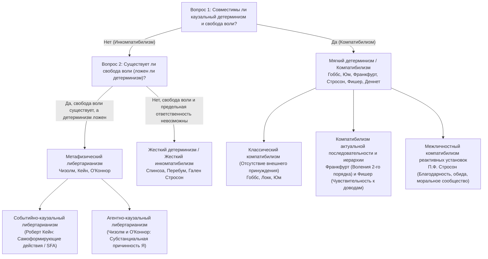
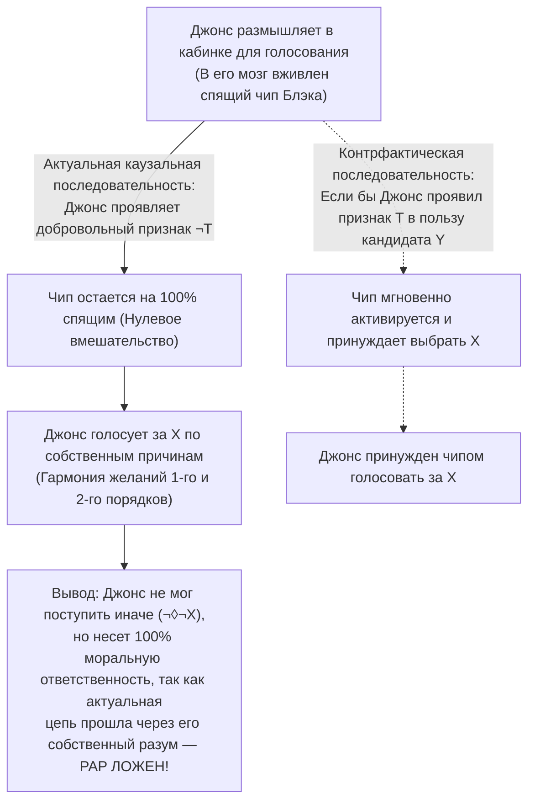

## 1. Введение: Классическая трилемма каузального детерминизма, свободы воли и моральной ответственности

Когда вы в эту самую секунду решаете прокрутить страницу вниз или протянуть руку к чашке кофе, вы испытываете непосредственную феноменологическую убежденность — <strong>чувство агентивности (Sense of Agency)</strong>: уверенность в том, что именно *от вас зависит*, как поступить, что вы могли бы поступить иначе и что вы являетесь сознательным, рациональным автором своих решений. Эта убежденность лежит в основании всей нашей правовой системы, морального одобрения и порицания, а также межличностных чувств благодарности, негодования и вины.

Однако стоит нам взглянуть на человека сквозь призму естественных наук, как эта повседневная интуиция лоб в лоб сталкивается с каузальной структурой физической Вселенной. Сокращение мышечных волокон вашей руки вызвано потенциалами действия мотонейронов, которые, в свою очередь, запущены выбросом нейромедиаторов в синапсах префронтальной коры и базальных ганглиев — процессами, строго подчиняющимися дифференциальным уравнениям электродинамики, термодинамики и квантовой механики. Еще в 1674 году <strong>Барух Спиноза</strong> (Письмо 58) сравнил человеческую иллюзию свободы воли с <strong>летящим камнем</strong>, который внезапно обрел бы сознание: осознавая собственное стремление продолжать движение, но не зная внешней силы, бросившей его, камень считал бы себя абсолютно свободным.

### Демон Лапласа и модальная формализация детерминизма

В 1814 году во введении к «Опыту философии теории вероятностей» <strong>Пьер-Симон Лаплас</strong> сформулировал знаменитый мысленный эксперимент с <strong>демоном Лапласа</strong>: ум, которому в данный момент были бы известны все силы, одушевляющие природу, и относительное положение всех ее составных частей, объял бы в одной формуле движения величайших тел Вселенной наравне с движениями легчайших атомов; для него не было бы ничего недостоверного, и будущее, так же как и прошедшее, предстало бы перед его взором.

В современной аналитической метафизике <strong>каузальный детерминизм</strong> строго определяется с помощью модальной логики. Пусть $P_0$ — истинное высказывание, дающее полное микрофизическое описание состояния всей Вселенной в некоторый момент $t_0$ далекого прошлого (например, миллиард лет назад), $L$ — конъюнкция всех истинных фундаментальных законов природы, а $P$ — истинное высказывание, описывающее действие человека в настоящий момент $t$ (например: *«Вы поднимаете правую руку в момент $t$»*). Детерминизм утверждает:

$$\Box \bigl( (P_0 \land L) \to P \bigr)$$

где $\Box$ означает метафизическую необходимость (*«истинно во всех возможных мирах»*). В каждом возможном мире, разделяющем то же далекое прошлое $P_0$ и те же законы природы $L$, что и актуальный мир, неизбежно происходит одно и то же действие $P$.

### Таксономия $2 \times 2$ дебатов о свободе воли

| Философская позиция | Совместима с детерминизмом? | Существует ли свобода воли? | Существует ли предельная моральная ответственность? | Ключевое условие свободы | Представители |
| :--- | :---: | :---: | :---: | :--- | :--- |
| <strong>Жесткий инкомпатибилизм</strong> (Hard Incompatibilism) | Нет | Нет | Нет (Ретрибутивное наказание неоправданно) | Предельная самопричинность (*Causa Sui*), логически невозможная | Барух Спиноза, Дерк Перебум, Гален Стросон |
| <strong>Либертарианизм</strong> (Libertarianism) | Нет | Да | Да | Индетерминистическая возможность поступить иначе и первоисточник | Родерик Чизолм, Роберт Кейн, Тимоти О'Коннор |
| <strong>Классический компатибилизм</strong> (Classical Compatibilism) | Да | Да | Да | Отсутствие внешнего физического принуждения; действие согласно желаниям | Томас Гоббс, Джон Локк, Дэвид Юм |
| <strong>Современный / Семикомпатибилизм</strong> (Contemporary / Semicompatibilism) | Да | Да | Да (Опирается на *актуальную каузальную цепь*) | Гармония желаний 1-го порядка и волений 2-го порядка (Франкфурт); чувствительность к доводам (Фишер) | Гарри Франкфурт, П.Ф. Стросон, Джон Мартин Фишер, Дэниел Деннет |

---

## 2. Главный аргумент Питера ван Инвагена: Аргумент последствий (The Consequence Argument)

В книге *An Essay on Free Will* (1983) <strong>Питер ван Инваген</strong> сформулировал <strong>Аргумент последствий (The Consequence Argument)</strong>:

> *«Если детерминизм истинен, то наши поступки суть последствия законов природы и событий в далеком прошлом. Но от нас не зависит (not up to us), что происходило до нашего рождения, и точно так же от нас не зависит, каковы законы природы. Следовательно, последствия этих вещей (включая наши нынешние поступки) также от нас не зависят».*

### Модальный оператор $\mathcal{N}$ и правила вывода $\alpha$ и $\beta$

Ван Инваген вводит агентный модальный оператор $\mathcal{N} p$:

$$\mathcal{N} p \iff \text{«Высказывание } p \text{ истинно, и ни один человек не имеет и никогда не имел никакого выбора относительно того, истинно ли } p\text{».}$$

Оператор подчиняется двум правилам вывода:
1. <strong>Правило $\alpha$ (От логической необходимости к бессилию)</strong>: $\Box p \vdash \mathcal{N} p$. Никто не имеет выбора в отношении логически или метафизически необходимых истин.
2. <strong>Правило $\beta$ (Перенос бессилия / Transfer of Powerlessness)</strong>: $\mathcal{N} p,\; \mathcal{N}(p \to q) \vdash \mathcal{N} q$. Если никто не имеет выбора в отношении $p$ и никто не имеет выбора в отношении импликации $(p \to q)$, то никто не имеет выбора и в отношении $q$.

### Формальный вывод из семи шагов

$$\begin{aligned}
1.\quad &\Box \bigl( (P_0 \land L) \to P \bigr) &&\text{[Посылка 1: Определение каузального детерминизма]} \\
2.\quad &\Box \bigl( P_0 \to (L \to P) \bigr) &&\text{[Из (1) по правилу экспортации пропозициональной логики]} \\
3.\quad &\mathcal{N} \bigl( P_0 \to (L \to P) \bigr) &&\text{[Из (2) по Правилу } \alpha\text{]} \\
4.\quad &\mathcal{N} P_0 &&\text{[Посылка 2: Принцип фиксированности далекого прошлого]} \\
5.\quad &\mathcal{N} (L \to P) &&\text{[Из (3) и (4) по Правилу } \beta\text{]} \\
6.\quad &\mathcal{N} L &&\text{[Посылка 3: Принцип фиксированности законов природы]} \\
7.\quad &\mathcal{N} P &&\text{[Из (5) и (6) по Правилу } \beta \text{ — Ч.Т.Д.]}
\end{aligned}$$

### Ответы компатибилистов: «Локальные чудеса» Дэвида Льюиса и контрпример к Правилу $\beta$

1. <strong>Дэвид Льюис (*«Are We Free to Break the Laws?»*, 1981)</strong>: Льюис различает способность в <strong>сильном смысле</strong> (совершить действие, которое само нарушает физический закон, что невозможно: $\mathcal{N}_{\text{strong}} L$) и способность в <strong>слабом контрфактическом смысле</strong>: *если бы* я решил не поднимать руку ($\neg P$), то в ближайшем возможном мире за долю секунды до моего решения в синапсах моего мозга произошло бы крошечное <strong>локальное чудо расхождения (Local divergence miracle)</strong>, так что $L$ было бы ложным в том мире ($\neg \mathcal{N}_{\text{weak}} L$).
2. <strong>Маккей и Джонсон (1996) против Правила $\beta$</strong>: Правила $\alpha$ и $\beta$ логически влекут <strong>Агломерацию</strong> ($\mathcal{N} p, \mathcal{N} q \vdash \mathcal{N}(p \land q)$). Но если вы свободно решаете *не* подбрасывать симметричную монету, то истинны и $\mathcal{N} p$ (*«Монета не упала орлом»*), и $\mathcal{N} q$ (*«Монета не упала решкой»*), однако $\mathcal{N}(p \land q)$ (*«Монета не упала ни орлом, ни решкой»*) <strong>ложно</strong>, так как вы легко могли гарантировать выпадение одной из сторон, просто подбросив монету!

---

## 3. Спасает ли квантовый индетерминизм свободу воли? Аргумент удачи и Базовый аргумент Стросона

Может ли вероятностный коллапс волновой функции по <strong>правилу Борна</strong> ($|\psi\rangle = c_1 |A\rangle + c_2 |B\rangle$, где $|c_1|^2 + |c_2|^2 = 1$) спасти свободу воли?

### Аргумент удачи (The Luck / Mind Argument)

Если ваше моральное решение между разоблачением коррупции ($A$) и получением взятки ($B$) в последнюю микросекунду решается <strong>беспричинным случайным квантовым скачком</strong> в префронтальной коре, то исход контролируете не *вы*, а слепой случай субатомной рулетки! Как показывают <strong>Аргумент перемотки (Rollback Argument)</strong> ван Инвагена (2000) и проблема <strong>межмировой удачи (Cross-world Luck)</strong> Альфреда Миле (2006), замена цепей Лапласа квантовым генератором случайных чисел превращает человека в хаотично дергающуюся марионетку, а не в ответственного субъекта.

### Либертарианские модели и Базовый аргумент Галена Стросона (1994)

Либертарианцы отвечают либо концепцией <strong>Самоформирующих действий (Self-Forming Actions, SFA)</strong> <strong>Роберта Кейна (1996)</strong> (в ситуации мучительного морального выбора агент одновременно прилагает волевые усилия к обоим вариантам в хаотических нейронных сетях, принимая ответственность за любой исход), либо <strong>Агентной причинностью (Agent-Causation)</strong> <strong>Родерика Чизолма</strong> и <strong>Тимоти О'Коннора</strong> ($S \xrightarrow{\text{agent-causes}} A$).

Однако <strong>Гален Стросон</strong> в 1994 году доказал с помощью своего <strong>Базового аргумента (The Basic Argument)</strong>, что предельная моральная ответственность <strong>логически невозможна</strong> независимо от истинности детерминизма:
1. Совершая поступок $A$, вы делаете это в силу того, каковы вы в ментальном и характерологическом плане ($M_1$).
2. Чтобы нести предельную ответственность за $A$, вы должны нести предельную ответственность за то, что вы являетесь $M_1$.
3. Но для этого вы должны были в прошлом намеренно выбрать стать $M_1$ на основе уже имевшихся у вас принципов оценки $M_0$, а для ответственности за $M_0$ потребовалось бы $M_{-1}$ — возникает <strong>порочный бесконечный регресс ($A \leftarrow M_1 \leftarrow M_0 \leftarrow M_{-1} \leftarrow \cdots$)</strong>, упирающийся в гены и раннюю среду $M_{\text{init}}$, которые вы не выбирали. Ничто не может быть <strong>*Causa Sui</strong>* (причиной самого себя).

---

## 4. Компатибилистская революция: От Юма к случаям Гарри Франкфурта

Для <strong>Томаса Гоббса</strong> и <strong>Дэвида Юма</strong> (*Исследование о человеческом познании*, 1748, Глава VIII) свобода противоположна не каузальной необходимости, а <strong>внешнему принуждению (цепям, тюрьме, насилию)</strong>. Более того: только если поступок каузально вытекает из устойчивого характера и мотивов агента, человека можно морально хвалить или порицать!

### Опровержение Принципа альтернативных возможностей (PAP) Гарри Франкфуртом (1969)

В 1969 году в знаменитой статье *«Alternate Possibilities and Moral Responsibility»* <strong>Гарри Франкфурт</strong> опроверг <strong>Принцип альтернативных возможностей (PAP: $\text{Resp}(S,A) \implies \Diamond \neg A$)</strong> с помощью мысленного эксперимента о <strong>Блэке и Джонсе</strong>:
* Нейрохирург <strong>Блэк</strong> хочет, чтобы <strong>Джонс</strong> проголосовал за кандидата $X$, и тайно вживляет чип в его мозг.
* <strong>Контрфактический протокол</strong>: Если Джонс проявит предварительный неврологический признак $T$ склонности голосовать за $Y$, чип немедленно активируется и принудительно заставит Джонса проголосовать за $X$. Если же Джонс проявит признак $\neg T$ и сам решит голосовать за $X$, чип останется <strong>полностью спящим (dormant)</strong>.
* <strong>Актуальная последовательность</strong>: Джонс размышляет самостоятельно и добровольно голосует за $X$; чип Блэка вообще не включается!

Хотя Джонс не мог поступить иначе ($\neg \Diamond \neg X$), он несет <strong>100 % моральную ответственность</strong>, поскольку чип никак не участвовал в <strong>актуальной каузальной последовательности</strong>. На этом фундаменте <strong>Джон Мартин Фишер</strong> построил свой <strong>семикомпатибилизм</strong> (разграничив *регулятивный контроль* и *направляющий контроль / Guidance Control*).

---

## 5. Иерархические воления, чувствительность к доводам, реактивные установки и нейронаука

1. <strong>Иерархическая теория воли Гарри Франкфурта (1971)</strong>:
   <strong>Личность (Person)</strong> отличается от импульсивного существа (<strong>Wanton</strong>) наличием <strong>волений второго порядка ($\text{Vol}_2$)</strong> относительно того, какие <strong>желания первого порядка ($\text{Des}_1$)</strong> должны стать ее действенной волей. <strong>Наркоман поневоле (Unwilling Addict)</strong> несвободен, так как его тяга противоречит его волению второго порядка бросить наркотик, тогда как у <strong>добровольного наркомана (Willing Addict)</strong> и автономного агента желания первого и второго порядков находятся в полном согласии (<strong>Hierarchical Mesh</strong>).
2. <strong>«Умеренная чувствительность к доводам» Фишера и Равиццы (1998)</strong>:
   Направляющий контроль требует, чтобы актуальный механизм принятия решений $M$ обладал <strong>восприимчивостью к доводам (Receptivity)</strong> (способностью распознавать достаточные основания поступить иначе) и <strong>реактивностью на доводы (Reactivity)</strong> (способностью переводить это распознавание в иное действие хотя бы в некоторых контрфактических мирах).
3. <strong>Реактивные установки П.Ф. Стросона (*«Freedom and Resentment»*, 1962)</strong>:
   Моральная ответственность укоренена в нашей сети <strong>участных реактивных установок</strong> (<strong>негодование / обида</strong>, <strong>благодарность</strong>, <strong>моральное возмущение</strong>, <strong>прощение</strong>). Отказаться от них по отношению ко всему человечеству ради холодной клинической <strong>объективной установки (Objective Attitude)</strong> во имя детерминизма психологически невозможно и практически абсурдно.
4. <strong>Эксперимент Бенджамина Либета (1983) и опровержение Аарона Шургера (2012)</strong>:
   Либет обнаружил, что при спонтанном сгибании запястья <strong>потенциал готовности (RP)</strong> в дополнительной моторной коре возникает на отметке $-550\text{ мс}$, раньше осознания намерения (<strong>время W</strong> на $-200\text{ мс}$). Однако этот нейронаучный аргумент против свободы воли полностью рушится:
   * <strong>Философская критика (Миле 2009, Деннет 2003, Маоз и др. 2019)</strong>: Бесцельное сгибание кисти не имеет ничего общего со сложным моральным выбором (когда испытуемые принимают осмысленные решения о благотворительных пожертвованиях, ранний RP полностью исчезает!). Кроме того, противопоставление «мозга» и «Я» опирается на наивный картезианский дуализм.
   * <strong>Модель стохастического аккумулятора Аарона Шургера (2012, *PNAS*)</strong>: Шургер доказал, что RP на $-550\text{ мс}$ — это вовсе не бессознательное решение, а математический артефакт обратного усреднения по времени (*time-locked averaging*) спонтанных флуктуаций <strong>розового шума ($1/f$)</strong> в моторной коре, которые случайно пересекают порог принятия решения около $-200\text{ мс}$!

---

## 6. Заключение: Реформа уголовного правосудия и автономия человека после демона Лапласа

Если понимать под свободой воли сверхъестественную <strong>*Causa Sui</strong>*, то мы должны вслед за Дерком Перебумом и Греггом Карузо отвергнуть карательный ретрибутивизм в пользу гуманной <strong>модели общественного здравоохранения и реабилитации</strong>. Но, как показывает <strong>современный компатибилизм</strong>, подлинная свобода человека состоит не в нарушении законов физики, а в нашей эмерджентной способности управлять своими желаниями с помощью разума, гибко реагировать на моральные доводы и жить в качестве ответственных участников морального сообщества.
