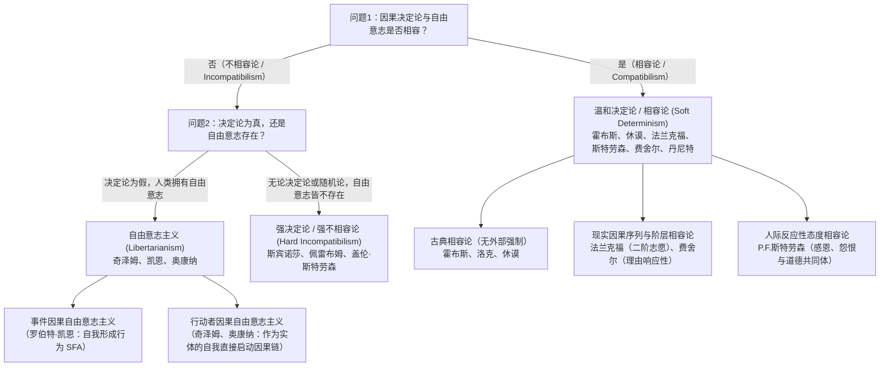
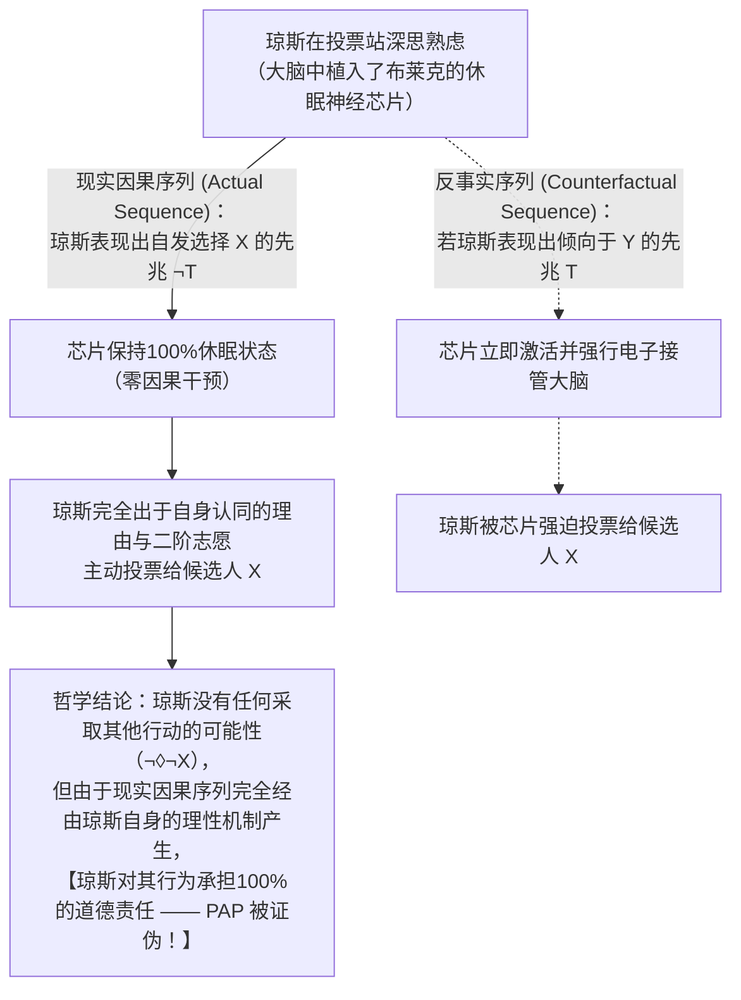

## 1. 导论：因果决定论、自由意志与道德责任的古典三难困境

当你此刻决定滑动屏幕继续阅读，或是伸手拿起桌上的咖啡杯时，我们在日常生活的每一瞬间都沉浸在一种强烈的<strong>能动感（Sense of Agency）</strong>之中：我们确信“我原本可以不滑动屏幕，也可以选择喝水而不是咖啡；是我凭自己的自由意志做出了这个决定”。这种信念构成了现代法律体系、道德赞扬与谴责、契约精神、内疚与感恩的基石。当法官宣判被告有罪时，其暗含的前提是：被告本可以遵守法律，但出于自由意志选择了犯罪，因此应当承担道德与法律责任。

然而，一旦我们从自然科学的视角审视人类，这种日常直觉便与物理宇宙的因果结构发生剧烈碰撞。你手指肌肉的收缩源于运动神经元的动作电位，神经元的放电取决于前额叶皮层与基底核突触间神经递质的释放，而这些电化学过程又严格遵循麦克斯韦电磁方程、热力学与量子力学定律。人类大脑不过是由约 $8.6 \times 10^{10}$ 个神经元和 $10^{26}$ 个原子组成的物理系统。如果宇宙中的每一个物理事件都由先前的物理状态与自然法则完全决定，那么我们引以为傲的“自由决断”，难道不只是自宇宙大爆炸（Big Bang）以来长达138亿年的巨大因果多米诺骨牌中的一环吗？

17世纪唯理主义哲学家<strong>巴鲁赫·斯宾诺莎（Baruch Spinoza）</strong>在1674年的信件（第58封信）中，曾用著名的<strong>“飞石之喻”</strong>揭示了这一困境：假设一块被外力抛向空中的石头突然拥有了意识，由于它只意识到自己正在向前飞行的努力，却对投掷它的外部原因一无所知，石头便会自豪地宣称：“我是凭自己完全自由的意志在飞翔！”斯宾诺莎指出，人类之所以自以为自由，仅仅是因为“他们意识到自己的行为，却对决定这些行为的原因一无所知”。

### 拉普拉斯妖与因果决定论的模态形式化

1814年，法国数学家、天文学家<strong>皮埃尔-西蒙·拉普拉斯（Pierre-Simon Laplace）</strong>在《概率的哲学试论》导言中提出了著名的<strong>“拉普拉斯妖（Laplace's Demon）”</strong>思想实验：如果存在一个全知智能，在某一瞬间知晓驱动自然界的一切力以及构成自然界的一切物体的位置，并拥有足够庞大的计算能力，那么宇宙中最大天体的运行与最微小原子的运动都将包含在同一条公式之中；对于它而言，没有任何事物是不确定的，未来就像过去一样历历在目。

在当代分析形而上学中，<strong>因果决定论（Causal Determinism）</strong>通过模态逻辑（Modal Logic）被严格定义为：设 $P_0$ 为描述人类诞生之前的遥远过去某一时刻 $t_0$（例如10亿年前）整个宇宙完整微观物理状态的真命题，$L$ 为所有真实基本自然法则的合取（Conjunction），$P$ 为描述未来任意时刻 $t$ 发生的某一事件或人类行为（例如“你在时刻 $t$ 举起右手”）的真命题。决定论主张以下必然蕴涵关系成立：

$$\Box \bigl( (P_0 \land L) \to P \bigr)$$

其中 $\Box$ 代表形而上学必然性（“在所有可能世界中为真”）。即：在任何与现实世界拥有完全相同的远古过去 $P_0$ 和完全相同的自然法则 $L$ 的可能世界中，未来的每一个行为 $P$ 都只有唯一确定的结果。

### 自由意志的 $2 \times 2$ 理论图谱

围绕“决定论、自由意志与道德责任”的冲突，当代哲学分化为<strong>不相容论（Incompatibilism）</strong>与<strong>相容论（Compatibilism）</strong>两大阵营及四个核心立场：

| 哲学立场 | 决定论与自由是否相容？ | 自由意志是否存在？ | 终极道德责任是否存在？ | 自由的核心条件 | 代表哲学家 |
| :--- | :---: | :---: | :---: | :--- | :--- |
| <strong>强决定论 / 强不相容论</strong> (Hard Incompatibilism) | 否（不相容） | 否 | 否（报应性惩罚不公正） | 终极自因（*Causa Sui*），但在逻辑上不可能 | 斯宾诺莎、德克·佩雷布姆、盖伦·斯特劳森 |
| <strong>自由意志主义</strong> (Libertarianism) | 否（不相容） | 是 | 是 | 非决定论的“采取其他行动的可能性”及终极起源 | 罗德里克·奇泽姆、罗伯特·凯恩、蒂莫西·奥康纳 |
| <strong>古典相容论（温和决定论）</strong> (Classical Compatibilism) | 是（相容） | 是 | 是 | 不存在锁链或威胁等“外部强制”，按自身欲望行动 | 托马斯·霍布斯、约翰·洛克、大卫·休谟 |
| <strong>当代相容论 / 半相容论</strong> (Contemporary / Semicompatibilism) | 是（相容） | 是 | 是（取决于现实因果序列） | 一阶欲望与二阶志愿的契合（法兰克福）、适度理由响应性（费舍尔） | 哈里·法兰克福、P.F.斯特劳森、约翰·马丁·费舍尔、丹尼尔·丹尼特 |

---

## 2. 彼得·范·因瓦根的不相容论主论证：“后承论证（The Consequence Argument）”

在1983年的经典著作《论自由意志（*An Essay on Free Will*）》中，美国哲学家<strong>彼得·范·因瓦根（Peter van Inwagen）</strong>提出了复兴当代不相容论的最强论证——<strong>“后承论证（The Consequence Argument）”</strong>。其直觉核心极其有力：

> “如果决定论是真的，那么我们的行为就是自然法则与遥远过去事件的后承（consequence）。但我们出生之前发生了什么并不由我们决定（not up to us），自然法则是什么也不由我们决定。因此，这些事物的后承（包括我们现在的行为）同样不由我们决定。”

### 模态算子 $\mathcal{N}$ 与推理规则 $\alpha \cdot \beta$

为了将这一直觉严格形式化，范·因瓦根引入了行动模态算子 $\mathcal{N} p$：

$$\mathcal{N} p \iff \text{“命题 } p \text{ 为真，且没有任何人类行动者现在或曾经对 } p \text{ 是否为真拥有任何选择余地（No choice about } p\text{）。”}$$

算子 $\mathcal{N}$ 遵循两条基本推理规则：
1. <strong>规则 $\alpha$（从逻辑必然性到无能为力）</strong>：
   $$\frac{\Box p}{\mathcal{N} p}$$
   如果命题 $p$ 在逻辑或形而上学上是必然真理（如 $2+2=4$），那么没有任何人能对 $p$ 是否为真拥有选择余地。
2. <strong>规则 $\beta$（无能为力的传递性 / Transfer of Powerlessness）</strong>：
   $$\frac{\mathcal{N} p, \quad \mathcal{N}(p \to q)}{\mathcal{N} q}$$
   如果 $p$ 为真且无人能改变（$\mathcal{N} p$），同时条件命题 $(p \to q)$ 也为真且无人能改变（$\mathcal{N}(p \to q)$），那么后件 $q$ 也必然为真且无人能改变（$\mathcal{N} q$）。

### 后承论证的七步形式推导

设 $P_0$ 为远古时代 $t_0$ 的宇宙物理状态，$L$ 为自然法则的合取，$P$ 为你现在时刻 $t$ 举起右手的真命题：

$$\begin{aligned}
1.\quad &\Box \bigl( (P_0 \land L) \to P \bigr) &&\text{【前提1：因果决定论的定义】} \\
2.\quad &\Box \bigl( P_0 \to (L \to P) \bigr) &&\text{【由1经命题逻辑输出律（Exportation）变形】} \\
3.\quad &\mathcal{N} \bigl( P_0 \to (L \to P) \bigr) &&\text{【对2应用推理规则 } \alpha\text{】} \\
4.\quad &\mathcal{N} P_0 &&\text{【前提2：过去固定性原理（无人能改变恐龙之前的远古过去）】} \\
5.\quad &\mathcal{N} (L \to P) &&\text{【对3和4应用推理规则 } \beta\text{】} \\
6.\quad &\mathcal{N} L &&\text{【前提3：法则固定性原理（无人能违背物理定律创造奇迹）】} \\
7.\quad &\mathcal{N} P &&\text{【对5和6应用推理规则 } \beta \text{ —— 证毕（Q.E.D.）】}
\end{aligned}$$

步骤7的结论 $\mathcal{N} P$ 表明：<strong>你此刻举起右手，而包括你在内的任何人类对此都没有任何选择余地！</strong>

### 相容论者的反击：大卫·刘易斯的“局部奇迹”与对规则 $\beta$ 的反例

1. <strong>大卫·刘易斯（David Lewis, 1981）《我们有打破法则的自由吗？（*Are We Free to Break the Laws?*）》</strong>：
   刘易斯指出前提3（$\mathcal{N} L$）混淆了<strong>强能力（Strong Ability）</strong>与<strong>弱反事实能力（Weak Counterfactual Ability）</strong>。人类当然没有在<strong>强意义</strong>上直接制造违背物理定律事件（如超光速奔跑）的超自然因果能力；但在刘易斯的可能世界反事实语义学中，“如果我刚才没有举手（$\neg P$）”所对应的最邻近可能世界，并不是把历史一直改写回宇宙大爆炸 $P_0$ 的世界，而是在我做出决定之前的几毫秒，大脑突触中自发出现了一个极其微小的<strong>“局部背离奇迹（Local divergence miracle）”</strong>从而偏离了现实世界法则 $L$ 的可能世界。因此，在弱反事实意义上，如果我做出了不同行为，法则 $L$ 就会在事前发生微小偏离（即 $\mathcal{N}_{\text{weak}} L$ 为假），这被称为<strong>“局部奇迹相容论”</strong>。
2. <strong>麦凯与约翰逊（McKay & Johnson, 1996）对规则 $\beta$ 的形式反驳</strong>：
   他们证明规则 $\alpha$ 与规则 $\beta$ 会逻辑蕴涵<strong>合取聚集律（Agglomeration）：$\mathcal{N} p, \mathcal{N} q \vdash \mathcal{N}(p \land q)$</strong>。然而，假设你手里有一枚均匀硬币，你可以自由选择是否抛硬币，但一旦抛出则正反面完全随机；事实上<strong>你选择不抛硬币</strong>。令 $p=$“硬币没有正面朝上”，$q=$“硬币没有反面朝上”。此时 $\mathcal{N} p$ 为真（因为即使你抛了也无法保证正面朝上），$\mathcal{N} q$ 也为真（无法保证反面朝上），但 <strong>$\mathcal{N}(p \land q)$ 却为假</strong>！因为 $(p \land q)$ 等价于“没有抛硬币”，而你完全有能力通过抛硬币来确保 $\neg(p \land q)$（必有一面朝上）发生！这一著名反例迫使不相容论者对算子 $\mathcal{N}$ 进行大幅修正。

---

## 3. 量子力学的不确定性能拯救自由意志吗？“运气论证”与斯特劳森的基本论证

许多人试图诉诸20世纪的<strong>量子力学（Quantum Mechanics）</strong>来拯救自由意志：既然微观粒子的波函数坍缩遵循<strong>玻恩定则（Born Rule）</strong>的概率分布：

$$|\psi\rangle = c_1 |\text{放电：选择行为 } A\rangle + c_2 |\text{不放电：选择行为 } B\rangle, \quad |c_1|^2 + |c_2|^2 = 1$$

且贝尔定理证明不存在局部隐变量，拉普拉斯妖便彻底失效了。然而，当代行动哲学家指出，<strong>单纯的量子随机性非但不能拯救自由意志，反而会彻底摧毁理性能动性</strong>。

### “运气论证 / 心灵论证（The Luck / Mind Argument）”

假设你在面临“揭发腐败（$A$）”还是“收受贿赂（$B$）”的道德抉择时，大脑前额叶神经元的放电与否取决于一个概率为 $50\%$ 的量子跃迁。如果直到坍缩发生前的最后一微秒，你的性格、记忆、信念、价值观与道德推理完全无法决定选择 $A$ 还是 $B$，而是由一次<strong>无原因的纯随机量子掷骰子</strong>来一锤定音，那么这怎么能叫“由你的理性与意志所控制”呢？把拉普拉斯妖的“铁链”换成“量子赌场的轮盘赌”，只是把决定论的木偶变成了随机抽搐的木偶。
* <strong>范·因瓦根的“回滚论证（Rollback Argument, 2000）”与阿尔弗雷德·米尔（Alfred Mele, 2006）的“跨世界运气”</strong>：假设全能的上帝将宇宙时间回滚到爱丽丝做出决定的1毫秒前，并从完全相同的物理和心理状态重播1,000次。结果爱丽丝在500次重播中说真话，在500次重播中说谎。比较第1次重播（说真话的爱丽丝）与第2次重播（说谎的爱丽丝）：直到决断瞬间为止，两者的思想、品格与努力程度100%完全相同，区分两者的仅仅是纯粹的<strong>运气（Luck）</strong>，任何人都无法为纯运气的结果承担道德责任。

### 自由意志主义的回应与盖伦·斯特劳森的“基本论证（Basic Argument）”

为了克服运气论证，当代自由意志主义者提出了两条路径：
1. <strong>罗伯特·凯恩（Robert Kane, 1996）的“自我形成行为（Self-Forming Actions, SFAs）”</strong>：当行动者处于强烈的道德内心挣扎（如道德义务与个人野心的撕裂）时，大脑中两个竞争的神经网络处于非平衡热力学混沌状态，放大了量子不确定性。由于行动者同时在为这两个目标付出积极的意志努力（Dual efforts of will），无论哪一方最终突破阈值获胜，都是行动者基于自身理由有意追求的结果（<strong>复数自愿控制 / Plural Voluntary Control</strong>）。
2. <strong>奇泽姆与奥康纳（Chisholm & O'Connor）的“行动者因果（Agent-Causation）”</strong>：拒绝将一切因果还原为“事件导致事件（$E_1 \to E_2$）”，主张作为理性实体的自我（Agent $S$）能够作为“不被推动的第一推动者（Prime Mover Unmoved）”直接启动新的因果链（$S \xrightarrow{\text{agent-causes}} A$）。

然而，英国哲学家<strong>盖伦·斯特劳森（Galen Strawson, 1994）</strong>提出了超越物理学之争的<strong>“基本论证（The Basic Argument）”</strong>，证明终极道德责任在逻辑上是不可能的：
1. 你采取行为 $A$，是因为你在心理与品格上是某种特定的人（心理状态 $M_1$）。
2. 要对行为 $A$ 负有终极道德责任，你必须对自己成为 $M_1$ 这样的人负有终极责任。
3. 但要对 $M_1$ 负责，你必须在过去有意识地选择将自己塑造成 $M_1$，而这又预设了你当时已经拥有一套据以进行选择的先前价值原则 $M_0$。
4. 要对 $M_0$ 负责，你又必须基于更早的 $M_{-1}$ 选择了 $M_0$……从而陷入<strong>恶性无限倒退（$A \leftarrow M_1 \leftarrow M_0 \leftarrow M_{-1} \leftarrow \cdots$）</strong>，最终必然追溯到你出生时的基因与早期童年环境——而那绝不是你自己选择的！
5. <strong>结论</strong>：没有任何存在能够成为<strong>“自因（*Causa Sui*，自我创造的原因）”</strong>。因此，无论宇宙是决定论还是非决定论，终极道德责任在逻辑上都不可能成立。

---

## 4. 相容论的革命：从霍布斯、休谟到法兰克福反例

面对自因（*Causa Sui*）的逻辑绝境，<strong>相容论（Compatibilism）</strong>实现了哥白尼式的视角转换：自由意志与道德责任根本不需要违背物理因果律！

### 古典相容论（霍布斯、洛克、休谟）

<strong>大卫·休谟（David Hume）</strong>在1748年《人类理解研究》第8章《论自由与必然》中指出，自由的对立面不是“因果必然性”，而是锁链与暴力威胁等<strong>“外部强制（Coercion）”</strong>。自由就是“按照意志的决定去行动或不行动的能力”。更重要的是，休谟指出：<strong>只有当一个人的行为是由他持久的品格、动机与信念因果地决定时，我们才能就该行为赞扬或谴责他！</strong> 如果一个行为与行动者的品格毫无因果关联，纯粹由偶然随机产生，那么行为一旦结束，行动者身上便不留任何道德污点，道德责任反而彻底瓦解。然而，古典相容论难以解释<strong>内部强迫（Internal Compulsion）</strong>——例如毒瘾发作的瘾君子或盗窃癖患者虽然没有外在锁链，却依然是不自由的。

### 哈里·法兰克福（1969）对“采取其他行动可能性原理（PAP）”的颠覆

两千年来，不相容论者与古典相容论者都默认了一条公理——<strong>采取其他行动可能性原理（Principle of Alternate Possibilities, PAP）</strong>：

$$\mathbf{PAP}: \quad \text{行动者 } S \text{ 对行为 } A \text{ 负有道德责任} \implies S \text{ 当时本可以采取其他行动 } (\Diamond \neg A).$$

1969年，美国哲学家<strong>哈里·法兰克福（Harry Frankfurt）</strong>发表了划时代论文《采取其他行动的可能性与道德责任》，通过著名的<strong>“法兰克福案例（Frankfurt-Style Cases）”</strong>彻底推翻了 PAP：

* <strong>神经外科医生布莱克（Black）与选民琼斯（Jones）</strong>：布莱克希望琼斯在选举中投票给候选人 $X$。布莱克在琼斯不知情的情况下，在他大脑中植入了一枚微型神经监测与控制芯片。
* <strong>反事实干预机制</strong>：如果琼斯表现出任何倾向于投给竞争对手 $Y$ 的神经先兆信号 $T$，芯片就会立即激活，强行接管琼斯的大脑并迫使他投给 $X$；反之，如果琼斯表现出先兆 $\neg T$ 并完全出于自己的意愿决定投给 $X$，芯片将<strong>完全保持休眠状态（Dormant）</strong>，绝不产生任何因果干预。
* <strong>实际发生的过程</strong>：投票当天，琼斯经过深思熟虑，完全出于自己的政治信念主动决定投票给 $X$，芯片自始至终从未启动！

这一思想实验震撼了整个哲学界：琼斯在所有可能分支中都只能投给 $X$（他<strong>无法采取其他行动</strong>），但他依然对自己的投票行为负有<strong>100%的道德责任</strong>！这证明：<strong>道德责任并不取决于非现实的反事实分支中“本可能发生什么”，而仅仅取决于现实因果序列（Actual Causal Sequence）中行为是如何产生的！</strong> 即便因果决定论像休眠芯片一样封死了其他可能性分支，只要现实行为源自行动者自身的理性机制，自由与责任就毫发无损。（针对不相容论者提出的“二难防卫 / Dilemma Defense”，德克·佩雷布姆通过将触发信号设定为“采取其他行动的必要条件而非充分条件”的“逃税案例”，以及约翰·马丁·费舍尔区分“调节性控制”与“引导性控制”的<strong>半相容论 / Semicompatibilism</strong>，进一步巩固了法兰克福的核心洞见。）

---

## 5. 阶层志愿、理由响应性、反应性态度与神经科学的挑战

在排除 PAP 之后，当代相容论建立起了四大支柱来正面界定自由行动的内部结构，并有力回应了实验神经科学的挑战：

1. <strong>法兰克福的“阶层欲望契合理论（Hierarchical Mesh Theory, 1971）”</strong>：
   人类作为“人格（Person）”区别于盲目追随冲动的“任性者（Wanton）”与动物的根本特征，在于不仅拥有直接指向行动的<strong>一阶欲望（First-Order Desires）</strong>，还拥有自我反思的<strong>二阶志愿（Second-Order Volitions）</strong>——即“希望哪一个一阶欲望成为自己实际生效的意志（Will）”。<strong>不情愿的瘾君子（Unwilling Addict）</strong>之所以不自由，是因为他渴望戒毒的二阶志愿与驱使他吸毒的一阶冲动发生了异化与分裂；相反，<strong>心甘情愿的瘾君子（Willing Addict）</strong>或自律的理性行动者，其一阶有效意志与二阶志愿达成了全心全意的和谐契合（Wholehearted Identification & Mesh）。（加里·沃森 Gary Watson 进一步将其深化为“欲望系统”与“价值判断系统”的契合。）
2. <strong>费舍尔与拉维扎的“适度理由响应性（Moderate Reasons-Responsiveness, 1998）”</strong>：
   为了回应“如果洗脑者同时植入一阶欲望与二阶志愿怎么办”的操纵论证（Manipulation Argument），约翰·马丁·费舍尔与马克·拉维扎指出，引导性控制要求产生行为的<strong>现实机制 $M$</strong> 具备：（a）<strong>理由接受性（Receptivity）</strong>——能够系统地识别反事实情境中的充分道德与实践理由；（b）<strong>理由反应性（Reactivity）</strong>——在至少部分存在充分相反理由的反事实世界中，能够将这种识别转化为不同的行动。强迫症或精神妄想机制对理由是僵化盲目的，而正常人的实践推理机制即使在决定论宇宙中也具备灵活的理由响应性。
3. <strong>P.F.斯特劳森的《自由与怨恨（*Freedom and Resentment*, 1962）》与人际反应性态度</strong>：
   P.F.斯特劳森指出，道德责任并非建立在抽象形而上学假设之上，而是内在于人类社会交往中的<strong>参与性反应性态度（Participant Reactive Attitudes）</strong>——如面对恶意伤害时的<strong>怨恨（Resentment）</strong>、面对善意帮助时的<strong>感恩（Gratitude）</strong>、<strong>义愤（Indignation）</strong>、<strong>内疚</strong>与<strong>宽恕</strong>。只有面对幼儿或重度精神分裂症患者时，我们才会悬置反应性态度，转而采取将其视为管理与治疗对象的<strong>客观态度（Objective Attitude）</strong>。要求人类因为物理学决定论而永远对所有亲友与同胞放弃感恩、怨恨与爱，一律采取冷酷的临床客观态度，不仅在心理学上是不可能的，在实践理性上也是自毁人性的荒谬之举。
4. <strong>本杰明·利贝特（Benjamin Libet, 1983）准备电位实验与当代神经科学的彻底反驳</strong>：
   1983年，利贝特通过脑电图（EEG）发现，受试者随意弯曲手腕时，大脑辅助运动区（SMA）的<strong>准备电位（Readiness Potential, RP）</strong>在肌肉运动前约 $-550\text{ ms}$ 就已升起，而受试者意识到“想要动手”的主观时间（<strong>W-time</strong>）却在 $-200\text{ ms}$ 左右，似乎“无意识大脑比你有意识的决定早了350毫秒”（利贝特本人则保留了最后 $150\text{ ms}$ 的有意识否决权 <strong>“Free Won't”</strong>）。
   然而，这一轰动性结论遭到了哲学家与当代神经科学家的双重证伪：
   * <strong>阿尔弗雷德·米尔（2009）与丹尼尔·丹尼特（2003）的哲学批判</strong>：没有任何理由地随机动一下手腕，与人类在现实道德生活中权衡长远理由的深思熟虑毫无共同之处（Uri Maoz 等人2019年的实验证实，当受试者进行有意义的慈善捐款抉择时，早期准备电位 RP 完全消失！）；此外，“大脑比你先做决定”暗中预设了荒谬的笛卡尔二元论，殊不知<strong>进行权衡的大脑神经系统正是你自己</strong>！
   * <strong>阿伦·舒尔格（Aaron Schurger et al., 2012, *PNAS*）的“随机累积器模型（Stochastic Accumulator Model）”</strong>：舒尔格团队证明，$-550\text{ ms}$ 的准备电位根本不是什么“无意识的预先决定”，而是大脑运动皮层原本就存在的<strong>自发背景粉红噪声（$1/f$ 神经随机涨落）</strong>！当实验者将几十次跨过放电阈值的时刻对齐在 $t=0$ 并向过去做逆向平均（Time-locked averaging）时，任何随机游走涨落在数学上都会必然呈现出一条看似提前半秒平滑上升的伪影曲线！真正的运动承诺恰恰发生在大约 $-200\text{ ms}$ 跨越阈值的瞬间，与主观意识完全同步！

---

## 6. 结论：刑事司法改革与拉普拉斯妖之后的人类自主性

综上所述，如果我们把自由意志定义为脱离宇宙因果网、无中生有创造自身的超自然<strong>自因（*Causa Sui*）</strong>，那么正如后承论证、运气论证与盖伦·斯特劳森的基本论证所示，这种幻影在任何宇宙中都不可能存在。德克·佩雷布姆与格雷格·卡鲁索（Gregg Caruso）由此主张在刑事司法中废除纯粹报应主义（Retributivism），代之以人道的<strong>“公共卫生隔离与康复模型（Public Health Quarantine Model）”</strong>，将司法重心转向保护社会安全、改造康复与消除犯罪的社会根源。

但与此同时，从休谟、P.F.斯特劳森到法兰克福、费舍尔与丹尼特的<strong>现代相容论</strong>向我们揭示：真正值得珍视的人类自由，绝不是违背物理定律的奇迹，也不是脑内的量子轮盘赌，而是<strong>在物理因果秩序之中涌现出的高级理性自治能力</strong>——即我们的行动源自二阶价值观与一阶欲望的深层契合，能够对客观道德理由做出灵活响应，并在充满感恩、怨恨与相互尊重的道德共同体中作为自治的人格而生活。物理定律不是囚禁自由的牢笼；恰恰因为存在稳定的因果法则，我们的深思熟虑才能可靠地引导未来的行动，使我们真正成为自己人生的作者。
