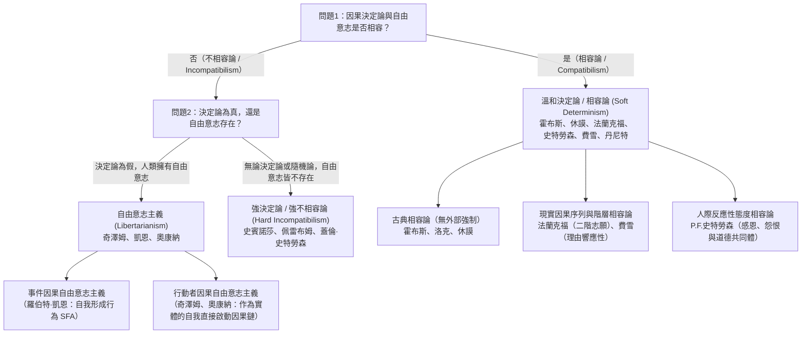
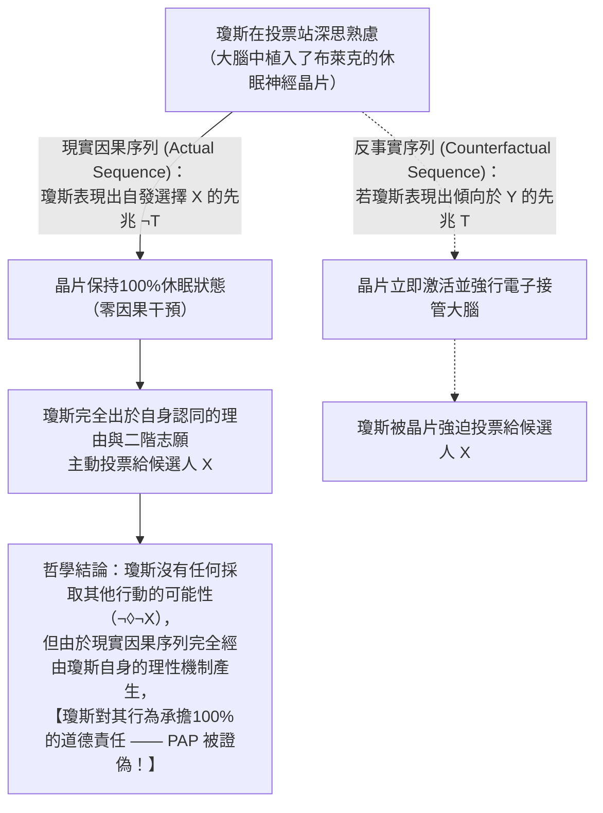

## 1. 導論：因果決定論、自由意志與道德責任的古典三難困境

當你此刻決定滑動螢幕繼續閱讀，或是伸手拿起桌上的咖啡杯時，我們在日常生活的每一瞬間都沉浸在一種強烈的<strong>能動感（Sense of Agency）</strong>之中：我們確信「我原本可以不滑動螢幕，也可以選擇喝水而不是咖啡；是我憑自己的自由意志做出了這個決定」。這種信念構成了現代法律體系、道德讚揚與譴責、契約精神、內疚與感恩的基石。當法官宣判被告有罪時，其暗含的前提是：被告本可以遵守法律，但出於自由意志選擇了犯罪，因此應當承擔道德與法律責任。

然而，一旦我們從自然科學的視角審視人類，這種日常直覺便與物理宇宙的因果結構發生劇烈碰撞。你手指肌肉的收縮源於運動神經元的動作電位，神經元的放電取決於前額葉皮質與基底核突觸間神經傳導物質的釋放，而這些電化學過程又嚴格遵循馬克士威電磁方程、熱力學與量子力學定律。人類大腦不過是由約 $8.6 \times 10^{10}$ 個神經元和 $10^{26}$ 個原子組成的物理系統。如果宇宙中的每一個物理事件都由先前的物理狀態與自然法則完全決定，那麼我們引以為傲的「自由決斷」，難道不只是自宇宙大爆炸（Big Bang）以來長達138億年的巨大因果骨牌效應中的一環嗎？

17世紀唯理主義哲學家<strong>巴魯赫·史賓諾莎（Baruch Spinoza）</strong>在1674年的信件（第58封信）中，曾用著名的<strong>「飛石之喻」</strong>揭示了這一困境：假設一塊被外力拋向空中的石頭突然擁有了意識，由於它只意識到自己正在向前飛行的努力，卻對投擲它的外部原因一無所知，石頭便會自豪地宣稱：「我是憑自己完全自由的意志在飛翔！」史賓諾莎指出，人類之所以自以為自由，僅僅是因為「他們意識到自己的行為，卻對決定這些行為的原因一無所知」。

### 拉普拉斯妖與因果決定論的模態形式化

1814年，法國數學家、天文學家<strong>皮埃爾-西蒙·拉普拉斯（Pierre-Simon Laplace）</strong>在《機率的哲學試論》導言中提出了著名的<strong>「拉普拉斯妖（Laplace's Demon）」</strong>思想實驗：如果存在一個全知智能，在某一瞬間知曉驅動自然界的一切力以及構成自然界的一切物體的位置，並擁有足夠龐大的計算能力，那麼宇宙中最大天體的運行與最微小原子的運動都將包含在同一條公式之中；對於它而言，沒有任何事物是不確定的，未來就像過去一樣歷歷在目。

在當代分析形上學中，<strong>因果決定論（Causal Determinism）</strong>透過模態邏輯（Modal Logic）被嚴格定義為：設 $P_0$ 為描述人類誕生之前的遙遠過去某一時刻 $t_0$（例如10億年前）整個宇宙完整微觀物理狀態的真命題，$L$ 為所有真實基本自然法則的合取（Conjunction），$P$ 為描述未來任意時刻 $t$ 發生的某一事件或人類行為（例如「你在時刻 $t$ 舉起右手」）的真命題。決定論主張以下必然蘊涵關係成立：

$$\Box \bigl( (P_0 \land L) \to P \bigr)$$

其中 $\Box$ 代表形上學必然性（「在所有可能世界中為真」）。即：在任何與現實世界擁有完全相同的遠古過去 $P_0$ 和完全相同的自然法則 $L$ 的可能世界中，未來的每一個行為 $P$ 都只有唯一確定的結果。

### 自由意志的 $2 \times 2$ 理論圖譜

圍繞「決定論、自由意志與道德責任」的衝突，當代哲學分化為<strong>不相容論（Incompatibilism）</strong>與<strong>相容論（Compatibilism）</strong>兩大陣營及四個核心立場：

| 哲學立場 | 決定論與自由是否相容？ | 自由意志是否存在？ | 終極道德責任是否存在？ | 自由的核心條件 | 代表哲學家 |
| :--- | :---: | :---: | :---: | :--- | :--- |
| <strong>強決定論 / 強不相容論</strong> (Hard Incompatibilism) | 否（不相容） | 否 | 否（報應性懲罰不公正） | 終極自因（*Causa Sui*），但在邏輯上不可能 | 史賓諾莎、德克·佩雷布姆、蓋倫·史特勞森 |
| <strong>自由意志主義</strong> (Libertarianism) | 否（不相容） | 是 | 是 | 非決定論的「採取其他行動的可能性」及終極起源 | 羅德里克·奇澤姆、羅伯特·凱恩、蒂莫西·奧康納 |
| <strong>古典相容論（溫和決定論）</strong> (Classical Compatibilism) | 是（相容） | 是 | 是 | 不存在鎖鏈或威脅等「外部強制」，按自身慾望行動 | 湯瑪斯·霍布斯、約翰·洛克、大衛·休謨 |
| <strong>當代相容論 / 半相容論</strong> (Contemporary / Semicompatibilism) | 是（相容） | 是 | 是（取決於現實因果序列） | 一階慾望與二階志願的契合（法蘭克福）、適度理由響應性（費雪） | 哈里·法蘭克福、P.F.史特勞森、約翰·馬丁·費雪、丹尼爾·丹尼特 |

---

## 2. 彼得·范·因瓦根的不相容論主論證：「後承論證（The Consequence Argument）」

在1983年的經典著作《論自由意志（*An Essay on Free Will*）》中，美國哲學家<strong>彼得·范·因瓦根（Peter van Inwagen）</strong>提出了復興當代不相容論的最強論證——<strong>「後承論證（The Consequence Argument）」</strong>。其直覺核心極其有力：

> 「如果決定論是真的，那麼我們的行為就是自然法則與遙遠過去事件的後承（consequence）。但我們出生之前發生了什麼並不由我們決定（not up to us），自然法則是什麼也不由我們決定。因此，這些事物的後承（包括我們現在的行為）同樣不由我們決定。」

### 模態算子 $\mathcal{N}$ 與推理規則 $\alpha \cdot \beta$

為了將這一直覺嚴格形式化，范·因瓦根引入了行動模態算子 $\mathcal{N} p$：

$$\mathcal{N} p \iff \text{「命題 } p \text{ 為真，且沒有任何人類行動者現在或曾經對 } p \text{ 是否為真擁有任何選擇餘地（No choice about } p\text{）。」}$$

算子 $\mathcal{N}$ 遵循兩條基本推理規則：
1. <strong>規則 $\alpha$（從邏輯必然性到無能為力）</strong>：
   $$\frac{\Box p}{\mathcal{N} p}$$
   如果命題 $p$ 在邏輯或形上學上是必然真理（如 $2+2=4$），那麼沒有任何人能對 $p$ 是否為真擁有選擇餘地。
2. <strong>規則 $\beta$（無能為力的傳遞性 / Transfer of Powerlessness）</strong>：
   $$\frac{\mathcal{N} p, \quad \mathcal{N}(p \to q)}{\mathcal{N} q}$$
   如果 $p$ 為真且無人能改變（$\mathcal{N} p$），同時條件命題 $(p \to q)$ 也為真且無人能改變（$\mathcal{N}(p \to q)$），那麼後件 $q$ 也必然為真且無人能改變（$\mathcal{N} q$）。

### 後承論證的七步形式推導

設 $P_0$ 為遠古時代 $t_0$ 的宇宙物理狀態，$L$ 為自然法則的合取，$P$ 為你現在時刻 $t$ 舉起右手的真命題：

$$\begin{aligned}
1.\quad &\Box \bigl( (P_0 \land L) \to P \bigr) &&\text{【前提1：因果決定論的定義】} \\
2.\quad &\Box \bigl( P_0 \to (L \to P) \bigr) &&\text{【由1經命題邏輯輸出律（Exportation）變形】} \\
3.\quad &\mathcal{N} \bigl( P_0 \to (L \to P) \bigr) &&\text{【對2應用推理規則 } \alpha\text{】} \\
4.\quad &\mathcal{N} P_0 &&\text{【前提2：過去固定性原理（無人能改變恐龍之前的遠古過去）】} \\
5.\quad &\mathcal{N} (L \to P) &&\text{【對3和4應用推理規則 } \beta\text{】} \\
6.\quad &\mathcal{N} L &&\text{【前提3：法則固定性原理（無人能違背物理定律創造奇蹟）】} \\
7.\quad &\mathcal{N} P &&\text{【對5和6應用推理規則 } \beta \text{ —— 證畢（Q.E.D.）】}
\end{aligned}$$

步驟7的結論 $\mathcal{N} P$ 表明：<strong>你此刻舉起右手，而包括你在內的任何人類對此都沒有任何選擇餘地！</strong>

### 相容論者的反擊：大衛·劉易斯的「局部奇蹟」與對規則 $\beta$ 的反例

1. <strong>大衛·劉易斯（David Lewis, 1981）《我們有打破法則的自由嗎？（*Are We Free to Break the Laws?*）》</strong>：
   劉易斯指出前提3（$\mathcal{N} L$）混淆了<strong>強能力（Strong Ability）</strong>與<strong>弱反事實能力（Weak Counterfactual Ability）</strong>。人類當然沒有在<strong>強意義</strong>上直接製造違背物理定律事件（如超光速奔跑）的超自然因果能力；但在劉易斯的可能世界反事實語義學中，「如果我剛才沒有舉手（$\neg P$）」所對應的最鄰近可能世界，並不是把歷史一直改寫回宇宙大爆炸 $P_0$ 的世界，而是在我做出決定之前的幾毫秒，大腦突觸中自發出現了一個極其微小的<strong>「局部背離奇蹟（Local divergence miracle）」</strong>從而偏離了現實世界法則 $L$ 的可能世界。因此，在弱反事實意義上，如果我做出了不同行為，法則 $L$ 就會在事前發生微小偏離（即 $\mathcal{N}_{\text{weak}} L$ 為假），這被稱為<strong>「局部奇蹟相容論」</strong>。
2. <strong>麥凱與強森（McKay & Johnson, 1996）對規則 $\beta$ 的形式反駁</strong>：
   他們證明規則 $\alpha$ 與規則 $\beta$ 會邏輯蘊涵<strong>合取聚集律（Agglomeration）：$\mathcal{N} p, \mathcal{N} q \vdash \mathcal{N}(p \land q)$</strong>。然而，假設你手裡有一枚均勻硬幣，你可以自由選擇是否拋硬幣，但一旦拋出則正反面完全隨機；事實上<strong>你選擇不拋硬幣</strong>。令 $p=$「硬幣沒有正面朝上」，$q=$「硬幣沒有反面朝上」。此時 $\mathcal{N} p$ 為真（因為即使你拋了也無法保證正面朝上），$\mathcal{N} q$ 也為真（無法保證反面朝上），但 <strong>$\mathcal{N}(p \land q)$ 卻為假</strong>！因為 $(p \land q)$ 等價於「沒有拋硬幣」，而你完全有能力透過拋硬幣來確保 $\neg(p \land q)$（必有一面朝上）發生！這一著名反例迫使不相容論者對算子 $\mathcal{N}$ 進行大幅修正。

---

## 3. 量子力學的不確定性能拯救自由意志嗎？「運氣論證」與史特勞森的基本論證

許多人試圖訴諸20世紀的<strong>量子力學（Quantum Mechanics）</strong>來拯救自由意志：既然微觀粒子的波函數坍縮遵循<strong>玻恩定則（Born Rule）</strong>的機率分佈：

$$|\psi\rangle = c_1 |\text{放電：選擇行為 } A\rangle + c_2 |\text{不放電：選擇行為 } B\rangle, \quad |c_1|^2 + |c_2|^2 = 1$$

且貝爾定理證明不存在局部隱變數，拉普拉斯妖便徹底失效了。然而，當代行動哲學家指出，<strong>單純的量子隨機性非但不能拯救自由意志，反而會徹底摧毀理性能動性</strong>。

### 「運氣論證 / 心靈論證（The Luck / Mind Argument）」

假設你在面臨「揭發腐敗（$A$）」還是「收受賄賂（$B$）」的道德抉擇時，大腦前額葉神經元的放電與否取決於一個機率為 $50\%$ 的量子躍遷。如果直到坍縮發生前的最後一微秒，你的性格、記憶、信念、價值觀與道德推理完全無法決定選擇 $A$ 還是 $B$，而是由一次<strong>無原因的純隨機量子擲骰子</strong>來一錘定音，那麼這怎麼能叫「由你的理性與意志所控制」呢？把拉普拉斯妖的「鐵鏈」換成「量子賭場的輪盤賭」，只是把決定論的木偶變成了隨機抽搐的木偶。
* <strong>范·因瓦根的「回滾論證（Rollback Argument, 2000）」與阿爾弗雷德·米爾（Alfred Mele, 2006）的「跨世界運氣」</strong>：假設全能的上帝將宇宙時間回滾到愛麗絲做出決定的1毫秒前，並從完全相同的物理和心理狀態重播1,000次。結果愛麗絲在500次重播中說真話，在500次重播中說謊。比較第1次重播（說真話的愛麗絲）與第2次重播（說謊的愛麗絲）：直到決斷瞬間為止，兩者的思想、品格與努力程度100%完全相同，區分兩者的僅僅是純粹的<strong>運氣（Luck）</strong>，任何人都無法為純運氣的結果承擔道德責任。

### 自由意志主義的回應與蓋倫·史特勞森的「基本論證（Basic Argument）」

為了克服運氣論證，當代自由意志主義者提出了兩條路徑：
1. <strong>羅伯特·凱恩（Robert Kane, 1996）的「自我形成行為（Self-Forming Actions, SFAs）」</strong>：當行動者處於強烈的道德內心掙扎（如道德義務與個人野心的撕裂）時，大腦中兩個競爭的神經網路處於非平衡熱力學混沌狀態，放大了量子不確定性。由於行動者同時在為這兩個目標付出積極的意志努力（Dual efforts of will），無論哪一方最終突破閾值獲勝，都是行動者基於自身理由有意追求的結果（<strong>複數自願控制 / Plural Voluntary Control</strong>）。
2. <strong>奇澤姆與奧康納（Chisholm & O'Connor）的「行動者因果（Agent-Causation）」</strong>：拒絕將一切因果還原為「事件導致事件（$E_1 \to E_2$）」，主張作為理性實體的自我（Agent $S$）能夠作為「不被推動的第一推動者（Prime Mover Unmoved）」直接啟動新的因果鏈（$S \xrightarrow{\text{agent-causes}} A$）。

然而，英國哲學家<strong>蓋倫·史特勞森（Galen Strawson, 1994）</strong>提出了超越物理學之爭的<strong>「基本論證（The Basic Argument）」</strong>，證明終極道德責任在邏輯上是不可能的：
1. 你採取行為 $A$，是因為你在心理與品格上是某種特定的人（心理狀態 $M_1$）。
2. 要對行為 $A$ 負有終極道德責任，你必須對自己成為 $M_1$ 這樣的人負有終極責任。
3. 但要對 $M_1$ 負責，你必須在過去有意識地選擇將自己塑造成 $M_1$，而這又預設了你當時已經擁有一套據以進行選擇的先前價值原則 $M_0$。
4. 要對 $M_0$ 負責，你又必須基於更早的 $M_{-1}$ 選擇了 $M_0$……從而陷入<strong>惡性無限倒退（$A \leftarrow M_1 \leftarrow M_0 \leftarrow M_{-1} \leftarrow \cdots$）</strong>，最終必然追溯到你出生時的基因與早期童年環境——而那絕不是你自己選擇的！
5. <strong>結論</strong>：沒有任何存在能夠成為<strong>「自因（*Causa Sui*，自我創造的原因）」</strong>。因此，無論宇宙是決定論還是非決定論，終極道德責任在邏輯上都不可能成立。

---

## 4. 相容論的革命：從霍布斯、休謨到法蘭克福反例

面對自因（*Causa Sui*）的邏輯絕境，<strong>相容論（Compatibilism）</strong>實現了哥白尼式的視角轉換：自由意志與道德責任根本不需要違背物理因果律！

### 古典相容論（霍布斯、洛克、休謨）

<strong>大衛·休謨（David Hume）</strong>在1748年《人類理解研究》第8章《論自由與必然》中指出，自由的對立面不是「因果必然性」，而是鎖鏈與暴力威脅等<strong>「外部強制（Coercion）」</strong>。自由就是「按照意志的決定去行動或不行動的能力」。更重要的是，休謨指出：<strong>只有當一個人的行為是由他持久的品格、動機與信念因果地決定時，我們才能就該行為讚揚或譴責他！</strong> 如果一個行為與行動者的品格毫無因果關聯，純粹由偶然隨機產生，那麼行為一旦結束，行動者身上便不留任何道德污點，道德責任反而徹底瓦解。然而，古典相容論難以解釋<strong>內部強迫（Internal Compulsion）</strong>——例如毒癮發作的癮君子或盜竊癖患者雖然沒有外在鎖鏈，卻依然是不自由的。

### 哈里·法蘭克福（1969）對「採取其他行動可能性原理（PAP）」的顛覆

兩千年來，不相容論者與古典相容論者都預設了一條公理——<strong>採取其他行動可能性原理（Principle of Alternate Possibilities, PAP）</strong>：

$$\mathbf{PAP}: \quad \text{行動者 } S \text{ 對行為 } A \text{ 負有道德責任} \implies S \text{ 當時本可以採取其他行動 } (\Diamond \neg A).$$

1969年，美國哲學家<strong>哈里·法蘭克福（Harry Frankfurt）</strong>發表了劃時代論文《採取其他行動的可能性與道德責任》，透過著名的<strong>「法蘭克福案例（Frankfurt-Style Cases）」</strong>徹底推翻了 PAP：

* <strong>神經外科醫生布萊克（Black）與選民瓊斯（Jones）</strong>：布萊克希望瓊斯在選舉中投票給候選人 $X$。布萊克在瓊斯不知情的情況下，在他大腦中植入了一枚微型神經監測與控制晶片。
* <strong>反事實干預機制</strong>：如果瓊斯表現出任何傾向於投給競爭對手 $Y$ 的神經先兆信號 $T$，晶片就會立即激活，強行接管瓊斯的大腦並迫使他投給 $X$；反之，如果瓊斯表現出先兆 $\neg T$ 並完全出於自己的意願決定投給 $X$，晶片將<strong>完全保持休眠狀態（Dormant）</strong>，絕不產生任何因果干預。
* <strong>實際發生的過程</strong>：投票當天，瓊斯經過深思熟慮，完全出於自己的政治信念主動決定投票給 $X$，晶片自始至終從未啟動！

這一思想實驗震撼了整個哲學界：瓊斯在所有可能分支中都只能投給 $X$（他<strong>無法採取其他行動</strong>），但他依然對自己的投票行為負有<strong>100%的道德責任</strong>！這證明：<strong>道德責任並不取決於非現實的反事實分支中「本可能發生什麼」，而僅僅取決於現實因果序列（Actual Causal Sequence）中行為是如何產生的！</strong> 即便因果決定論像休眠晶片一樣封死了其他可能性分支，只要現實行為源自行動者自身的理性機制，自由與責任就毫髮無損。（針對不相容論者提出的「二難防衛 / Dilemma Defense」，德克·佩雷布姆透過將觸發信號設定為「採取其他行動的必要條件而非充分條件」的「逃稅案例」，以及約翰·馬丁·費雪區分「調節性控制」與「引導性控制」的<strong>半相容論 / Semicompatibilism</strong>，進一步鞏固了法蘭克福的核心洞見。）

---

## 5. 階層志願、理由響應性、反應性態度與神經科學的挑戰

在排除 PAP 之後，當代相容論建立起了四大支柱來正面界定自由行動的內部結構，並有力回應了實驗神經科學的挑戰：

1. <strong>法蘭克福的「階層慾望契合理論（Hierarchical Mesh Theory, 1971）」</strong>：
   人類作為「人格（Person）」區別於盲目追隨衝動的「任性者（Wanton）」與動物的根本特徵，在於不僅擁有直接指向行動的<strong>一階慾望（First-Order Desires）</strong>，還擁有自我反思的<strong>二階志願（Second-Order Volitions）</strong>——即「希望哪一個一階慾望成為自己實際生效的意志（Will）」。<strong>不情願的癮君子（Unwilling Addict）</strong>之所以不自由，是因為他渴望戒毒的二階志願與驅使他吸毒的一階衝動發生了異化與分裂；相反，<strong>心甘情願的癮君子（Willing Addict）</strong>或自律的理性行動者，其一階有效意志與二階志願達成了全心全意的和諧契合（Wholehearted Identification & Mesh）。（加里·沃森 Gary Watson 進一步將其深化為「慾望系統」與「價值判斷系統」的契合。）
2. <strong>費雪與拉維扎的「適度理由響應性（Moderate Reasons-Responsiveness, 1998）」</strong>：
   為了回應「如果洗腦者同時植入一階慾望與二階志願怎麼辦」的操縱論證（Manipulation Argument），約翰·馬丁·費雪與馬克·拉維扎指出，引導性控制要求產生行為的<strong>現實機制 $M$</strong> 具備：（a）<strong>理由接受性（Receptivity）</strong>——能夠系統地識別反事實情境中的充分道德與實踐理由；（b）<strong>理由反應性（Reactivity）</strong>——在至少部分存在充分相反理由的反事實世界中，能夠將這種識別轉化為不同的行動。強迫症或精神妄想機制對理由是僵化盲目的，而正常人的實踐推理機制即使在決定論宇宙中也具備靈活的理由響應性。
3. <strong>P.F.史特勞森的《自由與怨恨（*Freedom and Resentment*, 1962）》與人際反應性態度</strong>：
   P.F.史特勞森指出，道德責任並非建立在抽象形上學假設之上，而是內在於人類社會交往中的<strong>參與性反應性態度（Participant Reactive Attitudes）</strong>——如面對惡意傷害時的<strong>怨恨（Resentment）</strong>、面對善意幫助時的<strong>感恩（Gratitude）</strong>、<strong>義憤（Indignation）</strong>、<strong>內疚</strong>與<strong>寬恕</strong>。只有面對幼兒或重度思覺失調症患者時，我們才會懸置反應性態度，轉而採取將其視為管理與治療對象的<strong>客觀態度（Objective Attitude）</strong>。要求人類因為物理學決定論而永遠對所有親友與同胞放棄感恩、怨恨與愛，一律採取冷酷的臨床客觀態度，不僅在心理學上是不可能的，在實踐理性上也是自毀人性的荒謬之舉。
4. <strong>班傑明·利貝特（Benjamin Libet, 1983）準備電位實驗與當代神經科學的徹底反駁</strong>：
   1983年，利貝特透過腦電圖（EEG）發現，受試者隨意彎曲手腕時，大腦輔助運動區（SMA）的<strong>準備電位（Readiness Potential, RP）</strong>在肌肉運動前約 $-550\text{ ms}$ 就已升起，而受試者意識到「想要動手」的主觀時間（<strong>W-time</strong>）卻在 $-200\text{ ms}$ 左右，似乎「無意識大腦比你有意識的決定早了350毫秒」（利貝特本人則保留了最後 $150\text{ ms}$ 的有意識否決權 <strong>「Free Won't」</strong>）。
   然而，這一轟動性結論遭到了哲學家與當代神經科學家的雙重證偽：
   * <strong>阿爾弗雷德·米爾（2009）與丹尼爾·丹尼特（2003）的哲學批判</strong>：沒有任何理由地隨機動一下手腕，與人類在現實道德生活中權衡長遠理由的深思熟慮毫無共同之處（Uri Maoz 等人2019年的實驗證實，當受試者進行有意義的慈善捐款抉擇時，早期準備電位 RP 完全消失！）；此外，「大腦比你先做決定」暗中預設了荒謬的笛卡兒二元論，殊不知<strong>進行權衡的大腦神經系統正是你自己</strong>！
   * <strong>阿倫·舒爾格（Aaron Schurger et al., 2012, *PNAS*）的「隨機累積器模型（Stochastic Accumulator Model）」</strong>：舒爾格團隊證明，$-550\text{ ms}$ 的準備電位根本不是什麼「無意識的預先決定」，而是大腦運動皮質原本就存在的<strong>自發背景粉紅雜訊（$1/f$ 神經隨機漲落）</strong>！當實驗者將幾十次跨過放電閾值的時刻對齊在 $t=0$ 並向過去做逆向平均（Time-locked averaging）時，任何隨機遊走漲落在數學上都會必然呈現出一條看似提前半秒平滑上升的偽影曲線！真正的運動承諾恰恰發生在大約 $-200\text{ ms}$ 跨越閾值的瞬間，與主觀意識完全同步！

---

## 6. 結論：刑事司法改革與拉普拉斯妖之後的人類自主性

綜上所述，如果我們把自由意志定義為脫離宇宙因果網、無中生有創造自身的超自然<strong>自因（*Causa Sui*）</strong>，那麼正如後承論證、運氣論證與蓋倫·史特勞森的基本論證所示，這種幻影在任何宇宙中都不可能存在。德克·佩雷布姆與格雷格·卡魯索（Gregg Caruso）由此主張在刑事司法中廢除純粹報應主義（Retributivism），代之以人道的<strong>「公共衛生隔離與康復模型（Public Health Quarantine Model）」</strong>，將司法重心轉向保護社會安全、改造康復與消除犯罪的社會根源。

但與此同時，從休謨、P.F.史特勞森到法蘭克福、費雪與丹尼特的<strong>現代相容論</strong>向我們揭示：真正值得珍視的人類自由，絕不是違背物理定律的奇蹟，也不是腦內的量子輪盤賭，而是<strong>在物理因果秩序之中湧現出的高級理性自治能力</strong>——即我們的行動源自二階價值觀與一階慾望的深層契合，能夠對客觀道德理由做出靈活響應，並在充滿感恩、怨恨與相互尊重的道德共同體中作為自治的人格而生活。物理定律不是囚禁自由的牢籠；恰恰因為存在穩定的因果法則，我們的深思熟慮才能可靠地引導未來的行動，使我們真正成為自己人生的作者。
