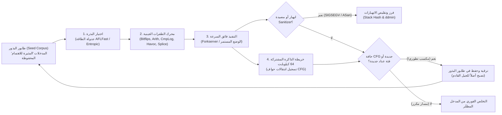

في ليلة خريفية عاصفة ومظلمة من عام 1988 في مدينة ماديسون بولاية ويسكونسن، كان أستاذ علوم الحاسوب <strong>بارتون ميلر (Barton Miller)</strong> يجلس أمام طرفيته المنزلية محاولاً الاتصال بمحطة عمل UNIX في الجامعة عبر مودم هاتفي بسرعة 1200 باود وخط هاتف تناظري. في الخارج، كانت عاصفة رعدية عنيفة تضرب المنطقة، ومع كل صاعقة برق كان التداخل الكهرومغناطيسي يحقن دفعات من الضجيج العشوائي في سلك الهاتف، مما يشوه تدفق محارف ASCII المرسلة إلى صدفة UNIX.

ما حدث بعد ذلك أذهله تماماً: فكلما أدخل ضجيج الخط سلاسل بايتات عشوائية مشوهة في أدوات UNIX القياسية العريقة — مثل `vi` و`cc` و`awk` و`sed` و`csh` و`indent` — لم تكتفِ تلك البرامج بطباعة رسالة خطأ نحوي، بل <strong>انهارت الواحدة تلو الأخرى بأخطاء التجزئة (`SIGSEGV` - Segmentation Fault) أو تجمدت في حلقات لا نهائية</strong>.

أدرك ميلر خطورة هذه الهشاشة، فكلّف طلاب الدراسات العليا ببناء مولد تدفقات محارف عشوائية أطلق عليه اسم <strong>«Fuzz» (التشويش)</strong> لاختبار نحو 90 أداة عبر سبع نسخ مختلفة من UNIX. كانت النتائج صادمة لمجتمع هندسة البرمجيات: <strong>ما بين 25% إلى 33% من جميع أدوات UNIX القياسية انهارت فوراً عند تغذيتها بتدفقات بايتات عشوائية تماماً</strong>.

وبعد مرور أكثر من خمسة وثلاثين عاماً، تطور <strong>الفحص الضبابي (Fuzzing / Fuzz Testing)</strong> من مجرد مولد ضجيج أعمى إلى أقوى تقنية آلية لاكتشاف الثغرات الأمنية في علوم الحاسوب، جامعاً بين حقن تعليمات التتبع أثناء الترجمة (Compiler Instrumentation)، والخوارزميات الجينية التطورية، وحلالات القيود المنطقية (SMT Solvers)، وتخطيط ذاكرة الظل (Shadow Memory). وقد تمكنت منصة <strong>OSS-Fuzz</strong> التابعة لشركة Google وحدها من اكتشاف <strong>أكثر من 10,000 ثغرة أمنية وأكثر من 36,000 خلل برمجي</strong> تلقائياً في مشاريع حيوية مثل OpenSSL وSQLite وFFmpeg ونواة Linux.

لماذا تفشل آلاف اختبارات الوحدات (Unit Tests) التي يكتبها البشر بعناية في رصد أخطاء تلف الذاكرة القاتلة بينما تكشفها الطفرات الآلية في دقائق؟ في هذا المقال نغوص في الأسس الرياضية والهندسية للفحص الضبابي الحديث: الانفجار التوافقي لفضاء المدخلات، النماذج الأربعة للفحص الضبابي، المعمارية الداخلية لـ <strong>AFL / AFL++ / LibFuzzer</strong> (خريطة البتات بحجم 64 كيلوبايت في خبيئة L1، والبرهان الرياضي للإزاحة `>> 1`، وخادم الاستنساخ Forkserver، وجدولة سلاسل ماركوف)، ومعمارية <strong>AddressSanitizer (ASan)</strong>، وخوارزمية <strong>التنقيح التفاضلي (`ddmin` - Delta Debugging)</strong> لأندرياس زيلر.

---

## الفصل الأول: الهاوية التوافقية لفضاء المدخلات و«تأثير عمود الإنارة»

### 1.1 مخزن مؤقت بحجم 64 بايت فقط يحتوي على $10^{154}$ احتمالاً

لماذا تعجز اختبارات الوحدات اليدوية عن القضاء على عيوب البرمجيات؟ يكمن السبب الجذري في <strong>الانفجار التوافقي الأسي لفضاء المدخلات</strong>. لنفترض دالة بسيطة بلغة C تقوم بتحليل ترويسة حزمة شبكة أو صورة بحجم $N = 64$ بايت فقط. بما أن كل بايت يتكون من 8 بتات ويحتمل $|\Sigma| = 2^8 = 256$ قيمة مختلفة، فإن إجمالي عدد المدخلات الممكنة بطول 64 بايت هو:

$$|\Sigma|^N = 256^{64} = \left(2^8\right)^{64} = 2^{512} \approx 1.34 \times 10^{154}$$

ولتصور ضخامة الرقم $1.34 \times 10^{154}$، تذكر أن «عدد إدنغتون» (إجمالي عدد البروتونات المقدر في الكون المرئي بأكمله) لا يتجاوز $\approx 10^{80}$. فلو جمعنا كل المعالجات على كوكب الأرض لاختبار تريليون ($10^{12}$) مدخل في الثانية بشكل متواصل منذ الانفجار العظيم قبل 13.8 مليار سنة، لما استطعنا استكشاف حتى جزء من $10^{-124}$ من فضاء هذا المخزن الصغير!

### 1.2 تأثير عمود الإنارة (Streetlight Effect) و«الآلة الغريبة» (Weird Machine)

عندما يكتب المبرمجون اختبارات الوحدات، فإنهم يقعون حتماً في <strong>تأثير عمود الإنارة (انحياز الملاحظة)</strong>: فمثل الشخص الذي يبحث عن مفاتيحه المفقودة ليلاً تحت ضوء عمود الإنارة فقط لأن المكان مضاء، يختبر المهندسون فقط <strong>المسارات الطبيعية المنصوص عليها في المواصفات</strong> و<strong>القيم الحدية الواضحة (`0`، `-1`، `NULL`)</strong> التي فكروا فيها مسبقاً أثناء كتابة الكود. أما الثغرات الكارثية فتختبئ في الظلام داخل ما يسميه الباحثون <strong>«الآلة الغريبة» (Weird Machine)</strong> — أي آلة الحالات الضمنية الناشئة عن طفح الأعداد الصحيحة والافتراضات الخفية للمحلل النحوي:

```c
int parse_image_chunk(const uint8_t *buf, size_t len) {
    if (len < 16) return -1;
    uint32_t magic  = *(const uint32_t *)(buf + 0);
    uint16_t width  = *(const uint16_t *)(buf + 4);
    uint16_t height = *(const uint16_t *)(buf + 6);
    uint8_t  flags  = buf[8];

    if (magic != 0x494D4721) return -1;          // يتطلب التوقيع السحري "IMG!"
    if (width == 0 || height == 0) return -1;    // اختبر المطور حالة الصفر!

    uint16_t alloc_size = width * height;        // [ثغرة] طفح عدد صحيح 16-بت!
    if (flags & 0x80) alloc_size += 16;
    uint8_t *pixel_buf = malloc(alloc_size);     // يخصص 0 أو 16 بايت فقط
    memcpy(pixel_buf, buf + 16, (size_t)width * height); // ينسخ 65536 بايت فيدمر الكومة (Heap)!
    ...
}
```

عند تمرير `width = 256` و`height = 256`، فإن حاصل الضرب $256 \times 256 = 65536 \equiv 0 \pmod{2^{16}}$ يسبب التفافاً (Wraparound) للمتغير ذي 16 بت `alloc_size` إلى الصفر، فيخصص `malloc(16)` مخزناً ضئيلاً ثم يقوم `memcpy` بالكتابة فوق 64 كيلوبايت من ذاكرة الكومة المجاورة.

---

## الفصل الثاني: النماذج الأربعة الكبرى للفحص الضبابي

لتجاوز حواجز المقارنة مثل `if (magic != 0x494D4721)` (حيث احتمال التخمين العشوائي هو $2^{-32} \approx 1 / 4.29\times 10^9$)، تطور الفحص الضبابي عبر أربعة نماذج رئيسية:

| نموذج الفحص الضبابي | الأدوات الممثلة | الرؤية الداخلية للبرنامج | آلية البحث والتوليد | نقاط القوة الأساسية | القيود والاختناقات |
| :--- | :--- | :--- | :--- | :--- | :--- |
| <strong>الصندوق الأسود</strong><br>(Black-box Fuzzing) | `fuzz` (1988), `zzuf`, `radamsa` | معدومة (صندوق مغلق) | قلب البتات العشوائي والكتابة العمياء فوق البايتات | لا يتطلب كود المصدر أو تعديل المترجم؛ سريع جداً في البدء | يعجز عن تجاوز الأرقام السحرية ($2^{-32}$) ومجاميع التحقق والتراكيب المعقدة |
| <strong>القائم على القواعد النحوية</strong><br>(Grammar-based) | `Peach`, `Syzkaller`, `LangFuzz`, `Domato` | قواعد خالية من السياق (CFG) أو توصيف نداءات النظام | يولّد ويطفّر أشجار إعراب مجردة (AST) صحيحة بنيوياً | يخترق المحللات اللغوية ليصل إلى عمق محركات JS ونواة نظام التشغيل | تكلفة بشرية عالية لكتابة القواعد؛ قد يغفل ثغرات المحلل عند الإدخال المشوه |
| <strong>الصندوق الأبيض: التنفيذ الرمزي / الهجين</strong> | `SAGE`, `KLEE`, `angr`, `Driller` | تتبع رمزي كامل للتعليمات وجمع شروط التفرع | يبني قيد المسار $\Pi$ ويعكس الفروع عبر <strong>حلال SMT (Z3)</strong> | يحل المعادلات المعقدة مثل `x == 0xdeadbeef` جبرياً في خطوة واحدة | <strong>انفجار المسارات ($2^d$)</strong> في الحلقات؛ بطء شديد في دوال التعمية والعمليات غير الخطية |
| <strong>الصندوق الرمادي الموجه بالتغطية (CGF)</strong> | <strong>`AFL`</strong>, <strong>`AFL++`</strong>, <strong>`LibFuzzer`</strong>, `Honggfuzz` | <strong>تتبع خفيف لحواف التدفق</strong> أثناء الترجمة (خريطة 64 كيلوبايت) | <strong>خوارزمية جينية تطورية</strong>: تحتفظ فقط بالبذور التي تكتشف حواف CFG جديدة | لا يحتاج لحلال SMT ثقيل؛ يحقق $10^4\text{–}10^5\text{ تنفيذ/ثانية}$ مع ارتقاء تطوري عميق | يحتاج لمساعدة CmpLog (RedQueen) أو القواميس للمقارنات المتعددة البايتات |

في التنفيذ الهجين (Concolic Execution)، تُعامل بايتات الإدخال كمتغيرات رمزية $\vec{\alpha}$ ويتم نفي شرط التفرع الأخير لإرساله إلى حلال SMT:

$$\Pi_{\text{path}} = c_1(\vec{\alpha}) \land c_2(\vec{\alpha}) \land \dots \land c_{k-1}(\vec{\alpha}) \land \neg c_k(\vec{\alpha})$$

في المقابل، قام <strong>AFL</strong> (الذي ابتكره <strong>Michał Zalewski</strong> عام 2013) و<strong>AFL++</strong> و<strong>LibFuzzer</strong> باستبدال حلالات SMT الثقيلة بالانتخاب الطبيعي الدارويني الموجه بتغطية الحواف.



---

## الفصل الثالث: داخل محرك AFL — تتبع الحواف، خريطة 64 كيلوبايت، وبرهان الإزاحة `>> 1`

### 3.1 لماذا تتفوق تغطية الحواف (Edge Coverage) على تغطية الكتل الأساسية؟

لو اكتفى الفاحص بتسجيل الكتل الأساسية (العقد) التي تمت زيارتها، فبعد تنفيذ المسار $A \to B \to C$ ستُعلَّم جميع الكتل $\{A, B, C\}$ كمزارة. وعندما يتخطى مدخل ثانٍ كتلة التهيئة $B$ متجهاً مباشرة عبر $A \to C$ (مما يسبب dereference لمؤشر فارغ في $C$)، فإن المجموعة $\{A, C\} \subset \{A, B, C\}$ ستُعتبر مكررة ويتم إهمالها! أما بتسجيل <strong>أزواج الانتقال الموجهة (الحواف)</strong> $(B_{\text{prev}} \to B_{\text{cur}})$، يكتشف AFL فوراً أن الحافة $(A \to C)$ لم تُسلَك من قبل.

### 3.2 الأسطر الثلاثة، خبيئة L1 بحجم 64 كيلوبايت، والضرورة الرياضية للإزاحة `>> 1`

يحقن مترجم AFL ثلاث عمليات فقط في بداية كل كتلة أساسية:

```c
/* Compile-time random 16-bit ID assigned to the current basic block */
cur_location = <COMPILE_TIME_RANDOM_16BIT>;

/* Record the transition edge (prev -> cur) in the 64 KB shared bitmap */
shared_mem[cur_location ^ prev_location]++;

/* Right-shift by 1 bit to preserve directionality and self-loops */
prev_location = cur_location >> 1;
```

لماذا يبلغ حجم `shared_mem` بالضبط $2^{16} = 65,536$ بايت (<strong>64 كيلوبايت</strong>)؟ لأن 64 كيلوبايت <strong>تتسع بالكامل داخل خبيئة البيانات L1/L2 لنواة المعالج الحديث</strong>، مما يمنع أي إخفاق في الخبيئة (Cache Miss) نحو ذاكرة DRAM وينجز التسجيل في نانوثانية واحدة تقريباً.

ولماذا تُعد <strong>الإزاحة لليمين بمقدار بت واحد (`>> 1`)</strong> في السطر الثالث `prev_location = cur_location >> 1;` ضرورة رياضية حتمية؟ بدون هذه الإزاحة، ستعاني عملية XOR ($\oplus$) من خللين جبريين قاتلين:

$$\text{Without shift: } \quad \text{Edge}(A \to B) = A \oplus B = B \oplus A = \text{Edge}(B \to A), \qquad \text{Edge}(A \to A) = A \oplus A = 0$$

$$\text{With 1-bit right shift: } \quad \text{Edge}(A \to B) = (A \gg 1) \oplus B \neq (B \gg 1) \oplus A = \text{Edge}(B \to A), \qquad \text{Edge}(A \to A) = (A \gg 1) \oplus A \neq 0$$

1. <strong>فقدان الاتجاه بسبب الإبدالية ($A \oplus B = B \oplus A$)</strong>: الانتقال من $A \to B$ والعودة من $B \to A$ سينتجان نفس الفهرس تماماً في خريطة البتات.
2. <strong>طمس الحلقات الذاتية بسبب خاصية التلاشي ($A \oplus A = 0$)</strong>: أي حلقة تقفز فيها الكتلة إلى نفسها ($A \to A$) ستعطي القيمة $0$ دائماً، مما يؤدي إلى تصادم جميع الحلقات الذاتية في البرنامج داخل البايت الواحد `shared_mem[0]`!

بإزاحة المعرف السابق بتاً واحداً لليمين (`>> 1`)، تنكسر التماثلية والتلاشي معاً في دورة ساعة واحدة للمعالج. كما يقوم AFL بتجميع عدادات التكرار في <strong>8 فئات لوغاريتمية ($1, 2, 3, 4\text{–}7, 8\text{–}15, 16\text{–}31, 32\text{–}127, 128\text{–}255$)</strong> لرصد مراحل توسع الحلقات دون إغراق الطابور.

### 3.3 خادم الاستنساخ (Forkserver)، الوضع المستمر، وجدولة ماركوف (AFLFast / Entropic)

للقضاء على عبء استدعاء `execve()` والرابط الديناميكي (`ld.so`) في كل مرة، يوقف <strong>Forkserver</strong> العملية قبل `main()` مباشرة ويستنسخ العمليات الأبناء عبر <strong>النسخ عند الكتابة (`fork()` Copy-on-Write)</strong> فقط باستخدام الأنابيب `fd 198`/`199`. بل إن <strong>الوضع المستمر (`LLVMFuzzerTestOneInput`)</strong> يلغي حتى `fork()` باستدعاء الدالة المستهدفة داخل حلقة في الذاكرة بسرعة تتجاوز $100,000\text{ تنفيذ/ثانية}$. ومع تقنية <strong>CmpLog (RedQueen)</strong> وجدولة الطاقة <strong>AFLFast / Entropic</strong> المبنية على سلاسل ماركوف وإنتروبيا شانون $H(s)$، يتم تركيز طاقة الطفرات على المسارات النادرة:

$$p(s) = \min\left(\frac{\alpha(s)}{\beta} \cdot \frac{2^{s_{\text{handicap}}}}{f(i)}, \; M\right), \qquad H(s) = -\sum_{e \in E(s)} \hat{p}_{s,e} \log_2 \hat{p}_{s,e}$$

---

## الفصل الرابع: تحويل تلف الذاكرة الصامت إلى انهيار فوري — معمارية Sanitizers

بما أن وحدة إدارة الذاكرة العتادية (MMU) تراقب الصلاحيات فقط على مستوى صفحات بحجم <strong>$4\text{ كيلوبايت}$</strong>، فإن تجاوز حدود الكومة بمقدار بايت واحد أو استخدام الذاكرة بعد تحريرها (Use-After-Free) نادراً ما يطلق إشارة `SIGSEGV`. يحل <strong>AddressSanitizer (ASan)</strong> هذه المشكلة عبر <strong>تخطيط ذاكرة الظل (Shadow Memory) بنسبة 1:8</strong>:

$$\text{ShadowAddr}(\text{Addr}) = (\text{Addr} \gg 3) + \text{Offset}$$

تُربط كل 8 بايتات متراصفة من ذاكرة التطبيق ببايت واحد في ذاكرة الظل: القيمة `0x00` تعني أن جميع البايتات الثمانية صالحة، والقيمة $1 \le k \le 7$ تعني أن أول $k$ بايتات فقط صالحة، بينما تشير القيم السالبة إلى <strong>المناطق الحمراء المسممة (`0xfa` للكومة، `0xf1` للمكدس)</strong> أو الذاكرة المحررة المحتجزة في <strong>طابور الحجر الصحي (`0xfd` لكشف Use-After-Free)</strong>. وقبل كل وصول للذاكرة، يدرج المترجم الفحص التالي:

```c
/* Compiler-injected ASan check before an N-byte memory access (N = 1, 2, 4) */
uintptr_t shadow_addr = (addr >> 3) + ASAN_SHADOW_OFFSET;
int8_t shadow_val = *(int8_t *)shadow_addr;

if (UNLIKELY(shadow_val != 0)) {
    /* For partial 8-byte words (1 <= shadow_val <= 7) or negative redzones */
    if (shadow_val < 0 || (int8_t)((addr & 7) + N) > shadow_val) {
        __asan_report_error(pc, bp, sp, addr, is_write, N);
    }
}
```

وبالتكامل مع <strong>UBSan</strong> (لطفح الأعداد الصحيحة والسلوك غير المعرف)، و<strong>MSan</strong> (لتتبع قراءة الذاكرة غير المهيأة بتاً ببت)، و<strong>TSan</strong> (لكشف سباقات البيانات عبر الساعات المتجهة)، و<strong>الفحص الضبابي التفاضلي (Differential Fuzzing)</strong>، يتحول أي خلل خفي فوراً إلى تقرير انهيار دقيق.

---

## الفصل الخامس: فرز الانهيارات وخوارزمية التنقيح التفاضلي (`ddmin`) لأندرياس زيلر

يتم أولاً تجميع آلاف ملفات الانهيار المكررة حسب السبب الجذري عبر حساب <strong>بصمة مكدس الاستدعاءات (Stack Hash)</strong> للإطارات العليا لحظة وقوع الخطأ. بعد ذلك، لتقليص ملف انهيار ضخم بحجم عدة ميغابايتات $c$ (بطول $N$) مليء بضجيج الطفرات إلى أصغر مثال ممكن، تعمل خوارزمية <strong>التنقيح التفاضلي (`ddmin` - Delta Debugging) لأندرياس زيلر</strong> على استخراج حالة اختبار <strong>1-صغرى (1-minimal) $c^*$</strong> بحيث يؤدي حذف أي بايت واحد إضافي منها إلى اختفاء الانهيار:

$$\forall c' \subsetneq c^* \; \text{with} \; |c^*| - |c'| = 1 : \quad \text{test}(c') \neq \text{FAIL}$$

$$T_{\text{best}}(N) = \mathcal{O}(\log_2 N), \qquad T_{\text{worst}}(N) = \frac{N^2 + 3N - 2}{2} = \mathcal{O}(N^2)$$

يقسم `ddmin` المدخل إلى $n$ أجزاء $\Delta_1, \dots, \Delta_n$ (بدءاً من $n=2$)، ويختبر أولاً كل مجموعة جزئية $\Delta_i$ بمفردها، ثم كل متممة $\nabla_i = c \setminus \Delta_i$، ويضاعف دقة التقسيم $n \leftarrow \min(2n, |c|)$ عندما لا ينجح أي تقليص مباشر. وبفضل هذا البحث الثنائي المعمم، تنجح أدوات مثل `afl-tmin` و`C-Reduce` في ضغط ملف بحجم 10 ميغابايت إلى نموذج إثبات مفهوم (PoC) لا يتجاوز بضعة بايتات في $\mathcal{O}(\log_2 N)$ خطوة فقط في أفضل الحالات.
