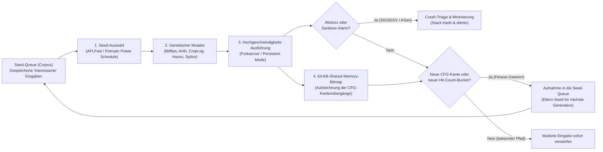

In einer stürmischen Herbstnacht im Jahr 1988 saß <strong>Barton Miller</strong>, Informatikprofessor an der University of Wisconsin–Madison, zu Hause an seinem Terminal. Über ein 1200-Baud-Modem und eine analoge Telefonleitung war er mit einer UNIX-Workstation der Universität verbunden, während draußen ein heftiges Gewitter tobte. Jeder Blitzeinschlag induzierte elektromagnetisches Rauschen in der Telefonleitung und verfälschte seine getippten Befehle durch zufällige Byte-Sequenzen.

Was dann geschah, verblüffte ihn: Immer wenn das Leitungsrauschen verstümmelte Bytes in vermeintlich ausgereifte Standard-UNIX-Werkzeuge wie `vi`, `cc`, `awk`, `sed`, `csh` oder `indent` einspeiste, gaben diese Programme nicht etwa eine saubere Fehlermeldung aus – sie <strong>stürzten reihenweise mit Speicherzugriffsverletzungen (`SIGSEGV`, Segmentation Fault) ab oder froren in Endlosschleifen ein</strong>.

Miller machte daraus ein Forschungsprojekt für seinen Betriebssystemkurs und ließ Studierende einen Generator für Zufallszeichenströme bauen, den er <strong>„Fuzz“</strong> nannte. Das Ergebnis erschütterte die Fachwelt: <strong>25 % bis 33 % aller getesteten UNIX-Standardprogramme auf sieben verschiedenen UNIX-Systemen stürzten bei rein zufälligen Eingaben sofort ab.</strong>

Mehr als 35 Jahre später hat sich <strong>Fuzzing (Fuzz Testing)</strong> von diesem blinden Rauschgenerator zur erfolgreichsten automatisierten Methode für das Aufspüren von Sicherheitslücken in der Informatik entwickelt – durch die Verschmelzung von Compiler-Instrumentierung, evolutionären genetischen Algorithmen, SMT-Constraint-Solvern und virtuellem Shadow-Memory-Mapping. Allein Googles kontinuierliche Fuzzing-Plattform <strong>OSS-Fuzz</strong> hat in kritischen Open-Source-Projekten wie OpenSSL, SQLite, FFmpeg und dem Linux-Kernel <strong>über 10.000 Sicherheitslücken und mehr als 36.000 Bugs</strong> vollautomatisch entdeckt.

Warum übersehen tausende handgeschriebene Unit-Tests katastrophale Speicherfehler, während automatisierte Mutation sie mühelos freilegt? Dieser Artikel analysiert die mathematischen und systemtechnischen Grundlagen des modernen Fuzzings: die kombinatorische Explosion des Eingaberaums, die vier Fuzzing-Paradigmen, die Architektur von <strong>AFL / AFL++ / LibFuzzer</strong> (Edge-Coverage-Bitmaps, der mathematische Beweis des 1-Bit-Rechtsshifts `>> 1`, Forkserver und Markov-Power-Schedules), <strong>AddressSanitizer (ASan)</strong> sowie <strong>Andreas Zellers Delta Debugging (`ddmin`)</strong>.

---

## Kapitel 1: Die kombinatorische Explosion des Eingaberaums und der Laternenpfahl-Effekt

### 1.1 Ein 64-Byte-Puffer umfasst $10^{154}$ mögliche Zustände

Warum können manuelle Unit-Tests Softwarefehler niemals vollständig eliminieren? Der Grund liegt in der <strong>kombinatorischen Explosion des Eingaberaums</strong>. Betrachten wir eine einfache C-Funktion, die einen nur $N = 64$ Byte langen Paket- oder Bild-Header einliest. Da jedes Byte $|\Sigma| = 2^8 = 256$ Werte annehmen kann, beträgt die Gesamtzahl aller möglichen 64-Byte-Eingaben:

$$|\Sigma|^N = 256^{64} = \left(2^8\right)^{64} = 2^{512} \approx 1.34 \times 10^{154}$$

Zum Vergleich: Die Eddington-Zahl (die geschätzte Anzahl aller Protonen im beobachtbaren Universum) liegt bei lediglich ca. $10^{80}$. Selbst wenn alle Prozessoren der Erde seit dem Urknall vor 13,8 Milliarden Jahren jede Sekunde eine Billion ($10^{12}$) Tests ausgeführt hätten, wäre nicht einmal der Bruchteil von $10^{-124}$ dieses winzigen 64-Byte-Raums abgedeckt.

### 1.2 Der Laternenpfahl-Effekt (Streetlight Effect) und die „Weird Machine“

Beim Schreiben manueller Unit-Tests unterliegen Entwickler unweigerlich dem <strong>Laternenpfahl-Effekt (Beobachtungsverzerrung)</strong>: Wie ein Nachtschwärmer, der seinen verlorenen Schlüssel nur direkt unter der Straßenlaterne sucht, weil es dort hell ist, testen Menschen nur <strong>spezifizierte Normalfälle</strong> und <strong>offensichtliche Randwerte (`0`, `-1`, `NULL`)</strong>, an die sie beim Programmieren ohnehin gedacht haben. Kritische Schwachstellen verbergen sich jedoch im Dunkeln – in der sogenannten <strong>„Weird Machine“</strong> (Bratus et al.), dem unbeabsichtigten Zustandsautomaten aus subtilen Parser-Annahmen und Integer-Überläufen:

```c
int parse_image_chunk(const uint8_t *buf, size_t len) {
    if (len < 16) return -1;
    uint32_t magic  = *(const uint32_t *)(buf + 0);
    uint16_t width  = *(const uint16_t *)(buf + 4);
    uint16_t height = *(const uint16_t *)(buf + 6);
    uint8_t  flags  = buf[8];

    if (magic != 0x494D4721) return -1;          // Erwartet Magic "IMG!"
    if (width == 0 || height == 0) return -1;    // Entwickler hat 0-Randwert getestet!

    uint16_t alloc_size = width * height;        // [BUG] 16-Bit-Integer-Überlauf!
    if (flags & 0x80) alloc_size += 16;
    uint8_t *pixel_buf = malloc(alloc_size);     // Allokiert nur 0 oder 16 Bytes
    memcpy(pixel_buf, buf + 16, (size_t)width * height); // Kopiert 65.536 Bytes -> Heap-Überlauf!
    ...
}
```

Für `width = 256, height = 256` ergibt $256 \times 256 = 65536 \equiv 0 \pmod{2^{16}}$ einen 16-Bit-Integer-Wraparound. `malloc(16)` reserviert einen winzigen Puffer, in den `memcpy` anschließend 64 KB schreibt und den gesamten Heap korrumpiert.

---

## Kapitel 2: Die vier Paradigmen des Fuzzings

Um Barrieren wie `if (magic != 0x494D4721)` (Zufallswahrscheinlichkeit $2^{-32} \approx 1 : 4{,}29\text{ Mrd.}$) zu überwinden, haben sich vier Hauptparadigmen entwickelt:

| Fuzzing-Paradigma | Typische Werkzeuge | Programmeinblick | Such- & Generierungsmechanismus | Hauptstärken | Grenzen & Engpässe |
| :--- | :--- | :--- | :--- | :--- | :--- |
| <strong>Black-Box-Fuzzing</strong> | 1988 `fuzz`, `zzuf`, `radamsa` | Keiner (reine Außenansicht) | Blinde Zufalls-Bitflips, Byte-Überschreibungen, Block-Mischung | Keine Instrumentierung oder Quellcode nötig, extrem schnell | Scheitert sofort an Magic Bytes ($2^{-32}$), Prüfsummen und komplexer Syntax |
| <strong>Grammatik-/Generierungsbasiert</strong> | `Peach`, `Syzkaller`, `LangFuzz`, `Domato` | Explizite Format-Grammatik (CFG) oder Syscall-Spezifikation | Erzeugt und mutiert strukturell valide Abstrakte Syntaxbäume (ASTs) | Durchdringt Lexer/Parser mühelos bis tief in JS-Engines und OS-Kernel | Hoher manueller Aufwand für Grammatiken; übersieht Parser-Bugs bei kaputter Syntax |
| <strong>White-Box Symbolische / Concolic Ausführung</strong> | `SAGE`, `KLEE`, `angr`, `Driller` | Vollständiger symbolischer Befehls-Trace & Pfadprädikate | Sammelt Pfadbedingungen $\Pi$ und negiert Zweige mittels <strong>SMT-Solver (Z3)</strong> | Löst komplexe Gleichungen wie `x == 0xdeadbeef` exakt in einem Schritt | <strong>Pfadexplosion ($2^d$)</strong> in Schleifen, SMT-Timeouts bei Hashfunktionen/Fließkomma |
| <strong>Coverage-Guided Grey-Box (CGF)</strong> | <strong>`AFL`</strong>, <strong>`AFL++`</strong>, <strong>`LibFuzzer`</strong>, `Honggfuzz` | Leichtgewichtige <strong>Edge-Coverage-Instrumentierung</strong> (64-KB-Bitmap) | <strong>Darwinsche Evolution</strong>: behält nur Mutationen, die neue CFG-Kanten entdecken | Kein teurer SMT-Solver nötig; $10^4\text{–}10^5\text{ execs/sec}$ kombiniert mit genetischer Selektion | Benötigt CmpLog/RedQueen oder Wörterbücher für monolithische Mehrbyte-Vergleiche |

Bei der White-Box-Concolic-Execution werden Eingabebytes als symbolische Variablen $\vec{\alpha}$ behandelt und die letzte Zweigbedingung $c_k(\vec{\alpha})$ für den SMT-Solver negiert:

$$\Pi_{\text{path}} = c_1(\vec{\alpha}) \land c_2(\vec{\alpha}) \land \dots \land c_{k-1}(\vec{\alpha}) \land \neg c_k(\vec{\alpha})$$

Das 2013 von <strong>Michał Zalewski (`lcamtuf`)</strong> entwickelte <strong>American Fuzzy Lop (AFL)</strong> (sowie <strong>AFL++</strong> und <strong>LibFuzzer</strong>) ersetzte schwere SMT-Beweiser durch extrem schnelle Compile-Time-Kanteninstrumentierung und evolutionäre Selektion.



---

## Kapitel 3: Die Architektur von AFL — Kanteninstrumentierung, 64-KB-Bitmap und der Beweis von `>> 1`

### 3.1 Warum Kantenabdeckung (Edge Coverage) statt Basisblock-Abdeckung?

Würde ein Fuzzer nur protokollieren, welche Basisblöcke (Knoten) besucht wurden, wäre nach dem Pfad $A \to B \to C$ die Menge $\{A, B, C\}$ vollständig markiert. Wenn eine zweite Eingabe den Initialisierungsblock $B$ überspringt und direkt $A \to C$ nimmt (wodurch in $C$ ein NULL-Zeiger dereferenziert wird), ist $\{A, C\} \subset \{A, B, C\}$ – ein Knoten-Fuzzer würde die Eingabe als redundant verwerfen! Durch die Aufzeichnung gerichteter <strong>Kantenübergänge (Edge Tuples)</strong> erkennt AFL sofort, dass die Kante $(A \to C)$ neu ist.

### 3.2 Das 3-Zeilen-Trampolin, 64 KB L1-Cache und die Mathematik hinter `>> 1`

AFL injiziert zur Compile-Zeit am Anfang jedes Basisblocks folgende drei Operationen:

```c
/* Compile-time random 16-bit ID assigned to the current basic block */
cur_location = <COMPILE_TIME_RANDOM_16BIT>;

/* Record the transition edge (prev -> cur) in the 64 KB shared bitmap */
shared_mem[cur_location ^ prev_location]++;

/* Right-shift by 1 bit to preserve directionality and self-loops */
prev_location = cur_location >> 1;
```

Warum ist `shared_mem` exakt $2^{16} = 65.536$ Bytes (<strong>64 KB</strong>) groß? Weil 64 KB <strong>vollständig in den L1-Datencache bzw. L2-Cache moderner CPU-Kerne passen</strong>. Jeder Kantenzähler-Zugriff erfolgt damit ohne DRAM-Cache-Miss in rund einer Nanosekunde!

Warum ist die <strong>1-Bit-Rechtsverschiebung (`>> 1`)</strong> in `prev_location = cur_location >> 1;` mathematisch zwingend erforderlich? Ohne diesen Shift hätte eine reine XOR-Verknüpfung $A \oplus B$ zwei fatale algebraische Defekte:

$$\text{Without shift: } \quad \text{Edge}(A \to B) = A \oplus B = B \oplus A = \text{Edge}(B \to A), \qquad \text{Edge}(A \to A) = A \oplus A = 0$$

$$\text{With 1-bit right shift: } \quad \text{Edge}(A \to B) = (A \gg 1) \oplus B \neq (B \gg 1) \oplus A = \text{Edge}(B \to A), \qquad \text{Edge}(A \to A) = (A \gg 1) \oplus A \neq 0$$

1. <strong>Verlust der Richtung durch Kommutativität ($A \oplus B = B \oplus A$)</strong>: Der Übergang $A \to B$ und der Rücksprung $B \to A$ würden denselben Index erzeugen.
2. <strong>Auslöschung aller Selbstschleifen durch Nilpotenz ($A \oplus A = 0$)</strong>: Jede enge Schleife eines Blocks auf sich selbst ($A \to A$) ergäbe $0$ – sämtliche Selbstschleifen des gesamten Programms würden im selben Byte `shared_mem[0]` kollidieren!

Der 1-Bit-Shift bricht Symmetrie und Nilpotenz in einem einzigen Taktzyklus. Zusätzlich quantisiert AFL die 8-Bit-Trefferzähler in <strong>8 logarithmische Buckets ($1, 2, 3, 4\text{–}7, 8\text{–}15, 16\text{–}31, 32\text{–}127, 128\text{–}255$)</strong>, um wichtige Meilensteine bei Schleifendurchläufen zu erkennen, ohne die Queue zu fluten.

### 3.3 Forkserver, Persistent Mode und Markov-Power-Schedules (AFLFast / Entropic)

Um den enormen Overhead von `execve()` und dem dynamischen Linker (`ld.so`) zu vermeiden, startet AFL das Zielprogramm einmalig bis kurz vor `main()` als <strong>Forkserver</strong> und klont für jeden Testfall nur noch per <strong>Copy-on-Write (CoW) `fork()`</strong> über die Steuer-Pipes `fd 198`/`199` ($>10.000\text{ execs/sec}$). Im <strong>Persistent Mode (`LLVMFuzzerTestOneInput`)</strong> entfällt selbst `fork()`, indem die Zielfunktion direkt in einer In-Memory-Schleife aufgerufen wird ($>100.000\text{ execs/sec}$). Über <strong>CmpLog (RedQueen)</strong> werden Operanden von Vergleichsbefehlen (`cmp`, `memcmp`) direkt in die Eingabe eingesetzt, während <strong>AFLFast und Entropic</strong> über Markov-Ketten und die Shannon-Entropie $H(s)$ selten besuchten Pfaden exponentiell mehr Mutationsenergie $p(s)$ zuweisen:

$$p(s) = \min\left(\frac{\alpha(s)}{\beta} \cdot \frac{2^{s_{\text{handicap}}}}{f(i)}, \; M\right), \qquad H(s) = -\sum_{e \in E(s)} \hat{p}_{s,e} \log_2 \hat{p}_{s,e}$$

---

## Kapitel 4: Stille Speicherkorruption in sofortige Abstürze verwandeln — Sanitizers

Da die Hardware-MMU des Prozessors Speicherschutz nur auf Ebene von <strong>$4\text{-KB}$-Seiten</strong> prüft, lösen ein 1-Byte-Heap-Overflow oder ein Use-After-Free fast nie ein `SIGSEGV` aus – das Programm läuft fehlerhaft weiter und der Fuzzer bemerkt den Bug nicht. <strong>AddressSanitizer (ASan)</strong> löst dieses Problem durch ein <strong>1:8-Shadow-Memory-Mapping</strong>:

$$\text{ShadowAddr}(\text{Addr}) = (\text{Addr} \gg 3) + \text{Offset}$$

Je 8 Bytes Anwendungsspeicher werden auf 1 Shadow-Byte abgebildet: `0x00` bedeutet alle 8 Bytes gültig, $1 \le k \le 7$ bedeutet nur die ersten $k$ Bytes gültig, und negative Werte markieren <strong>vergiftete Redzones (`0xfa` Heap-Redzone, `0xf1` Stack-Redzone)</strong> oder <strong>freigegebene Blöcke in der Quarantine-Queue (`0xfd` für Use-After-Free)</strong>. Vor jeden Speicherzugriff setzt der Compiler folgenden Check:

```c
/* Compiler-injected ASan check before an N-byte memory access (N = 1, 2, 4) */
uintptr_t shadow_addr = (addr >> 3) + ASAN_SHADOW_OFFSET;
int8_t shadow_val = *(int8_t *)shadow_addr;

if (UNLIKELY(shadow_val != 0)) {
    /* For partial 8-byte words (1 <= shadow_val <= 7) or negative redzones */
    if (shadow_val < 0 || (int8_t)((addr & 7) + N) > shadow_val) {
        __asan_report_error(pc, bp, sp, addr, is_write, N);
    }
}
```

Ergänzt durch <strong>UBSan</strong> (undefiniertes Verhalten & Integer-Overflows), <strong>MSan</strong> (bitgenaue Verfolgung nicht initialisierter Speicherzugriffe), <strong>TSan</strong> (Data-Race-Erkennung mittels Vektoruhren) und <strong>Differential Fuzzing</strong> (Vergleich mehrerer Implementierungen für logische/kryptographische Bugs) wird jeder subtile Fehler sofort in einen deterministischen Absturz verwandelt.

---

## Kapitel 5: Crash-Triage und Andreas Zellers Delta Debugging (`ddmin`)

Tausende redundante Crash-Dateien werden zunächst über <strong>Stack Hashing</strong> (Hashing der obersten Call-Stack-Frames am Absturzort) nach ihrer Grundursache dedupliziert. Um anschließend eine mehrere Megabyte große, durch tausende Mutationen aufgeblähte Crash-Datei $c$ (Länge $N$) auf ein minimales Beispiel zu schrumpfen, nutzt man <strong>Andreas Zellers Delta Debugging (`ddmin`)</strong>. Das Ziel ist ein <strong>1-minimaler Testfall $c^*$</strong>, bei dem das Entfernen jedes einzelnen weiteren Bytes den Absturz verschwinden lässt:

$$\forall c' \subsetneq c^* \; \text{with} \; |c^*| - |c'| = 1 : \quad \text{test}(c') \neq \text{FAIL}$$

$$T_{\text{best}}(N) = \mathcal{O}(\log_2 N), \qquad T_{\text{worst}}(N) = \frac{N^2 + 3N - 2}{2} = \mathcal{O}(N^2)$$

`ddmin` teilt die Eingabe in $n$ Teile $\Delta_1, \dots, \Delta_n$ (Start mit $n=2$), prüft zuerst jede Teilmenge $\Delta_i$ und danach jedes Komplement $\nabla_i = c \setminus \Delta_i$ auf Reproduktion des Absturzes. Schlägt beides fehl, wird die Granularität verdoppelt ($n \leftarrow \min(2n, |c|)$). Im Bestfall reduziert `ddmin` ähnlich der binären Suche eine 10-MB-Datei in nur $\mathcal{O}(\log_2 N)$ Schritten auf wenige Bytes (`afl-tmin` bzw. AST-basiertes `C-Reduce` für Compiler-Bugs).
