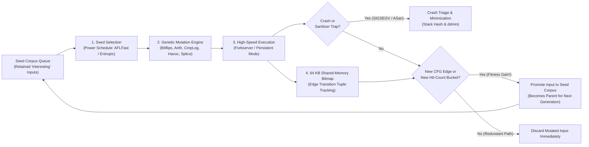
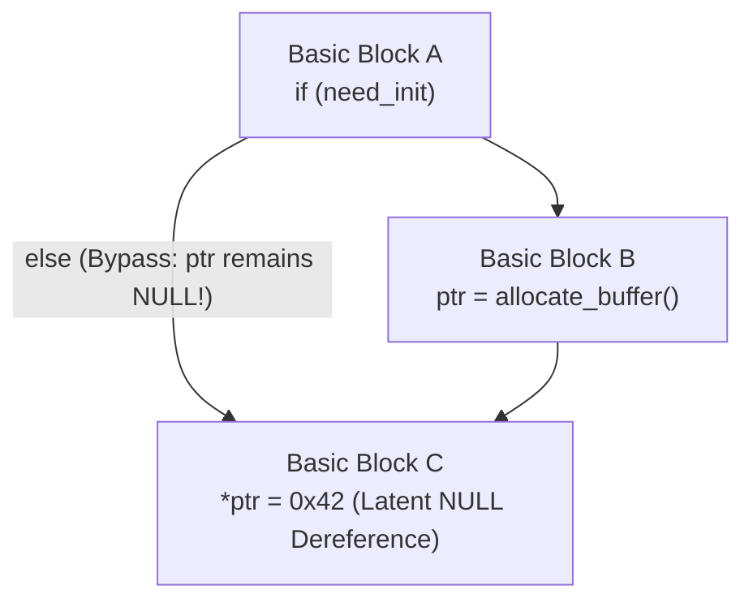
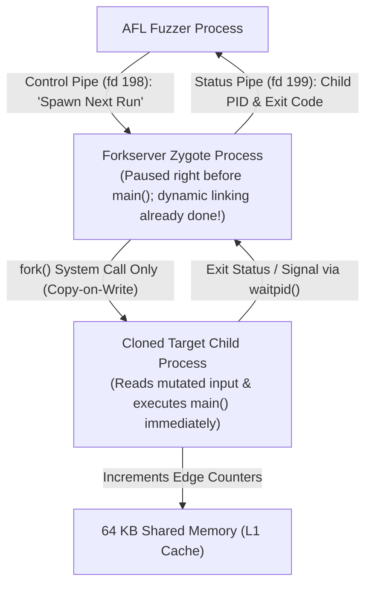
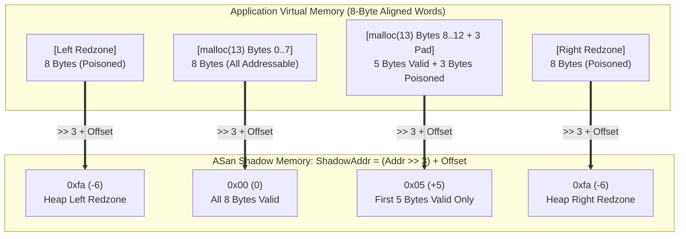
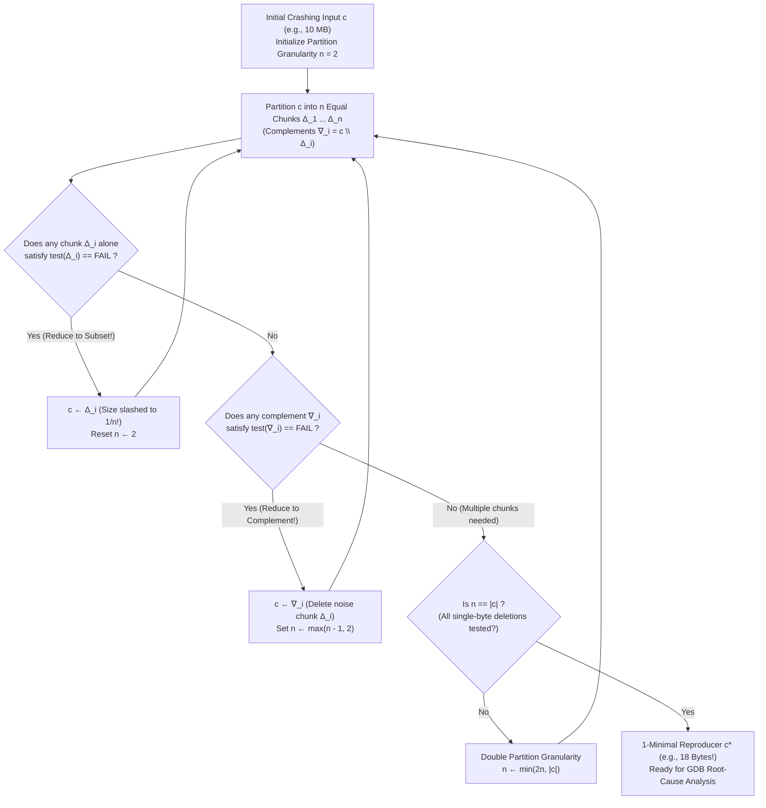

On a dark, stormy autumn night in 1988 in Madison, Wisconsin, computer science professor <strong>Barton Miller</strong> was sitting at a dial-up terminal in his home, trying to work remotely on his university UNIX workstation over a 1200-baud modem connected to an analog telephone line. Outside, a fierce Midwest thunderstorm was raging. Every time lightning struck nearby, electromagnetic interference injected bursts of random line noise into the telephone wire, corrupting the stream of ASCII characters flowing from Miller's terminal into the UNIX shell.

What happened next astonished him. As the storm-induced line noise fed garbled, nonsensical byte sequences into standard UNIX command-line utilities—programs like `vi`, `cc`, `awk`, `sed`, `csh`, and `indent` that thousands of systems programmers relied upon every single day—the utilities did not merely print syntax error messages and exit gracefully. Instead, one after another, they suffered catastrophic <strong>Segmentation Faults (`SIGSEGV`), dumped core, or locked up in infinite loops</strong>.

Struck by how fragile battle-tested system software was when confronted with unexpected bytes, Miller turned his observation into a graduate operating systems class project at the University of Wisconsin–Madison. He tasked his students with building a simple program that generated streams of completely random characters and piped them into standard UNIX utilities across seven major commercial and academic UNIX variants (including BSD, SunOS, and System V). Miller coined the term <strong>"Fuzz"</strong> for this random noise generator. The results sent shockwaves through the operating systems community: <strong>between 25% and 33% of all standard UNIX utilities crashed or hung when fed purely random byte streams</strong>, due to unchecked pointer dereferences, fixed-size stack buffer overflows, signed/unsigned integer confusions, and missing `EOF` checks.

More than three and a half decades later, <strong>Fuzzing (Fuzz Testing)</strong> has evolved from Miller's blind random noise generator into the single most productive automated vulnerability discovery discipline in computer science—fusing compiler intermediate representation (IR) instrumentation, evolutionary genetic algorithms, Satisfiability Modulo Theories (SMT) constraint solvers, and virtual-memory shadow mapping. Google's continuous fuzzing infrastructure, <strong>OSS-Fuzz</strong>, alone has automatically uncovered and helped remediate <strong>more than 10,000 security vulnerabilities and over 36,000 bugs</strong> across critical open-source foundations including OpenSSL, SQLite, FFmpeg, FreeType, curl, and the Linux kernel.

Why do catastrophic memory-corruption bugs and logic flaws routinely slip past thousands of carefully written human unit tests, only to be exposed within minutes by automated mutation of malformed inputs? In this article, we dissect the mathematical and systems engineering foundations of modern fuzzing: the combinatorial explosion of input spaces and the Streetlight Effect, the four major paradigms of fuzzing (Black-box, Grammar-based, White-box Concolic Execution, and Coverage-Guided Grey-box Fuzzing), the internal architecture of <strong>AFL / AFL++ / LibFuzzer</strong> (edge-transition bitmaps, the mathematical necessity of the 1-bit right-shift `>> 1`, logarithmic hit-count bucketing, Forkservers, and Markov-chain power schedules), the shadow-memory mechanics of <strong>AddressSanitizer (ASan)</strong> and companion sanitizers, and <strong>Andreas Zeller's Delta Debugging (`ddmin`)</strong> algorithm for shrinking multi-megabyte crashing inputs into surgical minimal reproducers.

---

## Chapter 1: The Combinatorial Abyss of Input Spaces and the Streetlight Effect

### 1.1 A 64-Byte Buffer Contains $10^{154}$ Universes

To understand why human-written test suites cannot eradicate software defects on their own, we must first confront the <strong>combinatorial explosion of the input space</strong>.

Consider a seemingly trivial C function that parses a compact binary network header or image chunk header of just $N = 64$ bytes. Because each byte consists of $8$ bits and can take $|\Sigma| = 2^8 = 256$ distinct values, the total number of possible 64-byte inputs is:

$$|\Sigma|^N = 256^{64} = \left(2^8\right)^{64} = 2^{512} \approx 1.34 \times 10^{154}$$

To grasp the scale of $1.34 \times 10^{154}$, recall that the Eddington number—the estimated total number of protons in the entire observable universe—is approximately $10^{80}$. Even if we harnessed every processor core on Earth to execute one trillion ($10^{12}$) test inputs per second continuously for the entire $13.8$-billion-year age of the universe ($\approx 4.35 \times 10^{17}$ seconds), we would evaluate only $4.35 \times 10^{29}$ inputs—an infinitesimal fraction ($10^{-124}$) of the state space of a single 64-byte buffer! When the input is a multi-kilobyte PDF document, an MP4 video stream, or a JavaScript program fed into a browser's JIT compiler, the input space explodes to $256^{65536}$ and beyond.

### 1.2 Why Manual Unit Tests Suffer from the Streetlight Effect

Of course, the vast majority of those $10^{154}$ byte sequences are rejected at the very first line of validation (for example, failing a header signature check). However, as conditional branches (`if`, `switch`, loops, state flags) compose sequentially and recursively across thousands of functions, the program's execution paths form a labyrinthine tree of reachable internal states.

When software engineers write manual unit tests and integration tests, they inevitably fall victim to the <strong>Streetlight Effect (Observational Bias)</strong>—named after the classic parable of a person searching for lost keys at night only directly underneath a streetlamp because "that is where the light is." Human engineers write tests for:
1. <strong>Expected valid inputs</strong> that verify the features specified in the design document.
2. <strong>Anticipated boundary conditions</strong> that the developer consciously thought of while writing the code (such as `0`, `-1`, `NULL`, or an empty string).

Crucially, if a developer consciously thinks of an edge case while writing a unit test, they have almost certainly already written an `if` check in the production code to handle that exact edge case! Catastrophic vulnerabilities live outside the cone of the streetlamp, in what security researchers Sergey Bratus et al. call the <strong>"Weird Machine"</strong>—the unintended, emergent finite-state automaton created by the interaction of subtle parser assumptions, integer truncations, and memory allocator semantics.

Consider the following realistic C parser snippet:

```c
int parse_image_chunk(const uint8_t *buf, size_t len) {
    if (len < 16) return -1;
    uint32_t magic  = *(const uint32_t *)(buf + 0);
    uint16_t width  = *(const uint16_t *)(buf + 4);
    uint16_t height = *(const uint16_t *)(buf + 6);
    uint8_t  flags  = buf[8];

    if (magic != 0x494D4721) return -1;          // Expects ASCII "IMG!"
    if (width == 0 || height == 0) return -1;    // Developer tested width=0, height=0!

    uint16_t alloc_size = width * height;        // [BUG] 16-bit integer wraparound!
    if (flags & 0x80) {
        alloc_size += 16;
    }
    uint8_t *pixel_buf = malloc(alloc_size);     // Allocates tiny buffer (0 or 16 bytes)
    if (!pixel_buf) return -1;

    // Copies 65,536 bytes into a 16-byte heap chunk -> catastrophic heap corruption!
    memcpy(pixel_buf, buf + 16, (size_t)width * height);
    ...
}
```

Here, the conscientious developer even wrote a boundary guard `if (width == 0 || height == 0) return -1;` and added unit tests for `width = 0` and `width = 100, height = 100`. Every unit test passes with 100% line coverage! Yet if an attacker supplies `magic = 0x494D4721`, `width = 256`, `height = 256`, and `flags = 0x80`, the product $256 \times 256 = 65,536 \equiv 0 \pmod{2^{16}}$ overflows the 16-bit unsigned integer `alloc_size` to `0`, adds `16` because of the flag bit, allocates a 16-byte heap buffer via `malloc(16)`, and immediately overwrites $65,536$ bytes of adjacent heap metadata and objects via `memcpy`.

---

## Chapter 2: The Four Paradigms of Fuzzing — Black-Box, Grammar-Based, Symbolic Execution, and Grey-Box

How can an automated system navigate a $2^{512}$ desert to discover the needle-in-a-haystack input where `magic == 0x494D4721`, `width * height == 65536`, and `flags & 0x80`? Over the past thirty years, fuzzing research has evolved across four fundamental paradigms defined by how much internal program state they observe and exploit.

| Fuzzing Paradigm | Representative Tools | Program Introspection | Search & Generation Mechanism | Core Strengths | Fundamental Bottlenecks |
| :--- | :--- | :--- | :--- | :--- | :--- |
| <strong>Dumb Black-Box Fuzzing</strong> | 1988 `fuzz`, `zzuf`, `radamsa` | None (zero internal visibility) | Blind pseudo-random bit flips, byte overwrites, or heuristic chunk shuffling | Zero compilation or instrumentation setup; works on closed-source binaries at high speed | Blindly blocked by magic bytes ($2^{-32}$ for a 4-byte comparison), checksums, and structured syntax |
| <strong>Grammar / Generation-Based Fuzzing</strong> | `Peach`, `Syzkaller`, `LangFuzz`, `Domato`, `Nautilus` | Explicit input format specification or Context-Free Grammar (CFG) | Synthesizes and mutates structurally valid Abstract Syntax Trees (ASTs) or stateful syscall sequences | Easily penetrates deep past lexers/parsers into JIT compilers, DOM engines, and OS kernels | High manual engineering cost to write accurate grammars; misses parser bugs triggered by malformed syntax |
| <strong>White-Box Symbolic / Concolic Execution</strong> | `SAGE`, `KLEE`, `angr`, `Driller`, `SymCC` | Full instruction-level symbolic trace and branch predicate collection | Records path constraint $\Pi$ over symbolic inputs $\vec{\alpha}$ and negates branches via <strong>SMT Solvers (Z3)</strong> | Solves arbitrary multi-byte magic comparisons (`x == 0xdeadbeef`) and complex arithmetic in one shot | <strong>Path Explosion ($2^d$)</strong> in loops, slow SMT solving on non-linear math/hashes, environment modeling |
| <strong>Coverage-Guided Grey-Box Fuzzing (CGF)</strong> | <strong>`AFL`</strong>, <strong>`AFL++`</strong>, <strong>`LibFuzzer`</strong>, `Honggfuzz` | Lightweight compile-time <strong>edge coverage instrumentation</strong> (64 KB bitmap) | <strong>Evolutionary genetic algorithm</strong> that retains only mutated inputs discovering new CFG edges | No expensive SMT solver needed; achieves $10^4\text{–}10^5\text{ execs/sec}$ while evolving deep into program state | Requires CmpLog / dictionary assistance for monolithic multi-byte comparisons or cryptographic checksums |

### 2.1 The Blindness of Black-Box Fuzzing: The $2^{-32}$ Magic-Number Wall

In pure <strong>Black-Box Fuzzing</strong>, the target program is treated as an opaque sealed box: the fuzzer feeds an input in and only checks whether the process exited with a fatal signal (`SIGSEGV`, `SIGABRT`). Look again at the first guard in `parse_image_chunk`:

```c
if (magic != 0x494D4721) return -1;
```

Because `magic` is a 32-bit integer, a blind random mutator has a $1 / 2^{32} \approx 1 / (4.29 \times 10^9)$ probability of guessing those 4 bytes by chance. Worse still, imagine a candidate input happens to mutate from having $1$ correct byte (`"I???"`) to having $3$ correct bytes (`"IMG?"`). To a black-box fuzzer, both `"I???"` and `"IMG?"` simply return `-1` without crashing. Because it receives zero feedback that `"IMG?"` came closer to passing the check, the black-box fuzzer throws `"IMG?"` away and remains permanently trapped at the very first `if` statement.

### 2.2 Grammar and Generation-Based Fuzzing

When the target expects highly structured inputs—such as an HTML/CSS document, an SQL query, a TLS handshake sequence, or stateful Linux kernel system calls—random byte mutations destroy syntactic validity before execution ever reaches the core engine. <strong>Generation-based (Grammar-based) Fuzzing</strong> overcomes this by encoding the input language as a formal Context-Free Grammar $G = (V, \Sigma, R, S)$ or protocol state machine.

Instead of flipping raw bits, a grammar fuzzer generates derivation trees from production rules $R$ and performs structure-preserving mutations such as replacing an AST subtree of type `<expr>` with another deeply nested `<expr>`. Google's <strong>Syzkaller</strong>, the premier kernel fuzzer responsible for thousands of Linux kernel bug discoveries, uses declarative syscall descriptions (`syzlang`) that track resource dependencies—for example, knowing that the integer returned by `fd = open(...)` or `sock = socket(...)` must be passed as the first argument to subsequent `ioctl(fd, ...)` and `mmap(..., fd, ...)` calls.

### 2.3 White-Box Fuzzing: Symbolic Execution, Concolic Testing, and SMT Solvers

At the opposite end of the spectrum lies <strong>White-Box Fuzzing</strong>, pioneered in symbolic execution by James C. King (1976) and scaled to industrial vulnerability hunting via <strong>Dynamic Symbolic Execution (Concolic Testing—Concrete + Symbolic)</strong> in tools like Microsoft's <strong>SAGE</strong> (Godefroid et al., 2008) and <strong>KLEE</strong> (Cadar et al., 2008).

In concolic execution, the engine runs the program on a concrete seed input while simultaneously maintaining a <strong>symbolic execution state</strong> where input bytes $buf[0], buf[1], \dots, buf[n-1]$ are represented as symbolic bit-vector variables $\alpha_0, \alpha_1, \dots, \alpha_{n-1}$. Whenever execution encounters a conditional branch instruction depending on the symbolic inputs, the engine appends the branch condition $c_i(\vec{\alpha})$ to the accumulated <strong>Path Constraint</strong> $\Pi$.

Suppose a run traverses branches $c_1(\vec{\alpha}), c_2(\vec{\alpha}), \dots, c_{k-1}(\vec{\alpha})$ and then takes the early-exit branch $\neg c_k(\vec{\alpha})$ at `if (magic != 0x494D4721) return -1;`. To force the next test input to enter the body of the `if` statement while keeping all earlier decisions intact, the concolic engine constructs the negated path formula:

$$\Pi_{\text{path}} = c_1(\vec{\alpha}) \land c_2(\vec{\alpha}) \land \dots \land c_{k-1}(\vec{\alpha}) \land \neg c_k(\vec{\alpha})$$

It then feeds $\Pi_{\text{path}}$ to an automated theorem prover—specifically an <strong>SMT Solver (Satisfiability Modulo Theories)</strong> such as Microsoft's <strong>Z3</strong>. Using decision procedures over the theory of fixed-size bit-vectors (`QF_BV`) and arrays (`QF_ABV`), Z3 algebraically solves $\text{concat}(\alpha_3, \alpha_2, \alpha_1, \alpha_0) = \text{0x494D4721}$ in milliseconds and synthesizes a concrete input beginning with `"IMG!"`.

Despite its mathematical elegance, pure symbolic execution hits two severe walls in large software systems:
1. <strong>The Path Explosion Problem</strong>: A loop iterating $d = 100$ times with a single internal `if` statement generates $2^{100} \approx 1.26 \times 10^{30}$ distinct symbolic execution paths.
2. <strong>SMT Solver Intractability</strong>: Cryptographic hash functions (SHA-256), cyclic redundancy checks (CRC32), complex floating-point transcendental functions, and symbolic pointer aliasing produce constraint formulas that cause SMT solvers to time out. (Hybrid tools like <strong>Driller</strong> and <strong>QSYM</strong> mitigate this by running fast grey-box fuzzing until coverage stalls, invoking concolic execution only to hop across narrow magic-byte guards!)

### 2.4 The Grey-Box Revolution: Evolutionary Coverage-Guided Fuzzing (CGF)

In 2013, security researcher <strong>Michał Zalewski (`lcamtuf`)</strong> released <strong>American Fuzzy Lop (AFL)</strong>, igniting the revolution of <strong>Coverage-Guided Grey-Box Fuzzing (CGF)</strong>. Today, AFL's community-driven successor <strong>AFL++</strong> (Fioraldi et al.), LLVM's in-process <strong>LibFuzzer</strong> (Serebryany), and <strong>Honggfuzz</strong> form the backbone of modern vulnerability discovery.



CGF abandons heavy instruction-by-instruction symbolic emulation and SMT solving in favor of a Darwinian evolutionary loop:
1. <strong>Lightweight Compile-Time Instrumentation</strong> records which control-flow edges are traversed during each run in a tiny shared-memory bitmap with near-zero runtime overhead.
2. <strong>Fitness Evaluation</strong>: After executing a mutated input, the fuzzer scans the bitmap. If the input triggered <strong>even a single previously unseen control-flow edge</strong> (or a new logarithmic hit-count bucket on an existing edge), that input is declared <strong>"interesting"</strong> and added to the seed corpus queue. Otherwise, it is immediately discarded.
3. <strong>Evolutionary Ratcheting</strong>: Imagine a parser checks a 4-byte token character by character (`if (b[0] == 'I') if (b[1] == 'M') if (b[2] == 'G') if (b[3] == '!')`). As soon as a random mutation sets `b[0] = 'I'` (which happens in at most $256$ tries), the execution enters the first `if` block, lighting up a new edge in the bitmap! The fuzzer saves this seed `"I???"`. Subsequent mutations now start from `"I???"`, finding `"IM??"` in another $\sim 256$ tries. What required $256^4 \approx 4.29 \times 10^9$ blind guesses in black-box fuzzing collapses into $4 \times 256 = 1,024$ evolutionary steps!

---

## Chapter 3: Inside AFL's Engine — Edge Instrumentation, the 64 KB Bitmap, and the Math of `>> 1`

How does a coverage-guided fuzzer track control-flow paths across tens of thousands of executions per second without drowning in instrumentation overhead or memory bandwidth? Every design detail of AFL's engine is a masterclass in systems engineering and discrete mathematics.

### 3.1 Why Edge (Tuple) Coverage Beats Basic-Block (Node) Coverage

A program's compiled machine code can be represented as a directed <strong>Control Flow Graph (CFG)</strong> $G = (V, E)$, where each vertex $v \in V$ is a <strong>Basic Block</strong> (a straight-line sequence of instructions with a single entry point and a single exit branch) and each directed edge $e = (u, v) \in E$ represents a control-flow transfer (conditional jump, call, or fall-through) from block $u$ to block $v$.

Why not simply record which basic blocks $v \in V$ were executed (Node Coverage)? Consider the following classic diamond-with-bypass control flow:



Suppose Seed #1 takes the path $A \to B \to C$ (where `need_init` is true, so `ptr` is safely initialized in Block $B$ before being dereferenced in Block $C$, or perhaps Block $C$ only dereferences `ptr` under a second condition). After Seed #1 finishes, basic blocks $A$, $B$, and $C$ have <strong>all been marked as visited</strong>.

Now suppose a mutated input, Seed #2, takes the direct bypass path $A \to C$ (skipping Block $B$). If the fuzzer only tracks <strong>Basic-Block (Node) Coverage</strong>, the set of blocks visited by Seed #2 is $\{A, C\}$, which is a strict subset of the already-visited blocks $\{A, B, C\}$! A node-coverage fuzzer concludes that Seed #2 discovered nothing new and <strong>throws Seed #2 in the trash</strong>—completely missing the critical path where initialization in Block $B$ was bypassed!

By tracking <strong>Edge (Tuple) Coverage</strong> $E$, Seed #1 records the edge set $\{(A \to B), (B \to C)\}$, whereas Seed #2 traverses the brand-new directed edge $(A \to C) \notin \{(A \to B), (B \to C)\}$. Edge coverage immediately recognizes $(A \to C)$ as a novel state transition and promotes Seed #2 to the seed queue.

### 3.2 The 3-Line Trampoline, 64 KB L1-Resident Bitmap, and the Proof of `>> 1`

To record directed edges $(B_{\text{prev}} \to B_{\text{cur}})$ at minimal cost, AFL's compiler wrapper (`afl-cc` / LLVM `SanitizerCoverage`) assigns each basic block a compile-time random 16-bit integer $L \in \{0, 1, \dots, 65535\}$ and injects the following 3-operation sequence at the entry of every basic block:

```c
/* Compile-time random 16-bit ID assigned to the current basic block */
cur_location = <COMPILE_TIME_RANDOM_16BIT>;

/* Record the transition edge (prev -> cur) in the 64 KB shared bitmap */
shared_mem[cur_location ^ prev_location]++;

/* Right-shift by 1 bit to preserve directionality and self-loops */
prev_location = cur_location >> 1;
```

Here, `shared_mem` is a $2^{16} = 65,536$-byte (<strong>64 KB</strong>) array allocated via POSIX shared memory (`shmget` / `shmat`) mapped into both the fuzzer process and the target child process, and `prev_location` is a thread-local (`__thread`) 16-bit variable holding the shifted ID of the previously executed basic block.

Why specifically <strong>64 KB</strong>?
1. <strong>Zero L1/L2 Cache Misses</strong>: Modern x86-64 and ARM64 CPU cores feature $32\text{ KB}\text{–}64\text{ KB}$ of L1 Data Cache and $256\text{ KB}\text{–}1\text{ MB}$ of L2 Cache. Because the entire 64 KB `shared_mem` bitmap fits comfortably inside the core's fast cache hierarchy, incrementing `shared_mem[index]++` on every basic-block jump never stalls waiting for main DRAM (~100 ns latency), executing in just 1–2 nanoseconds!
2. <strong>Fast Vectorized Scanning</strong>: After each run, the fuzzer parent process can scan the entire 64 KB bitmap in a few microseconds by comparing 64-bit words (`uint64_t`) or AVX2 256-bit registers against a cumulative global bitmap `virgin_bits`.

Now examine the third line: `prev_location = cur_location >> 1;`. Why does AFL perform a <strong>1-bit bitwise right shift (`>> 1`)</strong> before storing `cur_location` into `prev_location`? Why not simply write `prev_location = cur_location;` and index the bitmap with $A \oplus B$?

Let us prove mathematically what happens if we omit the 1-bit right shift:

$$\text{Without shift: } \quad \text{Edge}(A \to B) = A \oplus B = B \oplus A = \text{Edge}(B \to A), \qquad \text{Edge}(A \to A) = A \oplus A = 0$$

$$\text{With 1-bit right shift: } \quad \text{Edge}(A \to B) = (A \gg 1) \oplus B \neq (B \gg 1) \oplus A = \text{Edge}(B \to A), \qquad \text{Edge}(A \to A) = (A \gg 1) \oplus A \neq 0$$

Without the right shift (`>> 1`), the XOR operator $\oplus$ over $\mathbb{F}_2^{16}$ suffers from two catastrophic algebraic degeneracies:
1. <strong>Commutativity Destroys Edge Direction ($A \oplus B = B \oplus A$)</strong>: Because XOR is symmetric, a jump from Basic Block $A$ to Basic Block $B$ ($A \to B$) produces the exact same bitmap index as a jump from Basic Block $B$ back to Basic Block $A$ ($B \to A$). Forward transitions and backward return transitions become completely indistinguishable!
2. <strong>Nilpotency Annihilates All Self-Loops ($A \oplus A = 0$)</strong>: Any basic block $A$ that branches back to itself in a tight single-block loop ($A \to A$, such as `while (*p++ != '\0');`) evaluates $A \oplus A = 0$. Consequently, <strong>every single self-loop across the entire program binary collides into the exact same single byte `shared_mem[0]`</strong>!

By shifting `prev_location` right by 1 bit (`A >> 1`), symmetry and nilpotency are broken simultaneously in a single CPU clock cycle: $(A \gg 1) \oplus B \neq (B \gg 1) \oplus A$ (for almost all $A \neq B$), and for any non-zero block ID $A > 0$, $(A \gg 1) \oplus A \neq 0$ because the most significant set bit of $A$ has a $1$ in $A$ and a $0$ in $A \gg 1$! (In large binaries with $>10,000$ basic blocks, birthday-paradox hash collisions within the 65,536-entry bitmap can still occur; <strong>AFL++'s `LTO` mode (`afl-clang-lto`)</strong> eliminates collisions completely by analyzing the whole-program CFG at link time and assigning sequential collision-free edge indices!)

### 3.3 Logarithmic Hit-Count Bucketing

Each byte in `shared_mem[edge_id]` is an 8-bit counter (`0` to `255`) recording how many times that edge was traversed during a single execution. If the fuzzer treated a loop executing $5$ times as distinct from a loop executing $6$ times, the seed queue would immediately choke on hundreds of redundant inputs that merely vary loop iterations by one. Conversely, if the fuzzer only recorded a binary boolean ($0$ vs. $\ge 1$), it could never evolve an input that forces a loop to iterate enough times to overflow a buffer of size $100$!

AFL resolves this tension by mapping each raw 8-bit counter `c` ($1 \le c \le 255$) through a lookup table into <strong>8 logarithmic power-of-two buckets</strong>, where each bucket corresponds to a single bit in the normalized byte:

- <strong>Bit 0</strong>: $1$ hit
- <strong>Bit 1</strong>: $2$ hits
- <strong>Bit 2</strong>: $3$ hits
- <strong>Bit 3</strong>: $4\text{–}7$ hits
- <strong>Bit 4</strong>: $8\text{–}15$ hits
- <strong>Bit 5</strong>: $16\text{–}31$ hits
- <strong>Bit 6</strong>: $32\text{–}127$ hits
- <strong>Bit 7</strong>: $128\text{–}255$ hits

Thus, evolving a loop from $1$ iteration (Bit 0) to $4$ iterations (Bit 3), then $16$ iterations (Bit 5), and finally $128+$ iterations (Bit 7) provides a smooth staircase of evolutionary fitness rewards without flooding the corpus on every intermediate count.

### 3.4 The Forkserver and In-Process Persistent Mode

Even with zero-overhead L1-cache edge tracking, a fuzzer is only as effective as its execution throughput (`execs/sec`). If the fuzzer spawns a new process for every mutated input via the standard UNIX `fork()` + `execve()` sequence, throughput hits a brick wall at roughly $200\text{–}600\text{ execs/sec}$. Over $90\%$ of CPU time is wasted inside the OS kernel and dynamic linker (`ld-linux.so`): mapping the ELF executable, loading shared libraries (`libc.so`, `libssl.so`), resolving PLT/GOT symbol relocations, and running C++ static constructors.

To eliminate `execve()` completely, AFL introduced the <strong>Forkserver</strong> (originally inspired by Tarik Sekniqi and implemented by Zalewski):



1. At the start of the fuzzing campaign, the fuzzer launches the target binary <strong>once</strong>.
2. The compiler-injected constructor `__afl_auto_init` runs right after the dynamic linker finishes loading all shared libraries (just before `main()`), establishes communication with the fuzzer over two reserved file descriptors (`fd 198` for reading control commands, `fd 199` for reporting status), and <strong>halts the process in a tight `read(198, ...)` wait loop</strong>.
3. For every subsequent test case, the fuzzer writes a 4-byte trigger to `fd 198`. The paused Forkserver ("zygote") process wakes up and calls <strong>`fork()` without `execve()`</strong>.
4. Because modern operating systems implement `fork()` using <strong>Copy-on-Write (CoW)</strong> page tables, the child process inherits the fully linked binary, resolved symbols, and initialized heap in a few microseconds, copying physical 4 KB RAM pages only when the child actually modifies them!

When even the Copy-on-Write `fork()` kernel page-table teardown overhead becomes the bottleneck, <strong>LLVM LibFuzzer</strong> and <strong>AFL++ Persistent Mode (`__AFL_LOOP(10000)`)</strong> bypass `fork()` altogether by executing the target API tens of thousands of times inside a single process via a standard C/C++ fuzzing harness:

```c
#include <stdint.h>
#include <stddef.h>

extern "C" int LLVMFuzzerTestOneInput(const uint8_t *Data, size_t Size) {
    // Zero fork(), zero execve(), zero file I/O:
    // Mutated byte buffer is passed directly in-memory to the target parser!
    parse_image_chunk(Data, Size);
    return 0;
}
```

By resetting internal state in memory and looping 10,000 times per fork (or indefinitely in LibFuzzer), Persistent Mode routinely achieves <strong>$50,000$ to $250,000+$ executions per second per CPU core</strong>.

### 3.5 Mutation Operators, CmpLog (RedQueen), and Markov-Chain Power Schedules

Given a parent seed $s$ from the queue, how does the fuzzer generate candidate offspring? AFL/AFL++ applies a carefully engineered hierarchy of genetic mutation operators:

- <strong>Deterministic Stage</strong> (optional or targeted):
  1. <strong>Walking Bit Flips (`1/1`, `2/1`, `4/1`)</strong>: Sequentially flips every single bit, every adjacent 2-bit pair, and every 4-bit nibble across the input file, discovering single-bit flags and state toggles.
  2. <strong>Walking Byte Flips (`8/8`, `16/8`, `32/8`)</strong>: Sequentially inverts 1-byte, 2-byte, and 4-byte words.
  3. <strong>Walking Arithmetic ($\pm 1 \dots 35$)</strong>: Adds and subtracts small integers ($1$ through $35$) to every 8-bit, 16-bit, and 32-bit integer in both Little-Endian and Big-Endian byte orders. This systematically probes off-by-one length fields and size headers.
  4. <strong>Known Interesting Integers (`interest 8/16/32`)</strong>: Overwrites each 1-, 2-, and 4-byte window with boundary constants prone to triggering integer overflows: `0`, `-1`, `127`, `-128` (`INT8_MIN`), `32767` (`INT16_MAX`), `65535` (`UINT16_MAX`), `2147483647` (`INT32_MAX`), and `-2147483648` (`INT32_MIN`).
- <strong>Non-Deterministic Chaos Stage (Havoc & Splicing)</strong>:
  - <strong>Havoc</strong>: Applies a random stack of $2^1$ to $2^7$ mutations simultaneously—random bit flips, deleting or cloning byte blocks, overwriting with dictionary tokens, and random arithmetic.
  - <strong>Splicing (Genetic Crossover)</strong>: Selects a second seed $s'$ from the queue, picks a random midpoint where $s$ and $s'$ differ, and splices the prefix of $s$ onto the suffix of $s'$.
- <strong>Input-to-State Correspondence (`CmpLog` / RedQueen, Aschermann et al. 2019)</strong>:
  What about our 4-byte check `if (magic != 0x494D4721)` when compiled as a single 32-bit `cmp eax, 0x494d4721` instruction? Modern AFL++ and LibFuzzer inject <strong>Comparison Logging (`__sanitizer_cov_trace_cmp4`)</strong> hooks that record the runtime operands `(arg1, arg2)` of every integer comparison and `memcmp`/`strcmp` call into a secondary shared table. If the fuzzer sees that `arg1` (`0x11223344`) came directly from bytes $0\text{..}3$ of the input file and was compared against `arg2` (`0x494D4721`), it immediately substitutes `0x494D4721` (in both endiannesses) into bytes $0\text{..}3$—piercing 32-bit and 64-bit magic-byte guards instantly without an SMT solver!

Finally, not all seeds in the queue deserve equal mutation time. In vanilla AFL, a fuzzer can spend $95\%$ of its CPU cycles mutating seeds that exercise shallow, high-frequency error-handling paths. In 2016, <strong>Marcel Böhme et al.</strong> revolutionized seed scheduling with <strong>AFLFast</strong> (and later <strong>Entropic</strong>, 2020) by modeling grey-box fuzzing as a <strong>Markov Chain</strong> over the program's control-flow states. AFLFast assigns an evolutionary energy $p(s)$ (the number of mutated offspring generated from seed $s$) that is inversely proportional to how frequently the path $i$ exercised by $s$ has been hit across the entire campaign ($f(i)$), while Entropic maximizes the local <strong>Shannon Information Entropy $H(s)$</strong> of rare edge transitions around seed $s$:

$$p(s) = \min\left(\frac{\alpha(s)}{\beta} \cdot \frac{2^{s_{\text{handicap}}}}{f(i)}, \; M\right), \qquad H(s) = -\sum_{e \in E(s)} \hat{p}_{s,e} \log_2 \hat{p}_{s,e}$$

By starving over-explored "highway" paths and concentrating mutation energy on seeds that reach rare, low-probability frontier branches, AFLFast and Entropic achieve orders-of-magnitude faster vulnerability discovery.

---

## Chapter 4: Turning Silent Memory Corruption into Instant Crashes — The Architecture of Sanitizers

Suppose our coverage-guided fuzzer uses CmpLog to pass `magic == 0x494D4721` and uses boundary-integer mutation to find `width = 256, height = 256`, triggering a heap buffer overflow in `parse_image_chunk`. What happens if the overflow only writes 4 bytes past the end of a `malloc(20)` buffer?

In standard compiled C/C++ code running on an operating system, <strong>almost nothing happens!</strong> The CPU's hardware Memory Management Unit (MMU) enforces read/write permissions strictly at the granularity of <strong>$4\text{ KB}$ ($4,096$-byte) virtual memory pages</strong>. As long as the 4-byte out-of-bounds write lands inside the same mapped $4\text{ KB}$ heap page (corrupting padding bytes, another heap object's data field, or allocator metadata that isn't immediately dereferenced as an unmapped pointer), the CPU raises <strong>no `SIGSEGV` fault</strong>. The program returns `0` cleanly, and the fuzzer remains completely oblivious that it just triggered a critical vulnerability!

To transform silent memory corruption and undefined behavior into loud, instantaneous crashes at the exact offending instruction, fuzzing relies on compile-time <strong>Sanitizers</strong>.

### 4.1 AddressSanitizer (ASan): 1:8 Shadow Memory, Redzones, and Quarantine

Introduced by Konstantin Serebryany et al. at Google in 2012, <strong>AddressSanitizer (ASan, `-fsanitize=address`)</strong> detects out-of-bounds accesses to heap, stack, and global objects as well as Use-After-Free (UAF) bugs with an average slowdown of only $\sim 2\times$. Its architecture rests on three pillars:

1. <strong>1:8 Direct-Mapped Shadow Memory</strong>:
   In a 64-bit virtual address space, ASan reserves one-eighth of the virtual memory space as <strong>Shadow Memory</strong> (mapped lazily on demand). Every aligned <strong>8-byte word</strong> of normal Application Memory is governed by <strong>1 byte</strong> of Shadow Memory. Computing the shadow address for any pointer `Addr` requires no lookup tables, no hash maps, and no conditional branches—just a 3-bit right shift and a constant offset addition:

$$\text{ShadowAddr}(\text{Addr}) = (\text{Addr} \gg 3) + \text{Offset}$$

2. <strong>Sub-Word Poison Encoding (`0x00`, $1\text{..}7$, and Negative Codes)</strong>:
   How can $1$ shadow byte describe the addressability of $8$ individual application bytes with 1-byte precision? Because heap and stack allocations are always aligned to at least an 8-byte boundary (`Addr % 8 == 0`), valid bytes within any 8-byte word always form a contiguous prefix starting at offset $0$! Thus, a single signed shadow byte $v \in [-128, 127]$ encodes:
   - $v = \text{0x00}$: All $8$ bytes in the application word are valid and addressable (unpoisoned).
   - $1 \le v \le 7$: Only the first $v$ bytes (offsets $0$ through $v-1$) are addressable; the remaining $8 - v$ bytes (offsets $v$ through $7$) are <strong>poisoned (out-of-bounds)</strong>! For example, if a program calls `malloc(13)`, the first 8-byte word has shadow byte `0x00` ($8$ valid bytes) and the second 8-byte word has shadow byte `0x05` ($5$ valid bytes, $3$ poisoned bytes). An access to byte index $13$ (the 6th byte of the second word) immediately fails the check `(addr & 7) + 1 > 5`!
   - $v < 0$ (negative byte values): All $8$ bytes are completely poisoned, with specific negative hex codes identifying the exact type of violation in the crash report:
     - `0xfa`: Heap left/right redzone (`heap-buffer-overflow`)
     - `0xfd`: Freed heap region (`heap-use-after-free`)
     - `0xf1` / `0xf2` / `0xf3`: Stack left / middle / right redzone (`stack-buffer-overflow`)
     - `0xf9`: Global variable redzone (`global-buffer-overflow`)



Before every load or store instruction of size $N \in \{1, 2, 4, 8\}$ bytes at address `addr`, the compiler inserts the fast-path shadow check:

```c
/* Compiler-injected ASan check before an N-byte memory access (N = 1, 2, 4) */
uintptr_t shadow_addr = (addr >> 3) + ASAN_SHADOW_OFFSET;
int8_t shadow_val = *(int8_t *)shadow_addr;

if (UNLIKELY(shadow_val != 0)) {
    /* For partial 8-byte words (1 <= shadow_val <= 7) or negative redzones */
    if (shadow_val < 0 || (int8_t)((addr & 7) + N) > shadow_val) {
        __asan_report_error(pc, bp, sp, addr, is_write, N);
    }
}
```

3. <strong>Allocator Redzones & the Quarantine Queue</strong>:
   ASan replaces `malloc`/`free` (and `new`/`delete`) with its own sanitizer allocator, and surrounds stack arrays with padded frames. Every allocated buffer is bracketed on both the left and right by poisoned <strong>Redzones</strong> (`0xfa`), catching both linear overflows and small indexed out-of-bounds reads/writes. When `free(ptr)` is called, ASan poisons the entire payload's shadow bytes to `0xfd` and places the chunk into a fixed-size <strong>Quarantine Queue (FIFO)</strong> instead of returning it immediately to the `malloc` freelist. If dangling pointer code attempts to read or write `*ptr` after `free(ptr)`, the chunk has not yet been reallocated to a new object—it sits poisoned with `0xfd` in the quarantine queue, triggering an immediate, unmistakable `ERROR: AddressSanitizer: heap-use-after-free` report with three full stack traces (the offending access, the `free()` site, and the original `malloc()` site)!

### 4.2 The Full Sanitizer Suite and Differential Fuzzing Oracles

Modern fuzzing campaigns compile targets with multiple complementary sanitizers and semantic bug oracles:

| Sanitizer / Bug Oracle | Compiler Flag | Target Bug Classes | Internal Mechanism & Runtime Overhead |
| :--- | :--- | :--- | :--- |
| <strong>AddressSanitizer (ASan)</strong> | `-fsanitize=address` | Heap/stack/global out-of-bounds R/W, Use-After-Free, Use-After-Return, Double/Invalid Free | 1:8 shadow memory, stack/heap redzones (`0xfa`, `0xf1`), Quarantine FIFO queue (`0xfd`); $\sim 2\times$ slowdown |
| <strong>UndefinedBehaviorSanitizer (UBSan)</strong> | `-fsanitize=undefined` | Signed integer overflow, division by zero, shift out-of-bounds, null/misaligned pointer deref, bad C++ vptr cast | Inline arithmetic overflow flags (`jo`) and alignment/bounds checks before instructions; $\sim 1.2\times$ slowdown |
| <strong>MemorySanitizer (MSan)</strong> | `-fsanitize=memory` | <strong>Use of Uninitialized Memory</strong> (reading stack/heap bytes before they are written, leaking secrets or branching on garbage) | Bit-for-bit (1:1) shadow memory tracking initialization state across all CPU registers and RAM; raises error when uninitialized bit reaches a branch or syscall; $\sim 3\times$ slowdown |
| <strong>ThreadSanitizer (TSan)</strong> | `-fsanitize=thread` | <strong>Data Races</strong> (concurrent unsynchronized access where $\ge 1$ is a write) and lock-order deadlocks | Shadow state cells storing thread IDs, access offsets, and <strong>Vector Clocks</strong> tracking the Happens-Before ($\xrightarrow{hb}$) partial order; $\sim 5\text{–}15\times$ slowdown |
| <strong>Differential Fuzzing</strong> | Multi-target harness | <strong>Semantic / Logic / Cryptographic bugs</strong> that never corrupt memory or trigger UB | Feeds identical input $x$ to $k \ge 2$ independent implementations (e.g., OpenSSL vs. BoringSSL vs. LibreSSL, or Geth vs. Besu EVM) and asserts $f_1(x) = f_2(x)$ |

---

## Chapter 5: Crash Triage, Deduplication, and Andreas Zeller's Delta Debugging (`ddmin`)

### 5.1 Taming the Crash Flood: Stack Hashing and Root-Cause Bucketing

Once a fuzzer breaks through a parser guard into a buggy code path, its genetic mutator will rapidly generate thousands of slightly different inputs that all crash on the exact same vulnerable `memcpy` or null pointer dereference. A single overnight fuzzing run can easily dump $20,000$ crashing files into `out/default/crashes/`.

Why does AFL save so many duplicate crashes? Because AFL defines a crash as "unique" if its 64 KB edge-coverage bitmap contains a tuple or hit-count bucket not seen in previous crashes. If Crash #1 triggers the bug after passing through a logging helper and Crash #2 triggers the exact same bug after iterating a parser loop $4$ times instead of $2$, AFL saves both as "unique crashes."

To prevent security engineers from drowning in tens of thousands of duplicates, automated <strong>Crash Triage & Deduplication</strong> systems (such as Google's ClusterFuzz, `casr`, and Honggfuzz's stack analyzer) unwind the crashing thread's call stack (`PC_0, PC_1, ..., PC_n`) at the moment of the signal or ASan trap and compute a <strong>Major/Minor Stack Hash</strong>:
- <strong>Major Stack Hash</strong>: Hashes the function names / module-relative instruction offsets of the top $k=3$ to $5$ stack frames (filtering out generic libc/sanitizer frames like `__asan_report_load4`, `abort`, or `memcpy`) combined with the fault classification (e.g., `WRITE` vs. `READ`, `SEGV` vs. `heap-buffer-overflow`).
- <strong>Exploitability Heuristics</strong>: Automated triage classifies crashes by severity—ranking instruction-pointer hijacks (`PC` control), arbitrary write-what-where faults, and heap overflows (`EXPLOITABLE`) ahead of read-only null-pointer dereferences at offset `0x00000000` (`PROBABLY_NOT_EXPLOITABLE`).

### 5.2 Shrinking a 10 MB Crash into 18 Bytes: Delta Debugging (`ddmin`)

Even after deduplicating $20,000$ crashes down to $3$ distinct root-cause buckets, the engineer faces a second hurdle: the crashing input file produced by thousands of rounds of Havoc and Splicing mutations is often a <strong>bloated, multi-kilobyte or multi-megabyte blob</strong> filled with 99.9% irrelevant noise. Stepping through a parser in GDB while it processes 500,000 irrelevant tokens before hitting the bug is agonizing.

In 1999 (and generalized in 2002), <strong>Andreas Zeller</strong> and Ralf Hildebrandt formulated the <strong>Delta Debugging (`ddmin`)</strong> algorithm to automatically isolate the minimal failure-inducing input.

Formally, let $c$ be a failing input of length $N = |c|$ (a sequence of bytes, lines, or AST nodes), and let $\text{test}: \Sigma^* \to \{\text{PASS}, \text{FAIL}, \text{UNRESOLVED}\}$ be an automated oracle that runs the target binary and returns $\text{FAIL}$ if and only if the candidate input reproduces the exact same crash signature (stack hash). Finding the global minimum subset $c_{\min} \subseteq c$ is NP-complete in general ($2^N$ subsets). Instead, `ddmin` computes a <strong>1-minimal test case</strong> $c^* \subseteq c$—an input that still triggers $\text{test}(c^*) = \text{FAIL}$, such that removing <strong>any single element (any single byte)</strong> from $c^*$ causes the failure to disappear:

$$\forall c' \subsetneq c^* \; \text{with} \; |c^*| - |c'| = 1 : \quad \text{test}(c') \neq \text{FAIL}$$

$$T_{\text{best}}(N) = \mathcal{O}(\log_2 N), \qquad T_{\text{worst}}(N) = \frac{N^2 + 3N - 2}{2} = \mathcal{O}(N^2)$$

How does `ddmin` find $c^*$ without testing elements one by one in $O(N^2)$ time? By generalizing <strong>binary search</strong> over partitions of granularity $n$ (initially $n = 2$):

1. <strong>Partitioning</strong>: Divide the current failing input $c$ into $n$ contiguous, non-empty chunks $\Delta_1, \Delta_2, \dots, \Delta_n$ of approximately equal size ($|\Delta_i| \approx |c| / n$). For each chunk $\Delta_i$, define its complement $\nabla_i = c \setminus \Delta_i$ (the input $c$ with chunk $\Delta_i$ deleted).
2. <strong>Case 1 — Reduce to Subset ($\text{test}(\Delta_i) = \text{FAIL}$)</strong>: Test each chunk $\Delta_i$ in isolation. If any single chunk $\Delta_i$ triggers the crash on its own, then the other $n-1$ chunks are 100% irrelevant! We immediately replace $c \leftarrow \Delta_i$ (slashing the input size by a factor of $n$), reset granularity to $n \leftarrow 2$, and repeat from Step 1.
3. <strong>Case 2 — Reduce to Complement ($\text{test}(\nabla_i) = \text{FAIL}$)</strong>: If no isolated chunk suffices (for instance, because the file requires both a header in $\Delta_1$ and a payload in $\Delta_n$), test each complement $\nabla_i = c \setminus \Delta_i$. If deleting $\Delta_i$ still reproduces the crash ($\text{test}(\nabla_i) = \text{FAIL}$), then $\Delta_i$ was irrelevant noise! We replace $c \leftarrow \nabla_i$, adjust the partition count to $n \leftarrow \max(n - 1, 2)$, and repeat from Step 1.
4. <strong>Case 3 — Increase Granularity ($n \leftarrow \min(2n, |c|)$)</strong>: If neither any subset $\Delta_i$ nor any complement $\nabla_i$ reproduces the crash (meaning every chunk $\Delta_1, \dots, \Delta_n$ contains at least one essential byte), we double the resolution of our grid by setting $n \leftarrow \min(2n, |c|)$ and repeat from Step 1. Once $n = |c|$ and every single-byte deletion $\nabla_i$ has been tested without reproducing the crash, the algorithm terminates and returns the guaranteed 1-minimal reproducer $c^*$.



When a crash is caused by a single localized token of length $k \ll N$, Case 1 (or Case 2) halves the input size at every step, achieving <strong>logarithmic complexity $\mathcal{O}(\log_2 N)$</strong>—shrinking a $1\text{ MB}$ file in roughly $20\text{–}40$ executions! Even when a crash requires multiple scattered header fields across the file, Case 2 and Case 3 systematically excise all intervening blocks until only the bare-minimum skeleton remains.

In practice, tools like <strong>`afl-tmin`</strong> extend `ddmin` with alphabet normalization (replacing arbitrary high bytes like `0xe7` with ASCII `'0'` whenever doing so preserves the crash or edge coverage) so the minimized output is clean and readable. For structured programming languages—such as shrinking a 50,000-line C++ translation unit that triggers an Internal Compiler Error (ICE) in GCC or Clang—<strong>`C-Reduce`</strong> (Regehr et al., PLDI 2012) applies generalized delta debugging over syntax-preserving C/C++ AST transformations (inlining functions, stripping unused struct fields, replacing expressions with constants, and simplifying templates), distilling a massive source file down to a 5-line self-contained bug report.

---

## Conclusion: The Symbiosis of Human Specification and Evolutionary Search

From Barton Miller's stormy night on a 1200-baud dial-up line in 1988 to today's cloud-scale continuous fuzzing clusters running billions of sanitized executions per day, the science of fuzzing has fundamentally rewritten how we build reliable software:

1. <strong>Overcoming the Combinatorial Abyss</strong>: Because a 64-byte buffer spans $256^{64} \approx 10^{154}$ states, manual unit tests inevitably suffer from the Streetlight Effect, testing only anticipated happy paths and obvious boundaries while leaving the "Weird Machine" of parser state space untouched.
2. <strong>Evolutionary Grey-Box Guidance</strong>: By injecting a 3-line compile-time trampoline (`shared_mem[cur ^ prev]++; prev = cur >> 1;`) into an L1-cache-resident 64 KB bitmap—where the 1-bit right shift preserves edge directionality and self-loops—and accelerating execution via CoW Forkservers and in-process Persistent Mode, AFL++ and LibFuzzer transform exponential $256^k$ blind guesses into linear $k \times 256$ evolutionary climbs.
3. <strong>Sanitizers as Precision Bug Oracles</strong>: AddressSanitizer's $\text{ShadowAddr} = (\text{Addr} \gg 3) + \text{Offset}$ direct mapping, redzones, and quarantine queues—paired with UBSan, MSan, TSan, and differential fuzzing—turn silent sub-page memory corruptions and undefined behaviors into immediate, deterministic crashes.
4. <strong>Automated Triage and Delta Debugging</strong>: Call-stack hashing collapses tens of thousands of duplicate crashes into distinct root causes, while Zeller's `ddmin` algorithm shrinks multi-megabyte mutated blobs into surgical 1-minimal Proofs-of-Concept in $\mathcal{O}(\log N)$ steps.

In modern software engineering, humans no longer need to guess every malformed byte sequence an attacker might craft. Instead, engineers focus on writing clean fuzzing harnesses (`LLVMFuzzerTestOneInput`) and invariant assertions, unleashing coverage-guided evolutionary search and compiler sanitizers to relentlessly illuminate the darkest corners of code.
