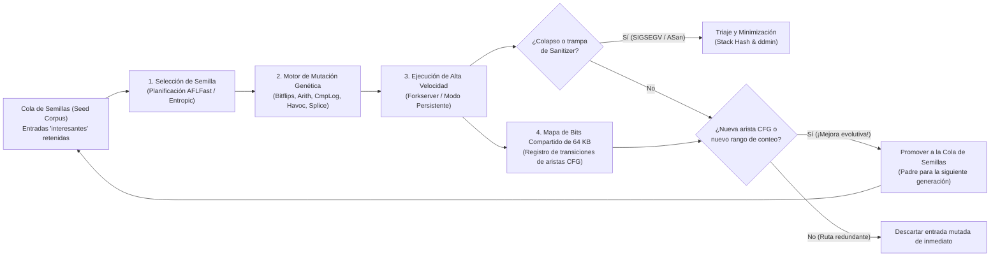

En una oscura y tormentosa noche de otoño de 1988 en Madison, Wisconsin, el profesor de ciencias de la computación <strong>Barton Miller</strong> intentaba trabajar desde la terminal de su casa conectado a una estación de trabajo UNIX de la universidad mediante un módem telefónico de 1200 baudios. Afuera rugía una feroz tormenta eléctrica del Medio Oeste. Cada vez que caía un rayo, la interferencia electromagnética inyectaba ráfagas de ruido aleatorio en la línea telefónica analógica, corrompiendo los caracteres ASCII enviados hacia la consola UNIX.

Lo que ocurrió a continuación lo dejó atónito: a medida que el ruido de la línea inyectaba secuencias de bytes sin sentido en utilidades estándar de UNIX ampliamente probadas —como `vi`, `cc`, `awk`, `sed`, `csh` e `indent`—, estos programas esenciales no se limitaban a mostrar un mensaje de error de sintaxis, sino que <strong>colapsaban uno tras otro con violaciones de segmento (`SIGSEGV`, Segmentation Fault) o quedaban bloqueados en bucles infinitos</strong>.

Impactado por esta fragilidad, Miller propuso a sus estudiantes de posgrado construir un generador de flujos de caracteres aleatorios al que bautizó como <strong>«Fuzz»</strong>. El resultado sacudió a la comunidad de ingeniería de software: <strong>entre el 25 % y el 33 % de todas las utilidades estándar de UNIX en siete variantes comerciales y académicas colapsaron al recibir flujos de bytes puramente aleatorios</strong>.

Más de tres décadas y media después, el <strong>Fuzzing (pruebas difusas)</strong> ha evolucionado desde aquel generador de ruido ciego hasta convertirse en la técnica automatizada de descubrimiento de vulnerabilidades más efectiva de la informática, combinando instrumentación en tiempo de compilación, algoritmos genéticos evolutivos, solucionadores formales SMT y mapeo de memoria sombra (Shadow Memory). Solo la plataforma continua <strong>OSS-Fuzz</strong> de Google ha descubierto automáticamente <strong>más de 10.000 vulnerabilidades de seguridad y más de 36.000 errores</strong> en proyectos críticos como OpenSSL, SQLite, FFmpeg y el kernel de Linux.

¿Por qué miles de pruebas unitarias escritas cuidadosamente por humanos pasan por alto corrupciones de memoria fatales que la mutación automática expone en minutos? En este artículo analizamos la explosión combinatoria del espacio de entrada, los cuatro paradigmas del fuzzing, la arquitectura interna de <strong>AFL / AFL++ / LibFuzzer</strong> (mapas de bits de 64 KB en caché L1, la demostración matemática del desplazamiento `>> 1`, Forkserver y planificación de cadenas de Markov), <strong>AddressSanitizer (ASan)</strong> y el algoritmo de <strong>Delta Debugging (`ddmin`)</strong> de Andreas Zeller.

---

## Capítulo 1: El abismo combinatorio del espacio de entrada y el efecto farola

### 1.1 Un búfer de 64 bytes alberga $10^{154}$ universos posibles

¿Por qué las pruebas unitarias manuales no pueden erradicar los errores de software? La razón fundamental radica en la <strong>explosión combinatoria del espacio de entrada</strong>. Consideremos una función en C que analiza un encabezado binario de apenas $N = 64$ bytes. Como cada byte puede tomar $|\Sigma| = 2^8 = 256$ valores distintos, el número total de entradas posibles de 64 bytes es:

$$|\Sigma|^N = 256^{64} = \left(2^8\right)^{64} = 2^{512} \approx 1.34 \times 10^{154}$$

Para dimensionar $1.34 \times 10^{154}$, recordemos que el número de Eddington (el total estimado de protones en todo el universo observable) es de apenas $\approx 10^{80}$. Aunque todos los procesadores de la Tierra evaluaran un billón ($10^{12}$) de entradas por segundo ininterrumpidamente desde el Big Bang hace 13.800 millones de años, no explorarían ni una fracción de $10^{-124}$ de ese pequeño búfer de 64 bytes.

### 1.2 El efecto farola (Streetlight Effect) y la «Weird Machine»

Al escribir pruebas unitarias, los desarrolladores caen inevitablemente en el <strong>efecto farola (sesgo de observación)</strong>: como quien busca sus llaves perdidas de noche únicamente debajo de la farola porque allí hay luz, los ingenieros solo prueban <strong>los casos válidos previstos en la especificación</strong> y <strong>los valores límite obvios (`0`, `-1`, `NULL`)</strong> en los que ya pensaron al programar. Sin embargo, las vulnerabilidades críticas habitan en la oscuridad de la <strong>«Weird Machine»</strong> (Bratus et al.): el autómata de estados emergente creado por desbordamientos de enteros y supuestos implícitos del analizador:

```c
int parse_image_chunk(const uint8_t *buf, size_t len) {
    if (len < 16) return -1;
    uint32_t magic  = *(const uint32_t *)(buf + 0);
    uint16_t width  = *(const uint16_t *)(buf + 4);
    uint16_t height = *(const uint16_t *)(buf + 6);
    uint8_t  flags  = buf[8];

    if (magic != 0x494D4721) return -1;          // Exige firma mágica "IMG!"
    if (width == 0 || height == 0) return -1;    // ¡El desarrollador probó el borde 0!

    uint16_t alloc_size = width * height;        // [BUG] ¡Desbordamiento entero de 16 bits!
    if (flags & 0x80) alloc_size += 16;
    uint8_t *pixel_buf = malloc(alloc_size);     // Reserva solo 0 o 16 bytes
    memcpy(pixel_buf, buf + 16, (size_t)width * height); // ¡Copia 65.536 bytes corrompiendo el heap!
    ...
}
```

Con `width = 256, height = 256`, el producto $256 \times 256 = 65536 \equiv 0 \pmod{2^{16}}$ desborda la variable de 16 bits `alloc_size` a `0`, reserva apenas 16 bytes con `malloc(16)` y sobrescribe 64 KB del heap mediante `memcpy`.

---

## Capítulo 2: Los cuatro paradigmas del Fuzzing

Para superar barreras como `if (magic != 0x494D4721)` (probabilidad aleatoria de $2^{-32} \approx 1 / 4.29\times 10^9$), el fuzzing ha evolucionado en cuatro grandes paradigmas:

| Paradigma de Fuzzing | Herramientas representativas | Visibilidad interna | Mecanismo de búsqueda y generación | Fortalezas clave | Cuellos de botella fundamentales |
| :--- | :--- | :--- | :--- | :--- | :--- |
| <strong>Fuzzing de caja negra</strong><br>(Black-box) | `fuzz` (1988), `zzuf`, `radamsa` | Ninguna (caja opaca) | Inversión aleatoria de bits y sobrescritura ciega de bytes | Sin instrumentación ni código fuente; altísima velocidad inicial | Bloqueado por bytes mágicos ($2^{-32}$), sumas de verificación y sintaxis estructurada |
| <strong>Fuzzing basado en gramáticas</strong><br>(Grammar-based) | `Peach`, `Syzkaller`, `LangFuzz`, `Domato` | Gramática libre de contexto (CFG) o especificación de syscalls | Sintetiza y muta árboles de sintaxis abstracta (AST) estructuralmente válidos | Penetra analizadores léxicos/sintácticos hasta motores JS y kernels de SO | Alto costo manual para definir gramáticas; omite fallos del parser ante sintaxis corrupta |
| <strong>Ejecución simbólica / concólica</strong><br>(White-box) | `SAGE`, `KLEE`, `angr`, `Driller` | Traza simbólica completa y recolección de predicados de rama | Construye la restricción de ruta $\Pi$ e invierte ramas con un <strong>solucionador SMT (Z3)</strong> | Resuelve algebraicamente `x == 0xdeadbeef` en un solo paso | <strong>Explosión de rutas ($2^d$)</strong> en bucles; bloqueo del SMT en hashes y aritmética no lineal |
| <strong>Fuzzing de caja gris guiado por cobertura (CGF)</strong> | <strong>`AFL`</strong>, <strong>`AFL++`</strong>, <strong>`LibFuzzer`</strong>, `Honggfuzz` | <strong>Instrumentación ligera de aristas</strong> en compilación (bitmap 64 KB) | <strong>Algoritmo genético evolutivo</strong>: retiene solo semillas que descubren nuevas aristas del CFG | Sin solucionador SMT pesado; logra $10^4\text{–}10^5\text{ execs/s}$ evolucionando hacia estados profundos | Requiere CmpLog (RedQueen) o diccionarios para comparaciones monolíticas multibyte |

En la ejecución concólica (Concrete + Symbolic), los bytes de entrada se tratan como variables simbólicas $\vec{\alpha}$ y se niega la última condición de rama para el solucionador SMT:

$$\Pi_{\text{path}} = c_1(\vec{\alpha}) \land c_2(\vec{\alpha}) \land \dots \land c_{k-1}(\vec{\alpha}) \land \neg c_k(\vec{\alpha})$$

Por el contrario, <strong>AFL</strong> (creado por <strong>Michał Zalewski</strong> en 2013), <strong>AFL++</strong> y <strong>LibFuzzer</strong> sustituyen la resolución SMT por selección natural darwiniana guiada por cobertura de aristas.



---

## Capítulo 3:Dentro del motor de AFL — Instrumentación de aristas, bitmap de 64 KB y demostración de `>> 1`

### 3.1 Por qué la cobertura de aristas (Edge Coverage) supera a la cobertura de bloques básicos

Si un fuzzer solo registrara qué bloques básicos fueron visitados, tras ejecutar la ruta $A \to B \to C$ los bloques $\{A, B, C\}$ quedarían marcados. Cuando una segunda entrada salta el bloque de inicialización $B$ tomando la ruta directa $A \to C$ (donde $C$ desreferencia un puntero nulo), como $\{A, C\} \subset \{A, B, C\}$, ¡un fuzzer basado en nodos descartaría la entrada como redundante! Al registrar <strong>pares de transición dirigidos (aristas)</strong> $(B_{\text{prev}} \to B_{\text{cur}})$, AFL detecta al instante que la arista $(A \to C)$ es nueva.

### 3.2 El trampolín de 3 líneas, los 64 KB en caché L1 y la necesidad matemática de `>> 1`

AFL inyecta en cada bloque básico estas tres operaciones durante la compilación:

```c
/* Compile-time random 16-bit ID assigned to the current basic block */
cur_location = <COMPILE_TIME_RANDOM_16BIT>;

/* Record the transition edge (prev -> cur) in the 64 KB shared bitmap */
shared_mem[cur_location ^ prev_location]++;

/* Right-shift by 1 bit to preserve directionality and self-loops */
prev_location = cur_location >> 1;
```

¿Por qué `shared_mem` mide exactamente $2^{16} = 65.536$ bytes (<strong>64 KB</strong>)? Porque 64 KB <strong>caben por completo en la caché de datos L1/L2 del núcleo de la CPU</strong>, evitando fallos de caché hacia la memoria DRAM y registrando cada salto en apenas ~1 nanosegundo.

¿Por qué es matemáticamente indispensable el <strong>desplazamiento de 1 bit a la derecha (`>> 1`)</strong> en `prev_location = cur_location >> 1;`? Sin ese desplazamiento, el operador XOR ($\oplus$) sufriría dos degeneraciones algebraicas fatales:

$$\text{Without shift: } \quad \text{Edge}(A \to B) = A \oplus B = B \oplus A = \text{Edge}(B \to A), \qquad \text{Edge}(A \to A) = A \oplus A = 0$$

$$\text{With 1-bit right shift: } \quad \text{Edge}(A \to B) = (A \gg 1) \oplus B \neq (B \gg 1) \oplus A = \text{Edge}(B \to A), \qquad \text{Edge}(A \to A) = (A \gg 1) \oplus A \neq 0$$

1. <strong>Pérdida de direccionalidad por conmutatividad ($A \oplus B = B \oplus A$)</strong>: El salto $A \to B$ y el retorno $B \to A$ producirían exactamente el mismo índice en el mapa de bits.
2. <strong>Aniquilación de autobucles por nilpotencia ($A \oplus A = 0$)</strong>: Cualquier bloque que salte sobre sí mismo ($A \to A$) daría $0$, haciendo colisionar todos los autobucles del programa en el único byte `shared_mem[0]`.

El desplazamiento `>> 1` rompe simultáneamente la simetría y la nilpotencia en un solo ciclo de reloj. Además, AFL agrupa los conteos de ejecución en <strong>8 cubetas logarítmicas ($1, 2, 3, 4\text{–}7, 8\text{–}15, 16\text{–}31, 32\text{–}127, 128\text{–}255$)</strong> para detectar hitos en la iteración de bucles sin saturar la cola.

### 3.3 Forkserver, Modo Persistente y planificación de cadenas de Markov (AFLFast / Entropic)

Para eliminar el enorme costo de `execve()` y del enlazador dinámico (`ld.so`), el <strong>Forkserver</strong> de AFL detiene el proceso justo antes de `main()` y clona procesos hijos mediante <strong>Copy-on-Write (`fork()`)</strong> a través de las tuberías `fd 198`/`199`. El <strong>Modo Persistente (`LLVMFuzzerTestOneInput`)</strong> elimina incluso `fork()`, invocando la función objetivo en un bucle en memoria a más de $100.000\text{ execs/s}$. Junto con <strong>CmpLog (RedQueen)</strong> y los planificadores <strong>AFLFast / Entropic</strong> basados en cadenas de Markov y entropía de Shannon $H(s)$, el fuzzer concentra su energía mutacional en las ramas menos exploradas:

$$p(s) = \min\left(\frac{\alpha(s)}{\beta} \cdot \frac{2^{s_{\text{handicap}}}}{f(i)}, \; M\right), \qquad H(s) = -\sum_{e \in E(s)} \hat{p}_{s,e} \log_2 \hat{p}_{s,e}$$

---

## Capítulo 4: Convirtiendo la corrupción silenciosa en colapsos instantáneos — Sanitizers

Dado que la MMU de hardware solo verifica permisos en páginas de <strong>$4\text{ KB}$</strong>, un desbordamiento de 1 byte en el heap o un Use-After-Free casi nunca dispara `SIGSEGV`. <strong>AddressSanitizer (ASan)</strong> resuelve esto mediante un <strong>mapeo de memoria sombra (Shadow Memory) 1:8</strong>:

$$\text{ShadowAddr}(\text{Addr}) = (\text{Addr} \gg 3) + \text{Offset}$$

Cada bloque alineado de 8 bytes de memoria de aplicación se proyecta en 1 byte sombra: `0x00` indica que los 8 bytes son válidos, $1 \le k \le 7$ indica que solo los primeros $k$ bytes son válidos, y los valores negativos marcan <strong>zonas rojas envenenadas (`0xfa` en heap, `0xf1` en pila)</strong> o memoria liberada retenida en la <strong>cola de cuarentena (`0xfd` para Use-After-Free)</strong>. Antes de cada acceso a memoria, el compilador inserta:

```c
/* Compiler-injected ASan check before an N-byte memory access (N = 1, 2, 4) */
uintptr_t shadow_addr = (addr >> 3) + ASAN_SHADOW_OFFSET;
int8_t shadow_val = *(int8_t *)shadow_addr;

if (UNLIKELY(shadow_val != 0)) {
    /* For partial 8-byte words (1 <= shadow_val <= 7) or negative redzones */
    if (shadow_val < 0 || (int8_t)((addr & 7) + N) > shadow_val) {
        __asan_report_error(pc, bp, sp, addr, is_write, N);
    }
}
```

Combinado con <strong>UBSan</strong> (comportamiento indefinido y desbordamiento de enteros), <strong>MSan</strong> (lectura de memoria no inicializada bit a bit), <strong>TSan</strong> (condiciones de carrera mediante relojes vectoriales) y el <strong>Fuzzing Diferencial</strong>, cualquier anomalía sutil provoca una detención inmediata y reproducible.

---

## Capítulo 5: Triaje de colapsos y Delta Debugging (`ddmin`) de Andreas Zeller

Los miles de archivos de colapso duplicados se agrupan primero mediante el <strong>hash de la pila de llamadas (Stack Hash)</strong> en el punto del fallo. Luego, para reducir un archivo corrupto de varios megabytes $c$ (longitud $N$) lleno de ruido mutacional a un ejemplo mínimo, el algoritmo <strong>Delta Debugging (`ddmin`) de Andreas Zeller</strong> encuentra automáticamente un caso de prueba <strong>1-minimal $c^*$</strong> en el que eliminar cualquier byte adicional hace desaparecer el fallo:

$$\forall c' \subsetneq c^* \; \text{with} \; |c^*| - |c'| = 1 : \quad \text{test}(c') \neq \text{FAIL}$$

$$T_{\text{best}}(N) = \mathcal{O}(\log_2 N), \qquad T_{\text{worst}}(N) = \frac{N^2 + 3N - 2}{2} = \mathcal{O}(N^2)$$

Dividiendo la entrada en $n$ fragmentos $\Delta_1, \dots, \Delta_n$ (empezando con $n=2$), `ddmin` prueba primero cada subconjunto $\Delta_i$, luego cada complemento $\nabla_i = c \setminus \Delta_i$, y duplica la granularidad $n \leftarrow \min(2n, |c|)$ cuando ninguna reducción directa funciona. Mediante esta búsqueda binaria generalizada, `ddmin` (`afl-tmin` y `C-Reduce`) comprime un archivo de 10 MB en una prueba de concepto (PoC) de pocos bytes en $\mathcal{O}(\log_2 N)$ pasos en el mejor caso.
