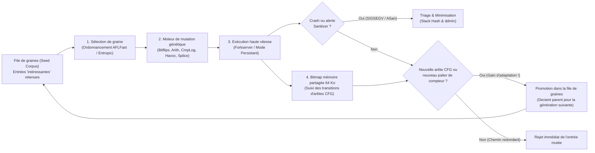

Par une nuit d'orage d'automne en 1988 à Madison, dans le Wisconsin, le professeur d'informatique <strong>Barton Miller</strong> travaillait depuis son domicile sur un terminal relié à sa station de travail UNIX universitaire via un modem commuté à 1200 bauds et une ligne téléphonique analogique. Dehors, la foudre frappait sans relâche, injectant par induction électromagnétique des rafales de bruit parasite dans la ligne téléphonique et corrompant les flux de caractères ASCII envoyés au shell UNIX.

Ce que Miller observa alors le stupéfia : chaque fois que le bruit de la ligne injectait des séquences d'octets incohérentes dans des utilitaires UNIX standard pourtant éprouvés — tels que `vi`, `cc`, `awk`, `sed`, `csh` ou `indent` — ces programmes utilisés quotidiennement par des milliers d'ingénieurs ne se contentaient pas d'afficher une erreur de syntaxe : ils <strong>plantaient brutalement avec des fautes de segmentation (`SIGSEGV`) ou se figeaient dans des boucles infinies</strong>.

Fasciné par cette fragilité, Miller confia à ses étudiants de master un projet consistant à bombarder d'entrées aléatoires près de 90 utilitaires sur sept variantes d'UNIX, baptisant ce générateur de bruit <strong>« Fuzz »</strong>. Les résultats ébranlèrent l'industrie : <strong>entre 25 % et 33 % des utilitaires UNIX standard plantaient dès qu'on leur soumettait des flux d'octets purement aléatoires</strong>.

Plus de trente-cinq ans plus tard, le <strong>fuzzing (test à données aléatoires)</strong> a évolué d'un simple générateur de bruit aveugle vers la discipline de découverte automatique de vulnérabilités la plus puissante de l'informatique, fusionnant l'instrumentation compilateur (LLVM IR), les algorithmes génétiques darwiniens, les solveurs formels SMT et la mémoire fantôme (Shadow Memory). À elle seule, l'infrastructure <strong>OSS-Fuzz</strong> de Google a découvert automatiquement <strong>plus de 10 000 vulnérabilités de sécurité et plus de 36 000 bugs</strong> dans des projets critiques comme OpenSSL, SQLite, FFmpeg et le noyau Linux.

Pourquoi des milliers de tests unitaires écrits par des humains laissent-ils passer des corruptions mémoire fatales que la mutation automatique débusque en quelques minutes ? Cet article décortique l'explosion combinatoire de l'espace d'entrée, les quatre paradigmes du fuzzing, l'architecture interne d'<strong>AFL / AFL++ / LibFuzzer</strong> (bitmap de 64 Ko en cache L1, preuve mathématique du décalage `>> 1`, Forkserver et ordonnancement markovien), le fonctionnement d'<strong>AddressSanitizer (ASan)</strong> et l'algorithme de <strong>Delta Debugging (`ddmin`)</strong> d'Andreas Zeller.

---

## Chapitre 1 : L'abîme combinatoire des espaces d'entrée et l'effet réverbère

### 1.1 Un tampon de 64 octets contient $10^{154}$ univers possibles

Pourquoi les suites de tests manuels ne peuvent-elles pas éradiquer les bugs ? À cause de l'<strong>explosion combinatoire de l'espace d'entrée</strong>. Considérons une fonction C qui analyse un en-tête binaire de seulement $N = 64$ octets. Chaque octet pouvant prendre $|\Sigma| = 2^8 = 256$ valeurs, le nombre total d'entrées possibles est :

$$|\Sigma|^N = 256^{64} = \left(2^8\right)^{64} = 2^{512} \approx 1.34 \times 10^{154}$$

À titre de comparaison, le nombre d'Eddington (le nombre total estimé de protons dans l'univers observable) n'est que d'environ $10^{80}$. Même si tous les processeurs sur Terre testaient mille milliards ($10^{12}$) d'entrées par seconde depuis le Big Bang il y a 13,8 milliards d'années, ils n'exploreraient pas $10^{-124}$ de cet espace de 64 octets.

### 1.2 L'effet réverbère (Streetlight Effect) et la « Weird Machine »

Lorsqu'un développeur écrit des tests unitaires, il est victime de l'<strong>effet réverbère (biais d'observation)</strong> : comme le passant qui cherche ses clés perdues uniquement sous le lampadaire parce qu'il y fait clair, l'humain ne teste que les <strong>cas nominaux spécifiés</strong> et les <strong>valeurs limites évidentes (`0`, `-1`, `NULL`)</strong> auxquelles il a déjà pensé en codant. Or, les vulnérabilités critiques résident dans l'ombre, au sein de la <strong>« Weird Machine »</strong> (Bratus et al.) — l'automate d'états émergent né de l'interaction entre troncatures d'entiers et invariants implicites :

```c
int parse_image_chunk(const uint8_t *buf, size_t len) {
    if (len < 16) return -1;
    uint32_t magic  = *(const uint32_t *)(buf + 0);
    uint16_t width  = *(const uint16_t *)(buf + 4);
    uint16_t height = *(const uint16_t *)(buf + 6);
    uint8_t  flags  = buf[8];

    if (magic != 0x494D4721) return -1;          // Attend la signature "IMG!"
    if (width == 0 || height == 0) return -1;    // Le développeur a testé 0 !

    uint16_t alloc_size = width * height;        // [BUG] Dépassement d'entier 16 bits !
    if (flags & 0x80) alloc_size += 16;
    uint8_t *pixel_buf = malloc(alloc_size);     // Alloue seulement 0 ou 16 octets
    memcpy(pixel_buf, buf + 16, (size_t)width * height); // Copie 65 536 octets -> corruption du tas !
    ...
}
```

Si `width = 256` et `height = 256`, le produit $256 \times 256 = 65536 \equiv 0 \pmod{2^{16}}$ provoque un dépassement d'entier sur 16 bits : `malloc(16)` alloue un minuscule tampon que `memcpy` écrase immédiatement avec 64 Ko de données.

---

## Chapitre 2 : Les quatre grands paradigmes du fuzzing

Pour franchir une barrière telle que `if (magic != 0x494D4721)` (probabilité aléatoire de $2^{-32} \approx 1 / 4,29\times 10^9$), quatre paradigmes se sont succédé :

| Paradigme de Fuzzing | Outils représentatifs | Visibilité interne | Mécanisme de recherche et génération | Forces principales | Limites et goulots d'étranglement |
| :--- | :--- | :--- | :--- | :--- | :--- |
| <strong>Fuzzing boîte noire</strong><br>(Black-box) | `fuzz` (1988), `zzuf`, `radamsa` | Aucune (totalement opaque) | Inversion aléatoire de bits, écrasement d'octets à l'aveugle | Aucune instrumentation ni code source requis, très rapide | Bloqué par les octets magiques ($2^{-32}$), les sommes de contrôle et la syntaxe |
| <strong>Fuzzing à base de grammaire</strong><br>(Grammar-based) | `Peach`, `Syzkaller`, `LangFuzz`, `Domato` | Grammaire hors-contexte (CFG) ou spécification d'API | Synthétise et mute des arbres syntaxiques abstraits (AST) valides | Traverse les analyseurs lexicaux/syntaxiques jusqu'au cœur des moteurs JS ou du noyau OS | Coût humain élevé pour écrire la grammaire ; manque les bugs de syntaxe malformée |
| <strong>Exécution symbolique / concolique</strong><br>(White-box) | `SAGE`, `KLEE`, `angr`, `Driller` | Trace symbolique complète et prédicats de branchement | Collecte la contrainte de chemin $\Pi$ et inverse les branches via un <strong>solveur SMT (Z3)</strong> | Résout algébriquement `x == 0xdeadbeef` en une seule étape | <strong>Explosion des chemins ($2^d$)</strong> dans les boucles, lenteur SMT sur le non-linéaire |
| <strong>Fuzzing boîte grise guidé par la couverture (CGF)</strong> | <strong>`AFL`</strong>, <strong>`AFL++`</strong>, <strong>`LibFuzzer`</strong>, `Honggfuzz` | <strong>Instrumentation légère des arêtes</strong> à la compilation (bitmap 64 Ko) | <strong>Évolution génétique</strong> : ne conserve que les graines découvrant de nouvelles arêtes du CFG | Pas de solveur SMT lourd ; $10^4\text{–}10^5\text{ execs/s}$ avec sélection naturelle vers les états profonds | Nécessite CmpLog (RedQueen) ou des dictionnaires pour les comparaisons multi-octets |

Dans l'exécution concolique (Concrete + Symbolic), les octets d'entrée sont modélisés par des variables symboliques $\vec{\alpha}$ et la dernière condition de branchement est inversée pour le solveur SMT :

$$\Pi_{\text{path}} = c_1(\vec{\alpha}) \land c_2(\vec{\alpha}) \land \dots \land c_{k-1}(\vec{\alpha}) \land \neg c_k(\vec{\alpha})$$

À l'inverse, <strong>AFL</strong> (créé par <strong>Michał Zalewski</strong> en 2013), <strong>AFL++</strong> et <strong>LibFuzzer</strong> remplacent le solveur SMT par une boucle évolutive guidée par la couverture d'arêtes.



---

## Chapitre 3 : Au cœur du moteur d'AFL — Instrumentation d'arêtes, bitmap de 64 Ko et preuve de `>> 1`

### 3.1 Pourquoi la couverture d'arêtes (Edge Coverage) surpasse la couverture de blocs

Si le fuzzer ne notait que les blocs de base visités, après une exécution empruntant $A \to B \to C$, les blocs $\{A, B, C\}$ seraient tous marqués comme visités. Lorsqu'une seconde entrée contourne l'initialisation en $B$ en prenant directement l'arête $A \to C$ (déclenchant un déréférencement NULL dans $C$), l'ensemble $\{A, C\} \subset \{A, B, C\}$ serait jugé redondant et jeté ! En suivant les <strong>couples de transition (arêtes)</strong> $(B_{\text{prev}} \to B_{\text{cur}})$, AFL détecte immédiatement que la transition $(A \to C)$ est inédite.

### 3.2 Le trampoline de 3 lignes, le cache L1 de 64 Ko et la nécessité mathématique de `>> 1`

À la compilation, AFL injecte à l'entrée de chaque bloc de base ces trois instructions :

```c
/* Compile-time random 16-bit ID assigned to the current basic block */
cur_location = <COMPILE_TIME_RANDOM_16BIT>;

/* Record the transition edge (prev -> cur) in the 64 KB shared bitmap */
shared_mem[cur_location ^ prev_location]++;

/* Right-shift by 1 bit to preserve directionality and self-loops */
prev_location = cur_location >> 1;
```

La taille de `shared_mem` est fixée à $2^{16} = 65\,536$ octets (<strong>64 Ko</strong>) afin de <strong>résider intégralement dans le cache de données L1/L2 du processeur</strong>, évitant tout défaut de cache vers la RAM et limitant le surcoût à ~1 nanoseconde par saut.

Pourquoi le <strong>décalage d'un bit vers la droite (`>> 1`)</strong> dans `prev_location = cur_location >> 1;` est-il indispensable ? Sans ce décalage, l'opérateur OU exclusif (XOR) souffrirait de deux dégénérescences algébriques fatales :

$$\text{Without shift: } \quad \text{Edge}(A \to B) = A \oplus B = B \oplus A = \text{Edge}(B \to A), \qquad \text{Edge}(A \to A) = A \oplus A = 0$$

$$\text{With 1-bit right shift: } \quad \text{Edge}(A \to B) = (A \gg 1) \oplus B \neq (B \gg 1) \oplus A = \text{Edge}(B \to A), \qquad \text{Edge}(A \to A) = (A \gg 1) \oplus A \neq 0$$

1. <strong>Perte de directionnalité par commutativité ($A \oplus B = B \oplus A$)</strong> : L'arête aller $A \to B$ et l'arête retour $B \to A$ produiraient exactement le même indice.
2. <strong>Annihilation des boucles réflexives par nilpotence ($A \oplus A = 0$)</strong> : Toute boucle d'un bloc sur lui-même ($A \to A$) vaudrait $0$, faisant entrer en collision toutes les boucles réflexives du programme dans l'unique octet `shared_mem[0]` !

Le décalage `>> 1` brise simultanément la symétrie et la nilpotence en un seul cycle d'horloge. De plus, les compteurs d'exécutions sont regroupés en <strong>8 paliers logarithmiques ($1, 2, 3, 4\text{–}7, 8\text{–}15, 16\text{–}31, 32\text{–}127, 128\text{–}255$)</strong> pour capter les étapes clés du déroulement des boucles.

### 3.3 Forkserver, Mode Persistant et ordonnancement markovien (AFLFast / Entropic)

Pour éliminer le coût prohibitif d'`execve()` et de l'éditeur de liens dynamique (`ld.so`), le <strong>Forkserver</strong> d'AFL fige le processus juste avant `main()` et clone les processus enfants uniquement par <strong>Copy-on-Write (`fork()`)</strong> via les tubes `fd 198`/`199`. Le <strong>Mode Persistant (`LLVMFuzzerTestOneInput`)</strong> va encore plus loin en appelant directement la fonction cible en mémoire dans une boucle sans aucun `fork()`, dépassant $100\,000\text{ execs/s}$. Associé à <strong>CmpLog (RedQueen)</strong> (qui intercepte les opérandes des instructions `cmp`/`memcmp`) et aux ordonnanceurs <strong>AFLFast / Entropic</strong> basés sur les chaînes de Markov et l'entropie de Shannon $H(s)$, le fuzzer concentre son énergie sur les chemins rares :

$$p(s) = \min\left(\frac{\alpha(s)}{\beta} \cdot \frac{2^{s_{\text{handicap}}}}{f(i)}, \; M\right), \qquad H(s) = -\sum_{e \in E(s)} \hat{p}_{s,e} \log_2 \hat{p}_{s,e}$$

---

## Chapitre 4 : Transformer les corruptions silencieuses en crashs immédiats — Les Sanitizers

Comme l'unité de gestion mémoire (MMU) matérielle ne vérifie les permissions qu'à l'échelle de pages de <strong>$4\text{ Ko}$</strong>, un débordement de tampon d'un seul octet sur le tas ou un Use-After-Free ne déclenche presque jamais de `SIGSEGV`. <strong>AddressSanitizer (ASan)</strong> résout ce problème grâce à une <strong>projection mémoire fantôme (Shadow Memory) 1:8</strong> :

$$\text{ShadowAddr}(\text{Addr}) = (\text{Addr} \gg 3) + \text{Offset}$$

Chaque mot aligné de 8 octets de mémoire applicative est associé à 1 octet fantôme : `0x00` si les 8 octets sont valides, $1 \le k \le 7$ si seuls les $k$ premiers octets sont valides, et une valeur négative pour les <strong>zones rouges empoisonnées (`0xfa` sur le tas, `0xf1` sur la pile)</strong> ou les blocs libérés placés en <strong>file de quarantaine (`0xfd` pour détecter les Use-After-Free)</strong>. Avant chaque accès mémoire, le compilateur insère :

```c
/* Compiler-injected ASan check before an N-byte memory access (N = 1, 2, 4) */
uintptr_t shadow_addr = (addr >> 3) + ASAN_SHADOW_OFFSET;
int8_t shadow_val = *(int8_t *)shadow_addr;

if (UNLIKELY(shadow_val != 0)) {
    /* For partial 8-byte words (1 <= shadow_val <= 7) or negative redzones */
    if (shadow_val < 0 || (int8_t)((addr & 7) + N) > shadow_val) {
        __asan_report_error(pc, bp, sp, addr, is_write, N);
    }
}
```

Complété par <strong>UBSan</strong> (comportements indéfinis et dépassements d'entiers), <strong>MSan</strong> (suivi bit à bit de la mémoire non initialisée), <strong>TSan</strong> (détection des courses aux données par horloges vectorielles) et le <strong>fuzzing différentiel</strong> (comparaison des sorties de plusieurs implémentations indépendantes), le moindre défaut mémoire ou logique provoque un arrêt immédiat et traçable.

---

## Chapitre 5 : Triage des crashs et Delta Debugging (`ddmin`) d'Andreas Zeller

Les milliers de crashs redondants sont d'abord dédupliqués par <strong>hachage de la pile d'appels (Stack Hash)</strong> des fonctions situées au sommet de la pile au moment de la faute. Ensuite, pour réduire un fichier de crash de plusieurs mégaoctets $c$ (de taille $N$) rempli de bruit de mutation en un cas de test minimal, l'algorithme de <strong>Delta Debugging (`ddmin`) d'Andreas Zeller</strong> recherche automatiquement un sous-ensemble <strong>1-minimal $c^*$</strong> tel que la suppression de n'importe quel octet supplémentaire fasse disparaître le crash :

$$\forall c' \subsetneq c^* \; \text{with} \; |c^*| - |c'| = 1 : \quad \text{test}(c') \neq \text{FAIL}$$

$$T_{\text{best}}(N) = \mathcal{O}(\log_2 N), \qquad T_{\text{worst}}(N) = \frac{N^2 + 3N - 2}{2} = \mathcal{O}(N^2)$$

En partitionnant l'entrée en $n$ blocs $\Delta_1, \dots, \Delta_n$ (initialement $n=2$), `ddmin` teste d'abord chaque sous-ensemble $\Delta_i$, puis chaque complémentaire $\nabla_i = c \setminus \Delta_i$, et double la granularité $n \leftarrow \min(2n, |c|)$ lorsque aucune réduction directe n'aboutit. Par cette généralisation de la recherche dichotomique, `ddmin` (utilisé dans `afl-tmin` et `C-Reduce`) réduit un fichier de 10 Mo en une preuve de concept (PoC) chirurgicale de quelques octets en seulement $\mathcal{O}(\log_2 N)$ étapes dans le meilleur cas.
