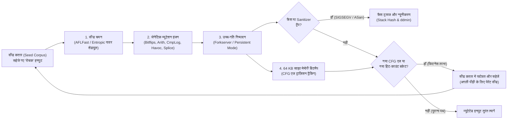

1988 की शरद ऋतु की एक अंधेरी, तूफ़ानी रात में मैडिसन, विस्कॉन्सिन में कंप्यूटर विज्ञान के प्रोफेसर <strong>बार्टन मिलर (Barton Miller)</strong> अपने घर के टर्मिनल पर बैठे थे और 1200-बॉड डायल-अप मोडेम तथा एनालॉग टेलीफोन लाइन के माध्यम से विश्वविद्यालय के UNIX वर्कस्टेशन पर काम करने का प्रयास कर रहे थे। बाहर भीषण तड़ित-झंझावात (thunderstorm) चल रहा था। जब भी बिजली गिरती, विद्युत-चुंबकीय हस्तक्षेप टेलीफोन तार में यादृच्छिक शोर (random line noise) भर देता, जिससे UNIX शेल को भेजे जा रहे ASCII अक्षर विकृत हो जाते।

इसके बाद जो हुआ उसने मिलर को स्तब्ध कर दिया: जब भी लाइन के शोर ने `vi`, `cc`, `awk`, `sed`, `csh` और `indent` जैसी अत्यंत विश्वसनीय मानी जाने वाली मानक UNIX यूटिलिटीज़ में अर्थहीन बाइट अनुक्रम भेजे, वे प्रोग्राम केवल सिंटैक्स त्रुटि दिखाकर बंद नहीं हुए — बल्कि वे <strong>एक के बाद एक सेगमेंटेशन फ़ॉल्ट (`SIGSEGV`, Segmentation Fault) के साथ क्रैश हो गए या अनंत लूप (infinite loops) में फँस गए</strong>।

इस नाजुकता से चकित होकर, मिलर ने अपने स्नातकोत्तर छात्रों को एक यादृच्छिक कैरेक्टर स्ट्रीम जनरेटर बनाने का प्रोजेक्ट दिया और इसे <strong>"Fuzz" (फ़ज़: शोर/रोआँ)</strong> नाम दिया। परिणामों ने संपूर्ण सॉफ़्टवेयर जगत को हिला दिया: <strong>सात प्रमुख व्यावसायिक और अकादमिक UNIX प्रणालियों की 25% से 33% मानक यूटिलिटीज़ केवल यादृच्छिक बाइट स्ट्रीम देने मात्र से क्रैश हो गईं</strong>।

पैंतीस से अधिक वर्षों के बाद, <strong>फ़ज़िंग (Fuzzing / Fuzz Testing)</strong> उस अंधे शोर जनरेटर से विकसित होकर कंप्यूटर विज्ञान की सबसे शक्तिशाली स्वचालित वल्नरेबिलिटी खोज तकनीक बन चुकी है, जो कंपाइलर इंस्ट्रूमेंटेशन (LLVM IR), डार्विनियन विकासवादी जेनेटिक एल्गोरिदम, SMT सॉल्वर और शैडो मेमोरी मैपिंग को जोड़ती है। अकेले Google के निरंतर फ़ज़िंग प्लेटफ़ॉर्म <strong>OSS-Fuzz</strong> ने OpenSSL, SQLite, FFmpeg और Linux कर्नेल जैसी महत्वपूर्ण ओपन-सोर्स परियोजनाओं में <strong>10,000 से अधिक सुरक्षा कमज़ोरियों और 36,000 से अधिक बग्स</strong> को स्वचालित रूप से खोजा है।

मनुष्यों द्वारा सावधानीपूर्वक लिखे गए हज़ारों यूनिट टेस्ट (Unit Tests) जिन घातक मेमोरी बग्स को छोड़ देते हैं, उन्हें स्वचालित म्यूटेशन कुछ ही मिनटों में कैसे पकड़ लेता है? इस लेख में हम इनपुट स्पेस के कॉम्बिनेटरियल विस्फोट, फ़ज़िंग के चार प्रतिमानों, <strong>AFL / AFL++ / LibFuzzer</strong> की आंतरिक संरचना (64 KB L1-कैश बिटमैप, 1-बिट राइट शिफ्ट `>> 1` की गणितीय अनिवार्यता, Forkserver और मार्कोव पावर शेड्यूल), <strong>AddressSanitizer (ASan)</strong> की शैडो मेमोरी और एंड्रियास ज़ेलर के <strong>डेल्टा डीबगिंग (`ddmin`)</strong> एल्गोरिदम का गहन विश्लेषण करेंगे।

---

## अध्याय 1: इनपुट स्पेस का कॉम्बिनेटरियल अथाह सागर और 'स्ट्रीटलाइट इफ़ेक्ट'

### 1.1 मात्र 64-बाइट बफ़र में छिपे हैं $10^{154}$ संभावित ब्रह्मांड

मैनुअल यूनिट टेस्ट सॉफ़्टवेयर बग्स को पूरी तरह समाप्त क्यों नहीं कर सकते? इसका मूल कारण <strong>इनपुट स्पेस का घातांकीय कॉम्बिनेटरियल विस्फोट</strong> है। मान लीजिए एक छोटा सा C फ़ंक्शन केवल $N = 64$ बाइट्स के बाइनरी नेटवर्क हेडर या इमेज चंक को पार्स करता है। चूँकि प्रत्येक बाइट के $|\Sigma| = 2^8 = 256$ संभावित मान हो सकते हैं, इसलिए कुल संभावित 64-बाइट इनपुट्स की संख्या है:

$$|\Sigma|^N = 256^{64} = \left(2^8\right)^{64} = 2^{512} \approx 1.34 \times 10^{154}$$

$1.34 \times 10^{154}$ की विशालता का अनुमान इस बात से लगाया जा सकता है कि संपूर्ण दृश्यमान ब्रह्मांड में प्रोटॉनों की कुल अनुमानित संख्या (एडिंगटन संख्या) केवल $\approx 10^{80}$ है। यदि पृथ्वी के सभी प्रोसेसर मिलकर बिग बैंग (13.8 अरब वर्ष पूर्व) से लेकर आज तक प्रति सेकंड एक ट्रिलियन ($10^{12}$) इनपुट टेस्ट करते, तब भी वे इस 64-बाइट स्पेस का $10^{-124}$ हिस्सा भी नहीं खंगाल पाते!

### 1.2 स्ट्रीटलाइट इफ़ेक्ट (Streetlight Effect) और 'वियर्ड मशीन' (Weird Machine)

जब डेवलपर्स मैनुअल यूनिट टेस्ट लिखते हैं, तो वे अनजाने में <strong>स्ट्रीटलाइट इफ़ेक्ट (अवलोकन पूर्वाग्रह)</strong> का शिकार हो जाते हैं: जैसे रात में चाबी खो जाने पर कोई व्यक्ति केवल स्ट्रीटलाइट के नीचे ही ढूँढता है क्योंकि वहाँ रोशनी है, वैसे ही इंजीनियर केवल <strong>स्पेसिफिकेशन में लिखे सामान्य पथों</strong> और <strong>स्पष्ट सीमा मानों (`0`, `-1`, `NULL`)</strong> का ही परीक्षण करते हैं जो कोड लिखते समय उनके दिमाग में आए थे। किंतु घातक बग्स अंधेरे में — <strong>'वियर्ड मशीन' (Weird Machine)</strong> (Bratus et al.) में छिपे होते हैं:

```c
int parse_image_chunk(const uint8_t *buf, size_t len) {
    if (len < 16) return -1;
    uint32_t magic  = *(const uint32_t *)(buf + 0);
    uint16_t width  = *(const uint16_t *)(buf + 4);
    uint16_t height = *(const uint16_t *)(buf + 6);
    uint8_t  flags  = buf[8];

    if (magic != 0x494D4721) return -1;          // "IMG!" मैजिक बाइट्स की जाँच
    if (width == 0 || height == 0) return -1;    // डेवलपर ने 0 सीमा का परीक्षण किया!

    uint16_t alloc_size = width * height;        // [बग] 16-बिट इंटीजर ओवरफ़्लो!
    if (flags & 0x80) alloc_size += 16;
    uint8_t *pixel_buf = malloc(alloc_size);     // केवल 0 या 16 बाइट आवंटित होते हैं
    memcpy(pixel_buf, buf + 16, (size_t)width * height); // 65,536 बाइट कॉपी होकर हीप नष्ट!
    ...
}
```

यहाँ यदि `width = 256` और `height = 256` दिया जाए, तो $256 \times 256 = 65536 \equiv 0 \pmod{2^{16}}$ के कारण 16-बिट वेरिएबल `alloc_size` ओवरफ़्लो होकर `0` हो जाता है, `malloc(16)` केवल 16 बाइट आवंटित करता है, और `memcpy` उसमें 64 KB डेटा लिखकर पूरे हीप (Heap) को भ्रष्ट कर देता है।

---

## अध्याय 2: फ़ज़िंग के चार प्रमुख प्रतिमान (Paradigms)

`if (magic != 0x494D4721)` (यादृच्छिक अनुमान की प्रायिकता $2^{-32} \approx 1 / 4.29\times 10^9$) जैसी दीवारों को पार करने के लिए फ़ज़िंग चार मुख्य प्रतिमानों में विकसित हुई है:

| फ़ज़िंग प्रतिमान | प्रतिनिधि टूल्स | आंतरिक दृश्यता | खोज और जनरेशन तंत्र | मुख्य शक्तियाँ | मूलभूत सीमाएँ |
| :--- | :--- | :--- | :--- | :--- | :--- |
| <strong>ब्लैक-बॉक्स फ़ज़िंग</strong><br>(Black-box Fuzzing) | 1988 `fuzz`, `zzuf`, `radamsa` | शून्य (पूर्णतः अपारदर्शी) | अंधाधुंध बिट फ़्लिप और बाइट ओवरराइट | सोर्स कोड या इंस्ट्रूमेंटेशन अनावश्यक; अत्यंत तेज़ प्रारंभिक गति | मैजिक बाइट्स ($2^{-32}$), चेकसम और जटिल सिंटैक्स पर तुरंत रुक जाता है |
| <strong>ग्रामर / जनरेशन-आधारित</strong><br>(Grammar-based) | `Peach`, `Syzkaller`, `LangFuzz`, `Domato` | संदर्भ-मुक्त व्याकरण (CFG) या सिस्टम कॉल विनिर्देश | संरचनात्मक रूप से वैध एब्स्ट्रैक्ट सिंटैक्स ट्री (AST) का निर्माण व म्यूटेशन | पार्सर को पार कर JS इंजन और OS कर्नेल की गहराई तक पहुँचता है | व्याकरण लिखने में भारी मानवीय श्रम; विकृत सिंटैक्स वाले पार्सर बग्स छूट सकते हैं |
| <strong>व्हाइट-बॉक्स सिम्बॉलिक / कॉनकॉलिक</strong><br>(Symbolic / Concolic) | `SAGE`, `KLEE`, `angr`, `Driller` | पूर्ण निर्देश-स्तरीय सिम्बॉलिक ट्रेस और ब्रांच प्रेडिकेट | पाथ कंस्ट्रेंट $\Pi$ एकत्र कर <strong>SMT सॉल्वर (Z3)</strong> से शाखा उलटता है | `x == 0xdeadbeef` जैसी जटिल शर्तों को एक ही बार में बीजगणितीय रूप से हल करता है | लूप्स में <strong>पाथ विस्फोट ($2^d$)</strong>; हैश और अरैखिक गणित पर SMT टाइमआउट |
| <strong>कवरेज-गाइडेड ग्रे-बॉक्स (CGF)</strong> | <strong>`AFL`</strong>, <strong>`AFL++`</strong>, <strong>`LibFuzzer`</strong>, `Honggfuzz` | हल्का कंपाइल-टाइम <strong>एज कवरेज इंस्ट्रूमेंटेशन</strong> (64 KB बिटमैप) | <strong>डार्विनियन जेनेटिक विकास</strong>: केवल नए CFG एज खोजने वाले सीड्स को सहेजता है | भारी SMT सॉल्वर के बिना $10^4\text{–}10^5\text{ निष्पादन/सेकंड}$ के साथ गहरे स्टेट्स तक विकास | एकल-निर्देश मल्टी-बाइट तुलना के लिए CmpLog (RedQueen) या डिक्शनरी आवश्यक |

व्हाइट-बॉक्स कॉनकॉलिक (Concrete + Symbolic) निष्पादन में इनपुट बाइट्स को प्रतीकात्मक चर $\vec{\alpha}$ मानकर अंतिम शाखा शर्त को SMT सॉल्वर के लिए नकारा जाता है:

$$\Pi_{\text{path}} = c_1(\vec{\alpha}) \land c_2(\vec{\alpha}) \land \dots \land c_{k-1}(\vec{\alpha}) \land \neg c_k(\vec{\alpha})$$

इसके विपरीत, 2013 में <strong>मिखाल ज़ालेव्स्की (Michał Zalewski)</strong> द्वारा निर्मित <strong>AFL</strong>, तथा <strong>AFL++</strong> और <strong>LibFuzzer</strong> ने भारी SMT सॉल्वर के स्थान पर एज-कवरेज निर्देशित प्राकृतिक चयन को अपनाया।



---

## अध्याय 3: AFL इंजन की आंतरिक संरचना — एज इंस्ट्रूमेंटेशन, 64 KB बिटमैप और `>> 1` का गणित

### 3.1 बेसिक-ब्लॉक कवरेज से एज (Edge) कवरेज बेहतर क्यों है?

यदि फ़ज़र केवल यह रिकॉर्ड करे कि कौन से बेसिक ब्लॉक (नोड्स) निष्पादित हुए, तो पथ $A \to B \to C$ के बाद तीनों ब्लॉक $\{A, B, C\}$ विज़िट किए गए मान लिए जाएँगे। जब दूसरा इनपुट इनिशियलाइज़ेशन ब्लॉक $B$ को छोड़कर सीधे $A \to C$ पर जाता है (जिससे ब्लॉक $C$ में NULL पॉइंटर डीरेफ़रेंस होता है), तो $\{A, C\} \subset \{A, B, C\}$ होने के कारण नोड-कवरेज फ़ज़र इसे बेकार समझकर फेंक देगा! किंतु <strong>निर्देशित ट्रांज़िशन युग्म (Edge Tuples)</strong> $(B_{\text{prev}} \to B_{\text{cur}})$ को रिकॉर्ड करने से AFL तुरंत पहचान लेता है कि एज $(A \to C)$ बिल्कुल नया है।

### 3.2 3-लाइन ट्रैम्पोलिन, 64 KB L1 कैश और `>> 1` राइट शिफ्ट की गणितीय सिद्धि

AFL कंपाइल समय पर प्रत्येक बेसिक ब्लॉक के प्रारंभ में ये तीन निर्देश जोड़ता है:

```c
/* Compile-time random 16-bit ID assigned to the current basic block */
cur_location = <COMPILE_TIME_RANDOM_16BIT>;

/* Record the transition edge (prev -> cur) in the 64 KB shared bitmap */
shared_mem[cur_location ^ prev_location]++;

/* Right-shift by 1 bit to preserve directionality and self-loops */
prev_location = cur_location >> 1;
```

`shared_mem` का आकार ठीक $2^{16} = 65,536$ बाइट्स (<strong>64 KB</strong>) इसलिए रखा गया है क्योंकि 64 KB <strong>आधुनिक CPU कोर के L1/L2 डेटा कैश में पूरी तरह समा जाता है</strong>, जिससे मुख्य DRAM कैश मिस नहीं होता और प्रत्येक शाखा का रिकॉर्ड ~1 नैनोसेकंड में पूरा हो जाता है।

तीसरी पंक्ति `prev_location = cur_location >> 1;` में <strong>1-बिट राइट शिफ्ट (`>> 1`)</strong> गणितीय रूप से क्यों अनिवार्य है? यदि हम राइट शिफ्ट न करें, तो XOR ($\oplus$) ऑपरेटर के दो घातक दोष सामने आते हैं:

$$\text{Without shift: } \quad \text{Edge}(A \to B) = A \oplus B = B \oplus A = \text{Edge}(B \to A), \qquad \text{Edge}(A \to A) = A \oplus A = 0$$

$$\text{With 1-bit right shift: } \quad \text{Edge}(A \to B) = (A \gg 1) \oplus B \neq (B \gg 1) \oplus A = \text{Edge}(B \to A), \qquad \text{Edge}(A \to A) = (A \gg 1) \oplus A \neq 0$$

1. <strong>क्रमविनिमेयता के कारण दिशा का लोप ($A \oplus B = B \oplus A$)</strong>: ब्लॉक $A \to B$ और वापस $B \to A$ का ट्रांज़िशन बिटमैप में एक ही इंडेक्स पर टकराएगा।
2. <strong>शून्यंभाविता (Nilpotency) के कारण सेल्फ़-लूप का विनाश ($A \oplus A = 0$)</strong>: स्वयं पर कूदने वाला कोई भी लूप ($A \to A$) हमेशा $0$ देगा, जिससे पूरे प्रोग्राम के सभी सेल्फ़-लूप एक ही बाइट `shared_mem[0]` में टकराकर नष्ट हो जाएँगे!

केवल 1-बिट राइट शिफ्ट (`>> 1`) एक ही CPU क्लॉक साइकिल में समरूपता और शून्यंभाविता दोनों को तोड़ देता है। इसके अतिरिक्त, हिट काउंट्स को <strong>8 लघुगणकीय बकेट्स ($1, 2, 3, 4\text{–}7, 8\text{–}15, 16\text{–}31, 32\text{–}127, 128\text{–}255$)</strong> में बाँटा जाता है ताकि लूप के महत्वपूर्ण पड़ाव पहचाने जा सकें।

### 3.3 Forkserver, Persistent Mode और मार्कोव चेन पावर शेड्यूल (AFLFast / Entropic)

हर बार `execve()` और डायनेमिक लिंकर (`ld.so`) के भारी ओवरहेड से बचने के लिए AFL का <strong>Forkserver</strong> `main()` से ठीक पहले प्रोसेस को रोक लेता है और पाइप `fd 198`/`199` के ज़रिए केवल <strong>Copy-on-Write (`fork()`)</strong> द्वारा चाइल्ड प्रोसेस क्लोन करता है। <strong>Persistent Mode (`LLVMFuzzerTestOneInput`)</strong> में `fork()` भी हट जाता है और मेमोरी के भीतर लूप में सीधे फ़ंक्शन को कॉल करके $100,000+\text{ निष्पादन/सेकंड}$ की गति प्राप्त की जाती है। साथ ही <strong>CmpLog (RedQueen)</strong> तथा मार्कोव चेन और शैनन एन्ट्रॉपी $H(s)$ पर आधारित <strong>AFLFast / Entropic</strong> शेड्यूलर दुर्लभ पथों को अधिक ऊर्जा $p(s)$ देते हैं:

$$p(s) = \min\left(\frac{\alpha(s)}{\beta} \cdot \frac{2^{s_{\text{handicap}}}}{f(i)}, \; M\right), \qquad H(s) = -\sum_{e \in E(s)} \hat{p}_{s,e} \log_2 \hat{p}_{s,e}$$

---

## अध्याय 4: मूक मेमोरी भ्रष्टाचार को तत्काल क्रैश में बदलना — Sanitizers आर्किटेक्चर

चूँकि हार्डवेयर MMU केवल <strong>$4\text{ KB}$ पेज</strong> के स्तर पर ही मेमोरी अनुमतियों की जाँच करता है, इसलिए 1-बाइट हीप ओवरफ़्लो या Use-After-Free प्रायः `SIGSEGV` उत्पन्न नहीं करता। <strong>AddressSanitizer (ASan)</strong> इसे <strong>1:8 शैडो मेमोरी मैपिंग (Shadow Memory)</strong> द्वारा पकड़ता है:

$$\text{ShadowAddr}(\text{Addr}) = (\text{Addr} \gg 3) + \text{Offset}$$

एप्लिकेशन मेमोरी के प्रत्येक 8-बाइट वर्ड को 1 शैडो बाइट में मैप किया जाता है: `0x00` का अर्थ है सभी 8 बाइट्स वैध हैं, $1 \le k \le 7$ का अर्थ है केवल प्रथम $k$ बाइट्स वैध हैं, और ऋणात्मक मान <strong>विषाक्त रेडज़ोन (`0xfa` हीप रेडज़ोन, `0xf1` स्टैक रेडज़ोन)</strong> या <strong>क्वारंटीन कतार में रखे गए मुक्त मेमोरी ब्लॉक (`0xfd` Use-After-Free के लिए)</strong> को दर्शाते हैं। प्रत्येक मेमोरी एक्सेस से पहले कंपाइलर यह जाँच जोड़ता है:

```c
/* Compiler-injected ASan check before an N-byte memory access (N = 1, 2, 4) */
uintptr_t shadow_addr = (addr >> 3) + ASAN_SHADOW_OFFSET;
int8_t shadow_val = *(int8_t *)shadow_addr;

if (UNLIKELY(shadow_val != 0)) {
    /* For partial 8-byte words (1 <= shadow_val <= 7) or negative redzones */
    if (shadow_val < 0 || (int8_t)((addr & 7) + N) > shadow_val) {
        __asan_report_error(pc, bp, sp, addr, is_write, N);
    }
}
```

इसके साथ <strong>UBSan</strong> (इंटीजर ओवरफ़्लो व अपरिभाषित व्यवहार), <strong>MSan</strong> (अपारंभीकृत मेमोरी रीड की बिट-दर-बिट ट्रैकिंग), <strong>TSan</strong> (वेक्टर क्लॉक द्वारा डेटा रेस की पहचान) और <strong>डिफ़रेंशियल फ़ज़िंग (Differential Fuzzing)</strong> मिलकर किसी भी सूक्ष्म बग को तुरंत पकड़ लेते हैं।

---

## अध्याय 5: क्रैश ट्रायज और एंड्रियास ज़ेलर का डेल्टा डीबगिंग (`ddmin`)

हज़ारों डुप्लिकेट क्रैश फ़ाइलों को पहले क्रैश के समय शीर्ष कॉल-स्टैक फ़्रेम्स के <strong>स्टैक हैश (Stack Hash)</strong> द्वारा मूल कारण के आधार पर समूहित किया जाता है। तत्पश्चात, म्यूटेशन के शोर से भरी कई मेगाबाइट की क्रैश फ़ाइल $c$ (लंबाई $N$) को सूक्ष्म रूप में बदलने के लिए <strong>एंड्रियास ज़ेलर का डेल्टा डीबगिंग (`ddmin`) एल्गोरिदम</strong> स्वचालित रूप से एक <strong>1-मिनिमल टेस्ट केस $c^*$</strong> खोजता है, जिसमें से एक भी बाइट और हटाने पर क्रैश गायब हो जाता है:

$$\forall c' \subsetneq c^* \; \text{with} \; |c^*| - |c'| = 1 : \quad \text{test}(c') \neq \text{FAIL}$$

$$T_{\text{best}}(N) = \mathcal{O}(\log_2 N), \qquad T_{\text{worst}}(N) = \frac{N^2 + 3N - 2}{2} = \mathcal{O}(N^2)$$

इनपुट को $n$ टुकड़ों $\Delta_1, \dots, \Delta_n$ ($n=2$ से प्रारंभ) में बाँटकर `ddmin` पहले प्रत्येक उपसमुच्चय $\Delta_i$ और फिर प्रत्येक पूरक $\nabla_i = c \setminus \Delta_i$ का परीक्षण करता है, और आवश्यकता पड़ने पर विभाजन की बारीकी $n \leftarrow \min(2n, |c|)$ को दोगुना करता है। इस सामान्यीकृत बाइनरी सर्च के माध्यम से `ddmin` (`afl-tmin` और `C-Reduce`) सर्वोत्तम स्थिति में मात्र $\mathcal{O}(\log_2 N)$ चरणों में 10 MB की फ़ाइल को कुछ बाइट्स के सटीक Proof-of-Concept (PoC) में बदल देता है।
