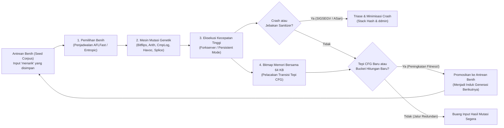

Pada suatu malam musim gugur yang gelap dan penuh badai di tahun 1988 di Madison, Wisconsin, profesor ilmu komputer <strong>Barton Miller</strong> sedang duduk di depan terminal rumahnya, berusaha bekerja jarak jauh ke workstation UNIX universitas melalui modem dial-up 1200-baud dan saluran telepon analog. Di luar, badai petir hebat sedang mengamuk. Setiap kali petir menyambar, interferensi elektromagnetik menyuntikkan derau (noise) acak ke kabel telepon, merusak aliran karakter ASCII yang dikirim ke shell UNIX.

Apa yang terjadi selanjutnya membuat Miller terpana: setiap kali derau saluran menyuntikkan urutan byte acak ke utilitas standar UNIX yang telah teruji — seperti `vi`, `cc`, `awk`, `sed`, `csh`, dan `indent` — program-program inti tersebut tidak sekadar mencetak pesan kesalahan sintaks, melainkan <strong>runtuh satu per satu dengan kesalahan segmentasi (`SIGSEGV`, Segmentation Fault) atau membeku dalam perulangan tak terbatas</strong>.

Terkejut oleh kerapuhan tersebut, Miller menugaskan mahasiswa pascasarjananya untuk membangun generator aliran karakter acak yang ia beri nama <strong>"Fuzz"</strong>. Hasilnya mengguncang komunitas rekayasa perangkat lunak: <strong>antara 25% hingga 33% dari seluruh utilitas standar UNIX di tujuh varian komersial dan akademik langsung crash saat diberi aliran byte murni acak</strong>.

Lebih dari tiga setengah dekade kemudian, <strong>Fuzzing (Fuzz Testing)</strong> telah berevolusi dari generator derau buta menjadi teknik penemuan kerentanan otomatis paling produktif dalam ilmu komputer — menggabungkan instrumentasi kompilator, algoritma genetika evolusioner, pemecah kendala SMT, dan pemetaan memori bayangan (Shadow Memory). Infrastruktur <strong>OSS-Fuzz</strong> milik Google saja telah secara otomatis menemukan <strong>lebih dari 10.000 kerentanan keamanan dan lebih dari 36.000 bug</strong> pada proyek open-source kritis seperti OpenSSL, SQLite, FFmpeg, dan kernel Linux.

Mengapa ribuan unit test buatan manusia melewatkan kerusakan memori fatal yang justru ditemukan oleh mutasi otomatis dalam hitungan menit? Artikel ini membedah ledakan комбинаtorial ruang input, empat paradigma fuzzing, arsitektur internal <strong>AFL / AFL++ / LibFuzzer</strong> (bitmap 64 KB di cache L1, bukti matematis pergeseran `>> 1`, Forkserver, dan penjadwalan rantai Markov), <strong>AddressSanitizer (ASan)</strong>, serta algoritma <strong>Delta Debugging (`ddmin`)</strong> karya Andreas Zeller.

---

## Bab 1: Jurang Kombinatorial Ruang Input dan Efek Lampu Jalan

### 1.1 Buffer 64 Byte Menyimpan $10^{154}$ Kemungkinan Semesta

Mengapa pengujian unit manual tidak dapat memberantas bug perangkat lunak? Alasan mendasarnya terletak pada <strong>ledakan kombinatorial ruang input</strong>. Bayangkan sebuah fungsi C sederhana yang mengurai header biner sepanjang $N = 64$ byte. Karena setiap byte memiliki $|\Sigma| = 2^8 = 256$ kemungkinan nilai, jumlah total input 64 byte yang mungkin adalah:

$$|\Sigma|^N = 256^{64} = \left(2^8\right)^{64} = 2^{512} \approx 1.34 \times 10^{154}$$

Sebagai perbandingan, bilangan Eddington (perkiraan jumlah total proton di seluruh alam semesta teramati) hanya sekitar $10^{80}$. Bahkan jika seluruh prosesor di Bumi menguji satu triliun ($10^{12}$) input per detik без henti sejak Big Bang 13,8 miliar tahun lalu, kita belum akan menjelajahi $10^{-124}$ bagian dari buffer 64 byte tersebut.

### 1.2 Efek Lampu Jalan (Streetlight Effect) dan "Weird Machine"

Saat menulis unit test manual, pengembang secara tak sadar terjebak dalam <strong>Efek Lampu Jalan (bias observasi)</strong>: seperti orang yang mencari kunci yang hilang di malam hari hanya di bawah lampu jalan karena terang, manusia hanya menguji <strong>jalur normal sesuai spesifikasi</strong> dan <strong>nilai batas yang sudah terpikirkan saat menulis kode (`0`, `-1`, `NULL`)</strong>. Padahal, kerentanan kritis bersembunyi di kegelapan <strong>"Weird Machine"</strong> (Bratus et al.) — mesin 상태 tak disengaja yang muncul dari interaksi integer overflow dan asumsi tersembunyi parser:

```c
int parse_image_chunk(const uint8_t *buf, size_t len) {
    if (len < 16) return -1;
    uint32_t magic  = *(const uint32_t *)(buf + 0);
    uint16_t width  = *(const uint16_t *)(buf + 4);
    uint16_t height = *(const uint16_t *)(buf + 6);
    uint8_t  flags  = buf[8];

    if (magic != 0x494D4721) return -1;          // Mengharapkan tanda "IMG!"
    if (width == 0 || height == 0) return -1;    // Pengembang sudah menguji batas 0!

    uint16_t alloc_size = width * height;        // [BUG] Integer overflow 16-bit!
    if (flags & 0x80) alloc_size += 16;
    uint8_t *pixel_buf = malloc(alloc_size);     // Hanya mengalokasikan 0 atau 16 byte
    memcpy(pixel_buf, buf + 16, (size_t)width * height); // Menyalin 65.536 byte -> merusak heap!
    ...
}
```

Ketika `width = 256, height = 256`, perkalian $256 \times 256 = 65536 \equiv 0 \pmod{2^{16}}$ menyebabkan wraparound pada bilangan bulat 16-bit `alloc_size` menjadi `0`, mengalokasikan hanya 16 byte via `malloc(16)`, lalu menimpa 64 KB memori heap melalui `memcpy`.

---

## Bab 2: Empat Paradigma Utama Fuzzing

Untuk menembus penjaga seperti `if (magic != 0x494D4721)` (peluang tebakan acak $2^{-32} \approx 1 / 4,29\times 10^9$), fuzzing berkembang melalui empat paradigma:

| Paradigma Fuzzing | Alat Representatif | Visibilitas Internal | Mekanisme Pencarian & Generasi | Kekuatan Utama | Hambatan Fundamental |
| :--- | :--- | :--- | :--- | :--- | :--- |
| <strong>Black-Box Fuzzing</strong> | `fuzz` (1988), `zzuf`, `radamsa` | Tidak ada (kotak legam) | Pembalikan bit acak & penimpaan byte buta | Tanpa kompilasi ulang atau kode sumber; eksekusi awal sangat cepat | Terhalang magic bytes ($2^{-32}$), checksum, dan sintaks terstruktur |
| <strong>Grammar / Generation-Based</strong> | `Peach`, `Syzkaller`, `LangFuzz`, `Domato` | Tata bahasa bebas konteks (CFG) atau spesifikasi syscall | Menyintesis & memutasi Abstract Syntax Tree (AST) yang valid secara struktural | Menembus lexer/parser langsung ke inti mesin JS dan kernel OS | Biaya manual tinggi untuk menulis tata bahasa; melewatkan bug parser pada sintaks rusak |
| <strong>White-Box Symbolic / Concolic</strong> | `SAGE`, `KLEE`, `angr`, `Driller` | Jejak simbolik instruksi penuh & predikat percabangan | Mengumpulkan kendala jalur $\Pi$ & membalik cabang via <strong>SMT Solver (Z3)</strong> | Memecahkan persamaan rumit `x == 0xdeadbeef` secara aljabar dalam satu langkah | <strong>Ledakan jalur ($2^d$)</strong> pada loop; SMT macet pada fungsi hash dan aritmetika nonlinier |
| <strong>Coverage-Guided Grey-Box (CGF)</strong> | <strong>`AFL`</strong>, <strong>`AFL++`</strong>, <strong>`LibFuzzer`</strong>, `Honggfuzz` | <strong>Instrumentasi tepi (edge) ringan</strong> saat kompilasi (bitmap 64 KB) | <strong>Algoritma genetika evolusioner</strong>: hanya menyimpan benih yang membuka tepi CFG baru | Tanpa SMT solver berat; mencapai $10^4\text{–}10^5\text{ execs/dtk}$ sambil berevolusi ke status terdalam | Membutuhkan CmpLog (RedQueen) atau kamus untuk perbandingan multibyte tunggal |

Dalam eksekusi konkolik (Concrete + Symbolic), byte input dimodelkan sebagai variabel simbolik $\vec{\alpha}$ dan kondisi cabang terakhir dinegasikan untuk SMT solver:

$$\Pi_{\text{path}} = c_1(\vec{\alpha}) \land c_2(\vec{\alpha}) \land \dots \land c_{k-1}(\vec{\alpha}) \land \neg c_k(\vec{\alpha})$$

Sebaliknya, <strong>AFL</strong> (dirilis oleh <strong>Michał Zalewski</strong> pada 2013), <strong>AFL++</strong>, dan <strong>LibFuzzer</strong> menggantikan SMT solver dengan seleksi alam Darwinian yang dipandu oleh cakupan tepi (edge coverage).



---

## Bab 3: Di Dalam Mesin AFL — Instrumentasi Tepi, Bitmap 64 KB, dan Bukti Matematis `>> 1`

### 3.1 Mengapa Cakupan Tepi (Edge Coverage) Mengungguli Cakupan Blok Dasar

Jika fuzzer hanya mencatat blok dasar (node) mana yang dikunjungi, setelah menjalankan jalur $A \to B \to C$ semua blok $\{A, B, C\}$ telah ditandai. Ketika input kedua melewati blok inisialisasi $B$ dan mengambil jalur langsung $A \to C$ (memicu dereferensi pointer NULL di $C$), karena $\{A, C\} \subset \{A, B, C\}$, fuzzer berbasis node akan membuang input tersebut sebagai redundan! Dengan mencatat <strong>pasangan transisi terarah (tepi/edge)</strong> $(B_{\text{prev}} \to B_{\text{cur}})$, AFL langsung mengenali bahwa tepi $(A \to C)$ adalah jalur baru.

### 3.2 Trampolin 3 Baris, Cache L1 64 KB, dan Keharusan Matematis `>> 1`

AFL menyuntikkan tiga operasi berikut di awal setiap blok dasar saat kompilasi:

```c
/* Compile-time random 16-bit ID assigned to the current basic block */
cur_location = <COMPILE_TIME_RANDOM_16BIT>;

/* Record the transition edge (prev -> cur) in the 64 KB shared bitmap */
shared_mem[cur_location ^ prev_location]++;

/* Right-shift by 1 bit to preserve directionality and self-loops */
prev_location = cur_location >> 1;
```

Mengapa `shared_mem` berukuran tepat $2^{16} = 65.536$ byte (<strong>64 KB</strong>)? Karena 64 KB <strong>muat sepenuhnya di dalam cache data L1/L2 inti CPU modern</strong>, mencegah cache miss ke DRAM utama dan menyelesaikan pencatatan hanya dalam ~1 nanodetik.

Mengapa <strong>pergeseran kanan 1-bit (`>> 1`)</strong> pada `prev_location = cur_location >> 1;` mutlak diperlukan secara matematis? Tanpa pergeseran tersebut, operator XOR ($\oplus$) mengalami dua degenerasi aljabar fatal:

$$\text{Without shift: } \quad \text{Edge}(A \to B) = A \oplus B = B \oplus A = \text{Edge}(B \to A), \qquad \text{Edge}(A \to A) = A \oplus A = 0$$

$$\text{With 1-bit right shift: } \quad \text{Edge}(A \to B) = (A \gg 1) \oplus B \neq (B \gg 1) \oplus A = \text{Edge}(B \to A), \qquad \text{Edge}(A \to A) = (A \gg 1) \oplus A \neq 0$$

1. <strong>Hilangnya arah akibat sifat komutatif ($A \oplus B = B \oplus A$)</strong>: Lompatan $A \to B$ dan lompatan balik $B \to A$ menghasilkan indeks bitmap yang sama persis.
2. <strong>Musnahnya self-loop akibat sifat nilpoten ($A \oplus A = 0$)</strong>: Setiap blok yang melompat ke dirinya sendiri ($A \to A$) menghasilkan $0$, sehingga seluruh self-loop di dalam program bertabrakan di satu byte tunggal `shared_mem[0]`!

Pergeseran `>> 1` mematahkan simetri dan nilpotensi sekaligus dalam satu siklus clock CPU. Selain itu, AFL mengelompokkan jumlah eksekusi ke dalam <strong>8 bucket logaritmik ($1, 2, 3, 4\text{–}7, 8\text{–}15, 16\text{–}31, 32\text{–}127, 128\text{–}255$)</strong> untuk mendeteksi tonggak iterasi loop tanpa membanjiri antrean.

### 3.3 Forkserver, Persistent Mode, dan Penjadwalan Rantai Markov (AFLFast / Entropic)

Untuk menghilangkan overhead besar dari `execve()` dan dynamic linker (`ld.so`), <strong>Forkserver</strong> AFL menghentikan proses tepat sebelum `main()` dan menggandakan proses anak hanya melalui <strong>Copy-on-Write (`fork()`)</strong> lewat pipa `fd 198`/`199`. <strong>Persistent Mode (`LLVMFuzzerTestOneInput`)</strong> bahkan menghilangkan `fork()`, memanggil fungsi target di dalam loop memori hingga lebih dari $100.000\text{ execs/dtk}$. Dipadukan dengan <strong>CmpLog (RedQueen)</strong> dan penjadwal <strong>AFLFast / Entropic</strong> berbasis rantai Markov serta entropi informasi Shannon $H(s)$, fuzzer memfokuskan energi mutasi pada cabang-cabang langka:

$$p(s) = \min\left(\frac{\alpha(s)}{\beta} \cdot \frac{2^{s_{\text{handicap}}}}{f(i)}, \; M\right), \qquad H(s) = -\sum_{e \in E(s)} \hat{p}_{s,e} \log_2 \hat{p}_{s,e}$$

---

## Bab 4: Mengubah Kerusakan Memori Senyap Menjadi Crash Instan — Arsitektur Sanitizer

Karena MMU perangkat keras hanya memeriksa izin akses pada tingkat halaman <strong>$4\text{ KB}$</strong>, heap overflow sebesar 1 byte atau Use-After-Free hampir tidak pernah memicu `SIGSEGV`. <strong>AddressSanitizer (ASan)</strong> mengatasi hal ini melalui <strong>pemetaan memori bayangan (Shadow Memory) 1:8</strong>:

$$\text{ShadowAddr}(\text{Addr}) = (\text{Addr} \gg 3) + \text{Offset}$$

Setiap 8 byte memori aplikasi yang sejajar dipetakan ke 1 byte bayangan: `0x00` berarti seluruh 8 byte valid, $1 \le k \le 7$ berarti hanya $k$ byte pertama yang valid, dan nilai negatif menandai <strong>Redzone beracun (`0xfa` di heap, `0xf1` di stack)</strong> atau memori bebas yang ditahan di <strong>Antrean Karantina (`0xfd` untuk menangkap Use-After-Free)</strong>. Sebelum setiap akses memori, kompilator menyisipkan pemeriksaan:

```c
/* Compiler-injected ASan check before an N-byte memory access (N = 1, 2, 4) */
uintptr_t shadow_addr = (addr >> 3) + ASAN_SHADOW_OFFSET;
int8_t shadow_val = *(int8_t *)shadow_addr;

if (UNLIKELY(shadow_val != 0)) {
    /* For partial 8-byte words (1 <= shadow_val <= 7) or negative redzones */
    if (shadow_val < 0 || (int8_t)((addr & 7) + N) > shadow_val) {
        __asan_report_error(pc, bp, sp, addr, is_write, N);
    }
}
```

Dikombinasikan dengan <strong>UBSan</strong> (perilaku tak terdefinisi & integer overflow), <strong>MSan</strong> (pelacakan bit-demi-bit memori yang belum diinisialisasi), <strong>TSan</strong> (deteksi data race dengan vector clock), dan <strong>Differential Fuzzing</strong>, setiap penyimpangan halus langsung diubah menjadi laporan crash yang presisi.

---

## Bab 5: Triase Crash dan Delta Debugging (`ddmin`) Andreas Zeller

Ribuan file crash duplikat pertama-tama dikelompokkan berdasarkan akar masalahnya menggunakan <strong>Stack Hash</strong> dari frame panggilan teratas saat kesalahan terjadi. Selanjutnya, untuk menyusutkan file crash berukuran beberapa megabyte $c$ (panjang $N$) yang penuh dengan derau mutasi menjadi contoh minimal, algoritma <strong>Delta Debugging (`ddmin`) karya Andreas Zeller</strong> secara otomatis mencari kasus uji <strong>1-minimal $c^*$</strong> di mana menghapus satu byte pun akan menghilangkan crash:

$$\forall c' \subsetneq c^* \; \text{with} \; |c^*| - |c'| = 1 : \quad \text{test}(c') \neq \text{FAIL}$$

$$T_{\text{best}}(N) = \mathcal{O}(\log_2 N), \qquad T_{\text{worst}}(N) = \frac{N^2 + 3N - 2}{2} = \mathcal{O}(N^2)$$

Dengan mempartisi input menjadi $n$ potongan $\Delta_1, \dots, \Delta_n$ (dimulai dari $n=2$), `ddmin` menguji setiap himpunan bagian $\Delta_i$, lalu setiap komplemen $\nabla_i = c \setminus \Delta_i$, dan menggandakan granularitas $n \leftarrow \min(2n, |c|)$ bila belum ada pengurangan yang berhasil. Melalui pencarian biner yang diperumum ini, `ddmin` (`afl-tmin` dan `C-Reduce`) mampu memeras file 10 MB menjadi Proof-of-Concept (PoC) berukuran belasan byte hanya dalam $\mathcal{O}(\log_2 N)$ langkah pada kasus terbaik.
