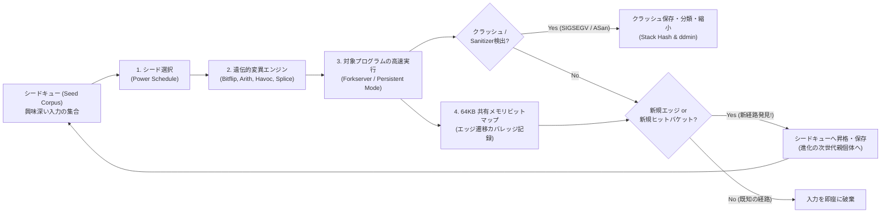
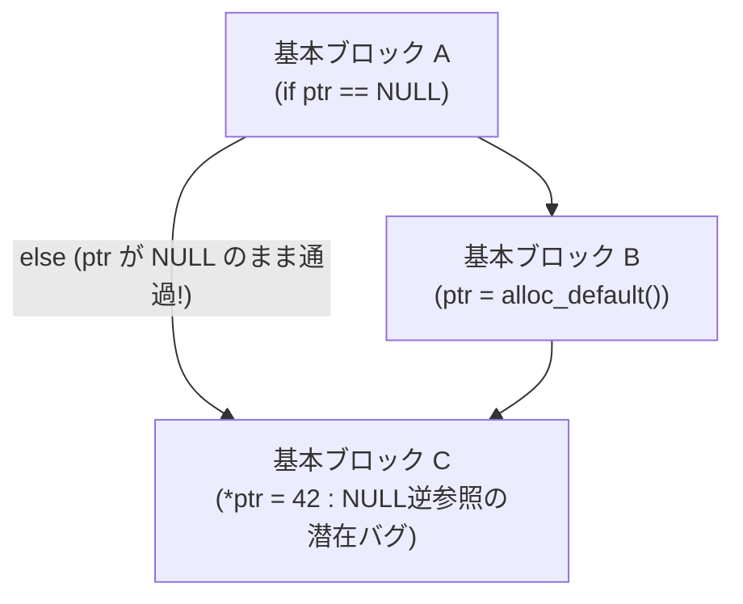
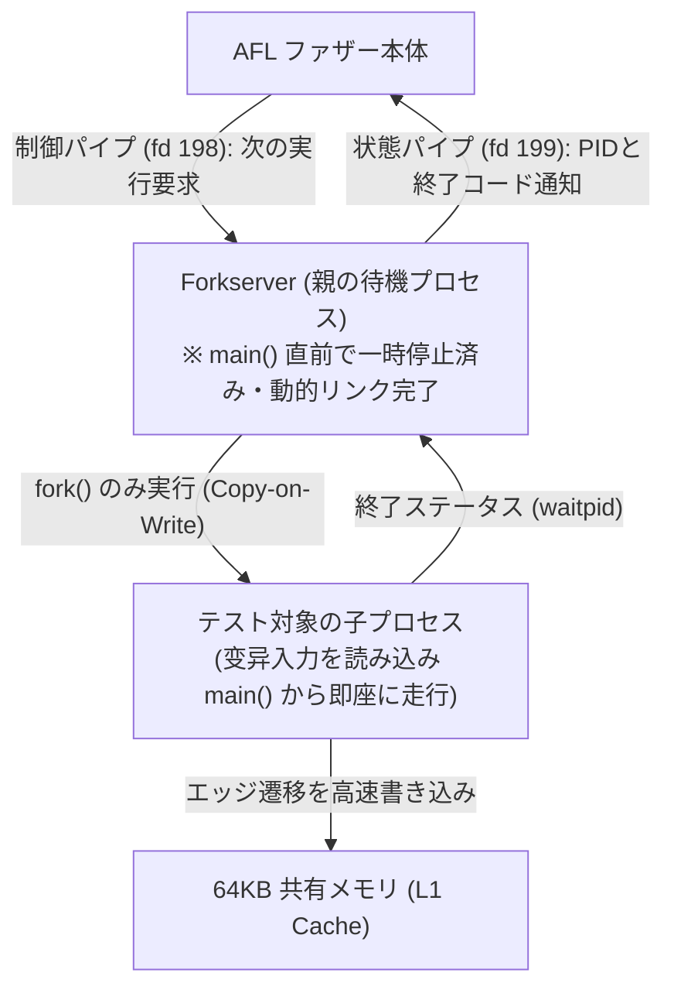
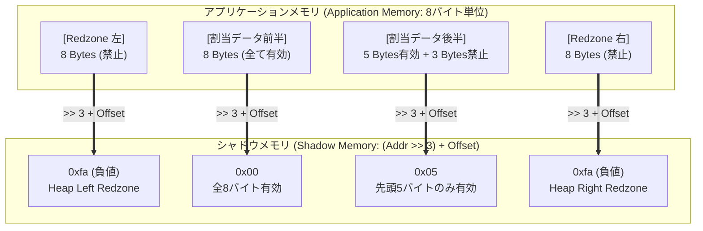
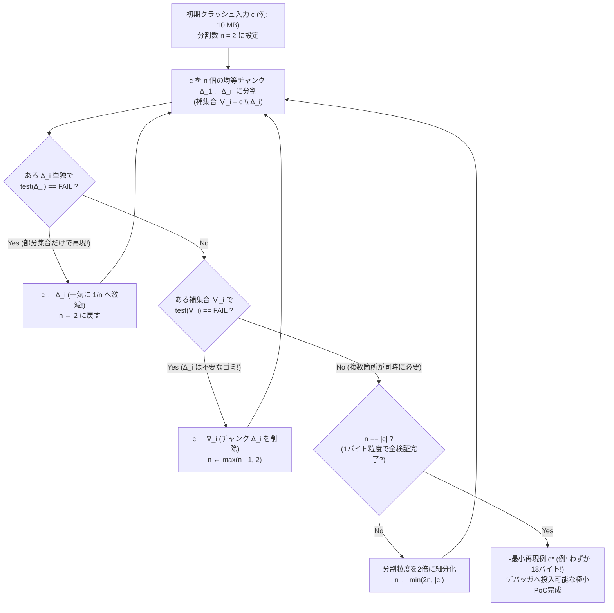

1988年秋のある嵐の夜、ウィスコンシン大学マディソン校の計算機科学者<strong>バートン・ミラー（Barton Miller）</strong>教授は、自宅の端末から1200ボーのダイヤルアップモデムと電話回線を経由して大学のUNIXワークステーションにログインし、作業を試みていた。窓の外では中西部特有の激しい雷雨が荒れ狂っており、落雷による電磁誘導ノイズがアナログ電話回線に絶え間なく混入していた。

すると、奇妙な現象が起きた。電話回線のノイズによってランダムに文字化けした無意味なバイト列がコマンドラインに送り込まれるたび、`vi`、`cc`、`awk`、`sed`、`csh`、`indent`といった、世界中のエンジニアが毎日信頼して使っていたはずの商用・学術UNIXの標準ユーティリティ群が、次々と<strong>セグメンテーション違反（Segmentation Fault）を起こしてクラッシュしたり、無限ループに陥ってハングアップしたりした</strong>のである。

この偶然の発見に衝撃を受けたミラー教授は、翌学期の大学院のオペレーティングシステム講義で学生たちに一つの課題を出した。「完全にでたらめな文字列（Random Character Streams）を生成して標準UNIXプログラムの標準入力に流し込み、どれだけのプログラムが壊れるか実験せよ」。彼らはこの無作為なノイズ注入ツールを<strong>「Fuzz（ファズ：毛羽立ち、雑音）」</strong>と名付けた。実験の結果はソフトウェア業界を震撼させた。7種類の異なるUNIXシステム上でテストされた約90個のユーティリティのうち、実に<strong>25%から33%ものプログラムが、単なるランダムなバイト列を入力されただけで即座にクラッシュした</strong>のである。

それから35年以上が経過した現在、「ファジング（Fuzzing / Fuzz Testing）」は単なる「ランダム文字列の投げ込み」から、コンパイラ計装（Instrumentation）、進化的遺伝的アルゴリズム、形式手法（SMTソルバ）、そして仮想メモリ空間のシャドウマッピングを組み合わせた<strong>現代ソフトウェアセキュリティにおける最強の自動脆弱性発見技術</strong>へと進化を遂げた。Googleが運営する分散ファジング基盤「OSS-Fuzz」だけでも、OpenSSL、SQLite、FFmpeg、Linuxカーネルなどの重要オープンソースソフトウェアから<strong>10,000件以上のセキュリティ脆弱性と36,000件以上のバグ</strong>を自動的に発見・修正に導いている。

なぜ、開発者が入念に設計した何千個もの単体テスト（Unit Test）をすり抜けた致命的なバグが、「でたらめな入力の自動変異」によっていとも簡単に見つかるのか？ 本稿では、入力空間の組合せ爆発という数理的壁から出発し、<strong>カバレッジ誘導型ファジング（Coverage-Guided Grey-box Fuzzing: AFL / AFL++ / LibFuzzer）</strong>の内部アーキテクチャ、64KB共有メモリビットマップとXORハッシュの数理、<strong>サニタイザー（AddressSanitizer等）</strong>によるサイレントなメモリ破壊の捕捉、そしてクラッシュの分類と<strong>デルタデバッギング（Delta Debugging: `ddmin`）</strong>による最小再現例（PoC）の自動縮小アルゴリズムまでを体系的に解き明かす。

---

## 第1章：入力空間の「天文学的爆発」と街灯の下の誤謬（Streetlight Effect）

### 1.1 わずか64バイトの入力が持つ $10^{154}$ 通りの宇宙

なぜ、人間が書くテストコードだけではソフトウェアのバグを根絶できないのか。その根本的な理由は、プログラムが受け取る<strong>入力空間（Input Space）の組合せ論的爆発</strong>にある。

いま、ネットワークパケットのヘッダや画像ファイルの先頭チャンクを解析する、ごく小さなC言語の関数を考えよう。この関数がわずか $N = 64$ バイトのバイト列を入力として受け取るとする。1バイトは $8$ ビットであり、$|\Sigma| = 2^8 = 256$ 通りの値をとり得る。したがって、長さ64バイトのあらゆる可能な入力パターンの総数は次のようになる。

$$|\Sigma|^N = 256^{64} = \left(2^8\right)^{64} = 2^{512} \approx 1.34 \times 10^{154}$$

この $1.34 \times 10^{154}$ という数字がどれほど巨大か想像できるだろうか。観測可能な宇宙全体に存在する陽子の総数（エディントン数）は約 $10^{80}$ 個にすぎない。もし地球上のすべてのスーパーコンピュータを束ねて、宇宙の誕生（ビッグバン）から現在までの138億年間、毎秒1兆回（$10^{12}$ 回/秒）のペースで入力をテストし続けたとしても、試行できる入力の総数はたかだか $4.3 \times 10^{29}$ 通りであり、わずか64バイトの入力空間の $10^{-124}$ すら探索できない。これがJPEG画像やPDFファイル、あるいはWebブラウザが解釈する数キロバイトのJavaScriptコードになれば、入力空間のサイズは $256^{4096}$ といった文字通り無限に近い領域へと発散する。

### 1.2 単体テストが陥る「街灯の下の誤謬（Streetlight Effect）」

もちろん、その $10^{154}$ 通りの入力の大部分は同じコードパス（たとえば最初の「マジックナンバー不一致エラー」）を通って即座に棄却される。しかし、プログラムの内部状態空間は、条件分岐（`if`、`switch`、ループ）が積み重なることで複雑な木構造をなしており、特定の条件が同時に重なったときにだけ開く「隠れた状態遷移」が無数に潜んでいる。

人間が単体テスト（Unit Test）や結合テストを書くとき、開発者は無意識のうちに<strong>「街灯の下の誤謬（Streetlight Effect / 観測バイアス）」</strong>に陥る。夜道で鍵を落とした酔っ払いが、鍵を落とした暗い茂みではなく「明るくて探しやすい街灯の下」ばかりを探す寓話と同じように、人間のテスト作成者は<strong>「仕様書に書かれた正常系の入力」</strong>と<strong>「自分が思いつく典型的な境界値（0、-1、空文字列、NULL）」</strong>しかテストケースとして記述できない。

ところが、現実の重大な脆弱性（ヒープバッファオーバーフローや整数オーバーフロー）は、開発者がそもそも想定すらしていなかった「奇妙な状態の組み合わせ」——セキュリティ研究者のセルゲイ・ブラトゥス（Sergey Bratus）らが<strong>「Weird Machine（奇妙な機械）」</strong>と呼ぶ、仕様外の隠れた状態遷移機械——の中で発火する。たとえば次のようなコード片を見てみよう。

```c
int parse_image_chunk(const uint8_t *buf, size_t len) {
    if (len < 16) return -1;
    uint32_t magic  = *(const uint32_t *)(buf + 0);
    uint16_t width  = *(const uint16_t *)(buf + 4);
    uint16_t height = *(const uint16_t *)(buf + 6);
    uint8_t  flags  = buf[8];

    if (magic != 0x494D4721) return -1;          // "IMG!"
    if (width == 0 || height == 0) return -1;

    uint16_t alloc_size = width * height;        // 【バグ】16ビット整数オーバーフロー！
    if (flags & 0x80) {
        alloc_size += 16;
    }
    uint8_t *pixel_buf = malloc(alloc_size);     // 小さすぎるバッファが確保される
    // その後、本来の width * height バイト分を書き込んでヒープ破壊！
    memcpy(pixel_buf, buf + 16, (size_t)width * height);
    ...
}
```

このコードでは、`width = 256`、`height = 256` が与えられると、`uint16_t` 型の変数 `alloc_size` の計算 $256 \times 256 = 65536 \equiv 0 \pmod{2^{16}}$ で<strong>16ビット整数オーバーフロー（ラップアラウンド）</strong>が発生し、`malloc(0)`（あるいは `flags & 0x80` が立っていれば `malloc(16)`）しかメモリが確保されないにもかかわらず、`memcpy` で $65,536$ バイトのコピーが行われてヒープ領域が壊滅的に破壊される。人間が書く単体テストでは `width = 10, height = 10` や `width = 0` はテストされても、「マジックナンバーが一致し、かつ幅と高さの積がちょうど $2^{16}$ の倍数付近になる」というピンポイントの入力はまず書かれない。

---

## 第2章：ファジングの4大パラダイム ── ブラックボックス、文法ベース、シンボリック実行、そしてグレーボックス

では、$2^{512}$ の広大な砂漠の中から、`magic == 0x494D4721` かつ `width * height >= 65536` という針の穴のような条件をどうやって自動的に見つけ出すのか？ ファジングの歴史は、対象プログラムの内部情報をどれだけ活用するかによって、大きく4つのパラダイムへと発展してきた。

| 手法分類 | 代表的ツール | プログラム内部情報の利用 | 探索メカニズム | 強み | 限界・ボトルネック |
| :--- | :--- | :--- | :--- | :--- | :--- |
| <strong>ブラックボックス・ファジング</strong><br>(Black-box Fuzzing) | 初期 `fuzz`, `zzuf`, `radamsa` | なし（完全な外部観測） | 乱数または経験則による盲目的なビット/バイト変異 | ソースコードも計装も不要、毎秒数万回の高速実行が可能 | マジックナンバー（4バイト比較で確率 $2^{-32}$）や深い分岐を突破できない |
| <strong>文法・生成ベース・ファジング</strong><br>(Grammar / Generation-based) | `Peach`, `Syzkaller`, `LangFuzz`, `Domato` | 入力フォーマット仕様・文脈自由文法（CFG） | BNF文法やシステムコール定義から構文的に正しいASTを生成・変異 | 構文解析（Parser）を突破し、JSエンジンやOSカーネル深部へ到達可能 | 文法定義を人間が記述するコストが高く、仕様外のパーサバグを見落とすことがある |
| <strong>ホワイトボックス・ファジング</strong><br>(Symbolic / Concolic Execution) | `SAGE`, `KLEE`, `angr`, `Driller` | 完全な命令トレースと分岐条件式の数理モデル | 記号変数とパス制約 $\Pi$ を構築し、<strong>SMTソルバ（Z3）</strong>で分岐反転解を算出 | `if (x == 0xdeadbeef)` のような複雑な等値制約を一撃で解読可能 | <strong>パス爆発問題（Path Explosion）</strong>とSMTソルバの計算量により大規模ソフトで失速 |
| <strong>カバレッジ誘導型グレーボックス</strong><br>(Coverage-Guided Grey-box: CGF) | <strong>`AFL`</strong>, <strong>`AFL++`</strong>, <strong>`LibFuzzer`</strong>, `Honggfuzz` | 軽量な<strong>エッジカバレッジ計装</strong>（64KBビットマップ） | 新規実行パスを開拓した入力だけを「種（Seed）」として残す<strong>進化的遺伝的探索</strong> | 1行のSMT計算もせず、毎秒数千〜数万回の試行と進化的選択で深部へ高速到達 | 単一ステップの巨大なマジックバイト比較には辞書やCmpLogの補助が必要 |

### 2.1 ブラックボックス・ファジングの壁：$2^{-32}$ のマジックナンバー

1988年のミラー教授のツールのように、プログラムの内部を一切見ずにランダムなバイト列を投げ込む手法を<strong>ブラックボックス・ファジング（Black-box Fuzzing）</strong>と呼ぶ。しかし、前節の `if (magic != 0x494D4721) return -1;` というたった1行の4バイト（32ビット）比較を、完全なランダム入力で突破できる確率は $1 / 2^{32} \approx 1 / (4.29 \times 10^9)$（約43億分の1）しかない。プログラムの入り口にこのようなチェックサムやマジックナンバーが2つ並んでいるだけで、通過確率は $2^{-64}$ に落ち込み、ブラックボックス・ファジングは1行目のエラー処理の壁の前で永久に足踏みしてしまう。

### 2.2 文法・生成ベース・ファジング（Grammar-based Fuzzing）

この壁を乗り越える第一のアプローチが、<strong>生成ベース（Generation-based）または文法ベース（Grammar-based）ファジング</strong>である。入力フォーマット（PNGやPDFの構造、SQLやJavaScriptの文脈自由文法 $G = (V, \Sigma, R, S)$、あるいはLinuxカーネルのシステムコール列の型定義）をあらかじめファザーに教え込み、構文木（AST）のレベルで妥当なデータを合成・部分木交換（Subtree Crossover）する。たとえばLinuxカーネルのファザーとして絶大な実績を誇るGoogleの<strong>Syzkaller</strong>は、`socket()` で得たファイル記述子を `bind()` や `setsockopt()` に渡すといった状態依存関係を含むシステムコール文法を備えており、カーネルの浅い引数チェックを通過してサブシステムの深部へと直接切り込むことができる。

### 2.3 ホワイトボックス・ファジング：シンボリック実行とSMTソルバ

第二のアプローチは、プログラムの機械語命令を1命令ずつ数学的に解析する<strong>ホワイトボックス・ファジング（シンボリック実行 / Concolic Execution）</strong>である。代表例としてMicrosoftの<strong>SAGE</strong>（Godefroidら、2008年）やLLVMベースの<strong>KLEE</strong>（Cadarら、2008年）が挙げられる。

シンボリック実行では、入力バイト列 $buf[0], buf[1], \dots, buf[n-1]$ を具体的な数値ではなく<strong>記号変数（Symbolic Variables）</strong> $\alpha_0, \alpha_1, \dots, \alpha_{n-1}$ として扱う。プログラムを実行しながら、通過した条件分岐の論理式を<strong>パス制約（Path Constraint）</strong> $\Pi$ として記録していく。もしプログラムが $k$ 個目の分岐条件 $c_k(\vec{\alpha})$（たとえば `magic == 0x494D4721`）で偽の枝に進んで終了したならば、そこまでの $k-1$ 個の分岐条件を維持したまま、最後の $k$ 個目の条件だけを論理否定した連立制約式を作る。

$$\Pi_{\text{path}} = c_1(\vec{\alpha}) \land c_2(\vec{\alpha}) \land \dots \land c_{k-1}(\vec{\alpha}) \land \neg c_k(\vec{\alpha})$$

そして、この論理式 $\Pi_{\text{path}}$ を満たす入力ベクトル $\vec{\alpha}$ が存在するかどうかを、<strong>Z3</strong>などの<strong>SMTソルバ（Satisfiability Modulo Theories Solver）</strong>に問い合わせる。SMTソルバはビットベクトル算術の決定手続きを用いて、`buf[0..3] = "IMG!"` という解を数ミリ秒で逆算してくれる。

しかし、シンボリック実行には致命的な弱点がある。ループや分岐が深くなるにつれて実行可能なパスの総数が $2^d$（分岐深さ $d$ に対して指数関数的）に膨れ上がる<strong>「パス爆発問題（Path Explosion Problem）」</strong>と、ハッシュ関数（CRC32やSHA-256）や浮動小数点演算、ポインタの間接参照を含む複雑な制約式でSMTソルバの計算時間が数分〜数時間に凍りつく問題である。

### 2.4 カバレッジ誘導型グレーボックス・ファジング（CGF）の革命

この「ブラックボックスの盲目性」と「ホワイトボックスの計算量爆発」の双方を鮮やかに打破したのが、2013年にポーランドのセキュリティ研究者<strong>ミハウ・ザレフスキ（Michał Zalewski / lcamtuf）</strong>が開発した<strong>AFL（American Fuzzy Lop）</strong>によって確立された<strong>カバレッジ誘導型グレーボックス・ファジング（Coverage-Guided Grey-box Fuzzing: CGF）</strong>である。



CGFの核心となる洞察は驚くほどシンプルかつ深遠である。<strong>「重たいSMTソルバで分岐条件を解く必要はない。入力をランダムに少しずつ変異させて超高速に実行し、『これまで一度も通ったことのない新しい分岐（エッジ）』を通過した入力だけを『有望な種（Seed）』として保存し、その種をさらに変異させ続ければ、ダーウィン進化論の自然選択によってプログラムの最深部へ自動的に到達できる」</strong>というものである。

たとえば、4バイトのマジックナンバー比較が `if (buf[0] == 'I' && buf[1] == 'M' && buf[2] == 'G' && buf[3] == '!')` のように1バイトずつの比較（あるいはコンパイラ展開やCmpLogによる分解）になっていれば、最初の1バイト `'I'` が偶然当たった瞬間に「新しい基本ブロックへ1歩進んだ！」というカバレッジ増加が検出され、その入力がシードキューに保存される。次の世代の変異はその保存されたシードを親として行われるため、4バイトを同時に当てる確率 $256^4 \approx 4.3 \times 10^9$ 回の試行が、1バイトずつ4段階の進化を登る $4 \times 256 = 1,024$ 回の試行へと劇的に圧縮されるのである！

---

## 第3章：AFLの内部アーキテクチャ ── エッジ計装、64KBビットマップ、1ビット右シフトの数理

カバレッジ誘導型ファザー（AFL、そのコミュニティ後継版である<strong>AFL++</strong>、およびLLVM統合型の<strong>LibFuzzer</strong>）が、オーバーヘッドを最小限に抑えながら毎秒数千〜数万回の速度でプログラムの実行経路を追跡できるのはなぜか。その秘密は、コンパイル時に注入されるわずか数命令の計装コードと、L1キャッシュに完全に収まる64KBのデータ構造にある。

### 3.1 なぜ「基本ブロックカバレッジ」ではなく「エッジカバレッジ」なのか

プログラムの制御フローグラフ（CFG: Control Flow Graph）において、分岐を含まない一直線の命令列を<strong>基本ブロック（Basic Block: ノード）</strong>と呼び、基本ブロックから別の基本ブロックへのジャンプを<strong>エッジ（Edge: 辺）</strong>と呼ぶ。

もしファザーが「どの基本ブロックを実行したか（ノードカバレッジ）」だけを記録していたらどうなるだろうか。基本ブロック $A$ の後に条件分岐があり、ブロック $B$ を経てブロック $C$ で合流し、さらにその下に処理が続く次のような構造を考えよう。



最初のテスト入力1が $A \to B \to C$ という経路を通ったとする。このとき、基本ブロック $A, B, C$ はすべて「訪問済み」としてマークされる。次に、テスト入力2が $B$ をスキップして $A \to C$ という直行ルートを通ったとしよう。実はこの $A \to C$ の直行ルートこそが、「初期化ブロック $B$ を通らずにブロック $C$ でポインタを参照してしまう」という致命的なバグの引き金である。ところが、ノードカバレッジ（基本ブロック単位の記録）では、$A$ も $C$ もすでに入力1で訪問済みであるため、入力2が通過した $A \to C$ は「何も新しいブロックを通っていない退屈な入力」と判定されて<strong>捨てられてしまう</strong>のである！

これに対し、ブロック間の遷移ペア（タプル）である<strong>エッジ（Edge）</strong>を記録すれば、入力1はエッジ $\{(A \to B), (B \to C)\}$ を通過したのに対し、入力2は未踏のエッジ $(A \to C)$ を通過したことが明確に区別できる。これが、AFLが基本ブロックではなく<strong>エッジ遷移カバレッジ（Edge / Tuple Coverage）</strong>を採用している理由である。

### 3.2 64KB共有メモリビットマップと「1ビット右シフト `>> 1`」の数学的必然性

では、プログラム内の無数のエッジ $(B_{\text{prev}} \to B_{\text{cur}})$ を、実行速度を落とさずにどうやって記録するのか。AFLのコンパイララッパー（`afl-cc` / `afl-clang-fast`）は、コンパイル時に各基本ブロックの先頭に、わずか3行に相当する機械語命令（トランポリン）を挿入する。

```c
/* Compile-time random 16-bit ID assigned to the current basic block */
cur_location = <COMPILE_TIME_RANDOM_16BIT>;

/* Record the transition edge (prev -> cur) in the 64 KB shared bitmap */
shared_mem[cur_location ^ prev_location]++;

/* Right-shift by 1 bit to preserve directionality and self-loops */
prev_location = cur_location >> 1;
```

ここで `shared_mem` は、ファザー本体（親プロセス）とテスト対象プログラム（子プロセス）の間でPOSIX共有メモリ（`shmget` / `shmat`）によって共有された、サイズ $2^{16} = 65,536$ バイト（<strong>64 KB</strong>）のバイト配列 `uint8_t shared_mem[65536]` である。なぜ64KBなのか？ 現代のCPUの<strong>L1データキャッシュ（通常32KB〜64KB）およびL2キャッシュに丸ごと収まるサイズ</strong>であるため、基本ブロックを移動するたびにメモリアクセスが発生してもDRAMへのキャッシュミスが起きず、わずか数クロックサイクルで記録が完了するからである。

ここで最も美しい設計上の工夫が、3行目の `prev_location = cur_location >> 1;` における<strong>「1ビット右シフト（`>> 1`）」</strong>である。なぜ単に `prev_location = cur_location;` とせず、わざわざ1ビット右にずらすのか？ もし右シフトを行わず、エッジIDを単純な排他的論理和（XOR） $B_{\text{prev}} \oplus B_{\text{cur}}$ で計算したと仮定すると、XOR演算の代数的性質から<strong>2つの致命的な欠陥</strong>が生じる。

$$\text{Without shift: } \quad \text{Edge}(A \to B) = A \oplus B = B \oplus A = \text{Edge}(B \to A), \qquad \text{Edge}(A \to A) = A \oplus A = 0$$

$$\text{With 1-bit right shift: } \quad \text{Edge}(A \to B) = (A \gg 1) \oplus B \neq (B \gg 1) \oplus A = \text{Edge}(B \to A), \qquad \text{Edge}(A \to A) = (A \gg 1) \oplus A \neq 0$$

1. <strong>向きの喪失（可換性による衝突 $A \oplus B = B \oplus A$）</strong>：XOR演算は交換法則を満たすため、基本ブロック $A$ から $B$ への遷移 $(A \to B)$ と、逆方向の $B$ から $A$ への遷移 $(B \to A)$ がまったく同じインデックス $A \oplus B$ にハッシュされてしまい、遷移の方向が区別できなくなる。
2. <strong>自己ループの消失（べき零性によるゼロ潰れ $A \oplus A = 0$）</strong>：ある基本ブロック $A$ が自分自身へジャンプするタイトなループ $(A \to A)$ を持つ場合、同じ値のXORは常に $A \oplus A = 0$ となる。その結果、プログラム中のあらゆる場所にあるすべての自己ループ $(A \to A), (B \to B), (C \to C)$ が、すべて単一の番地 `shared_mem[0]` に衝突して潰れてしまう！

直前のブロックIDを1ビットだけ右シフトして `prev_location = A >> 1` としておけば、$(A \gg 1) \oplus B$ と $(B \gg 1) \oplus A$ は全く異なる値になり、さらに自己ループ $(A \gg 1) \oplus A$ も非ゼロの固有値を持つ。たった1命令の右シフト（アセンブリでは `shr` 1命令、実質ゼロコスト）によって、非対称な順序対ハッシュ関数が実現されているのである。

### 3.3 ヒットカウントの対数的バケット化（Logarithmic Hit-Count Bucketing）

さらに、`shared_mem[edge_id]++` によってカウントされる1バイト（$0\text{〜}255$）の実行回数は、プログラム終了後にそのまま比較されるのではなく、次の<strong>8段階の対数的バケット（べき乗バケット）</strong>へと量子化（正規化）される。

- バケット1: $1$ 回実行（ビット0）
- バケット2: $2$ 回実行（ビット1）
- バケット3: $3$ 回実行（ビット2）
- バケット4: $4\text{〜}7$ 回実行（ビット3）
- バケット5: $8\text{〜}15$ 回実行（ビット4）
- バケット6: $16\text{〜}31$ 回実行（ビット5）
- バケット7: $32\text{〜}127$ 回実行（ビット6）
- バケット8: $128\text{〜}255$ 回実行（ビット7）

なぜこのようなバケット化を行うのか？ もしループの実行回数が「5回」の入力と「6回」の入力をすべて別々の新規カバレッジとして保存していたら、単なる文字列長の違いだけでシードキューが何千個もの無意味な入力で溢れ返ってしまう。しかし一方で、「ループを1回だけ回った入力」と「ループを8回回った入力」、そして「ループを128回以上回ってバッファ上限に迫った入力」は、質的に異なる内部状態を探索している可能性が高い。対数的バケット化により、無駄なシード膨張を防ぎつつ、ループ展開の重要なマイルストーンだけを確実に進化のステップとして捉えることができる。

### 3.4 ForkserverとPersistent Mode：毎秒10,000回を超える実行エンジンの秘密

ファジングの探索能力は、単位時間あたりの実行回数（`execs/sec`）に直結する。しかし、素朴に1回のテスト入力ごとにOSの `fork()` と `execve()` システムコールを呼び出して対象プログラムを起動すると、1秒間にせいぜい数百回しか実行できない。`execve()` が呼ばれるたびに、OSカーネルはELFバイナリをメモリに読み込み、動的リンカ（`ld-linux.so`）が共有ライブラリ（`libc.so` など）のシンボル解決と再配置を行い、C++のグローバルコンストラクタ（`.init_array`）を実行するという膨大な初期化処理を毎回繰り返すからである。

このボトルネックを解消するため、AFLが導入した機構が<strong>フォークサーバ（Forkserver）</strong>である。



対象プログラムの開始直後（動的リンクとライブラリ初期化が終わった `main()` 関数の入り口）に注入された初期化ルーチンが、ファイル記述子 `198`（制御読み取り用）と `199`（状態書き込み用）のパイプを通じてファザーと通信し、そこでプロセス自身を一時停止（ストップ）させる。ファザーが新しい入力をテストしたいときは、パイプ `198` に4バイトの合図を送るだけでよい。すると待機していたForkserverプロセスは、`execve()` を一切呼ばずに<strong>`fork()` システムコールだけを発行して自身のクローン（子プロセス）を作る</strong>。

Linuxなどの現代OSの `fork()` は<strong>コピー・オン・ライト（Copy-on-Write: CoW）</strong>で実装されているため、すでにメモリ上に展開・リンク済みのコード領域や初期化済みデータページを物理コピーする必要がなく、ページテーブルの複製だけで数マイクロ秒のうちに子プロセスが走り出す。これにより実行速度は一挙に数倍〜数十倍（毎秒 $5,000\text{〜}15,000$ 回）へと跳ね上がる。

さらに、<strong>LibFuzzer</strong>やAFL++の<strong>Persistent Mode（永続モード）</strong>では、この `fork()` のオーバーヘッドすら排除する。次のようなハーネス関数（Fuzz Target）を定義し、<strong>同一プロセス内の高速なループの中で、メモリ上のバイト配列として変異入力を直接関数に渡し続ける</strong>のである。

```c
#include <stdint.h>
#include <stddef.h>

int LLVMFuzzerTestOneInput(const uint8_t *Data, size_t Size) {
    // fork() すら行わず、メモリ上のバッファを直接ターゲット関数へ渡す！
    parse_image_chunk(Data, Size);
    return 0;
}
```

システムコールによるプロセス生成もファイルI/Oも完全にゼロになるため、Persistent Modeでは<strong>1コアあたり毎秒 $50,000\text{〜}200,000$ 回以上</strong>という驚異的なスループットを達成できる。

### 3.5 遺伝的変異オペレータ（Mutation Operators）とパワースケジュール（Power Schedules）

シードキューから選ばれた入力は、次の2段階の変異ステージを経て新しいテスト入力へと生まれ変わる。

1. <strong>決定論的変異ステージ（Deterministic Stage）</strong>：
   - <strong>Walking Bit Flips (`flip 1/1`, `2/1`, `4/1`)</strong>：入力の先頭から1ビットずつ（あるいは連続する2ビット、4ビットずつ）順番に反転させていく。これでフラグビットの切り替えを網羅する。
   - <strong>Walking Byte Flips (`flip 8/8`, `16/8`, `32/8`)</strong>：1バイト、2バイト、4バイト単位で全ビットを反転させる。
   - <strong>Arithmetic ($\pm 1 \dots 35$)</strong>：1バイト、2バイト、4バイトの整数値に対して、リトルエンディアンとビッグエンディアンの双方で $-35$ から $+35$ までの微少な加減算を行う。オフバイワン（Off-by-one）バグや長さフィールドの調整に絶大な威力を発揮する。
   - <strong>Interest（境界値置換）</strong>：`0`、`-1`、`INT8_MIN`（`-128`）、`INT16_MAX`（`32767`）、`INT32_MIN`（`-2147483648`）、`65535` などの整数オーバーフローを引き起こしやすい既知の境界値を順番に埋め込む。
2. <strong>非決定論的カオス変異（Havoc & Splicing Stage）</strong>：
   - <strong>Havoc（大破壊）</strong>：ランダムなビット反転、ランダムなバイトの挿入・削除・複製、辞書トークン（Dictionary Tokens：`"IMG!"` やSQLキーワードなど）の挿入を数個〜数十個ランダムに重ね掛けする。
   - <strong>Splicing（交叉・スプライシング）</strong>：シードキュー内の2つの異なるシードを選び、ランダムな中間地点で前半と後半を繋ぎ合わせる（遺伝的アルゴリズムの交叉：Crossover）。
   - <strong>CmpLog / RedQueen（Input-to-State Correspondence）</strong>：近年のAFL++やLibFuzzerでは、コンパイル時にすべての比較命令（`cmp`、`memcmp`、`strcmp`）の左右のオペランド値をフックして記録し、入力中に左辺と同じバイト列があれば右辺の値へ直接書き換えることで、SMTソルバなしに4バイト・8バイトのマジックナンバーを一撃で突破する。

さらに重要なのが、シードキュー内のどのシードにどれだけ多くの変異エネルギー（試行回数）を割り当てるかを決める<strong>パワースケジュール（Power Schedule）</strong>である。マルセル・ベーメ（Marcel Böhme）らが提案した<strong>AFLFast</strong>および<strong>Entropic</strong>では、プログラムの探索をマルコフ連鎖としてモデル化し、<strong>「めったに通過しない希少な（低頻度の）パスを通るシード」</strong>や<strong>「周辺に未探索の分岐を多く抱える情報エントロピーの高いシード」</strong>に対して指数関数的に多くのエネルギー $p(s)$ を優先配分する。

$$p(s) = \min\left(\frac{\alpha(s)}{\beta} \cdot \frac{2^{s_{\text{handicap}}}}{f(i)}, \; M\right), \qquad H(s) = -\sum_{e \in E(s)} \hat{p}_{s,e} \log_2 \hat{p}_{s,e}$$

ここで $f(i)$ はシード $s$ が通るパス $i$ がこれまでのファジング全体で踏まれた回数、$\alpha(s)$ は実行速度やカバレッジサイズに基づく基本スコア、$H(s)$ はシード $s$ が引き起こすエッジ遷移確率分布のシャノン・エントロピーである。この数理スケジューリングにより、浅いエラー処理パスばかりを何百万回も無駄打ちする現象を防ぎ、希少な深部パスへと探索力を集中させることができる。

---

## 第4章：サイレントなメモリ破壊を「即死クラッシュ」に変える ── サニタイザー（Sanitizers）の内部機構

どれほど優れたファザーが深いパスに到達し、第1章で見たようなヒープバッファオーバーフローを引き起こしたとしても、<strong>プログラムがクラッシュ（`SIGSEGV` や `SIGABRT` を発生）しなければ、ファザーはバグが起きたことに気づけない</strong>。

C/C++におけるメモリ破壊バグの最も厄介な性質は、それが<strong>「サイレント（無音）に進行する」</strong>ことである。OSのハードウェアMMU（メモリ管理ユニット）は $4\text{ KB}$（4096バイト）のページ単位でしかアクセス権限を監視していない。そのため、`malloc(16)` で確保したヒープ領域の末尾を1バイトだけ踏み越えて17バイト目に書き込んでも（Off-by-one Heap Overflow）、あるいは解放済み（`free` 済み）のメモリ領域を読み書きしても（Use-After-Free: UAF）、そのアドレスが同じ $4\text{ KB}$ ページ内の有効なヒープ領域にある限り、`SIGSEGV` は発生せずプログラムは何事もなかったかのように動き続けてしまう。

この「サイレントな異常」を、発生したその命令の瞬間に100%確実に検出して即座にプロセスを強制終了（Abort）させるコンパイラ計装技術が<strong>サニタイザー（Sanitizers）</strong>である。

### 4.1 AddressSanitizer（ASan）：1対8のシャドウメモリとレッドゾーンの数理

Googleのコンスタンティン・セレブリャーニ（Konstantin Serebryany）らが2012年に開発した<strong>AddressSanitizer（ASan：`clang/gcc -fsanitize=address`）</strong>は、ファジングにおける必須の武器である。ASanはいかにして1バイト単位のバッファオーバーフローやUse-After-Freeをわずか約2倍の速度低下で検出するのか？

その核心は、64ビット仮想アドレス空間の広大さを利用した<strong>1対8のシャドウメモリ・マッピング（Shadow Memory Mapping）</strong>と、アロケータの<strong>レッドゾーン（Redzones）</strong>にある。

1. <strong>1対8の線形アドレス変換</strong>：
   アプリケーションが使用する通常のメモリ（Application Memory）の<strong>連続する8バイト（1ワード＝64ビット境界）ごとに、1バイトの「シャドウメモリ（Shadow Memory）」</strong>を割り当てる。あるメモリアドレス $\text{Addr}$ に対応するシャドウメモリの番地 $\text{ShadowAddr}$ は、条件分岐もテーブル参照も含まない、たった1回のビットシフトと加算だけで算出できる。

$$\text{ShadowAddr}(\text{Addr}) = (\text{Addr} \gg 3) + \text{Offset}$$

   （x86-64 Linuxでは通常 $\text{Offset} = \text{0x7fff8000}$ が用いられる）。
2. <strong>シャドウバイトの符号化規則（Poisoning Encoding）</strong>：
   シャドウメモリの1バイトの値 $v$ は、対応するアプリケーションメモリの8バイトのうち「先頭から何バイトまでがアクセス可能か」を表す。
   - $v = \text{0x00}$：8バイトすべてが正常にアクセス可能（Unpoisoned）。
   - $1 \le v \le 7$：先頭の $v$ バイトだけがアクセス可能であり、残りの $8 - v$ バイトは<strong>アクセス禁止（Poisoned）</strong>。たとえば `malloc(13)` が呼ばれた場合、最初の8バイトに対応するシャドウバイトは `0x00`、次の8バイトに対応するシャドウバイトは `0x05` となり、14バイト目（オフセット13）への1バイトアクセスすら正確に検出できる！
   - $v < 0$（負の値 / 最上位ビットが1）：8バイト全体が完全にアクセス禁止領域（<strong>Redzone</strong> または解放済みメモリ）。具体的には、`0xfa` はヒープの左レッドゾーン、`0xf1`〜`0xf3` はスタック変数の前後に挟まれたレッドゾーン、`0xfd` は<strong>解放済みヒープ領域（Freed Heap Memory）</strong>を表す。



ASanを有効にしてコンパイルすると、コンパイラはプログラム中のすべてのメモリアクセス（ポインタの読み書き `*p`）の直前に、次のような検査コードを自動的に挿入する。

```c
/* Compiler-injected ASan check before an N-byte memory access (N = 1, 2, 4) */
uintptr_t shadow_addr = (addr >> 3) + ASAN_SHADOW_OFFSET;
int8_t shadow_val = *(int8_t *)shadow_addr;

if (UNLIKELY(shadow_val != 0)) {
    /* For partial 8-byte words (1 <= shadow_val <= 7) or negative redzones */
    if (shadow_val < 0 || (int8_t)((addr & 7) + N) > shadow_val) {
        __asan_report_error(pc, bp, sp, addr, is_write, N);
    }
}
```

さらに、ASanは標準の `malloc()` / `free()` を独自の専用アロケータに置き換える。`malloc(N)` が呼ばれると、要求された $N$ バイトの前後（左右）に毒入り（Poisoned: `0xfa`）の<strong>レッドゾーン（Redzone）</strong>を配置してメモリを返すため、バッファの直前・直後への1バイトのアンダーフロー／オーバーフローも即座に `shadow_val < 0` に引っかかる。また、`free(p)` が呼ばれたときには、そのメモリ領域のシャドウバイトを `0xfd`（解放済み毒状態）に書き換えた上で、すぐには再利用せず<strong>隔離キュー（Quarantine Queue：FIFOバッファ）</strong>に一定期間閉じ込める。これにより、解放されたポインタに後からアクセスする<strong>Use-After-Free（UAF）</strong>が発生した瞬間、確実に `0xfd` のシャドウバイトを踏んでクラッシュするのである。

### 4.2 UBSan、MSan、TSan、そして差分ファジング（Differential Fuzzing）

ASan以外にも、バグの種類に応じて専門のサニタイザー群が組み合わされる。

| サニタイザー / オラクル | コンパイラフラグ | 検出対象となるバグ・脆弱性 | 内部動作原理とオーバーヘッド |
| :--- | :--- | :--- | :--- |
| <strong>AddressSanitizer (ASan)</strong> | `-fsanitize=address` | ヒープ/スタック/グローバルのバッファオーバーフロー、Use-After-Free、Double Free | 1:8シャドウメモリ＋前後Redzone＋Quarantine隔離キュー（速度低下 約 $2\times$） |
| <strong>UndefinedBehaviorSanitizer (UBSan)</strong> | `-fsanitize=undefined` | 符号付き整数オーバーフロー、ゼロ除算、範囲外ビットシフト、NULL/境界未整列ポインタ参照 | 算術演算やキャスト命令の直前に軽量な境界・オーバーフロー検査命令を挿入（約 $1.2\times$） |
| <strong>MemorySanitizer (MSan)</strong> | `-fsanitize=memory` | <strong>未初期化メモリ（Uninitialized Memory）の読み取り</strong>とそれに基づく条件分岐 | 1ビット対1ビットの完全シャドウメモリで全レジスタ・メモリの初期化状態を追跡（約 $3\times$） |
| <strong>ThreadSanitizer (TSan)</strong> | `-fsanitize=thread` | マルチスレッド環境における<strong>データ競合（Data Race）</strong>、デッドロック（Lock-order inversion） | 各メモリアクセスのスレッドIDとベクタクロック（Happens-Before履歴）をシャドウ記録（約 $5\text{〜}15\times$） |
| <strong>差分ファジング (Differential Fuzzing)</strong> | 複数実装の並行比較 | 暗号ライブラリや言語処理系の<strong>論理バグ・仕様不一致</strong>（クラッシュしないバグ） | 同一の入力 $x$ を実装A（OpenSSL）と実装B（BoringSSL）に与え、出力 $f_A(x) \neq f_B(x)$ を検出 |

特に第1章のコード例にあった `uint16_t alloc_size = width * height;` のような整数オーバーフローや符号付き演算の未定義動作は<strong>UBSan</strong>が即座に捕捉し、暗号計算やネットワークレスポンスに初期化されていないスタック上のゴミデータが混入する情報漏洩バグ（Heartbleedと同種の情報露出）は<strong>MSan</strong>が捕捉する。さらに、そもそもメモリ破壊を起こさない「計算結果の間違い（たとえば楕円曲線暗号の署名検証ミスや、EVMスマートコントラクト仮想マシンのコンセンサス不一致）」に対しては、同じ仕様を持つ複数の異なる実装に同じファジング入力を与えて出力の食い違いを監視する<strong>差分ファジング（Differential Fuzzing）</strong>が決定的なオラクル（審判）として機能する。

---

## 第5章：クラッシュの分類（Triage）とデルタデバッギング（`ddmin`）による再現例の縮小

### 5.1 クラッシュの洪水とスタックハッシュによる重複排除（Deduplication）

ファザーを一晩走らせると、翌朝には `crashes/` ディレクトリの中に数千〜数万個ものクラッシュ入力ファイルが溜まっていることが珍しくない。もちろん、プログラムに数万個の異なるバグがあるわけではなく、<strong>たった1つのバグに到達する何万通りもの異なる経路や余分なゴミバイト違いの入力が大量生産されている</strong>のである。

初期のAFLは「クラッシュ時にそれまでに見たことのない新しいエッジ組み合わせを通っていたら『ユニークなクラッシュ（Unique Crash）』として保存する」というヒューリスティックを使っていたため、同じバグでも通過したループ回数が違うだけで何百個もの「ユニーククラッシュ」として水増しされてしまう問題があった。

そのため、実務の<strong>クラッシュ分類・トリアージ（Crash Triage & Deduplication）</strong>では、クラッシュ発生時の<strong>コールスタック（Call Stack Trace）のハッシュ化</strong>が用いられる。具体的には、クラッシュした瞬間のプログラムカウンタ（PC）から遡って上位 $k$ 個（通常 $k=3\text{〜}5$）の関数フレームの命令オフセット列 $(f_1, f_2, \dots, f_k)$ と、発生したシグナル／ASanエラー種別（例：`heap-buffer-overflow WRITE 4`）を組み合わせた<strong>スタックハッシュ（Stack Hash）</strong>を計算し、同一の根本原因（Root Cause）を持つクラッシュ群を1つのバケットへと自動的に集約する。

### 5.2 アンドレアス・ツェラーの「デルタデバッギング（Delta Debugging: `ddmin`）」

クラッシュが重複排除されたとしても、開発者の目の前にはまだ大きな壁が残っている。ファザーが何万回ものHavoc変異やSplicing（交叉）を繰り返して生成したクラッシュ入力は、多くの場合<strong>数キロバイトから数メガバイトにも及ぶ、意味不明なゴミデータまみれの巨大ファイル</strong>だからである。10MBの壊れた入力ファイルをデバッガ（GDB）に食わせて、その中のいったいどの数バイトがバグの真の引き金なのかを人間が目視で特定するのは不可能に近い。

ここで登場するのが、1999年にザールラント大学の<strong>アンドレアス・ツェラー（Andreas Zeller）</strong>が定式化した<strong>デルタデバッギング（Delta Debugging: `ddmin` アルゴリズム）</strong>である。

いま、バグ（同じクラッシュ）を確実に引き起こす初期の巨大な入力列を $c$（長さ $N = |c|$）とし、任意の入力 $x$ に対して「同じクラッシュが再現すれば $\text{FAIL}$、再現しなければ $\text{PASS}$」を返すテスト関数 $\text{test}(x)$ を考える（初期状態では $\text{test}(c) = \text{FAIL}$、空入力では $\text{test}(\emptyset) = \text{PASS}$）。我々の目標は、<strong>そこからどの1バイト（1要素）を取り除いてももはやクラッシュしなくなる極小の入力 $c^*$（1-minimal test case：1-最小再現例）</strong>を自動的に見つけ出すことである。

$$\forall c' \subsetneq c^* \; \text{with} \; |c^*| - |c'| = 1 : \quad \text{test}(c') \neq \text{FAIL}$$

$$T_{\text{best}}(N) = \mathcal{O}(\log_2 N), \qquad T_{\text{worst}}(N) = \frac{N^2 + 3N - 2}{2} = \mathcal{O}(N^2)$$

素朴に1バイトずつ削って試せば $O(N^2)$ 回のテストが必要になり、10MBのファイルでは何年もかかってしまう。そこで `ddmin` アルゴリズムは、<strong>二分探索（Binary Search）の分割統治法</strong>を一般化した次の手続きをとる。

1. まず分割数 $n = 2$ とし、現在のクラッシュ入力 $c$ を $n$ 個の互いに素な連続チャンク（部分列） $\Delta_1, \Delta_2, \dots, \Delta_n$ に均等分割する。また、各チャンク $\Delta_i$ を元の入力 $c$ から取り除いた残りの補集合を $\nabla_i = c \setminus \Delta_i$ と定義する。
2. <strong>ステップA（部分集合への縮小：Reduce to Subset）</strong>：各チャンク $\Delta_i$ 単独でクラッシュが再現するか（$\text{test}(\Delta_i) = \text{FAIL}$）をテストする。もしある $\Delta_i$ だけでクラッシュしたならば、残りの $n-1$ 個のチャンクはすべて無関係なゴミだったことになる！ ただちに現在の入力を $c \leftarrow \Delta_i$ に置き換え（サイズは一気に $1/n$ に激減する）、分割数を $n \leftarrow 2$ に戻してステップ1を繰り返す。
3. <strong>ステップB（補集合への縮小：Reduce to Complement）</strong>：もし単独のチャンクではクラッシュしなかった場合、各チャンクを1つだけ削った補集合 $\nabla_i = c \setminus \Delta_i$ でクラッシュが維持されるか（$\text{test}(\nabla_i) = \text{FAIL}$）をテストする。もしある $\nabla_i$ でクラッシュが維持されたならば、削ったチャンク $\Delta_i$ は不要なゴミだったことになる。そこで現在の入力を $c \leftarrow \nabla_i$ に縮小し、分割数を $n \leftarrow \max(n - 1, 2)$ に更新してステップ1を繰り返す。
4. <strong>ステップC（分割粒度の細分化：Increase Granularity）</strong>：どの $\Delta_i$ でも $\nabla_i$ でもクラッシュが再現しなかった場合（たとえばファイルの先頭にあるヘッダと末尾にあるペイロードの<strong>両方</strong>が同時に存在しないとクラッシュしない場合）、分割の網の目を倍に細かくして $n \leftarrow \min(2n, |c|)$ とし、ステップ1に戻る。分割数 $n$ が入力長 $|c|$ に達してもこれ以上1バイトも削れなくなった時点で終了し、得られた $c$ が求める1-最小再現例 $c^*$ となる。



このアルゴリズムの美しさは、バグの原因が1箇所の連続領域に局在している場合、通常の二分探索とまったく同じように毎回サイズが半分（$N \to N/2 \to N/4 \to \dots$）へと縮小し、わずか<strong>$\mathcal{O}(\log_2 N)$ 回のテスト実行</strong>で最小入力に到達する点にある。さらに、複数の離れた場所（ヘッダとフッタなど）が同時にバグに関与している場合でも、ステップB（補集合テスト）とステップC（粒度細分化）の組み合わせによって、無関係な中間部分をゴッソリと削り落としながら確実に極小解へと収束する。

AFLに付属する最小化ツール<strong>`afl-tmin`</strong>は、このデルタデバッギングの考え方をクラッシュだけでなく「同じエッジカバレッジを維持する最小のシードを見つける問題」にも拡張しており、またC/C++コンパイラ（GCCやLLVM）自身のバグを縮小するツール<strong>`C-Reduce`</strong>（Regehrら、2012年）は、文字単位ではなく抽象構文木（AST）の変換規則に沿って `ddmin` を適用することで、数万行のプリプロセス済みCコードから「コンパイラをクラッシュさせるわずか5行の有効なCプログラム」を全自動で削り出すことができる。

---

## まとめ：人間とファザーの役割分担

1988年のウィスコンシン州の雷雨の夜に始まったファジングは、35年の歳月を経て、単なる乱数テストから「コンパイラ計装による制御フロー観測」「進化的遺伝的探索」「シャドウメモリによる厳密な動的検証」「分割統治による反例最小化」を統合した精緻な計算機科学の結晶へと進化した。

- <strong>入力空間の壁</strong>：わずか64バイトの入力でも $256^{64} \approx 10^{154}$ 通りに達し、人間が書く単体テストは「街灯の下の誤謬」によって仕様外の隠れた状態遷移（Weird Machine）を見落とす。
- <strong>カバレッジ誘導型ファジング（AFL / LibFuzzer）</strong>：基本ブロック間の遷移を `(prev >> 1) ^ cur` で64KB共有メモリビットマップに記録し、1ビット右シフトによって方向性と自己ループを保持しながら、ForkserverやPersistent Modeで毎秒数万回の進化選択を回す。
- <strong>サニタイザー（ASan / UBSan / MSan / TSan）</strong>：$\text{ShadowAddr} = (\text{Addr} \gg 3) + \text{Offset}$ という1対8のシャドウメモリとRedzone・Quarantineキューによって、OSの4KBページ境界では見逃される1バイトのヒープ破壊やUse-After-Freeを即座に顕在化させる。
- <strong>クラッシュ分類とデルタデバッギング（`ddmin`）</strong>：スタックハッシュで数万件の重複クラッシュを根本原因ごとに束ね、ツェラーの `ddmin` アルゴリズムによって数メガバイトの変異ファイルを数バイトの1-最小再現例（PoC）へと $\mathcal{O}(\log N)$ で凝縮する。

人間は「プログラムが満たすべき不変条件や仕様（オラクル、サニタイザー、ハーネス）」を定義し、広大な入力空間の探索そのものは進化計算とコンパイラ計装に委ねる。この人間と機械の協調こそが、現代のセキュアなソフトウェア基盤を支える最も強力な盾となっているのである。
