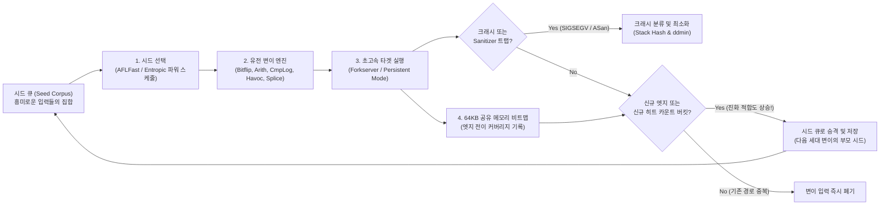

1988년 가을 폭풍우가 몰아치던 어느 밤, 위스콘신 대학교 매디슨 캠퍼스의 컴퓨터 과학 교수 <strong>바튼 밀러(Barton Miller)</strong>는 자택 단말기에서 1200보오(baud) 다이얼업 모뎀과 아날로그 전화선을 통해 대학의 UNIX 워크스테이션에 원격 접속해 작업하고 있었다. 창밖에서는 격렬한 뇌우가 몰아쳤고, 낙뢰로 인한 전자기 유도 노이즈가 전화선에 끊임없이 유입되면서 밀러 교수가 입력하던 명령어를 무작위로 깨진 바이트 스트림으로 변조시켰다.

그러자 놀라운 현상이 벌어졌다. 노이즈로 깨진 무의미한 문자열이 `vi`, `cc`, `awk`, `sed`, `csh`, `indent` 같은 당대 최고 수준의 상용·학술 UNIX 표준 유틸리티에 전달되자, 전 세계 엔지니어들이 매일 신뢰하며 쓰던 핵심 프로그램들이 잇달아 <strong>세그멘테이션 오류(Segmentation Fault, `SIGSEGV`)를 일으키며 충돌하거나 무한 루프에 빠져 멈춰버린 것</strong>이다.

이 우연한 발견에 큰 충격을 받은 밀러 교수는 대학원 운영체제 수업 프로젝트로 무작위 문자 스트림 생성기를 만들어 7종의 UNIX 시스템 유틸리티에 주입하는 실험을 진행했고, 이 도구를 <strong>"Fuzz(퍼즈: 보풀, 잡음)"</strong>라고 명명했다. 결과는 충격적이었다. <strong>전체 표준 UNIX 유틸리티의 25%~33%가 순수한 무작위 바이트 입력만으로 즉시 크래시를 일으켰다.</strong>

그로부터 35년 이상이 지난 오늘날, <strong>퍼징(Fuzzing / Fuzz Testing)</strong>은 단순한 난수 주입에서 벗어나 컴파일러 계측(Instrumentation), 다윈 진화 유전 알고리즘, SMT 제약 조건 솔버, 가상 메모리 섀도우 매핑을 결합한 <strong>현대 소프트웨어 보안 최강의 자동 취약점 발굴 기술</strong>로 진화했다. 구글의 <strong>OSS-Fuzz</strong> 프로젝트 하나만으로도 OpenSSL, SQLite, FFmpeg, Linux 커널 등 핵심 오픈소스에서 <strong>10,000건 이상의 보안 취약점과 36,000건 이상의 버그</strong>를 자동으로 찾아냈다.

왜 개발자가 수천 개의 단위 테스트(Unit Test)를 작성해도 찾지 못한 치명적 버그가 무작위 변이 입력에 의해 쉽게 드러날까? 본 글에서는 입력 공간의 조합 폭발과 가로등 효과로부터 출발해 <strong>커버리지 유도 그레이박스 퍼징(AFL / AFL++ / LibFuzzer)</strong>의 아키텍처, 64KB 공유 메모리 비트맵과 1비트 우측 시프트(`>> 1`)의 수학적 필연성, <strong>AddressSanitizer(ASan)</strong>의 섀도우 메모리, 그리고 <strong>델타 디버깅(Delta Debugging: `ddmin`)</strong> 최소 재현 알고리즘을 체계적으로 해부한다.

---

## 제1장: 입력 공간의 조합 폭발과 '가로등 효과(Streetlight Effect)'

### 1.1 단 64바이트 버퍼가 품은 $10^{154}$ 개의 우주

인간이 작성한 테스트 코드만으로 버그를 박멸할 수 없는 근본 원인은 <strong>입력 공간(Input Space)의 기하급수적 조합 폭발</strong>에 있다. 단 $N = 64$ 바이트의 네트워크 헤더나 이미지 청크를 파싱하는 함수를 생각해 보자. 각 바이트는 $2^8 = 256$ 가지 값을 가질 수 있으므로 가능한 모든 입력의 수는 다음과 같다.

$$|\Sigma|^N = 256^{64} = \left(2^8\right)^{64} = 2^{512} \approx 1.34 \times 10^{154}$$

관측 가능한 우주 전체의 양성자 수(에딩턴 수)가 약 $10^{80}$ 개에 불과하다는 점을 떠올려 보라. 지구상의 모든 컴퓨터를 동원해 빅뱅 이후 지금까지 138억 년 동안 매초 1조 번씩 테스트를 수행해도 64바이트 입력 공간의 $10^{-124}$ 조차 탐색할 수 없다.

### 1.2 단위 테스트의 가로등 효과와 '기묘한 상태 기계(Weird Machine)'

인간 개발자가 단위 테스트를 작성할 때는 필연적으로 <strong>가로등 효과(Streetlight Effect / 관찰 편향)</strong>에 빠진다. 밤길에 열쇠를 잃어버린 사람이 찾기 쉬운 밝은 가로등 밑만 뒤지는 것처럼, 개발자는 <strong>설계 명세서에 적힌 정상 경로</strong>와 <strong>코드를 작성할 때 이미 의식했던 경계값(`0`, `-1`, `NULL`)</strong>만 테스트한다. 반면 치명적인 취약점은 개발자가 미처 상상하지 못한 조건들의 교차점, 즉 세르게이 브라투스(Sergey Bratus) 등이 명명한 <strong>'기묘한 기계(Weird Machine)'</strong> 속에서 발현된다.

```c
int parse_image_chunk(const uint8_t *buf, size_t len) {
    if (len < 16) return -1;
    uint32_t magic  = *(const uint32_t *)(buf + 0);
    uint16_t width  = *(const uint16_t *)(buf + 4);
    uint16_t height = *(const uint16_t *)(buf + 6);
    uint8_t  flags  = buf[8];

    if (magic != 0x494D4721) return -1;          // "IMG!" 매직 바이트 검사
    if (width == 0 || height == 0) return -1;    // 개발자가 테스트한 0 경계 조건

    uint16_t alloc_size = width * height;        // [버그] 16비트 정수 오버플로!
    if (flags & 0x80) alloc_size += 16;
    uint8_t *pixel_buf = malloc(alloc_size);     // 0 또는 16바이트만 할당됨
    memcpy(pixel_buf, buf + 16, (size_t)width * height); // 65,536바이트 복사로 힙 파괴!
    ...
}
```

위 코드에서 `width = 256`, `height = 256`이 입력되면 $256 \times 256 = 65536 \equiv 0 \pmod{2^{16}}$ 으로 인해 16비트 정수 오버플로가 발생하고, `malloc(16)`으로 할당된 작은 버퍼에 64KB가 복사되면서 치명적인 힙 버퍼 오버플로가 터진다.

---

## 제2장: 퍼징의 4대 패러다임 비교

`magic == 0x494D4721` 같은 4바이트 비교(무작위 통과 확률 $2^{-32} \approx 43$억분의 1)를 뚫고 프로그램 심층부로 들어가기 위해 퍼징은 4가지 패러다임으로 발전해 왔다.

| 패러다임 분류 | 대표 도구 | 내부 정보 활용 수준 | 탐색 및 생성 메커니즘 | 핵심 강점 | 한계 및 병목 |
| :--- | :--- | :--- | :--- | :--- | :--- |
| <strong>블랙박스 퍼징</strong><br>(Black-box Fuzzing) | 초기 `fuzz`, `zzuf`, `radamsa` | 없음 (완전 외부 관찰) | 무작위 비트 플립 및 바이트 변이 | 소스 코드나 계측 불필요, 빠른 실행 | 4바이트 매직 넘버($2^{-32}$)나 체크섬, 구조적 문법을 통과하지 못함 |
| <strong>문법/생성 기반 퍼징</strong><br>(Grammar-based) | `Peach`, `Syzkaller`, `LangFuzz`, `Domato` | 입력 포맷 명세 또는 문맥 자유 문법(CFG) | BNF 문법 및 시스템 콜 명세로부터 유효한 AST 생성·교차 | 파서를 통과하여 JS 엔진이나 OS 커널 심층부까지 도달 | 정교한 문법 작성에 막대한 수작업 필요, 비정상 구문 파서 버그 누락 가능 |
| <strong>화이트박스 퍼징</strong><br>(Symbolic / Concolic) | `SAGE`, `KLEE`, `angr`, `Driller` | 명령어 단위 심볼릭 추적 및 분기 조건 수집 | 경로 제약식 $\Pi$ 구축 후 <strong>SMT 솔버(Z3)</strong>로 분기 반전 해 계산 | `x == 0xdeadbeef` 같은 복잡한 산술·등식 조건을 단번에 해결 | 루프에서 <strong>경로 폭발($2^d$)</strong> 발생, 해시·비선형 연산에서 SMT 솔버 타임아웃 |
| <strong>커버리지 유도 그레이박스</strong><br>(Coverage-Guided Grey-box) | <strong>`AFL`</strong>, <strong>`AFL++`</strong>, <strong>`LibFuzzer`</strong>, `Honggfuzz` | 경량 컴파일 타임 <strong>엣지 커버리지 계측</strong> (64KB 비트맵) | 새로운 CFG 엣지를 개척한 입력만 시드로 보존하는 <strong>진화 유전 탐색</strong> | 무거운 SMT 솔버 없이 초당 수만 회 실행과 자연 선택으로 심층 도달 | 단일 명령어 다중 바이트 비교에는 사전이나 CmpLog 보조 필요 |

화이트박스 콘콜릭(Concolic) 실행에서는 입력 바이트를 기호 변수 $\vec{\alpha}$로 두고 $k$번째 분기 조건을 부정한 논리식을 SMT 솔버에 질의한다.

$$\Pi_{\text{path}} = c_1(\vec{\alpha}) \land c_2(\vec{\alpha}) \land \dots \land c_{k-1}(\vec{\alpha}) \land \neg c_k(\vec{\alpha})$$

반면 2013년 <strong>미하우 잘레프스키(Michał Zalewski)</strong>가 개발한 <strong>AFL</strong>과 그 후속작인 <strong>AFL++</strong>, <strong>LibFuzzer</strong>는 무거운 SMT 솔버 대신 초고속 엣지 커버리지 피드백과 다윈적 자연 선택을 결합하여 패러다임 전환을 이루었다.



---

## 제3장: AFL 내부 아키텍처 — 엣지 계측, 64KB 비트맵, 그리고 `>> 1`의 수학적 필연성

### 3.1 왜 기본 블록(노드)이 아니라 '엣지(Edge) 커버리지'인가?

만약 기본 블록 $A \to B \to C$를 거친 입력1이 모든 블록 $\{A, B, C\}$를 방문 처리했다고 하자. 이후 초기화 블록 $B$를 건너뛰고 $A \to C$로 직행하여 NULL 역참조 버그를 일으키는 입력2가 들어오면, 노드 커버리지는 $\{A, C\} \subset \{A, B, C\}$이므로 입력2를 "새로운 블록이 없는 무가치한 입력"으로 간주해 버린다! 반면 블록 간 전이 쌍인 <strong>엣지(Edge Tuple)</strong>를 기록하면 $(A \to C)$가 미답의 전이임을 즉시 포착할 수 있다.

### 3.2 3줄의 계측 트램펄린, 64KB L1 비트맵, 그리고 `>> 1` 우측 시프트 증명

AFL 컴파일러 래퍼(`afl-cc`)는 모든 기본 블록 진입점에 다음 3줄의 계측 코드를 삽입한다.

```c
/* Compile-time random 16-bit ID assigned to the current basic block */
cur_location = <COMPILE_TIME_RANDOM_16BIT>;

/* Record the transition edge (prev -> cur) in the 64 KB shared bitmap */
shared_mem[cur_location ^ prev_location]++;

/* Right-shift by 1 bit to preserve directionality and self-loops */
prev_location = cur_location >> 1;
```

`shared_mem`의 크기가 정확히 $2^{16} = 65,536$ 바이트(<strong>64 KB</strong>)인 이유는 현대 CPU 코어의 <strong>L1 데이터 캐시 및 L2 캐시에 통째로 상주</strong>하여 DRAM 캐시 미스 없이 1~2나노초 만에 기록을 끝내기 위함이다.

여기서 세 번째 줄 `prev_location = cur_location >> 1;`의 <strong>1비트 우측 시프트(`>> 1`)</strong>가 없다면 어떤 일이 벌어질까?

$$\text{Without shift: } \quad \text{Edge}(A \to B) = A \oplus B = B \oplus A = \text{Edge}(B \to A), \qquad \text{Edge}(A \to A) = A \oplus A = 0$$

$$\text{With 1-bit right shift: } \quad \text{Edge}(A \to B) = (A \gg 1) \oplus B \neq (B \gg 1) \oplus A = \text{Edge}(B \to A), \qquad \text{Edge}(A \to A) = (A \gg 1) \oplus A \neq 0$$

1. <strong>교환법칙으로 인한 방향성 소실($A \oplus B = B \oplus A$)</strong>: 블록 $A \to B$ 전이와 역방향 $B \to A$ 전이가 동일한 비트맵 인덱스로 충돌한다.
2. <strong>멱등성(Nilpotency)으로 인한 자기 루프 소멸($A \oplus A = 0$)</strong>: 자기 자신으로 점프하는 모든 루프 $(A \to A)$가 항상 $0$이 되어 프로그램 전체의 모든 자기 루프가 단일 바이트 `shared_mem[0]`에 충돌한다!

단 1비트의 우측 시프트(`cur_location >> 1`)만 추가하면 비대칭성이 부여되어 방향성과 자기 루프가 동시에 보존된다. 또한 각 바이트의 실행 횟수는 $1, 2, 3, 4\text{–}7, 8\text{–}15, \dots, 128+$의 <strong>8단계 로그 버킷(Logarithmic Bucketing)</strong>으로 양자화되어 루프 전개의 핵심 이정표를 포착한다.

### 3.3 Forkserver, Persistent Mode, 그리고 마르코프 연쇄 파워 스케줄링

매 실행마다 `execve()`와 동적 링커(`ld.so`)를 호출하는 병목을 없애기 위해 AFL은 `main()` 직전에 멈춰 대기하는 <strong>Forkserver</strong>를 두고, <strong>Copy-on-Write(CoW)</strong> 기반 `fork()`만 수행하여 속도를 초당 수만 회로 끌어올린다. 나아가 <strong>LibFuzzer / Persistent Mode (`LLVMFuzzerTestOneInput`)</strong>는 동일 프로세스 내 메모리 루프로 함수를 직접 호출해 초당 10만 회 이상의 실행을 달성한다. 또한 <strong>AFLFast(Böhme 등)와 Entropic</strong>은 마르코프 연쇄와 섀넌 엔트로피 $H(s)$를 통해 저빈도 희귀 경로를 지나는 시드에 집중적으로 변이 에너지를 할당한다.

$$p(s) = \min\left(\frac{\alpha(s)}{\beta} \cdot \frac{2^{s_{\text{handicap}}}}{f(i)}, \; M\right), \qquad H(s) = -\sum_{e \in E(s)} \hat{p}_{s,e} \log_2 \hat{p}_{s,e}$$

---

## 제4장: 조용한 메모리 오염을 즉각적인 크래시로 — 새니타이저(Sanitizers) 아키텍처

C/C++에서 몇 바이트의 힙 버퍼 오버플로나 Use-After-Free가 발생해도 OS의 MMU는 $4\text{ KB}$ 페이지 단위로만 권한을 검사하므로 `SIGSEGV` 없이 조용히 넘어가는 경우가 대부분이다. <strong>AddressSanitizer(ASan)</strong>는 가상 메모리의 8바이트마다 1바이트를 매핑하는 <strong>1:8 섀도우 메모리(Shadow Memory)</strong>와 <strong>레드존(Redzones)</strong>, 그리고 해제된 메모리의 재사용을 지연시키는 <strong>격리 큐(Quarantine Queue)</strong>로 이를 즉시 포착한다.

$$\text{ShadowAddr}(\text{Addr}) = (\text{Addr} \gg 3) + \text{Offset}$$

섀도우 바이트 `0x00`은 8바이트 전체 접근 가능, $1 \le k \le 7$은 앞의 $k$바이트만 접근 가능, 음수(`0xfa` 힙 레드존, `0xfd` 해제된 힙 메모리 등)는 접근 금지 영역을 뜻하며, 모든 메모리 접근 직전에 다음 검사가 수행된다.

```c
/* Compiler-injected ASan check before an N-byte memory access (N = 1, 2, 4) */
uintptr_t shadow_addr = (addr >> 3) + ASAN_SHADOW_OFFSET;
int8_t shadow_val = *(int8_t *)shadow_addr;

if (UNLIKELY(shadow_val != 0)) {
    /* For partial 8-byte words (1 <= shadow_val <= 7) or negative redzones */
    if (shadow_val < 0 || (int8_t)((addr & 7) + N) > shadow_val) {
        __asan_report_error(pc, bp, sp, addr, is_write, N);
    }
}
```

여기에 정수 오버플로 등 미정의 동작을 잡는 <strong>UBSan</strong>, 초기화되지 않은 메모리 읽기를 비트 단위로 추적하는 <strong>MSan</strong>, 벡터 클록으로 데이터 레이스를 잡는 <strong>TSan</strong>, 그리고 서로 다른 구현체의 출력 차이를 비교하는 <strong>차분 퍼징(Differential Fuzzing)</strong>이 결합되어 완벽한 버그 오라클을 구축한다.

---

## 제5장: 크래시 분류(Triage)와 델타 디버깅(`ddmin`)을 통한 재현 입력 최소화

퍼저가 쏟아낸 수만 개의 중복 크래시는 크래시 시점의 상위 호출 스택 프레임을 해싱하는 <strong>스택 해시(Stack Hash)</strong>를 통해 근본 원인별로 그룹화된다. 마지막으로, 수천 번의 변이로 인해 수 메가바이트로 비대해진 크래시 파일 $c$에서 버그와 무관한 노이즈를 제거하기 위해 <strong>안드레아스 젤러(Andreas Zeller)의 델타 디버깅(`ddmin`) 알고리즘</strong>이 사용된다.

$$\forall c' \subsetneq c^* \; \text{with} \; |c^*| - |c'| = 1 : \quad \text{test}(c') \neq \text{FAIL}$$

$$T_{\text{best}}(N) = \mathcal{O}(\log_2 N), \qquad T_{\text{worst}}(N) = \frac{N^2 + 3N - 2}{2} = \mathcal{O}(N^2)$$

`ddmin`은 입력을 $n$개의 청크 $\Delta_1, \dots, \Delta_n$으로 분할하여 부분집합 $\Delta_i$ 단독 테스트와 여집합 $\nabla_i = c \setminus \Delta_i$ 테스트를 반복하고, 실패가 재현되지 않으면 분할 입도 $n \leftarrow \min(2n, |c|)$를 두 배로 촘촘하게 늘리는 일반화된 이진 탐색을 수행한다. 이를 통해 단 1바이트만 더 지워도 크래시가 사라지는 <strong>1-최소 재현 입력(1-minimal PoC) $c^*$</strong>를 최선 $\mathcal{O}(\log_2 N)$ 시간 안에 자동으로 추출해 낸다.
