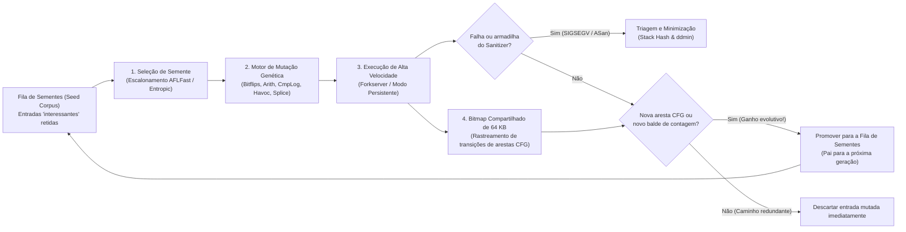

Em uma noite escura e tempestuosa de outono em 1988, em Madison, Wisconsin, o professor de ciência da computação <strong>Barton Miller</strong> tentava trabalhar em seu terminal doméstico conectado a uma estação de trabalho UNIX da universidade por meio de um modem discado de 1200 bauds. Lá fora, uma violenta tempestade elétrica atingia a região. A cada raio, a interferência eletromagnética injetava rajadas de ruído aleatório na linha telefônica analógica, corrompendo os caracteres ASCII enviados ao shell UNIX.

O que aconteceu a seguir o deixou perplexo: sempre que o ruído da linha injetava sequências de bytes sem sentido em utilitários padrão do UNIX amplamente testados — como `vi`, `cc`, `awk`, `sed`, `csh` e `indent` — esses programas essenciais não exibiam apenas uma mensagem de erro de sintaxe; eles <strong>travavam um após o outro com falhas de segmentação (`SIGSEGV`, Segmentation Fault) ou entravam em loops infinitos</strong>.

Impressionado com essa fragilidade, Miller transformou a observação em um projeto de pós-graduação, criando um gerador de fluxos de caracteres aleatórios batizado de <strong>"Fuzz"</strong>. O resultado chocou a comunidade de engenharia de software: <strong>entre 25% e 33% de todos os utilitários padrão do UNIX em sete variantes comerciais e acadêmicas colapsaram ao receber fluxos de bytes puramente aleatórios</strong>.

Mais de três décadas e meia depois, o <strong>Fuzzing (testes difusos)</strong> evoluiu daquele gerador de ruído cego para a técnica automatizada de descoberta de vulnerabilidades mais produtiva da ciência da computação, unindo instrumentação de compilador, algoritmos genéticos evolutivos, solucionadores formais SMT e mapeamento de memória sombra (Shadow Memory). Somente a plataforma contínua <strong>OSS-Fuzz</strong> do Google já descobriu automaticamente <strong>mais de 10.000 vulnerabilidades de segurança e mais de 36.000 bugs</strong> em projetos críticos como OpenSSL, SQLite, FFmpeg e o kernel Linux.

Por que milhares de testes unitários escritos por humanos deixam passar corrupções fatais de memória que a mutação automática expõe em minutos? Neste artigo, dissecamos a explosão combinatória do espaço de entrada, os quatro paradigmas do fuzzing, a arquitetura interna do <strong>AFL / AFL++ / LibFuzzer</strong> (bitmaps de 64 KB no cache L1, a prova matemática do deslocamento `>> 1`, Forkserver e escalonamento de cadeias de Markov), o <strong>AddressSanitizer (ASan)</strong> e o algoritmo <strong>Delta Debugging (`ddmin`)</strong> de Andreas Zeller.

---

## Capítulo 1: O Abismo Combinatório do Espaço de Entrada e o Efeito Poste de Luz

### 1.1 Um Buffer de 64 Bytes Contém $10^{154}$ Universos Possíveis

Por que suítes de testes unitários manuais não conseguem erradicar defeitos de software? A razão fundamental está na <strong>explosão combinatória do espaço de entrada</strong>. Considere uma função em C que analisa um cabeçalho binário de apenas $N = 64$ bytes. Como cada byte pode assumir $|\Sigma| = 2^8 = 256$ valores distintos, o número total de entradas possíveis de 64 bytes é:

$$|\Sigma|^N = 256^{64} = \left(2^8\right)^{64} = 2^{512} \approx 1.34 \times 10^{154}$$

Para dimensionar $1.34 \times 10^{154}$, lembre-se de que o número de Eddington (o total estimado de prótons em todo o universo observável) é de apenas $\approx 10^{80}$. Mesmo que todos os processadores da Terra avaliassem um trilhão ($10^{12}$) de entradas por segundo ininterruptamente desde o Big Bang há 13,8 bilhões de anos, não explorariam nem uma fração de $10^{-124}$ desse pequeno buffer de 64 bytes.

### 1.2 O Efeito Poste de Luz (Streetlight Effect) e a "Weird Machine"

Ao escrever testes unitários, os desenvolvedores inevitavelmente caem no <strong>Efeito Poste de Luz (viés de observação)</strong>: como alguém que procura suas chaves perdidas à noite apenas debaixo do poste porque ali há luz, os engenheiros testam apenas <strong>os casos válidos previstos na especificação</strong> e <strong>os valores limites óbvios (`0`, `-1`, `NULL`)</strong> nos quais já pensaram ao programar. Contudo, as vulnerabilidades críticas habitam na escuridão da <strong>"Weird Machine"</strong> (Bratus et al.) — o autômato de estados emergente criado por estouros de inteiros e suposições implícitas do parser:

```c
int parse_image_chunk(const uint8_t *buf, size_t len) {
    if (len < 16) return -1;
    uint32_t magic  = *(const uint32_t *)(buf + 0);
    uint16_t width  = *(const uint16_t *)(buf + 4);
    uint16_t height = *(const uint16_t *)(buf + 6);
    uint8_t  flags  = buf[8];

    if (magic != 0x494D4721) return -1;          // Exige assinatura mágica "IMG!"
    if (width == 0 || height == 0) return -1;    // O desenvolvedor testou o limite 0!

    uint16_t alloc_size = width * height;        // [BUG] Estouro de inteiro de 16 bits!
    if (flags & 0x80) alloc_size += 16;
    uint8_t *pixel_buf = malloc(alloc_size);     // Aloca apenas 0 ou 16 bytes
    memcpy(pixel_buf, buf + 16, (size_t)width * height); // Copia 65.536 bytes corrompendo o heap!
    ...
}
```

Com `width = 256, height = 256`, o produto $256 \times 256 = 65536 \equiv 0 \pmod{2^{16}}$ estoura a variável de 16 bits `alloc_size` para `0`, aloca apenas 16 bytes com `malloc(16)` e sobrescreve 64 KB do heap via `memcpy`.

---

## Capítulo 2: Os Quatro Paradigmas do Fuzzing

Para superar barreiras como `if (magic != 0x494D4721)` (probabilidade aleatória de $2^{-32} \approx 1 / 4,29\times 10^9$), o fuzzing evoluiu em quatro grandes paradigmas:

| Paradigma de Fuzzing | Ferramentas Representativas | Visibilidade Interna | Mecanismo de Busca e Geração | Principais Forças | Gargalos Fundamentais |
| :--- | :--- | :--- | :--- | :--- | :--- |
| <strong>Fuzzing de Caixa-Preta</strong><br>(Black-box) | `fuzz` (1988), `zzuf`, `radamsa` | Nenhuma (caixa opaca) | Inversão aleatória de bits e sobrescrita cega de bytes | Sem instrumentação ou código-fonte; altíssima velocidade inicial | Bloqueado por bytes mágicos ($2^{-32}$), checksums e sintaxe estruturada |
| <strong>Fuzzing Baseado em Gramática</strong><br>(Grammar-based) | `Peach`, `Syzkaller`, `LangFuzz`, `Domato` | Gramática livre de contexto (CFG) ou especificação de syscalls | Sintetiza e muta Árvores de Sintaxe Abstrata (AST) estruturalmente válidas | Penetra analisadores léxicos/sintáticos até motores JS e kernels de SO | Alto custo manual para escrever gramáticas; perde bugs de sintaxe malformada |
| <strong>Execução Simbólica / Concólica</strong><br>(White-box) | `SAGE`, `KLEE`, `angr`, `Driller` | Rastreamento simbólico completo e coleta de predicados de desvio | Constrói a restrição de caminho $\Pi$ e inverte desvios com <strong>solucionador SMT (Z3)</strong> | Resolve algebricamente `x == 0xdeadbeef` em um único passo | <strong>Explosão de caminhos ($2^d$)</strong> em loops; lentidão do SMT em hashes e matemática não linear |
| <strong>Fuzzing de Caixa-Cinza Guiado por Cobertura (CGF)</strong> | <strong>`AFL`</strong>, <strong>`AFL++`</strong>, <strong>`LibFuzzer`</strong>, `Honggfuzz` | <strong>Instrumentação leve de arestas</strong> na compilação (bitmap 64 KB) | <strong>Algoritmo genético evolutivo</strong>: retém apenas sementes que descobrem novas arestas do CFG | Sem solucionador SMT pesado; atinge $10^4\text{–}10^5\text{ execs/s}$ evoluindo para estados profundos | Requer CmpLog (RedQueen) ou dicionários para comparações monolíticas multibyte |

Na execução concólica (Concrete + Symbolic), os bytes de entrada são tratados como variáveis simbólicas $\vec{\alpha}$ e a última condição de desvio é negada para o solucionador SMT:

$$\Pi_{\text{path}} = c_1(\vec{\alpha}) \land c_2(\vec{\alpha}) \land \dots \land c_{k-1}(\vec{\alpha}) \land \neg c_k(\vec{\alpha})$$

Por outro lado, o <strong>AFL</strong> (criado por <strong>Michał Zalewski</strong> em 2013), o <strong>AFL++</strong> e o <strong>LibFuzzer</strong> substituem a resolução SMT pela seleção natural darwiniana guiada pela cobertura de arestas.



---

## Capítulo 3: Dentro do Motor do AFL — Instrumentação de Arestas, Bitmap de 64 KB e a Prova de `>> 1`

### 3.1 Por que a Cobertura de Arestas (Edge Coverage) Supera a Cobertura de Blocos Básicos

Se um fuzzer registrasse apenas quais blocos básicos foram visitados, após executar o caminho $A \to B \to C$ os blocos $\{A, B, C\}$ estariam todos marcados. Quando uma segunda entrada pula o bloco de inicialização $B$ tomando a rota direta $A \to C$ (onde $C$ desreferencia um ponteiro nulo), como $\{A, C\} \subset \{A, B, C\}$, um fuzzer baseado em nós descartaria a entrada como redundante! Ao registrar <strong>pares de transição direcionados (arestas)</strong> $(B_{\text{prev}} \to B_{\text{cur}})$, o AFL detecta instantaneamente que a aresta $(A \to C)$ é inédita.

### 3.2 O Trampolim de 3 Linhas, os 64 KB no Cache L1 e a Necessidade Matemática de `>> 1`

O AFL injeta em cada bloco básico estas três operações durante a compilação:

```c
/* Compile-time random 16-bit ID assigned to the current basic block */
cur_location = <COMPILE_TIME_RANDOM_16BIT>;

/* Record the transition edge (prev -> cur) in the 64 KB shared bitmap */
shared_mem[cur_location ^ prev_location]++;

/* Right-shift by 1 bit to preserve directionality and self-loops */
prev_location = cur_location >> 1;
```

Por que `shared_mem` mede exatamente $2^{16} = 65.536$ bytes (<strong>64 KB</strong>)? Porque 64 KB <strong>cabem inteiramente no cache de dados L1/L2 do núcleo da CPU</strong>, evitando falhas de cache para a memória DRAM e registrando cada salto em ~1 nanossegundo.

Por que o <strong>deslocamento de 1 bit para a direita (`>> 1`)</strong> em `prev_location = cur_location >> 1;` é matematicamente indispensável? Sem esse deslocamento, o operador XOR ($\oplus$) sofreria duas degenerações algébricas fatais:

$$\text{Without shift: } \quad \text{Edge}(A \to B) = A \oplus B = B \oplus A = \text{Edge}(B \to A), \qquad \text{Edge}(A \to A) = A \oplus A = 0$$

$$\text{With 1-bit right shift: } \quad \text{Edge}(A \to B) = (A \gg 1) \oplus B \neq (B \gg 1) \oplus A = \text{Edge}(B \to A), \qquad \text{Edge}(A \to A) = (A \gg 1) \oplus A \neq 0$$

1. <strong>Perda de direcionalidade por comutatividade ($A \oplus B = B \oplus A$)</strong>: O salto $A \to B$ e o retorno $B \to A$ produziriam exatamente o mesmo índice no bitmap.
2. <strong>Aniquilação de auto-loops por nilpotência ($A \oplus A = 0$)</strong>: Qualquer bloco que salte sobre si mesmo ($A \to A$) resultaria em $0$, fazendo colidir todos os auto-loops do programa no único byte `shared_mem[0]`.

O deslocamento `>> 1` quebra simultaneamente a simetria e a nilpotência em um único ciclo de clock. Além disso, o AFL agrupa as contagens de execução em <strong>8 baldes logarítmicos ($1, 2, 3, 4\text{–}7, 8\text{–}15, 16\text{–}31, 32\text{–}127, 128\text{–}255$)</strong> para detectar marcos na iteração de loops sem saturar a fila.

### 3.3 Forkserver, Modo Persistente e Escalonamento de Cadeias de Markov (AFLFast / Entropic)

Para eliminar o enorme custo de `execve()` e do linker dinâmico (`ld.so`), o <strong>Forkserver</strong> do AFL pausa o processo logo antes de `main()` e clona processos filhos via <strong>Copy-on-Write (`fork()`)</strong> através dos pipes `fd 198`/`199`. O <strong>Modo Persistente (`LLVMFuzzerTestOneInput`)</strong> elimina até mesmo o `fork()`, invocando a função alvo em um loop em memória a mais de $100.000\text{ execs/s}$. Junto com o <strong>CmpLog (RedQueen)</strong> e os escalonadores <strong>AFLFast / Entropic</strong> baseados em cadeias de Markov e entropia de Shannon $H(s)$, o fuzzer concentra sua energia mutacional nos ramos menos explorados:

$$p(s) = \min\left(\frac{\alpha(s)}{\beta} \cdot \frac{2^{s_{\text{handicap}}}}{f(i)}, \; M\right), \qquad H(s) = -\sum_{e \in E(s)} \hat{p}_{s,e} \log_2 \hat{p}_{s,e}$$

---

## Capítulo 4: Transformando Corrupção Silenciosa em Falhas Instantâneas — Sanitizers

Como a MMU de hardware só verifica permissões em páginas de <strong>$4\text{ KB}$</strong>, um estouro de 1 byte no heap ou um Use-After-Free quase nunca dispara `SIGSEGV`. O <strong>AddressSanitizer (ASan)</strong> resolve isso por meio de um <strong>mapeamento de memória sombra (Shadow Memory) 1:8</strong>:

$$\text{ShadowAddr}(\text{Addr}) = (\text{Addr} \gg 3) + \text{Offset}$$

Cada palavra alinhada de 8 bytes de memória de aplicação é projetada em 1 byte sombra: `0x00` indica que todos os 8 bytes são válidos, $1 \le k \le 7$ indica que apenas os primeiros $k$ bytes são válidos, e valores negativos marcam <strong>zonas vermelhas envenenadas (`0xfa` no heap, `0xf1` na pilha)</strong> ou memória liberada retida na <strong>fila de quarentena (`0xfd` para Use-After-Free)</strong>. Antes de cada acesso à memória, o compilador insere:

```c
/* Compiler-injected ASan check before an N-byte memory access (N = 1, 2, 4) */
uintptr_t shadow_addr = (addr >> 3) + ASAN_SHADOW_OFFSET;
int8_t shadow_val = *(int8_t *)shadow_addr;

if (UNLIKELY(shadow_val != 0)) {
    /* For partial 8-byte words (1 <= shadow_val <= 7) or negative redzones */
    if (shadow_val < 0 || (int8_t)((addr & 7) + N) > shadow_val) {
        __asan_report_error(pc, bp, sp, addr, is_write, N);
    }
}
```

Combinado com <strong>UBSan</strong> (comportamento indefinido e estouro de inteiros), <strong>MSan</strong> (leitura de memória não inicializada bit a bit), <strong>TSan</strong> (condições de corrida via relógios vetoriais) e o <strong>Fuzzing Diferencial</strong>, qualquer anomalia sutil provoca uma parada imediata e reprodutível.

---

## Capítulo 5: Triagem de Falhas e Delta Debugging (`ddmin`) de Andreas Zeller

Os milhares de arquivos de falha duplicados são agrupados primeiro pelo <strong>hash da pilha de chamadas (Stack Hash)</strong> no ponto do erro. Em seguida, para reduzir um arquivo corrompido de vários megabytes $c$ (comprimento $N$) cheio de ruído mutacional a um exemplo mínimo, o algoritmo <strong>Delta Debugging (`ddmin`) de Andreas Zeller</strong> encontra automaticamente um caso de teste <strong>1-minimal $c^*$</strong> no qual remover qualquer byte adicional faz a falha desaparecer:

$$\forall c' \subsetneq c^* \; \text{with} \; |c^*| - |c'| = 1 : \quad \text{test}(c') \neq \text{FAIL}$$

$$T_{\text{best}}(N) = \mathcal{O}(\log_2 N), \qquad T_{\text{worst}}(N) = \frac{N^2 + 3N - 2}{2} = \mathcal{O}(N^2)$$

Dividindo a entrada em $n$ fragmentos $\Delta_1, \dots, \Delta_n$ (começando com $n=2$), o `ddmin` testa primeiro cada subconjunto $\Delta_i$, depois cada complemento $\nabla_i = c \setminus \Delta_i$, e dobra a granularidade $n \leftarrow \min(2n, |c|)$ quando nenhuma redução direta funciona. Por meio dessa busca binária generalizada, o `ddmin` (`afl-tmin` e `C-Reduce`) comprime um arquivo de 10 MB em uma prova de conceito (PoC) de poucos bytes em $\mathcal{O}(\log_2 N)$ passos no melhor caso.
