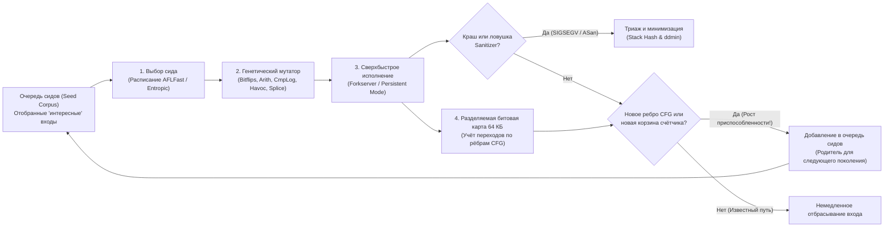

Тёмной грозовой осенней ночью 1988 года в Мэдисоне (штат Висконсин) профессор информатики <strong>Бартон Миллер (Barton Miller)</strong> сидел дома за терминалом, пытаясь работать на университетской UNIX-станции через модем со скоростью 1200 бод по аналоговой телефонной линии. За окном бушевала сильная гроза.Каждый удар молнии наводил электромагнитные помехи в телефонном проводе, искажая поток символов ASCII, отправляемых в командную оболочку UNIX.

То, что произошло дальше, поразило его: когда линейный шум посылал бессмысленные последовательности байтов в проверенные временем стандартные утилиты UNIX — такие как `vi`, `cc`, `awk`, `sed`, `csh` и `indent`, — эти программы не просто выводили сообщение об ошибке синтаксиса, а <strong>одна за другой аварийно завершались с ошибкой сегментации (`SIGSEGV`, Segmentation Fault) или зависали в бесконечных циклах</strong>.

Потрясённый этой хрупкостью, Миллер поручил своим студентам написать генератор случайных символьных потоков, который он назвал <strong>«Fuzz» (шум, помехи)</strong>, и протестировать около 90 утилит на семи версиях UNIX. Результаты ошеломили индустрию: <strong>от 25 % до 33 % всех стандартных утилит UNIX падали при подаче чисто случайных байтовых потоков</strong>.

Спустя более чем 35 лет <strong>фаззинг (Fuzzing / Fuzz Testing)</strong> превратился из слепого генератора шума в самую результативную технологию автоматического поиска уязвимостей в компьютерных науках, объединившую компиляторную инструментацию (LLVM IR), эволюционные генетические алгоритмы, SMT-решатели и теневую память (Shadow Memory). Только платформа непрерывного фаззинга <strong>OSS-Fuzz</strong> от Google автоматически обнаружила <strong>более 10 000 уязвимостей безопасности и свыше 36 000 багов</strong> в критически важных проектах, включая OpenSSL, SQLite, FFmpeg и ядро Linux.

Почему тысячи тщательно написанных модульных тестов (Unit Tests) пропускают фатальные повреждения памяти, которые автоматическая мутация вскрывает за считанные минуты? В этой статье мы разберём комбинаторный взрыв пространства входов, четыре парадигмы фаззинга, внутреннюю архитектуру <strong>AFL / AFL++ / LibFuzzer</strong> (битовая карта 64 КБ в кэше L1, математическое доказательство сдвига `>> 1`, Forkserver и марковские расписания), устройство <strong>AddressSanitizer (ASan)</strong> и алгоритм <strong>дельта-отладки (`ddmin`)</strong> Андреаса Целлера.

---

## Глава 1: Комбинаторная бездна пространства входов и «эффект фонарного столба»

### 1.1 Буфер из 64 байт скрывает $10^{154}$ вселенных

Почему ручные модульные тесты не способны искоренить ошибки в ПО? Фундаментальная причина кроется в <strong>комбинаторном взрыве пространства входных данных</strong>. Рассмотрим простую функцию на C, разбирающую бинарный заголовок пакета или изображения длиной всего $N = 64$ байта. Поскольку каждый байт принимает $|\Sigma| = 2^8 = 256$ значений, общее число возможных 64-байтовых входов равно:

$$|\Sigma|^N = 256^{64} = \left(2^8\right)^{64} = 2^{512} \approx 1.34 \times 10^{154}$$

Для сравнения: число Эддингтона (оценка общего количества протонов во всей наблюдаемой Вселенной) составляет всего около $10^{80}$. Даже если бы все процессоры Земли проверяли по триллиону ($10^{12}$) входов в секунду непрерывно с момента Большого взрыва (13,8 млрд лет), они не исследовали бы и $10^{-124}$ доли этого крошечного 64-байтового буфера.

### 1.2 «Эффект фонарного столба» (Streetlight Effect) и «Странная машина» (Weird Machine)

При написании модульных тестов разработчики неизбежно попадают в ловушку <strong>эффекта фонарного столба (смещение наблюдения)</strong>: подобно человеку, ищущему потерянные ночью ключи только под фонарём, потому что там светло, программисты тестируют лишь <strong>штатные сценарии из спецификации</strong> и <strong>очевидные граничные значения (`0`, `-1`, `NULL`)</strong>, о которых они и так подумали при написании кода. Но критические уязвимости прячутся в темноте — в так называемой <strong>«Weird Machine»</strong> (Bratus et al.), скрытом конечном автомате, возникающем на стыке целочисленных переполнений и неявных допущений парсера:

```c
int parse_image_chunk(const uint8_t *buf, size_t len) {
    if (len < 16) return -1;
    uint32_t magic  = *(const uint32_t *)(buf + 0);
    uint16_t width  = *(const uint16_t *)(buf + 4);
    uint16_t height = *(const uint16_t *)(buf + 6);
    uint8_t  flags  = buf[8];

    if (magic != 0x494D4721) return -1;          // Ожидается сигнатура "IMG!"
    if (width == 0 || height == 0) return -1;    // Разработчик протестировал границу 0!

    uint16_t alloc_size = width * height;        // [БАГ] 16-битное целочисленное переполнение!
    if (flags & 0x80) alloc_size += 16;
    uint8_t *pixel_buf = malloc(alloc_size);     // Выделяется всего 0 или 16 байт
    memcpy(pixel_buf, buf + 16, (size_t)width * height); // Копирование 65 536 байт крушит кучу!
    ...
}
```

При `width = 256, height = 256` произведение $256 \times 256 = 65536 \equiv 0 \pmod{2^{16}}$ переполняет 16-битную переменную `alloc_size` в `0`, `malloc(16)` выделяет крошечный буфер, а `memcpy` записывает туда 64 КБ данных, разрушая кучу (Heap).

---

## Глава 2: Четыре парадигмы фаззинга

Чтобы преодолеть проверки вроде `if (magic != 0x494D4721)` (вероятность случайного угадывания $2^{-32} \approx 1 / 4{,}29\times 10^9$), фаззинг развился в четыре основные парадигмы:

| Парадигма фаззинга | Примеры инструментов | Внутренняя видимость | Механизм поиска и генерации | Сильные стороны | Фундаментальные ограничения |
| :--- | :--- | :--- | :--- | :--- | :--- |
| <strong>Чёрный ящик</strong><br>(Black-box Fuzzing) | `fuzz` (1988), `zzuf`, `radamsa` | Отсутствует (полная непрозрачность) | Слепые случайные инверсии битов и перезапись байтов | Не нужен исходный код и инструментация; высокий темп запуска | Блокируется магическими числами ($2^{-32}$), контрольными суммами и сложным синтаксисом |
| <strong>Грамматический / генерационный</strong><br>(Grammar-based) | `Peach`, `Syzkaller`, `LangFuzz`, `Domato` | Контекстно-свободная грамматика (CFG) или схема системных вызовов | Синтезирует и мутирует синтаксически корректные деревья (AST) | Легко проходит лексеры и парсеры, проникая вглубь JS-движков и ядра ОС | Высокая трудоёмкость написания грамматик; пропускает баги парсера на битом синтаксисе |
| <strong>Белый ящик: символьное / конколическое исполнение</strong> | `SAGE`, `KLEE`, `angr`, `Driller` | Полная символьная трасса инструкций и предикатов ветвления | Собирает условие пути $\Pi$ и инвертирует ветви через <strong>SMT-решатель (Z3)</strong> | Мгновенно алгебраически решает уравнения вида `x == 0xdeadbeef` | <strong>Взрыв числа путей ($2^d$)</strong> в циклах; зависание SMT на хэшах и нелинейной арифметике |
| <strong>Серый ящик с обратной связью по покрытию (CGF)</strong> | <strong>`AFL`</strong>, <strong>`AFL++`</strong>, <strong>`LibFuzzer`</strong>, `Honggfuzz` | Лёгкая компиляторная <strong>инструментация рёбер</strong> (битовая карта 64 КБ) | <strong>Дарвиновский генетический отбор</strong>: сохраняет только входы, открывшие новые рёбра CFG | Не требует SMT-решателя; $10^4\text{–}10^5\text{ запусков/с}$ с эволюционным продвижением вглубь кода | Требует CmpLog (RedQueen) или словарей для монолитных многобайтовых сравнений |

При конколическом (Concrete + Symbolic) исполнении входные байты представляются символьными переменными $\vec{\alpha}$, а последнее условие ветвления инвертируется для SMT-решателя:

$$\Pi_{\text{path}} = c_1(\vec{\alpha}) \land c_2(\vec{\alpha}) \land \dots \land c_{k-1}(\vec{\alpha}) \land \neg c_k(\vec{\alpha})$$

Напротив, созданный <strong>Михалом Залевским (Michał Zalewski)</strong> в 2013 году <strong>AFL</strong>, а также <strong>AFL++</strong> и <strong>LibFuzzer</strong> заменили тяжёлый SMT-анализ сверхбыстрой обратной связью по покрытию рёбер.



---

## Глава 3: Внутри движка AFL — инструментация рёбер, битовая карта 64 КБ и математика `>> 1`

### 3.1 Почему покрытие рёбер (Edge Coverage) лучше покрытия базовых блоков

Если бы фаззер отмечал только посещённые базовые блоки (узлы), то после пути $A \to B \to C$ все блоки $\{A, B, C\}$ считались бы пройденными. Когда второй вход пропускает блок инициализации $B$ и идёт напрямую по ребру $A \to C$ (вызывая разыменование NULL в $C$), множество узлов $\{A, C\} \subset \{A, B, C\}$ показалось бы избыточным, и фаззер выбросил бы этот вход! Отслеживая <strong>направленные пары переходов (рёбра)</strong> $(B_{\text{prev}} \to B_{\text{cur}})$, AFL мгновенно видит, что переход $(A \to C)$ является новым.

### 3.2 Трамплин из 3 строк, 64 КБ в кэше L1 и необходимость сдвига `>> 1`

При компиляции AFL вставляет в начало каждого базового блока три операции:

```c
/* Compile-time random 16-bit ID assigned to the current basic block */
cur_location = <COMPILE_TIME_RANDOM_16BIT>;

/* Record the transition edge (prev -> cur) in the 64 KB shared bitmap */
shared_mem[cur_location ^ prev_location]++;

/* Right-shift by 1 bit to preserve directionality and self-loops */
prev_location = cur_location >> 1;
```

Размер `shared_mem` равен ровно $2^{16} = 65\,536$ байт (<strong>64 КБ</strong>), так как 64 КБ <strong>целиком помещаются в кэш данных L1/L2 ядра процессора</strong>, исключая промахи кэша в DRAM и сокращая время записи до ~1 наносекунды.

Почему в третьей строке `prev_location = cur_location >> 1;` математически необходим <strong>побитовый сдвиг вправо на 1 бит (`>> 1`)</strong>? Без него операция XOR ($\oplus$) страдала бы от двух фатальных алгебраических вырождений:

$$\text{Without shift: } \quad \text{Edge}(A \to B) = A \oplus B = B \oplus A = \text{Edge}(B \to A), \qquad \text{Edge}(A \to A) = A \oplus A = 0$$

$$\text{With 1-bit right shift: } \quad \text{Edge}(A \to B) = (A \gg 1) \oplus B \neq (B \gg 1) \oplus A = \text{Edge}(B \to A), \qquad \text{Edge}(A \to A) = (A \gg 1) \oplus A \neq 0$$

1. <strong>Потеря направления из-за коммутативности ($A \oplus B = B \oplus A$)</strong>: Переход $A \to B$ и обратный переход $B \to A$ давали бы один и тот же индекс.
2. <strong>Уничтожение петель из-за нильпотентности ($A \oplus A = 0$)</strong>: Любой цикл из блока в самого себя ($A \to A$) давал бы $0$, сталкивая все самопетли программы в единственный байт `shared_mem[0]`!

Сдвиг `>> 1` разрушает симметрию и нильпотентность за один такт CPU. Кроме того, счётчики попаданий квантуются в <strong>8 логарифмических корзин ($1, 2, 3, 4\text{–}7, 8\text{–}15, 16\text{–}31, 32\text{–}127, 128\text{–}255$)</strong>, позволяя отслеживать прогресс раскрутки циклов.

### 3.3 Forkserver, Persistent Mode и марковские расписания энергии (AFLFast / Entropic)

Чтобы убрать накладные расходы `execve()` и динамического компоновщика (`ld.so`), <strong>Forkserver</strong> замораживает процесс перед `main()` и клонирует дочерние процессы только через <strong>Copy-on-Write (`fork()`)</strong> по каналам `fd 198`/`199`. В режиме <strong>Persistent Mode (`LLVMFuzzerTestOneInput`)</strong> устраняется даже `fork()` — целевая функция вызывается в цикле внутри одного процесса со скоростью свыше $100\,000\text{ запусков/с}$. В сочетании с <strong>CmpLog (RedQueen)</strong> и планировщиками <strong>AFLFast / Entropic</strong> на базе цепей Маркова и информационной энтропии Шеннона $H(s)$ фаззер направляет основную энергию на редкие ветви:

$$p(s) = \min\left(\frac{\alpha(s)}{\beta} \cdot \frac{2^{s_{\text{handicap}}}}{f(i)}, \; M\right), \qquad H(s) = -\sum_{e \in E(s)} \hat{p}_{s,e} \log_2 \hat{p}_{s,e}$$

---

## Глава 4: Превращение скрытой порчи памяти в мгновенный краш — архитектура санитайзеров

Поскольку аппаратный блок управления памятью (MMU) проверяет права доступа только с точностью до страниц по <strong>$4\text{ КБ}$</strong>, переполнение буфера в куче на 1 байт или Use-After-Free почти никогда не вызывают `SIGSEGV`. <strong>AddressSanitizer (ASan)</strong> решает эту проблему с помощью <strong>отображения теневой памяти (Shadow Memory) в масштабе 1:8</strong>:

$$\text{ShadowAddr}(\text{Addr}) = (\text{Addr} \gg 3) + \text{Offset}$$

Каждые выровненные 8 байт памяти приложения отображаются в 1 теневой байт: `0x00` означает доступность всех 8 байт, $1 \le k \le 7$ — доступность только первых $k$ байт, а отрицательные коды помечают <strong>отравленные красные зоны (Redzones: `0xfa` в куче, `0xf1` на стеке)</strong> или освобождённую память в <strong>карантинной очереди (`0xfd` для поимки Use-After-Free)</strong>. Перед каждым обращением к памяти компилятор вставляет проверку:

```c
/* Compiler-injected ASan check before an N-byte memory access (N = 1, 2, 4) */
uintptr_t shadow_addr = (addr >> 3) + ASAN_SHADOW_OFFSET;
int8_t shadow_val = *(int8_t *)shadow_addr;

if (UNLIKELY(shadow_val != 0)) {
    /* For partial 8-byte words (1 <= shadow_val <= 7) or negative redzones */
    if (shadow_val < 0 || (int8_t)((addr & 7) + N) > shadow_val) {
        __asan_report_error(pc, bp, sp, addr, is_write, N);
    }
}
```

Вместе с <strong>UBSan</strong> (целочисленные переполнения и неопределённое поведение), <strong>MSan</strong> (побитовое отслеживание неинициализированной памяти), <strong>TSan</strong> (обнаружение гонок данных через векторные часы) и <strong>дифференциальным фаззингом</strong> санитайзеры превращают малейшее нарушение инвариантов в мгновенный отчёт об ошибке.

---

## Глава 5: Триаж крашей и дельта-отладка (`ddmin`) Андреаса Целлера

Тысячи дублирующихся крашей сначала группируются по корневой причине с помощью <strong>хэширования стека вызовов (Stack Hash)</strong> верхних фреймов в момент аварии. Затем, чтобы сжать многомегабайтный аварийный файл $c$ (длины $N$), переполненный мутационным шумом, до крошечного примера, применяется алгоритм <strong>дельта-отладки (`ddmin`) Андреаса Целлера</strong>, находящий <strong>1-минимальный тест $c^*$</strong>, из которого нельзя удалить ни одного байта без исчезновения ошибки:

$$\forall c' \subsetneq c^* \; \text{with} \; |c^*| - |c'| = 1 : \quad \text{test}(c') \neq \text{FAIL}$$

$$T_{\text{best}}(N) = \mathcal{O}(\log_2 N), \qquad T_{\text{worst}}(N) = \frac{N^2 + 3N - 2}{2} = \mathcal{O}(N^2)$$

Разбивая вход на $n$ кусков $\Delta_1, \dots, \Delta_n$ (начиная с $n=2$), `ddmin` сначала проверяет каждое подмножество $\Delta_i$, затем каждое дополнение $\nabla_i = c \setminus \Delta_i$, и удваивает дробность разбиения $n \leftarrow \min(2n, |c|)$, если прямое сокращение не удалось. Благодаря этому обобщённому двоичному поиску `ddmin` (`afl-tmin` и `C-Reduce`) сжимает 10-мегабайтный файл до нескольких байт минимального PoC всего за $\mathcal{O}(\log_2 N)$ шагов в лучшем случае.
