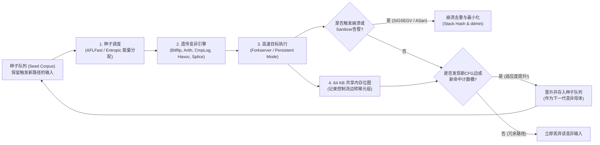

1988年秋的一个暴风雨之夜，威斯康星大学麦迪逊分校的计算机科学教授<strong>巴顿·米勒（Barton Miller）</strong>正坐在家中的终端前，通过1200波特率的拨号调制解调器和模拟电话线远程连接大学的UNIX工作站。窗外雷电交加，闪电引发的电磁干扰不断在电话线上注入随机噪声，将他输入的命令篡改成乱码字节流。

令人震惊的一幕发生了：每当包含噪声的随机字节流入那些久经考验的UNIX标准工具——如 `vi`、`cc`、`awk`、`sed`、`csh` 和 `indent`——这些每天被全球无数程序员依赖的系统程序竟然接二连三地<strong>触发段错误（Segmentation Fault）崩溃，或者陷入死循环挂起</strong>。

米勒教授敏锐地意识到这一现象背后的深刻问题。他在随后的研究生操作系统课程中布置了一个课题：编写一个纯粹的随机字符流生成器，向7种主流商用和学术UNIX系统的近90个实用程序灌入随机噪声。米勒将这个工具命名为<strong>“Fuzz（毛刺/噪声）”</strong>。实验结果震惊了整个软件工程界：<strong>高达25%至33%的UNIX标准核心工具在面对随机字节流时直接崩溃</strong>。

三十多年后的今天，<strong>模糊测试（Fuzzing / Fuzz Testing）</strong>已经从最初盲目的随机数注入，演变为融合编译器中间表示（IR）插桩、达尔文进化遗传算法、SMT形式化约束求解器以及虚拟内存影子映射（Shadow Mapping）的<strong>现代软件安全最强自动化漏洞挖掘技术</strong>。仅Google运营的开源持续模糊测试平台<strong>OSS-Fuzz</strong>，就已经在OpenSSL、SQLite、FFmpeg、Linux内核等关键基础设施中自动发现了<strong>超过10,000个安全漏洞和36,000多个软件缺陷</strong>。

为什么程序员精心编写的数千个单元测试（Unit Tests）会漏掉致命漏洞，而“自动变异的畸形输入”却能精准引爆它们？本文将从输入空间的组合爆炸出发，系统剖析<strong>覆盖率引导灰盒模糊测试（AFL / AFL++ / LibFuzzer）</strong>的内核架构、64 KB共享内存位图与1位右移（`>> 1`）的代数证明、<strong>AddressSanitizer（ASan）</strong>影子内存机制，以及<strong>Delta Debugging（`ddmin`）</strong>测试用例最小化算法。

---

## 第一章：输入空间的组合深渊与“路灯效应（Streetlight Effect）”

### 1.1 64字节缓冲区背后的 $10^{154}$ 个平行宇宙

为什么人工编写的测试套件无法根除软件漏洞？根本原因在于<strong>输入空间的指数级组合爆炸</strong>。假设一个C语言函数只读取短短 $N = 64$ 字节的网络数据包头或图像块头。由于每个字节有 $2^8 = 256$ 种可能取值，所有可能的64字节输入总数为：

$$|\Sigma|^N = 256^{64} = \left(2^8\right)^{64} = 2^{512} \approx 1.34 \times 10^{154}$$

$1.34 \times 10^{154}$ 是一个超越人类直觉的天文数字——整个可观测宇宙中的质子总数（爱丁顿数）也不过约 $10^{80}$ 个。即便集合地球上所有CPU核心，以每秒一万亿次（$10^{12}$ 次/秒）的速度从宇宙大爆炸一直测试到今天（约138亿年），所能覆盖的输入也不足该空间的 $10^{-124}$。

### 1.2 人工单元测试的“路灯效应”与“怪异状态机（Weird Machine）”

当人类工程师编写单元测试时，不可避免地会陷入认知心理学上的<strong>“路灯效应（Streetlight Effect / 观测偏差）”</strong>——就像夜里丢了钥匙的人只在明亮的路灯下寻找一样，开发者只会测试<strong>设计文档规定的正常路径</strong>以及<strong>自己写代码时已经想到的边界值（如 `0`、`-1`、`NULL`）</strong>。如果开发者想到了某个边界条件，他往往已经在生产代码里写了 `if` 防御检查；而真正的致命漏洞，恰恰潜伏在开发者思维盲区之外的<strong>“怪异状态机（Weird Machine）”</strong>中：

```c
int parse_image_chunk(const uint8_t *buf, size_t len) {
    if (len < 16) return -1;
    uint32_t magic  = *(const uint32_t *)(buf + 0);
    uint16_t width  = *(const uint16_t *)(buf + 4);
    uint16_t height = *(const uint16_t *)(buf + 6);
    uint8_t  flags  = buf[8];

    if (magic != 0x494D4721) return -1;          // 要求魔数 "IMG!"
    if (width == 0 || height == 0) return -1;    // 开发者测试了0边界

    uint16_t alloc_size = width * height;        // 【致命漏洞】16位无符号整数溢出回绕！
    if (flags & 0x80) alloc_size += 16;
    uint8_t *pixel_buf = malloc(alloc_size);     // 仅分配0或16字节堆块
    memcpy(pixel_buf, buf + 16, (size_t)width * height); // 拷贝65536字节导致堆溢出！
    ...
}
```

当 `width = 256, height = 256` 时，$256 \times 256 = 65536 \equiv 0 \pmod{2^{16}}$ 触发16位整数溢出回绕，`malloc(16)` 分配极小缓冲区后被 `memcpy` 覆写64 KB内存，瞬间造成灾难性的堆破坏。

---

## 第二章：模糊测试的四大范式演进

为了穿越 `magic == 0x494D4721` 这样概率仅为 $2^{-32}$（约43亿分之一）的检查壁垒，模糊测试演化出了四大核心范式：

| 模糊测试范式 | 代表工具 | 程序内部可见性 | 核心探索机制 | 核心优势 | 局限与瓶颈 |
| :--- | :--- | :--- | :--- | :--- | :--- |
| <strong>黑盒模糊测试</strong><br>(Black-box Fuzzing) | 1988 `fuzz`, `zzuf`, `radamsa` | 无（完全黑盒） | 盲目随机比特翻转、字节覆写与块拼接 | 无需源码与插桩，启动极快 | 无法突破4字节魔数（概率 $2^{-32}$）、校验和与复杂语法结构 |
| <strong>基于语法/生成的模糊测试</strong><br>(Grammar-based Fuzzing) | `Peach`, `Syzkaller`, `LangFuzz`, `Domato` | 显式上下文无关文法（CFG）或接口规范 | 依据产生式规则生成并变异合法抽象语法树（AST） | 轻松穿透词法/语法分析器，直达JS引擎或OS内核深处 | 人工编写精准语法规范成本高昂；可能遗漏畸形语法触发的解析器漏洞 |
| <strong>白盒符号/混合执行</strong><br>(Symbolic / Concolic) | `SAGE`, `KLEE`, `angr`, `Driller` | 完整指令级符号追踪与分支谓词收集 | 收集路径约束 $\Pi$ 并调用<strong>SMT求解器（Z3）</strong>取反求解 | 可直接代数求解 `x == 0xdeadbeef` 等复杂等式约束 | 循环与深分支引发严重的<strong>路径爆炸（$2^d$）</strong>，非线性运算令SMT求解超时 |
| <strong>覆盖率引导灰盒模糊测试</strong><br>(Coverage-Guided Grey-box) | <strong>`AFL`</strong>, <strong>`AFL++`</strong>, <strong>`LibFuzzer`</strong>, `Honggfuzz` | 轻量级编译期<strong>边覆盖率插桩</strong>（64 KB位图） | <strong>达尔文遗传进化</strong>：仅保留触发新控制流边的变异种子 | 无需昂贵SMT求解，以每秒数万次执行逐步进化深入程序状态 | 对单指令多字节比较需借助字典或CmpLog（RedQueen）钩子 |

在白盒符号执行（Concolic Execution）中，引擎将输入视为符号变量 $\vec{\alpha}$，记录路径约束并在第 $k$ 个分支取反：

$$\Pi_{\text{path}} = c_1(\vec{\alpha}) \land c_2(\vec{\alpha}) \land \dots \land c_{k-1}(\vec{\alpha}) \land \neg c_k(\vec{\alpha})$$

而由 <strong>Michał Zalewski (`lcamtuf`)</strong> 在2013年开创的<strong>AFL（American Fuzzy Lop）</strong>及其现代演进版 <strong>AFL++</strong>、<strong>LibFuzzer</strong>，则用轻量级边覆盖率反馈替代了沉重的SMT求解。



---

## 第三章：AFL内核深度解剖 —— 边插桩、64 KB位图与 `>> 1` 的数学证明

### 3.1 为什么必须用“边覆盖率（Edge Coverage）”而非“基本块覆盖率”？

如果只记录哪些基本块（Basic Block）被执行过：假设路径 $A \to B \to C$ 已经访问了基本块 $\{A, B, C\}$。当新输入绕过初始化块 $B$ 直接走 $A \to C$（触发空指针解引用漏洞的路径）时，由于 $\{A, C\} \subset \{A, B, C\}$，节点覆盖率会误以为没有新发现而将其丢弃！而记录有向边元组 $(B_{\text{prev}} \to B_{\text{cur}})$ 则能立即识别出 $(A \to C)$ 是一条全新的控制流转移边。

### 3.2 三行插桩代码、64 KB L1缓存位图与“1位右移 `>> 1`”的代数必然性

AFL在编译期为每个基本块分配一个16位随机数，并在基本块入口注入以下三行逻辑：

```c
/* Compile-time random 16-bit ID assigned to the current basic block */
cur_location = <COMPILE_TIME_RANDOM_16BIT>;

/* Record the transition edge (prev -> cur) in the 64 KB shared bitmap */
shared_mem[cur_location ^ prev_location]++;

/* Right-shift by 1 bit to preserve directionality and self-loops */
prev_location = cur_location >> 1;
```

为什么 `shared_mem` 的大小恰好是 $2^{16} = 65,536$ 字节（<strong>64 KB</strong>）？因为64 KB能够<strong>完整装入现代CPU核心的L1数据缓存（L1d Cache）/L2缓存</strong>，从而让每次基本块跳转的位图递增操作完全不触发DRAM内存缺失，仅需约1纳秒！

更精妙的是第三行 `prev_location = cur_location >> 1;`。为什么要把前一个基本块的ID<strong>右移1位（`>> 1`）</strong>？如果不右移，直接用 $A \oplus B$ 作为位图索引，异或运算（XOR）的代数性质会导致两个灾难性后果：

$$\text{Without shift: } \quad \text{Edge}(A \to B) = A \oplus B = B \oplus A = \text{Edge}(B \to A), \qquad \text{Edge}(A \to A) = A \oplus A = 0$$

$$\text{With 1-bit right shift: } \quad \text{Edge}(A \to B) = (A \gg 1) \oplus B \neq (B \gg 1) \oplus A = \text{Edge}(B \to A), \qquad \text{Edge}(A \to A) = (A \gg 1) \oplus A \neq 0$$

1. <strong>交换律抹杀方向性（$A \oplus B = B \oplus A$）</strong>：从基本块 $A$ 跳到 $B$ 与从 $B$ 跳回 $A$ 会映射到完全相同的索引，方向信息彻底丢失。
2. <strong>幂零律抹杀所有自环（$A \oplus A = 0$）</strong>：任何基本块跳回自身的紧凑循环 $(A \to A)$ 异或结果恒为 $0$，导致全程序所有自环全部碰撞到同一个字节 `shared_mem[0]`！

通过执行单周期指令 `cur_location >> 1`，对称性与幂零律被同时打破，完美保留了边方向与自环特征。此外，AFL还将每个字节的命中次数映射为8个<strong>对数分桶（Logarithmic Bucketing：$1, 2, 3, 4\text{–}7, 8\text{–}15, 16\text{–}31, 32\text{–}127, 128\text{–}255$）</strong>，从而区分循环展开的关键里程碑。

### 3.3 Forkserver、Persistent Mode 与马尔可夫链能量调度（AFLFast / Entropic）

为了消除每次 `execve()` 动态链接与ELF加载的高昂开销，AFL在 `main()` 入口处启动<strong>Forkserver（孵化服务器）</strong>，通过文件描述符 `198` 和 `199` 管道通信，仅调用基于<strong>写时复制（Copy-on-Write, CoW）</strong>的 `fork()` 克隆进程，将吞吐量提升至每秒上万次；而在 <strong>LibFuzzer / Persistent Mode (`LLVMFuzzerTestOneInput`)</strong> 下，连 `fork()` 都被消除，直接在进程内循环传参，达到每秒 $10^5$ 次以上的极速执行。

在变异策略上，除了确定性位翻转（Bitflip）、算术加减（$\pm 1\dots 35$）、边界整数替换、Havoc随机叠加与Splicing交叉外，<strong>AFLFast（Böhme等）与 Entropic</strong> 通过马尔可夫链与香农信息熵 $H(s)$ 为罕见低频路径分配指数级能量：

$$p(s) = \min\left(\frac{\alpha(s)}{\beta} \cdot \frac{2^{s_{\text{handicap}}}}{f(i)}, \; M\right), \qquad H(s) = -\sum_{e \in E(s)} \hat{p}_{s,e} \log_2 \hat{p}_{s,e}$$

---

## 第四章：将静默内存破坏转化为瞬时崩溃 —— Sanitizers（消毒器）架构

在C/C++中，如果堆溢出仅越界写入了几个字节，由于操作系统MMU仅以 $4\text{ KB}$ 页为单位检查权限，程序通常<strong>不会触发 `SIGSEGV`</strong>，而是静默篡改相邻数据并正常返回，导致模糊测试器漏掉漏洞。<strong>AddressSanitizer（ASan）</strong>通过<strong>1:8影子内存映射（Shadow Memory）</strong>解决了这一难题：

$$\text{ShadowAddr}(\text{Addr}) = (\text{Addr} \gg 3) + \text{Offset}$$

每8字节对齐的应用程序内存对应1字节影子内存：`0x00` 表示全部8字节合法；$1 \le k \le 7$ 表示仅前 $k$ 字节合法；负数表示<strong>中毒红区（Redzones，如 `0xfa` 堆红区、`0xf1` 栈红区）</strong>或<strong>已释放隔离区（Quarantine Queue，`0xfd`）</strong>。编译器在每次内存读写前注入快速检测指令：

```c
/* Compiler-injected ASan check before an N-byte memory access (N = 1, 2, 4) */
uintptr_t shadow_addr = (addr >> 3) + ASAN_SHADOW_OFFSET;
int8_t shadow_val = *(int8_t *)shadow_addr;

if (UNLIKELY(shadow_val != 0)) {
    /* For partial 8-byte words (1 <= shadow_val <= 7) or negative redzones */
    if (shadow_val < 0 || (int8_t)((addr & 7) + N) > shadow_val) {
        __asan_report_error(pc, bp, sp, addr, is_write, N);
    }
}
```

配合检测未定义算术溢出的 <strong>UBSan</strong>、按位追踪未初始化内存读取的 <strong>MSan</strong>、利用向量时钟检测数据竞争的 <strong>TSan</strong>，以及对比多套独立实现输出差异的<strong>差分模糊测试（Differential Fuzzing）</strong>，任何细微的1字节越界或逻辑偏差都会在发生瞬间被转化为精准崩溃报告。

---

## 第五章：崩溃去重（Triage）与 Delta Debugging（`ddmin`）最小化算法

当模糊测试产生数万个崩溃文件时，首先通过调用栈回溯计算顶层栈帧的<strong>调用栈哈希（Stack Hash）</strong>进行去重归类。随后，面对长达数兆字节、充斥着无用变异噪声的崩溃输入 $c$（长度 $N$），<strong>Andreas Zeller 的 Delta Debugging（`ddmin`）算法</strong>通过广义二分查找自动提取<strong>1-最小测试用例（1-minimal test case）$c^*$</strong>——即哪怕再删掉任意1个字节，崩溃都会消失的极小复现样本：

$$\forall c' \subsetneq c^* \; \text{with} \; |c^*| - |c'| = 1 : \quad \text{test}(c') \neq \text{FAIL}$$

$$T_{\text{best}}(N) = \mathcal{O}(\log_2 N), \qquad T_{\text{worst}}(N) = \frac{N^2 + 3N - 2}{2} = \mathcal{O}(N^2)$$

`ddmin` 将输入划分为 $n$ 个块 $\Delta_1, \dots, \Delta_n$（初始 $n=2$），优先测试单个子块 $\Delta_i$ 是否复现崩溃（若复现则直接缩小至 $\Delta_i$），其次测试剔除 $\Delta_i$ 后的补集 $\nabla_i = c \setminus \Delta_i$ 是否复现崩溃（若复现则删除噪声块 $\Delta_i$），若均不复现则将分块粒度加倍 $n \leftarrow \min(2n, |c|)$。在理想情况下，`ddmin` 仅需 $\mathcal{O}(\log_2 N)$ 次执行即可将10 MB的畸形文件浓缩为十几字节的精准PoC，配合 `afl-tmin` 与针对C/C++语法树的 `C-Reduce`，彻底打通了从自动化漏洞发现到根因修复的最后一公里。
