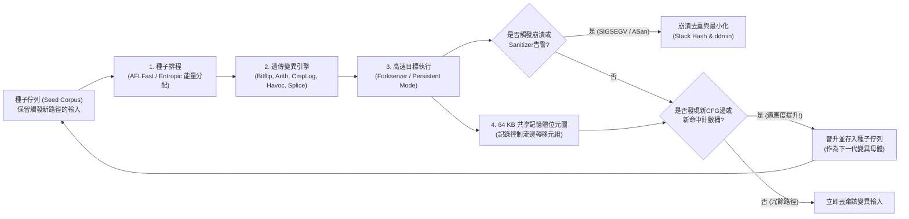

1988年秋的一個暴風雨之夜，威斯康辛大學麥迪遜分校的電腦科學教授<strong>巴頓·米勒（Barton Miller）</strong>正坐在家中的終端機前，透過1200鮑率的撥號數據機和類比電話線遠端連線至大學的UNIX工作站。窗外雷電交加，閃電引發的電磁干擾不斷在電話線上注入隨機雜訊，將他輸入的指令篡改成亂碼位元組流。

令人震驚的一幕發生了：每當包含雜訊的隨機位元組流入那些久經考驗的UNIX標準工具——如 `vi`、`cc`、`awk`、`sed`、`csh` 和 `indent`——這些每天被全球無數工程師依賴的系統程式竟然接二連三地<strong>觸發區段錯誤（Segmentation Fault）崩潰，或者陷入無窮迴圈掛起</strong>。

米勒教授敏銳地意識到這一現象背後的深刻問題。他在隨後的研究生作業系統課程中佈置了一個課題：編寫一個純粹的隨機字元流產生器，向7種主流商用和學術UNIX系統的近90個公用程式灌入隨機雜訊。米勒將這個工具命名為<strong>「Fuzz（毛刺/雜訊）」</strong>。實驗結果震驚了整個軟體工程界：<strong>高達25%至33%的UNIX標準核心工具在面對隨機位元組流時直接崩潰</strong>。

三十多年後的今天，<strong>模糊測試（Fuzzing / Fuzz Testing）</strong>已經從最初盲目的亂數注入，演變為融合編譯器中間表示（IR）插樁、達爾文演化遺傳演算法、SMT形式化約束求解器以及虛擬記憶體影子映射（Shadow Mapping）的<strong>現代軟體安全最強自動化漏洞挖掘技術</strong>。僅Google營運的開源持續模糊測試平台<strong>OSS-Fuzz</strong>，就已經在OpenSSL、SQLite、FFmpeg、Linux核心等關鍵基礎設施中自動發現了<strong>超過10,000個安全漏洞和36,000多個軟體缺陷</strong>。

為什麼工程師精心編寫的數千個單元測試（Unit Tests）會漏掉致命漏洞，而「自動變異的畸形輸入」卻能精準引爆它們？本文將從輸入空間的組合爆炸出發，系統剖析<strong>覆蓋率引導灰盒模糊測試（AFL / AFL++ / LibFuzzer）</strong>的內部架構、64 KB共享記憶體位元圖與1位元右移（`>> 1`）的代數證明、<strong>AddressSanitizer（ASan）</strong>影子記憶體機制，以及<strong>Delta Debugging（`ddmin`）</strong>測試案例最小化演算法。

---

## 第一章：輸入空間的組合深淵與「路燈效應（Streetlight Effect）」

### 1.1 64位元組緩衝區背後的 $10^{154}$ 個平行宇宙

為什麼人工編寫的測試套件無法根除軟體漏洞？根本原因在於<strong>輸入空間的指數級組合爆炸</strong>。假設一個C語言函式只讀取短短 $N = 64$ 位元組的網路封包標頭或影像區塊標頭。由於每個位元組有 $2^8 = 256$ 種可能取值，所有可能的64位元組輸入總數為：

$$|\Sigma|^N = 256^{64} = \left(2^8\right)^{64} = 2^{512} \approx 1.34 \times 10^{154}$$

$1.34 \times 10^{154}$ 是一個超越人類直覺的天文數字——整個可觀測宇宙中的質子總數（愛丁頓數）也不過約 $10^{80}$ 個。即便集合地球上所有CPU核心，以每秒一兆次（$10^{12}$ 次/秒）的速度從宇宙大爆炸一直測試到今天（約138億年），所能覆蓋的輸入也不足該空間的 $10^{-124}$。

### 1.2 人工單元測試的「路燈效應」與「怪異狀態機（Weird Machine）」

當人類工程師編寫單元測試時，不可避免地會陷入認知心理學上的<strong>「路燈效應（Streetlight Effect / 觀測偏差）」</strong>——就像夜裡丟了鑰匙的人只在明亮的路燈下尋找一樣，開發者只會測試<strong>設計文件規定的正常路徑</strong>以及<strong>自己寫程式碼時已經想到的邊界值（如 `0`、`-1`、`NULL`）</strong>。如果開發者想到了某個邊界條件，他往往已經在生產程式碼裡寫了 `if` 防禦檢查；而真正的致命漏洞，恰恰潛伏在開發者思維盲區之外的<strong>「怪異狀態機（Weird Machine）」</strong>中：

```c
int parse_image_chunk(const uint8_t *buf, size_t len) {
    if (len < 16) return -1;
    uint32_t magic  = *(const uint32_t *)(buf + 0);
    uint16_t width  = *(const uint16_t *)(buf + 4);
    uint16_t height = *(const uint16_t *)(buf + 6);
    uint8_t  flags  = buf[8];

    if (magic != 0x494D4721) return -1;          // 要求魔數 "IMG!"
    if (width == 0 || height == 0) return -1;    // 開發者測試了0邊界

    uint16_t alloc_size = width * height;        // 【致命漏洞】16位元無號整數溢位回繞！
    if (flags & 0x80) alloc_size += 16;
    uint8_t *pixel_buf = malloc(alloc_size);     // 僅配置0或16位元組堆積區塊
    memcpy(pixel_buf, buf + 16, (size_t)width * height); // 拷貝65536位元組導致堆積溢位！
    ...
}
```

當 `width = 256, height = 256` 時，$256 \times 256 = 65536 \equiv 0 \pmod{2^{16}}$ 觸發16位元整數溢位回繞，`malloc(16)` 配置極小緩衝區後被 `memcpy` 覆寫64 KB記憶體，瞬間造成災難性的堆積破壞。

---

## 第二章：模糊測試的四大範式演進

為了穿越 `magic == 0x494D4721` 這樣機率僅為 $2^{-32}$（約43億分之一）的檢查壁壘，模糊測試演化出了四大核心範式：

| 模糊測試範式 | 代表工具 | 程式內部可見性 | 核心探索機制 | 核心優勢 | 局限與瓶頸 |
| :--- | :--- | :--- | :--- | :--- | :--- |
| <strong>黑箱模糊測試</strong><br>(Black-box Fuzzing) | 1988 `fuzz`, `zzuf`, `radamsa` | 無（完全黑箱） | 盲目隨機位元翻轉、位元組覆寫與區塊拼接 | 無需原始碼與插樁，啟動極快 | 無法突破4位元組魔數（機率 $2^{-32}$）、校驗和與複雜語法結構 |
| <strong>基於語法/生成的模糊測試</strong><br>(Grammar-based Fuzzing) | `Peach`, `Syzkaller`, `LangFuzz`, `Domato` | 顯式上下文無關文法（CFG）或介面規範 | 依據產生式規則生成並變異合法抽象語法樹（AST） | 輕鬆穿透詞法/語法分析器，直達JS引擎或OS核心深處 | 人工編寫精準語法規範成本高昂；可能遺漏畸形語法觸發的解析器漏洞 |
| <strong>白箱符號/混合執行</strong><br>(Symbolic / Concolic) | `SAGE`, `KLEE`, `angr`, `Driller` | 完整指令級符號追蹤與分支謂詞收集 | 收集路徑約束 $\Pi$ 並呼叫<strong>SMT求解器（Z3）</strong>取反求解 | 可直接代數求解 `x == 0xdeadbeef` 等複雜等式約束 | 迴圈與深分支引發嚴重的<strong>路徑爆炸（$2^d$）</strong>，非線性運算令SMT求解逾時 |
| <strong>覆蓋率引導灰箱模糊測試</strong><br>(Coverage-Guided Grey-box) | <strong>`AFL`</strong>, <strong>`AFL++`</strong>, <strong>`LibFuzzer`</strong>, `Honggfuzz` | 輕量級編譯期<strong>邊覆蓋率插樁</strong>（64 KB位元圖） | <strong>達爾文遺傳演化</strong>：僅保留觸發新控制流邊的變異種子 | 無需昂貴SMT求解，以每秒數萬次執行逐步演化深入程式狀態 | 對單指令多位元組比較需借助字典或CmpLog（RedQueen）鉤子 |

在白箱符號執行（Concolic Execution）中，引擎將輸入視為符號變數 $\vec{\alpha}$，記錄路徑約束並在第 $k$ 個分支取反：

$$\Pi_{\text{path}} = c_1(\vec{\alpha}) \land c_2(\vec{\alpha}) \land \dots \land c_{k-1}(\vec{\alpha}) \land \neg c_k(\vec{\alpha})$$

而由 <strong>Michał Zalewski (`lcamtuf`)</strong> 在2013年開創的<strong>AFL（American Fuzzy Lop）</strong>及其現代演進版 <strong>AFL++</strong>、<strong>LibFuzzer</strong>，則用輕量級邊覆蓋率回饋替代了沉重的SMT求解。



---

## 第三章：AFL核心深度解剖 —— 邊插樁、64 KB位元圖與 `>> 1` 的數學證明

### 3.1 為什麼必須用「邊覆蓋率（Edge Coverage）」而非「基本區塊覆蓋率」？

如果只記錄哪些基本區塊（Basic Block）被執行過：假設路徑 $A \to B \to C$ 已經造訪了基本區塊 $\{A, B, C\}$。當新輸入繞過初始化區塊 $B$ 直接走 $A \to C$（觸發空指標解參考漏洞的路徑）時，由於 $\{A, C\} \subset \{A, B, C\}$，節點覆蓋率會誤以為沒有新發現而將其丟棄！而記錄有向邊元組 $(B_{\text{prev}} \to B_{\text{cur}})$ 則能立即識別出 $(A \to C)$ 是一條全新的控制流轉移邊。

### 3.2 三行插樁程式碼、64 KB L1快取位元圖與「1位元右移 `>> 1`」的代數必然性

AFL在編譯期為每個基本區塊配置一個16位元亂數，並在基本區塊入口注入以下三行邏輯：

```c
/* Compile-time random 16-bit ID assigned to the current basic block */
cur_location = <COMPILE_TIME_RANDOM_16BIT>;

/* Record the transition edge (prev -> cur) in the 64 KB shared bitmap */
shared_mem[cur_location ^ prev_location]++;

/* Right-shift by 1 bit to preserve directionality and self-loops */
prev_location = cur_location >> 1;
```

為什麼 `shared_mem` 的大小恰好是 $2^{16} = 65,536$ 位元組（<strong>64 KB</strong>）？因為64 KB能夠<strong>完整裝入現代CPU核心的L1資料快取（L1d Cache）/L2快取</strong>，從而讓每次基本區塊跳轉的位元圖遞增操作完全不觸發DRAM記憶體缺失，僅需約1奈秒！

更精妙的是第三行 `prev_location = cur_location >> 1;`。為什麼要把前一個基本區塊的ID<strong>右移1位元（`>> 1`）</strong>？如果不右移，直接用 $A \oplus B$ 作為位元圖索引，互斥或運算（XOR）的代數性質會導致兩個災難性後果：

$$\text{Without shift: } \quad \text{Edge}(A \to B) = A \oplus B = B \oplus A = \text{Edge}(B \to A), \qquad \text{Edge}(A \to A) = A \oplus A = 0$$

$$\text{With 1-bit right shift: } \quad \text{Edge}(A \to B) = (A \gg 1) \oplus B \neq (B \gg 1) \oplus A = \text{Edge}(B \to A), \qquad \text{Edge}(A \to A) = (A \gg 1) \oplus A \neq 0$$

1. <strong>交換律抹殺方向性（$A \oplus B = B \oplus A$）</strong>：從基本區塊 $A$ 跳到 $B$ 與從 $B$ 跳回 $A$ 會映射到完全相同的索引，方向資訊徹底丟失。
2. <strong>冪零律抹殺所有自環（$A \oplus A = 0$）</strong>：任何基本區塊跳回自身的緊湊迴圈 $(A \to A)$ 互斥或結果恆為 $0$，導致全程式所有自環全部碰撞到同一個位元組 `shared_mem[0]`！

透過執行單週期指令 `cur_location >> 1`，對稱性與冪零律被同時打破，完美保留了邊方向與自環特徵。此外，AFL還將每個位元組的命中次數映射為8個<strong>對數分桶（Logarithmic Bucketing：$1, 2, 3, 4\text{–}7, 8\text{–}15, 16\text{–}31, 32\text{–}127, 128\text{–}255$）</strong>，從而區分迴圈展開的關鍵里程碑。

### 3.3 Forkserver、Persistent Mode 與馬可夫鏈能量排程（AFLFast / Entropic）

為了消除每次 `execve()` 動態連結與ELF載入的高昂開銷，AFL在 `main()` 入口處啟動<strong>Forkserver（孵化伺服器）</strong>，透過檔案描述子 `198` 和 `199` 管線通訊，僅呼叫基於<strong>寫入時複製（Copy-on-Write, CoW）</strong>的 `fork()` 複製行程，將吞吐量提升至每秒上萬次；而在 <strong>LibFuzzer / Persistent Mode (`LLVMFuzzerTestOneInput`)</strong> 下，連 `fork()` 都被消除，直接在行程內迴圈傳參，達到每秒 $10^5$ 次以上的極速執行。

在變異策略上，除了確定性位元翻轉（Bitflip）、算術加減（$\pm 1\dots 35$）、邊界整數替換、Havoc隨機疊加與Splicing交叉外，<strong>AFLFast（Böhme等）與 Entropic</strong> 透過馬可夫鏈與香農資訊熵 $H(s)$ 為罕見低頻路徑分配指數級能量：

$$p(s) = \min\left(\frac{\alpha(s)}{\beta} \cdot \frac{2^{s_{\text{handicap}}}}{f(i)}, \; M\right), \qquad H(s) = -\sum_{e \in E(s)} \hat{p}_{s,e} \log_2 \hat{p}_{s,e}$$

---

## 第四章：將靜默記憶體破壞轉化為瞬時崩潰 —— Sanitizers（消毒器）架構

在C/C++中，如果堆積溢位僅越界寫入了幾個位元組，由於作業系統MMU僅以 $4\text{ KB}$ 頁為單位檢查權限，程式通常<strong>不會觸發 `SIGSEGV`</strong>，而是靜默篡改相鄰資料並正常返回，導致模糊測試器漏掉漏洞。<strong>AddressSanitizer（ASan）</strong>透過<strong>1:8影子記憶體映射（Shadow Memory）</strong>解決了這一難題：

$$\text{ShadowAddr}(\text{Addr}) = (\text{Addr} \gg 3) + \text{Offset}$$

每8位元組對齊的應用程式記憶體對應1位元組影子記憶體：`0x00` 表示全部8位元組合法；$1 \le k \le 7$ 表示僅前 $k$ 位元組合法；負數表示<strong>中毒紅區（Redzones，如 `0xfa` 堆積紅區、`0xf1` 堆疊紅區）</strong>或<strong>已釋放隔離區（Quarantine Queue，`0xfd`）</strong>。編譯器在每次記憶體讀寫前注入快速檢測指令：

```c
/* Compiler-injected ASan check before an N-byte memory access (N = 1, 2, 4) */
uintptr_t shadow_addr = (addr >> 3) + ASAN_SHADOW_OFFSET;
int8_t shadow_val = *(int8_t *)shadow_addr;

if (UNLIKELY(shadow_val != 0)) {
    /* For partial 8-byte words (1 <= shadow_val <= 7) or negative redzones */
    if (shadow_val < 0 || (int8_t)((addr & 7) + N) > shadow_val) {
        __asan_report_error(pc, bp, sp, addr, is_write, N);
    }
}
```

配合檢測未定義算術溢位的 <strong>UBSan</strong>、按位元追蹤未初始化記憶體讀取的 <strong>MSan</strong>、利用向量時鐘檢測資料競爭的 <strong>TSan</strong>，以及對比多套獨立實作輸出差異的<strong>差分模糊測試（Differential Fuzzing）</strong>，任何細微的1位元組越界或邏輯偏差都會在發生瞬間被轉化為精準崩潰報告。

---

## 第五章：崩潰去重（Triage）與 Delta Debugging（`ddmin`）最小化演算法

當模糊測試產生數萬個崩潰檔案時，首先透過呼叫堆疊回溯計算頂層堆疊幀的<strong>呼叫堆疊雜湊（Stack Hash）</strong>進行去重歸類。隨後，面對長達數百萬位元組、充斥著無用變異雜訊的崩潰輸入 $c$（長度 $N$），<strong>Andreas Zeller 的 Delta Debugging（`ddmin`）演算法</strong>透過廣義二分搜尋自動提取<strong>1-最小測試案例（1-minimal test case）$c^*$</strong>——即哪怕再刪掉任意1個位元組，崩潰都會消失的極小重現樣本：

$$\forall c' \subsetneq c^* \; \text{with} \; |c^*| - |c'| = 1 : \quad \text{test}(c') \neq \text{FAIL}$$

$$T_{\text{best}}(N) = \mathcal{O}(\log_2 N), \qquad T_{\text{worst}}(N) = \frac{N^2 + 3N - 2}{2} = \mathcal{O}(N^2)$$

`ddmin` 將輸入劃分為 $n$ 個區塊 $\Delta_1, \dots, \Delta_n$（初始 $n=2$），優先測試單個子區塊 $\Delta_i$ 是否重現崩潰（若重現則直接縮小至 $\Delta_i$），其次測試剔除 $\Delta_i$ 後的補集 $\nabla_i = c \setminus \Delta_i$ 是否重現崩潰（若重現則刪除雜訊區塊 $\Delta_i$），若均不重現則將分塊粒度加倍 $n \leftarrow \min(2n, |c|)$。在理想情況下，`ddmin` 僅需 $\mathcal{O}(\log_2 N)$ 次執行即可將10 MB的畸形檔案濃縮為十幾位元組的精準PoC，配合 `afl-tmin` 與針對C/C++語法樹的 `C-Reduce`，徹底打通了從自動化漏洞發現到根因修復的最後一哩路。
