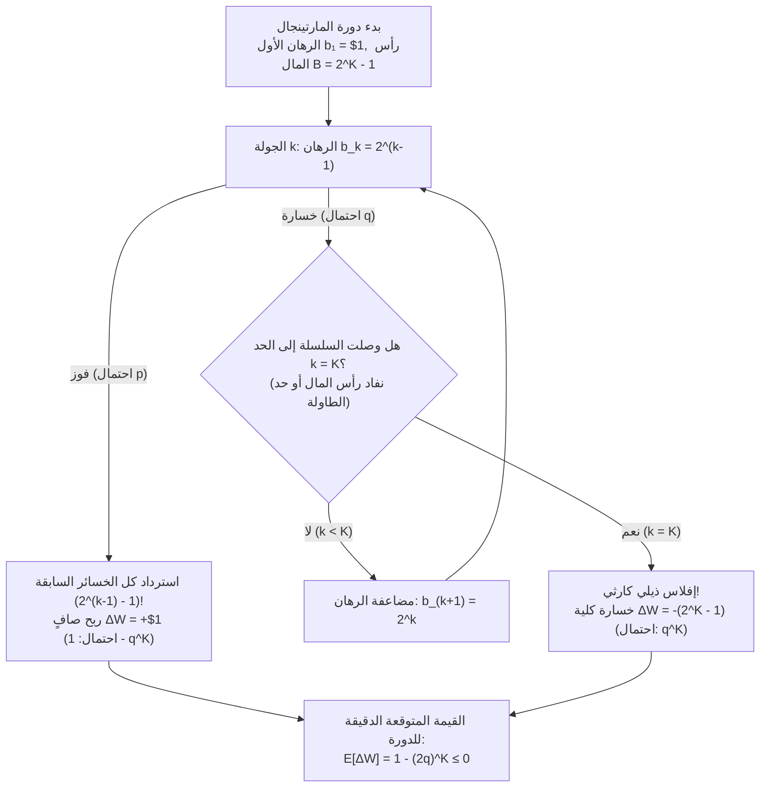
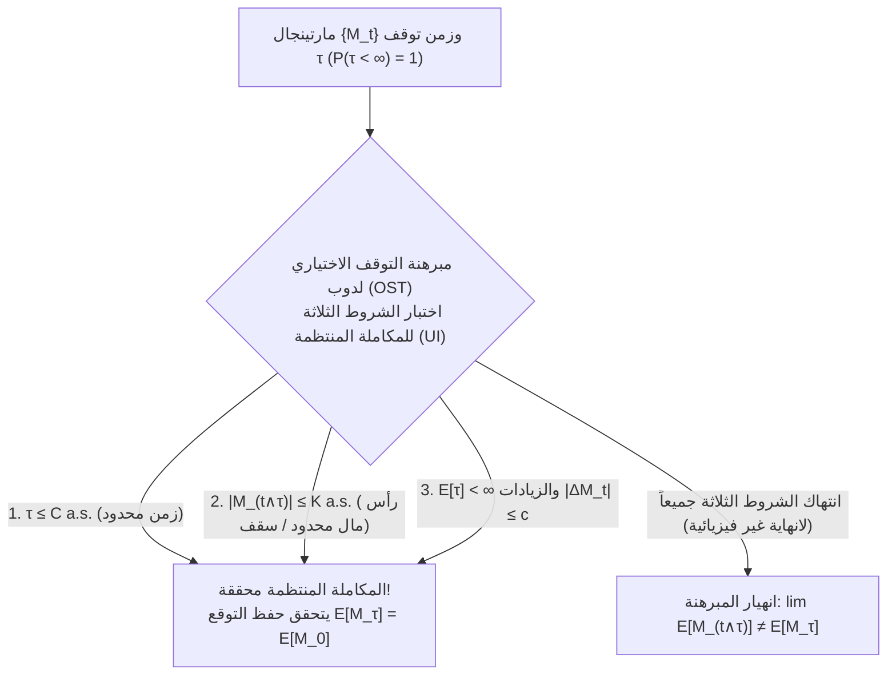

## مقدمة: أسطورة كازينوهات القرن الثامن عشر المغرية

في عام 1754 في البندقية، حاول المغامر الشهير <strong>جاكومو كازانوفا (Giacomo Casanova)</strong> هزيمة لعبة الورق *فارو (Faro)* عبر مضاعفة رهانه بعد كل خسارة (<strong>استراتيجية المارتينجال</strong>). وبعد أن رهن مجوهرات عشيقته، عصفت به سلسلة خسائر متتالية في ظهيرة واحدة فخسر 5000 عملة ذهبية وأفلس تماماً. وفي عام 1891، عاش <strong>تشارلز ويلز (Charles Wells)</strong> («الرجل الذي حطم البنك في مونت كارلو») الوهم نفسه على طاولة الروليت قبل أن يخسر ثروته بالكامل ويموت معدماً في باريس عام 1922.

في لعبة ثنائية بعائد متساوٍ ($1:1$) واحتمال فوز $p \in (0, 1)$ واحتمال خسارة $q = 1 - p$، تراهن بمبلغ $\$1$ في الجولة الأولى؛ وإذا خسرت تضاعف رهانك إلى $\$2, \$4, \$8, \dots, \$2^{k-1}$. في اللحظة الأولى التي تفوز فيها عند الجولة $k$، يكون ربحك الصافي:

$$\Delta W = 2^{k-1} - \sum_{j=0}^{k-2} 2^j = 2^{k-1} - (2^{k-1} - 1) = +\$1$$

وبما أن احتمال الخسارة إلى الأبد هو $\lim_{k \to \infty} q^k = 0$، تبدو الاستراتيجية وكأنها آلة مضمونة لتحقيق $+\$1$ باحتمال $1$! فلماذا تنهار حتماً في الواقع؟

---

## 1. فخ رأس المال المحدود و«مدحلة البخار» عند طالب

يمتلك كل مقامر حقيقي رأس مال محدود $B$ (أو يصطدم بالحد الأقصى لطاولة الكازينو) يتحمل على الأكثر $K$ خسائر متتالية، مما يتطلب رأس مال تراكمي قدره:

$$B_K = \sum_{j=0}^{K-1} 2^j = 2^K - 1$$

في دورة واحدة، إما أن تربح $+\$1$ باحتمال $1 - q^K$، أو تتعرض لإفلاس كارثي قدره $-\$(2^K - 1)$ باحتمال $q^K$، مما يعطي القيمة المتوقعة الدقيقة:

$$\mathbb{E}[\Delta W] = 1 \cdot (1 - q^K) - (2^K - 1) q^K = 1 - (2q)^K \le 0 \quad \left(\text{عندما } q \ge \frac{1}{2}\right)$$

- <strong>اللعبة العادلة ($p = q = 1/2$)</strong>: $2q = 1 \implies \mathbb{E}[\Delta W] = 0$ مهما كان حجم رأس المال $K$، بينما القيمة المتوقعة لأقصى رهان مطلوب بدون سقف هي ما لا نهاية: $\mathbb{E}[2^{\tau-1}] = \sum_{k=1}^\infty 2^{k-1}(1/2)^k = \infty$.
- <strong>لعبة الكازينو المنحازة ($q > 1/2$)</strong>: $2q > 1 \implies \mathbb{E}[\Delta W] = 1 - (2q)^K < 0$، أي أنه كلما زاد رأس مالك $K$، زادت خسارتك المتوقعة في كل دورة بشكل أسي!

وهذا يحول المسير العشوائي المعتدل إلى ما يسميه <strong>نسيم نيكولاس طالب (Nassim Nicholas Taleb)</strong> <strong>«التقاط القروش أمام مدحلة بخار»</strong> (التواء سلبي شديد / مخاطر الذيل).

| سلسلة الخسائر $k$ | الرهان $b_k = 2^{k-1}$ | رأس المال المطلوب $B_k = 2^k - 1$ | الربح عند الفوز | الاحتمال $q^k$ (عملة عادلة $q=0.5$) | الاحتمال $q^k$ (روليت أوروبي $q=19/37$) |
| :--- | :--- | :--- | :--- | :--- | :--- |
| $k = 1$ | $\$1$ | $\$1$ | $+\$1$ | $50.000\%$ | $51.351\%$ |
| $k = 5$ | $\$16$ | $\$31$ | $+\$1$ | $3.125\%$ | $3.570\%$ |
| $k = 10$ | $\$512$ | $\$1,023$ | $+\$1$ | $0.098\%$ ($1$ من $1,024$) | $0.128\%$ ($1$ من $784$) |
| $k = 20$ | $\$524,288$ | $\$1,048,575$ | $+\$1$ | $0.000095\%$ | $0.000163\%$ |

---

## 2. مسألة إفلاس المقامر لهويغنز وباسكال (1657)

يبدأ مقامر برأس مال $k$ وحدة ضد كازينو يملك $N - k$ وحدة (حاجزان ماصّان عند $0$ و $N$)، فيربح $+1$ باحتمال $p$ ويخسر $-1$ باحتمال $q = 1 - p$. إن احتمال الفوز $P_k = \mathbb{P}(X_\tau = N \mid X_0 = k)$ يحقق معادلة الفروق الخطية من الرتبة الثانية:

$$P_k = p P_{k+1} + q P_{k-1}, \qquad P_0 = 0, \quad P_N = 1$$

ومن خلال الجمع التلسكوبي للعلاقة $P_{j+1} - P_j = (q/p)^j P_1$، نشتق الصيغتين المغلقتين الدقيقتين:

$$P_k = \begin{cases} \dfrac{k}{N} & \text{إذا كان } p = q = \dfrac{1}{2} \;\text{(لعبة عادلة)} \\[10pt] \dfrac{1 - (q/p)^k}{1 - (q/p)^N} & \text{إذا كان } p \ne q \;\text{(لعبة منحازة)} \end{cases}$$

### نتائج مدمرة:
1. <strong>إفلاس حتمي بنسبة 100% أمام كازينو ذي ثروة لا نهائية ($N \to \infty$)</strong>:
   حتى في <strong>لعبة عادلة بنسبة 100% ($p = 1/2$)</strong>، فإن احتمال الإفلاس النهائي هو $\lim_{N \to \infty} (1 - k/N) = 1$ (<strong>إفلاس مؤكد بنسبة 100%</strong>).
2. <strong>الجدار الأسي في الروليت</strong>:
   محاولة مضاعفة $k = \$100$ إلى $N = \$200$ عبر رهانات بقيمة $\$1$ تعطي $P_{100} = \frac{1}{1 + (q/p)^{100}}$. في الروليت الأوروبي ($p = 18/37$) تبلغ فرصة النجاح $0.448\%$ فقط ($99.55\%$ إفلاس؛ وتصل إلى <strong>$99.998\%$</strong> عند الرهان بنصف دولار)، وفي الروليت الأمريكي ($p = 18/38, q/p = 10/9$) تفشل باحتمال <strong>$99.997\%$</strong>! ووفقاً لمبرهنة <strong>دوبينز وسافاج (1965)</strong>، فإن اللعب الجريء (*Bold Play*) هو الأمثل عندما يكون $p < 1/2$.

---

## 3. نظرية المارتينجال لبول ليفي وجوزيف دوب ومبرهنة التوقف الاختياري

بالنسبة لترشيح معلومات $\{\mathcal{F}_t\}_{t \ge 0}$، تسمى العملية المتكيفة القابلة للمكاملة $\{M_t\}_{t \ge 0}$ ($\mathbb{E}[|M_t|] < \infty$) <strong>مارتينجال (Martingale)</strong> إذا كان $\mathbb{E}[M_{t+1} \mid \mathcal{F}_t] = M_t$، و<strong>تحت-مارتينجال (Submartingale)</strong> إذا كان $\ge M_t$، و<strong>فوق-مارتينجال (Supermartingale)</strong> إذا كان $\le M_t$. ويثبت <strong>التكامل العشوائي المتقطع (تحويل المارتينجال)</strong> $(H \cdot M)_n = \sum_{k=1}^n H_k (M_k - M_{k-1})$ أنه يستحيل التغلب على لعبة عادلة بأي استراتيجية مراهنة قابلة للتنبؤ $H_k \in \mathcal{F}_{k-1}$.

تنص <strong>مبرهنة التوقف الاختياري لدوب (Doob's OST)</strong> على أنه لزمن توقف $\tau$، يتحقق $\mathbb{E}[M_\tau] = \mathbb{E}[M_0]$ <strong>إذا وفقط إذا</strong> كانت العائلة $\{M_{t \wedge \tau}\}$ قابلة للمكاملة بانتظام، وهو ما يُضمن إذا تحقق <strong>شرط واحد على الأقل</strong> من الشروط الثلاثة التالية:
1. أن يكون $\tau$ محدوداً تقريباً مؤكداً ($\tau \le C < \infty$)، أو
2. أن تكون العملية المتوقفة $|M_{t \wedge \tau}| \le K < \infty$ محدودة بانتظام (رأس مال محدود!)، أو
3. أن يكون $\mathbb{E}[\tau] < \infty$ والزيادات الشرطية محدودة $\mathbb{E}[|M_{t+1} - M_t| \mid \mathcal{F}_t] \le c < \infty$.

وأخيراً، باستخدام <strong>متطابقة والد (Wald's Identity)</strong> والمارتينجال التربيعي $M_t = X_t^2 - t$ في اللعبة العادلة ($p = 1/2$)، نحصل فوراً على <strong>المدة المتوقعة للعبة حتى الإفلاس</strong>:

$$\mathbb{E}[X_\tau^2 - \tau] = k^2 \implies \mathbb{E}[\tau] = k(N - k)$$

وعندما يؤول رأس مال الكازينو إلى ما لا نهاية ($N \to \infty$)، يكون $\mathbb{E}[\tau] = \infty$: أي أن الإفلاس يقع باحتمال $100\%$، لكن متوسط الزمن اللازم حتى وقوع الإفلاس لا نهائي! أما عند $p \ne q$ فإن متطابقة والد تعطي $\mathbb{E}[\tau] = \frac{k - N P_k}{q - p}$.
