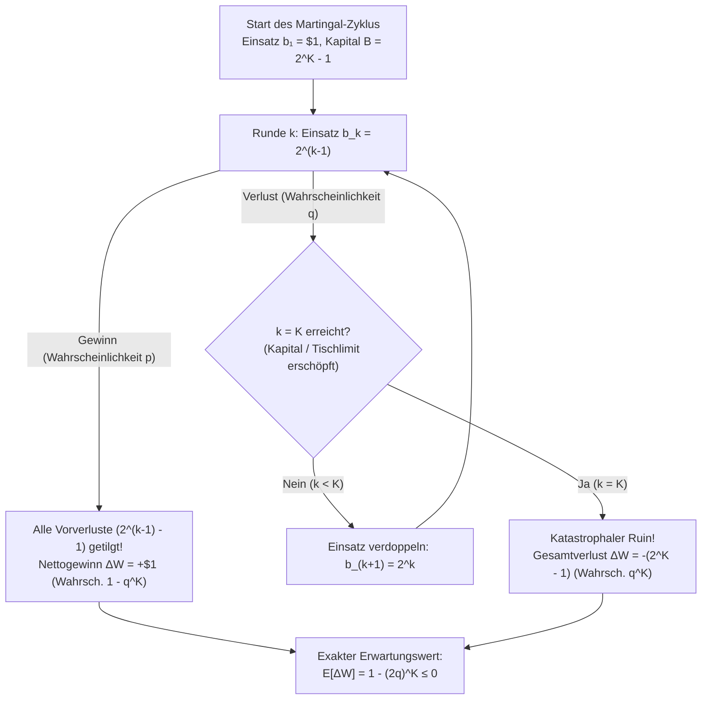
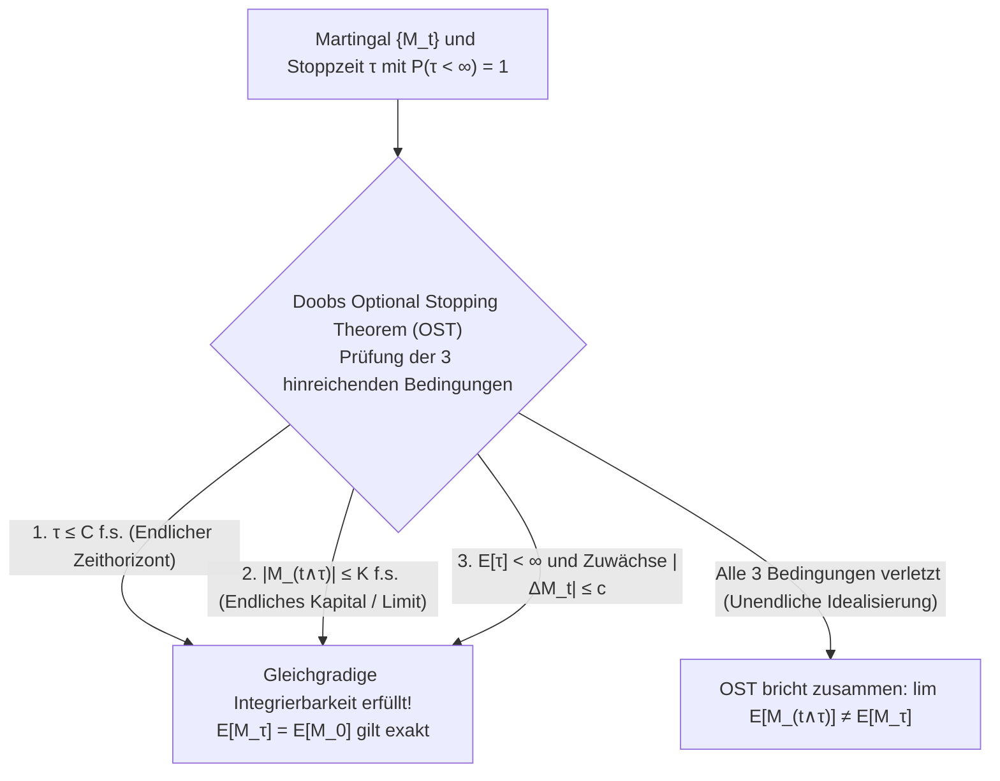

## Einleitung: Der verführerische Casino-Mythos des 18. Jahrhunderts

Im Jahr 1754 versuchte der berühmte Venezianer <strong>Giacomo Casanova</strong> in den Spielsalons von Venedig das Schicksal beim Kartenspiel *Pharao* durch ein vermeintlich unfehlbares mathematisches System zu bezwingen: Er verdoppelte nach jedem Verlust seinen Einsatz (<strong>Martingal-Strategie</strong>). Nachdem er die Diamanten seiner Geliebten verpfändet hatte, verlor er an einem einzigen Nachmittag durch eine Pechsträhne 5.000 Zechinen und stand vor dem Nichts. Ein ähnliches Schicksal ereilte <strong>Charles Wells</strong>, der 1891 die Bank von Monte Carlo sprengte, bei seiner Rückkehr jedoch sein gesamtes Vermögen durch das unerbittliche Gesetz der großen Zahlen verlor und 1922 völlig verarmt in Paris starb.

Warum wirkt die Martingal-Verdopplungsstrategie auf den ersten Blick unbesiegbar? Betrachten wir ein binäres Spiel mit einfacher Auszahlung ($1:1$), Gewinnwahrscheinlichkeit $p \in (0, 1)$ und Verlustwahrscheinlichkeit $q = 1 - p$. Der Spieler setzt in Runde $1$ genau $\$1$. Verliert er, setzt er in den folgenden Runden $\$2, \$4, \$8, \dots, \$2^{k-1}$. Sobald er in Runde $k$ zum allerersten Mal gewinnt, beträgt sein Nettogewinn:

$$\Delta W = 2^{k-1} - \sum_{j=0}^{k-2} 2^j = 2^{k-1} - (2^{k-1} - 1) = +\$1$$

Da die Wahrscheinlichkeit, für immer zu verlieren, gegen Null strebt ($\lim_{k \to \infty} q^k = 0$), scheint der Gewinn von $+\$1$ mit Wahrscheinlichkeit $1$ ($\mathbb{P}(\tau < \infty) = 1$) garantiert zu sein! Wo liegt der mathematische Trugschluss?

---

## 1. Die Falle des endlichen Kapitals und Talebs „Dampfwalze“

In der Realität besitzt jeder Spieler nur ein endliches Kapital $B$, und jedes Casino setzt ein striktes Tischlimit. Kann der Spieler maximal $K$ aufeinanderfolgende Verluste verkraften, benötigt er ein Gesamtkapital von:

$$B_K = \sum_{j=0}^{K-1} 2^j = 2^K - 1$$

In einem einzelnen Zyklus gibt es somit nur zwei mögliche Ausgänge:
1. <strong>Erfolg innerhalb von $K$ Runden</strong>: Tritt mit Wahrscheinlichkeit $1 - q^K$ ein und liefert $+\$1$.
2. <strong>Totalverlust (Ruin nach $K$ Fehlversuchen)</strong>: Tritt mit Wahrscheinlichkeit $q^K$ ein und kostet $-\$(2^K - 1)$.

Der exakte Erwartungswert $\mathbb{E}[\Delta W]$ eines einzelnen Martingal-Zyklus lautet daher:

$$\mathbb{E}[\Delta W] = 1 \cdot (1 - q^K) - (2^K - 1) q^K = 1 - (2q)^K \le 0 \quad \left(\text{für } q \ge \frac{1}{2}\right)$$

- <strong>Faires Spiel ($p = q = 1/2$)</strong>: Hier ist $2q = 1$, also $\mathbb{E}[\Delta W] = 1 - 1^K = 0$. Egal ob Ihr Kapital $\$1.023$ ($K=10$) oder eine Milliarde Dollar ($K=30$) beträgt – der Erwartungswert bleibt exakt Null! Zudem ist der erwartete Maximaleinsatz bei unbegrenztem Spiel unendlich: $\mathbb{E}[2^{\tau-1}] = \sum_{k=1}^\infty 2^{k-1} (1/2)^k = \infty$.
- <strong>Casino-Spiel mit Hausvorteil ($q > 1/2$)</strong>: Hier gilt $2q > 1$, sodass $\mathbb{E}[\Delta W] = 1 - (2q)^K < 0$ mit wachsendem Kapital $K$ sogar <strong>exponentiell negativer</strong> wird!

Wie <strong>Nassim Nicholas Taleb</strong> betont, verändert das Martingal-System nicht den Erwartungswert, sondern erzeugt eine extreme <strong>negative Schiefe (Negative Skewness)</strong>: Man sammelt „Pennys vor einer Dampfwalze“ ($99,9\%$ kleine Gewinne von $+\$1$, erkauft durch $0,1\%$ Totalverlust).

| Fehlversuche $k$ | Einsatz $b_k = 2^{k-1}$ | Benötigtes Kapital $B_k = 2^k - 1$ | Nettogewinn bei Sieg | Wahrscheinlichkeit $q^k$ (Fair $q=0.5$) | Wahrscheinlichkeit $q^k$ (Roulette $q=19/37$) |
| :--- | :--- | :--- | :--- | :--- | :--- |
| $k = 1$ | $\$1$ | $\$1$ | $+\$1$ | $50,000\%$ | $51,351\%$ |
| $k = 5$ | $\$16$ | $\$31$ | $+\$1$ | $3,125\%$ | $3,570\%$ |
| $k = 10$ | $\$512$ | $\$1.023$ | $+\$1$ | $0,098\%$ ($1$ zu $1.024$) | $0,128\%$ ($1$ zu $784$) |
| $k = 20$ | $\$524.288$ | $\$1.048.575$ | $+\$1$ | $0,000095\%$ | $0,000163\%$ |

---

## 2. Das Ruinproblem des Spielers von Huygens und Pascal (1657)

Was geschieht, wenn ein Spieler stattdessen konservativ immer genau $1$ Einheit setzt? Er startet mit $X_0 = k$ Einheiten gegen eine Bank mit $N - k$ Einheiten (absorbierende Ränder bei $0$ und $N$). In jedem Schritt gewinnt er $+1$ mit Wahrscheinlichkeit $p$ und verliert $-1$ mit Wahrscheinlichkeit $q = 1 - p$.

Sei $P_k = \mathbb{P}(X_\tau = N \mid X_0 = k)$ die Wahrscheinlichkeit, das Ziel $N$ vor dem Bankrott bei $0$ zu erreichen. Nach dem Gesetz der totalen Wahrscheinlichkeit gilt die lineare Differenzengleichung zweiter Ordnung:

$$P_k = p P_{k+1} + q P_{k-1}, \qquad P_0 = 0, \quad P_N = 1$$

Aus $(p + q) P_k = p P_{k+1} + q P_{k-1}$ folgt $P_{k+1} - P_k = (q/p)(P_k - P_{k-1})$ und durch Induktion $P_{j+1} - P_j = (q/p)^j P_1$. Die Teleskopsumme $\sum_{j=0}^{k-1} (P_{j+1} - P_j)$ liefert mit $P_N = 1$ die exakte geschlossene Lösung:

$$P_k = \begin{cases} \dfrac{k}{N} & \text{falls } p = q = \dfrac{1}{2} \;\text{(Faires Spiel)} \\[10pt] \dfrac{1 - (q/p)^k}{1 - (q/p)^N} & \text{falls } p \ne q \;\text{(Verzerrtes Spiel)} \end{cases}$$

### Zwei verheerende Konsequenzen:
1. <strong>Sicherer Ruin gegen eine unendlich reiche Bank ($N \to \infty$)</strong>:
   Selbst in einem <strong>100% fairen Spiel ($p = q = 1/2$)</strong> gilt für $N \to \infty$:

   $$\lim_{N \to \infty} R_k = \lim_{N \to \infty} \left(1 - \frac{k}{N}\right) = 1 \quad (100\%\text{ sicherer Bankrott!})$$

   Da die eindimensionale symmetrische Irrfahrt rekurrent ist, trifft sie die absorbierende Wand bei $0$ mit Wahrscheinlichkeit $1$.
2. <strong>Die exponentielle Wand des Hausvorteils im Roulette</strong>:
   Versucht ein Spieler mit $k = \$100$, sein Geld durch $\$1$-Einsätze auf $N = \$200$ zu verdoppeln, gilt $P_{100} = \frac{1}{1 + (q/p)^{100}}$.
   - Im <strong>Europäischen Roulette</strong> ($p = 18/37, q/p = 19/18$) ist $(19/18)^{100} \approx 222,26$, also $P_{100} \approx 0,448\%$ (Ruinwahrscheinlichkeit <strong>$99,552\%$</strong>; bei $\$0,50$-Einsätzen $k=200, N=400$ sogar <strong>$99,998\%$</strong>!).
   - Im <strong>Amerikanischen Roulette</strong> ($p = 18/38, q/p = 10/9$) ist $(10/9)^{100} \approx 37.648,6$, also $P_{100} \approx 0,00266\%$ — eine <strong>Ruinwahrscheinlichkeit von $99,997\%$</strong>! Nach dem Satz von <strong>Dubins und Savage (1965)</strong> ist bei $p < 1/2$ daher *Bold Play* (Alles-auf-eine-Karte, Gewinnchance $18/37 \approx 48,65\%$) optimal.

---

## 3. Martingaltheorie von Lévy und Doob & das Optional Stopping Theorem

<strong>Paul Lévy</strong> und <strong>Joseph Leo Doob</strong> formalisierten faire Spiele durch eine Filtration $\{\mathcal{F}_t\}_{t \ge 0}$. Ein adaptierter Prozess $\{M_t\}_{t \ge 0}$ mit $\mathbb{E}[|M_t|] < \infty$ heißt:
- <strong>Martingal (Faires Spiel)</strong>: $\mathbb{E}[M_{t+1} \mid \mathcal{F}_t] = M_t$ f.s.
- <strong>Submartingal (Günstiges Spiel)</strong>: $\mathbb{E}[M_{t+1} \mid \mathcal{F}_t] \ge M_t$ f.s.
- <strong>Supermartingal (Ungünstiges Spiel)</strong>: $\mathbb{E}[M_{t+1} \mid \mathcal{F}_t] \le M_t$ f.s.

Für jede vorhersagbare Wettstrategie $H_k \in \mathcal{F}_{k-1}$ ist das <strong>diskrete stochastische Integral (Martingal-Transformation)</strong>

$$(H \cdot M)_n = \sum_{k=1}^n H_k (M_k - M_{k-1})$$

wieder ein Martingal, denn $\mathbb{E}[H_n(M_n - M_{n-1}) \mid \mathcal{F}_{n-1}] = H_n \cdot 0 = 0$. Kein Wettsystem kann ein faires Spiel schlagen!

Warum gilt beim unbegrenzten Martingal-Verdoppeln dennoch $\mathbb{E}[W_\tau] = +1 \ne 0 = \mathbb{E}[W_0]$? Die Antwort liefert <strong>Doobs Optional Stopping Theorem (OST)</strong>: Für eine Stoppzeit $\tau$ mit $\mathbb{P}(\tau < \infty) = 1$ gilt $\mathbb{E}[M_\tau] = \mathbb{E}[M_0]$ <strong>genau dann</strong>, wenn $\{M_{t \wedge \tau}\}$ gleichgradig integrierbar ist, was garantiert ist, falls <strong>mindestens eine</strong> der drei Bedingungen erfüllt ist:
1. $\tau$ ist fast sicher beschränkt ($\tau \le C < \infty$), ODER
2. $|M_{t \wedge \tau}| \le K < \infty$ ist gleichmäßig beschränkt (endliches Kapital!), ODER
3. $\mathbb{E}[\tau] < \infty$ und $\mathbb{E}[|M_{t+1} - M_t| \mid \mathcal{F}_t] \le c < \infty$.

Beim unbegrenzten Verdoppeln ist zwar $\mathbb{E}[\tau] = 2 < \infty$, aber die Einsätze $|W_{t+1} - W_t| = 2^t \to \infty$ verletzen alle drei Bedingungen. In der realen Welt erzwingt das endliche Kapital $B = 2^K - 1$ jedoch Bedingung 2 und stellt $\mathbb{E}[W_{\tau \wedge K}] = 0$ wieder her!

### Erwartete Spieldauer $\mathbb{E}[\tau]$ über Walds Identität und $M_t = X_t^2 - t$
Beim fairen Ruinproblem ($p = q = 1/2$) ist $M_t = X_t^2 - t$ ein Martingal, da $\mathbb{E}[(X_t + \xi_{t+1})^2 - (t+1) \mid \mathcal{F}_t] = X_t^2 + 1 - t - 1 = X_t^2 - t$. Doobs OST liefert sofort:

$$\mathbb{E}[X_\tau^2 - \tau] = k^2 \implies \mathbb{E}[\tau] = N^2 \left(\frac{k}{N}\right) - k^2 = k(N - k)$$

Für $N \to \infty$ folgt $\lim_{N \to \infty} \mathbb{E}[\tau] = \infty$: Gegen ein unendlich reiches Casino tritt der Ruin zwar mit Wahrscheinlichkeit $1$ ein, aber die <strong>erwartete Zeit bis zum Ruin ist unendlich</strong> (weshalb Bedingung 3 verletzt wird)! Bei $p \ne q$ liefert <strong>Walds Identität</strong> $\mathbb{E}[X_\tau - k] = (p - q)\mathbb{E}[\tau]$ sofort $\mathbb{E}[\tau] = \frac{k - N P_k}{q - p}$ (bzw. $\frac{k}{q - p}$ für $N \to \infty$).
