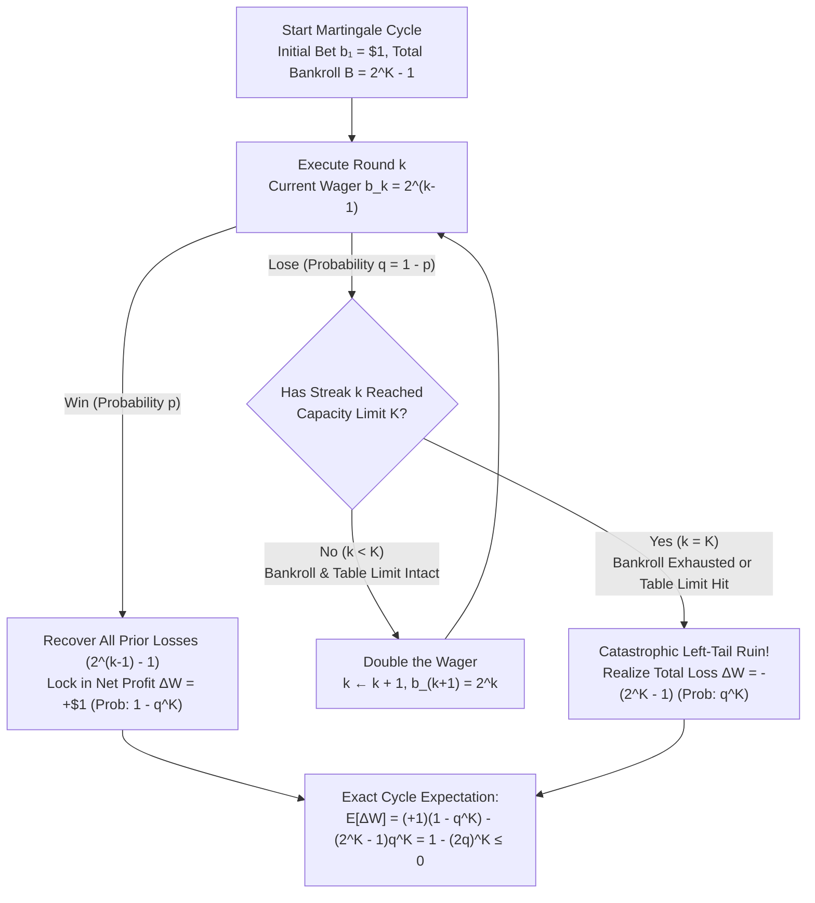
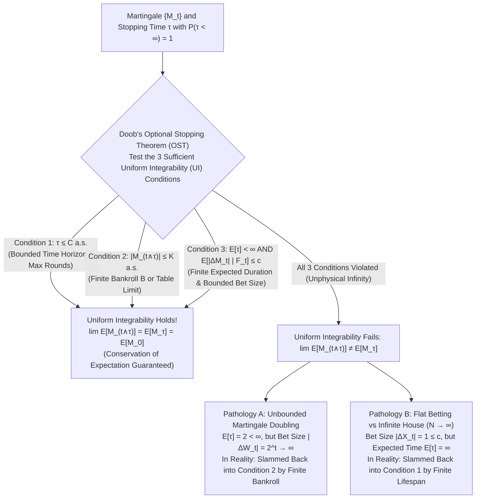

## Introduction: The Seductive 18th-Century Casino Myth of an "Unbeatable System"

In 1754, in the candlelit *ridotti* (casinos) of Venice, the legendary adventurer and author <strong>Giacomo Casanova</strong> sat at a *Faro* table armed with what eighteenth-century European aristocrats whispered was an infallible mathematical recipe for wealth. Pawning the diamonds of his lover (known in his memoirs *Histoire de ma vie* as the nun "M.M."), Casanova played the system known in France as playing *à la martingale*—doubling his wager after every loss so that the very first win would recover all previous losses plus a net profit of one unit. For several days, Casanova accumulated gold sequins with effortless regularity. Then, on a single fateful afternoon, an improbable streak of consecutive losses struck. Within hours, his exponentially ballooning wagers exhausted his entire war chest of 5,000 sequins, leaving him destitute.

More than a century later, in the summer of 1891, the British fraudster and gambler <strong>Charles Wells</strong>—immortalized in the music-hall anthem *"The Man Who Broke the Bank at Monte Carlo"*—used an aggressive progression system at the Monte Carlo roulette tables, exhausting the table's reserve cash twelve times over eleven hours and walking away with a million francs. Yet mathematics is an unforgiving creditor. When Wells returned to Monte Carlo to repeat his triumph, a ruthless run of opposing outcomes wiped out his entire fortune. He eventually died penniless in Paris in 1922.

Why have centuries of gamblers, Enlightenment intellectuals, and modern algorithmic foreign-exchange (FX) traders and hedge funds fallen under the spell of the <strong>Martingale Doubling Strategy</strong>, only to meet the exact same catastrophic end?

The reason lies in an elementary arithmetic identity so clean and seductive that it feels like a loophole in the laws of nature. Consider a binary game paying even money ($1:1$), such as betting on Red or Black in roulette or flipping a coin. On each independent round, you win with probability $p \in (0, 1)$ and lose with probability $q = 1 - p$.

You execute the following deterministic betting algorithm:

1. In round $1$, wager $b_1 = \$1$. If you win, pocket $+\$1$ and end the cycle.
2. If you lose round $1$, double your bet to $b_2 = \$2$ in round $2$.
3. If you continue to lose, keep doubling your wager: $b_3 = \$4, b_4 = \$8, \dots, b_k = \$2^{k-1}$ in round $k$.
4. <strong>Stop the cycle the very first time you win (say, at round $k \ge 1$)</strong>, and reset your bet to $\$1$ for the next cycle.

Suppose you suffer $k - 1$ consecutive losses and finally win on round $k$. What is your total cumulative loss from the first $k - 1$ rounds? By the formula for a finite geometric series with ratio $2$:

$$L_{k-1} = \sum_{j=0}^{k-2} 2^j = 2^{k-1} - 1$$

On round $k$, your winning wager of $b_k = \$2^{k-1}$ pays out $+2^{k-1}$. Therefore, your <strong>net profit $\Delta W$ for the entire cycle</strong> at the exact moment of your first win is:

$$\Delta W = 2^{k-1} - \sum_{j=0}^{k-2} 2^j = 2^{k-1} - (2^{k-1} - 1) = +\$1$$

Look closely at that equation. Whether you win on the very first spin ($k = 1$), after ten consecutive losses ($k = 11$), or after a hundred consecutive losses ($k = 101$), <strong>the exact instant a single win occurs, every dollar of prior losses is wiped clean and you lock in a guaranteed net profit of $+\$1$!</strong>

Furthermore, what is the probability that you lose forever and never see a single win? Since each trial fails independently with probability $q < 1$, the probability of losing $k$ times in a row is $q^k$. Taking the limit as $k \to \infty$:

$$\lim_{k \to \infty} \mathbb{P}(\text{losing the first } k \text{ rounds}) = \lim_{k \to \infty} q^k = 0$$

Consequently, the stopping time $\tau = \inf\{k \ge 1 : \text{win on round } k\}$ is finite with probability $1$ ($\mathbb{P}(\tau < \infty) = 1 - 0 = 1$, *almost surely*).

Here is the paradox that has haunted probability theory for three hundred years: <strong>If each individual round of a game has zero or negative expected value, how can a strategy that wins $+\$1$ with probability $1$ fail?</strong>

In this article, we dissect this paradox across three rigorous mathematical levels:
1. <strong>The Anatomy of the Martingale Trap under Finite Boundaries</strong>: We prove how finite bankrolls and casino table limits shatter the illusion of guaranteed profit, transforming a benign random walk into what Nassim Nicholas Taleb calls *"picking up pennies in front of a steamroller"*—a distribution with extreme negative skewness where $\mathbb{E}[\Delta W] = 1 - (2q)^K \le 0$.
2. <strong>Huygens and Pascal's Gambler's Ruin Problem (1657)</strong>: We formulate flat-betting survival as an absorbing Markov chain, set up and solve the second-order homogeneous linear difference equation $P_k = p P_{k+1} + q P_{k-1}$, and derive two devastating corollaries: against an infinitely wealthy house ($N \to \infty$), <strong>even a $100\%$ fair game ($p = 1/2$) guarantees $100\%$ eventual bankruptcy</strong>, while in a casino game like roulette, grinding $\$1$ bets to double $\$100$ to $\$200$ fails with up to <strong>$99.997\%$ probability</strong>.
3. <strong>Paul Lévy and Joseph Leo Doob's Martingale Theory & Optional Stopping Theorem (OST)</strong>: Moving to modern measure-theoretic probability, we define filtrations $\{\mathcal{F}_t\}$, martingales, discrete stochastic integrals $(H \cdot M)_n$, and <strong>Doob's Optional Stopping Theorem</strong>. We show that the apparent creation of $+\$1$ out of nothing ($\mathbb{E}[W_\tau] = +1 \ne 0 = \mathbb{E}[W_0]$) is a textbook failure of <strong>Uniform Integrability (Vitali Convergence)</strong>, and we use quadratic and exponential martingales alongside <strong>Wald's Identity</strong> to derive both ruin probabilities and the exact expected duration until ruin $\mathbb{E}[\tau] = k(N - k)$ in just a few lines.

---

## Chapter 1: The Mathematical Anatomy of the Martingale Betting Trap — Finite Bankrolls, Table Limits, and Taleb's Steamroller

### 1.1 The Exponential Explosion of Required Capital and Casino Table Limits

The seductive claim that the Martingale doubling strategy yields $+\$1$ with probability $1$ hides two unstated assumptions of infinity:
1. <strong>Infinite Bankroll ($B = \infty$)</strong>: The gambler possesses unlimited capital and credit to keep doubling through any losing streak of arbitrary length.
2. <strong>No Table Limit ($M_{\max} = \infty$)</strong>: The casino willingly accepts wagers of arbitrary size $\$2^{k-1} \to \infty$.

In the physical and financial universe, neither infinity exists. Every human being, corporation, and sovereign wealth fund operates under a strictly finite capital constraint, and every casino on Earth enforces a strict <strong>Table Limit</strong> (for instance, a minimum bet of $\$1$ and a maximum bet of $\$1,000$). Casino operators do not post maximum bet signs merely out of conservatism; the ratio between the table maximum and minimum is specifically engineered to cap the maximum number of consecutive doublings $K$ at around $7$ to $10$ steps.

Suppose a gambler has enough total capital (or table-limit headroom) to sustain at most <strong>$K$ consecutive bets</strong> in a single Martingale cycle. To place the $K$-th wager of $b_K = 2^{K-1}$ after losing the first $K - 1$ bets, the gambler must possess a <strong>total cumulative bankroll $B_K$</strong> equal to:

$$B_K = \sum_{j=0}^{K-1} 2^j = 2^K - 1$$

Let us examine how violently the required bet size $b_k = 2^{k-1}$ and total committed capital $B_k = 2^k - 1$ explode as a losing streak $k$ progresses, comparing a <strong>Fair Coin Toss ($p = q = 0.5$)</strong> against <strong>European Roulette ($p = 18/37 \approx 0.4865$, $q = 19/37 \approx 0.5135$ due to the single green zero)</strong>:

| Losing Streak $k$ | Round $k$ Bet $b_k = 2^{k-1}$ | Cumulative Bankroll Required $B_k = 2^k - 1$ | Net Profit Upon Win | Streak Probability $q^k$ (Fair Coin $q=0.5$) | Streak Probability $q^k$ (European Roulette $q=19/37$) |
| :--- | :--- | :--- | :--- | :--- | :--- |
| $k = 1$ | $\$1$ | $\$1$ | $+\$1$ | $50.000\%$ | $51.351\%$ |
| $k = 3$ | $\$4$ | $\$7$ | $+\$1$ | $12.500\%$ | $13.541\%$ |
| $k = 5$ | $\$16$ | $\$31$ | $+\$1$ | $3.125\%$ | $3.570\%$ |
| $k = 10$ | $\$512$ | $\$1,023$ | $+\$1$ | $0.0977\%$ ($1$ in $1,024$) | $0.1276\%$ ($1$ in $784$) |
| $k = 15$ | $\$16,384$ | $\$32,767$ | $+\$1$ | $0.00305\%$ ($1$ in $32,768$) | $0.00456\%$ ($1$ in $21,946$) |
| $k = 20$ | $\$524,288$ | $\$1,048,575$ | $+\$1$ | $0.000095\%$ ($1$ in $1.05\text{M}$) | $0.000163\%$ ($1$ in $614,327$) |
| $k = 30$ | $\$536,870,912$ | $\$1,073,741,823$ | $+\$1$ | $9.31 \times 10^{-10}$ | $2.09 \times 10^{-9}$ |

The arithmetic is unforgiving. Merely to survive up to $K = 10$ rounds, you must put $\$1,023$ on the line to chase a $+\$1$ reward—and in European Roulette, a 10-spin losing streak occurs once every $784$ cycles (roughly once every 15 hours of play). To survive $K = 20$ consecutive losses, you must risk over <strong>$\$1.048\text{ million}$</strong> to win a single dollar!

### 1.2 Exact Expected Value of a Single Cycle Under Finite Capacity $K$

Let us compute the exact expected change in wealth $\mathbb{E}[\Delta W]$ for a single Martingale cycle when the player's bankroll (or the casino's table limit) allows at most $K$ consecutive wagers ($B = 2^K - 1$ units).

In any single cycle, there are only two mutually exclusive outcomes:

1. <strong>Success (At least one win occurs within the first $K$ rounds)</strong>:
   This is the complement of losing all $K$ rounds, so it occurs with probability $1 - q^K$. Whenever this happens, the net payoff is $+\$1$.
2. <strong>Catastrophic Bust (All $K$ rounds are lost)</strong>:
   This occurs with probability $q^K$. The gambler loses the entire committed bankroll of $-\$(2^K - 1)$ and cannot double again.

Multiplying each outcome by its probability yields the exact expected value of a single Martingale cycle:

$$\mathbb{E}[\Delta W] = (+1) \cdot (1 - q^K) + \left(-(2^K - 1)\right) \cdot q^K$$

Expanding the terms reveals an immediate cancellation of $-q^K$ and $+q^K$:

$$\mathbb{E}[\Delta W] = 1 - q^K - 2^K q^K + q^K = 1 - (2q)^K \le 0 \quad \left(\text{for } q \ge \frac{1}{2}\right)$$

This compact formula $\mathbb{E}[\Delta W] = 1 - (2q)^K$ completely demystifies the Martingale betting strategy across all game regimes:

#### Regime 1: The Fair Game ($p = q = 1/2$)
When $q = 1/2$, we have $2q = 1$, and therefore:

$$\mathbb{E}[\Delta W] = 1 - 1^K = 0$$

Whether $K = 3$ (a $\$7$ bankroll) or $K = 30$ (a $\$1.07\text{ billion}$ bankroll), <strong>the expected value of the Martingale cycle in a fair game is identically zero!</strong> The tiny probability $q^K = 2^{-K}$ of suffering a catastrophic loss is offset by the exact exponential magnitude $-(2^K - 1)$ of that loss.

#### Regime 2: The Subfair Casino Game ($p < 1/2 \iff q > 1/2$)
Whenever the house has an edge ($q > 1/2$), we have $2q > 1$. Consequently:

$$\mathbb{E}[\Delta W] = 1 - (2q)^K < 0$$

Even more shockingly, because $2q > 1$, as the gambler brings a larger bankroll $K$ to the table to "make the system safer," $(2q)^K$ grows exponentially, meaning <strong>the larger your bankroll $K$, the MORE NEGATIVE your expected profit per cycle becomes!</strong>

Why does bringing more capital make your expected value worse per cycle? We can prove this directly by calculating the <strong>expected total action (total dollars wagered) $\mathbb{E}[S_K]$</strong> during a single cycle. Round $j$ ($1 \le j \le K$) is reached if and only if the first $j - 1$ rounds were lost (probability $q^{j-1}$), at which point a wager of size $2^{j-1}$ is placed. Hence, the expected total amount bet in one cycle is:

$$\mathbb{E}[S_K] = \sum_{j=1}^K 2^{j-1} q^{j-1} = \sum_{j=0}^{K-1} (2q)^j = \frac{(2q)^K - 1}{2q - 1}$$

Since the casino extracts an expected toll (house edge) of $(q - p) = 2q - 1$ on every dollar wagered, your expected net profit is simply the per-dollar return $(p - q) = -(2q - 1)$ multiplied by the expected total action $\mathbb{E}[S_K]$:

$$\mathbb{E}[\Delta W] = -(2q - 1) \cdot \mathbb{E}[S_K] = -(2q - 1) \cdot \frac{(2q)^K - 1}{2q - 1} = 1 - (2q)^K$$

In European Roulette ($q = 19/37 \implies 2q = 38/37 \approx 1.02703$):
- A simple $\$1$ flat bet ($K = 1$) has an expected value of $\mathbb{E}[\Delta W] = 1 - 38/37 = -\$0.0270$ ($-2.7$ cents).
- A 10-step Martingale cycle ($K = 10$, requiring a $\$1,023$ bankroll) has an expected value of $\mathbb{E}[\Delta W] = 1 - (38/37)^{10} \approx -\$0.3056$ ($-30.6$ cents per cycle—more than <strong>11 times worse</strong> than a flat bet!).
- A 20-step Martingale cycle ($K = 20$, requiring a $\$1,048,575$ bankroll) has an expected value of $\mathbb{E}[\Delta W] = 1 - (38/37)^{20} \approx -\$0.7046$ per cycle!

### 1.3 Infinite Expected Capital Commitment and Taleb's "Steamroller" Skewness Transformation

Even if we grant a hypothetical gambler an infinite credit line ($K = \infty$) in a fair game ($p = q = 1/2$), what is the <strong>expected size of the final winning bet $b_\tau = 2^{\tau - 1}$</strong> required to complete a cycle?
Since the stopping time $\tau$ follows a geometric distribution $\mathbb{P}(\tau = k) = (1/2)^k$ for $k = 1, 2, \dots$, the expected maximum wager placed during a cycle is:

$$\mathbb{E}[b_\tau] = \sum_{k=1}^{\infty} 2^{k-1} \mathbb{P}(\tau = k) = \sum_{k=1}^{\infty} 2^{k-1} \left(\frac{1}{2}\right)^k = \sum_{k=1}^{\infty} \frac{1}{2} = \frac{1}{2} + \frac{1}{2} + \frac{1}{2} + \cdots = +\infty$$

Thus, even in an idealized universe without limits, extracting $+\$1$ via the Martingale strategy demands an <strong>infinite expected capital commitment</strong> (the exact dual of Daniel Bernoulli's 1738 <strong>St. Petersburg Paradox</strong>).

From the standpoint of mathematical statistics and quantitative finance, the Martingale betting strategy does not alter the first moment (drift) of a fair game; it executes a radical <strong>skewness transformation (third central moment distortion)</strong>. It takes a symmetric, zero-mean random walk and compresses $1 - q^K \approx 99.9\%$ of the probability mass into a tiny positive outcome ($+\$1$), while sweeping all the accumulated risk into a catastrophic left-tail singularity of $-\$(2^K - 1)$ occurring with probability $q^K \approx 0.1\%$.

Option trader and philosopher <strong>Nassim Nicholas Taleb</strong> famously dubbed this return profile <strong>"picking up pennies in front of a steamroller."</strong> For weeks or months, a Martingale trader generates a deceptively smooth, upward-sloping equity curve with a near-100% win rate and an artificially inflated Sharpe ratio—until a routine $K$-sigma tail event arrives, and the steamroller obliterates years of accumulated pennies in a single afternoon. From Nick Leeson's 1995 collapse of <strong>Barings Bank</strong> (doubling down on Nikkei 225 futures straddles after the Kobe earthquake) to the 1998 implosion of <strong>Long-Term Capital Management (LTCM)</strong> and modern retail FX "grid/Martingale" trading bots, the mathematical tombstone is always inscribed with $\mathbb{E}[\Delta W] = 1 - (2q)^K$.

---

## Chapter 2: Huygens and Pascal's Gambler's Ruin Problem (1657) — Absorbing Markov Chains and Exact Difference Equations

### 2.1 Historical Origin and Formulation as an Absorbing Random Walk

Having seen why doubling bets leads to rapid ruin, a natural question arises: *What if a gambler plays conservatively, betting a constant unit ($b_t = \$1$) on every round until they either reach a target fortune $N$ or go bankrupt at $0$?*

This is the classic <strong>Gambler's Ruin Problem</strong>, one of the foundational pillars of probability theory. First posed by <strong>Blaise Pascal</strong> to Pierre de Fermat and transmitted in 1656 to the Dutch mathematician and physicist <strong>Christiaan Huygens</strong>, it appeared as the famous Fifth Problem in Huygens's 1657 treatise *De ratiociniis in ludo aleae* (*On Reasoning in Games of Chance*). Its general solution was later developed by <strong>Jacob Bernoulli</strong> in *Ars Conjectandi* (1713) and <strong>Abraham de Moivre</strong> in *The Doctrine of Chances* (1718).

Let us formulate the problem rigorously as a discrete-time <strong>Absorbing Markov Chain</strong> (a 1D simple random walk between two absorbing barriers):

- A gambler starts at time $t = 0$ with an initial capital of $X_0 = k$ units (where $k \in \{1, 2, \dots, N - 1\}$).
- The adversary (the casino or house) starts with $N - k$ units, so the total wealth in the closed system is fixed at $N$ units.
- At each discrete step $t = 1, 2, \dots$, the gambler wagers $1$ unit, winning $+1$ with probability $p$ and losing $-1$ with probability $q = 1 - p$:

$$X_t = X_{t-1} + \xi_t, \qquad \mathbb{P}(\xi_t = +1) = p, \quad \mathbb{P}(\xi_t = -1) = q = 1 - p$$

- The game continues until the random stopping time $\tau = \inf\{t \ge 0 : X_t \in \{0, N\}\}$ when the wealth hits one of the two <strong>absorbing barriers</strong>:
  - <strong>$X_\tau = 0$</strong>: <strong>Gambler's Ruin</strong> (the gambler goes bankrupt).
  - <strong>$X_\tau = N$</strong>: <strong>Target Reached / Casino's Ruin</strong> (the gambler captures all $N$ units).

We seek the exact closed-form expression for the <strong>winning probability</strong> starting from capital $k$:

$$P_k = \mathbb{P}(X_\tau = N \mid X_0 = k) \qquad (0 \le k \le N)$$

as well as the complementary <strong>ruin probability</strong> $R_k = \mathbb{P}(X_\tau = 0 \mid X_0 = k) = 1 - P_k$.

### 2.2 Setting Up and Solving the Second-Order Linear Difference Equation

Using <strong>First-Step Analysis</strong> (conditioning on the outcome of the very first wager $\xi_1$ via the Law of Total Probability and the Markov Property), a gambler currently at state $k$ ($1 \le k \le N - 1$) transitions to:
1. State $k + 1$ with probability $p$, from which the conditional probability of eventually reaching $N$ is $P_{k+1}$.
2. State $k - 1$ with probability $q$, from which the conditional probability of eventually reaching $N$ is $P_{k-1}$.

Therefore, the sequence $\{P_k\}_{k=0}^N$ satisfies the <strong>second-order homogeneous linear difference equation</strong>:

$$P_k = p P_{k+1} + q P_{k-1} \qquad (1 \le k \le N - 1)$$

subject to the two absorbing <strong>boundary conditions</strong>:

$$P_0 = 0, \qquad P_N = 1$$

Let us solve this boundary-value problem from first principles using telescoping forward differences.
Since $p + q = 1$, we can rewrite the left-hand side as $P_k = (p + q) P_k$:

$$(p + q) P_k = p P_{k+1} + q P_{k-1}$$

Rearranging terms to group $p$ and $q$ yields:

$$p (P_{k+1} - P_k) = q (P_k - P_{k-1}) \implies P_{k+1} - P_k = \left(\frac{q}{p}\right) (P_k - P_{k-1})$$

Notice that the forward difference $\Delta_k = P_{k+1} - P_k$ forms a geometric progression with common ratio $r = q/p$. Applying this relation inductively from $j = 1$ up to $j$ and using the lower boundary condition $P_0 = 0$:

$$P_{j+1} - P_j = \left(\frac{q}{p}\right)^j (P_1 - P_0) = \left(\frac{q}{p}\right)^j P_1$$

Summing this telescoping series from $j = 0$ to $j = k - 1$ cancels all intermediate terms on the left-hand side:

$$P_k - P_0 = \sum_{j=0}^{k-1} (P_{j+1} - P_j) = P_1 \sum_{j=0}^{k-1} \left(\frac{q}{p}\right)^j$$

Since $P_0 = 0$, evaluating the geometric sum on the right-hand side splits naturally into two cases depending on whether $q/p = 1$ or $q/p \ne 1$:

#### Case A: The Fair Game ($p = q = 1/2 \iff q/p = 1$)
When $p = q = 1/2$, the ratio is $q/p = 1$, so each term in the sum equals $1$:

$$P_k = P_1 \sum_{j=0}^{k-1} 1^j = k P_1$$

Imposing the upper boundary condition $P_N = 1$ at $k = N$ gives $1 = N P_1 \implies P_1 = 1/N$. Substituting $P_1$ back yields the linear solution:

$$P_k = \frac{k}{N}, \qquad R_k = 1 - P_k = \frac{N - k}{N}$$

#### Case B: The Biased Game ($p \ne q \iff q/p \ne 1$)
When $p \ne q$, the common ratio $q/p \ne 1$ allows us to sum the finite geometric series:

$$P_k = P_1 \frac{1 - (q/p)^k}{1 - (q/p)}$$

Imposing the upper boundary condition $P_N = 1$ at $k = N$ determines the constant $P_1$:

$$1 = P_N = P_1 \frac{1 - (q/p)^N}{1 - (q/p)} \implies P_1 = \frac{1 - (q/p)}{1 - (q/p)^N}$$

Substituting $P_1$ back into the expression for $P_k$ cancels the factor $1 - (q/p)$ and delivers the celebrated exponential formula:

$$P_k = \frac{1 - (q/p)^k}{1 - (q/p)^N}$$

Combining both regimes gives the complete exact solution to the Gambler's Ruin Problem:

$$P_k = \begin{cases} \dfrac{k}{N} & \text{if } p = q = \dfrac{1}{2} \;\text{(Fair Game)} \\[12pt] \dfrac{1 - (q/p)^k}{1 - (q/p)^N} & \text{if } p \ne q \;\text{(Biased Game)} \end{cases}$$

---

## Chapter 3: Three Shocking Consequences of the Gambler's Ruin Formula

### 3.1 Consequence 1: Against an Infinitely Wealthy Casino ($N \to \infty$), Even a 100% Fair Game Guarantees Ruin!

Suppose a gambler with finite initial capital $k$ plays against a casino (or financial market) whose capital is effectively infinite ($N \to \infty$), or equivalently, suppose the gambler plays indefinitely without setting a fixed upper walk-away target ($N \to \infty$).

What happens in a <strong>100% Fair Game ($p = q = 1/2$)</strong> with zero house edge? Taking the limit $N \to \infty$ in the fair-game formula $P_k = k/N$:

$$\lim_{N \to \infty} P_k = \lim_{N \to \infty} \frac{k}{N} = 0 \implies \lim_{N \to \infty} R_k = \lim_{N \to \infty} \left(1 - \frac{k}{N}\right) = 1 \quad (100\%\text{ Certain Ruin!})$$

Read that result again: <strong>Even when the game is completely fair ($p = 1/2$), a player with finite wealth $k$ playing indefinitely against an infinitely wealthy adversary will go bankrupt with $100\%$ certainty ($\mathbb{P}(\text{Ruin}) = 1$)!</strong>

Why does a fair coin toss guarantee bankruptcy? By George Pólya's famous 1921 theorem, a one-dimensional symmetric simple random walk on $\mathbb{Z}$ is <strong>recurrent</strong> (more precisely, <strong>null recurrent</strong>): its sample paths oscillate with unbounded amplitude ($\limsup_{t \to \infty} X_t = +\infty$ and $\liminf_{t \to \infty} X_t = -\infty$ almost surely). Because the gambler faces an absorbing barrier at $X = 0$ while the casino faces no upper barrier ($N = \infty$), the random walk's inevitable downward excursions will eventually touch $0$ with probability $1$—and the instant $X_t = 0$, the gambler is absorbed and eliminated from the game forever. It is the <strong>asymmetry of finite capital versus infinite capital</strong>, not just the house edge, that makes indefinite gambling fatal.

*(Note: What if the gambler possesses a genuine positive edge $p > 1/2 \implies q/p < 1$, like a blackjack card counter or a profitable quantitative fund against an infinite market $N \to \infty$? Since $(q/p)^N \to 0$ as $N \to \infty$, we get:*

$$\lim_{N \to \infty} P_k = 1 - \left(\frac{q}{p}\right)^k \implies \lim_{N \to \infty} R_k = \left(\frac{q}{p}\right)^k$$

*Thus, a player with a positive edge has a strictly positive probability of surviving forever, yet still faces a non-zero probability of ruin $(q/p)^k$ if their initial bankroll $k$ is too small relative to their unit bet size!)*

### 3.2 Consequence 2: The Exponential Wall of the House Edge ($99.997\%$ Failure to Double $\$100$)

Now let us examine what happens in a real casino where the house holds a slight edge ($p < 1/2 \iff q/p > 1$).
Suppose you walk into a casino with <strong>$k = \$100$</strong> and a modest, disciplined goal: <strong>double your money to $N = \$200$ and walk out</strong>.

Compare two possible strategies:

1. <strong>Bold Play (All-In $\$100$ on a Single Spin)</strong>:
   You place all $\$100$ on Red in a single spin. Your probability of reaching $\$200$ is simply $p$:
   - In <strong>European Roulette</strong> ($18$ red, $18$ black, $1$ green zero; $p = 18/37$): <strong>$P_{\text{bold}} = \frac{18}{37} \approx 48.65\%$</strong>.
   - In <strong>American Roulette</strong> ($18$ red, $18$ black, $2$ green zeros `0` and `00`; $p = 18/38 = 9/19$): <strong>$P_{\text{bold}} = \frac{18}{38} \approx 47.37\%$</strong>.

2. <strong>Timid Play (Grinding $\$1$ Bets at a Time from $k = 100$ to $N = 200$)</strong>:
   Suppose you think betting $\$100$ at once is "too reckless," so you decide to bet <strong>$1$ dollar at a time</strong> ($k = 100, N = 200$).
   Substituting $k = 100$ and $N = 2k = 200$ into the Gambler's Ruin formula and factoring the denominator $1 - (q/p)^{200} = \big(1 - (q/p)^{100}\big)\big(1 + (q/p)^{100}\big)$ gives:

$$P_{100} = \frac{1 - (q/p)^{100}}{1 - (q/p)^{200}} = \frac{1}{1 + (q/p)^{100}}$$

Let us plug in the actual roulette probabilities:

- <strong>In European Roulette ($p = 18/37, q = 19/37 \implies q/p = 19/18 \approx 1.055556$)</strong>:
  Although $19/18$ is barely above $1$, raising it to the $100$-th power yields $(19/18)^{100} \approx 222.258$. Therefore:

  $$P_{100} = \frac{1}{1 + 222.258} \approx 0.004479 \quad (\mathbf{0.448\%}\text{ chance of success!})$$

  Your probability of going broke before reaching $\$200$ is <strong>$99.552\%$</strong>! And if you bet $\$0.50$ units ($k = 200, N = 400$), $(19/18)^{200} \approx 49,398.7$, so $P_{200} \approx 0.00202\%$—a <strong>$99.998\%$ probability of ruin</strong>!

- <strong>In American Roulette ($p = 18/38, q = 20/38 \implies q/p = 20/18 = 10/9 \approx 1.111111$)</strong>:
  Trying to double $\$100$ to $\$200$ via $\$1$ bets ($k = 100, N = 200$) runs headfirst into $(10/9)^{100} \approx 37,648.62$:

  $$P_{100} = \frac{1}{1 + 37,648.62} \approx 0.00002656 \quad (\mathbf{0.00266\%}\text{ chance of success!})$$

  Your probability of failing and losing your entire $\$100$ is <strong>$99.9973\%$</strong> (only $1$ in $37,650$ players succeeds)!

| Game & Betting Strategy | Win Prob $p$ | Odds Ratio $q/p$ | Initial $k$ / Target $N$ | Success Probability $P_k$ | Ruin Probability $R_k = 1 - P_k$ |
| :--- | :--- | :--- | :--- | :--- | :--- |
| <strong>Fair Coin Toss</strong> ($\$1$ units) | $0.5000$ | $1.0000$ | $k = 100, N = 200$ | <strong>$50.000\%$</strong> | $50.000\%$ |
| <strong>European Roulette (Bold Play: $\$100$ All-In)</strong> | $18/37 \approx 0.4865$ | $19/18 \approx 1.0556$ | $k = 1, N = 2$ | <strong>$48.649\%$</strong> | $51.351\%$ |
| <strong>European Roulette ($\$5$ Bets)</strong> | $18/37 \approx 0.4865$ | $19/18 \approx 1.0556$ | $k = 20, N = 40$ | <strong>$25.335\%$</strong> | $74.665\%$ |
| <strong>European Roulette ($\$1$ Bets)</strong> | $18/37 \approx 0.4865$ | $19/18 \approx 1.0556$ | $k = 100, N = 200$ | <strong>$0.448\%$</strong> | <strong>$99.552\%$</strong> |
| <strong>European Roulette ($\$0.50$ Bets)</strong> | $18/37 \approx 0.4865$ | $19/18 \approx 1.0556$ | $k = 200, N = 400$ | <strong>$0.0020\%$</strong> | <strong>$99.998\%$</strong> |
| <strong>American Roulette ($\$1$ Bets)</strong> | $18/38 \approx 0.4737$ | $10/9 \approx 1.1111$ | $k = 100, N = 200$ | <strong>$0.0027\%$</strong> | <strong>$99.997\%$</strong> |

### 3.3 Consequence 3: Dubins and Savage's Theorem (1965) — Why Bold Play Is Optimal in Subfair Games

Why does grinding small $\$1$ bets turn a $48.65\%$ chance of doubling your money into a $99.55\%$–$99.997\%$ certainty of ruin?
Because in any game with negative drift ($p < 1/2$), <strong>the Law of Large Numbers is your mortal enemy</strong>. Splitting your capital into hundreds of small wagers forces the empirical win rate to converge tightly around $p < 1/2$, eliminating the variance you desperately need to overcome the negative drift.

In their landmark 1965 monograph *How to Gamble If You Must: Inequalities for Stochastic Processes*, <strong>Lester Dubins</strong> and <strong>Leonard J. Savage</strong> proved that in any subfair game ($p < 1/2$), the strategy that maximizes the probability of reaching a target fortune $N$ from initial fortune $k$ is <strong>Bold Play</strong>—wagering the maximum possible amount $\min(X_t, N - X_t)$ on every single turn so as to minimize the total number of trials exposed to the house edge.

---

## Chapter 4: Paul Lévy and Joseph Leo Doob's Modern Martingale Theory

### 4.1 From the 18th-Century Betting System to the 20th-Century Stochastic Process

So far we have analyzed doubling bets (Chapter 1) and constant bets (Chapters 2–3). But what if a gambler uses a complex, path-dependent betting rule $H_t$—such as the Fibonacci progression, the Labouchère cancellation system, D'Alembert's system, or a neural network that adjusts bet sizes based on the last 50 outcomes?

To prove once and for all that <strong>no dynamic betting system can ever turn a fair or subfair game into a winning one</strong>, 20th-century mathematicians <strong>Jean Ville (1939)</strong>, <strong>Paul Lévy (1934–1937)</strong>, and <strong>Joseph Leo Doob (1940–1953)</strong> forged the modern measure-theoretic theory of <strong>Martingales</strong>.
In a delightful stroke of historical irony, Ville and Doob named the mathematical concept of a "fair stochastic process" a <strong>martingale</strong> specifically because their theorems proved the futility of the 18th-century martingale betting strategy!

### 4.2 Filtrations, Martingales, Submartingales, and Supermartingales

Let $(\Omega, \mathcal{F}, \mathbb{P})$ be a probability space equipped with a discrete-time <strong>filtration</strong> $\{\mathcal{F}_t\}_{t \ge 0}$:

$$\mathcal{F}_0 \subseteq \mathcal{F}_1 \subseteq \mathcal{F}_2 \subseteq \cdots \subseteq \mathcal{F}_t \subseteq \cdots \subseteq \mathcal{F}$$

where each sub-$\sigma$-algebra $\mathcal{F}_t$ represents the totality of historical information observable up to time $t$. A stochastic process $\{M_t\}_{t \ge 0}$ is <strong>adapted</strong> to $\{\mathcal{F}_t\}$ if $M_t$ is $\mathcal{F}_t$-measurable for every $t \ge 0$ (meaning the value of $M_t$ is known at time $t$).

> <strong>Definition (Martingale, Submartingale, and Supermartingale)</strong>:
> An adapted discrete-time real-valued process $\{M_t\}_{t \ge 0}$ on $(\Omega, \mathcal{F}, \{\mathcal{F}_t\}, \mathbb{P})$ that is integrable ($\mathbb{E}[|M_t|] < \infty$ for all $t \ge 0$) is called:
> - A <strong>Martingale</strong> (*Fair Game*) if for all $t \ge 0$:
>
>   $$\mathbb{E}[M_{t+1} \mid \mathcal{F}_t] = M_t \quad \text{a.s.}$$
>
> - A <strong>Submartingale</strong> (*Favorable Game*, non-decreasing in expectation) if for all $t \ge 0$:
>
>   $$\mathbb{E}[M_{t+1} \mid \mathcal{F}_t] \ge M_t \quad \text{a.s.}$$
>
> - A <strong>Supermartingale</strong> (*Unfavorable / Casino Game*, non-increasing in expectation) if for all $t \ge 0$:
>
>   $$\mathbb{E}[M_{t+1} \mid \mathcal{F}_t] \le M_t \quad \text{a.s.}$$

By the <strong>Tower Property</strong> of conditional expectation ($\mathbb{E}[\mathbb{E}[M_t \mid \mathcal{F}_t] \mid \mathcal{F}_s] = \mathbb{E}[M_t \mid \mathcal{F}_s]$ for $s < t$), any martingale satisfies $\mathbb{E}[M_t \mid \mathcal{F}_s] = M_s$ and thus preserves unconditional expectation across all deterministic times $t \ge 0$:

$$\mathbb{E}[M_t] = \mathbb{E}[M_0] \qquad (\forall t \ge 0)$$

### 4.3 The Discrete Stochastic Integral (Martingale Transform) and the Impossibility of Betting Systems

Suppose $\{M_t\}_{t \ge 0}$ represents the cumulative payoff of a unit-stake game, and a gambler dynamically varies their bet size $H_k$ on round $k$. Because the gambler cannot see into the future, the wager $H_k$ placed on round $k$ must be determined solely by the history observed up to round $k - 1$:

$$H_k \in \mathcal{F}_{k-1} \qquad (\forall k \ge 1)$$

Such a sequence $\{H_k\}_{k \ge 1}$ is called a <strong>predictable (or previsible) process</strong>. The gambler's wealth $W_n$ at time $n$ starting from initial wealth $W_0$ is given by the <strong>Martingale Transform (Discrete Stochastic Integral)</strong>:

$$W_n = W_0 + (H \cdot M)_n = W_0 + \sum_{k=1}^n H_k (M_k - M_{k-1})$$

> <strong>Theorem (Conservation of Fairness Under Predictable Betting Strategies)</strong>:
> Let $\{H_k\}_{k \ge 1}$ be a bounded predictable process ($H_k \in \mathcal{F}_{k-1}$).
> 1. If $\{M_t\}$ is a martingale, then the transformed wealth process $W_n = W_0 + (H \cdot M)_n$ is also a <strong>martingale</strong>, so $\mathbb{E}[W_n] = W_0$ for all $n \ge 0$.
> 2. If $\{M_t\}$ is a supermartingale (subfair casino game) and the gambler can only place non-negative bets ($H_k \ge 0$), then $W_n$ is also a <strong>supermartingale</strong>, so $\mathbb{E}[W_n] \le W_0$ for all $n \ge 0$.

<strong>Proof</strong>: Because $H_n$ is $\mathcal{F}_{n-1}$-measurable, we can factor $H_n$ outside the conditional expectation given $\mathcal{F}_{n-1}$:

$$\mathbb{E}[W_n - W_{n-1} \mid \mathcal{F}_{n-1}] = \mathbb{E}[H_n (M_n - M_{n-1}) \mid \mathcal{F}_{n-1}] = H_n \mathbb{E}[M_n - M_{n-1} \mid \mathcal{F}_{n-1}]$$

If $\{M_t\}$ is a martingale, $\mathbb{E}[M_n - M_{n-1} \mid \mathcal{F}_{n-1}] = 0$, so $\mathbb{E}[W_n \mid \mathcal{F}_{n-1}] = W_{n-1}$. If $\{M_t\}$ is a supermartingale and $H_n \ge 0$, the product is $\le 0$, so $\mathbb{E}[W_n \mid \mathcal{F}_{n-1}] \le W_{n-1}$. $\blacksquare$

This three-line proof is the mathematical death knell for every betting progression ever invented: <strong>multiplying a zero-expectation increment by any history-dependent bet size $H_n \in \mathcal{F}_{n-1}$ still yields zero conditional expectation.</strong>

---

## Chapter 5: Doob's Optional Stopping Theorem (OST) — Resolving the Paradox of Stopped Martingales

### 5.1 The Heart of the Paradox: Why Does $\mathbb{E}[W_n] = 0$ While $\mathbb{E}[W_\tau] = +1$?

Now we confront the ultimate mathematical mystery.
By the Martingale Transform Theorem, in a fair coin-tossing game ($p = q = 1/2$) starting at $W_0 = 0$, the wealth process $W_n$ of the Martingale doubling strategy ($H_k = 2^{k-1} \mathbb{I}_{\{\tau \ge k\}}$) is a bona fide martingale, satisfying $\mathbb{E}[W_n] = 0$ at every deterministic time $n \ge 0$.
Yet at the random stopping time $\tau = \inf\{n \ge 1 : W_n = +1\}$ (the first win), we know that $\mathbb{P}(\tau < \infty) = 1$ and $W_\tau = +1$ almost surely, which gives:

$$\mathbb{E}[W_\tau] = +1 \ne 0 = \mathbb{E}[W_0]$$

How can a martingale whose expectation is $0$ at every fixed time $n = 1, 2, 3, \dots$ suddenly have expectation $+1$ at a random stopping time $\tau$?

The answer is codified in <strong>Doob's Optional Stopping Theorem (OST)</strong>, which establishes the exact boundary between valid stopping rules that preserve expectation and pathological infinite schemes where expectation breaks down.

### 5.2 Stopping Times and the Exact Statement of Doob's Optional Stopping Theorem

> <strong>Definition (Stopping Time)</strong>:
> A random variable $\tau : \Omega \to \{0, 1, 2, \dots\} \cup \{\infty\}$ is a <strong>stopping time</strong> with respect to the filtration $\{\mathcal{F}_t\}_{t \ge 0}$ if for every deterministic time $t \ge 0$:
>
> $$\{\omega \in \Omega : \tau(\omega) \le t\} \in \mathcal{F}_t$$
>
> That is, whether the stopping rule has triggered by time $t$ can be determined exclusively from information available at time $t$, without clairvoyance into the future.

> <strong>Theorem (Doob's Optional Stopping Theorem / Optional Sampling Theorem)</strong>:
> Let $\{M_t\}_{t \ge 0}$ be a martingale with respect to $\{\mathcal{F}_t\}_{t \ge 0}$ and let $\tau$ be an almost surely finite stopping time ($\mathbb{P}(\tau < \infty) = 1$).
> For every deterministic time $t \ge 0$, the truncated stopping time $t \wedge \tau = \min(t, \tau)$ satisfies $\mathbb{E}[M_{t \wedge \tau}] = \mathbb{E}[M_0]$.
> Furthermore, at the terminal stopping time $\tau$, the conservation of expectation
>
> $$\mathbb{E}[M_\tau] = \mathbb{E}[M_0]$$
>
> holds <strong>if and only if</strong> the stopped family $\{M_{t \wedge \tau}\}_{t \ge 0}$ is <strong>uniformly integrable (UI)</strong>—which is guaranteed whenever <strong>at least one</strong> of the following three sufficient conditions is satisfied:
>
> 1. <strong>[Condition 1: Bounded Stopping Time]</strong> $\tau$ is bounded almost surely: there exists a deterministic constant $C < \infty$ such that $\mathbb{P}(\tau \le C) = 1$.
> 2. <strong>[Condition 2: Bounded Stopped Process]</strong> The stopped process is uniformly bounded almost surely: there exists a deterministic constant $K < \infty$ such that $|M_{t \wedge \tau}| \le K$ a.s. for all $t \ge 0$.
> 3. <strong>[Condition 3: Integrable Stopping Time with Bounded Conditional Increments]</strong> The expected stopping time is finite, $\mathbb{E}[\tau] < \infty$, AND there exists a deterministic constant $c < \infty$ such that on the event $\{\tau > t\}$:
>
>    $$\mathbb{E}[\tau] < \infty \quad \text{and} \quad \mathbb{E}\big[|M_{t+1} - M_t| \;\big|\; \mathcal{F}_t\big] \le c \;\;\text{a.s. for all } t \ge 0$$

### 5.3 Diagnosing the Unbounded Martingale Doubling Strategy Against Doob's Three Conditions

Let us test the idealized, unconstrained Martingale doubling strategy ($W_0 = 0$, $\tau = \inf\{t \ge 1 : W_t = +1\}$) against all three of Doob's conditions:

- <strong>Does Condition 1 ($\tau \le C$) hold? NO!</strong>
  Although $\mathbb{P}(\tau < \infty) = 1$, a losing streak can last any finite number of rounds with positive probability $\mathbb{P}(\tau > k) = 2^{-k} > 0$, so $\sup \tau = +\infty$. In the real world, human lifespan or casino closing hours impose a hard time cap $C < \infty$, immediately forcing Condition 1 to hold!
- <strong>Does Condition 2 ($|W_{t \wedge \tau}| \le K$) hold? NO!</strong>
  After $t$ consecutive losses prior to $\tau$, the gambler's cumulative debt is $W_t = -(2^t - 1)$, which plunges to $-\infty$ without bound as $t \to \infty$. In the real world, a finite bankroll $B = 2^K - 1$ or a casino table limit imposes a strict lower bound $W_{t \wedge \tau} \ge -(2^K - 1)$, <strong>forcing Condition 2 to hold and restoring $\mathbb{E}[W_{\tau \wedge K}] = 0$</strong>!
- <strong>Does Condition 3 ($\mathbb{E}[\tau] < \infty$ AND $\mathbb{E}[|\Delta W_t| \mid \mathcal{F}_t] \le c$) hold? NO!</strong>
  Remarkably, the expected stopping time $\mathbb{E}[\tau]$ is finite and tiny:

  $$\mathbb{E}[\tau] = \sum_{k=1}^{\infty} k \left(\frac{1}{2}\right)^k = 2 < \infty$$

  Why, then, does Condition 3 fail? Because the second half of Condition 3—bounded conditional increments—is violently violated! On the event $\{\tau > t\}$, the next wager is $|W_{t+1} - W_t| = 2^t \to \infty$, which cannot be bounded by any finite constant $c < \infty$.

Let us see explicitly how the failure of <strong>Uniform Integrability (Vitali Convergence Theorem)</strong> prevents exchanging the limit $t \to \infty$ with the expectation operator $\mathbb{E}[\cdot]$. At any finite truncation time $t$, $t \wedge \tau \le t$ is bounded, so Doob's OST holds:

$$\mathbb{E}[W_{t \wedge \tau}] = (+1)\left(1 - \frac{1}{2^t}\right) + \left(-(2^t - 1)\right)\left(\frac{1}{2^t}\right) = 1 - \frac{1}{2^t} - 1 + \frac{1}{2^t} = 0$$

Taking $t \to \infty$ outside versus inside the expectation reveals the discontinuity:

$$\lim_{t \to \infty} \mathbb{E}[W_{t \wedge \tau}] = 0 \quad \ne \quad +1 = \mathbb{E}\left[\lim_{t \to \infty} W_{t \wedge \tau}\right] = \mathbb{E}[W_\tau]$$

Because a vanishing probability mass $2^{-t}$ carries an exponentially exploding debt $-(2^t - 1)$, their product remains $-1$ all the way to $t \to \infty$ ("probability mass escaping to infinity"), violating uniform integrability!

---

## Chapter 6: Solving Gambler's Ruin and Expected Duration $\mathbb{E}[\tau]$ via Martingales and Wald's Identity

Armed with Doob's Optional Stopping Theorem, we can now derive <strong>both</strong> the Gambler's Ruin probabilities $P_k$ and the <strong>expected duration of the game $\mathbb{E}[\tau]$</strong> in just a few lines of algebra by constructing three classic martingales on the absorbing interval $\{0, 1, \dots, N\}$ with $\tau = \inf\{t \ge 0 : X_t \in \{0, N\}\}$.

### 6.1 First Martingale $M_t^{(1)} = X_t$: Two-Line Proof of Fair Gambler's Ruin

In a fair game ($p = q = 1/2$) starting at $X_0 = k$, $X_t$ is a martingale and $|X_{t \wedge \tau}| \le N$ is uniformly bounded (<strong>Condition 2 holds</strong>). By Doob's OST:

$$\mathbb{E}[X_\tau] = \mathbb{E}[X_0] = k$$

Since $X_\tau \in \{0, N\}$ with $\mathbb{P}(X_\tau = N) = P_k$ and $\mathbb{P}(X_\tau = 0) = 1 - P_k$:

$$\mathbb{E}[X_\tau] = N P_k + 0 (1 - P_k) = k \implies P_k = \frac{k}{N}$$

### 6.2 Second Martingale $M_t^{(2)} = (q/p)^{X_t}$: De Moivre's Exponential Martingale for Biased Games

When $p \ne q$, define <strong>De Moivre's Exponential Martingale</strong> $M_t = (q/p)^{X_t}$. Checking its conditional expectation:

$$\mathbb{E}[M_{t+1} \mid \mathcal{F}_t] = p \left(\frac{q}{p}\right)^{X_t + 1} + q \left(\frac{q}{p}\right)^{X_t - 1} = \left(\frac{q}{p}\right)^{X_t} \left(p \cdot \frac{q}{p} + q \cdot \frac{p}{q}\right) = M_t (q + p) = M_t$$

Thus $M_t = (q/p)^{X_t}$ is a martingale! Because $0 \le X_{t \wedge \tau} \le N$, $M_{t \wedge \tau}$ is bounded by $\max(1, (q/p)^N)$ (<strong>Condition 2 holds</strong>). Applying Doob's OST ($\mathbb{E}[M_\tau] = \mathbb{E}[M_0]$) immediately yields:

$$P_k \left(\frac{q}{p}\right)^N + (1 - P_k) \left(\frac{q}{p}\right)^0 = \left(\frac{q}{p}\right)^k \implies P_k = \frac{1 - (q/p)^k}{1 - (q/p)^N}$$

### 6.3 Third Martingale $M_t^{(3)} = X_t^2 - t$ and Wald's Identity: Expected Duration Until Ruin $\mathbb{E}[\tau]$

How many steps $\tau$ will the game last on average before one party is ruined?

#### (1) Fair Game ($p = q = 1/2$) via the Quadratic Martingale $M_t = X_t^2 - t$
In a fair simple random walk, each increment $\xi_{t+1} \in \{+1, -1\}$ has mean $\mathbb{E}[\xi_{t+1} \mid \mathcal{F}_t] = 0$ and variance $\mathbb{E}[\xi_{t+1}^2 \mid \mathcal{F}_t] = 1$. Consider the compensated quadratic process:

$$M_t = X_t^2 - t$$

Computing its conditional expectation given $\mathcal{F}_t$:

$$\mathbb{E}[X_{t+1}^2 - (t + 1) \mid \mathcal{F}_t] = \mathbb{E}\big[X_t^2 + 2 X_t \xi_{t+1} + \xi_{t+1}^2 - t - 1 \;\big|\; \mathcal{F}_t\big] = X_t^2 + 0 + 1 - t - 1 = X_t^2 - t = M_t$$

Hence $M_t = X_t^2 - t$ is a martingale! Applying Doob's OST at the bounded stopping time $t \wedge \tau$ gives $\mathbb{E}[X_{t \wedge \tau}^2 - (t \wedge \tau)] = \mathbb{E}[X_0^2] = k^2$. Sending $t \to \infty$ via the Monotone Convergence Theorem for $t \wedge \tau \uparrow \tau$ and the Bounded Convergence Theorem for $X_{t \wedge \tau}^2 \le N^2$:

$$\mathbb{E}[\tau] = \mathbb{E}[X_\tau^2] - k^2 = N^2 P_k + 0^2 (1 - P_k) - k^2 = N^2 \left(\frac{k}{N}\right) - k^2 = k(N - k)$$

This remarkable formula $\mathbb{E}[\tau] = k(N - k)$ reveals three profound insights:
1. <strong>Quadratic Scaling of Duration</strong>: If you start with $k = \$100$ and try to reach $N = \$200$ via $\$1$ fair bets, the game will take on average $\mathbb{E}[\tau] = 100 \times (200 - 100) = 10,000$ rounds!
2. <strong>Asymmetric Persistence</strong>: Even if you start with just $k = \$1$ against a casino with $N - k = \$999,999$, your expected game duration is $\mathbb{E}[\tau] = 1 \times 999,999 \approx 1,000,000$ rounds!
3. <strong>Why $\mathbb{E}[\tau] = \infty$ Against an Infinite Casino ($N \to \infty$)</strong>:
   Taking $N \to \infty$ in $\mathbb{E}[\tau] = k(N - k)$ gives:

   $$\lim_{N \to \infty} \mathbb{E}[\tau] = \lim_{N \to \infty} k(N - k) = +\infty$$

   Here lies one of the most famous counterintuitive results in stochastic processes: against an infinitely wealthy house in a fair game ($p = 1/2$), <strong>ruin occurs with $100\%$ certainty ($\mathbb{P}(\tau_0 < \infty) = 1$), yet the expected time until ruin is infinite ($\mathbb{E}[\tau_0] = +\infty$)</strong>! Why? By the Reflection Principle, the first-hitting time $\tau_0$ to $0$ has a heavy power-law tail $\mathbb{P}(\tau_0 > t) \sim \sqrt{\frac{2}{\pi}} k t^{-1/2}$, whose sum diverges. And this infinite expected time $\mathbb{E}[\tau_0] = \infty$ is precisely why flat betting against an infinite house violates <strong>Condition 3</strong> of Doob's OST!

#### (2) Biased Game ($p \ne q$) via Wald's First Identity
When $p \ne q$, each step has drift $\mu = p - q \ne 0$, so $M_t = X_t - (p - q) t$ is a martingale. Applying Doob's OST (which is equivalent to <strong>Wald's First Identity</strong> $\mathbb{E}[X_\tau - X_0] = (p - q) \mathbb{E}[\tau]$) yields:

$$\mathbb{E}[X_\tau] - k = (p - q) \mathbb{E}[\tau] \implies \mathbb{E}[\tau] = \frac{N P_k - k}{p - q} = \frac{1}{q - p} \left( k - N \frac{1 - (q/p)^k}{1 - (q/p)^N} \right)$$

Against an infinitely wealthy casino ($N \to \infty$, so $P_k \to 0$) with house edge $q > p$, the expected time until bankruptcy is finite and swift:

$$\lim_{N \to \infty} \mathbb{E}[\tau] = \frac{k}{q - p} < \infty$$

---

## Chapter 7: Synthesis and Beyond the Casino — From the Fundamental Theorem of Asset Pricing to the Kelly Criterion

Let us synthesize the four canonical regimes of stochastic wealth dynamics in a comprehensive comparison table:

| Strategy & Game Regime | Single-Step Dynamics | Target Reach Prob $P_k$ | Ruin Probability $R_k$ | Expected Net Profit $\mathbb{E}[\Delta W]$ | Expected Duration $\mathbb{E}[\tau]$ | Status of Doob's OST (Uniform Integrability) |
| :--- | :--- | :--- | :--- | :--- | :--- | :--- |
| <strong>1. Unbounded Martingale Doubling</strong> ($B = \infty$ Idealization) | $p = q = 1/2$ Bet $b_t = 2^{t-1}$ | $1$ ($100\%$) | $0$ ($0\%$) | $+1$ (Apparent Paradox) | $\mathbb{E}[\tau] = \frac{1}{p} = 2$ | <strong>Violates All 3 UI Conditions</strong> ($\| \Delta W_t \| = 2^t \to \infty$ destroys UI) |
| <strong>2. Real-World Martingale Doubling</strong> (Finite Bankroll $B = 2^K - 1$) | Any $p, q$ Max $K$ losses | $1 - q^K$ | $q^K$ | $1 - (2q)^K \le 0$ ($0$ if fair; strictly negative & worsens with $K$ if $q > 1/2$) | $\dfrac{1 - q^K}{p}$ | <strong>Satisfies Conditions 1 & 2</strong> (Boundedness restores conservation of expectation) |
| <strong>3. Gambler's Ruin: Fair Flat Betting</strong> | $p = q = 1/2$ Bet $b_t = 1$ | $\dfrac{k}{N}$ ($0$ as $N \to \infty$) | $1 - \dfrac{k}{N}$ (<strong>$100\%$</strong> as $N \to \infty$) | $0$ | $k(N - k)$ (<strong>$\infty$</strong> as $N \to \infty$) | <strong>Satisfies Condition 2</strong> for finite $N$; <strong>Violates Condition 3</strong> ($\mathbb{E}[\tau] = \infty$) as $N \to \infty$ |
| <strong>4. Gambler's Ruin: Biased Flat Betting</strong> | $p < q$ Bet $b_t = 1$ | $\dfrac{1 - (q/p)^k}{1 - (q/p)^N}$ (Decays exponentially) | $1 - P_k$ (<strong>$99.55\%\text{–}99.997\%$</strong> in Roulette $k=100, N=200$) | $(p - q)\mathbb{E}[\tau] < 0$ | $\dfrac{k - N P_k}{q - p}$ ($\dfrac{k}{q - p}$ as $N \to \infty$) | Supermartingale; <strong>Satisfies Conditions 2 & 3</strong> (Time relentlessly erodes wealth) |

### 7.1 The Fundamental Theorem of Asset Pricing (FTAP) and the Kelly Criterion

Joseph Doob's martingale framework is the mathematical bedrock of modern <strong>Quantitative Finance</strong>. The <strong>First Fundamental Theorem of Asset Pricing (FTAP)</strong>—pioneered by Harrison and Kreps (1979) and proven in full generality by Delbaen and Schachermayer (1994)—states that a financial market is free of arbitrage (*No Free Lunch with Vanishing Risk*, NFLVR) if and only if there exists an <strong>Equivalent Martingale Measure (Risk-Neutral Measure) $\mathbb{Q}$</strong> under which discounted asset prices are martingales. Whenever a hedge fund claims to generate steady risk-free alpha by doubling down on losing positions or selling deep out-of-the-money tail options, it is merely exploiting the visual gap between a stopped non-UI local martingale and a true martingale—until the finite-capital boundary condition triggers catastrophic liquidation.

What if you genuinely possess a positive statistical edge ($p > 1/2$, a true submartingale)? How should you size your bets so that you never go bankrupt?
In 1956, Bell Labs physicist <strong>John L. Kelly Jr.</strong>, building on Claude Shannon's information theory, proved that the optimal strategy is the exact opposite of the Martingale doubling system: instead of increasing your bet after losses, <strong>wager a fixed proportional fraction $f^* = p - q$ of your current bankroll $X_t$ on each trial</strong> (scaling bets *down* after losses and *up* after wins). Under the <strong>Kelly Criterion</strong>, wealth evolves multiplicatively as $X_t = X_0 \prod_{i=1}^t (1 + f^* \xi_i)$, guaranteeing <strong>strictly zero probability of ruin ($\mathbb{P}(\text{Ruin}) = 0$)</strong> while maximizing the asymptotic logarithmic growth rate $g(f) = p \log(1 + f) + q \log(1 - f)$.

Those who double their wagers in defiance of losses are crushed with probability $1$ by the boundary conditions of Doob's Optional Stopping Theorem; those who scale their risk in proportion to their edge and surviving capital harness the mathematics of stochastic processes to endure and compound forever.
