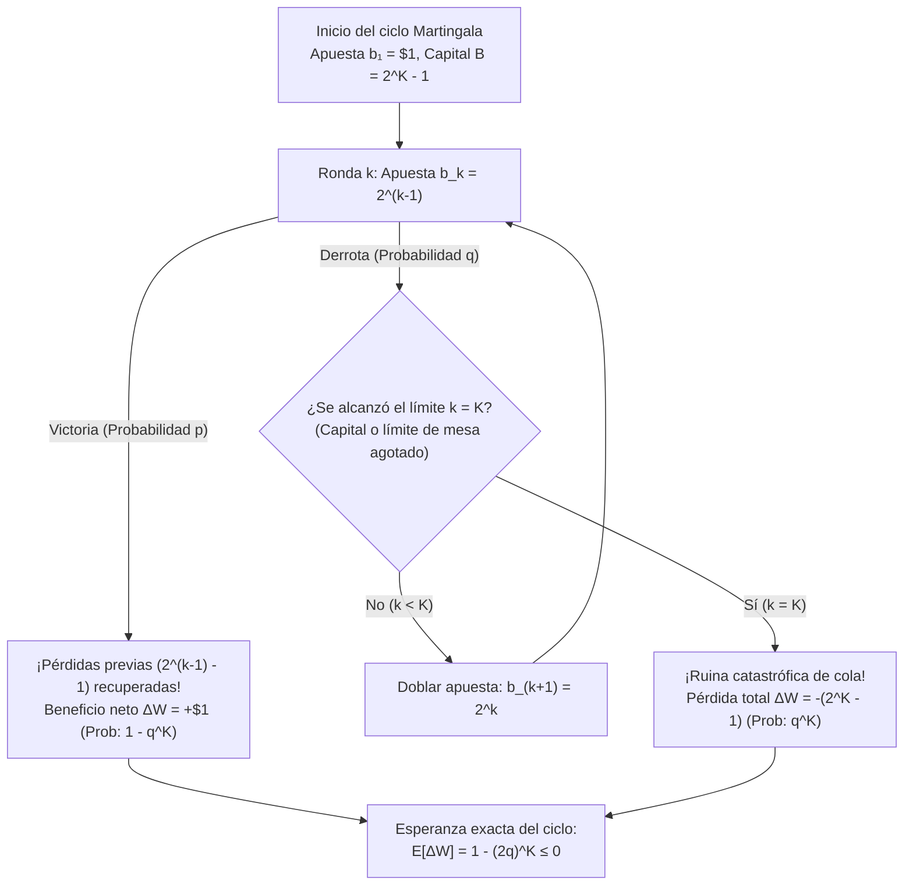
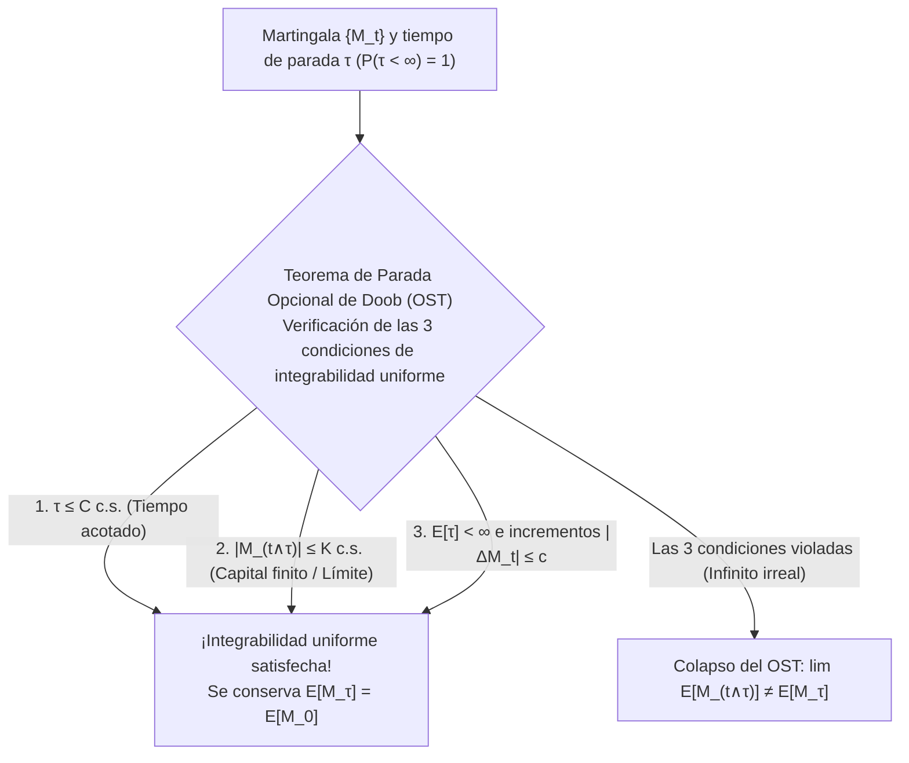

## Introducción: El seductor mito de los casinos del siglo XVIII

En 1754, en los salones de Venecia, <strong>Giacomo Casanova</strong> intentó vencer al juego de cartas *Faro* utilizando la estrategia de doblar la apuesta tras cada derrota (<strong>sistema Martingala</strong>). Tras empeñar los diamantes de su amante, una racha adversa le hizo perder 5.000 cequíes en una sola tarde. En 1891, <strong>Charles Wells</strong> («el hombre que quebró la banca en Montecarlo») vivió un espejismo similar en la ruleta antes de perder toda su fortuna y morir en la indigencia en París en 1922.

En un juego binario con pago $1:1$, probabilidad de éxito $p \in (0, 1)$ y de fracaso $q = 1 - p$, el jugador apuesta $\$1$ en la ronda $1$ y duplica la apuesta tras cada pérdida: $\$2, \$4, \dots, \$2^{k-1}$. En el instante en que logra su primera victoria en la ronda $k$, su beneficio neto es:

$$\Delta W = 2^{k-1} - \sum_{j=0}^{k-2} 2^j = 2^{k-1} - (2^{k-1} - 1) = +\$1$$

Como la probabilidad de perder para siempre es $\lim_{k \to \infty} q^k = 0$, ¡parece una máquina garantizada de ganar $+\$1$ con probabilidad $1$! ¿Por qué colapsa en la realidad?

---

## 1. La trampa del capital finito y la «apisonadora» de Taleb

Todo jugador real posee un capital finito $B$ (o se enfrenta al límite de mesa del casino) que soporta a lo sumo $K$ derrotas consecutivas, requiriendo un capital acumulado de:

$$B_K = \sum_{j=0}^{K-1} 2^j = 2^K - 1$$

En un solo ciclo existen únicamente dos resultados posibles: ganar $+\$1$ con probabilidad $1 - q^K$, o sufrir una ruina catastrófica de $-\$(2^K - 1)$ con probabilidad $q^K$. El valor esperado exacto $\mathbb{E}[\Delta W]$ es:

$$\mathbb{E}[\Delta W] = 1 \cdot (1 - q^K) - (2^K - 1) q^K = 1 - (2q)^K \le 0 \quad \left(\text{para } q \ge \frac{1}{2}\right)$$

- <strong>Juego justo ($p = q = 1/2$)</strong>: $2q = 1 \implies \mathbb{E}[\Delta W] = 0$ para cualquier $K$, mientras que la apuesta máxima esperada sin límite es infinita: $\mathbb{E}[2^{\tau-1}] = \sum_{k=1}^\infty 2^{k-1}(1/2)^k = \infty$.
- <strong>Juego con ventaja de la casa ($q > 1/2$)</strong>: $2q > 1 \implies \mathbb{E}[\Delta W] = 1 - (2q)^K < 0$, empeorando exponencialmente cuanto mayor sea tu capital $K$.

Esto transforma un paseo aleatorio suave en lo que <strong>Nassim Nicholas Taleb</strong> denomina <strong>«recoger centavos frente a una apisonadora»</strong> (asimetría negativa extrema / riesgo de cola).

| Racha de derrotas $k$ | Apuesta $b_k = 2^{k-1}$ | Capital requerido $B_k = 2^k - 1$ | Beneficio al ganar | Probabilidad $q^k$ (Moneda $q=0.5$) | Probabilidad $q^k$ (Ruleta $q=19/37$) |
| :--- | :--- | :--- | :--- | :--- | :--- |
| $k = 1$ | $\$1$ | $\$1$ | $+\$1$ | $50,000\%$ | $51,351\%$ |
| $k = 5$ | $\$16$ | $\$31$ | $+\$1$ | $3,125\%$ | $3,570\%$ |
| $k = 10$ | $\$512$ | $\$1.023$ | $+\$1$ | $0,098\%$ ($1$ en $1.024$) | $0,128\%$ ($1$ en $784$) |
| $k = 20$ | $\$524.288$ | $\$1.048.575$ | $+\$1$ | $0,000095\%$ | $0,000163\%$ |

---

## 2. El problema de la ruina del jugador de Huygens y Pascal (1657)

Si un jugador empieza con $k$ unidades frente a un casino con $N - k$ unidades (barreras absorbentes en $0$ y $N$), apostando $1$ unidad por turno, la probabilidad de alcanzar $N$ antes de arruinarse en $0$, $P_k = \mathbb{P}(X_\tau = N \mid X_0 = k)$, satisface la ecuación en diferencias lineal de segundo orden:

$$P_k = p P_{k+1} + q P_{k-1}, \qquad P_0 = 0, \quad P_N = 1$$

Mediante la suma telescópica de $P_{j+1} - P_j = (q/p)^j P_1$, obtenemos las soluciones exactas:

$$P_k = \begin{cases} \dfrac{k}{N} & \text{si } p = q = \dfrac{1}{2} \;\text{(Juego justo)} \\[10pt] \dfrac{1 - (q/p)^k}{1 - (q/p)^N} & \text{si } p \ne q \;\text{(Juego sesgado)} \end{cases}$$

### Consecuencias devastadoras:
1. <strong>Ruina del 100% frente a un casino infinitamente rico ($N \to \infty$)</strong>:
   Incluso en un <strong>juego 100% justo ($p = 1/2$)</strong>, la probabilidad de ruina eventual es $\lim_{N \to \infty} (1 - k/N) = 1$ (<strong>ruina segura al 100%</strong>).
2. <strong>El muro exponencial en la ruleta</strong>:
   Intentar duplicar $k = \$100$ a $N = \$200$ mediante apuestas de $\$1$ da $P_{100} = \frac{1}{1 + (q/p)^{100}}$. En la ruleta europea ($p = 18/37$), el éxito es de solo $0,448\%$ ($99,55\%$ de ruina; con apuestas de $\$0,50$ es del <strong>$99,998\%$</strong>), y en la ruleta americana ($p = 18/38, q/p = 10/9$), ¡fracasa con una probabilidad del <strong>$99,997\%$</strong>! Por el teorema de <strong>Dubins y Savage (1965)</strong>, el juego audaz (*Bold Play*) es óptimo cuando $p < 1/2$.

---

## 3. Teoría de martingalas de Lévy y Doob y el Teorema de Parada Opcional

Dada una filtración $\{\mathcal{F}_t\}_{t \ge 0}$, un proceso adaptado integrable $\{M_t\}_{t \ge 0}$ ($\mathbb{E}[|M_t|] < \infty$) es una <strong>Martingala</strong> si $\mathbb{E}[M_{t+1} \mid \mathcal{F}_t] = M_t$, una <strong>Submartingala</strong> si $\ge M_t$, y una <strong>Supermartingala</strong> si $\le M_t$. La <strong>integral estocástica discreta (transformada de martingala)</strong> $(H \cdot M)_n = \sum_{k=1}^n H_k (M_k - M_{k-1})$ demuestra que ninguna estrategia predecible $H_k \in \mathcal{F}_{k-1}$ puede vencer a un juego justo.

El <strong>Teorema de Parada Opcional de Doob (OST)</strong> establece que para un tiempo de parada $\tau$, $\mathbb{E}[M_\tau] = \mathbb{E}[M_0]$ se cumple <strong>si y solo si</strong> $\{M_{t \wedge \tau}\}$ es uniformemente integrable, lo cual está garantizado si se cumple <strong>al menos una</strong> de estas tres condiciones:
1. $\tau$ está acotado casi seguramente ($\tau \le C < \infty$), O
2. $|M_{t \wedge \tau}| \le K < \infty$ está uniformemente acotado (capital finito), O
3. $\mathbb{E}[\tau] < \infty$ y $\mathbb{E}[|M_{t+1} - M_t| \mid \mathcal{F}_t] \le c < \infty$.

Finalmente, usando la <strong>Identidad de Wald</strong> y la martingala cuadrática $M_t = X_t^2 - t$ en el juego justo ($p = 1/2$), obtenemos al instante la <strong>duración esperada hasta la ruina</strong>:

$$\mathbb{E}[X_\tau^2 - \tau] = k^2 \implies \mathbb{E}[\tau] = k(N - k)$$

Cuando $N \to \infty$, $\mathbb{E}[\tau] = \infty$: ¡la ruina ocurre con probabilidad $1$, pero el tiempo esperado hasta arruinarse es infinito! Para $p \ne q$, la identidad de Wald arroja $\mathbb{E}[\tau] = \frac{k - N P_k}{q - p}$.
