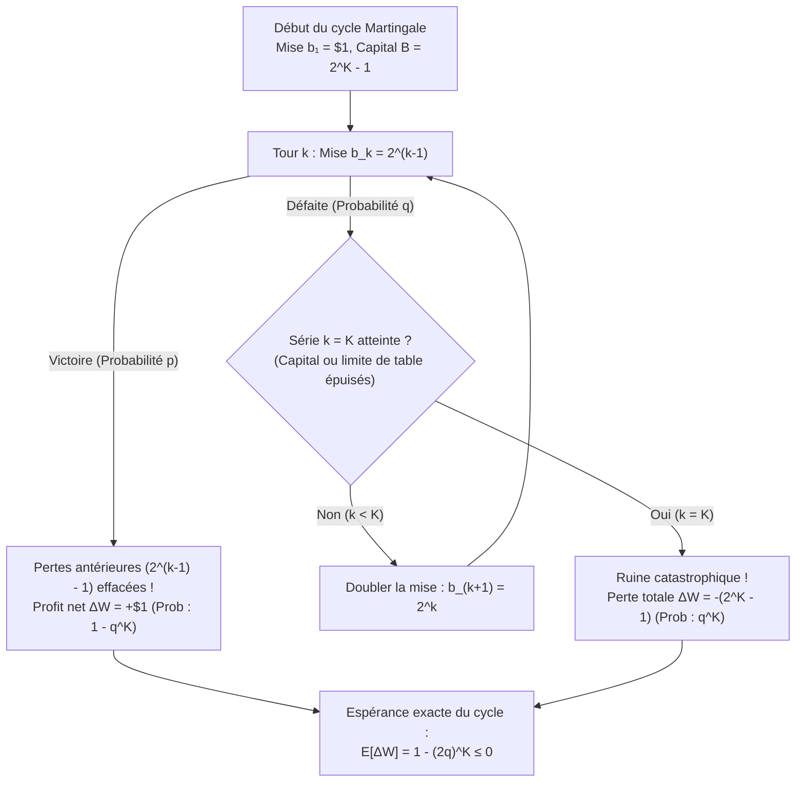
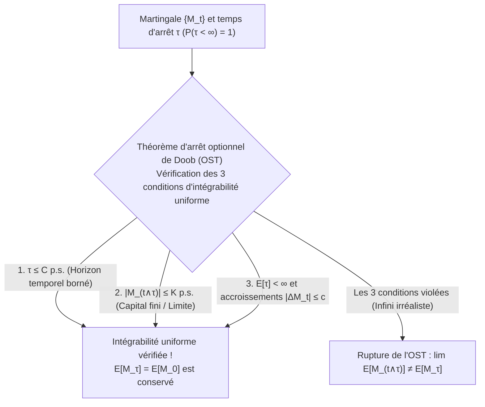

## Introduction : Le mythe séduisant des casinos du XVIIIe siècle

En 1754, dans les *ridotti* de Venise, <strong>Giacomo Casanova</strong> tenta de dompter le jeu de *Pharaon* en jouant *à la martingale* — c'est-à-dire en doublant sa mise après chaque défaite. Après avoir mis en gage les diamants de sa maîtresse, il perdit 5 000 sequins en un seul après-midi face à une série noire. En 1891, <strong>Charles Wells</strong> (« l'homme qui fit sauter la banque à Monte-Carlo ») connut une gloire éphémère similaire à la roulette avant d'être ruiné par la loi des grands nombres et de mourir sans le sou à Paris en 1922.

Pourquoi la stratégie de doublement semble-t-elle infaillible ? Dans un jeu binaire à gain égal ($1:1$) avec probabilité de gain $p \in (0, 1)$ et de perte $q = 1 - p$, le joueur mise $\$1$ au tour $1$, puis double sa mise après chaque échec : $\$2, \$4, \dots, \$2^{k-1}$. Dès la toute première victoire au tour $k$, son profit net est :

$$\Delta W = 2^{k-1} - \sum_{j=0}^{k-2} 2^j = 2^{k-1} - (2^{k-1} - 1) = +\$1$$

Puisque la probabilité de perdre éternellement est nulle ($\lim_{k \to \infty} q^k = 0$), le joueur semble assuré de gagner $+\$1$ avec probabilité $1$ ($\mathbb{P}(\tau < \infty) = 1$). Où se cache la faille ?

---

## 1. Le piège du capital fini et le « rouleau compresseur » de Taleb

Dans le monde réel, tout joueur dispose d'un capital fini $B$ et tout casino impose une mise maximale (*table limit*). Si le joueur peut supporter au plus $K$ défaites consécutives, son capital total engagé est :

$$B_K = \sum_{j=0}^{K-1} 2^j = 2^K - 1$$

Sur un cycle unique, seules deux issues sont possibles :
1. <strong>Victoire en au plus $K$ tours</strong> : probabilité $1 - q^K$, gain net $+\$1$.
2. <strong>Faillite catastrophique ($K$ défaites d'affilée)</strong> : probabilité $q^K$, perte nette $-\$(2^K - 1)$.

L'espérance mathématique exacte $\mathbb{E}[\Delta W]$ d'un cycle est donc :

$$\mathbb{E}[\Delta W] = 1 \cdot (1 - q^K) - (2^K - 1) q^K = 1 - (2q)^K \le 0 \quad \left(\text{pour } q \ge \frac{1}{2}\right)$$

- <strong>Jeu équitable ($p = q = 1/2$)</strong> : $2q = 1 \implies \mathbb{E}[\Delta W] = 1 - 1^K = 0$. Quel que soit votre capital $K$, l'espérance est strictement nulle, et la mise maximale espérée sans limite est infinie : $\mathbb{E}[2^{\tau-1}] = \sum_{k=1}^\infty 2^{k-1}(1/2)^k = +\infty$.
- <strong>Jeu de casino ($q > 1/2$)</strong> : $2q > 1 \implies \mathbb{E}[\Delta W] = 1 - (2q)^K < 0$. Plus votre capital $K$ est grand, plus votre perte espérée par cycle s'aggrave exponentiellement !

Comme l'explique <strong>Nassim Nicholas Taleb</strong>, la martingale transforme une marche aléatoire symétrique en une distribution à <strong>asymétrie négative extrême (Negative Skewness)</strong> : on « ramasse des centimes devant un rouleau compresseur ».

| Défaites consécutives $k$ | Mise $b_k = 2^{k-1}$ | Capital cumulé requis $B_k = 2^k - 1$ | Profit net si gain | Probabilité $q^k$ (Jeu juste $q=0.5$) | Probabilité $q^k$ (Roulette $q=19/37$) |
| :--- | :--- | :--- | :--- | :--- | :--- |
| $k = 1$ | $\$1$ | $\$1$ | $+\$1$ | $50,000\%$ | $51,351\%$ |
| $k = 5$ | $\$16$ | $\$31$ | $+\$1$ | $3,125\%$ | $3,570\%$ |
| $k = 10$ | $\$512$ | $\$1\,023$ | $+\$1$ | $0,098\%$ ($1$ sur $1\,024$) | $0,128\%$ ($1$ sur $784$) |
| $k = 20$ | $\$524\,288$ | $\$1\,048\,575$ | $+\$1$ | $0,000095\%$ | $0,000163\%$ |

---

## 2. Le problème de la ruine du joueur de Huygens et Pascal (1657)

Si le joueur mise prudemment $1$ unité à chaque tour en partant d'un capital $X_0 = k$ face à un casino possédant $N - k$ unités (barrières absorbantes en $0$ et $N$), la probabilité $P_k = \mathbb{P}(X_\tau = N \mid X_0 = k)$ d'atteindre $N$ avant la ruine en $0$ vérifie l'équation aux différences finies linéaire du second ordre :

$$P_k = p P_{k+1} + q P_{k-1}, \qquad P_0 = 0, \quad P_N = 1$$

En écrivant $p(P_{k+1} - P_k) = q(P_k - P_{k-1})$, on obtient par télescopage $\sum_{j=0}^{k-1} (P_{j+1} - P_j) = P_1 \sum_{j=0}^{k-1} (q/p)^j$, d'où les deux solutions exactes :

$$P_k = \begin{cases} \dfrac{k}{N} & \text{si } p = q = \dfrac{1}{2} \;\text{(Jeu équitable)} \\[10pt] \dfrac{1 - (q/p)^k}{1 - (q/p)^N} & \text{si } p \ne q \;\text{(Jeu biaisé)} \end{cases}$$

### Conséquences majeures :
1. <strong>Ruine certaine face à un casino infiniment riche ($N \to \infty$)</strong> :
   Même dans un <strong>jeu 100 % équitable ($p = 1/2$)</strong>, $\lim_{N \to \infty} (1 - k/N) = 1$ (<strong>100 % de probabilité de ruine</strong>).
2. <strong>Le mur exponentiel de la roulette</strong> :
   Pour doubler $k = \$100$ en $N = \$200$ par mises de $\$1$, $P_{100} = \frac{1}{1 + (q/p)^{100}}$. À la roulette européenne ($p = 18/37$), $P_{100} \approx 0,448\%$ ($99,55\%$ de ruine ; et <strong>$99,998\%$ de ruine</strong> avec des mises de $\$0,50$). À la roulette américaine ($p = 18/38$), la probabilité d'échec atteint <strong>$99,997\%$</strong> ! D'après le théorème de <strong>Dubins et Savage (1965)</strong>, le jeu audacieux (*Bold Play*, tout miser d'un coup) est optimal lorsque $p < 1/2$.

---

## 3. Théorie des martingales de Lévy et Doob et théorème d'arrêt optionnel

Soit $\{\mathcal{F}_t\}_{t \ge 0}$ une filtration. Un processus adapté intégrable $\{M_t\}_{t \ge 0}$ ($\mathbb{E}[|M_t|] < \infty$) est :
- une <strong>Martingale</strong> si $\mathbb{E}[M_{t+1} \mid \mathcal{F}_t] = M_t$ p.s. ;
- une <strong>Sous-martingale</strong> si $\mathbb{E}[M_{t+1} \mid \mathcal{F}_t] \ge M_t$ p.s. ;
- une <strong>Surmartingale</strong> si $\mathbb{E}[M_{t+1} \mid \mathcal{F}_t] \le M_t$ p.s.

Pour toute stratégie de mise prévisible $H_k \in \mathcal{F}_{k-1}$, l'<strong>intégrale stochastique discrète (transformée de martingale)</strong> $(H \cdot M)_n = \sum_{k=1}^n H_k (M_k - M_{k-1})$ reste une martingale ($\mathbb{E}[H_n \Delta M_n \mid \mathcal{F}_{n-1}] = H_n \cdot 0 = 0$).

Le <strong>théorème d'arrêt optionnel de Doob (OST)</strong> stipule que pour un temps d'arrêt $\tau$ fini p.s., $\mathbb{E}[M_\tau] = \mathbb{E}[M_0]$ est vérifié <strong>si et seulement si</strong> $\{M_{t \wedge \tau}\}$ est uniformément intégrable, ce qui est garanti dès qu'<strong>au moins l'une</strong> des trois conditions suivantes est satisfaite :
1. $\tau$ est borné presque sûrement ($\tau \le C < \infty$) ;
2. $|M_{t \wedge \tau}| \le K < \infty$ est uniformément borné (capital fini !) ;
3. $\mathbb{E}[\tau] < \infty$ et $\mathbb{E}[|M_{t+1} - M_t| \mid \mathcal{F}_t] \le c < \infty$.

Enfin, dans le problème de la ruine équitable ($p = 1/2$), la martingale quadratique $M_t = X_t^2 - t$ donne immédiatement par l'OST la <strong>durée espérée du jeu</strong> :

$$\mathbb{E}[X_\tau^2 - \tau] = k^2 \implies \mathbb{E}[\tau] = N^2 \left(\frac{k}{N}\right) - k^2 = k(N - k)$$

Lorsque $N \to \infty$, $\mathbb{E}[\tau] = \infty$ : la ruine est certaine à $100\%$, mais le temps moyen avant la ruine est infini ! Lorsque $p \ne q$, l'<strong>identité de Wald</strong> donne $\mathbb{E}[\tau] = \frac{k - N P_k}{q - p}$.
