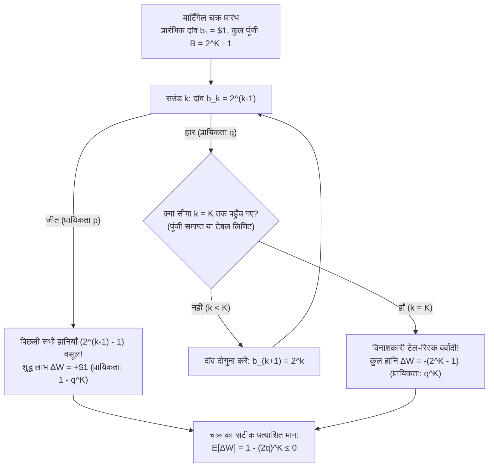
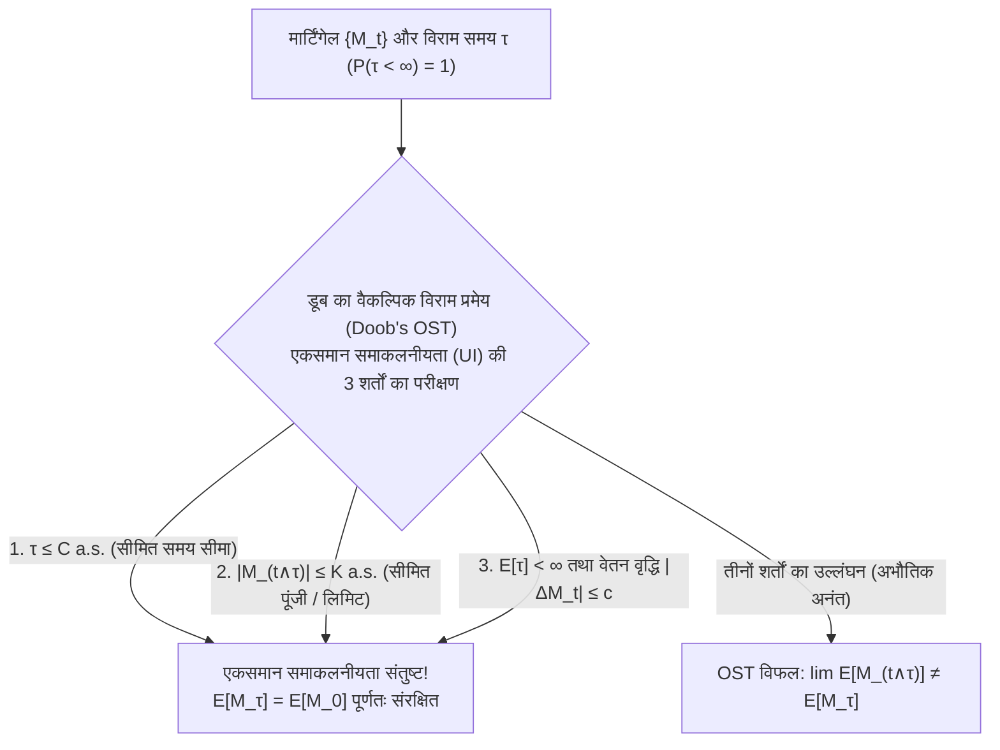

## प्रस्तावना: 18वीं सदी के कैसीनो का लुभावना मिथक

1754 में वेनिस के कैसीनो में, प्रसिद्ध साहसी और लेखक <strong>जियाकोमो कैसानोवा (Giacomo Casanova)</strong> ने हर हार के बाद अपना दांव दोगुना करने की प्रणाली (<strong>मार्टिंगेल रणनीति / Martingale Strategy</strong>) का उपयोग करके *फ़ैरो (Faro)* कार्ड गेम को हराने की कोशिश की। अपनी प्रेमिका के हीरे गिरवी रखने के बाद, लगातार हार की एक श्रृंखला ने एक ही दोपहर में उनके पूरे 5,000 स्वर्ण सिक्कों को नष्ट कर दिया। 1891 में, <strong>चार्ल्स वेल्स (Charles Wells)</strong> ("वह व्यक्ति जिसने मोंटे कार्लो में बैंक तोड़ दिया") ने रूलेट टेबल पर इसी तरह का भ्रम जिया, लेकिन अंततः अपनी सारी संपत्ति खो दी और 1922 में पेरिस में कंगाली में उनकी मृत्यु हो गई।

$1:1$ भुगतान वाले द्विआधारी खेल में, जहाँ जीतने की प्रायिकता $p \in (0, 1)$ और हारने की प्रायिकता $q = 1 - p$ है, आप पहले राउंड में $\$1$ का दांव लगाते हैं; यदि आप हारते हैं, तो आप दांव को दोगुना करके $\$2, \$4, \$8, \dots, \$2^{k-1}$ कर देते हैं। जिस क्षण आप राउंड $k$ में पहली बार जीतते हैं, आपका शुद्ध लाभ होता है:

$$\Delta W = 2^{k-1} - \sum_{j=0}^{k-2} 2^j = 2^{k-1} - (2^{k-1} - 1) = +\$1$$

चूँकि हमेशा के लिए हारते रहने की प्रायिकता $\lim_{k \to \infty} q^k = 0$ है, यह $+\$1$ कमाने की $100\%$ गारंटीकृत मशीन जैसी दिखती है! फिर वास्तविक दुनिया में यह रणनीति हमेशा क्यों ध्वस्त हो जाती है?

---

## 1. सीमित पूंजी का जाल और तालेब का "स्टीमरोलर"

प्रत्येक वास्तविक जुआरी के पास सीमित पूंजी (Bankroll) $B$ होती है (या वह कैसीनो की टेबल सीमा से बंधा होता है) जो अधिकतम $K$ लगातार हार को सहन कर सकती है, जिसके लिए आवश्यक कुल पूंजी है:

$$B_K = \sum_{j=0}^{K-1} 2^j = 2^K - 1$$

एकल चक्र में केवल दो परिणाम संभव हैं: प्रायिकता $1 - q^K$ के साथ $+\$1$ जीतना, या प्रायिकता $q^K$ के साथ $-\$(2^K - 1)$ की विनाशकारी बर्बादी झेलना। इससे सटीक प्रत्याशित मान (Expected Value) प्राप्त होता है:

$$\mathbb{E}[\Delta W] = 1 \cdot (1 - q^K) - (2^K - 1) q^K = 1 - (2q)^K \le 0 \quad \left(\text{जब } q \ge \frac{1}{2}\right)$$

- <strong>निष्पक्ष खेल ($p = q = 1/2$)</strong>: $2q = 1 \implies \mathbb{E}[\Delta W] = 0$ चाहे आपकी पूंजी $K$ कितनी भी बड़ी क्यों न हो, जबकि बिना सीमा के अपेक्षित अधिकतम दांव अनंत है: $\mathbb{E}[2^{\tau-1}] = \sum_{k=1}^\infty 2^{k-1}(1/2)^k = \infty$।
- <strong>कैसीनो खेल ($q > 1/2$)</strong>: $2q > 1 \implies \mathbb{E}[\Delta W] = 1 - (2q)^K < 0$ — आपकी पूंजी $K$ जितनी बड़ी होगी, प्रति चक्र आपकी अपेक्षित हानि घातीय रूप से उतनी ही अधिक होगी!

यह एक सामान्य यादृच्छिक भ्रमण (Random Walk) को उस स्थिति में बदल देता है जिसे <strong>नसीम निकोलस तालेब (Nassim Nicholas Taleb)</strong> <strong>"स्टीमरोलर के सामने सिक्के उठाना"</strong> (अत्यधिक ऋणात्मक विषमता / Negative Skewness) कहते हैं।

| लगातार हार $k$ | दांव $b_k = 2^{k-1}$ | आवश्यक कुल पूंजी $B_k = 2^k - 1$ | जीतने पर लाभ | प्रायिकता $q^k$ (निष्पक्ष सिक्का $q=0.5$) | प्रायिकता $q^k$ (यूरोपीय रूलेट $q=19/37$) |
| :--- | :--- | :--- | :--- | :--- | :--- |
| $k = 1$ | $\$1$ | $\$1$ | $+\$1$ | $50.000\%$ | $51.351\%$ |
| $k = 5$ | $\$16$ | $\$31$ | $+\$1$ | $3.125\%$ | $3.570\%$ |
| $k = 10$ | $\$512$ | $\$1,023$ | $+\$1$ | $0.098\%$ ($1,024$ में $1$) | $0.128\%$ ($784$ में $1$) |
| $k = 20$ | $\$524,288$ | $\$1,048,575$ | $+\$1$ | $0.000095\%$ | $0.000163\%$ |

---

## 2. ह्यूजेंस और पास्कल की 'जुआरी की बर्बादी' समस्या (1657)

एक जुआरी $k$ इकाइयों के साथ $N - k$ इकाइयों वाले कैसीनो के विरुद्ध खेल शुरू करता है ($0$ और $N$ पर अवशोषक बाधाएं), प्रायिकता $p$ के साथ $+1$ जीतता है और $q = 1 - p$ के साथ $-1$ हारता है। $0$ पर दिवालिया होने से पहले $N$ तक पहुँचने की प्रायिकता $P_k = \mathbb{P}(X_\tau = N \mid X_0 = k)$ द्वितीय-कोटि रैखिक अंतर समीकरण को संतुष्ट करती है:

$$P_k = p P_{k+1} + q P_{k-1}, \qquad P_0 = 0, \quad P_N = 1$$

टेलीस्कोपिक योग $P_{j+1} - P_j = (q/p)^j P_1$ के माध्यम से हम दोनों सटीक बंद-रूप (Closed-form) समाधान प्राप्त करते हैं:

$$P_k = \begin{cases} \dfrac{k}{N} & \text{यदि } p = q = \dfrac{1}{2} \;\text{(निष्पक्ष खेल)} \\[10pt] \dfrac{1 - (q/p)^k}{1 - (q/p)^N} & \text{यदि } p \ne q \;\text{(पक्षपाती खेल)} \end{cases}$$

### विनाशकारी परिणाम:
1. <strong>अनंत पूंजी वाले कैसीनो ($N \to \infty$) के विरुद्ध 100% निश्चित बर्बादी</strong>:
   यहाँ तक कि <strong>100% निष्पक्ष खेल ($p = 1/2$)</strong> में भी, अंततः बर्बाद होने की प्रायिकता $\lim_{N \to \infty} (1 - k/N) = 1$ (<strong>100% निश्चित दिवालियापन</strong>) है!
2. <strong>रूलेट में घातीय दीवार ($99.997\%$ विफलता दर)</strong>:
   $\$1$ के दांव से $k = \$100$ को $N = \$200$ तक दोगुना करने का प्रयास $P_{100} = \frac{1}{1 + (q/p)^{100}}$ देता है। यूरोपीय रूलेट ($p = 18/37$) में सफलता की संभावना केवल $0.448\%$ ($99.55\%$ बर्बादी; और $\$0.50$ के दांव पर <strong>$99.998\%$ बर्बादी</strong>) है, तथा अमेरिकी रूलेट ($p = 18/38, q/p = 10/9$) में यह <strong>$99.997\%$ प्रायिकता के साथ विफल</strong> हो जाता है! <strong>डबिन्स और सैवेज (1965)</strong> के प्रमेय के अनुसार, जब $p < 1/2$ हो तो *बोल्ड प्ले (Bold Play)* ही इष्टतम रणनीति है।

---

## 3. पॉल लेवी और जोसेफ डूब का मार्टिंगेल सिद्धांत तथा वैकल्पिक विराम प्रमेय (OST)

किसी फिल्ट्रेशन $\{\mathcal{F}_t\}_{t \ge 0}$ के लिए, समाकलनीय अनुकूलित प्रक्रिया $\{M_t\}_{t \ge 0}$ ($\mathbb{E}[|M_t|] < \infty$) एक <strong>मार्टिंगेल (Martingale)</strong> कहलाती है यदि $\mathbb{E}[M_{t+1} \mid \mathcal{F}_t] = M_t$, <strong>सबमार्टिंगेल (Submartingale)</strong> यदि $\ge M_t$, और <strong>सुपरमार्टिंगेल (Supermartingale)</strong> यदि $\le M_t$। <strong>असतत स्टोकेस्टिक समाकलन (मार्टिंगेल रूपांतरण)</strong> $(H \cdot M)_n = \sum_{k=1}^n H_k (M_k - M_{k-1})$ सिद्ध करता है कि कोई भी पूर्वानुमानित दांव रणनीति $H_k \in \mathcal{F}_{k-1}$ निष्पक्ष खेल को नहीं हरा सकती।

<strong>डूब का वैकल्पिक विराम प्रमेय (Doob's Optional Stopping Theorem, OST)</strong>: किसी विराम समय (Stopping Time) $\tau$ के लिए, $\mathbb{E}[M_\tau] = \mathbb{E}[M_0]$ <strong>तभी और केवल तभी</strong> सत्य होता है जब $\{M_{t \wedge \tau}\}$ एकसमान समाकलनीय (Uniformly Integrable) हो, जिसकी गारंटी तब होती है जब निम्नलिखित <strong>तीन पर्याप्त शर्तों में से कम से कम एक</strong> पूरी हो:
1. $\tau$ लगभग निश्चित रूप से परिबद्ध हो ($\tau \le C < \infty$), या
2. $|M_{t \wedge \tau}| \le K < \infty$ एकसमान रूप से परिबद्ध हो (सीमित पूंजी!), या
3. $\mathbb{E}[\tau] < \infty$ और $\mathbb{E}[|M_{t+1} - M_t| \mid \mathcal{F}_t] \le c < \infty$।

अंत में, निष्पक्ष खेल ($p = 1/2$) में <strong>वाल्ड की सर्वसमिका (Wald's Identity)</strong> और द्विघात मार्टिंगेल $M_t = X_t^2 - t$ का उपयोग करके, हम तुरंत <strong>बर्बादी तक की अपेक्षित अवधि</strong> प्राप्त करते हैं:

$$\mathbb{E}[X_\tau^2 - \tau] = k^2 \implies \mathbb{E}[\tau] = k(N - k)$$

जब $N \to \infty$, तब $\mathbb{E}[\tau] = \infty$: अर्थात् बर्बादी $100\%$ निश्चित है, लेकिन बर्बादी तक का अपेक्षित समय अनंत है! जब $p \ne q$ हो, तो वाल्ड की सर्वसमिका से $\mathbb{E}[\tau] = \frac{k - N P_k}{q - p}$ प्राप्त होता है।
