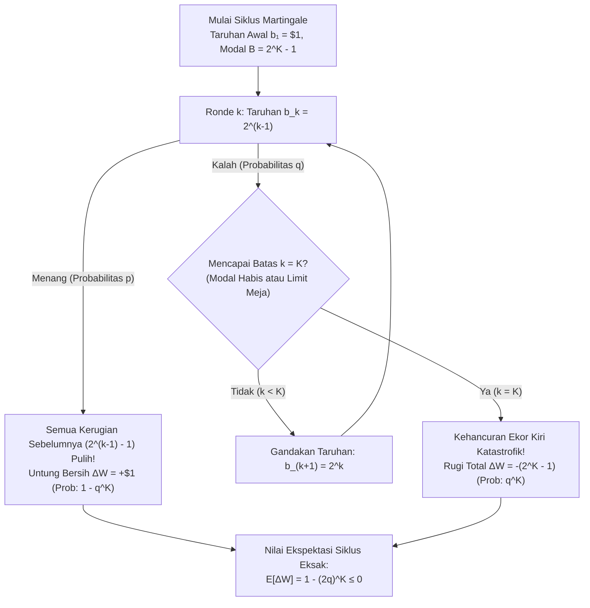
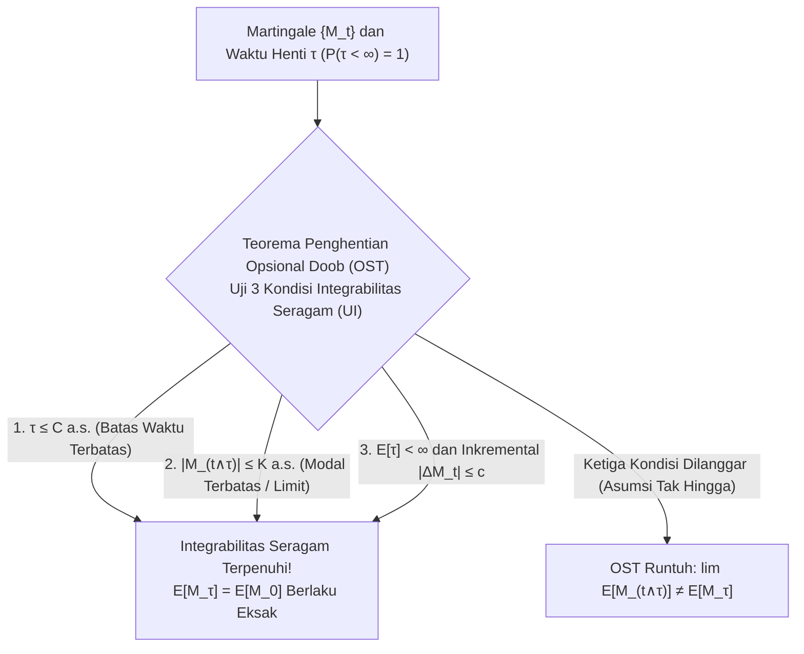

## Pendahuluan: Mitos Kasino Abad ke-18 yang Menggoda

Pada tahun 1754 di Venesia, petualang legendaris <strong>Giacomo Casanova</strong> mencoba menaklukkan permainan kartu *Faro* dengan menggandakan taruhannya setiap kali kalah (<strong>Strategi Martingale</strong>). Setelah menggadaikan berlian kekasihnya, rentetan kekalahan beruntun menghancurkan seluruh modalnya sebesar 5.000 sequin hanya dalam satu sore. Pada tahun 1891, <strong>Charles Wells</strong> ("pria yang membobol bank di Monte Carlo") mengalami ilusi serupa di meja rolet sebelum akhirnya bangkrut total dan meninggal tanpa sepeser pun di Paris pada tahun 1922.

Dalam permainan biner dengan pembayaran $1:1$, probabilitas menang $p \in (0, 1)$, dan kalah $q = 1 - p$, Anda bertaruh $\$1$ di ronde pertama; jika kalah, Anda menggandakan taruhan menjadi $\$2, \$4, \$8, \dots, \$2^{k-1}$. Saat pertama kali Anda menang pada ronde ke-$k$, keuntungan bersih Anda adalah:

$$\Delta W = 2^{k-1} - \sum_{j=0}^{k-2} 2^j = 2^{k-1} - (2^{k-1} - 1) = +\$1$$

Karena probabilitas kalah selamanya adalah $\lim_{k \to \infty} q^k = 0$, strategi ini tampak seperti mesin penghasil $+\$1$ yang pasti dengan probabilitas $1$! Mengapa strategi ini selalu hancur di dunia nyata?

---

## 1. Jebakan Modal Terbatas dan "Mesin Gilas" Taleb

Setiap penjudi di dunia nyata memiliki modal terbatas $B$ (atau dibatasi oleh batas maksimum meja kasino / *table limit*) yang hanya mampu menahan paling banyak $K$ kekalahan beruntun, sehingga membutuhkan total modal:

$$B_K = \sum_{j=0}^{K-1} 2^j = 2^K - 1$$

Dalam satu siklus, Anda menang $+\$1$ dengan probabilitas $1 - q^K$, atau mengalami kebangkrutan total $-\$(2^K - 1)$ dengan probabilitas $q^K$, menghasilkan nilai ekspektasi eksak:

$$\mathbb{E}[\Delta W] = 1 \cdot (1 - q^K) - (2^K - 1) q^K = 1 - (2q)^K \le 0 \quad \left(\text{untuk } q \ge \frac{1}{2}\right)$$

- <strong>Permainan Adil ($p = q = 1/2$)</strong>: $2q = 1 \implies \mathbb{E}[\Delta W] = 0$ untuk nilai $K$ berapa pun, sedangkan ekspektasi taruhan maksimum tanpa batas adalah tak hingga: $\mathbb{E}[2^{\tau-1}] = \sum_{k=1}^\infty 2^{k-1}(1/2)^k = \infty$.
- <strong>Permainan Kasino ($q > 1/2$)</strong>: $2q > 1 \implies \mathbb{E}[\Delta W] = 1 - (2q)^K < 0$ — semakin besar modal $K$ Anda, semakin buruk nilai ekspektasi Anda secara eksponensial!

Hal ini mengubah jalan acak biasa menjadi apa yang disebut <strong>Nassim Nicholas Taleb</strong> sebagai <strong>"memungut recehan di depan mesin gilas (steamroller)"</strong> (kemencengan negatif ekstrem / *tail risk*).

| Kekalahan Beruntun $k$ | Taruhan $b_k = 2^{k-1}$ | Modal Kumulatif $B_k = 2^k - 1$ | Untung Saat Menang | Probabilitas $q^k$ (Koin Adil $q=0.5$) | Probabilitas $q^k$ (Rolet Eropa $q=19/37$) |
| :--- | :--- | :--- | :--- | :--- | :--- |
| $k = 1$ | $\$1$ | $\$1$ | $+\$1$ | $50,000\%$ | $51,351\%$ |
| $k = 5$ | $\$16$ | $\$31$ | $+\$1$ | $3,125\%$ | $3,570\%$ |
| $k = 10$ | $\$512$ | $\$1.023$ | $+\$1$ | $0,098\%$ ($1$ dari $1.024$) | $0,128\%$ ($1$ dari $784$) |
| $k = 20$ | $\$524.288$ | $\$1.048.575$ | $+\$1$ | $0,000095\%$ | $0,000163\%$ |

---

## 2. Masalah Kehancuran Penjudi Huygens & Pascal (1657)

Seorang penjudi mulai dengan $k$ unit melawan kasino dengan $N - k$ unit (dinding penyerap di $0$ dan $N$), menang $+1$ dengan probabilitas $p$ dan kalah $-1$ dengan probabilitas $q = 1 - p$. Probabilitas mencapai target $N$ sebelum bangkrut di $0$, $P_k = \mathbb{P}(X_\tau = N \mid X_0 = k)$, memenuhi persamaan beda linier orde kedua:

$$P_k = p P_{k+1} + q P_{k-1}, \qquad P_0 = 0, \quad P_N = 1$$

Melalui deret teleskopik $P_{j+1} - P_j = (q/p)^j P_1$, kita memperoleh kedua solusi bentuk tertutup yang eksak:

$$P_k = \begin{cases} \dfrac{k}{N} & \text{jika } p = q = \dfrac{1}{2} \;\text{(Permainan Adil)} \\[10pt] \dfrac{1 - (q/p)^k}{1 - (q/p)^N} & \text{jika } p \ne q \;\text{(Permainan Bias)} \end{cases}$$

### Konsekuensi Menghancurkan:
1. <strong>Kehancuran 100% Melawan Kasino dengan Kekayaan Tak Terbatas ($N \to \infty$)</strong>:
   Bahkan dalam <strong>permainan yang 100% adil ($p = 1/2$)</strong>, probabilitas kebangkrutan pada akhirnya adalah $\lim_{N \to \infty} (1 - k/N) = 1$ (<strong>100% pasti bangkrut</strong>).
2. <strong>Dinding Eksponensial di Meja Rolet</strong>:
   Mencoba menggandakan $k = \$100$ menjadi $N = \$200$ melalui taruhan $\$1$ menghasilkan $P_{100} = \frac{1}{1 + (q/p)^{100}}$. Dalam Rolet Eropa ($p = 18/37$), peluang sukses hanya $0,448\%$ ($99,55\%$ bangkrut; dan <strong>$99,998\%$</strong> untuk taruhan $\$0,50$), sedangkan dalam Rolet Amerika ($p = 18/38, q/p = 10/9$), gagal dengan probabilitas <strong>$99,997\%$</strong>! Menurut teorema <strong>Dubins dan Savage (1965)</strong>, *Bold Play* (taruhan penuh sekaligus) adalah strategi optimal saat $p < 1/2$.

---

## 3. Teori Martingale Lévy & Doob serta Teorema Penghentian Opsional

Untuk filtrasi $\{\mathcal{F}_t\}_{t \ge 0}$, proses teradaptasi $\{M_t\}_{t \ge 0}$ dengan $\mathbb{E}[|M_t|] < \infty$ adalah <strong>Martingale</strong> jika $\mathbb{E}[M_{t+1} \mid \mathcal{F}_t] = M_t$, <strong>Submartingale</strong> ($\ge M_t$), dan <strong>Supermartingale</strong> ($\le M_t$). <strong>Integral Stokastik Diskrit (Transformasi Martingale)</strong> $(H \cdot M)_n = \sum_{k=1}^n H_k (M_k - M_{k-1})$ membuktikan bahwa Anda tidak dapat mengalahkan permainan adil dengan strategi taruhan $H_k \in \mathcal{F}_{k-1}$ secanggih apa pun.

<strong>Teorema Penghentian Opsional Doob (OST)</strong> menyatakan bahwa untuk waktu henti $\tau$, $\mathbb{E}[M_\tau] = \mathbb{E}[M_0]$ berlaku <strong>jika dan hanya jika</strong> $\{M_{t \wedge \tau}\}$ terintegralkan secara seragam, yang dijamin apabila <strong>setidaknya satu</strong> dari tiga kondisi berikut terpenuhi:
1. $\tau$ terbatas hampir pasti ($\tau \le C < \infty$), ATAU
2. $|M_{t \wedge \tau}| \le K < \infty$ terbatas secara seragam (modal terbatas!), ATAU
3. $\mathbb{E}[\tau] < \infty$ dan $\mathbb{E}[|M_{t+1} - M_t| \mid \mathcal{F}_t] \le c < \infty$.

Terakhir, melalui <strong>Identitas Wald</strong> dan martingale kuadratik $M_t = X_t^2 - t$ pada permainan adil ($p = 1/2$), kita langsung mendapatkan <strong>ekspektasi durasi permainan hingga bangkrut</strong>:

$$\mathbb{E}[X_\tau^2 - \tau] = k^2 \implies \mathbb{E}[\tau] = k(N - k)$$

Ketika $N \to \infty$, $\mathbb{E}[\tau] = \infty$: kebangkrutan pasti terjadi ($100\%$), namun rata-rata waktu menuju kebangkrutan adalah tak terhingga! Untuk $p \ne q$, Identitas Wald memberikan $\mathbb{E}[\tau] = \frac{k - N P_k}{q - p}$.
