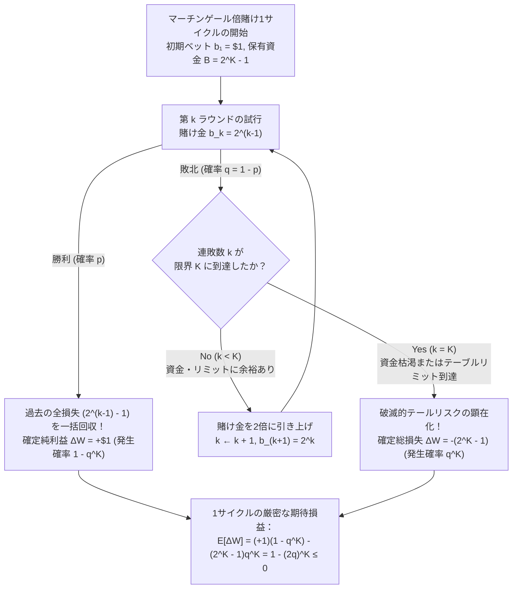
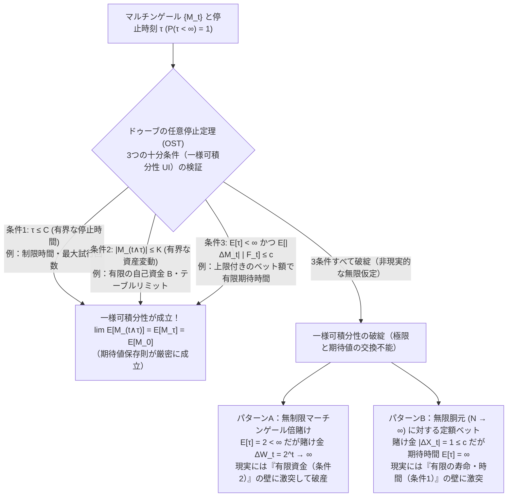

## 序論：18世紀のカジノを魅了した「絶対に負けない賭け方」の魔力

1754年のヴェネツィア。稀代の冒険家にして文筆家の<strong>ジャコモ・カサノヴァ（Giacomo Casanova）</strong>は、回想録『我が生涯の物語（*Histoire de ma vie*）』の中で、当時のヨーロッパ社交界で密かに流行していた「ある必勝法」を使ってファロ（Faro）と呼ばれるカードゲームに挑んだ顛末を記している。彼は愛人から預かったダイヤモンドを担保に莫大な資金を調達し、負けるたびに賭け金を倍に引き上げるシステム——今日<strong>「マーチンゲール法（Martingale Betting Strategy）」</strong>あるいは<strong>「倍賭け法」</strong>として知られる手法——を実践した。最初の数日間、カサノヴァは面白いように金貨を積み上げた。しかしある午後、悪魔のような連敗の波が彼を襲い、わずか数時間のうちに5,000ゼッキーノもの大金をすべて失って破産したのである。

それから1世紀以上が経過した1891年夏、モナコのモンテカルロ・カジノに現れたイギリス人山師<strong>チャールズ・ウェルズ（Charles Wells）</strong>は、ルーレットのテーブルで同じくマーチンゲール法を含む攻撃的な倍賭けを敢行し、11時間のうちに12回もテーブルの予備資金を枯渇させた（いわゆる「モンテカルロの銀行を破産させた男」）。しかし、大衆歌謡にまで歌われた彼の栄光は長くは続かなかった。翌年、さらなる大勝を目論んでカジノに戻ったウェルズは、連敗の連鎖によって全財産を失い、後年は詐欺罪で投獄された末、1922年にパリで一文無しのまま息を引き取った。

なぜ、歴史上の無数の知識人、ギャンブラー、そして現代の外国為替（FX）トレーダーやヘッジファンドに至るまで、これほどまでに多くの人間が「倍賭け法」の魔力に取り憑かれ、そして例外なく破滅してきたのだろうか？

その理由は、この戦略が持つ<strong>初等算術的なあまりにも完璧な外観</strong>にある。コイントスやルーレットの赤黒賭けのように、勝てば賭け金と同額の利益（配当1倍）が得られ、負ければ賭け金を失うゲームを考えよう。1回の試行で勝つ確率を $p \in (0, 1)$、負ける確率を $q = 1 - p$ とする。

ギャンブラーは以下の単純なアルゴリズムに従う：

1. 最初の第 $1$ ラウンドに $\$1$ を賭ける。勝てば $+\$1$ の利益を確定してゲーム（1サイクル）を終了する。
2. もし負ければ、第 $2$ ラウンドには倍の $\$2$ を賭ける。
3. 以後、負けるたびに賭け金を $\$4, \$8, \$16, \dots$ と2倍にし続け、第 $j$ ラウンドには $\$2^{j-1}$ を賭ける。
4. そして<strong>最初に勝った第 $k$ ラウンド（$k \ge 1$）で即座にサイクルを終了</strong>し、次のサイクルでは再び $\$1$ からやり直す。

いま、ギャンブラーが $k-1$ 回連続で負け続け、第 $k$ ラウンド目で初めて勝利したとしよう。
第 $1$ ラウンドから第 $k-1$ ラウンドまでの累積損失額 $L_{k-1}$ は、初項 $1$、公比 $2$ の等比数列の和であるから、

$$L_{k-1} = \sum_{j=0}^{k-2} 2^j = 2^{k-1} - 1$$

となる。一方、第 $k$ ラウンド目で賭けた金額は $\$2^{k-1}$ であり、このラウンドで勝利したことで得られる払戻金（純利益分）は $+2^{k-1}$ である。したがって、第 $k$ ラウンドで初めて勝った瞬間の<strong>通算純損益 $\Delta W$</strong> は、

$$\Delta W = 2^{k-1} - \sum_{j=0}^{k-2} 2^j = 2^{k-1} - (2^{k-1} - 1) = +\$1$$

となる！

この数式が意味する事実は驚異的である。第 $1$ ラウンドで勝とうが（$k=1$）、10連敗した後の第 $11$ ラウンドで勝とうが（$k=11$）、あるいは100連敗した後の第 $101$ ラウンドでようやく勝とうが（$k=101$）、<strong>「いつかたった1回でも勝つ瞬間が訪れさえすれば、それまでの過去のすべての累積損失は1セント残らず回収され、必ず $+\$1$ の純利益が手元に残る」</strong>のである。

さらに、永久に負け続ける（一度も勝てない）確率はどうだろうか？ 1回の試行で負ける確率は $q < 1$ であるから、$k$ 回連続で負ける確率は $q^k$ である。試行回数 $k$ を無限大へと飛ばせば、

$$\lim_{k \to \infty} \mathbb{P}(\text{最初の } k \text{ 回すべて負ける}) = \lim_{k \to \infty} q^k = 0$$

となる。すなわち、いつか必ず最初の勝利が訪れる確率は $\mathbb{P}(\tau < \infty) = 1 - 0 = 1$（確率 $1$、ほとんど確実 / almost surely）である。

「確率 $1$ でいつか勝つ瞬間が訪れ、その瞬間に必ず $+\$1$ の利益が確定する」——それならば、このサイクルを1万回繰り返せば、確実に $+\$10,000$ の資産が築けるはずではないか？

本稿では、この直感と現実の乖離に潜む数学的構造を3つの階層から徹底的に解剖する。
第1に、<strong>有限資金（Finite Bankroll）とテーブルリミット</strong>という現実の境界条件を導入したとき、マーチンゲール倍賭け法がいかにして「緩やかなランダムウォーク」を「ナシーム・ニコラス・タレブの蒸気ローラー（極端な負の歪度を持つテールリスク分布）」へと変貌させるかを証明する。
第2に、クリスティアーン・ホイヘンスとブレーズ・パスカルに端を発する<strong>「ギャンブラーの破産問題（Gambler's Ruin Problem）」</strong>を定式化し、2階線形差分方程式（吸収壁マルコフ連鎖）を厳密に解くことで、「無限の資金を持つカジノを相手にしたとき、たとえ勝率50%の完全に公平なゲームであってもギャンブラーは確率100%で破産する」という衝撃の定理を導く。
そして第3に、20世紀の確率論者<strong>ポール・レヴィ（Paul Lévy）</strong>と<strong>ジョセフ・レオ・ドゥーブ（Joseph Leo Doob）</strong>が構築した測度論的確率過程の最高峰<strong>「マルチンゲール理論（Martingale Theory）」</strong>および<strong>「ドゥーブの任意停止定理（Doob's Optional Stopping Theorem）」</strong>を導入し、「なぜ期待値ゼロの公平なゲームから、ランダムな停止時刻 $\tau$ を選ぶことで見かけ上の正の期待値 $\mathbb{E}[W_\tau] = +1 > 0$ が生み出されてしまうのか」というパラドックスの根源を、<strong>一様可積分性（Uniform Integrability）の破綻</strong>という観点から完全に解決する。

---

## 第1章：マーチンゲール倍賭け法の解剖——有限資金の壁と「蒸気ローラーの前の小銭拾い」

### 1.1 指数関数的に膨張する所要資金とカジノのテーブルリミット

序論で見た「確率 $1$ で $+\$1$ を得る」という議論には、暗黙のうちに<strong>「ギャンブラーが無限の資金（$B = \infty$）を持っており、かつカジノ側が無限大の賭け金（$b_k \to \infty$）を受け入れる」</strong>という非現実的な仮定が紛れ込んでいる。

現実の世界では、いかなる個人投資家も、いかなる巨大ヘッジファンドも有限の資金しか持たず、また世界中のすべてのカジノのテーブルには必ず<strong>最大ベット額の制限（テーブルリミット、Table Limit）</strong>が設けられている。カジノがルーレットに「最小ベット $\$1$、最大ベット $\$1,000$」という制限を設けているのは、単なるハウスリスク管理のためだけではなく、<strong>マーチンゲール倍賭け法を数学的に封殺するための防壁</strong>なのである。

いま、ギャンブラーが最大で <strong>$K$ 回までの連続ベット</strong>に耐えられる資金（あるいはテーブルリミット）しか持っていないとしよう。第 $K$ ラウンドの賭け金 $2^{K-1}$ をテーブルに置くために必要な<strong>初期総資金（Required Bankroll）$B_K$</strong> は、第 $1$ ラウンドから第 $K$ ラウンドまでの賭け金の総和である：

$$B_K = \sum_{j=0}^{K-1} 2^j = 2^K - 1$$

たった $\$1$ の利益を守るために、連敗数 $k$ に応じて必要となる賭け金と累積資金がどれほど爆発的に増加するかを以下の表で確認しよう。ここでは公平なコイントス（$p = q = 0.5$）と、ヨーロピアン・ルーレットの赤黒賭け（緑の「0」が1つ存在するため、勝率 $p = 18/37 \approx 0.4865$、敗率 $q = 19/37 \approx 0.5135$）の両方について $k$ 連敗の発生確率 $q^k$ を示している。

| 連敗ラウンド $k$ | 第 $k$ 回目のベット額 $b_k = 2^{k-1}$ | 必要な累積総資金 $B_k = 2^k - 1$ | 勝った場合の純利益 | $k$ 連敗する確率（公平 $q=0.5$） | $k$ 連敗する確率（ルーレット $q=19/37$） |
| :--- | :--- | :--- | :--- | :--- | :--- |
| $k = 1$ | $\$1$ | $\$1$ | $+\$1$ | $50.000\%$ | $51.351\%$ |
| $k = 3$ | $\$4$ | $\$7$ | $+\$1$ | $12.500\%$ | $13.541\%$ |
| $k = 5$ | $\$16$ | $\$31$ | $+\$1$ | $3.125\%$ | $3.570\%$ |
| $k = 10$ | $\$512$ | $\$1,023$ | $+\$1$ | $0.098\%$ (約1,024回に1回) | $0.128\%$ (約784回に1回) |
| $k = 15$ | $\$16,384$ | $\$32,767$ | $+\$1$ | $0.00305\%$ (約3.3万回に1回) | $0.00456\%$ (約2.2万回に1回) |
| $k = 20$ | $\$524,288$ | $\$1,048,575$ | $+\$1$ | $0.000095\%$ (約105万回に1回) | $0.000163\%$ (約61万回に1回) |
| $k = 30$ | $\$536,870,912$ | $\$1,073,741,823$ | $+\$1$ | $9.31 \times 10^{-10}$ | $2.09 \times 10^{-9}$ |

この表が突きつける現実は冷酷である。
わずか $K = 10$ 回目の賭け（$\$512$）まで耐えるためだけでも、ギャンブラーは $\$1,023$ の資金を用意しなければならない。そしてルーレットにおいて10連敗する確率は $q^{10} = (19/37)^{10} \approx 0.1276\%$、すなわち<strong>約784サイクルに1回</strong>の頻度で確実に発生する。1時間に50スピン回るルーレットであれば、わずか十数時間プレイするうちに10連敗の直撃を受ける計算になる。そして20連敗まで耐えようとすれば、<strong>たった $\$1$ を稼ぐために約105万ドル（約1億5千万円）の担保資金</strong>をテーブルに晒さなければならないのである！

### 1.2 有限資金 $B = 2^K - 1$ の下での厳密な期待値計算

では、最大 $K$ 連敗までの耐久力（初期資金 $B = 2^K - 1$ 単位）を持つギャンブラーが、1サイクルのマーチンゲール倍賭けを行ったときの<strong>純損益 $\Delta W$ の期待値 $\mathbb{E}[\Delta W]$</strong> を厳密に計算してみよう。

1サイクルの試行において起こり得る事象は、以下の排反な2通りしかない：

1. <strong>成功（第 $1$ ラウンドから第 $K$ ラウンドまでのどこかで1回勝つ）</strong>：
   これは「$K$ 回すべて負ける」という事象の余事象であるから、その発生確率は $1 - q^K$ である。このとき得られる純利益は常に $+\$1$ である。
2. <strong>破滅的破産（$K$ 回連続で負けて資金 $B = 2^K - 1$ が完全に枯渇する、あるいはテーブルリミットに達して次の倍賭けができなくなる）</strong>：
   その発生確率は $q^K$ である。このときギャンブラーが失う金額は $-\$(2^K - 1)$ である。

したがって、1サイクルあたりの純損益 $\Delta W$ の期待値 $\mathbb{E}[\Delta W]$ は次のように求まる：

$$\mathbb{E}[\Delta W] = (+1) \cdot (1 - q^K) + \left(-(2^K - 1)\right) \cdot q^K$$

右辺を展開して整理すると、$q^K$ の項が相殺され、極めて美しい閉じた式（Closed-form expression）が得られる：

$$\mathbb{E}[\Delta W] = 1 - q^K - 2^K q^K + q^K = 1 - (2q)^K \le 0 \quad \left(\text{for } q \ge \frac{1}{2}\right)$$

この決定的な公式 $\mathbb{E}[\Delta W] = 1 - (2q)^K$ を、ゲームの有利・不利（$q$ の値）に応じて詳しく吟味しよう。

#### ケース1：完全に公平なゲーム（$p = q = 1/2$）の場合
コイントスのようにハウスエッジ（控除率）がゼロの公平なゲームでは、$q = 1/2$ であるから $2q = 1$ となる。したがって、

$$\mathbb{E}[\Delta W] = 1 - 1^K = 0$$

となる！ すなわち、あなたが $K = 5$（資金 $\$31$）で挑もうが、$K = 20$（資金 $\$1,048,575$）で挑もうが、あるいは国家予算規模の資金 $K = 50$ を用意しようが、<strong>有限の上限 $K$ が存在する限り、勝率 $99.9999\%$ で得られる $+\$1$ の利益と、確率 $0.0001\%$ で被る巨額の破産損失 $-\$(2^K - 1)$ は寸分の狂いもなく完全に相殺され、期待値は厳密にゼロ（$\mathbb{E}[\Delta W] = 0$）になる</strong>のである。

#### ケース2：カジノ側が有利なゲーム（$p < 1/2 \iff q > 1/2$）の場合
ルーレットやバカラなど、現実のすべてのカジノゲームや取引コストが存在する金融市場では $q > 1/2$ であり、したがって $2q > 1$ である。このとき、

$$\mathbb{E}[\Delta W] = 1 - (2q)^K < 0$$

となるだけでなく、驚くべきことに<strong>「耐久できる連敗上限 $K$（すなわち初期資金 $B = 2^K - 1$）を大きくすればするほど、1サイクルあたりの期待損失額 $\mathbb{E}[\Delta W]$ は指数関数的に悪化する」</strong>という逆説的な事実が導かれる！

なぜ資金を増やして破産確率 $q^K$ を下げたはずなのに、期待値はむしろマイナス方向へ発散するのだろうか？
その理由は、1サイクル中にギャンブラーがテーブルに投じる<strong>「総ベット額（Total Action / Turnover）$S_K$ の期待値」</strong>を計算すれば一目で理解できる。第 $j$ ラウンド（$1 \le j \le K$）が実行されるのは、最初の $j-1$ ラウンドにすべて負けた場合（確率 $q^{j-1}$）に限られ、そのときのベット額は $2^{j-1}$ であるから、1サイクルあたりの期待総ベット額 $\mathbb{E}[S_K]$ は、

$$\mathbb{E}[S_K] = \sum_{j=1}^K 2^{j-1} q^{j-1} = \sum_{j=0}^{K-1} (2q)^j = \frac{(2q)^K - 1}{2q - 1}$$

となる。ギャンブラーが賭ける1ドルごとに、カジノは期待値として $(q - p) = 2q - 1$ のハウスエッジ（通行料）を徴収する。したがって、1サイクル全体の期待損益は「1ドルあたりの期待収益 $(p - q) = -(2q - 1)$」に「期待総ベット額 $\mathbb{E}[S_K]$」を掛けたものに等しく、

$$\mathbb{E}[\Delta W] = -(2q - 1) \cdot \mathbb{E}[S_K] = -(2q - 1) \cdot \frac{(2q)^K - 1}{2q - 1} = 1 - (2q)^K$$

と見事に一致する！
具体例として、ヨーロピアン・ルーレット（$q = 19/37 \implies 2q = 38/37 \approx 1.027027$）を考えよう。
- フラットベットで単に $\$1$ を1回だけ賭ける場合（$K = 1$）：期待値は $\mathbb{E}[\Delta W] = 1 - 38/37 = -1/37 \approx -\$0.027$（約 $-2.7$ セント）である。
- ところが、$\$1,023$ の資金を用意して $K = 10$ のマーチンゲール倍賭けを行った場合：1サイクルの期待値は $\mathbb{E}[\Delta W] = 1 - (38/37)^{10} \approx 1 - 1.3056 = -\$0.3056$（約 $-30.6$ セント）へと<strong>11倍以上に悪化</strong>する！
- さらに $\$1,048,575$ の資金を用意して $K = 20$ のマーチンゲール倍賭けを行った場合：1サイクルの期待値は $\mathbb{E}[\Delta W] = 1 - (38/37)^{20} \approx 1 - 1.7046 = -\$0.7046$（約 $-70.5$ セント）へと膨れ上がるのである。

### 1.3 必要資金の期待値は無限大であり、「蒸気ローラーの前で小銭を拾う」歪度変換に過ぎない

さらに、仮に資金制限もテーブルリミットも存在しない理想郷（$K = \infty$）を想像してみよう。公平なゲーム（$p = q = 1/2$）において、最初に勝つ停止時刻を $\tau = \inf\{k \ge 1 : \xi_k = +1\}$ とする。このとき、あなたが $+\$1$ を勝ち取るために最後にテーブルに置かなければならない<strong>最大ベット額 $b_\tau = 2^{\tau - 1}$ の期待値</strong>はどうなるだろうか？

幾何分布に従う停止時刻 $\tau$ が $\tau = k$ となる確率は $\mathbb{P}(\tau = k) = (1/2)^k$ であるから、

$$\mathbb{E}[b_\tau] = \sum_{k=1}^{\infty} 2^{k-1} \mathbb{P}(\tau = k) = \sum_{k=1}^{\infty} 2^{k-1} \left(\frac{1}{2}\right)^k = \sum_{k=1}^{\infty} \frac{1}{2} = \frac{1}{2} + \frac{1}{2} + \frac{1}{2} + \cdots = +\infty$$

となる。つまり、たとえ確実に $+\$1$ が手に入るとしても、その $+\$1$ を得るためにあなたが覚悟しなければならない<strong>期待最大リスク資金は無限大（$\mathbb{E}[b_\tau] = \infty$）</strong>なのである（これはダニエル・ベルヌーイが1738年に提唱した<strong>「サンクトペテルブルクのパラドックス（St. Petersburg Paradox）」</strong>の双対問題に他ならない）。

数理ファイナンスおよび統計学の視点から言えば、マーチンゲール倍賭け法とは、確率過程の「期待値（第1モーメント）」を改善する魔法ではなく、確率分布の<strong>「歪度（Skewness、第3中心モーメント）」を極端に負の方向へ歪める非線形変換</strong>に過ぎない。

本来、フラットベット（毎回一定額を賭ける戦略）であれば、損益分布は左右対称な正規分布（ガウス分布）に漸近する穏やかなランダムウォークを描く。しかしマーチンゲール倍賭け法を適用すると、分布の99.9%の確率質量が「$+\$1$ の微小な利益」に凝縮される一方で、残り0.1%の左裾（Left Tail）に「全財産喪失 $-\$(2^K - 1)$」という破滅的な特異点が形成される。

『ブラック・スワン』の著者でありオプション・トレーダーの<strong>ナシーム・ニコラス・タレブ（Nassim Nicholas Taleb）</strong>は、このような強い負の歪度（Negative Skewness）を持つ戦略を<strong>「蒸気ローラーの前で小銭を拾うようなもの（Picking up pennies in front of a steamroller）」</strong>と呼んで痛烈に批判した。普段は毎日コツコツと小銭（$+\$1$）を拾い続けるため、運用成績グラフは右肩上がりの直線を描き、シャープレシオ（平均リターン÷標準偏差）は見かけ上極めて高く見える。しかし、ひとたびテールイベント（$K$ 連敗）が到来すれば、蒸気ローラーに轢き潰されてそれまでに積み上げた利益の数百倍〜数万倍の資産を一瞬で失う。1995年にニック・リーソンが日経225先物のショート・ストラドル（損失が出るたびにポジションを倍増させるナンピン買い）によって英国の名門ベアリングス銀行を破綻させた事件も、1998年にノーベル経済学賞受賞者らを擁した巨大ヘッジファンド LTCM（ロングターム・キャピタル・マネジメント）がロシア財政危機で破綻した事件も、その数学的本質はすべてこの $1 - (2q)^K$ のテールリスク構造に帰着するのである。

---

## 第2章：ホイヘンスとパスカルの「ギャンブラーの破産問題（1657年）」——吸収壁ランダムウォークと厳密解の導出

### 2.1 歴史的背景と吸収壁マルコフ連鎖としての定式化

では、「無謀な倍賭け（マーチンゲール法）さえ使わず、毎回コツコツと一定額（$\$1$ 単位）だけを堅実に賭け続ければ、破産せずに目標金額へ到達できるのではないか？」という疑問が当然湧き上がるだろう。
この問いに完璧な数学的解答を与えるのが、確率論の歴史において最も古く、かつ最も重要な問題の一つである<strong>「ギャンブラーの破産問題（Gambler's Ruin Problem）」</strong>である。

1654年のパスカル（Blaise Pascal）とフェルマー（Pierre de Fermat）の往復書簡によって確率論が誕生した直後の1656年、パスカルは友人のカルカヴィを通じてオランダの物理学者・数学者<strong>クリスティアーン・ホイヘンス（Christiaan Huygens）</strong>に「2人のプレイヤーがサイコロを振ってポイントを奪い合い、どちらかが先に全ポイントを失うまでの勝敗確率」に関する問題を提示した。ホイヘンスは1657年に発表した世界初の確率論の教科書『サイコロ遊びにおける推論について（*De ratiociniis in ludo aleae*）』の巻末に掲げた「5つの未解決問題」の第5問としてこれを収録し、後に<strong>ヤコブ・ベルヌーイ（Jacob Bernoulli）</strong>の『推論術（*Ars Conjectandi*, 1713年）』および<strong>アブラハム・ド・モアブル（Abraham de Moivre）</strong>の『偶然の教義（*The Doctrine of Chances*, 1711/1718年）』によって一般解が完成された。

問題を現代の確率過程論（離散時間マルコフ連鎖）の言葉で厳密に定式化しよう。

- ギャンブラー（プレイヤーA）は初期資金 $X_0 = k$ 単位（ドル）を持ってゲームを開始する。
- 対戦相手であるカジノ（ハウス、プレイヤーB）は初期資金 $N - k$ 単位を持っている。したがって、両者の資金の総和は常に一定値 $N$ 単位（$0 < k < N$）に保たれる閉じた系である。
- 各離散時刻 $t = 1, 2, 3, \dots$ において、独立同一分布（i.i.d.）に従う確率変数 $\xi_t$ により、ギャンブラーは確率 $p$ で $+1$ 単位を獲得し（カジノが $-1$ 単位を失う）、確率 $q = 1 - p$ で $-1$ 単位を失う（カジノが $+1$ 単位を獲得する）：

$$X_t = X_{t-1} + \xi_t, \qquad \mathbb{P}(\xi_t = +1) = p, \quad \mathbb{P}(\xi_t = -1) = q = 1 - p$$

- ゲームは、ギャンブラーの資産 $X_t$ が以下の2つの<strong>吸収壁（Absorbing Barriers）</strong>のいずれかに到達した瞬間の停止時刻 $\tau = \inf\{t \ge 0 : X_t \in \{0, N\}\}$ で終了する：
  - <strong>$X_\tau = 0$</strong>：ギャンブラーの資金が尽きて破産する（<strong>ギャンブラーの破産 / Gambler's Ruin</strong>）。
  - <strong>$X_\tau = N$</strong>：カジノの資金をすべて奪い取り、ギャンブラーが目標金額 $N$ に到達して勝利する（<strong>目標達成 / Casino's Ruin</strong>）。

いま求めたいのは、初期資金 $k$ から出発したギャンブラーが、破産（$0$）する前に目標金額 $N$ に到達して勝利する確率

$$P_k = \mathbb{P}(X_\tau = N \mid X_0 = k) \qquad (0 \le k \le N)$$

および、破産する確率 $R_k = \mathbb{P}(X_\tau = 0 \mid X_0 = k) = 1 - P_k$ の厳密解である。

### 2.2 2階線形差分方程式の構築と厳密解の導出

初期状態 $X_0 = k$（ただし $1 \le k \le N - 1$）にあるギャンブラーが最初の1ステップ（第 $1$ ラウンド）をプレイした直後の状態に条件付けを行う（<strong>第1ステップ解析 / First-Step Analysis</strong>）。
全確率の公式（Law of Total Probability）とマルコフ性（Markov Property：将来の到達確率は現在の資産額のみに依存し、過去の経路には依存しない）を用いると、

1. 最初の1ステップで勝った場合（確率 $p$）：保有資産は $k + 1$ となり、そこからの勝利確率は $P_{k+1}$ となる。
2. 最初の1ステップで負けた場合（確率 $q$）：保有資産は $k - 1$ となり、そこからの勝利確率は $P_{k-1}$ となる。

したがって、数列 $\{P_k\}_{k=0}^N$ は以下の<strong>定数係数2階斉次線形差分方程式（Second-Order Homogeneous Linear Difference Equation）</strong>を満たす：

$$P_k = p P_{k+1} + q P_{k-1} \qquad (1 \le k \le N - 1)$$

また、吸収壁における<strong>境界条件（Boundary Conditions）</strong>は定義より明らかに、

$$P_0 = 0, \qquad P_N = 1$$

である（最初から資金が $0$ なら勝利確率は $0$ であり、最初から資金が $N$ に達していれば既に勝利しているので確率は $1$ である）。

この差分方程式を、階差数列の望遠鏡和（Telescoping Sum）を用いて一歩ずつ厳密に解こう。
まず、$p + q = 1$ であることを利用して、左辺の $P_k$ を $(p + q) P_k$ と書き換える：

$$(p + q) P_k = p P_{k+1} + q P_{k-1}$$

項を移項して $p$ と $q$ でまとめると、

$$p (P_{k+1} - P_k) = q (P_k - P_{k-1}) \implies P_{k+1} - P_k = \left(\frac{q}{p}\right) (P_k - P_{k-1})$$

が得られる。ここで隣接項の階差を $\Delta_k = P_{k+1} - P_k$ と置けば、$\Delta_k = (q/p) \Delta_{k-1}$ という公比 $r = q/p$ の等比数列になっている！
したがって、$k = 1, 2, \dots$ に対して帰納的に適用し、境界条件 $P_0 = 0$ を代入すると、

$$\begin{aligned}
P_2 - P_1 &= \left(\frac{q}{p}\right) (P_1 - P_0) = \left(\frac{q}{p}\right) P_1 \\
P_3 - P_2 &= \left(\frac{q}{p}\right) (P_2 - P_1) = \left(\frac{q}{p}\right)^2 P_1 \\
&\;\;\vdots \\
P_{j+1} - P_j &= \left(\frac{q}{p}\right)^j P_1
\end{aligned}$$

となる。この式の両辺を $j = 0$ から $j = k - 1$ まで足し合わせる（望遠鏡和をとる）と、左辺の中間項がすべて綺麗に打ち消し合い、

$$P_k - P_0 = \sum_{j=0}^{k-1} (P_{j+1} - P_j) = P_1 \sum_{j=0}^{k-1} \left(\frac{q}{p}\right)^j$$

となる。$P_0 = 0$ であるから、あとは右辺の等比級数の和を、公比 $q/p = 1$ の場合と $q/p \ne 1$ の場合の2つに場合分けして計算すればよい。

#### 場合分け1：公平なゲーム（$p = q = 1/2 \iff q/p = 1$）のとき
公比が $q/p = 1$ であるから、右辺の和は単に $1$ を $k$ 個足し合わせたものになる：

$$P_k = P_1 \sum_{j=0}^{k-1} 1^j = k P_1$$

ここに上端の境界条件 $P_N = 1$（$k = N$）を代入すると、

$$1 = P_N = N P_1 \implies P_1 = \frac{1}{N}$$

となり、直ちに公平なゲームの厳密解が得られる：

$$P_k = \frac{k}{N}, \qquad R_k = 1 - P_k = \frac{N - k}{N}$$

#### 場合分け2：偏りのあるゲーム（$p \ne q \iff q/p \ne 1$）のとき
公比 $q/p \ne 1$ の等比数列の和の公式 $\sum_{j=0}^{k-1} r^j = \frac{1 - r^k}{1 - r}$ を適用すると、

$$P_k = P_1 \frac{1 - (q/p)^k}{1 - (q/p)}$$

となる。ここに上端の境界条件 $P_N = 1$（$k = N$）を代入して未知定数 $P_1$ を決定する：

$$1 = P_N = P_1 \frac{1 - (q/p)^N}{1 - (q/p)} \implies P_1 = \frac{1 - (q/p)}{1 - (q/p)^N}$$

この $P_1$ を元の $P_k$ の式に代入すると、分子・分母の $1 - (q/p)$ が約分されて消え、偏りのあるゲームの厳密解が得られる：

$$P_k = \frac{1 - (q/p)^k}{1 - (q/p)^N}$$

以上をまとめると、ギャンブラーの破産問題における目標到達（勝利）確率 $P_k$ の完全な閉じた解は以下の通りである：

$$P_k = \begin{cases} \dfrac{k}{N} & \text{if } p = q = \dfrac{1}{2} \;\text{（公平なゲーム / Fair Game）} \\[12pt] \dfrac{1 - (q/p)^k}{1 - (q/p)^N} & \text{if } p \ne q \;\text{（偏りのあるゲーム / Biased Game）} \end{cases}$$

（なお、偏りのあるゲームの解において $q/p \to 1$ の極限をロピタルの定理でとると、$\lim_{r \to 1} \frac{1 - r^k}{1 - r^N} = \lim_{r \to 1} \frac{-k r^{k-1}}{-N r^{N-1}} = \frac{k}{N}$ となり、公平なゲームの解へ連続的に接続することが確認できる。）

---

## 第3章：厳密解が暴き出す3つの衝撃的帰結——無限の胴元とハウスエッジの指数関数壁

第2章で導出した厳密解 $P_k$ は、一見すると簡潔な初等関数の式に見える。しかし、そこに具体的な数値を代入し、あるいは極限操作 $N \to \infty$ を施した瞬間、私たちの日常的直感を根底から覆す<strong>3つの恐るべき数学的真実</strong>が浮かび上がる。

### 3.1 帰結1：無限の資金を持つカジノ（$N \to \infty$）を相手にすると、100%公平なゲーム（$p=1/2$）でも確実に破産する！

いま、あなたの初期資金が $k$ ドルであるのに対し、対戦相手であるカジノ（あるいは金融市場全体）の資金が事実上無限大（$N \to \infty$）であるか、あるいはあなたが「いくら勝ったらやめる」という明確な利確目標 $N$ を定めずに漫然とプレイし続ける状況（$N \to \infty$）を考えよう。

もしゲームにハウスエッジが一切なく、<strong>勝率 $p = 1/2, q = 1/2$ の100%公平なコイントス</strong>であったとしたら、あなたが最終的に破産しない確率 $\lim_{N \to \infty} P_k$ はいくらになるだろうか？
公平なゲームの公式 $P_k = k / N$ において $N \to \infty$ の極限をとると、

$$\lim_{N \to \infty} P_k = \lim_{N \to \infty} \frac{k}{N} = 0$$

したがって、最終的にギャンブラーが破産する確率 $R_k = 1 - P_k$ は、

$$\lim_{N \to \infty} R_k = \lim_{N \to \infty} \left(1 - \frac{k}{N}\right) = 1 \quad (100\%)$$

となる！
これは確率論における最も深遠な定理の一つである。<strong>たとえゲームが完全に公平（期待値ゼロ）であっても、有限の資金 $k$ しか持たないプレイヤーが、無限の資金を持つ胴元（$N = \infty$）を相手に永久にゲームを続ければ、確率 $1$（100%の確実性）でいつの日か必ず破産する</strong>のである。

なぜ公平なゲームなのに100%破産するのか？
1次元格子 $\mathbb{Z}$ 上の対称単純ランダムウォーク（$p = q = 1/2$）は、ジョージ・ポリヤ（George Pólya）が1921年に証明した通り<strong>常返的（Recurrent、より正確には零常返 / Null Recurrent）</strong>である。そのため、時刻 $t \to \infty$ にわたる標本経路（Sample Path）の振幅は $\limsup_{t \to \infty} X_t = +\infty$ かつ $\liminf_{t \to \infty} X_t = -\infty$ となり、上下にどこまでも大きくうねり続ける。しかし、ギャンブラーの側には $X = 0$ という<strong>片側吸収壁（下限）</strong>が存在する一方で、カジノ側には上限が存在しない（$N = \infty$）。ランダムウォークがどれほど一時期 $+1000k$ まで増えようとも、いずれ必ず下方のランダムな揺らぎによって一度は $0$ を通過する瞬間が訪れる。そして一度でも $0$ に触れた瞬間、ゲームは強制終了（吸収）されて二度と復活できない。この<strong>「境界条件の非対称性（有限の自己資金 vs 無限の市場資金）」</strong>こそが、公平なゲームにおいてすら個人プレイヤーを100%破滅させる真犯人なのである。

（ちなみに、もしプレイヤー側が勝率で優位に立っている有利なゲーム $p > 1/2 \implies q/p < 1$ の場合、たとえばブラックジャックのカードカウンティングや正の期待値を持つクオンツ戦略で $N \to \infty$ の極限をとると、$(q/p)^N \to 0$ となるため、

$$\lim_{N \to \infty} P_k = 1 - \left(\frac{q}{p}\right)^k, \qquad \lim_{N \to \infty} R_k = \left(\frac{q}{p}\right)^k < 1$$

となり、破産確率は $1$ 未満に抑えられる。しかしそれでも、初期資金 $k$ が小さければ $(q/p)^k$ という無視できない破産リスクが残るため、第7章で触れる「ケリー基準」のような資金比例ベットが必要になる。）

### 3.2 帰結2：わずか数パーセントのハウスエッジが築く「指数関数の絶壁」（$99.997\%$ の破産確率）

次に、現実のカジノのようにハウスエッジが存在する不利なゲーム（$p < 1/2 \iff q/p > 1$）において、有限の目標金額 $N$ を設定した場合を計算してみよう。

例として、ルーレットで<strong>手持ちの資金 $\$100$ を倍の $\$200$ に増やしたら勝ち逃げする</strong>という、極めて常識的に見える目標（初期資金 $k = 100$、目標金額 $N = 200$）を立てたとしよう。
このとき、ギャンブラーには大きく分けて2つの賭け方がある：

1. <strong>大胆なプレイ（Bold Play / オールイン戦略）</strong>：
   手持ちの $\$100$ を最初の1スピンに全額賭ける。勝てばその場で目標の $\$200$ に到達し、負ければ $\$0$ になって終了する。
   この戦略で目標 $\$200$ を達成できる確率は、1回のスピンの勝率 $p$ そのものであるから、
   - ヨーロピアン・ルーレット（$p = 18/37$）なら：<strong>$P_{\text{bold}} = \frac{18}{37} \approx 48.65\%$</strong>
   - アメリカン・ルーレット（「0」と「00」の2つがあるため $p = 18/38 = 9/19$）なら：<strong>$P_{\text{bold}} = \frac{18}{38} \approx 47.37\%$</strong>
   と、ほぼ半数近い確率で資産を倍増させることができる。

2. <strong>慎重なプレイ（Timid Play / コツコツ $\$1$ ずつ賭ける戦略）</strong>：
   「一度に $\$100$ も賭けるのは危険すぎるから、手堅く1回 $\$1$ ずつ賭けて、コツコツと $\$100$ から $\$200$ まで増やそう」と考えたとする。
   このとき、ギャンブラーの破産問題の公式において $k = 100, N = 200$ を代入すると、分母は $1 - (q/p)^{200} = \left(1 - (q/p)^{100}\right)\left(1 + (q/p)^{100}\right)$ と因数分解できるため、目標達成確率 $P_{100}$ は次のように簡約される：

$$P_{100} = \frac{1 - (q/p)^{100}}{1 - (q/p)^{200}} = \frac{1}{1 + (q/p)^{100}}$$

さあ、この式にルーレットの具体的な数値を代入してみよう！

- <strong>ヨーロピアン・ルーレット（$p = 18/37, q = 19/37 \implies q/p = 19/18 \approx 1.055556$）の場合</strong>：
  わずか $1.055556$ という $1$ よりほんの少し大きいだけの比率であっても、それを $100$ 乗すると、

  $$\left(\frac{19}{18}\right)^{100} \approx 222.258$$

  へと膨れ上がる。したがって、$\$1$ ずつ賭けて $\$100$ を $\$200$ にできる確率は、

  $$P_{100} = \frac{1}{1 + 222.258} \approx 0.004479 \quad (\text{わずか } \mathbf{0.448\%} \text{！})$$

  つまり、破産確率は <strong>$99.552\%$</strong> に達する！ もし賭け単位を $\$0.50$ にして（$k = 200, N = 400$）さらに「手堅く」プレイしようとすれば、$(19/18)^{200} \approx 49,398.7$ となり、成功確率は $P_{200} \approx \mathbf{0.00202\%}$、<strong>破産確率は実に $99.998\%$</strong> となる！

- <strong>アメリカン・ルーレット（$p = 18/38, q = 20/38 \implies q/p = 20/18 = 10/9 \approx 1.111111$）の場合</strong>：
  $\$100$ を持って $\$1$ ずつ賭け、$\$200$ を目指す（$k = 100, N = 200$）と、

  $$\left(\frac{10}{9}\right)^{100} \approx 37,648.62$$

  となるため、目標 $\$200$ に到達できる確率は、

  $$P_{100} = \frac{1}{1 + 37,648.62} \approx 0.00002656 \quad (\text{わずか } \mathbf{0.00266\%} \text{！})$$

  となり、<strong>$\$200$ に届く前に $\$0$ になって破産する確率は $R_{100} = 1 - P_{100} \approx \mathbf{99.9973\%}$（約37,650人に1人しか成功しない）</strong>という絶望的な数値になる！

以下の表に、初期資金 $k$ から出発して資産を2倍（$N = 2k$）に増やす際の成功確率 $P_k$ と破産確率 $R_k = 1 - P_k$ の比較をまとめよう。

| ゲームの種類と戦略 | 勝率 $p$ | 敗勝比 $q/p$ | 初期単位 $k$ / 目標 $N$ | 目標達成確率 $P_k$ | 破産確率 $R_k = 1 - P_k$ |
| :--- | :--- | :--- | :--- | :--- | :--- |
| <strong>公平なコイントス</strong>（単位ベット） | $0.5000$ | $1.0000$ | $k = 100, N = 200$ | <strong>$50.000\%$</strong> | $50.000\%$ |
| <strong>ヨーロピアン・ルーレット（オールイン Bold Play）</strong> | $18/37 \approx 0.4865$ | $19/18 \approx 1.0556$ | $k = 1, N = 2$ ($\$100$ 一括) | <strong>$48.649\%$</strong> | $51.351\%$ |
| <strong>ヨーロピアン・ルーレット（$\$5$ ずつ賭ける）</strong> | $18/37 \approx 0.4865$ | $19/18 \approx 1.0556$ | $k = 20, N = 40$ | <strong>$25.335\%$</strong> | $74.665\%$ |
| <strong>ヨーロピアン・ルーレット（$\$1$ ずつ賭ける）</strong> | $18/37 \approx 0.4865$ | $19/18 \approx 1.0556$ | $k = 100, N = 200$ | <strong>$0.448\%$</strong> | <strong>$99.552\%$</strong> |
| <strong>ヨーロピアン・ルーレット（$\$0.50$ ずつ賭ける）</strong> | $18/37 \approx 0.4865$ | $19/18 \approx 1.0556$ | $k = 200, N = 400$ | <strong>$0.0020\%$</strong> | <strong>$99.998\%$</strong> |
| <strong>アメリカン・ルーレット（$\$1$ ずつ賭ける）</strong> | $18/38 \approx 0.4737$ | $10/9 \approx 1.1111$ | $k = 100, N = 200$ | <strong>$0.0027\%$</strong> | <strong>$99.997\%$</strong> |

### 3.3 帰結3：ダビンズ＝サヴェッジの定理——なぜ不利なゲームでは「大胆な賭け（Bold Play）」が最適なのか？

なぜ「$\$1$ ずつ手堅く賭ける（Timid Play）」と破産確率が $99.997\%$ に跳ね上がり、「$\$100$ を一発で賭ける（Bold Play）」と勝率が約 $48\%$ にまで劇的に改善するのだろうか？

その理由は<strong>大数の法則（Law of Large Numbers）</strong>にある。期待値がマイナス（$p < 1/2$）のゲームにおいて、賭け金を細かく分割して試行回数 $n$ を増やせば増やすほど、大数の法則によって実際の勝率は理論上の勝率 $p < 1/2$ の周囲へと強く収束（標準偏差は $\propto 1/\sqrt{n}$ で縮小）し、負のドリフト $(p - q) n < 0$ から逃れるための「幸運な上振れ（分散）」が完全に消滅してしまうからである。

1965年、数学者の<strong>レスター・ダビンズ（Lester Dubins）</strong>と<strong>レナード・サヴェッジ（Leonard J. Savage）</strong>は、不朽の名著『どうしてもギャンブルをしなければならないなら（*How to Gamble If You Must: Inequalities for Stochastic Processes*）』において、この事実を最も一般的な形で証明した（<strong>ダビンズ＝サヴェッジの定理</strong>）：

> <strong>定理（Subfair Game における Bold Play の最適性）</strong>：
> 期待値が負（$p < 1/2$）である任意のゲームにおいて、初期資金 $k$ から目標金額 $N$ に到達する確率を最大化する最適戦略は、各時点で「目標金額 $N$ に到達するのに必要な額 $N - X_t$」と「現在の全保有資金 $X_t$」のうち小さい方の金額 $\min(X_t, N - X_t)$ を一度に全額賭ける<strong>大胆なプレイ（Bold Play）</strong>である。

カジノが豪華な無料ドリンクを提供し、煌びやかな演出で客を長時間テーブルに座らせようとするのは、客に「小さな賭けを何百回も繰り返させる（Timid Play へ誘導する）」ためである。試行回数が増えた瞬間、$(q/p)^k$ という指数関数の壁が発動し、カジノの勝率は $51.35\%$ から $99.99\%$ 以上へと自動的に昇華するのである。

---

## 第4章：ポール・レヴィとジョセフ・ドゥーブの「マルチンゲール理論」——「公平なゲーム」の現代的公理化

### 4.1 賭博術としての「マーチンゲール」から、確率過程としての「マルチンゲール」へ

第1章では「倍賭け法」、第2章・第3章では「定額ベット（ランダムウォーク）」を個別に解析した。では、もしギャンブラーが「過去10回の出目のパターンを見て、フィボナッチ数列やモンテカルロ法、あるいはディープラーニングを使って次のベット額 $H_t$ を巧みに変化させる複雑な動的システム」を編み出したとしたらどうなるだろうか？ すべての可能な賭け方に対して、一挙に「必勝法は存在しない」ことを証明する一般的な数学的枠組みは存在するのだろうか？

この究極の問いに答えるために20世紀半ばに創始されたのが、現代確率論・数理ファイナンスの中核をなす<strong>「マルチンゲール理論（Martingale Theory）」</strong>である。

ここで用語の歴史的皮肉について明確にしておこう：
- カジノの賭博術における<strong>「マーチンゲール（Martingale betting system）」</strong>とは、18世紀から伝わる「負けるたびに賭け金を倍にする必勝法（と信じられた手法）」のことである。
- これに対し、フランスの数学者<strong>ジャン・ヴィル（Jean Ville, 1939年）</strong>と<strong>ポール・レヴィ（Paul Lévy, 1934–1937年）</strong>が導入し、アメリカの数学者<strong>ジョセフ・レオ・ドゥーブ（Joseph Leo Doob, 1940–1953年）</strong>が測度論的確率論の基礎の上に完成させた確率過程の<strong>「マルチンゲール（Martingale process）」</strong>とは、<strong>「過去のいかなる履歴が与えられた下でも、将来の条件付き期待値が現在の値に等しい（＝完全に公平なゲームである）確率過程」</strong>を指す数学用語である。
ヴィルとドゥーブがあえてこの賭博術の名前を数学の専門用語に借用したのは、まさに<strong>「マルチンゲール理論を用いることで、いかなるマーチンゲール倍賭け法も公平なゲームを打ち負かすことはできないと完全に証明できるから」</strong>であった。

### 4.2 フィルトレーション（情報構造）とマルチンゲールの厳密な定義

確率空間 $(\Omega, \mathcal{F}, \mathbb{P})$ 上で離散時間 $t \in \{0, 1, 2, \dots\}$ にわたって進行する確率過程を考えよう。

1. <strong>フィルトレーション（Filtration / 増大情報系）$\{\mathcal{F}_t\}_{t \ge 0}$</strong>：
   部分 $\sigma$-加法族の単調増加列

   $$\mathcal{F}_0 \subseteq \mathcal{F}_1 \subseteq \mathcal{F}_2 \subseteq \cdots \subseteq \mathcal{F}_t \subseteq \cdots \subseteq \mathcal{F}$$

   を<strong>フィルトレーション</strong>と呼ぶ。直感的には、$\mathcal{F}_t$ は<strong>「時刻 $t$ までに観測されたすべての歴史的情報（過去のすべての勝敗結果や資産推移）」</strong>を表す。また、確率過程 $\{M_t\}_{t \ge 0}$ が各時刻 $t$ において $\mathcal{F}_t$-可測であるとき（すなわち時刻 $t$ の時点で $M_t$ の値が確定して判明しているとき）、$\{M_t\}$ はフィルトレーション $\{\mathcal{F}_t\}$ に<strong>適合している（Adapted）</strong>という。

2. <strong>マルチンゲール・劣マルチンゲール・優マルチンゲールの定義</strong>：
   フィルトレーション $\{\mathcal{F}_t\}_{t \ge 0}$ に適合した実数値確率過程 $\{M_t\}_{t \ge 0}$ が、すべての時刻 $t \ge 0$ で可積分条件（<strong>絶対期待値の有限性</strong>）

   $$\mathbb{E}[|M_t|] < \infty \qquad (\forall t \ge 0)$$

   を満たすとする。このとき、以下の条件に応じて3つのクラスが定義される：

   - <strong>マルチンゲール（Martingale：公平なゲーム / Fair Game）</strong>：
     すべての $t \ge 0$ に対して、時刻 $t$ までの情報 $\mathcal{F}_t$ が与えられた下での次時刻 $M_{t+1}$ の条件付き期待値が、現在の値 $M_t$ に等しい：

     $$\mathbb{E}[M_{t+1} \mid \mathcal{F}_t] = M_t \quad \text{a.s.}$$

   - <strong>劣マルチンゲール（Submartingale：プレイヤーに有利なゲーム / Favorable Game）</strong>：
     条件付き期待値が現在値以上（平均して資産が増加傾向）である：

     $$\mathbb{E}[M_{t+1} \mid \mathcal{F}_t] \ge M_t \quad \text{a.s.}$$

   - <strong>優マルチンゲール（Supermartingale：プレイヤーに不利なカジノゲーム / Unfavorable Game）</strong>：
     条件付き期待値が現在値以下（平均して資産が減少傾向）である：

     $$\mathbb{E}[M_{t+1} \mid \mathcal{F}_t] \le M_t \quad \text{a.s.}$$

   （※なぜ増加する方が「劣（Sub）」で減少する方が「優（Super）」と呼ばれるのか？ これはドゥーブがポテンシャル論における「劣調和関数（Subharmonic function：境界の平均よりも下に凸であるため内部の値が境界平均以下になる関数）」と「優調和関数（Superharmonic function）」との深い対応関係から命名したためである。）

条件付き期待値の塔性質（Tower Property：任意の $s < t$ に対して $\mathbb{E}[\mathbb{E}[M_t \mid \mathcal{F}_t] \mid \mathcal{F}_s] = \mathbb{E}[M_t \mid \mathcal{F}_s]$）を繰り返し適用すれば、マルチンゲール $\{M_t\}$ は任意の未来の時刻 $t > s$ に対して

$$\mathbb{E}[M_t \mid \mathcal{F}_s] = M_s \implies \mathbb{E}[M_t] = \mathbb{E}[M_0] \qquad (\forall t \ge 0)$$

を満たす。すなわち、マルチンゲールにおいては<strong>期待値が時間を通じて完全に保存される（Conservation of Expectation）</strong>。

### 4.3 離散確率積分（マルチンゲール変換）と「必勝賭博システム不可能性定理」

いま、基本となるゲーム（たとえば1単位のコイントスや株価変動）の累積損益過程を $\{M_t\}_{t \ge 0}$ としよう。そしてギャンブラーは、各ラウンド $k = 1, 2, \dots$ に先立って、賭け金（あるいはポジション保有量）$H_k$ を自由に決定できるものとする。

ここで決定的に重要なルールは、ギャンブラーは未来を透視する超能力を持たないため、<strong>第 $k$ ラウンドの賭け金 $H_k$ は、第 $k$ ラウンドの結果が出る前、すなわち第 $k-1$ ラウンドまでの過去情報 $\mathcal{F}_{k-1}$ のみに基づいて決定されなければならない</strong>ということである：

$$H_k \in \mathcal{F}_{k-1} \qquad (\forall k \ge 1)$$

このような性質を持つ過程 $\{H_k\}_{k \ge 1}$ を<strong>予測可能過程（Predictable Process / Previsible Process）</strong>と呼ぶ。マーチンゲール倍賭け法（前ラウンドで負けていれば $H_k = 2 H_{k-1}$、勝っていれば $H_k = 1$）も、ダランベール法も、モンテカルロ法も、すべて過去の勝敗履歴 $\mathcal{F}_{k-1}$ だけから次の賭け金が決まるため、厳密に予測可能過程である。

初期資産 $W_0$ から出発し、予測可能な賭け戦略 $\{H_k\}$ を用いたときの時刻 $n$ におけるギャンブラーの総資産 $W_n$ は、

$$W_n = W_0 + (H \cdot M)_n = W_0 + \sum_{k=1}^n H_k (M_k - M_{k-1})$$

と表される。この $(H \cdot M)_n = \sum_{k=1}^n H_k \Delta M_k$ を<strong>マルチンゲール変換（Martingale Transform）</strong>あるいは<strong>離散確率積分（Discrete Stochastic Integral：伊藤積分の離散版）</strong>と呼ぶ。

このとき、次の基本的かつ強力な定理が成り立つ：

> <strong>定理（マルチンゲール変換の不変性 / You Cannot Beat a Fair Game）</strong>：
> 1. $\{M_t\}$ がマルチンゲールであり、$\{H_k\}$ が有界な予測可能過程（$H_k \in \mathcal{F}_{k-1}$）ならば、変換後の資産過程 $W_n = W_0 + (H \cdot M)_n$ もまた<strong>マルチンゲール</strong>である。したがって、任意の固定時刻 $n$ において $\mathbb{E}[W_n] = W_0$ が成り立つ。
> 2. $\{M_t\}$ が優マルチンゲール（カジノ側が有利な不利なゲーム）であり、$\{H_k\}$ が非負かつ有界な予測可能過程（$H_k \ge 0$、すなわち自分がカジノ側になって胴元を引き受けることができない通常のプレイヤー）ならば、変換後の資産過程 $W_n = W_0 + (H \cdot M)_n$ もまた<strong>優マルチンゲール</strong>である。したがって、任意の固定時刻 $n$ において $\mathbb{E}[W_n] \le W_0$ が成り立つ。

<strong>【証明】</strong>
証明は条件付き期待値の線形性と「既知の変数は条件付き期待値の外に出せる（Taking out what is known）」という性質から、わずか1行で完結する。時刻 $n-1$ の情報 $\mathcal{F}_{n-1}$ の下で、第 $n$ ラウンドの資産増分 $W_n - W_{n-1} = H_n (M_n - M_{n-1})$ の条件付き期待値をとると、$H_n$ は $\mathcal{F}_{n-1}$-可測であるから、

$$\mathbb{E}[W_n - W_{n-1} \mid \mathcal{F}_{n-1}] = \mathbb{E}[H_n (M_n - M_{n-1}) \mid \mathcal{F}_{n-1}] = H_n \mathbb{E}[M_n - M_{n-1} \mid \mathcal{F}_{n-1}]$$

となる。もし $\{M_t\}$ がマルチンゲールなら $\mathbb{E}[M_n - M_{n-1} \mid \mathcal{F}_{n-1}] = 0$ であるから右辺は $0$ となり、$\mathbb{E}[W_n \mid \mathcal{F}_{n-1}] = W_{n-1}$ が従う。もし $\{M_t\}$ が優マルチンゲールで $H_n \ge 0$ なら $\mathbb{E}[M_n - M_{n-1} \mid \mathcal{F}_{n-1}] \le 0$ より右辺は $\le 0$ となり、$\mathbb{E}[W_n \mid \mathcal{F}_{n-1}] \le W_{n-1}$ が従う。（証明終）

この3行の証明こそが、古今東西のあらゆる「資金管理システム（ベッティング・システム）」に対する最終判決である。過去の出目を見てどれほど巧妙に賭け金 $H_n$ を増減させようとも、各ステップの条件付き期待値がゼロ（または負）である限り、それに何を掛けて足し合わせても期待値はゼロ（または負）のまま微動だにしないのである。

---

## 第5章：ドゥーブの任意停止定理（Optional Stopping Theorem）——パラドックスの完全解決

### 5.1 パラドックスの核心：なぜ $\mathbb{E}[W_n] = 0$ なのに $\mathbb{E}[W_\tau] = +1$ になるのか？

ここで、鋭い読者はひとつの重大な疑問に気づくだろう。
第4章の定理によって、公平なコイントス（$p = q = 1/2$）に対してマーチンゲール倍賭け戦略 $H_k = 2^{k-1} \mathbb{I}_{\{\tau \ge k\}}$ を適用した資産過程 $W_n$ は<strong>正真正銘のマルチンゲール</strong>であり、任意の固定時刻 $n \in \{1, 2, 3, \dots\}$ において

$$\mathbb{E}[W_n] = \mathbb{E}[W_0] = 0$$

が厳密に成り立っている。
ところが一方、序論で確認したように、「最初に勝った時刻 $\tau = \inf\{n \ge 1 : W_n = +1\}$ でゲームをやめる」というルールを採用すると、$\mathbb{P}(\tau < \infty) = 1$ で必ずいつか勝利が訪れ、その停止時刻 $\tau$ における資産は確率 $1$ で $W_\tau = +1$ となる。したがって、停止時刻 $\tau$ における期待値は、

$$\mathbb{E}[W_\tau] = +1 \ne 0 = \mathbb{E}[W_0]$$

となってしまう！
「任意の固定時刻 $n$ では期待値が $0$ であるにもかかわらず、ランダムな停止時刻 $\tau$ を代入した瞬間に期待値が $+1$ へジャンプする」——なぜこのような魔法のような等号の破綻が起こるのだろうか？

この謎を完全に解き明かすのが、ジョセフ・ドゥーブが証明した現代確率論の最高傑作<strong>「ドゥーブの任意停止定理（Doob's Optional Stopping Theorem / Optional Sampling Theorem）」</strong>である。

### 5.2 停止時刻（Stopping Time）とドゥーブの任意停止定理の厳密な主張

まず、ランダムな時刻 $\tau$ が満たすべき「未来をカンニングしない」という条件を数学的に定義する。

> <strong>定義（停止時刻 / Stopping Time, Markov Time）</strong>：
> 非負整数値（または $+\infty$）をとる確率変数 $\tau : \Omega \to \{0, 1, 2, \dots\} \cup \{\infty\}$ が、任意の決定論的時刻 $t \ge 0$ に対して
>
> $$\{\omega \in \Omega : \tau(\omega) \le t\} \in \mathcal{F}_t$$
>
> を満たすとき、$\tau$ をフィルトレーション $\{\mathcal{F}_t\}$ に関する<strong>停止時刻</strong>と呼ぶ。

すなわち、「時刻 $t$ までにゲームを停止したかどうか（$\tau \le t$）」が、時刻 $t$ までに得られた情報 $\mathcal{F}_t$ だけから完全に判定できる（未来の情報を必要としない）ようなランダムな時刻が停止時刻である。「初めて資産が $+1$ になった瞬間にやめる」という時刻 $\tau = \inf\{t \ge 0 : W_t = +1\}$ は明らかに正当な停止時刻である（一方、「今日の最高値をつけた瞬間に売る」という時刻は、その日の終わりまで未来を見なければ最高値かどうか判定できないため、停止時刻ではない）。

では、マルチンゲール $\{M_t\}$ と停止時刻 $\tau$ に対して、いつ $\mathbb{E}[M_\tau] = \mathbb{E}[M_0]$ が成り立ち、いつ破綻するのだろうか？ ドゥーブの任意停止定理は、その<strong>必要十分条件（一様可積分性）</strong>と、実用上極めて重要な<strong>3つの十分条件</strong>を次のように与えている：

> <strong>定理（ドゥーブの任意停止定理 / Doob's Optional Stopping Theorem）</strong>：
> $\{M_t\}_{t \ge 0}$ をフィルトレーション $\{\mathcal{F}_t\}$ に関するマルチンゲールとし、$\tau$ をほとんど確実に有限な停止時刻（$\mathbb{P}(\tau < \infty) = 1$）とする。
> このとき、停止された過程 $M_{t \wedge \tau}$（ただし $t \wedge \tau = \min(t, \tau)$）の期待値はすべての固定時刻 $t \ge 0$ で保存される：
>
> $$\mathbb{E}[M_{t \wedge \tau}] = \mathbb{E}[M_0] \qquad (\forall t \ge 0)$$
>
> さらに、$t \to \infty$ の極限である最終停止時点 $M_\tau = \lim_{t \to \infty} M_{t \wedge \tau}$ においても期待値保存則
>
> $$\mathbb{E}[M_\tau] = \mathbb{E}[M_0]$$
>
> が成り立つための必要十分条件は、停止されたマルチンゲール族 $\{M_{t \wedge \tau}\}_{t \ge 0}$ が<strong>一様可積分（Uniformly Integrable, UI）</strong>であることである。特に、以下の<strong>3つの十分条件のうち少なくとも1つ</strong>が満たされれば、$\{M_{t \wedge \tau}\}$ は一様可積分となり、確実に $\mathbb{E}[M_\tau] = \mathbb{E}[M_0]$ が成立する：
>
> 1. <strong>【条件1：停止時刻の有界性（Bounded Stopping Time）】</strong>
>    ある決定論的な有限定数 $C < \infty$ が存在して、$\mathbb{P}(\tau \le C) = 1$ が成り立つ（すなわち、最長でも時刻 $C$ までに必ずゲームを打ち切る）。
> 2. <strong>【条件2：停止過程の有界性（Bounded Stopped Process）】</strong>
>    ある決定論的な有限定数 $K < \infty$ が存在して、すべての $t \ge 0$ に対して $|M_{t \wedge \tau}| \le K$ a.s. が成り立つ（すなわち、停止するまでの間、資産の変動幅が上下とも有限の範囲 $[-K, K]$ に収まっている）。
> 3. <strong>【条件3：停止時刻の可積分性と条件付き増分の有界性（Integrable Stopping Time & Bounded Increments）】</strong>
>    停止時刻の期待値が有限 $\mathbb{E}[\tau] < \infty$ であり、かつある有限定数 $c < \infty$ が存在して、$\tau > t$ なるすべての時刻 $t$ で1ステップあたりの条件付き期待変動幅が一様に有界である：
>
>    $$\mathbb{E}[\tau] < \infty \quad \text{かつ} \quad \mathbb{E}\big[|M_{t+1} - M_t| \;\big|\; \mathcal{F}_t\big] \le c \;\;\text{a.s.}$$

### 5.3 無制限マーチンゲール倍賭け法が「3つの条件すべて」を破壊するメカニズム

さあ、このドゥーブの任意停止定理という精密なメスを使って、理想化された無制限マーチンゲール倍賭け法（初期資産 $W_0 = 0$、停止時刻 $\tau = \inf\{t \ge 1 : W_t = +1\}$）を解剖しよう。なぜ理想の世界では $\mathbb{E}[W_\tau] = +1 \ne 0 = \mathbb{E}[W_0]$ となったのか？ 3つの条件を順番にチェックする：

- <strong>条件1（$\tau \le C$）のチェック $\implies$ 【破綻！】</strong>
  $\mathbb{P}(\tau < \infty) = 1$ ではあるが、連敗が何十回、何百回続く確率は $\mathbb{P}(\tau > k) = (1/2)^k > 0$ であり、いかなる有限の定数 $C$ でも上から抑えることはできない（$\sup \tau = +\infty$）。もしあなたが「夜12時になったら（$C = 100$ ラウンドに達したら）どんなに負けていても必ず帰る」という時間制限を設ければ、その瞬間に条件1が満たされ、$\mathbb{E}[W_{\tau \wedge C}] = 0$ へと引き戻される！

- <strong>条件2（$|W_{t \wedge \tau}| \le K$）のチェック $\implies$ 【破綻！】</strong>
  最初に勝つ前の $t$ 連敗時点での含み損（累積損失）は $W_t = -(2^t - 1)$ である。$t \to \infty$ とともに資産の下限は $-\infty$ へと発散するため、有界性 $|W_{t \wedge \tau}| \le K$ は完全に破綻している。そして現実世界では、あなたの銀行口座の残高（有限資金 $B = 2^K - 1$）またはカジノのテーブルリミットが<strong>強制的に下限 $W_t \ge -(2^K - 1)$ を設定するため、現実世界では常に条件2が発動し、$\mathbb{E}[W_{\tau \wedge K}] = 0$ が絶対的な鉄則として復活する</strong>のである！

- <strong>条件3（$\mathbb{E}[\tau] < \infty$ かつ増分 $\le c$）のチェック $\implies$ 【破綻！】</strong>
  実は、公平なコイントスで初めて表が出るまでの期待回数 $\mathbb{E}[\tau]$ 自体は、

  $$\mathbb{E}[\tau] = \sum_{k=1}^{\infty} k \left(\frac{1}{2}\right)^k = 2 < \infty$$

  となり、たった2回という極めて小さな有限値である！ ではなぜ条件3が満たされないのか？ 後半の条件である<strong>「1ステップあたりの増分の有界性」が破綻している</strong>からである。時刻 $t < \tau$ における次の賭け金は $|W_{t+1} - W_t| = 2^t$ であり、$t$ とともに指数関数的に発散してどんな定数 $c < \infty$ でも抑えられない！

さらに決定的な視点として、極限操作と期待値（積分）の順序交換がなぜ失敗するかを式で見てみよう。
任意の有限時刻 $t$ で打ち切った停止時刻 $t \wedge \tau = \min(t, \tau)$ は有界（$\le t$）であるから、条件1より確実にドゥーブの任意停止定理が成り立つ：

$$\mathbb{E}[W_{t \wedge \tau}] = (+1) \cdot \mathbb{P}(\tau \le t) + \left(-(2^t - 1)\right) \cdot \mathbb{P}(\tau > t) = (+1)\left(1 - \frac{1}{2^t}\right) - (2^t - 1)\left(\frac{1}{2^t}\right) = 0$$

ここで $t \to \infty$ の極限をとると、<strong>「期待値の極限」</strong>と<strong>「極限の期待値」</strong>の間に決定的なギャップが生じる：

$$\lim_{t \to \infty} \mathbb{E}[W_{t \wedge \tau}] = \lim_{t \to \infty} 0 = 0 \quad \ne \quad +1 = \mathbb{E}\left[\lim_{t \to \infty} W_{t \wedge \tau}\right] = \mathbb{E}[W_\tau]$$

測度論（ルベーグ積分論）における<strong>ヴィタリの収束定理（Vitali Convergence Theorem）</strong>が教える通り、$\lim_{t \to \infty} \mathbb{E}[X_t] = \mathbb{E}[\lim_{t \to \infty} X_t]$ と極限を積分記号の中に入れられるための必要十分条件こそが<strong>一様可積分性（Uniform Integrability）</strong>

$$\lim_{M \to \infty} \sup_{t \ge 0} \mathbb{E}\big[|W_{t \wedge \tau}| \cdot \mathbb{I}_{\{|W_{t \wedge \tau}| \ge M\}}\big] = 0$$

である。マーチンゲール倍賭け法では、事象 $\{\tau > t\}$ の確率質量 $(1/2)^t$ は $t \to \infty$ で $0$ に収束するものの、その事象上での負債額 $|W_t| = 2^t - 1$ が $2^t$ のスピードで爆発するため、両者の積である尾部期待値（Tail Expectation）が

$$\mathbb{E}\big[|W_{t \wedge \tau}| \cdot \mathbb{I}_{\{\tau > t\}}\big] = (2^t - 1) \cdot \frac{1}{2^t} = 1 - \frac{1}{2^t} \xrightarrow{t \to \infty} 1 \ne 0$$

となって永久に消滅しない（確率質量が無限遠へ逃げ去る現象）。これこそが、マーチンゲール倍賭け法が見かけ上 $+1$ を生み出す数学的トリックの全貌である。

---

## 第6章：マルチンゲールとウォールドの恒等式による「破産確率」と「破産までの期待時間 $\mathbb{E}[\tau]$」のエレガントな導出

ドゥーブの任意停止定理の真の威力は、単に倍賭け法の誤りを暴くことだけではない。第2章では差分方程式を解いて導出した「ギャンブラーの破産問題」の勝利確率 $P_k$ や、さらには<strong>「ゲームが決着する（破産または目標達成する）までにかかる期待ステップ数 $\mathbb{E}[\tau]$」</strong>を、3つの巧妙なマルチンゲールを構成することで<strong>わずか数行の代数計算で一挙に導出できる</strong>点にある！

初期資金 $X_0 = k$（$0 < k < N$）、吸収壁を $\{0, N\}$ とするギャンブラーの破産問題（$\tau = \inf\{t \ge 0 : X_t \in \{0, N\}\}$）に任意停止定理を適用してみよう。

### 6.1 第1のマルチンゲール $M_t^{(1)} = X_t$：公平なゲームの破産確率の2行証明

公平なゲーム（$p = q = 1/2$）では、各ステップの増分 $\xi_t \in \{+1, -1\}$ は $\mathbb{E}[\xi_t \mid \mathcal{F}_{t-1}] = 0$ を満たすため、保有資産 $X_t$ 自体がマルチンゲールである。
さらに、停止時刻 $\tau$ までの過程 $X_{t \wedge \tau}$ は常に $0 \le X_{t \wedge \tau} \le N$ の範囲に収まっているため、<strong>任意停止定理の【条件2（停止過程の有界性）】を自動的に満たす！</strong>

したがって、直ちに $\mathbb{E}[X_\tau] = \mathbb{E}[X_0] = k$ が成り立つ。
一方、停止時点 $X_\tau$ がとり得る値は $N$（確率 $P_k$）または $0$（確率 $1 - P_k$）の2つだけであるから、

$$\mathbb{E}[X_\tau] = N \cdot P_k + 0 \cdot (1 - P_k) = N P_k$$

両者を等置すれば、差分方程式を一切解くことなく、たった2行でホイヘンスの解が得られる：

$$N P_k = k \implies P_k = \frac{k}{N}$$

### 6.2 第2のマルチンゲール $M_t^{(2)} = (q/p)^{X_t}$：ド・モアブルの指数マルチンゲールによる偏りゲームの解

では、偏りのあるゲーム（$p \ne q$）の場合はどうするか？ このとき $X_t$ 自体はドリフト $p - q \ne 0$ を持つためマルチンゲールではない。
しかし、アブラハム・ド・モアブルの発想に基づき、次の指数変換を施した過程（<strong>ド・モアブルのマルチンゲール / De Moivre's Exponential Martingale</strong>）を定義する：

$$M_t = \left(\frac{q}{p}\right)^{X_t}$$

この $M_t$ の条件付き期待値を計算してみよう。$X_{t+1} = X_t + \xi_{t+1}$ は確率 $p$ で $X_t + 1$、確率 $q$ で $X_t - 1$ となるから、

$$\mathbb{E}[M_{t+1} \mid \mathcal{F}_t] = p \left(\frac{q}{p}\right)^{X_t + 1} + q \left(\frac{q}{p}\right)^{X_t - 1} = \left(\frac{q}{p}\right)^{X_t} \left( p \cdot \frac{q}{p} + q \cdot \frac{p}{q} \right) = \left(\frac{q}{p}\right)^{X_t} (q + p) = M_t$$

なんと、$p + q = 1$ のおかげで、<strong>$M_t = (q/p)^{X_t}$ は完全にマルチンゲールになる</strong>のである！
そして停止時刻 $\tau$ まで $0 \le X_{t \wedge \tau} \le N$ であるから、$M_{t \wedge \tau}$ もまた定数 $\max\big(1, (q/p)^N\big)$ で一様に有界であり、<strong>【条件2】が成立する</strong>。
よってドゥーブの任意停止定理 $\mathbb{E}[M_\tau] = \mathbb{E}[M_0]$ を適用すると、

$$P_k \left(\frac{q}{p}\right)^N + (1 - P_k) \left(\frac{q}{p}\right)^0 = \left(\frac{q}{p}\right)^k$$

これを $P_k$ について解けば、直ちに第2章と同じ一般解が得られる：

$$P_k \left[ \left(\frac{q}{p}\right)^N - 1 \right] = \left(\frac{q}{p}\right)^k - 1 \implies P_k = \frac{1 - (q/p)^k}{1 - (q/p)^N}$$

### 6.3 第3のマルチンゲール $M_t^{(3)} = X_t^2 - t$ とウォールドの恒等式：破産までの期待時間 $\mathbb{E}[\tau]$

さらに興味深い問題として、<strong>「ギャンブラーが破産するか目標達成するまでに、平均して何ラウンド（何時間）ゲームが続くのか？」</strong>という<strong>期待継続時間（Expected Duration）$\mathbb{E}[\tau]$</strong> を求めよう。

#### （1）公平なゲーム（$p = q = 1/2$）における二次マルチンゲール $M_t = X_t^2 - t$
公平なランダムウォークでは $\mathbb{E}[\xi_{t+1} \mid \mathcal{F}_t] = 0$ かつ分散 $\mathbb{E}[\xi_{t+1}^2 \mid \mathcal{F}_t] = (+1)^2 \cdot \frac{1}{2} + (-1)^2 \cdot \frac{1}{2} = 1$ である。
そこで、2乗から時刻 $t$ を引いた過程

$$M_t = X_t^2 - t$$

を考える。条件付き期待値を計算すると、

$$\begin{aligned}
\mathbb{E}[M_{t+1} \mid \mathcal{F}_t] &= \mathbb{E}\big[(X_t + \xi_{t+1})^2 - (t + 1) \;\big|\; \mathcal{F}_t\big] \\
&= X_t^2 + 2 X_t \mathbb{E}[\xi_{t+1} \mid \mathcal{F}_t] + \mathbb{E}[\xi_{t+1}^2 \mid \mathcal{F}_t] - t - 1 \\
&= X_t^2 + 0 + 1 - t - 1 = X_t^2 - t = M_t
\end{aligned}$$

となり、<strong>$M_t = X_t^2 - t$ はマルチンゲール（2次変動補償マルチンゲール）である！</strong>
有界な停止時刻 $t \wedge \tau$ に対して任意停止定理を適用すると、

$$\mathbb{E}[X_{t \wedge \tau}^2 - (t \wedge \tau)] = \mathbb{E}[X_0^2 - 0] = k^2 \implies \mathbb{E}[t \wedge \tau] = \mathbb{E}[X_{t \wedge \tau}^2] - k^2$$

ここで $t \to \infty$ の極限をとる。左辺は $t \wedge \tau \uparrow \tau$ より単調収束定理（Monotone Convergence Theorem）から $\mathbb{E}[\tau]$ に収束し、右辺は $0 \le X_{t \wedge \tau}^2 \le N^2$ より有界収束定理（Bounded Convergence Theorem）から $\mathbb{E}[X_\tau^2] - k^2$ に収束する。
すでに $P_k = k / N$ を知っているので、$\mathbb{E}[X_\tau^2] = N^2 P_k + 0^2 (1 - P_k) = N^2 (k/N) = kN$ を代入すると、

$$\mathbb{E}[\tau] = kN - k^2 = k(N - k)$$

という驚くほど簡潔で美しい公式が得られる！

この公式 $\mathbb{E}[\tau] = k(N - k)$ が持つ意味は極めて深い：
1. <strong>中点 $k = N/2$ での予想外の長期戦</strong>：
   たとえばあなたが初期資金 $k = \$100$ を持ち、$\$1$ ずつの公平な賭けで倍の $N = \$200$ を目指すとする。直感的には100〜200回程度で決着がつきそうに思えるかもしれない。しかし実際の期待ラウンド数は、

   $$\mathbb{E}[\tau] = 100 \times (200 - 100) = 10,000 \text{ ラウンド！}$$

   ランダムウォークは前後に激しく打ち消し合うため、$\$100$ の距離を進むにはその2乗である $100^2 = 10,000$ ステップもの時間を要するのである（拡散現象における $\Delta x \sim \sqrt{\Delta t} \iff \Delta t \sim (\Delta x)^2$ のスケーリング則）。
2. <strong>わずか $\$1$ から出発しても期待時間は莫大になる</strong>：
   もしあなたがたった $k = \$1$ しか持たず、目標 $N = \$1,000$ を目指したとする。最初の1回で負ければ即座に1ステップで終わる（確率 $50\%$）にもかかわらず、たまに生き残ったパスが何十万ステップも彷徨うため、期待継続時間は $\mathbb{E}[\tau] = 1 \times (1000 - 1) = 999$ ラウンドにもなる。
3. <strong>無限の胴元（$N \to \infty$）に対する「確率1の破産」と「無限の期待時間」の共存</strong>：
   第3章で、無限の資金を持つカジノ（$N \to \infty$）を相手にすると、公平なゲームでも破産確率は $\lim_{N \to \infty} R_k = 1$（100%確実に破産する）ことを証明した。では、破産するまでの期待時間 $\lim_{N \to \infty} \mathbb{E}[\tau]$ はいくらになるだろうか？

   $$\lim_{N \to \infty} \mathbb{E}[\tau] = \lim_{N \to \infty} k(N - k) = +\infty$$

   なんと、<strong>「破産は確率 $1$（100%確実）で起こる（$\mathbb{P}(\tau < \infty) = 1$）にもかかわらず、破産するまでの期待時間は無限大（$\mathbb{E}[\tau] = \infty$）である」</strong>！
   なぜこのような一見矛盾した現象が起こるのか？ 鏡像原理（Reflection Principle）を用いて1次元対称ランダムウォークが原点 $0$ に初めて到達する時刻 $\tau_0$ の確率分布を計算すると、大きな $t$ に対して

   $$\mathbb{P}(\tau_0 = t) \sim \frac{k}{\sqrt{2\pi}} t^{-3/2} \implies \mathbb{P}(\tau_0 > t) \sim \sqrt{\frac{2}{\pi}} k \, t^{-1/2}$$

   という重いべき乗則の裾（Heavy Power-Law Tail：レヴィ＝スミルノフ分布の離散版）を持つことがわかる。全確率の和 $\sum_t \mathbb{P}(\tau_0 = t) = 1$ は収束するためいつかは必ず破産するが、期待値 $\mathbb{E}[\tau_0] = \sum_{t=0}^\infty \mathbb{P}(\tau_0 > t) \sim \sum t^{-1/2} = \infty$ は発散するのである！
   そしてこれこそが、第5章の図で示した「無限胴元に対する定額ベット」がドゥーブの任意停止定理の【条件3（$\mathbb{E}[\tau] < \infty$）】に違反する理由である（定額ベットでは1ステップの変動幅は $|X_{t+1} - X_t| = 1 \le c$ と有界であるにもかかわらず、$\mathbb{E}[\tau] = \infty$ となるために $\mathbb{E}[X_{\tau_0}] = 0 \ne k = \mathbb{E}[X_0]$ という期待値の不一致が許容される）。

#### （2）偏りのあるゲーム（$p \ne q$）におけるウォールドの恒等式と期待時間
最後に、ハウスエッジがあるゲーム（$p \ne q$）での期待継続時間 $\mathbb{E}[\tau]$ を求めよう。
1ステップあたりの期待ドリフトは $\mu = \mathbb{E}[\xi_t] = p - q \ne 0$ であるから、ドリフトを差し引いた過程

$$M_t = X_t - (p - q) t$$

はマルチンゲールとなる。これにドゥーブの任意停止定理を適用すると（これは統計的逐次解析における<strong>ウォールドの第1恒等式 / Wald's First Identity</strong> $\mathbb{E}[\sum_{i=1}^\tau \xi_i] = \mathbb{E}[\xi_1] \mathbb{E}[\tau]$ と完全に同値である）、

$$\mathbb{E}[X_\tau - (p - q) \tau] = \mathbb{E}[X_0] = k \implies \mathbb{E}[X_\tau] - k = (p - q) \mathbb{E}[\tau]$$

$\mathbb{E}[X_\tau] = N P_k$ を代入して $\mathbb{E}[\tau]$ について解けば、偏りのあるゲームにおける期待継続時間の厳密解が得られる：

$$\mathbb{E}[\tau] = \frac{N P_k - k}{p - q} = \frac{1}{q - p} \left( k - N \cdot \frac{1 - (q/p)^k}{1 - (q/p)^N} \right)$$

特に、カジノ側が有利（$q > p$）で、カジノの資金が無限大（$N \to \infty$、したがって $P_k \to 0$）の極限では、

$$\lim_{N \to \infty} \mathbb{E}[\tau] = \frac{k}{q - p} < \infty$$

となる。公平なゲームでは無限大だった破産までの期待時間は、ハウスエッジ $q - p > 0$ が存在した瞬間、<strong>有限かつ極めて短い時間 $\frac{k}{q - p}$ へと劇的に短縮される</strong>のである（たとえば初期資金 $k = \$100$ でヨーロピアン・ルーレット $q - p = 1/37$ を $\$1$ ずつプレイし続けた場合、平均して $\mathbb{E}[\tau] = 100 / (1/37) = 3,700$ スピンで確実に全財産を失う）。

---

## 第7章：総括と現代数理ファイナンスへの展望——ブラック・ショールズ理論からケリー基準まで

本稿で導出した4つの代表的な確率的資産戦略の数理的性質を、以下の比較一覧表に総括する。

| 賭け戦略・ゲームの枠組み | 1ステップの条件 | 目標到達確率 $P_k$ / 成功確率 | 破産確率 $R_k$ | 1サイクル（または停止時）の期待損益 $\mathbb{E}[\Delta W]$ | 期待継続時間 $\mathbb{E}[\tau]$ | ドゥーブの任意停止定理（UI条件）との関係 |
| :--- | :--- | :--- | :--- | :--- | :--- | :--- |
| <strong>① 無制限マーチンゲール倍賭け法</strong>（理想空間：$B = \infty$） | $p = q = 1/2$ 賭け金 $b_t = 2^{t-1}$ | $1$ ($100\%$) | $0$ ($0\%$) | $+1$ （見かけ上のパラドックス） | $\mathbb{E}[\tau] = \frac{1}{p} = 2$ | <strong>全3条件が破綻</strong>（賭け金 $2^t \to \infty$ により一様可積分性が崩壊） |
| <strong>② 現実のマーチンゲール倍賭け法</strong>（有限資金 $B = 2^K - 1$） | 任意の $p, q$ 最大 $K$ 連敗まで | $1 - q^K$ | $q^K$ | $1 - (2q)^K \le 0$ （公平なら $0$、カジノなら負で $K$ と共に悪化） | $\frac{1 - q^K}{p}$ | <strong>条件1・条件2が成立</strong>（有界性により期待値保存則が完全に復活） |
| <strong>③ ギャンブラーの破産（公平な定額ベット）</strong> | $p = q = 1/2$ 賭け金 $b_t = 1$ | $\dfrac{k}{N}$ （$N \to \infty$ で $0$） | $1 - \dfrac{k}{N}$ （$N \to \infty$ で <strong>$100\%$</strong>） | $0$ | $k(N - k)$ （$N \to \infty$ で <strong>$\infty$</strong>） | 有限 $N$ なら<strong>条件2成立</strong>。 $N \to \infty$ では $\mathbb{E}[\tau] = \infty$ により<strong>条件3が破綻</strong> |
| <strong>④ ギャンブラーの破産（不利な定額ベット）</strong> | $p < q$ 賭け金 $b_t = 1$ | $\dfrac{1 - (q/p)^k}{1 - (q/p)^N}$ （指数関数的に減衰） | $1 - P_k$ （$k=100, N=200$ ルーレットで <strong>$99.55\% \sim 99.997\%$</strong>） | $(p - q)\mathbb{E}[\tau] < 0$ | $\dfrac{k - N P_k}{q - p}$ （$N \to \infty$ で $\dfrac{k}{q - p}$） | 優マルチンゲールかつ<strong>条件2・3が成立</strong>（時間はかかるほど確実に負ける） |

### 7.1 資産価格付けの基本定理（FTAP）とケリー基準（Kelly Criterion）への昇華

ジョセフ・ドゥーブが確立したマルチンゲールと任意停止定理の枠組みは、今日ではカジノの確率計算を遥かに超え、現代の<strong>数理ファイナンス（Mathematical Finance）</strong>および<strong>確率解析（Stochastic Calculus）</strong>の屋台骨そのものとなっている。

1979年にマイケル・ハリソン（J. Michael Harrison）とデイヴィッド・クレプス（David M. Kreps）が導入し、1994年にフレディ・デルバエン（Freddy Delbaen）とヴァルター・シャッハーマイヤー（Walter Schachermayer）が最も一般的な半マルチンゲールに対して完成させた<strong>「資産価格付けの第1基本定理（First Fundamental Theorem of Asset Pricing, FTAP）」</strong>は、次のように主張する：

> <strong>資産価格付けの第1基本定理</strong>：
> 金融市場において「リスクなしの無制限の裁定機会（No Free Lunch with Vanishing Risk, NFLVR：すなわち必勝の錬金術）」が存在しないための必要十分条件は、実確率測度 $\mathbb{P}$ と互いに絶対連続な<strong>同値マルチンゲール測度（Equivalent Martingale Measure / リスク中立測度）$\mathbb{Q}$</strong> が存在し、$\mathbb{Q}$ の下で割引資産価格過程 $\{S_t / B_t\}$ がマルチンゲール（より一般には局所マルチンゲール）となることである。

ブラック・ショールズ（Black-Scholes）のオプション価格公式も、現代のデリバティブ評価も、すべて「適切な測度変換（ギルサノフの定理）の下で市場をマルチンゲール化し、ドゥーブの任意停止定理・マルチンゲール表現定理によって期待値を計算する」という手法の上に成り立っている。そして、FXの自動売買（EA）におけるナンピン・マーチンゲール手法や、ネイキッド・ショート・オプション戦略が一時的に高い勝率を誇りながら最終的にファンドを破綻させるのは、一様可積分性を無視して左裾に巨大な負債を押し込める「擬似アービトラージ（局所マルチンゲールと真のマルチンゲールの乖離）」に他ならない。

では最後に、もしあなたが「市場の非効率性の発見」や「高度な統計モデル」によって、本当に<strong>自分が有利なゲーム（$p > 1/2$、劣マルチンゲール）</strong>を見出したとき、破産確率をゼロに保ちつつ資産成長率を最大化する正しい賭け方は何だろうか？
それは「負けたときに賭け金を倍にする（マーチンゲール倍賭け法）」ことでは断じてない。1956年にベル研究所の物理学者<strong>ジョン・ラリー・ケリー・ジュニア（John L. Kelly Jr.）</strong>がクロード・シャノンの情報理論を応用して導出した<strong>「ケリー基準（Kelly Criterion）」</strong>が示す通り、<strong>「現在の保有資金 $X_t$ に対して常に一定の最適比率 $f^* = p - q$（配当1倍の場合）だけを賭ける（すなわち、勝って資金が増えれば賭け金を増やし、負けて資金が減れば賭け金を減らす）」</strong>ことである。

ケリー基準に従えば、資産は $X_t = X_0 \prod_{i=1}^t (1 + f^* \xi_i)$ と幾何学的に推移するため、一度も $0$ に到達することはなく（<strong>破産確率 $\mathbb{P}(\text{Ruin}) = 0$</strong>）、対数資産 $\log X_t$ の長期成長率

$$g(f) = \mathbb{E}[\log(1 + f \xi)] = p \log(1 + f) + q \log(1 - f)$$

は $f = f^* = p - q$ において厳密に最大化される。
「負けたときに意地になって賭け金を倍増させる者は確率 $1$ で破滅し、己のエッジと資金残高に比例して冷静に賭け金を縮小できる者だけが指数関数的な繁栄を手にする」——350年にわたるギャンブラーの破産問題とマルチンゲールの数学が私たちに教えるのは、単なる確率の公式ではなく、不確実性に満ちた世界を生き抜くための最も冷徹で美しい理性の法則なのである。
