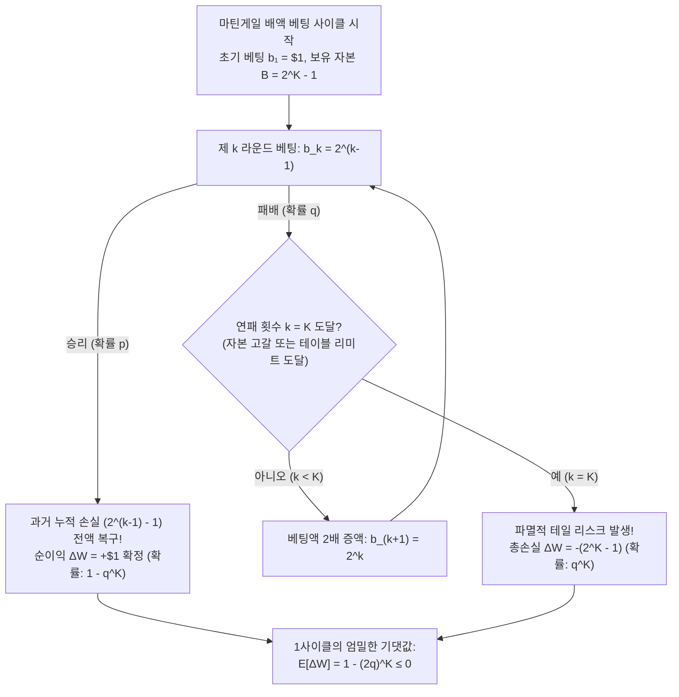
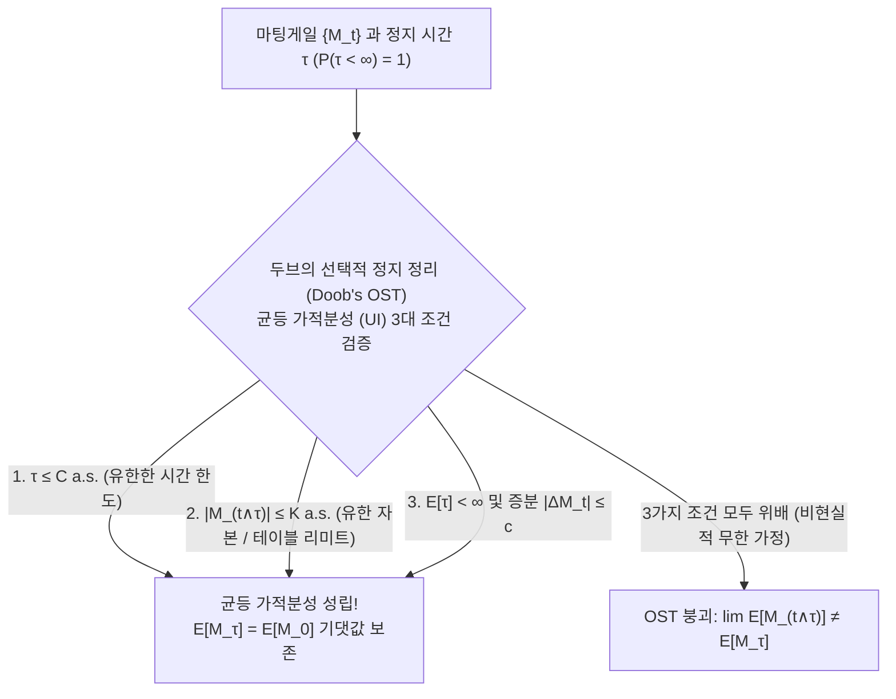

## 서론: 18세기 카지노를 매혹시킨 ‘절대 지지 않는 베팅법’의 신화

1754년 베네치아의 카지노. 전설적인 모험가이자 작가인 <strong>자코모 카사노바(Giacomo Casanova)</strong>는 회고록 《내 인생의 이야기》에서 애인의 다이아몬드를 담보로 거금을 마련한 뒤, 질 때마다 판돈을 두 배로 올리는 <strong>마틴게일 배액 베팅법(Martingale Doubling Strategy)</strong>으로 ‘파로(Faro)’ 카드 게임에 도전한 일화를 기록했다. 처음 며칠간 금화를 쓸어 담던 카사노바는 어느 날 오후 악마 같은 연패의 파도를 만나 단 몇 시간 만에 5,000체키노를 모두 잃고 파산했다. 1891년 모나코 몬테카를로 카지노에서 똑같이 공격적인 배액 베팅으로 테이블 예비 자금을 12번이나 바닥내며 ‘몬테카를로의 은행을 파산시킨 사나이’로 불렸던 <strong>찰스 웰스(Charles Wells)</strong> 역시, 이듬해 대수의 법칙에 짓눌려 전 재산을 잃고 1922년 파리에서 무일푼으로 생을 마감했다.

왜 수많은 도박사와 지식인, 그리고 현대의 외환(FX)·암호화폐 트레이더들까지 이 배액 베팅법의 마력에 빠져 예외 없이 파멸했을까?

승리 확률이 $p \in (0, 1)$, 패배 확률이 $q = 1 - p$ 인 $1:1$ 배당 게임에서 첫 판에 $\$1$를 걸고, 질 때마다 $\$2, \$4, \$8, \dots, \$2^{k-1}$로 판돈을 두 배씩 올린다고 하자. $k-1$번 연속으로 진 뒤 $k$번째 라운드에서 마침내 첫 승리를 거두는 순간, 순이익 $\Delta W$는 다음과 같다:

$$\Delta W = 2^{k-1} - \sum_{j=0}^{k-2} 2^j = 2^{k-1} - (2^{k-1} - 1) = +\$1$$

몇 번을 연패하든 <strong>단 한 번만 이기면 이전의 모든 누적 손실을 완벽히 복구하고 반드시 $+\$1$의 순이익이 남는다!</strong> 게다가 영원히 지기만 할 확률은 $\lim_{k \to \infty} q^k = 0$ 이므로, 언젠가 첫 승리를 거둘 확률은 $1$($100\%$)이다. 그렇다면 왜 이 완벽해 보이는 $+\$1$ 확정 수익 기계가 현실에서는 반드시 파산할까?

---

## 제1장: 마틴게일 배액 베팅의 해부 — 유한한 자본과 탈레브의 ‘증기 롤러’

### 1.1 기하급수적으로 폭발하는 요구 자본과 테이블 리미트

현실의 모든 플레이어는 유한한 자본(Bankroll) $B$만을 가지며, 모든 카지노는 최대 베팅 한도(<strong>테이블 리미트, Table Limit</strong>)를 설정한다. 최대 $K$번의 연속 베팅을 감당하기 위해 필요한 누적 총자본 $B_K$는 다음과 같다:

$$B_K = \sum_{j=0}^{K-1} 2^j = 2^K - 1$$

단 1사이클에서 가능한 결과는 두 가지뿐이다: 확률 $1 - q^K$로 $K$번째 이내에 승리하여 $+\$1$를 얻거나, 확률 $q^K$로 $K$번 모두 패배하여 $-\$(2^K - 1)$의 파멸적 손실을 입는 것이다. 따라서 1사이클의 정확한 기댓값 $\mathbb{E}[\Delta W]$는 다음과 같이 유도된다:

$$\mathbb{E}[\Delta W] = (+1) \cdot (1 - q^K) - (2^K - 1) q^K = 1 - (2q)^K \le 0 \quad \left(q \ge \frac{1}{2}\text{ 일 때}\right)$$

- <strong>공정한 게임 ($p = q = 1/2$)</strong>: $2q = 1$ 이므로 자본 한도 $K$가 얼마이든 <strong>기댓값은 정확히 $\mathbb{E}[\Delta W] = 0$</strong> 이다! 또한 무제한 게임에서 $+\$1$를 얻기 위해 필요한 마지막 베팅액의 기댓값은 $\mathbb{E}[2^{\tau-1}] = \sum_{k=1}^\infty 2^{k-1}(1/2)^k = +\infty$ 로 발산한다.
- <strong>하우스 엣지가 있는 카지노 게임 ($q > 1/2$)</strong>: $2q > 1$ 이므로 $\mathbb{E}[\Delta W] = 1 - (2q)^K < 0$ 이며, <strong>보유 자본 $K$가 클수록 1사이클당 기대 손실이 오히려 기하급수적으로 커진다!</strong>

<strong>나심 니콜라스 탈레브(Nassim Nicholas Taleb)</strong>가 지적했듯, 마틴게일 전략은 평온한 랜덤 워크를 <strong>“증기 롤러 앞에서 동전 줍기(Picking up pennies in front of a steamroller)”</strong>라는 극단적 음의 왜도(Negative Skewness / 꼬리 위험) 분포로 바꿀 뿐이다.

| 연패 라운드 $k$ | 제 $k$ 회 베팅액 $b_k = 2^{k-1}$ | 필요 누적 자본 $B_k = 2^k - 1$ | 승리 시 순이익 | $k$ 연패 확률 $q^k$ (동전 던지기 $q=0.5$) | $k$ 연패 확률 $q^k$ (유럽식 룰렛 $q=19/37$) |
| :--- | :--- | :--- | :--- | :--- | :--- |
| $k = 1$ | $\$1$ | $\$1$ | $+\$1$ | $50.000\%$ | $51.351\%$ |
| $k = 5$ | $\$16$ | $\$31$ | $+\$1$ | $3.125\%$ | $3.570\%$ |
| $k = 10$ | $\$512$ | $\$1,023$ | $+\$1$ | $0.0977\%$ ($1,024$회 중 $1$회) | $0.1276\%$ ($784$회 중 $1$회) |
| $k = 20$ | $\$524,288$ | $\$1,048,575$ | $+\$1$ | $0.000095\%$ | $0.000163\%$ |

---

## 제2장: 호이겐스와 파스칼의 ‘도박꾼의 파산 문제(1657)’ — 흡수벽 랜덤 워크와 엄밀해

도박꾼이 초기 자본 $X_0 = k$ 단위를 가지고 $N - k$ 단위를 가진 카지노를 상대로 매번 $1$ 단위씩 정액 베팅할 때(흡수벽 $0$과 $N$), 파산($0$)하기 전에 목표 금액 $N$에 도달할 확률 $P_k = \mathbb{P}(X_\tau = N \mid X_0 = k)$는 다음의 <strong>2계 제차 선형 차분방정식</strong>을 만족한다:

$$P_k = p P_{k+1} + q P_{k-1}, \qquad P_0 = 0, \quad P_N = 1$$

$P_{j+1} - P_j = (q/p)^j P_1$ 의 망원급수(Telescoping Sum) 합을 통해 두 가지 경우의 닫힌 해(Closed-form solution)를 얻는다:

$$P_k = \begin{cases} \dfrac{k}{N} & \text{if } p = q = \dfrac{1}{2} \;\text{(공정한 게임 / Fair Game)} \\[10pt] \dfrac{1 - (q/p)^k}{1 - (q/p)^N} & \text{if } p \ne q \;\text{(편향된 게임 / Biased Game)} \end{cases}$$

### 두 가지 충격적인 수학적 귀결:
1. <strong>무한한 자본을 가진 카지노($N \to \infty$)를 상대로 하면, 100% 공정한 게임($p = 1/2$)에서도 반드시 파산한다!</strong>
   $\lim_{N \to \infty} R_k = \lim_{N \to \infty} (1 - k/N) = 1$ (<strong>$100\%$ 확정적 파산</strong>). 1차원 대칭 랜덤 워크의 영재귀성(Null Recurrence) 때문에 언젠가 반드시 흡수벽 $0$에 도달한다.
2. <strong>룰렛의 지수함수 장벽 ($99.997\%$의 파산 확률)</strong>:
   $\$100$를 들고 $\$1$씩 베팅하여 $\$200$로 두 배 증식을 시도할 때($k = 100, N = 200$), $P_{100} = \frac{1}{1 + (q/p)^{100}}$ 이다. 유럽식 룰렛($p = 18/37, q/p = 19/18$)에서는 성공 확률이 고작 $0.448\%$($99.55\%$ 파산; $\$0.50$ 단위 베팅 시 <strong>$99.998\%$ 파산</strong>)이며, 미국식 룰렛($p = 18/38, q/p = 10/9$)에서는 무려 <strong>$99.997\%$의 확률로 실패</strong>한다! <strong>두빈스-새비지 정리(Dubins-Savage Theorem, 1965)</strong>에 의해 불리한 게임($p < 1/2$)에서는 한 번에 전액을 거는 <strong>대담한 플레이(Bold Play)</strong>가 최적이다.

---

## 제3장: 폴 레비와 조지프 두브의 마팅게일 이론 및 선택적 정지 정리(OST)

필트레이션 $\{\mathcal{F}_t\}_{t \ge 0}$ 에 적응된 가적분 확률과정 $\{M_t\}_{t \ge 0}$ ($\mathbb{E}[|M_t|] < \infty$)는 $\mathbb{E}[M_{t+1} \mid \mathcal{F}_t] = M_t$ 일 때 <strong>마팅게일(Martingale)</strong>, $\ge M_t$ 일 때 <strong>서브마팅게일(Submartingale)</strong>, $\le M_t$ 일 때 <strong>슈퍼마팅게일(Supermartingale)</strong>이라 정의된다. 임의의 예측 가능한 베팅 전략 $H_k \in \mathcal{F}_{k-1}$ 에 대한 <strong>이산 확률적분(마팅게일 변환)</strong> $(H \cdot M)_n = \sum_{k=1}^n H_k (M_k - M_{k-1})$ 은 공정한 게임을 절대 이길 수 없음을 증명한다.

<strong>두브의 선택적 정지 정리(Doob's Optional Stopping Theorem, OST)</strong>: 정지 시간 $\tau$ 에 대해 $\mathbb{E}[M_\tau] = \mathbb{E}[M_0]$ 가 성립할 필요충분조건은 $\{M_{t \wedge \tau}\}$ 의 <strong>균등 가적분성(Uniform Integrability)</strong>이며, 이는 다음 <strong>세 가지 충분조건 중 하나 이상</strong>이 만족될 때 보장된다:
1. $\tau$ 가 거의 확실히 유계($\tau \le C < \infty$)이거나,
2. $|M_{t \wedge \tau}| \le K < \infty$ 가 균등 유계(유한한 자본 한도!)이거나,
3. $\mathbb{E}[\tau] < \infty$ 이고 조건부 증분 $\mathbb{E}[|M_{t+1} - M_t| \mid \mathcal{F}_t] \le c < \infty$ 가 유계일 때.

마지막으로 공정한 게임($p = 1/2$)에서 이차 마팅게일 $M_t = X_t^2 - t$ 와 OST를 적용하면 <strong>파산까지의 기대 지속 시간</strong>을 단번에 얻는다:

$$\mathbb{E}[X_\tau^2 - \tau] = k^2 \implies \mathbb{E}[\tau] = k(N - k)$$

무한한 카지노($N \to \infty$)를 상대로 하면 $\mathbb{E}[\tau] = \infty$ 가 되어, <strong>파산 확률은 $100\%$이지만 파산할 때까지 걸리는 기대 시간은 무한대</strong>가 된다! 편향된 게임($p \ne q$)에서는 <strong>발트의 항등식(Wald's Identity)</strong>에 의해 $\mathbb{E}[\tau] = \frac{k - N P_k}{q - p}$ 가 도출된다.
