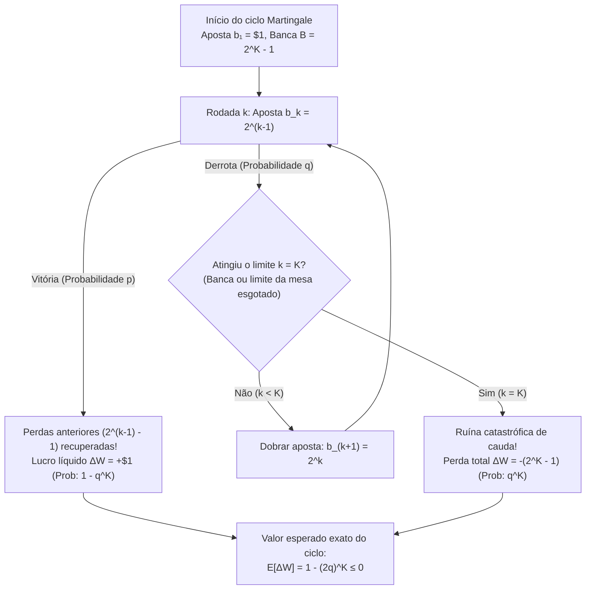
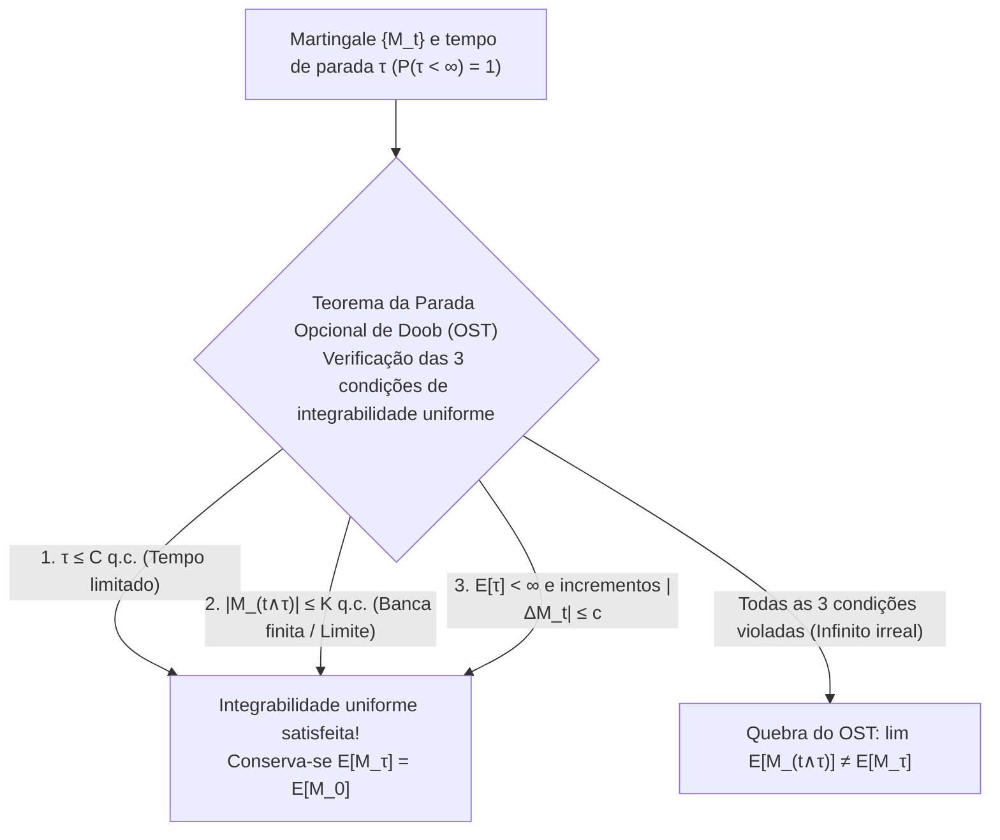

## Introdução: O sedutor mito dos cassinos do século XVIII

Em 1754, nos salões de Veneza, <strong>Giacomo Casanova</strong> tentou derrotar o jogo de *Faro* usando a famosa <strong>estratégia Martingale</strong> — dobrando sua aposta após cada derrota. Depois de empenhar os diamantes de sua amante, uma sequência de perdas destruiu todo o seu capital de 5.000 sequim em uma única tarde. Em 1891, <strong>Charles Wells</strong> («o homem que quebrou a banca em Monte Carlo») viveu uma ilusão semelhante na roleta antes de perder toda a sua fortuna e morrer sem um tostão em Paris em 1922.

Em um jogo binário com pagamento $1:1$, probabilidade de vitória $p \in (0, 1)$ e de derrota $q = 1 - p$, você aposta $\$1$ na rodada $1$; se perder, aposta $\$2, \$4, \$8, \dots, \$2^{k-1}$. Na primeira vez em que vence na rodada $k$, seu lucro líquido é:

$$\Delta W = 2^{k-1} - \sum_{j=0}^{k-2} 2^j = 2^{k-1} - (2^{k-1} - 1) = +\$1$$

Como a probabilidade de perder para sempre é $\lim_{k \to \infty} q^k = 0$, parece uma máquina garantida de $+\$1$ com probabilidade $1$! Por que essa estratégia entra em colapso?

---

## 1. A armadilha da banca finita e o «rolo compressor» de Taleb

Qualquer jogador real possui uma banca finita $B$ (ou limite de mesa do cassino) capaz de suportar no máximo $K$ derrotas consecutivas, exigindo um capital total de:

$$B_K = \sum_{j=0}^{K-1} 2^j = 2^K - 1$$

Em um único ciclo, você ganha $+\$1$ com probabilidade $1 - q^K$ ou sofre uma ruína catastrófica de $-\$(2^K - 1)$ com probabilidade $q^K$, resultando no valor esperado exato:

$$\mathbb{E}[\Delta W] = 1 \cdot (1 - q^K) - (2^K - 1) q^K = 1 - (2q)^K \le 0 \quad \left(\text{para } q \ge \frac{1}{2}\right)$$

- <strong>Jogo justo ($p = q = 1/2$)</strong>: $2q = 1 \implies \mathbb{E}[\Delta W] = 0$ para qualquer $K$, enquanto a aposta máxima esperada sem limite é infinita: $\mathbb{E}[2^{\tau-1}] = \sum_{k=1}^\infty 2^{k-1}(1/2)^k = \infty$.
- <strong>Jogo de cassino ($q > 1/2$)</strong>: $2q > 1 \implies \mathbb{E}[\Delta W] = 1 - (2q)^K < 0$, tornando-se exponencialmente pior quanto maior for a sua banca $K$!

Isso converte um passeio aleatório suave no que <strong>Nassim Nicholas Taleb</strong> chama de <strong>«catar moedas na frente de um rolo compressor»</strong> (assimetria negativa extrema / risco de cauda).

| Sequência de derrotas $k$ | Aposta $b_k = 2^{k-1}$ | Banca necessária $B_k = 2^k - 1$ | Lucro ao vencer | Probabilidade $q^k$ (Moeda $q=0.5$) | Probabilidade $q^k$ (Roleta $q=19/37$) |
| :--- | :--- | :--- | :--- | :--- | :--- |
| $k = 1$ | $\$1$ | $\$1$ | $+\$1$ | $50,000\%$ | $51,351\%$ |
| $k = 5$ | $\$16$ | $\$31$ | $+\$1$ | $3,125\%$ | $3,570\%$ |
| $k = 10$ | $\$512$ | $\$1.023$ | $+\$1$ | $0,098\%$ ($1$ em $1.024$) | $0,128\%$ ($1$ em $784$) |
| $k = 20$ | $\$524.288$ | $\$1.048.575$ | $+\$1$ | $0,000095\%$ | $0,000163\%$ |

---

## 2. O problema da ruína do jogador de Huygens e Pascal (1657)

Um jogador começa com $k$ unidades contra um cassino com $N - k$ unidades (barreiras absorventes em $0$ e $N$), ganhando $+1$ com probabilidade $p$ e perdendo $-1$ com probabilidade $q = 1 - p$. A probabilidade de vitória $P_k = \mathbb{P}(X_\tau = N \mid X_0 = k)$ satisfaz a equação de diferenças linear de segunda ordem:

$$P_k = p P_{k+1} + q P_{k-1}, \qquad P_0 = 0, \quad P_N = 1$$

Pela soma telescópica de $P_{j+1} - P_j = (q/p)^j P_1$, derivamos ambas as soluções exatas em forma fechada:

$$P_k = \begin{cases} \dfrac{k}{N} & \text{se } p = q = \dfrac{1}{2} \;\text{(Jogo justo)} \\[10pt] \dfrac{1 - (q/p)^k}{1 - (q/p)^N} & \text{se } p \ne q \;\text{(Jogo enviesado)} \end{cases}$$

### Consequências devastadoras:
1. <strong>Ruína de 100% contra um cassino infinitamente rico ($N \to \infty$)</strong>:
   Mesmo em um <strong>jogo 100% justo ($p = 1/2$)</strong>, a probabilidade de ruína eventual é $\lim_{N \to \infty} (1 - k/N) = 1$ (<strong>100% de ruína certa</strong>).
2. <strong>A parede exponencial na roleta</strong>:
   Tentar dobrar $k = \$100$ para $N = \$200$ via apostas de $\$1$ fornece $P_{100} = \frac{1}{1 + (q/p)^{100}}$. Na roleta europeia ($p = 18/37$), a chance de sucesso é de apenas $0,448\%$ ($99,55\%$ de ruína; e <strong>$99,998\%$</strong> com apostas de $\$0,50$), e na roleta americana ($p = 18/38, q/p = 10/9$), falha com probabilidade de <strong>$99,997\%$</strong>! Pelo teorema de <strong>Dubins e Savage (1965)</strong>, a aposta ousada (*Bold Play*) é ótima quando $p < 1/2$.

---

## 3. Teoria dos Martingales de Lévy e Doob e o Teorema da Parada Opcional

Dada uma filtração $\{\mathcal{F}_t\}_{t \ge 0}$, um processo adaptado integrável $\{M_t\}_{t \ge 0}$ ($\mathbb{E}[|M_t|] < \infty$) é um <strong>Martingale</strong> se $\mathbb{E}[M_{t+1} \mid \mathcal{F}_t] = M_t$, um <strong>Submartingale</strong> se $\ge M_t$, e um <strong>Supermartingale</strong> se $\le M_t$. A <strong>integral estocástica discreta (transformada de martingale)</strong> $(H \cdot M)_n = \sum_{k=1}^n H_k (M_k - M_{k-1})$ prova que nenhuma estratégia previsível $H_k \in \mathcal{F}_{k-1}$ pode vencer um jogo justo.

O <strong>Teorema da Parada Opcional de Doob (OST)</strong> afirma que para um tempo de parada $\tau$, $\mathbb{E}[M_\tau] = \mathbb{E}[M_0]$ vale <strong>se e somente se</strong> $\{M_{t \wedge \tau}\}$ for uniformemente integrável, o que é garantido se <strong>pelo menos uma</strong> das três condições for satisfeita:
1. $\tau$ é limitado quase certamente ($\tau \le C < \infty$), OU
2. $|M_{t \wedge \tau}| \le K < \infty$ é uniformemente limitado (banca finita), OU
3. $\mathbb{E}[\tau] < \infty$ e $\mathbb{E}[|M_{t+1} - M_t| \mid \mathcal{F}_t] \le c < \infty$.

Por fim, usando a <strong>Identidade de Wald</strong> e o martingale quadrático $M_t = X_t^2 - t$ no jogo justo ($p = 1/2$), obtemos imediatamente a <strong>duração esperada até a ruína</strong>:

$$\mathbb{E}[X_\tau^2 - \tau] = k^2 \implies \mathbb{E}[\tau] = k(N - k)$$

Quando $N \to \infty$, $\mathbb{E}[\tau] = \infty$: a ruína ocorre com $100\%$ de certeza, mas o tempo esperado até a ruína é infinito! Para $p \ne q$, a identidade de Wald fornece $\mathbb{E}[\tau] = \frac{k - N P_k}{q - p}$.
