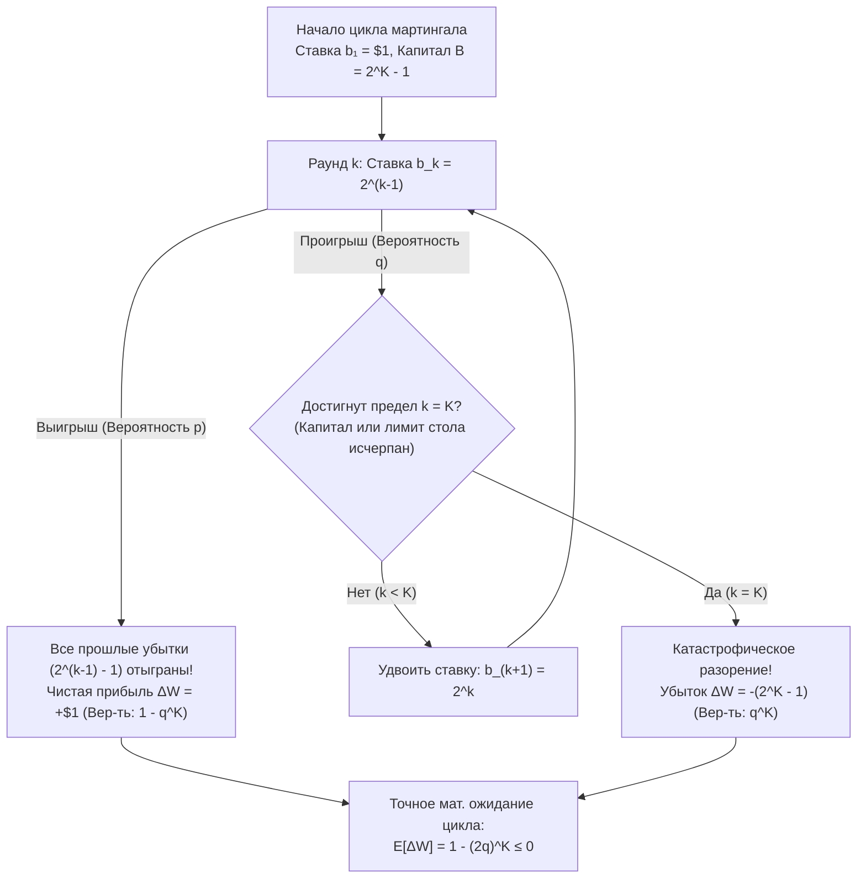
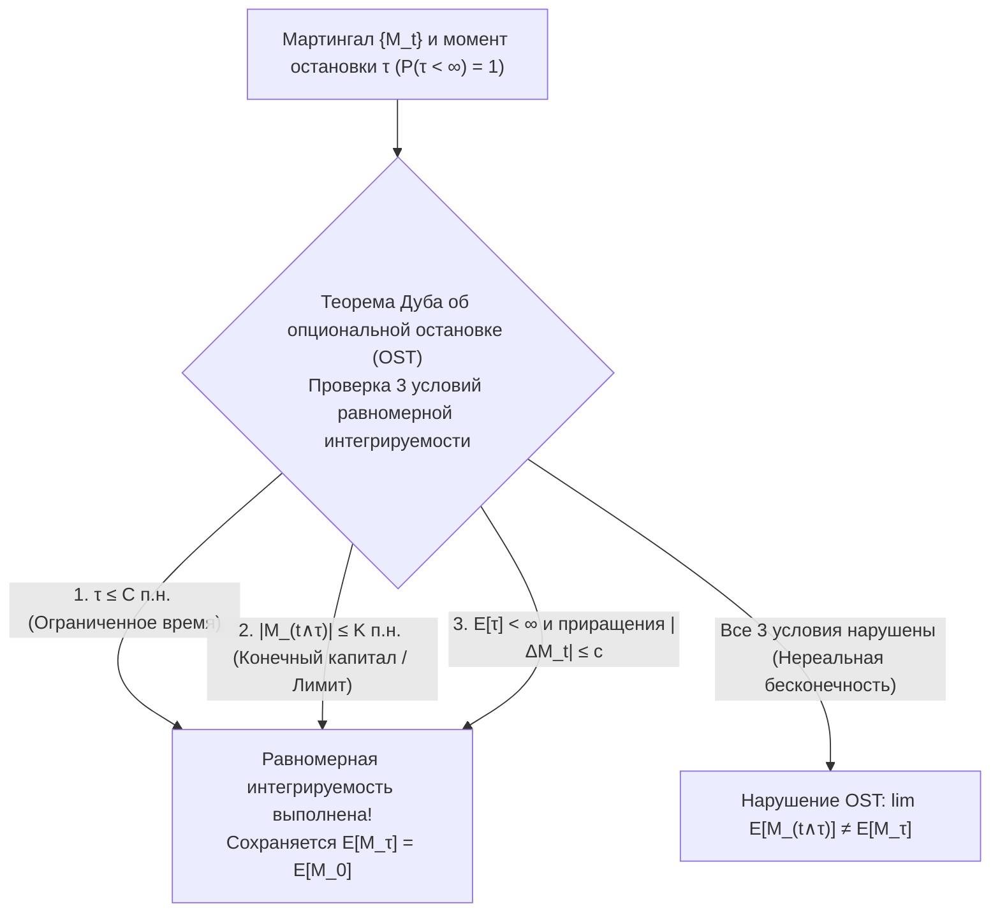

## Введение: Соблазнительный миф казино XVIII века

В 1754 году в игорных домах Венеции <strong>Джакомо Казанова</strong> пытался обыграть банк в карточной игре *фараон*, удваивая ставку после каждого проигрыша (<strong>система мартингал</strong>). Заложив бриллианты своей возлюбленной, он за один день попал в полосу неудач и потерял все 5000 цехинов. В 1891 году <strong>Чарльз Уэллс</strong> («человек, который сорвал банк в Монте-Карло») пережил аналогичный триумф на рулетке, но при повторной попытке потерял всё состояние и умер в нищете в Париже в 1922 году.

В бинарной игре с выплатой $1:1$, вероятностью выигрыша $p \in (0, 1)$ и проигрыша $q = 1 - p$ игрок ставит $\$1$, а после каждого проигрыша удваивает ставку: $\$2, \$4, \$8, \dots, \$2^{k-1}$. Как только на $k$-м шаге случается первый выигрыш, чистая прибыль составляет:

$$\Delta W = 2^{k-1} - \sum_{j=0}^{k-2} 2^j = 2^{k-1} - (2^{k-1} - 1) = +\$1$$

Поскольку вероятность проигрывать вечно равна $\lim_{k \to \infty} q^k = 0$, стратегия выглядит как гарантированная машина по извлечению $+\$1$ с вероятностью $1$! В чём же кроется математический подвох?

---

## 1. Ловушка конечного капитала и «паровой каток» Талеба

Любой реальный игрок обладает конечным капиталом $B$ (или ограничен лимитом стола казино), способным выдержать не более $K$ проигрышей подряд, что требует суммарного банка:

$$B_K = \sum_{j=0}^{K-1} 2^j = 2^K - 1$$

В одном цикле возможны лишь два исхода: выигрыш $+\$1$ с вероятностью $1 - q^K$ или катастрофическое разорение $-\$(2^K - 1)$ с вероятностью $q^K$. Точное математическое ожидание изменения капитала равно:

$$\mathbb{E}[\Delta W] = 1 \cdot (1 - q^K) - (2^K - 1) q^K = 1 - (2q)^K \le 0 \quad \left(\text{при } q \ge \frac{1}{2}\right)$$

- <strong>Честная игра ($p = q = 1/2$)</strong>: $2q = 1 \implies \mathbb{E}[\Delta W] = 0$ при любом $K$, а ожидаемая максимальная ставка без лимита бесконечна: $\mathbb{E}[2^{\tau-1}] = \sum_{k=1}^\infty 2^{k-1}(1/2)^k = \infty$.
- <strong>Игра с преимуществом казино ($q > 1/2$)</strong>: $2q > 1 \implies \mathbb{E}[\Delta W] = 1 - (2q)^K < 0$ — чем больше ваш запас капитала $K$, тем сильнее (экспоненциально!) растёт ваш ожидаемый убыток за цикл!

По выражению <strong>Нассима Николаса Талеба</strong>, мартингал превращает обычное случайное блуждание в <strong>«собирание пенсов перед паровым катком»</strong> (экстремальная отрицательная асимметрия / хвостовой риск).

| Серия поражений $k$ | Ставка $b_k = 2^{k-1}$ | Требуемый банк $B_k = 2^k - 1$ | Прибыль при победе | Вероятность $q^k$ (Монета $q=0.5$) | Вероятность $q^k$ (Рулетка $q=19/37$) |
| :--- | :--- | :--- | :--- | :--- | :--- |
| $k = 1$ | $\$1$ | $\$1$ | $+\$1$ | $50,000\%$ | $51,351\%$ |
| $k = 5$ | $\$16$ | $\$31$ | $+\$1$ | $3,125\%$ | $3,570\%$ |
| $k = 10$ | $\$512$ | $\$1\,023$ | $+\$1$ | $0,098\%$ ($1$ из $1\,024$) | $0,128\%$ ($1$ из $784$) |
| $k = 20$ | $\$524\,288$ | $\$1\,048\,575$ | $+\$1$ | $0,000095\%$ | $0,000163\%$ |

---

## 2. Задача о разорении игрока Гюйгенса и Паскаля (1657)

Игрок начинает с капиталом $k$ единиц против казино с $N - k$ единицами (поглощающие экраны в $0$ и $N$), выигрывая $+1$ с вероятностью $p$ и теряя $-1$ с вероятностью $q = 1 - p$. Вероятность успеха $P_k = \mathbb{P}(X_\tau = N \mid X_0 = k)$ удовлетворяет линейному разностному уравнению второго порядка:

$$P_k = p P_{k+1} + q P_{k-1}, \qquad P_0 = 0, \quad P_N = 1$$

Телескопическое суммирование $P_{j+1} - P_j = (q/p)^j P_1$ даёт точные аналитические решения:

$$P_k = \begin{cases} \dfrac{k}{N} & \text{если } p = q = \dfrac{1}{2} \;\text{(Честная игра)} \\[10pt] \dfrac{1 - (q/p)^k}{1 - (q/p)^N} & \text{если } p \ne q \;\text{(Несимметричная игра)} \end{cases}$$

### Разрушительные следствия:
1. <strong>100%-ное разорение против бесконечно богатого казино ($N \to \infty$)</strong>:
   Даже в <strong>абсолютно честной игре ($p = 1/2$)</strong> вероятность разорения равна $\lim_{N \to \infty} (1 - k/N) = 1$ (<strong>гарантированное банкротство с вероятностью 100%</strong>).
2. <strong>Экспоненциальная стена в рулетке</strong>:
   Попытка удвоить $k = \$100$ до $N = \$200$ ставками по $\$1$ даёт $P_{100} = \frac{1}{1 + (q/p)^{100}}$. В европейской рулетке ($p = 18/37$) шанс успеха равен всего $0,448\%$ ($99,55\%$ разорения; а при ставках по $\$0,50$ — <strong>$99,998\%$</strong>), а в американской рулетке ($p = 18/38, q/p = 10/9$) провал происходит с вероятностью <strong>$99,997\%$</strong>! Согласно теореме <strong>Дубинса и Сэвиджа (1965)</strong>, при $p < 1/2$ оптимальна смелая игра (*Bold Play* — ставить всё сразу).

---

## 3. Теория мартингалов Леви и Дуба и теорема об опциональной остановке

Пусть $\{\mathcal{F}_t\}_{t \ge 0}$ — фильтрация. Адаптированный интегрируемый процесс $\{M_t\}_{t \ge 0}$ ($\mathbb{E}[|M_t|] < \infty$) называется <strong>мартингалом</strong>, если $\mathbb{E}[M_{t+1} \mid \mathcal{F}_t] = M_t$, <strong>субмартингалом</strong> ($\ge M_t$) и <strong>супермартингалом</strong> ($\le M_t$). <strong>Дискретный стохастический интеграл (преобразование мартингала)</strong> $(H \cdot M)_n = \sum_{k=1}^n H_k (M_k - M_{k-1})$ доказывает, что никакая предсказуемая стратегия $H_k \in \mathcal{F}_{k-1}$ не способна обыграть честную игру.

<strong>Теорема Дуба об опциональной остановке (OST)</strong> гласит: для момента остановки $\tau$ равенство $\mathbb{E}[M_\tau] = \mathbb{E}[M_0]$ выполняется <strong>тогда и только тогда</strong>, когда семейство $\{M_{t \wedge \tau}\}$ равномерно интегрируемо, что гарантируется при выполнении <strong>хотя бы одного</strong> из трёх условий:
1. $\tau$ ограничен почти наверное ($\tau \le C < \infty$), ИЛИ
2. $|M_{t \wedge \tau}| \le K < \infty$ равномерно ограничен (конечный капитал!), ИЛИ
3. $\mathbb{E}[\tau] < \infty$ и $\mathbb{E}[|M_{t+1} - M_t| \mid \mathcal{F}_t] \le c < \infty$.

Наконец, используя <strong>тождество Вальда</strong> и квадратичный мартингал $M_t = X_t^2 - t$ в честной игре ($p = 1/2$), мы мгновенно получаем <strong>ожидаемую продолжительность игры до разорения</strong>:

$$\mathbb{E}[X_\tau^2 - \tau] = k^2 \implies \mathbb{E}[\tau] = k(N - k)$$

При $N \to \infty$ получаем $\mathbb{E}[\tau] = \infty$: разорение происходит со $100\%$-ной вероятностью, но среднее время до разорения бесконечно! При $p \ne q$ тождество Вальда даёт $\mathbb{E}[\tau] = \frac{k - N P_k}{q - p}$.
