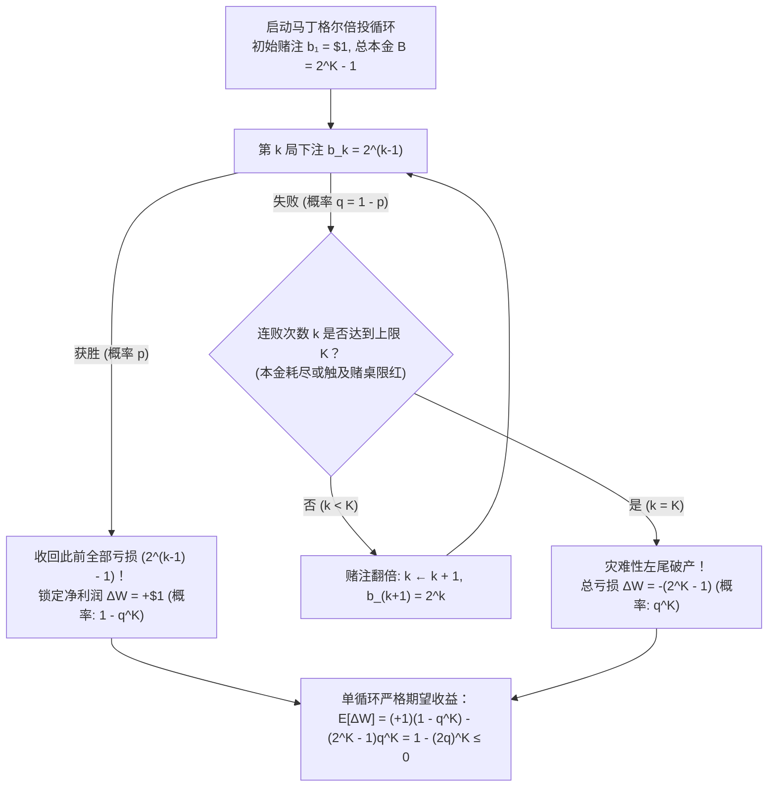
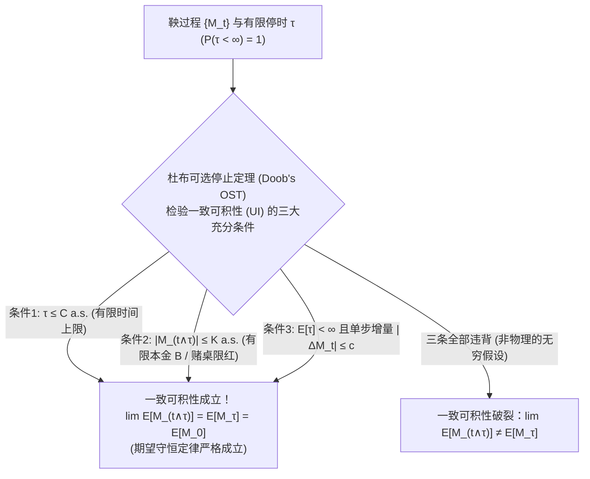

## 引言：18世纪赌场的诱人神话——“只要一直翻倍就绝不会输”？

1754年的威尼斯，传奇冒险家与作家<strong>贾科莫·卡萨诺瓦（Giacomo Casanova）</strong>在回忆录《我的一生》中记述了他在赌场玩“法罗（Faro）”纸牌时的惨痛经历。他典当了情人的钻石筹集巨资，采用当时欧洲贵族秘密流传的“必胜法则”——<strong>马丁格尔倍投策略（Martingale Doubling Strategy）</strong>：每输一局就将赌注翻倍。最初几天他赢取了大量金币，然而在一个灾难性的下午，一连串罕见的连败击穿了他的全部资金，使他在几小时内输光了5000金币。1891年夏天，英国投机客<strong>查尔斯·威尔斯（Charles Wells）</strong>在蒙特卡洛轮盘赌桌上同样使用激进的倍投法，11小时内12次赢光赌桌储备金（被称为“攻破蒙特卡洛银行的人”）；但当他次年重返赌场时，大数定律无情地收回了一切，他最终输光全部家产，于1922年在巴黎贫病交加地死去。

为什么几百年来无数赌徒、知识分子乃至现代量化外汇（FX）交易员与对冲基金都对“倍投法”深信不疑，最终却无一例外地走向毁灭？

原因在于其<strong>初等算术上看似无懈可击的完美性</strong>。考虑一个赔率为 $1:1$ 的二元博弈（如抛硬币或轮盘赌押红黑），单局获胜概率为 $p \in (0, 1)$，失败概率为 $q = 1 - p$。赌徒执行如下算法：
1. 第 $1$ 局下注 $\$1$；若获胜则净赚 $+\$1$ 并结束本轮循环。
2. 若第 $1$ 局失败，第 $2$ 局将赌注翻倍至 $\$2$。
3. 此后每输一局都将赌注翻倍：第 $3$ 局 $\$4$，第 $4$ 局 $\$8$，……，第 $k$ 局下注 $\$2^{k-1}$。
4. <strong>一旦在第 $k$ 局首次获胜，立即停止本轮循环</strong>，下一轮重新从 $\$1$ 开始。

假设赌徒在经历了前 $k-1$ 局连败后，终于在第 $k$ 局迎来首次获胜。前 $k-1$ 局的累计亏损总额为等比数列之和：

$$L_{k-1} = \sum_{j=0}^{k-2} 2^j = 2^{k-1} - 1$$

而第 $k$ 局获胜赢得的奖金为 $+2^{k-1}$。因此，在首次获胜的第 $k$ 局结束瞬间，赌徒在整个循环中的<strong>累计净利润 $\Delta W$</strong> 恒为：

$$\Delta W = 2^{k-1} - \sum_{j=0}^{k-2} 2^j = 2^{k-1} - (2^{k-1} - 1) = +\$1$$

无论你是在第 $1$ 局就赢（$k=1$），还是连输 $10$ 局后在第 $11$ 局才赢（$k=11$），抑或连输 $100$ 局后在第 $101$ 局获胜，<strong>只要赢下哪怕一次，此前所有的累计亏损都会被一笔勾销，并稳赚 $+\$1$ 的净利润！</strong>
而且，永远连输下去的概率是多少？由于单局失败概率 $q < 1$，连输 $k$ 局的概率为 $q^k$。当 $k \to \infty$ 时：

$$\lim_{k \to \infty} q^k = 0 \implies \mathbb{P}(\tau < \infty) = 1 - 0 = 1$$

也就是说，首次获胜的时刻 $\tau$ 几乎必然（以 $100\%$ 的概率）是有限的！既然每个循环都以概率 $1$ 净赚 $+\$1$，为什么这个“永动机”在现实中会彻底破产？

---

## 第一章：马丁格尔倍投陷阱的数学解剖——有限本金与塔勒布的“压路机”

### 1.1 指数级爆炸的本金需求与赌场限红（Table Limit）

“以概率 $1$ 稳赚 $+\$1$”的论证暗中偷换了两个不可能存在于现实物理世界的<strong>无穷大假设</strong>：赌徒拥有无限本金（$B = \infty$），且赌场允许无限大的下注额（$b_k \to \infty$）。

在现实中，任何个人或基金的本金都是有限的，而且全球所有赌场都设有严格的<strong>赌桌投注上限（限红，Table Limit）</strong>。假设赌徒的本金（或赌桌限红）最多只能支撑 <strong>$K$ 次连续下注</strong>。为了在连输 $K-1$ 次后还能摆出第 $K$ 局的赌注 $2^{K-1}$，赌徒必须拥有的<strong>初始总本金 $B_K$</strong> 为：

$$B_K = \sum_{j=0}^{K-1} 2^j = 2^K - 1$$

下表展示了随着连败局数 $k$ 的增加，所需赌注与累计本金如何呈指数级爆炸（对比公平硬币 $q = 0.5$ 与欧洲单零轮盘赌 $p = 18/37 \approx 0.4865, q = 19/37 \approx 0.5135$）：

| 连败局数 $k$ | 第 $k$ 局赌注 $b_k = 2^{k-1}$ | 所需累计总本金 $B_k = 2^k - 1$ | 获胜时净利润 | 连输 $k$ 局概率 $q^k$（公平硬币 $q=0.5$） | 连输 $k$ 局概率 $q^k$（欧洲轮盘 $q=19/37$） |
| :--- | :--- | :--- | :--- | :--- | :--- |
| $k = 1$ | $\$1$ | $\$1$ | $+\$1$ | $50.000\%$ | $51.351\%$ |
| $k = 5$ | $\$16$ | $\$31$ | $+\$1$ | $3.125\%$ | $3.570\%$ |
| $k = 10$ | $\$512$ | $\$1,023$ | $+\$1$ | $0.0977\%$（每 $1,024$ 轮 $1$ 次） | $0.1276\%$（每 $784$ 轮 $1$ 次） |
| $k = 15$ | $\$16,384$ | $\$32,767$ | $+\$1$ | $0.00305\%$ | $0.00456\%$ |
| $k = 20$ | $\$524,288$ | $\$1,048,575$ | $+\$1$ | $0.000095\%$ | $0.000163\%$（每 $61$ 万轮 $1$ 次） |
| $k = 30$ | $\$536,870,912$ | $\$1,073,741,823$ | $+\$1$ | $9.31 \times 10^{-10}$ | $2.09 \times 10^{-9}$ |

### 1.2 有限本金容量 $K$ 下的单循环严格数学期望

当最大承受连败次数为 $K$（本金 $B = 2^K - 1$）时，单轮马丁格尔循环只有两种互斥结局：
1. <strong>成功（在前 $K$ 局内至少赢一次）</strong>：发生概率为 $1 - q^K$，净收益为 $+\$1$。
2. <strong>灾难性爆仓（连续 $K$ 局全部失败）</strong>：发生概率为 $q^K$，净亏损为 $-\$(2^K - 1)$。

因此，单轮循环财富变化量 $\Delta W$ 的严格数学期望为：

$$\mathbb{E}[\Delta W] = (+1) \cdot (1 - q^K) - (2^K - 1) q^K = 1 - q^K - 2^K q^K + q^K = 1 - (2q)^K \le 0 \quad \left(\text{当 } q \ge \frac{1}{2}\right)$$

这一核心公式揭示了三大铁律：
- <strong>公平博弈（$p = q = 1/2$）</strong>：此时 $2q = 1$，故 $\mathbb{E}[\Delta W] = 1 - 1^K = 0$。无论你的本金有多雄厚（无论 $K = 10$ 还是 $K = 100$），高概率的 $+\$1$ 微利与极小概率的 $-\$(2^K - 1)$ 巨额爆仓精确抵消，<strong>期望收益恒等于零</strong>！而且若不设上限（$K \to \infty$），为了赢取 $\$1$ 所需投入的期望最终赌注为无穷大：$\mathbb{E}[2^{\tau-1}] = \sum_{k=1}^\infty 2^{k-1}(1/2)^k = +\infty$。
- <strong>赌场优势博弈（$p < 1/2 \implies q > 1/2$）</strong>：此时 $2q > 1$，故 $\mathbb{E}[\Delta W] = 1 - (2q)^K < 0$。更可怕的是，<strong>你准备的本金 $K$ 越雄厚，单轮循环的期望亏损反而呈指数级恶化！</strong> 因为单轮期望总流水为 $\mathbb{E}[S_K] = \sum_{j=0}^{K-1} (2q)^j = \frac{(2q)^K - 1}{2q - 1}$，赌场对每一美元流水征收 $(2q - 1)$ 的赌场优势税。

正如《黑天鹅》作者<strong>纳西姆·尼古拉斯·塔勒布（Nassim Nicholas Taleb）</strong>所指出的，马丁格尔策略并未改变随机游走的期望漂移，而是对收益分布实施了极端的<strong>负偏度（Negative Skewness）扭曲</strong>——把原本对称的随机游走变成了<strong>“在压路机前捡硬币（Picking up pennies in front of a steamroller）”</strong>的尾部风险炸弹。1995年搞垮巴林银行的尼克·里森（Nick Leeson）和1998年破产的长期资本管理公司（LTCM），皆死于这一数学结构。

---

## 第二章：惠更斯与帕斯卡的“赌徒破产问题（1657）”——吸收壁随机游走与精确解

如果赌徒放弃危险的倍投法，改为每次只老老实实下注固定的 $\$1$ 单位（平注法，Flat Betting），结果又会如何？
这就是1656年帕斯卡向费马提出、并由<strong>克里斯蒂安·惠更斯（Christiaan Huygens）</strong>在1657年著作《论赌博中的计算》中正式发表的经典<strong>“赌徒破产问题（Gambler's Ruin Problem）”</strong>。

设赌徒初始本金为 $X_0 = k$ 单位，对手（赌场）拥有 $N - k$ 单位，系统总资金固定为 $N$（在 $0$ 和 $N$ 处设有两个<strong>吸收壁 / Absorbing Barriers</strong>）。每步赌徒以概率 $p$ 赢 $+1$，以概率 $q = 1 - p$ 输 $-1$，直至停时 $\tau = \inf\{t \ge 0 : X_t \in \{0, N\}\}$ 游戏结束。

记 $P_k = \mathbb{P}(X_\tau = N \mid X_0 = k)$ 为从本金 $k$ 出发、在破产归零前成功达到目标金额 $N$ 的获胜概率。由全概率公式与马尔可夫性（第一步分析法），$P_k$ 满足<strong>二阶常系数齐次线性差分方程</strong>：

$$P_k = p P_{k+1} + q P_{k-1} \quad (1 \le k \le N - 1), \qquad P_0 = 0, \quad P_N = 1$$

将左端写为 $(p + q) P_k$ 并移项整理，可得相邻差分满足等比关系：

$$p(P_{k+1} - P_k) = q(P_k - P_{k-1}) \implies P_{j+1} - P_j = \left(\frac{q}{p}\right)^j (P_1 - P_0) = \left(\frac{q}{p}\right)^j P_1$$

对 $j = 0, 1, \dots, k-1$ 进行裂项求和（望远镜求和），并代入上边界条件 $P_N = 1$，即可导出完整的精确闭合解：

$$P_k = \begin{cases} \dfrac{k}{N} & \text{若 } p = q = \dfrac{1}{2} \;\text{（公平博弈 / Fair Game）} \\[12pt] \dfrac{1 - (q/p)^k}{1 - (q/p)^N} & \text{若 } p \ne q \;\text{（有偏博弈 / Biased Game）} \end{cases}$$

### 精确解揭示的两大震撼推论：
1. <strong>面对无限富有的赌场（$N \to \infty$），即便在 $100\%$ 公平的博弈中也必将破产！</strong>
   在公平博弈（$p = q = 1/2$）中令赌场资金 $N \to \infty$（或者赌徒不设止盈上限一直赌下去）：

   $$\lim_{N \to \infty} P_k = \lim_{N \to \infty} \frac{k}{N} = 0 \implies \lim_{N \to \infty} R_k = \lim_{N \to \infty} \left(1 - \frac{k}{N}\right) = 1 \quad (100\%\text{ 必然破产！})$$

   由于一维对称简单随机游走具有<strong>零常返性（Null Recurrence）</strong>，其轨道振幅无界，必然会在某个有限时刻触碰下吸收壁 $X = 0$。仅仅是“有限本金对抗无限市场”这一边界不对称性，就足以保证 $100\%$ 的破产率！
2. <strong>微小的赌场优势构筑的指数级高墙（轮盘赌翻倍失败率高达 $99.997\%$）</strong>：
   假设你带着 $k = \$100$ 走进赌场，希望翻倍到 $N = \$200$ 就离场。若采取一把全押（<strong>大胆博弈 / Bold Play</strong>），在欧洲轮盘（$p = 18/37$）中成功率高达 <strong>$48.65\%$</strong>。
   但若你每次谨慎地下注 $\$1$（<strong>保守博弈 / Timid Play</strong>，$k = 100, N = 200$），成功概率变为 $P_{100} = \frac{1}{1 + (q/p)^{100}}$：
   - 在<strong>欧洲轮盘</strong>（$p = 18/37, q/p = 19/18 \approx 1.0556$）中，$(19/18)^{100} \approx 222.26$，成功率仅为 <strong>$0.448\%$</strong>（破产率 <strong>$99.552\%$</strong>；若每次押 $\$0.50$ 即 $k=200, N=400$，破产率高达 <strong>$99.998\%$</strong>）！
   - 在<strong>美式轮盘</strong>（$p = 18/38, q/p = 10/9 \approx 1.1111$）中，$(10/9)^{100} \approx 37,648.6$，成功率仅为 <strong>$0.00266\%$</strong>，<strong>破产概率高达惊人的 $99.9973\%$</strong>！这正是著名的<strong>杜宾斯-萨维奇定理（Dubins-Savage Theorem, 1965）</strong>：在负期望博弈中，分割赌注会激活大数定律，使你必死无疑；唯有尽量减少博弈次数的“大胆全押”才是最优策略。

---

## 第三章：保罗·莱维与约瑟夫·杜布的现代鞅论与可选停止定理（OST）

为了从根本上证明<strong>任何动态调整赌注的策略都无法战胜公平博弈</strong>，20世纪数学家<strong>保罗·莱维（Paul Lévy）</strong>与<strong>约瑟夫·杜布（Joseph Leo Doob）</strong>建立了现代测度论概率论的核心——<strong>鞅论（Martingale Theory）</strong>。

设 $(\Omega, \mathcal{F}, \{\mathcal{F}_t\}_{t \ge 0}, \mathbb{P})$ 为带信息流（Filtration）的概率空间，其中 $\mathcal{F}_t$ 代表截至时刻 $t$ 的全部历史信息。适应过程 $\{M_t\}_{t \ge 0}$ 若满足可积性 $\mathbb{E}[|M_t|] < \infty$，则称为：
- <strong>鞅（Martingale，公平博弈）</strong>：$\mathbb{E}[M_{t+1} \mid \mathcal{F}_t] = M_t$ a.s.
- <strong>下鞅（Submartingale，有利博弈）</strong>：$\mathbb{E}[M_{t+1} \mid \mathcal{F}_t] \ge M_t$ a.s.
- <strong>上鞅（Supermartingale，不利博弈）</strong>：$\mathbb{E}[M_{t+1} \mid \mathcal{F}_t] \le M_t$ a.s.

任何不具备预知未来能力的下注策略 $\{H_k\}$ 都必须是<strong>可预测过程（Predictable Process）</strong>，即第 $k$ 局的赌注只依赖于前 $k-1$ 局的历史信息（$H_k \in \mathcal{F}_{k-1}$）。赌徒在时刻 $n$ 的累计财富由<strong>离散随机积分（鞅变换 / Martingale Transform）</strong>给出：

$$W_n = W_0 + (H \cdot M)_n = W_0 + \sum_{k=1}^n H_k (M_k - M_{k-1})$$

由于 $\mathbb{E}[H_n (M_n - M_{n-1}) \mid \mathcal{F}_{n-1}] = H_n \mathbb{E}[M_n - M_{n-1} \mid \mathcal{F}_{n-1}] = 0$，<strong>鞅变换仍然是鞅</strong>，在任意确定性时刻 $n$ 恒有 $\mathbb{E}[W_n] = W_0 = 0$！

那么，为什么在随机停时 $\tau = \inf\{n \ge 1 : W_n = +1\}$ 处会出现 $\mathbb{E}[W_\tau] = +1 \ne 0 = \mathbb{E}[W_0]$ 的悖论？
<strong>杜布可选停止定理（Doob's Optional Stopping Theorem, OST）</strong>给出了终极解答：对于有限停时 $\tau$（$\mathbb{P}(\tau < \infty) = 1$），等式 $\mathbb{E}[M_\tau] = \mathbb{E}[M_0]$ 成立<strong>当且仅当</strong>停止过程族 $\{M_{t \wedge \tau}\}_{t \ge 0}$ <strong>一致可积（Uniformly Integrable, UI）</strong>，这在满足以下<strong>三个充分条件中的任意一条</strong>时必然成立：
1. <strong>停时有界</strong>：存在常数 $C < \infty$ 使得 $\mathbb{P}(\tau \le C) = 1$；或
2. <strong>停止过程有界</strong>：存在常数 $K < \infty$ 使得对所有 $t$ 有 $|M_{t \wedge \tau}| \le K$ a.s.（对应现实中的有限本金与限红！）；或
3. <strong>停时期望有限且条件增量有界</strong>：$\mathbb{E}[\tau] < \infty$ 且存在常数 $c < \infty$ 使得 $\mathbb{E}[|M_{t+1} - M_t| \mid \mathcal{F}_t] \le c$ a.s.

在无限制马丁格尔倍投中，虽然 $\mathbb{E}[\tau] = 2 < \infty$，但单步增量 $|W_{t+1} - W_t| = 2^t \to \infty$ 破坏了全部三条条件；一旦回到现实世界，有限本金立即触发<strong>条件2</strong>，将期望收益无情地拉回 $\mathbb{E}[W_{\tau \wedge K}] = 0$！

### 利用瓦尔德恒等式（Wald's Identity）与二次鞅秒解破产期望时间 $\mathbb{E}[\tau]$
在赌徒破产问题中，借助三个经典鞅与杜布可选停止定理，无需解差分方程即可瞬间导出全部结论：
1. <strong>线性鞅 $M_t^{(1)} = X_t$（当 $p=1/2$）</strong>：由 $\mathbb{E}[X_\tau] = N P_k = k \implies P_k = k/N$。
2. <strong>棣莫弗指数鞅 $M_t^{(2)} = (q/p)^{X_t}$（当 $p \ne q$）</strong>：由 $\mathbb{E}[(q/p)^{X_\tau}] = P_k (q/p)^N + (1 - P_k) = (q/p)^k \implies P_k = \frac{1 - (q/p)^k}{1 - (q/p)^N}$。
3. <strong>二次补偿鞅 $M_t^{(3)} = X_t^2 - t$（当 $p=1/2$）</strong>：由于 $\mathbb{E}[X_{t+1}^2 - (t+1) \mid \mathcal{F}_t] = X_t^2 + 1 - t - 1 = X_t^2 - t$，由可选停止定理得：

   $$\mathbb{E}[X_\tau^2 - \tau] = k^2 \implies \mathbb{E}[\tau] = N^2 \left(\frac{k}{N}\right) - k^2 = k(N - k)$$

   当赌场资金无限（$N \to \infty$）时，$\lim_{N \to \infty} \mathbb{E}[\tau] = \infty$：<strong>尽管破产以 $100\%$ 的概率发生（$\mathbb{P}(\tau < \infty) = 1$），但直到破产为止的期望时间却是无穷大（$\mathbb{E}[\tau] = \infty$，因此违背了条件3）！</strong> 而在有偏博弈（$p \ne q$）中，由<strong>瓦尔德恒等式</strong> $\mathbb{E}[X_\tau - k] = (p - q)\mathbb{E}[\tau]$ 可得 $\mathbb{E}[\tau] = \frac{k - N P_k}{q - p}$（当 $N \to \infty, q > p$ 时为 $\frac{k}{q - p}$）。在现代金融数学中，唯有当拥有正期望优势（$p > 1/2$）并采用按本金比例下注的<strong>凯利公式（Kelly Criterion, $f^* = p - q$）</strong>时，才能在实现零破产概率的同时最大化长期对数增长率。
